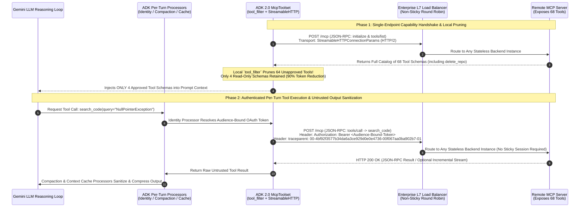
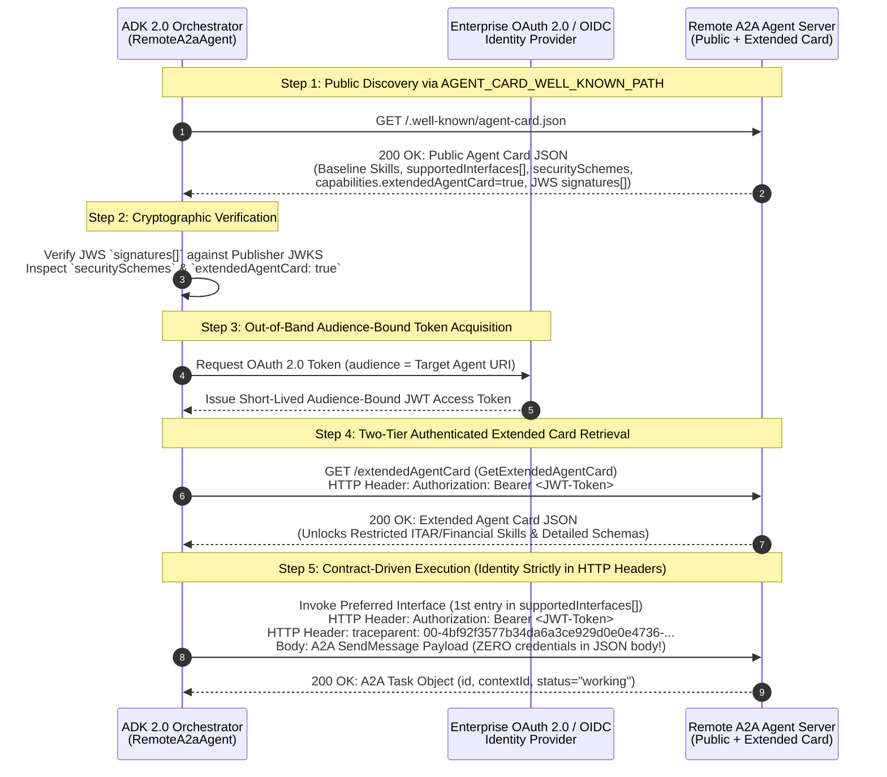
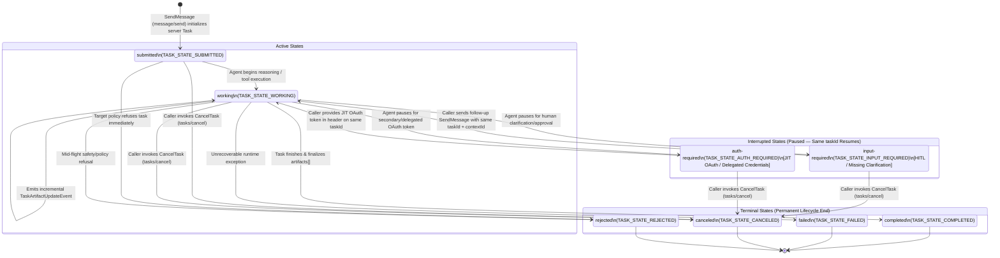
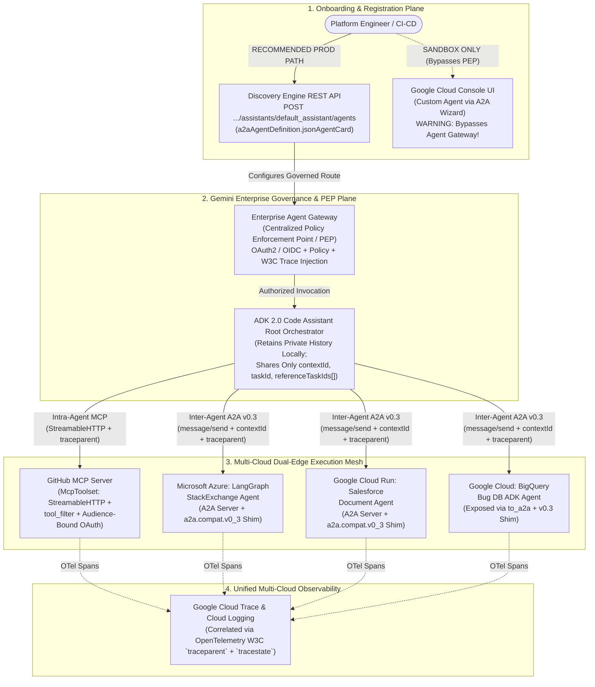
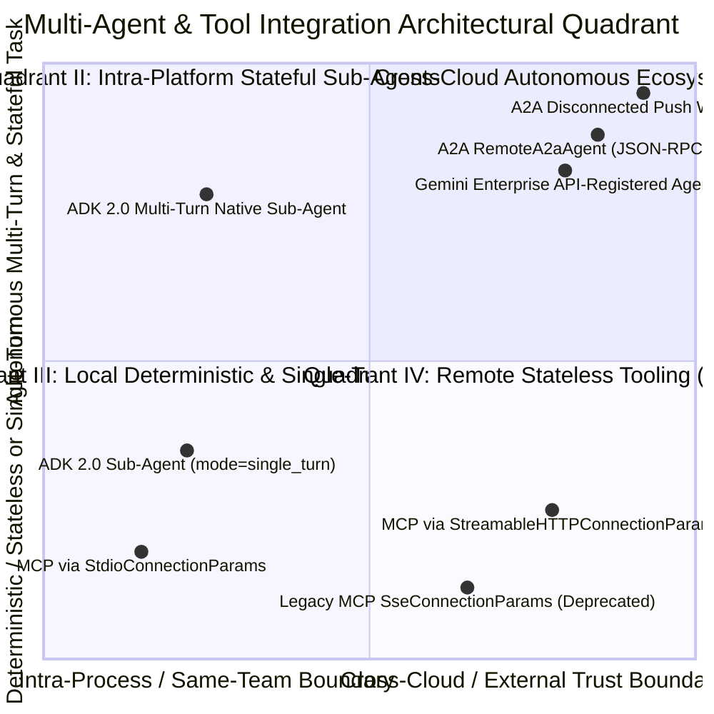

# OKF-L400-B2: A2A Protocol and Multi-Agent Mechanics — Google Open Knowledge Framework (OKF) Authoritative Reference (`L400_version_20261026_0350`)
**Topic Tags:** `#L400_version_20261026_0350` `#AgentToAgentProtocol` `#ModelContextProtocol` `#MultiAgentOrchestration` `#AgentDevelopmentKit` `#GeminiEnterprise` `#EnterpriseAgentGateway` `#AntigravityAgenticAI`

---

## 0. OKF Document Metadata & Topic Modeling Taxonomy
**Topic Tags:** `#OKFMetadata` `#TopicModelingTaxonomy` `#GCPKnowledgeCatalog` `#L400_version_20261026_0350`

> **OKF v0.2 Trust Signals, Bucket Merge & Enforced FDE Grading Rubric (`OKF-L400-21`):**
> - **Version Tag:** `L400_version_20261026_0350` | **Status (`status`):** `stable` (`VETTED` / `APPROVED`) | **TTL (`stale_after`):** `2027-04-26T00:00:00Z` *(Maintains existing TTL & version)* | **Verified (`verified`):** `true`
> - **Merged Bucket OKF Lineage:** Reconciled with `Concepts 01, 10, 15` in `gs://gea_agent_development_architectural_best_practices_1790796607` (`project=fivedaysai-prd-sandbox-317383`)
> - **Cloud FDE Prevailing Standard:** `https://g3doc.corp.google.com/company/teams/cloud-fde/index.md?cl=head`
> - **Enforced Project Grading Rubric (`OKF-L400-21`):** Adheres to the 0–3 FDE Field-Readiness Rubric (Pass Gate: Average >= 2.0 across Part A & Part B; Zero-Score Pause Rule: any `0 - Not Demonstrated` triggers an immediate pause and 2-week re-presentation). Primary mapped competencies for `OKF-L400-B2`: **Part B.1.1 (Multi-Agent Coordination), Part B.2.6 (A2A AgentCard & OpenAPI Contracts), Part B.3.2 (Enterprise Agent Gateway Routing), Part B.7.1 (Loose Coupling), Part B.7.3 (Schema Evolution & v0.3/v1.0 Adapter Shims)**.

### 0.1 OKF Metadata Table
**Topic Tags:** `#DocumentGovernance` `#CatalogSchema` `#AntigravityContext` `#SourceLineage`

| Metadata Field | Authoritative Specification |
| :--- | :--- |
| **Document ID** | `OKF-L400-B2` |
| **Document Title** | A2A Protocol and Multi-Agent Mechanics (`Build` Pillar — Lecture B2) |
| **Version Identifier** | `L400_version_20261026_0350` |
| **Classification & Level** | Google Cloud L400 Principal / Field Deployed Engineer (FDE) & Professional Cloud Architect (PCA) Authoritative Reference |
| **Target Capabilities** | Multi-Agent Interoperability, Dual-Edge Protocol Selection (`MCP` Intra-Agent vs. `A2A` Inter-Agent), ADK 2.0 `McpToolset` & `StreamableHTTPConnectionParams`, Contract-Driven Discovery via Agent Cards (`/.well-known/agent-card.json` / `/.well-known/agent.json` via `AGENT_CARD_WELL_KNOWN_PATH`), JWS Signed Cards & Authenticated Extended Cards (`GetExtendedAgentCard`), Stateful A2A Task Lifecycle (`Submitted`, `Working`, `Input Required`, `Auth Required`, `Completed`, `Failed`, `Canceled`, `Rejected`), Asynchronous Consumption Modes (`Polling`, `SSE Streaming`, `Hardened Push Webhooks`), Version Compatibility Shims (`v1.0` vs. `v0.3` via `a2a.compat.v0_3`), Enterprise Agent Gateway Policy Enforcement Point (PEP) Registration via Discovery Engine REST API, Cross-Cloud Context Minimization (`contextId`, `referenceTaskIds[]`), and OpenTelemetry `W3C Trace Context` Observability. |
| **Source Artifacts Synthesized** | 1. `A2A_protocol_and_multi_agent_mechanics.md` (Video Transcript, Slide Breakdown, Transport Security & Multi-Agent Mechanics)<br/>2. `sme-recording-b2-a2a-protocol-and-multi-agent-mechanics.md` (SME Recording Deep-Dive, 6 Enterprise Customer Scenarios, 6 PCA Exam Questions, Mermaid State/Sequence Flows)<br/>3. `slides-b2-a2a-protocol-and-multi-agent-mechanics.md` (33-Slide Enterprise Architecture Guide, 15 Slide-Grounded Customer Use Cases, Trade-Off Matrices & Quadrant Analysis) |
| **GCP Knowledge Catalog Ingestion Schema** | `gcp.knowledge.okf.v2.L400Module` — Indexed by heading-level `#TopicTags`, semantic entity triples (`Subject -> Predicate -> Object`), protocol wire bindings (`JSON-RPC 2.0`, `gRPC`, `HTTP+JSON`), SDK constructs (`RemoteA2aAgent`, `to_a2a`, `McpToolset`, `a2a.compat.v0_3`), and PCA scenario decision trees. |
| **Antigravity Agentic AI Role** | Serves as the primary architectural retrieval and grounding specification for Antigravity coding and architecture agents when designing, generating, auditing, or troubleshooting multi-agent systems across Google Cloud ADK 2.0, Vertex AI Agent Engine, Gemini Enterprise, and heterogeneous multi-cloud frameworks (`LangGraph`, `CrewAI`, `Semantic Kernel`, `LlamaIndex`, `Azure AI Foundry`, `AG2`). Prevents high-severity production regressions including the "Agent-as-a-Tool" anti-pattern, deprecated MCP SSE transport drops, A2A `v1.0`/`v0.3` wire mismatches, and Console UI registrations that bypass the Enterprise Agent Gateway. |

---

### 0.2 Primary Topic Tags, Secondary Sub-Topic Tags & Three-Tier Taxonomy
**Topic Tags:** `#PrimaryTopicTags` `#SecondarySubTopicTags` `#ThreeTierTaxonomy` `#OntologyDesign`

#### 0.2.1 Primary Topic Tags (6 Core Pillars)
**Topic Tags:** `#CorePillars` `#ProtocolBoundaries` `#StatefulTasks` `#GatewayGovernance`

1. **`#DualEdgeProtocolArchitecture`**: The foundational architectural boundary separating the **intra-agent edge**—where **Model Context Protocol (MCP)** connects an agent to passive tools, data resources, and prompt templates—from the **inter-agent edge**—where **Agent-to-Agent Protocol (A2A)** connects autonomous peer agents across framework, team, and cloud boundaries, alongside ADK 2.0 `mode="single_turn"` for lightweight internal single-turn sub-agent delegation.
2. **`#MCPTransportAndTrustBoundaries`**: The MCP `Host` / `Client` / `Server` JSON-RPC 2.0 architecture (spec `2025-11-25`), the production migration from deprecated dual-endpoint `SseConnectionParams` to single-endpoint stateless-friendly `StreamableHTTPConnectionParams` (and local `StdioConnectionParams`), and defense-in-depth hardening of untrusted MCP servers using ADK per-turn processors (`identity`, `compaction`, `context cache`), audience-bound OAuth tokens (`auth_scheme`/`auth_credential`), and client-side `tool_filter` allowlists.
3. **`#AgentCardDiscoveryAndIdentitySeparation`**: Dynamic capability discovery via the self-describing JSON **Agent Card** published at `https://{host}/.well-known/agent-card.json` (or legacy `/.well-known/agent.json` / `/agent.json`, dynamically resolved via `AGENT_CARD_WELL_KNOWN_PATH`), declaring Identity, Skills, Capabilities, `supportedInterfaces[]`, JWS `signatures[]`, two-tier `extendedAgentCard` retrieval (`GetExtendedAgentCard`), and strict separation of transport-layer authentication headers (`securitySchemes`) from application message payloads.
4. **`#StatefulTaskLifecycleAndAsyncModes`**: The A2A execution state machine that decouples stateless single-turn `Message` exchanges from server-assigned, stateful, long-running `Task` objects tracked across active (`submitted`, `working`), paused interrupted (`input-required` for Human-in-the-Loop, `auth-required` for Just-in-Time OAuth), and terminal (`completed`, `failed`, `canceled`, `rejected`) states across Polling (`GetTask`), SSE Streaming (`SendStreamingMessage` + `SubscribeToTask`), and Hardened Push Webhooks (`PushNotificationConfig`).
5. **`#CrossCloudContextAndW3CObservability`**: Multi-cloud, zero-shared-memory context propagation enforcing data minimization (`contextId` for logical conversation grouping, `taskId` for stateful unit tracking, and `referenceTaskIds[]` for task lineage without leaking full private conversation histories) paired with mandatory **OpenTelemetry `W3C Trace Context`** (`traceparent`, `tracestate`) propagation across every HTTP/gRPC and MCP/A2A hop.
6. **`#GeminiEnterpriseOnboardingAndVersionShims`**: Production onboarding of heterogeneous agents into Gemini Enterprise via `RemoteA2aAgent` and `to_a2a(agent)`, governed by the two critical operational caveats: bridging **A2A v1.0** (`SendMessage`, `TASK_STATE_WORKING`) and **A2A v0.3** (`message/send`, `working`) via the `a2a.compat.v0_3` adapter shim (`protocolVersion: "0.3"`), and enforcing programmatic registration via the **Discovery Engine REST API** (`POST .../engines/{APP}/assistants/default_assistant/agents`) so traffic traverses the **Enterprise Agent Gateway (Policy Enforcement Point)** rather than bypassing it via the Cloud Console UI.

#### 0.2.2 Secondary Sub-Topic Tags (6 Operational Enablers)
**Topic Tags:** `#SubTopicEnablers` `#AntiPatternPrevention` `#WebhookSecurity` `#CryptographicCards`

1. **`#AgentAsAToolAntiPattern`** *(Type: Risk & Remediation)* — Diagnosing and eliminating the anti-pattern of wrapping a full reasoning agent inside an MCP tool schema; refactoring to ADK 2.0 `mode="single_turn"` for immediate single-turn sub-agents or A2A `RemoteA2aAgent` for stateful multi-turn peer delegation.
2. **`#LocalToolFilterTokenOptimization`** *(Type: Performance & Security)* — Using `McpToolset(..., tool_filter=[...])` on the ADK client side to prune bloated third-party MCP server catalogs (e.g., 60–85 tools down to 3–4 read-only tools) before LLM context injection, slashing input token costs by 60–90% and enforcing least privilege.
3. **`#AuthenticatedExtendedAndSignedCards`** *(Type: Zero-Trust Discovery)* — Protecting capability manifests against MITM tampering and reconnaissance via v1.0 JWS cryptographic `signatures[]` and two-tier `capabilities.extendedAgentCard` (`GET /extendedAgentCard`) gated behind out-of-band OAuth transport headers.
4. **`#WebhookSSRFAndReplayHardening`** *(Type: Async Security)* — Securing disconnected `PushNotificationConfig` callbacks against Server-Side Request Forgery (SSRF), spoofed notifications, and replay attacks through strict URL/DNS allowlisting, outbound authentication, signed JWT + JWKS or mTLS sender verification, and timestamp/nonce validation.
5. **`#ProtocolVersionCompatShimV03`** *(Type: Interoperability)* — Resolving the #1 root cause of custom A2A registration and runtime failures in Gemini Enterprise by enabling `a2a.compat.v0_3` and declaring `protocolVersion: "0.3"` per interface.
6. **`#CentralizedGatewayPEPGovernance`** *(Type: Enterprise Governance)* — Mandating programmatic agent registration through the Discovery Engine REST API rather than the Console UI Custom Agent flow to guarantee 100% routing through the Enterprise Agent Gateway (PEP).

#### 0.2.3 Three-Tier Architectural Taxonomy
**Topic Tags:** `#ThreeTierHierarchy` `#KnowledgeGraphStructure` `#EnterpriseArchitecture`

* **Tier 1: Strategic Platform & Governance Plane (`Gemini Enterprise & Build Pillar`)**
  * Multi-Agent Interoperability ("Bridging Agent Islands" without rewrites)
  * Enterprise Agent Gateway (Centralized Policy Enforcement Point / PEP)
  * Discovery Engine REST API Onboarding vs. Cloud Console UI Sandbox Flow
  * Multi-Cloud Distributed Observability (`OpenTelemetry` + `W3C Trace Context` + `Cloud Trace`)
* **Tier 2: Protocol & Contract Plane (`A2A v1.0 / v0.3` & `MCP 2025-11-25`)**
  * **Intra-Agent Edge (`MCP`):** `Host` / `Client` / `Server` topology; Server primitives (`Tools`, `Resources`, `Prompts`); Client primitives (`Sampling`, `Roots`, `Elicitation`); Transports (`StreamableHTTP`, `Stdio`, deprecated `SSE`).
  * **Inter-Agent Edge (`A2A`):** Self-Describing Agent Card (`AGENT_CARD_WELL_KNOWN_PATH`, JWS `signatures[]`, `extendedAgentCard`, `supportedInterfaces[]`, `securitySchemes`); Core Objects (`Task`, `Message`, `Part`, `Artifact`); Task State Machine (`submitted`, `working`, `input-required`, `auth-required`, `completed`, `failed`, `canceled`, `rejected`); Consumption Modes (`Poll`, `SSE Stream`, `Webhook Push`); Wire Bindings (`JSON-RPC 2.0`, `gRPC`, `HTTP+JSON`).
* **Tier 3: Implementation & Runtime Plane (`ADK 2.0` & `a2a-sdk`)**
  * ADK 2.0 Primitives: `McpToolset`, `StreamableHTTPConnectionParams`, `StdioConnectionParams`, `tool_filter`, `auth_scheme`, `auth_credential`, `mode="single_turn"`, `RemoteA2aAgent`, `to_a2a(agent)`.
  * Per-Turn Execution Processors: `Identity Processor`, `Compaction Processor`, `Context Cache Processor`.
  * Version Compatibility Shims: `a2a.compat.v0_3` bridging v1.0 (`SendMessage`, `TASK_STATE_WORKING`) and v0.3 (`message/send`, `working`).

#### 0.2.4 Topic Taxonomy Matrix Table
**Topic Tags:** `#TaxonomyMatrix` `#SlideMapping` `#ArchitecturalMapping`

| Primary Topic Tag | Associated Secondary Sub-Topic Tags | Core Architectural Focus | Source Slide / Cluster Coverage | Key ADK 2.0 & Protocol Constructs |
| :--- | :--- | :--- | :--- | :--- |
| **`#DualEdgeProtocolArchitecture`** | `#AgentAsAToolAntiPattern` | Distinguishing intra-agent tool/resource access (MCP) from inter-agent autonomous collaboration (A2A) and single-turn local sub-agents. | Cluster 1 & 3 (Slides 1–9) | `McpToolset`, `RemoteA2aAgent`, `to_a2a()`, `mode="single_turn"` |
| **`#MCPTransportAndTrustBoundaries`** | `#LocalToolFilterTokenOptimization` | MCP `Host`/`Client`/`Server` primitives, migrating from legacy `SSE` to `StreamableHTTP`, and securing untrusted tool outputs. | Cluster 4 (Slides 10–14) | `StreamableHTTPConnectionParams`, `StdioConnectionParams`, `tool_filter`, `auth_scheme`, `auth_credential` |
| **`#AgentCardDiscoveryAndIdentitySeparation`** | `#AuthenticatedExtendedAndSignedCards` | Dynamic discovery via well-known Agent Card manifests, JWS signatures, extended cards, and transport-header identity isolation. | Cluster 5 (Slides 15–20) | `AGENT_CARD_WELL_KNOWN_PATH`, `supportedInterfaces[]`, `securitySchemes`, `GetExtendedAgentCard`, `signatures[]` |
| **`#StatefulTaskLifecycleAndAsyncModes`** | `#WebhookSSRFAndReplayHardening` | Decoupling stateless `Message` turns from stateful `Task` lifecycles, interrupted states (`input-required`, `auth-required`), and async consumption. | Cluster 6 (Slides 21–26) | `SendMessage` (`message/send`), `GetTask` (`tasks/get`), `SendStreamingMessage`, `SubscribeToTask`, `PushNotificationConfig` |
| **`#CrossCloudContextAndW3CObservability`** | `#CentralizedGatewayPEPGovernance` | Minimum context sharing across zero-shared-memory agents (`contextId`, `referenceTaskIds[]`) and multi-cloud W3C trace propagation. | Cluster 6 & 7 (Slides 24, 27–29) | `contextId`, `taskId`, `referenceTaskIds[]`, `traceparent`, `tracestate`, OpenTelemetry |
| **`#GeminiEnterpriseOnboardingAndVersionShims`** | `#ProtocolVersionCompatShimV03`, `#CentralizedGatewayPEPGovernance` | Onboarding multi-framework A2A agents into Gemini Enterprise while resolving `v1.0`/`v0.3` drift and Console UI gateway bypass. | Cluster 2, 3 & 7 (Slides 8–9, 30–33) | `a2a.compat.v0_3`, `protocolVersion: "0.3"`, `POST .../engines/{APP}/assistants/default_assistant/agents` |

---

### 0.3 Module Topic Connection & Flow Graph
**Topic Tags:** `#TopicConnectionGraph` `#MermaidArchitecture` `#ASCIITopology` `#KnowledgeFlow`

#### 0.3.1 Mermaid.js Topic Connection & Architectural Flow Graph (`graph LR`)
**Topic Tags:** `#MermaidGraphLR` `#EndToEndFlow` `#DualEdgeTopology`

```mermaid
graph LR
    subgraph Islands["1. Enterprise Problem Space"]
        Prob["Agent Islands Problem<br/>(ADK, LangGraph, CrewAI, AutoGen<br/>across GCP, AWS, Azure)"]
        Anti["Anti-Pattern:<br/>Wrapping Autonomous Agent<br/>as an MCP Tool"]
    end

    subgraph DualEdge["2. Dual-Edge Protocol Architecture"]
        Rule["Core Architectural Rule:<br/>MCP Inside Agents | A2A Between Agents"]
        SingleTurn["ADK 2.0 Sub-Agent:<br/>mode='single_turn'<br/>(Immediate Sync Return)"]
    end

    subgraph MCPEdge["3. Intra-Agent Edge: Model Context Protocol (MCP)"]
        MCPPrim["MCP 2025-11-25 Primitives:<br/>Server: Tools, Resources, Prompts<br/>Client: Sampling, Roots, Elicitation"]
        MCPTrans["ADK McpToolset Transports:<br/>StreamableHTTPConnectionParams (Prod)<br/>StdioConnectionParams (Local)<br/>(Deprecated: SseConnectionParams)"]
        MCPSec["MCP Trust Boundary Controls:<br/>Local tool_filter Allowlist<br/>Audience-Bound OAuth<br/>Identity/Compaction/Cache Processors"]
    end

    subgraph A2ADiscovery["4. Inter-Agent Edge: A2A Discovery & Security"]
        Card["Agent Card Manifest:<br/>AGENT_CARD_WELL_KNOWN_PATH<br/>(/.well-known/agent-card.json)"]
        CardSec["Zero-Trust Card Security:<br/>v1.0 JWS signatures[]<br/>extendedAgentCard (OAuth Gated)<br/>Identity Strictly in HTTP Headers"]
        ADKBridge["ADK Symmetric Wrappers:<br/>RemoteA2aAgent (Consume)<br/>to_a2a(agent) (Expose)"]
    end

    subgraph A2AMechanics["5. Stateful A2A Task Mechanics & Observability"]
        Objects["Core Objects:<br/>Stateless Message (parts[]) vs.<br/>Stateful Task (id, contextId, artifacts[])"]
        States["Task State Machine:<br/>submitted -> working<br/>Interrupted: input-required | auth-required<br/>Terminal: completed | failed | canceled | rejected"]
        Async["Consumption Modes:<br/>1. Poll (GetTask / tasks/get)<br/>2. Stream (SSE + SubscribeToTask)<br/>3. Push (Hardened Webhook)"]
        Trace["Context & Observability:<br/>Minimal Context (contextId, referenceTaskIds[])<br/>OpenTelemetry W3C Trace Context"]
    end

    subgraph GEOnboarding["6. Gemini Enterprise Production Onboarding"]
        Shim["Caveat 1: Version Reality<br/>Spec v1.0 (SendMessage) vs. GE v0.3 (message/send)<br/>Fix: a2a.compat.v0_3 & protocolVersion='0.3'"]
        Gateway["Caveat 2: Gateway PEP Routing<br/>Console UI Bypasses Agent Gateway<br/>Fix: Register via Discovery Engine REST API"]
    end

    Prob --> Rule
    Anti -.->|"Remediated by"| SingleTurn
    Anti -.->|"Remediated by"| ADKBridge
    Rule -->|"Intra-Agent (Agent-to-Tool)"| MCPPrim
    Rule -->|"Local Simple Delegation"| SingleTurn
    Rule -->|"Inter-Agent (Agent-to-Agent)"| Card
    MCPPrim --> MCPTrans --> MCPSec
    Card --> CardSec --> ADKBridge
    ADKBridge --> Objects --> States --> Async --> Trace
    Trace --> Shim --> Gateway
```



#### 0.3.2 ASCII Architectural Taxonomy & Protocol Flow Diagram
**Topic Tags:** `#ASCIIDiagram` `#ProtocolHierarchy` `#GatewayRoutingPicture`

```text
+===================================================================================================+
|                     GEMINI ENTERPRISE & ADK 2.0 MULTI-AGENT ARCHITECTURE (B2)                     |
+===================================================================================================+
                                                  |
          +---------------------------------------+---------------------------------------+
          |                                       |                                       |
          v                                       v                                       v
+-----------------------------------+   +-----------------------------------+   +-------------------+
|     INTRA-AGENT EDGE (MCP)        |   |      INTER-AGENT EDGE (A2A)       |   |  LOCAL SUB-AGENT  |
|   "Inside the Agent -> Tools"     |   |   "Between Autonomous Agents"     |   |   (ADK 2.0 Only)  |
+-----------------------------------+   +-----------------------------------+   +-------------------+
| * Spec: MCP 2025-11-25 (JSON-RPC) |   | * Governance: Linux Foundation    |   | * ADK 2.0 Config: |
| * Topology: Host -> Client -> Svr |   | * Spec: A2A v1.0 (GE uses v0.3)   |   |   mode=           |
| * Server Primitives:              |   | * Discovery: Agent Card JSON      |   |   "single_turn"   |
|   - Tools, Resources, Prompts     |   |   AGENT_CARD_WELL_KNOWN_PATH      |   | * Executes &      |
| * Client Primitives:              |   |   (/.well-known/agent-card.json)  |   |   returns         |
|   - Sampling, Roots, Elicitation  |   | * Security: JWS signatures[],     |   |   immediately     |
| * ADK 2.0 Transport:              |   |   extendedAgentCard, HTTP Header  |   |   without         |
|   - StreamableHTTPConnectionParams|   |   Auth (ZERO tokens in payload)   |   |   multi-turn      |
|     (Single HTTP/2-3 endpoint;    |   | * Stateful Task Lifecycle:        |   |   session state   |
|      replaces deprecated SSE)     |   |   submitted -> working            |   |   or MCP wrapper  |
|   - StdioConnectionParams (Local) |   |   |-- paused: input-required      |   |   anti-pattern.   |
| * Trust Boundary Controls:        |   |   |-- paused: auth-required       |   +-------------------+
|   - Local `tool_filter` allowlist |   |   +-- terminal: completed, failed,|
|   - Audience-bound OAuth tokens   |   |                 canceled, rejected|
|   - Per-Turn Identity, Compaction |   | * Consumption: Poll, SSE Stream,  |
|     & Context Cache Processors    |   |   or Hardened Push Webhooks       |
+-----------------------------------+   +-----------------------------------+
                  |                                       |
                  +-------------------+-------------------+
                                      |
                                      v
+===================================================================================================+
|             GEMINI ENTERPRISE ONBOARDING & TWO CRITICAL PRODUCTION CAVEATS                        |
+===================================================================================================+
|  [Caveat 1: Protocol Version Reality]          |  [Caveat 2: Enterprise Agent Gateway Routing]    |
|  * Open Spec = v1.0 (`SendMessage`, PascalCase)|  * Console UI ("Custom agent via A2A") BYPASSES  |
|  * Gemini Enterprise = v0.3 (`message/send`)   |    the Enterprise Agent Gateway (PEP)!           |
|  * Fix: Enable `a2a.compat.v0_3` shim &        |  * Fix: Register programmatically via Discovery  |
|    set `protocolVersion: "0.3"` in Agent Card. |    Engine REST API (`POST .../agents`).          |
+===================================================================================================+
```

---

## 1. Executive Overview, Problem Statement & Antigravity Agentic AI Development Context
**Topic Tags:** `#ExecutiveOverview` `#AgentIslandsProblem` `#AntigravityDevelopment` `#BuildPillar`

> **Enforced FDE Project Grading Rubric Reference (`OKF-L400-21` & `g3doc/company/teams/cloud-fde`):** Every project applying Section 1 of `OKF-L400-B2` is graded against **Part B.1.1 (Multi-Agent Coordination), Part B.2.6 (A2A AgentCard & OpenAPI Contracts), Part B.3.2 (Enterprise Agent Gateway Routing), Part B.7.1 (Loose Coupling), Part B.7.3 (Schema Evolution & v0.3/v1.0 Adapter Shims)** and merged bucket **Concepts 01, 10, 15** (`stale_after: 2027-04-26T00:00:00Z`, version `L400_version_20261026_0350`). Builders must achieve >= 2 (**Competent**) across Part A & Part B and avoid any 0 (**Not Demonstrated**) pause triggers.

### 1.1 The Enterprise "Agent Islands" Problem Statement
**Topic Tags:** `#SiloedAgents` `#MultiFrameworkSprawl` `#MultiCloudHeterogeneity` `#CompositionOverRewrite`

Across modern enterprises, generative AI adoption has shifted rapidly from single monolithic assistants to specialized domain agents built independently by lines of business. However, this organic growth has created a severe architectural bottleneck known as the **"Agent Islands" Problem**:
* **Framework Fragmentation:** Different engineering organizations build agents in incompatible SDKs—Google Cloud teams build in **ADK 2.0**, data science teams use **LangGraph** or **LlamaIndex**, enterprise workflow teams adopt **CrewAI** or **AG2 (AutoGen)**, and .NET organizations standardize on **Microsoft Semantic Kernel** or **Azure AI Foundry**.
* **Multi-Cloud & Runtime Silos:** Agents are deployed across disconnected runtime substrates including **Vertex AI Agent Engine**, **Google Cloud Run**, **Google Kubernetes Engine (GKE)**, **Amazon Bedrock / AWS ECS**, **Azure Kubernetes Service (AKS)**, and SaaS platforms such as **ServiceNow**, **Salesforce Agentforce**, and **SAP**.
* **The Fallacy of "Rewrite Everything":** Attempting to force every internal department and external SaaS vendor to rewrite their production agents into a single proprietary framework is economically unviable, politically impossible, and introduces months of regression risk.
* **The Open Protocol Mandate:** Enterprise architects need open, vendor-neutral wire standards that wrap existing heterogeneous agents as reusable, contract-driven building blocks—achieving **composition over rewrite** with zero vendor lock-in while preserving centralized security, identity governance, and end-to-end distributed tracing.

### 1.2 The Dual-Edge Solution: Model Context Protocol (MCP) + Agent-to-Agent Protocol (A2A)
**Topic Tags:** `#MCPvsA2A` `#DualEdgeArchitecture` `#LinuxFoundation` `#OpenStandards`

Module B2 of the Gemini Enterprise Application Platform (*Build, Scale, Govern, Optimize* — **Build Pillar**) establishes how two complementary open standards solve the interoperability crisis at two distinct architectural edges:
1. **The Intra-Agent Edge — Model Context Protocol (MCP):** Originated by Anthropic and now community-governed (specification revision `2025-11-25`), MCP acts as the **"USB-C port for AI"** *inside* a single agent. It standardizes how an agent's LLM reasoning loop connects to deterministic **Tools**, static/dynamic **Resources**, and **Prompts** over JSON-RPC 2.0 (`McpToolset` with `StreamableHTTPConnectionParams` or `StdioConnectionParams`).
2. **The Inter-Agent Edge — Agent-to-Agent Protocol (A2A):** Governed by the **Linux Foundation** with founding and steering contributions from Google, AWS, Microsoft, Salesforce, SAP, and ServiceNow, A2A standardizes how **independent, opaque, autonomous agents collaborate with one another** *between* agent boundaries. A2A provides self-describing capability discovery (**Agent Cards**), long-running stateful **Task** lifecycles (`submitted` $\rightarrow$ `working` $\rightarrow$ `input-required` / `auth-required` $\rightarrow$ `completed` / `failed` / `canceled` / `rejected`), multi-transport bindings (`JSON-RPC 2.0`, `gRPC`, `HTTP+JSON`), and cross-cloud context propagation (`contextId`, `referenceTaskIds[]`, `W3C Trace Context`).

### 1.3 Antigravity Agentic AI Development Context & Knowledge Catalog Grounding
**Topic Tags:** `#AntigravityGrounding` `#AgenticCoding` `#AutomatedGuardrails` `#ProductionReadiness`

When this OKF document is ingested into a **Google Cloud Knowledge Catalog** to ground **Antigravity-driven Agentic AI development**, autonomous coding and architecture agents must enforce six non-negotiable engineering invariants during code generation and architecture synthesis:
1. **Never Generate "Agent-as-a-Tool" Wrappers:** Antigravity agents must never wrap a multi-turn autonomous agent inside an MCP tool schema. If the target is a local helper agent requiring immediate single-turn execution, generate an ADK 2.0 sub-agent with `mode="single_turn"`. If the target is a stateful, multi-turn, or cross-cloud agent, generate an A2A `RemoteA2aAgent` integration.
2. **Default to `StreamableHTTPConnectionParams` for Remote MCP:** Antigravity code generators must never emit deprecated `SseConnectionParams` for production remote MCP servers; they must emit `StreamableHTTPConnectionParams` paired with an explicit `tool_filter=[...]` allowlist and `auth_scheme`/`auth_credential` on `McpToolset`.
3. **Never Hardcode Agent Card Paths or Embed Credentials in Payloads:** Generated Python/Java/Go/Rust code must import and use `AGENT_CARD_WELL_KNOWN_PATH` (`from google.adk.agents.remote_a2a_agent import AGENT_CARD_WELL_KNOWN_PATH`) and pass OAuth/OIDC/mTLS credentials strictly in HTTP/gRPC transport headers (`Authorization: Bearer <token>`), never inside `Message.parts[]` or `Task` metadata.
4. **Always Inject the A2A v0.3 Compatibility Shim for Gemini Enterprise Targets:** Because the open A2A specification is at **v1.0** (`SendMessage`, `TASK_STATE_WORKING`) while **Gemini Enterprise** and experimental ADK tooling consume **A2A v0.3** (`message/send`, `working`), Antigravity agents scaffolding A2A servers for Gemini Enterprise must enable `a2a.compat.v0_3` and advertise `protocolVersion: "0.3"` in the Agent Card.
5. **Enforce Discovery Engine REST API Registration over Console UI:** Antigravity deployment scripts (Terraform, CI/CD pipelines, shell scripts) must register custom A2A agents via the **Discovery Engine REST API** (`POST https://discoveryengine.googleapis.com/v1alpha/projects/{PROJECT}/locations/{LOC}/collections/default_collection/engines/{APP}/assistants/default_assistant/agents`) so traffic is governed by the **Enterprise Agent Gateway (PEP)**, explicitly warning developers that the Google Cloud Console UI *Custom agent via A2A* flow bypasses the gateway.
6. **Enforce Context Minimization & W3C Trace Propagation:** Generated multi-agent orchestration code must pass only `contextId`, `taskId`, and `referenceTaskIds[]` across agent boundaries (never dumping the caller's full private conversation history) and must attach OpenTelemetry `W3C Trace Context` (`traceparent`, `tracestate`) headers on every outbound call.

---

## 2. Deep Technical Architecture, Matrices, Visual Pictures & Flow Diagrams
**Topic Tags:** `#DeepTechnicalArchitecture` `#A2AvsMCP` `#AgentCards` `#TaskStateMachine` `#EnterpriseAgentGateway`

> **Enforced FDE Project Grading Rubric Reference (`OKF-L400-21` & `g3doc/company/teams/cloud-fde`):** Every project applying Section 2 of `OKF-L400-B2` is graded against **Part B.1.1 (Multi-Agent Coordination), Part B.2.6 (A2A AgentCard & OpenAPI Contracts), Part B.3.2 (Enterprise Agent Gateway Routing), Part B.7.1 (Loose Coupling), Part B.7.3 (Schema Evolution & v0.3/v1.0 Adapter Shims)** and merged bucket **Concepts 01, 10, 15** (`stale_after: 2027-04-26T00:00:00Z`, version `L400_version_20261026_0350`). Builders must achieve >= 2 (**Competent**) across Part A & Part B and avoid any 0 (**Not Demonstrated**) pause triggers.

### 2.1 Dual-Edge Protocol Architecture: A2A vs. MCP, `StreamableHTTP`, Local `tool_filter` & ADK 2.0 `mode="single_turn"`
**Topic Tags:** `#DualEdgeArchitecture` `#MCPvsA2A` `#StreamableHTTP` `#ToolFilter` `#SingleTurnSubAgent`

#### 2.1.1 The Dual-Edge Decision Boundary & The "Agent-as-a-Tool" Anti-Pattern
**Topic Tags:** `#IntraAgentEdge` `#InterAgentEdge` `#AgentAsAToolAntiPattern` `#ADK2SingleTurn`

Enterprise multi-agent architectures operate across two fundamentally distinct communication edges:
* **Intra-Agent Edge (`MCP` — Inside the Agent):** Connects a single agent's LLM reasoning loop to **passive, stateless, deterministic capabilities**—database queries, REST API wrappers, file system readers, or code execution sandboxes. The invoking agent retains 100% control of the conversation state, planning loop, and retry logic; the MCP server simply executes a typed function (`Tools`), returns data (`Resources`), or supplies a template (`Prompts`).
* **Inter-Agent Edge (`A2A` — Between Autonomous Agents):** Connects an orchestrating or peer agent to an **autonomous, opaque, stateful agent** that possesses its own LLM reasoning loop, internal memory, private toolset, and potentially long-running execution lifecycle. Rather than invoking a rigid function schema, the caller delegates a high-level goal via a `Message` or `Task`, and the remote agent negotiates clarifications (`input-required`), requests delegated credentials (`auth-required`), or streams incremental `Artifact` outputs.
* **Why Wrapping an Agent as an MCP Tool Fails (The Anti-Pattern):** Teams frequently attempt to wrap a complex multi-turn agent inside an MCP `Tool` JSON schema. This causes three severe production failures:
  1. **Abstraction Confusion & Context Collapse:** An MCP tool call expects a synchronous, deterministic JSON output from a rigid parameter schema. Forcing an autonomous agent behind a single tool invocation hides its internal multi-turn state, prevents it from pausing to ask the user clarifying questions (`input-required`), and strips away task-level progress tracking.
  2. **Nested LLM Timeout Cascading:** When an outer LLM waits synchronously on an MCP tool call that internally triggers a multi-step LangGraph or CrewAI reasoning loop (taking 30–180 seconds), HTTP proxies, load balancers, and tool-execution timers time out blindly.
  3. **Single-Turn Local Alternative (`mode="single_turn"` in ADK 2.0):** When an architect genuinely needs a lightweight helper sub-agent inside the *same* ADK 2.0 application to perform an immediate, stateless single-turn transformation (e.g., formatting raw data into SEC-compliant Markdown or classifying intent) and return control immediately to the parent agent, they still should **not** wrap it as an MCP tool. Instead, **ADK 2.0** provides native single-turn sub-agent configuration (`mode="single_turn"`), which invokes the sub-agent and immediately returns its response to the primary orchestrator without transferring long-term session ownership or incurring MCP serialization overhead.

#### 2.1.2 MCP Architecture (`2025-11-25`), Transport Evolution (`StreamableHTTP` vs. Deprecated `SSE`) & Trust Boundaries
**Topic Tags:** `#MCP20251125` `#StreamableHTTPConnectionParams` `#SseDeprecation` `#MCPTrustBoundary`

The **Model Context Protocol (MCP)** specification (`2025-11-25`) uses **JSON-RPC 2.0** over a three-tier topology:
1. **MCP Host:** The AI application runtime (e.g., an ADK 2.0 Agent on Vertex AI Agent Engine or Cloud Run) that coordinates the LLM and manages one or more MCP Clients.
2. **MCP Client:** The protocol connector instantiated inside the Host (via ADK's `McpToolset`) that maintains a 1:1 session with a specific MCP Server, handling capability negotiation and transport framing.
3. **MCP Server:** The lightweight local or remote service exposing capabilities to the Client.

MCP defines **Six Core Primitives** divided by directionality:
* **Server-to-Client Primitives (Exposed by the MCP Server):**
  1. **`Tools`:** Executable functions invoked by the LLM (with JSON Schema input validation) to query APIs, mutate state, or run computations.
  2. **`Resources`:** Contextual data objects (files, database records, log streams, documentation) read by the host/application to ground the LLM.
  3. **`Prompts`:** Reusable, parameterized prompt templates and workflow slash-commands surfaced by the server.
* **Client-to-Server Primitives (Provided by the MCP Host/Client):**
  4. **`Sampling`:** Allows an MCP Server to request an LLM completion *back* through the Host/Client without the server needing its own LLM API keys—keeping model governance and safety filters centralized at the Host.
  5. **`Roots`:** Defines the filesystem URI or workspace boundaries (e.g., `file:///workspace/repo-a`) that the MCP Server is authorized to inspect or operate within.
  6. **`Elicitation`:** Enables the MCP Server to request structured additional information or confirmation dynamically from the user via the Host during execution.

**MCP Transport Evolution in ADK 2.0 (`McpToolset`):**
ADK 2.0's `McpToolset` automatically discovers an MCP server's tools and converts them into native Python callables for the Gemini reasoning loop. It supports three connection parameter classes, with a strict production deprecation boundary:
* **`StdioConnectionParams`:** Spawns the MCP server as a local child process communicating over `stdin`/`stdout`. Ideal for local IDE tooling or sidecar containers, but unsuitable for shared multi-tenant cloud services.
* **`SseConnectionParams` (DEPRECATED HTTP+SSE):** The legacy remote MCP transport required **two separate endpoints**: a long-lived `GET /sse` connection for server-to-client events and a separate `POST /messages` endpoint for client-to-server JSON-RPC commands. In enterprise cloud environments, this dual-endpoint design caused catastrophic reliability issues:
  * **Load Balancer Sticky-Session Failures:** Layer-7 load balancers (Google Cloud ALB, Envoy, AWS ALB) route the initial `GET /sse` stream to Container Instance A, but route subsequent `POST /messages` requests to Container Instance B (which has no memory of the session ID), causing immediate `400/404 Session Not Found` errors.
  * **Proxy Idle Timeouts & Expensive Re-Handshakes:** Corporate firewalls, CDNs, and reverse proxies silently terminate idle `GET` SSE connections after 60 seconds, forcing the ADK client to repeat the entire MCP capability negotiation handshake.
  * **Split Security & CORS Complexity:** Enforcing OAuth 2.0, mTLS, and CORS policies across asymmetric `GET` stream and `POST` command routes complicated API Gateway configurations.
* **`StreamableHTTPConnectionParams` (Current Production Standard):** Replaces `SseConnectionParams` in MCP `2025-11-25` and ADK 2.0 with four decisive production advantages:
  1. **Unified Single Endpoint:** Consolidates all client-to-server `POST` requests, standard synchronous JSON responses, and incremental SSE streaming responses onto a **single HTTPS endpoint** (e.g., `https://mcp.enterprise.internal/mcp`).
  2. **Stateless & Serverless Friendly:** Eliminates mandatory persistent sticky connections, enabling horizontal autoscaling behind standard round-robin L7 load balancers and **scale-to-zero** deployments on **Google Cloud Run**.
  3. **Simplified Security & Infrastructure:** Applies OAuth 2.0 Bearer tokens, API keys, WAF rules, and CORS headers uniformly to a single route.
  4. **Superior Error Propagation & Stream Resumption:** Uses native **HTTP/2 and HTTP/3** multiplexing, structured HTTP status codes, and session/stream resumption IDs to recover cleanly from transient network blips.

**Defense-in-Depth for Untrusted MCP Servers (`tool_filter` & ADK Processors):**
Because an MCP server sits **outside** the agent's primary trust boundary, both **tool execution results** and **tool descriptions advertised by the server** are untrusted inputs that enter the LLM context window (creating indirect prompt-injection vectors). ADK 2.0 enforces three layers of protection:
1. **Local Client-Side `tool_filter` Allowlisting:** Enterprise MCP servers (such as GitHub, Jira, or SAP ERP) frequently advertise 60 to 100+ tools, including destructive operations (`delete_repository`, `initiate_wire_transfer`). By passing `tool_filter=['get_issue', 'search_code', 'list_commits']` to `McpToolset`, ADK filters the catalog **locally on the client side**. Even though the MCP server transmits its full catalog over the wire during discovery, `McpToolset` exposes *only* the allowlisted tools to the Gemini LLM. This simultaneously:
   * **Eliminates Destructive Blast Radius** (the LLM cannot see or call unapproved write/delete tools).
   * **Slashes Input Token Consumption by 60–90%** (avoiding injecting 80+ bloated JSON schemas on every turn).
   * **Reduces LLM Reasoning Latency & Hallucination** (preventing tool-selection overload).
2. **Audience-Bound OAuth Token Injection (`auth_scheme` & `auth_credential`):** Configured directly on `McpToolset` so every outbound MCP tool call carries a short-lived OAuth 2.0 token cryptographically scoped (`aud` claim) strictly to that target MCP server, preventing token replay against other enterprise services.
3. **ADK Per-Turn Execution Processors:** On every turn of the ADK execution loop, requests and untrusted tool outputs pass through the **Identity Processor** (propagating caller principal context), **Compaction Processor** (summarizing/pruning bloated or maliciously padded tool outputs), and **Context Cache Processor** (optimizing immutable system/tool prefixes while isolating dynamic untrusted data).

#### 2.1.3 Multi-Dimensional Comparison Matrix: MCP vs. A2A vs. ADK 2.0 Sub-Agents
**Topic Tags:** `#ProtocolComparisonMatrix` `#MCPvsA2AMatrix` `#IntegrationSelection`

| Architectural Dimension | Model Context Protocol (MCP) | Agent-to-Agent Protocol (A2A) | ADK 2.0 Local Sub-Agent (`mode="single_turn"`) |
| :--- | :--- | :--- | :--- |
| **Primary Architectural Edge** | **Intra-Agent Edge** (*Inside* the agent: Agent $\rightarrow$ Tools, Resources, Prompts). | **Inter-Agent Edge** (*Between* autonomous agents across teams, frameworks, and clouds). | **In-Process / Intra-Framework Edge** (Parent ADK Agent $\rightarrow$ Helper ADK Sub-Agent). |
| **Origin & Governance** | Originated by Anthropic; community-governed open spec (`2025-11-25`). | Governed by the **Linux Foundation** (Google, AWS, Microsoft, Salesforce, SAP, ServiceNow). | Native **Google Cloud ADK 2.0** runtime construct. |
| **Target Abstraction & Opacity** | **White-Box / Schema-Bound Capability:** Caller knows the exact function name and JSON Schema parameters (`Tools`), URI (`Resources`), or template (`Prompts`). | **Black-Box / Opaque Peer Agent:** Caller knows high-level `skills[]` from the Agent Card, but has zero visibility into the target's internal LLM, prompts, memory, or private tools. | **Same-Runtime Specialist:** Shares ADK invocation framework; executes a focused single-turn prompt/tool chain and returns immediately. |
| **Statefulness & Execution Lifecycle** | **Stateless / Synchronous Function Call:** Each tool call executes and returns a result within a single turn of the caller's reasoning loop. | **Stateful & Asynchronous (`Task` State Machine):** Decouples stateless `Message` turns from server-tracked `Task` lifecycles (`submitted` $\rightarrow$ `working` $\rightarrow$ `input-required` / `auth-required` $\rightarrow$ `completed` / `failed` / `canceled` / `rejected`). | **Single-Turn Immediate Return:** Invokes sub-agent for one turn and returns output directly to parent without retaining multi-turn dialogue state. |
| **Wire Transports & Bindings** | **JSON-RPC 2.0** over **`StreamableHTTPConnectionParams`** (production single-endpoint HTTP/2–3) or **`StdioConnectionParams`** (local subprocess). *Deprecated: `SseConnectionParams`.* | Multi-transport declared in `supportedInterfaces[]`: **JSON-RPC 2.0**, **gRPC** (Protobuf over HTTP/2), or **HTTP+JSON (REST)**. Async consumption via **Poll**, **SSE Stream**, or **Webhook Push**. | In-memory Python/Java/Go invocation within the ADK runner process. |
| **Discovery Mechanism** | Session handshake (`initialize` $\rightarrow$ `tools/list`, `resources/list`, `prompts/list`), filtered locally via `McpToolset(tool_filter=[...])`. | Self-describing **Agent Card** JSON at `AGENT_CARD_WELL_KNOWN_PATH` (`/.well-known/agent-card.json` or `/agent.json`), JWS `signatures[]`, and `GET /extendedAgentCard`. | Declared in Python code via `sub_agents=[...]` on the parent `LlmAgent`. |
| **Security & Identity Model** | `auth_scheme` + `auth_credential` on `McpToolset` injecting audience-bound OAuth tokens; untrusted outputs sanitized via ADK Identity, Compaction, and Context Cache processors. | `securitySchemes` in Agent Card (`OAuth2`, `OIDC`, `APIKey`, `mTLS`). **Identity is strictly in HTTP/gRPC transport headers**, never in the A2A JSON payload. | Inherits parent ADK session invocation context and Identity Processor state. |

#### 2.1.4 Visual Architecture: Dual-Edge Protocol Topology & ADK `McpToolset` Pipeline
**Topic Tags:** `#ASCIIArchitecture` `#MermaidSequence` `#McpToolsetPipeline`

```text
+---------------------------------------------------------------------------------------------------+
|                   DUAL-EDGE ARCHITECTURE: MCP (INTRA-AGENT) vs. A2A (INTER-AGENT)                 |
+---------------------------------------------------------------------------------------------------+

  [Enterprise End User]
           |
           v  (HTTPS + OAuth Bearer Token + W3C traceparent)
+===================================================================================================+
|  PRIMARY ORCHESTRATOR: ADK 2.0 Root Agent (Vertex AI Agent Engine / Cloud Run)                    |
|                                                                                                   |
|  +---------------------------------------------------------------------------------------------+  |
|  | ADK 2.0 Execution Loop & Per-Turn Processors:                                               |  |
|  |   [1. Identity Processor] ---> [2. Compaction Processor] ---> [3. Context Cache Processor]  |  |
|  +---------------------------------------------------------------------------------------------+  |
|           |                                       |                                   |           |
|           | (Edge A: Intra-Agent)                 | (Edge B: In-Process)              | (Edge C:  |
|           v                                       v                                   |  Inter-   |
|  +---------------------------------+   +-----------------------------------+          |  Agent)   |
|  | McpToolset                      |   | ADK Sub-Agent                     |          |           |
|  | - StreamableHTTPConnectionParams|   | - mode="single_turn"              |          |           |
|  | - tool_filter=['get_issue',...] |   | - Executes 1 turn & returns       |          |           |
|  | - auth_scheme / auth_credential |   |   immediately to Root Orchestrator|          |           |
|  +---------------------------------+   +-----------------------------------+          |           |
+===========|===========================================================================|===========+
            |                                                                           |
            | Single-Endpoint HTTP/2 POST/GET                                           | A2A Protocol
            | (Audience-Bound OAuth Token)                                              | (RemoteA2aAgent)
            v                                                                           v
+-----------------------------------------+                 +---------------------------------------+
| EXTERNAL TRUST BOUNDARY: MCP SERVER     |                 | EXTERNAL PEER AGENT: A2A SERVER       |
| (e.g., GitHub / Epic FHIR / SAP MCP)    |                 | (e.g., LangGraph on Azure / CrewAI)   |
| - Advertises 68 tools over JSON-RPC 2.0 |                 | - Publishes /.well-known/agent-card   |
| - ADK `tool_filter` drops 64 write tools|                 | - Manages own LLM, memory & tools     |
|   locally before Gemini context!        |                 | - Returns stateful `Task` (id, status)|
+-----------------------------------------+                 +---------------------------------------+
```



#### 2.1.5 Inline Section 2.1 Best Practices
**Topic Tags:** `#Section21BestPractices` `#MCPHardening` `#DualEdgeRules`

* **Enforce the Dual-Edge Architectural Rule:** Use **MCP (`McpToolset`)** strictly inside an agent to connect to deterministic tools, data resources, and prompt templates; use **A2A (`RemoteA2aAgent` / `to_a2a`)** strictly between autonomous agents that manage their own reasoning loops, state, and multi-turn lifecycles.
* **Replace Agent-as-a-Tool Wrappers with `mode="single_turn"` or A2A:** Never disguise a reasoning agent as an MCP tool schema. For fast, stateless, single-turn delegation within the same ADK 2.0 codebase, configure the sub-agent with `mode="single_turn"`; for cross-team or multi-turn stateful delegation, use A2A.
* **Mandate `StreamableHTTPConnectionParams` for All Remote MCP Servers:** Immediately migrate any legacy `SseConnectionParams` configurations to `StreamableHTTPConnectionParams` to eliminate dual-endpoint (`GET`/`POST`) L7 load-balancer sticky-session failures and 60-second proxy idle drops, enabling Cloud Run scale-to-zero.
* **Always Apply Client-Side `tool_filter` Allowlists on `McpToolset`:** Never expose a third-party MCP server's raw, unfiltered tool catalog directly to the LLM. Explicitly pass `tool_filter=['approved_tool_1', 'approved_tool_2']` to reduce prompt token overhead by 60–90%, prevent LLM tool-selection confusion, and block destructive write/delete tools at the ADK client boundary.

#### 2.1.6 Inline Section 2.1 FAQs (Q&As)
**Topic Tags:** `#Section21FAQs` `#MCPQuestions` `#StreamableHTTPQuestions`

1. **Q: Does configuring `tool_filter` on `McpToolset` prevent the remote MCP server from sending all its tool schemas over the network during initialization?**
   **A:** No. During the `tools/list` JSON-RPC handshake, the remote MCP server still transmits its full catalog over the wire to the ADK `McpToolset` client. However, `McpToolset` applies `tool_filter` **locally inside the ADK runtime** before building the LLM prompt request, ensuring that only the allowlisted tool schemas are injected into the Gemini context window and that the LLM can never invoke filtered-out tools.
2. **Q: Why did thelegacy MCP HTTP+SSE transport (`SseConnectionParams`) fail behind standard enterprise Application Load Balancers (ALBs) and Envoy proxies?**
   **A:** Legacy HTTP+SSE split communication across two separate endpoints: a persistent `GET /sse` stream for server-to-client messages and a separate `POST /messages` endpoint for client-to-server commands. Without strict session affinity (sticky sessions), L7 load balancers routed `POST` requests to different backend container instances than the one holding the in-memory `GET` SSE stream, breaking the session. Furthermore, proxies killed idle `GET` streams every 60 seconds. `StreamableHTTPConnectionParams` solves both problems by unifying request/response and streaming over a single stateless-friendly HTTP/2 or HTTP/3 endpoint.
3. **Q: How is `StreamableHTTP` protected against network eavesdropping if HTTP itself is a plaintext protocol?**
   **A:** In production deployments, `StreamableHTTPConnectionParams` always operates over **HTTPS (HTTP/2 or HTTP/3 over TLS 1.3)**, providing strong cryptographic encryption in transit, server certificate authentication (or mutual TLS / mTLS), and tamper detection via Message Authentication Codes (MACs), paired with application-layer audience-bound OAuth 2.0 Bearer tokens in the `Authorization` header.
4. **Q: When should an architect choose ADK 2.0 `mode="single_turn"` over A2A `RemoteA2aAgent`?**
   **A:** Choose `mode="single_turn"` when the target helper agent runs within the **same ADK 2.0 process/application**, requires only a single synchronous reasoning pass (such as formatting, summarization, or classification), and must return control immediately to the parent agent without holding multi-turn session state. Choose `RemoteA2aAgent` when the target agent runs in a separate service, team boundary, framework (`LangGraph`, `CrewAI`), or cloud, or requires multi-turn stateful `Task` tracking.

---

### 2.2 Contract-Driven Discovery: Self-Describing Agent Cards (`/.well-known/agent.json` & `/.well-known/agent-card.json`), JWS Signatures, Extended Cards & Transport-Layer Identity Separation
**Topic Tags:** `#AgentCardDiscovery` `#WellKnownPath` `#JWSSignatures` `#ExtendedAgentCard` `#TransportLayerIdentity`

#### 2.2.1 The Agent Card Specification & Dynamic Well-Known Path Resolution (`AGENT_CARD_WELL_KNOWN_PATH`)
**Topic Tags:** `#AgentCardSchema` `#AGENT_CARD_WELL_KNOWN_PATH` `#SixCardSections`

In A2A, agents do not share internal source code, prompts, or memory. Instead, every A2A server publishes a self-describing JSON manifest called the **Agent Card**, which serves as the machine-readable contract for discovery, capability negotiation, transport selection, and authentication.
* **Evolution of the Well-Known Discovery Path:**
  * In early A2A `v0.2.x` / `v0.3` implementations, the Agent Card was published at `https://{host}/.well-known/agent.json` (or `/agent.json`).
  * In the **A2A v1.0** specification, the canonical well-known path is standardized at **`https://{host}/.well-known/agent-card.json`**.
  * **Mandatory Engineering Rule (`AGENT_CARD_WELL_KNOWN_PATH`):** Never hardcode `'/.well-known/agent.json'` or `'/.well-known/agent-card.json'` as string literals in orchestrator code. Always import the SDK constant **`AGENT_CARD_WELL_KNOWN_PATH`** (`from google.adk.agents.remote_a2a_agent import AGENT_CARD_WELL_KNOWN_PATH`), which automatically resolves the appropriate well-known URI path for the active SDK and protocol version.
* **The Six Authoritative Sections of an A2A Agent Card:**
  1. **Identity (`name`, `description`, `version`, `provider`):** Human- and LLM-readable identity metadata describing what the agent is, which organization operates it, and its semantic version.
  2. **Skills (`skills[]`):** Structured descriptors of the specialized tasks the agent can perform. Each skill entry includes `id`, `name`, `description`, semantic `tags[]`, sample `examples[]` (prompts showing how to invoke the skill), and skill-specific `inputModes[]` / `outputModes[]` (MIME types such as `text/plain`, `application/json`, `application/pdf`, `image/png`).
  3. **Capabilities (`capabilities`):** Boolean feature flags declaring which advanced protocol mechanics the agent supports:
     * `streaming` (`true`/`false`): Support for real-time SSE streaming via `SendStreamingMessage` (`message/stream`) and `SubscribeToTask` (`tasks/resubscribe`).
     * `pushNotifications` (`true`/`false`): Support for disconnected webhook callbacks via `PushNotificationConfig`.
     * `extendedAgentCard` (`true`/`false`): Support for two-tier authenticated card retrieval via `GetExtendedAgentCard` (`GET /extendedAgentCard`).
  4. **Interfaces (`supportedInterfaces[]` in v1.0 vs. `url` + `preferredTransport` in v0.3):**
     * In **A2A v1.0**, `supportedInterfaces[]` is an **ordered array** of endpoint bindings where **the first entry is the agent's preferred transport**. Each entry declares its own `url`, `protocolBinding` (`JSONRPC`, `GRPC`, or `HTTP+JSON`), and `protocolVersion` (e.g., `"1.0"` or `"0.3"`).
     * In **A2A v0.3**, the card uses a top-level `url` field paired with `preferredTransport` and `additionalInterfaces[]`.
  5. **Security (`securitySchemes` + `securityRequirements`):** Modeled after OpenAPI 3.0 security definitions, declaring the authentication mechanisms required to invoke the agent (`oauth2`, `openIdConnect`, `apiKey`, `http` Bearer, or `mutualTLS`).
  6. **Signatures (`signatures[]` — New in A2A v1.0):** An array of **JSON Web Signatures (JWS / RFC 7515)** over the canonicalized Agent Card JSON payload. Consuming orchestrators verify `signatures[]` against the publisher's public JWKS keys to guarantee that the discovery manifest was not tampered with by a compromised registry or man-in-the-middle proxy.

#### 2.2.2 Two-Tier Authenticated Discovery (`extendedAgentCard`) & Transport-Layer Identity Separation
**Topic Tags:** `#GetExtendedAgentCard` `#TwoTierDiscovery` `#IdentityNeverInPayload` `#ZeroTrustAuth`

Enterprise security architects face two recurring threats during multi-agent discovery: (1) exposing proprietary or regulated skill schemas on an unauthenticated public URL, and (2) leaking user OAuth tokens inside logged LLM message payloads. A2A solves both at the protocol level:
* **Two-Tier Discovery via `extendedAgentCard` (`GetExtendedAgentCard` / `GET /extendedAgentCard`):**
  * The public Agent Card at `/.well-known/agent-card.json` can expose only baseline identity metadata, public routing skills, `securitySchemes`, and the flag **`"capabilities": { "extendedAgentCard": true }`**.
  * Once a calling orchestrator completes out-of-band authentication (obtaining an audience-bound OAuth 2.0 / OIDC token matching `securitySchemes`), it invokes **`GetExtendedAgentCard`** (`GET /extendedAgentCard` in HTTP+JSON) with the `Authorization: Bearer <token>` header.
  * The target agent returns a richer **Extended Agent Card** containing restricted, tenant-specific, or ITAR/HIPAA-classified `skills[]` and parameter schemas tailored to that authenticated caller's permissions.
* **The Golden Security Rule — Identity Is NEVER in the A2A Payload:**
  * A2A strictly separates **application message payloads** (`Message`, `Task`, `Part`, `Artifact`) from **caller identity and credentials**.
  * Access tokens, OIDC JWTs, API keys, and client certificates must **never** be placed inside `Message.parts[]`, `Task.metadata`, or JSON-RPC body parameters.
  * Instead, credentials are transmitted **exclusively at the HTTP/gRPC transport layer** (e.g., `Authorization: Bearer <token>` HTTP headers or gRPC metadata headers), governed by the card's `securitySchemes`. This prevents plaintext credentials from being persisted into conversation history databases, BigQuery audit tables, or LLM context windows.

#### 2.2.3 Symmetric ADK 2.0 Abstractions: `RemoteA2aAgent` (Consumer) & `to_a2a(agent)` (Provider)
**Topic Tags:** `#RemoteA2aAgent` `#ToA2aFunction` `#ADKSymmetricWrappers`

ADK 2.0 makes A2A consumption and exposure symmetrical and declarative:
* **Consuming an External A2A Agent (`RemoteA2aAgent`):** wraps any remote A2A endpoint (whether built in LangGraph on Azure, CrewAI on AWS, ServiceNow, or ADK) so it behaves like a native local sub-agent inside an ADK parent orchestrator:
  ```python
  from google.adk.agents.llm_agent import Agent
  from google.adk.agents.remote_a2a_agent import RemoteA2aAgent, AGENT_CARD_WELL_KNOWN_PATH

  # Wrap a remote LangGraph / ServiceNow / ADK A2A agent via its well-known card
  derivatives_pricing_agent = RemoteA2aAgent(
      name="derivatives_pricing_agent",
      description="Autonomous quantitative pricing & hedging specialist on Azure AKS.",
      agent_card=f"https://quant-agent.corp.example.com{AGENT_CARD_WELL_KNOWN_PATH}",
  )

  root_orchestrator = Agent(
      model="gemini-2.5-pro",
      name="institutional_investment_orchestrator",
      instruction="Delegate complex derivatives Monte Carlo pricing tasks to derivatives_pricing_agent.",
      sub_agents=[derivatives_pricing_agent],
  )
  ```
* **Exposing an ADK Agent as an A2A Server (`to_a2a(agent)`):** converts any native ADK `Agent` into a standards-compliant A2A server that automatically serves its Agent Card and handles `SendMessage` / `GetTask` requests:
  ```python
  from google.adk.a2a.utils.agent_to_a2a import to_a2a

  # Expose the ADK agent as an A2A-compliant ASGI/FastAPI application
  a2a_app = to_a2a(root_orchestrator, port=8080)
  ```

#### 2.2.4 Agent Card Schema & Version Field Comparison Matrix (`v1.0` vs. `v0.3`)
**Topic Tags:** `#AgentCardMatrix` `#V10vsV03Card` `#SchemaComparison`

| Agent Card Section / Concept | A2A v1.0 Canonical Specification | A2A v0.3 Specification (Consumed by Gemini Enterprise) | Architectural Purpose & Security Role |
| :--- | :--- | :--- | :--- |
| **Well-Known Discovery Path** | `https://{host}/.well-known/agent-card.json` | `https://{host}/.well-known/agent.json` (or `/agent.json` in v0.2.x) | Resolved dynamically in code via `AGENT_CARD_WELL_KNOWN_PATH` to prevent broken URLs across versions. |
| **Endpoint & Transport Declaration** | `supportedInterfaces[]` (ordered list of `{url, protocolBinding, protocolVersion}`; **1st entry = preferred**) | Top-level `url` + `preferredTransport` + optional `additionalInterfaces[]` | Enables multi-transport negotiation (`JSONRPC`, `GRPC`, `HTTP+JSON`) and per-interface version shimming. |
| **Cryptographic Integrity** | `signatures[]` (RFC 7515 JWS detached/embedded signatures over canonical card JSON) | *Not present in v0.3* (relied solely on HTTPS TLS server certificate) | Protects against manifest tampering on untrusted registries or MITM proxies. |
| **Two-Tier Restricted Discovery** | `capabilities.extendedAgentCard: true` + `GetExtendedAgentCard` (`GET /extendedAgentCard`) | `supportsAuthenticatedExtendedCard: true` | Hides sensitive/regulated `skills[]` from public crawlers until caller authenticates via OAuth 2.0 header. |
| **Authentication Declaration** | `securitySchemes` + `securityRequirements` (OAuth2, OIDC, APIKey, mTLS) | `securitySchemes` + `security` | Enforces transport-layer header authentication (`Authorization: Bearer <token>`); keeps tokens out of payloads. |
| **Skill I/O Negotiation** | `defaultInputModes[]`, `defaultOutputModes[]`, plus per-skill `inputModes[]` / `outputModes[]` | `defaultInputModes[]`, `defaultOutputModes[]`, per-skill MIME arrays | Negotiates multi-modal payload `Part` types (`text/plain`, `application/json`, `application/pdf`, `image/png`). |

#### 2.2.5 Visual Architecture: Zero-Trust Agent Card Discovery & Extended Card Handshake
**Topic Tags:** `#AgentCardSequence` `#ExtendedCardFlow` `#ASCIIManifest`

```text
+===================================================================================================+
|                     ANATOMY OF AN A2A v1.0 / v0.3 MULTI-INTERFACE AGENT CARD                      |
+===================================================================================================+
|  GET https://agent.enterprise.com/.well-known/agent-card.json  (via AGENT_CARD_WELL_KNOWN_PATH)   |
+---------------------------------------------------------------------------------------------------+
|  {                                                                                                |
|    "name": "commercial_loan_underwriter",                                                         |
|    "description": "Autonomous commercial credit risk & underwriting agent",                       |
|    "version": "2.4.0",                                                                            |
|    "capabilities": {                                                                              |
|      "streaming": true,                  // Supports SendStreamingMessage / SubscribeToTask       |
|      "pushNotifications": true,          // Supports disconnected PushNotificationConfig webhooks |
|      "extendedAgentCard": true           // Supports OAuth-gated GET /extendedAgentCard           |
|    },                                                                                             |
|    "supportedInterfaces": [              // Ordered: 1st entry is PREFERRED transport!            |
|      { "url": "https://agent.enterprise.com/a2a/grpc", "protocolBinding": "GRPC",                 |
|        "protocolVersion": "1.0" },                                                                |
|      { "url": "https://agent.enterprise.com/a2a/v03",  "protocolBinding": "JSONRPC",              |
|        "protocolVersion": "0.3" }        // Exposed via a2a.compat.v0_3 for Gemini Enterprise!    |
|    ],                                                                                             |
|    "securitySchemes": {                                                                           |
|      "corp_oidc": { "type": "openIdConnect", "openIdConnectUrl": "https://idp.example.com/..." }  |
|    },                                                                                             |
|    "securityRequirements": [{ "corp_oidc": ["a2a.underwrite.execute"] }],                         |
|    "skills": [ { "id": "public_prequal", "name": "Public Loan Prequalification", ... } ],         |
|    "signatures": [ { "protected": "eyJhbGciOiJSUzI1NiIs...", "signature": "dBjftJeZ4CVP..." } ]   |
|  }                                                                                                |
+===================================================================================================+
```



#### 2.2.6 Inline Section 2.2 Best Practices
**Topic Tags:** `#Section22BestPractices` `#CardDiscoveryRules` `#ZeroTrustIdentity`

* **Always Use `AGENT_CARD_WELL_KNOWN_PATH`:** Import `AGENT_CARD_WELL_KNOWN_PATH` from `google.adk.agents.remote_a2a_agent` rather than hardcoding `/.well-known/agent.json` or `/.well-known/agent-card.json` so orchestrators remain resilient across `v0.2.x`, `v0.3`, and `v1.0` upgrades.
* **Verify JWS `signatures[]` and Gate Sensitive Skills Behind `extendedAgentCard`:** For regulated workloads (defense, finance, healthcare), cryptographically sign Agent Cards using v1.0 `signatures[]` and place proprietary or classified skill schemas behind `capabilities.extendedAgentCard = true` (`GetExtendedAgentCard`), exposing only minimal routing metadata on the unauthenticated public endpoint.
* **Never Place Tokens or Credentials Inside A2A Payloads:** Enforce automated CI/CD linting and runtime policy checks ensuring that OAuth tokens, API keys, and user credentials ride strictly in HTTP `Authorization` or gRPC metadata headers as declared in `securitySchemes`, never inside `Message.parts[]` or `Task` payloads.
* **Order `supportedInterfaces[]` by Performance & Compatibility Preference:** Because A2A v1.0 clients treat the **first entry** in `supportedInterfaces[]` as the agent's preferred transport, order high-performance bindings (such as `GRPC` for internal high-throughput meshes) first while including a `JSONRPC` or `HTTP+JSON` interface with `protocolVersion: "0.3"` when supporting Gemini Enterprise clients.

#### 2.2.7 Inline Section 2.2 FAQs (Q&As)
**Topic Tags:** `#Section22FAQs` `#AgentCardQuestions` `#ExtendedCardQuestions`

1. **Q: How does an A2A v1.0 client know which transport protocol (`JSON-RPC`, `gRPC`, or `HTTP+JSON`) a remote agent prefers when multiple endpoints are exposed?**
   **A:** In A2A v1.0, the Agent Card contains an ordered array called `supportedInterfaces[]`, where each element specifies a `url`, `protocolBinding` (`JSONRPC`, `GRPC`, or `HTTP+JSON`), and `protocolVersion`. By specification, the **first entry** in `supportedInterfaces[]` is the agent's preferred transport, and the client selects the highest-priority entry whose binding and version it supports.
2. **Q: What problem does `capabilities.extendedAgentCard` (`GetExtendedAgentCard`) solve that the standard `/.well-known/agent-card.json` endpoint cannot?**
   **A:** The standard `/.well-known/agent-card.json` endpoint is designed for unauthenticated discovery, meaning any network caller can read its contents. If an agent supports classified, tenant-specific, or proprietary skills (e.g., ITAR export-control simulations or executive M&A valuation), advertising them publicly leaks sensitive capability metadata. Setting `capabilities.extendedAgentCard: true` allows the public card to advertise only generic identity and `securitySchemes`, requiring the caller to authenticate via OAuth 2.0 headers and call `GetExtendedAgentCard` (`GET /extendedAgentCard`) to retrieve the restricted skill catalog.
3. **Q: Why does A2A strictly forbid passing OAuth tokens or user identity inside the JSON `Message` or `Task` payload?**
   **A:** In multi-agent systems, `Message` turns and `Task.history[]` arrays are routinely serialized into conversation databases, cached in prompt context windows, exported to BigQuery analytics tables, and inspected by debugging tools. Embedding bearer tokens inside the JSON payload exposes live credentials to log-harvesting and prompt-injection exfiltration. Keeping identity strictly in HTTP/gRPC transport headers (`Authorization: Bearer <token>`) isolates credentials to the network security layer.

---

### 2.3 Stateful A2A Task Lifecycle (`Submitted`, `Working`, `Input Required`, `Auth Required`, `Completed`, `Failed`, `Canceled`, `Rejected`) & Asynchronous Consumption Modes
**Topic Tags:** `#StatefulTaskLifecycle` `#TaskStates` `#AsyncConsumptionModes` `#PushNotificationConfig` `#WebhookHardening`

#### 2.3.1 Core A2A Execution Objects: Decoupling Stateless `Message` from Stateful `Task`
**Topic Tags:** `#CoreA2AObjects` `#MessageVsTask` `#PartAndArtifact` `#UnifiedPartModel`

A2A fundamentally separates a **single turn of communication (`Message`)** from a **long-running, stateful unit of work (`Task`)**:
1. **`Message` (Stateless Communication Turn):** Represents one conversational turn sent by the client (`role: "user"`) or returned by the remote agent (`role: "agent"`). Contains:
   * `messageId`: Unique identifier assigned by the sender.
   * `role`: `"user"` or `"agent"`.
   * `parts[]`: One or more typed content units (`Part`).
   * Optional correlation identifiers: `taskId` (attaching the message to an existing paused/active task) and `contextId` (grouping messages into a shared logical conversation).
   * *Note on Immediate Stateless Replies:* For trivial, instantaneous queries that require no background tracking, a remote agent can return a single `Message` directly from `SendMessage` without instantiating a long-lived `Task`.
2. **`Task` (Stateful, Server-Tracked Unit of Work):** Represents a durable, stateful operation managed by the remote agent across seconds, minutes, hours, or days. Contains:
   * `id` (`taskId`): Unique identifier **assigned by the receiving A2A server**.
   * `contextId`: Shared logical conversation/session identifier across multiple related tasks.
   * `status`: A `TaskStatus` object containing the current `state` enum, an optional human/agent-readable status `message`, and a `timestamp`.
   * `artifacts[]`: Array of immutable or incrementally appended output deliverables (`Artifact`) produced by the task.
   * `history[]`: Ordered log of `Message` exchanges within this task (when history retention is enabled).
   * `referenceTaskIds[]`: Array of upstream/related task IDs providing explicit cross-task lineage.
3. **`Part` (Atomic Content Building Block — Unified in v1.0):** The smallest unit of payload data inside a `Message` or `Artifact`.
   * **A2A v1.0 Unified `Part` Model:** Consolidates legacy v0.3 polymorphic subclasses (`TextPart`, `FilePart`, `DataPart`) into a single unified `Part` structure containing one of: `text` (string), `raw` (inline base64 bytes), `url` (URI reference to an external file/object), or `data` (structured JSON object), alongside `mediaType` (MIME type, e.g., `application/json`, `application/pdf`) and `filename`.
4. **`Artifact` (Tangible Task Deliverable):** A structured output generated by a `Task` (such as a generated source file, an underwriting PDF report, or a SQL analysis table), containing `artifactId`, `name`, `description`, and `parts[]` (streamed incrementally via `TaskArtifactUpdateEvent`).

#### 2.3.2 The 8 A2A Task Lifecycle States (`Active`, `Interrupted`, `Terminal`)
**Topic Tags:** `#EightTaskStates` `#ActiveStates` `#InterruptedStates` `#TerminalStates` `#HITLAndJITOAuth`

Every A2A `Task` progresses through a deterministic state machine comprising **8 explicit states** grouped into three lifecycle categories:

| Lifecycle Category | Canonical State Name (Conceptual / Slide Label) | A2A v0.3 Wire Value (Lowercase String — Gemini Enterprise) | A2A v1.0 Wire Value (Proto SCREAMING_SNAKE_CASE Enum) | State Semantics, Transition Triggers & Recovery Mechanics |
| :--- | :--- | :--- | :--- | :--- |
| **1. Active States** | **`Submitted`** | `"submitted"` | `TASK_STATE_SUBMITTED` | **Initial Acknowledged State:** The remote agent has received `SendMessage` (`message/send`), assigned a server `taskId`, and queued the work, but active reasoning/execution has not yet started. Transitions to `working` (or `rejected` if policy validation fails). |
| **1. Active States** | **`Working`** | `"working"` | `TASK_STATE_WORKING` | **Active Processing State:** The remote agent's LLM reasoning loop, internal tools, or sub-agents are actively executing the task. Can emit incremental `TaskArtifactUpdateEvent` chunks and transition to `input-required`, `auth-required`, or any Terminal state. |
| **2. Interrupted States (Pause & Resume)** | **`Input Required`** | `"input-required"` | `TASK_STATE_INPUT_REQUIRED` | **Human-in-the-Loop (HITL) / Clarification Pause:** The task is **paused (NOT failed!)** because the remote agent requires missing parameters, disambiguation, or human executive approval. The caller resumes the **exact same `taskId`** by sending a follow-up `SendMessage` carrying the same `taskId` and `contextId`, transitioning the task back to `working`. |
| **2. Interrupted States (Pause & Resume)** | **`Auth Required`** | `"auth-required"` | `TASK_STATE_AUTH_REQUIRED` | **Just-in-Time (JIT) Credential / OAuth Pause:** The task is **paused** because the remote agent encountered a protected downstream resource (e.g., SAP ERP or a restricted GitHub repo) requiring secondary or delegated user authorization. Once the caller completes the out-of-band OAuth/consent flow and re-invokes with the new transport header token on the **same `taskId`**, the task resumes to `working`. |
| **3. Terminal States (Permanent End)** | **`Completed`** | `"completed"` | `TASK_STATE_COMPLETED` | **Successful Completion (Terminal):** The task has finished all execution steps and finalized its `artifacts[]`. No further state transitions are permitted on this `taskId`. |
| **3. Terminal States (Permanent End)** | **`Failed`** | `"failed"` | `TASK_STATE_FAILED` | **Unrecoverable Execution Error (Terminal):** The remote agent encountered an unhandled runtime exception, downstream outage, or unrecoverable failure. Permanently ends the task lifecycle. |
| **3. Terminal States (Permanent End)** | **`Canceled`** | `"canceled"` | `TASK_STATE_CANCELED` | **Caller-Initiated Termination (Terminal):** The invoking client explicitly aborted the in-flight task by calling `CancelTask` (`tasks/cancel`). Permanently ends the task lifecycle. |
| **3. Terminal States (Permanent End)** | **`Rejected`** | `"rejected"` | `TASK_STATE_REJECTED` | **Target Agent Policy Refusal (Terminal):** The receiving agent refused to accept or execute the task due to safety guardrails, quota limits, invalid capability scope, or policy violations. Permanently ends the task lifecycle. |

#### 2.3.3 Three Asynchronous Consumption Patterns (`Poll`, `SSE Stream`, `Hardened Push Webhooks`)
**Topic Tags:** `#PollingGetTask` `#SSEStreaming` `#SubscribeToTask` `#WebhookSecurityControls`

Because autonomous tasks can run from sub-seconds to multiple days, A2A supports three distinct consumption patterns:
1. **Pattern 1 — Synchronous Request / Asynchronous Polling (`SendMessage` + `GetTask`):**
   * The client calls `SendMessage` (`message/send`). If the work takes time, the server returns a `Task` in `submitted` or `working` state.
   * The client periodically polls `GetTask` (`tasks/get`) passing the `taskId` (and optional `historyLength`) until `status.state` reaches an interrupted (`input-required`, `auth-required`) or terminal (`completed`, `failed`, `canceled`, `rejected`) state.
2. **Pattern 2 — Real-Time Server-Sent Events Streaming (`SendStreamingMessage` + `SubscribeToTask`):**
   * Requires `"capabilities": { "streaming": true }` in the Agent Card.
   * The client invokes `SendStreamingMessage` (`message/stream`) over an HTTP connection kept open as an SSE stream.
   * The server pushes real-time events: **`TaskStatusUpdateEvent`** (state transitions, e.g., `submitted` $\rightarrow$ `working` $\rightarrow$ `completed`) and **`TaskArtifactUpdateEvent`** (streaming text tokens or partial file chunks into `artifacts[]`).
   * **Stream Resumption:** If the client's network connection drops mid-task, it calls **`SubscribeToTask`** (`tasks/resubscribe` in v0.3) with the active `taskId` to re-attach to the live SSE event stream without restarting the task.
3. **Pattern 3 — Disconnected Push Notifications / Webhooks (`PushNotificationConfig`):**
   * Requires `"capabilities": { "pushNotifications": true }` in the Agent Card. Designed for long-running tasks (minutes, hours, or days) where holding an open HTTP connection from a serverless orchestrator (like Cloud Run) is anti-architectural and costly.
   * The client registers a callback webhook URL and authentication configuration via `CreateTaskPushNotificationConfig` (`tasks/pushNotificationConfig/set` in v0.3) or inline during `SendMessage`.
   * Both client and server disconnect. Whenever the task transitions state (e.g., into `auth-required`, `input-required`, or `completed`), the remote A2A server sends an asynchronous HTTP `POST` notification to the client's webhook callback URL, prompting the client to wake up and call `GetTask` (`tasks/get`) to fetch the full updated `Task` and `artifacts[]`.
   * **Mandatory Webhook Security Hardening (Two-Sided Threat Model):**
     * **Server-Side Threat (Remote Agent as SSRF Confused Deputy):** A malicious caller could register an internal metadata IP (`http://169.254.169.254/...`) or internal RFC 1918 corporate address (`http://10.0.0.1/admin`) as the webhook `url`, tricking the remote agent into performing **Server-Side Request Forgery (SSRF)**. **Mitigations:** The A2A server must enforce strict URL/domain allowlisting, resolve DNS and block private/link-local/loopback IP ranges, enforce HTTPS TLS, and authenticate outbound webhook calls.
     * **Client-Side Threat (Orchestrator Webhook Receiver Spoofing & Replay):** Because the orchestrator's webhook receiver is an exposed HTTP endpoint, an attacker could POST forged `completed` notifications or replay old webhook payloads. **Mitigations:** The webhook receiver must verify sender authenticity via **Asymmetric JWT signed with the remote agent's public JWKS** (or **mTLS** / HMAC signatures), validate `iat`/`exp` timestamps and unique `jti` nonces to block **replay attacks**, and verify `taskId`/`contextId` ownership before fetching results.

#### 2.3.4 Visual Architecture: A2A Task State Machine & Asynchronous Consumption Flows
**Topic Tags:** `#TaskStateMachineDiagram` `#MermaidStateDiagram` `#AsyncSequenceDiagram`

```text
+===================================================================================================+
|                        A2A STATEFUL TASK LIFECYCLE STATE MACHINE (8 STATES)                       |
+===================================================================================================+

   [Client Calls SendMessage / message/send]
                       |
                       v
            +---------------------+          (Target Agent Refuses Policy/Validation)
            |      SUBMITTED      |---------------------------------------------------+
            | (v0.3: "submitted") |                                                   |
            | (v1.0: TASK_STATE_  |                                                   |
            |        SUBMITTED)   |                                                   |
            +---------------------+                                                   |
                       |                                                              |
                       | (Agent starts execution)                                     |
                       v                                                              |
            +---------------------+ <----------------------------------------+        |
            |       WORKING       |                                          |        |
            | (v0.3: "working")   | ---+                                     |        |
            | (v1.0: TASK_STATE_  |    | (Emits TaskArtifactUpdateEvent /    |        |
            |        WORKING)     | <--+        TaskStatusUpdateEvent)       |        |
            +---------------------+                                          |        |
               |        |        |                                           |        |
    +----------+        |        +------------------+                        |        |
    | (Missing Info /   | (Needs Delegated OAuth /  |                        |        |
    |  HITL Approval)   |  Secondary Credentials)   |                        |        |
    v                   v                           |                        |        |
+------------------+ +------------------+           | (Follow-up SendMessage |        |
|  INPUT REQUIRED  | |  AUTH REQUIRED   |           |  on SAME taskId +      |        |
| ("input-required"| | ("auth-required" | ----------+  contextId OR out-of-  |        |
|  TASK_STATE_     | |  TASK_STATE_     | -----------> band OAuth completed) |        |
|  INPUT_REQUIRED) | |  AUTH_REQUIRED)  |           |                        |        |
+------------------+ +------------------+           |                        |        |
         |                    |                     |                        |        |
         +--------------------+---------------------+------------------------+        |
         | (Caller Calls CancelTask / tasks/cancel from Active or Interrupted State)  |
         v                                          |                                 v
+------------------+                       +------------------+              +------------------+
|     CANCELED     |                       |   COMPLETED  or  |              |     REJECTED     |
|  ("canceled" /   |                       |      FAILED      |              |  ("rejected" /   |
|   TASK_STATE_    |                       | ("completed" /   |              |   TASK_STATE_    |
|   CANCELED)      |                       |  "failed")       |              |   REJECTED)      |
+------------------+                       +------------------+              +------------------+
  [TERMINAL STATE]                           [TERMINAL STATES]                 [TERMINAL STATE]
```



#### 2.3.5 Inline Section 2.3 Best Practices
**Topic Tags:** `#Section23BestPractices` `#AsyncTaskRules` `#WebhookHardeningRules`

* **Never Create a New `taskId` When Resuming from `input-required` or `auth-required`:** Interrupted states are deliberate pauses, not failures. Always send the follow-up `SendMessage` (containing the human's answer or updated HTTP `Authorization` header) referencing the **exact same `taskId` and `contextId`** so the remote agent resumes its in-memory/persisted state machine to `working`.
* **Match the Consumption Mode to Expected Task Duration:** Use **Polling (`GetTask`)** for simple low-frequency checks; use **SSE Streaming (`SendStreamingMessage` + `SubscribeToTask`)** for interactive sub-minute tasks where users watch live token/artifact generation; and use **Disconnected Push Webhooks (`PushNotificationConfig`)** for multi-minute or multi-hour workflows (such as human approval chains or batch underwriting) so Cloud Run orchestrators can scale to zero while waiting.
* **Harden Both Ends of `PushNotificationConfig` Webhooks:** Protect the remote A2A server against SSRF (by blocking private RFC 1918 / link-local `169.254.169.254` callback IPs and enforcing domain allowlists) and protect the orchestrator's webhook receiver against spoofed/replayed notifications (by verifying Asymmetric JWT + JWKS or mTLS signatures, validating `iat`/`exp` timestamps, and checking `jti` nonces).

#### 2.3.6 Inline Section 2.3 FAQs (Q&As)
**Topic Tags:** `#Section23FAQs` `#TaskLifecycleQuestions` `#WebhookQuestions`

1. **Q: What is the difference between `failed`, `canceled`, and `rejected` in the A2A Task lifecycle?**
   **A:** All three are **terminal states** that permanently end a task, but they identify different root causes:
   * `failed` (`TASK_STATE_FAILED`): The remote agent accepted the task and began execution, but encountered an unrecoverable runtime exception or downstream system error.
   * `canceled` (`TASK_STATE_CANCELED`): The **calling client** explicitly terminated the active or paused task by invoking `CancelTask` (`tasks/cancel`).
   * `rejected` (`TASK_STATE_REJECTED`): The **target agent** refused to execute the task due to policy violations, unauthorized capability scope, safety guardrails, or quota limits.
2. **Q: How does A2A v1.0 simplify the `Part` data model compared to A2A v0.3?**
   **A:** In A2A v0.3, a `Part` was a polymorphic union of distinct wrapper types (`TextPart`, `FilePart`, `DataPart`) discriminated by a `"kind"` or `"type"` field. A2A v1.0 unifies this into a single flat `Part` structure that directly holds `text`, `raw` (inline bytes), `url` (file URI), or `data` (structured JSON) alongside `mediaType` and `filename`, simplifying serialization across Protobuf (`gRPC`) and JSON.
3. **Q: What happens if an SSE streaming connection (`SendStreamingMessage`) drops mid-execution during a 45-second task?**
   **A:** Because the `Task` state lives on the remote A2A server (identified by `taskId`), a dropped network stream does **not** abort the task. The client simply invokes **`SubscribeToTask`** (`tasks/resubscribe` in v0.3) with the `taskId` to re-attach to the SSE stream and continue receiving `TaskStatusUpdateEvent` and `TaskArtifactUpdateEvent` messages until completion.

---

### 2.4 Multi-Agent Topologies, Context Minimization (`contextId`, `referenceTaskIds[]`), `W3C Trace Context`, `v1.0` vs. `v0.3` Adapter Shims, & Enterprise Agent Gateway Registration (API vs. UI)
**Topic Tags:** `#MultiAgentTopologies` `#ContextMinimization` `#W3CTraceContext` `#VersionShimsV03` `#EnterpriseAgentGateway`

#### 2.4.1 Cross-Cloud Context Minimization (`contextId`, `taskId`, `referenceTaskIds[]`) & Multi-Cloud Observability (`W3C Trace Context`)
**Topic Tags:** `#ContextMinimization` `#ReferenceTaskIds` `#OpenTelemetry` `#W3CTraceParent`

In a multi-agent system spanning Google Cloud, AWS, and Microsoft Azure, peer agents **share no memory**. Architects must coordinate stateful multi-step workflows across these boundaries while preventing two severe operational hazards: **cross-boundary data leakage / prompt-injection amplification** and **multi-cloud "black box" debugging outages**:
1. **Least-Privilege Context Sharing (`contextId` + `taskId` + `referenceTaskIds[]`):**
   * **The Anti-Pattern (History Dumping):** Forwarding the orchestrator's entire 20-turn private user conversation history to every downstream partner agent wastes massive input tokens, leaks proprietary PII/source code across trust boundaries, and exposes every downstream agent to indirect prompt injections hidden in earlier turns.
   * **The A2A Best Practice ("Share the Minimum"):** Keep the full private conversation history strictly on the caller's side. When delegating to a remote A2A agent, pass **only**:
     * **`contextId`:** Groups multiple related tasks across different turns into a single logical conversation/session identifier.
     * **`taskId`:** Identifies the specific stateful task being created or resumed.
     * **`referenceTaskIds[]`:** Explicitly links the new task to prior dependent task IDs (e.g., `referenceTaskIds: ["task-github-diff-01", "task-bq-logs-02"]`) so the downstream agent understands task lineage without needing the raw transcript.
     * **Sanitized `Message.parts[]`:** Only the specific question or data slice required for that specialist's skill.
2. **Multi-Cloud Distributed Tracing (`OpenTelemetry` + `W3C Trace Context`):**
   * Consider the canonical **Multi-Agent Root-Cause Debugging Topology** (Course Lab Architecture):
     * An **ADK 2.0 Code Assistant Orchestrator** (in Gemini Enterprise on Google Cloud) receives an engineer's exception query and fans out parallel requests to:
       1. A **GitHub MCP Server** (via `McpToolset` over `StreamableHTTP`) to inspect recent commits and pull requests.
       2. A **LangGraph StackExchange Agent on Microsoft Azure** (via `RemoteA2aAgent` over A2A) to search external community workarounds.
       3. A **Salesforce Document Agent on Cloud Run** (via `RemoteA2aAgent` over A2A) to check customer escalation tickets.
       4. A **BigQuery Bug DB Agent built with ADK** (via `RemoteA2aAgent` over A2A) to query historical regression logs.
   * Without distributed tracing, a 25-second latency spike or a silent failure in the Azure LangGraph agent looks like a generic timeout in Google Cloud Logging, triggering a multi-team "war room."
   * **Mandatory Observability Pattern:** Every agent and MCP client in the topology must instrument **OpenTelemetry** and propagate **W3C Trace Context** HTTP/gRPC headers (**`traceparent`** and **`tracestate`**) across every A2A and MCP hop. By exporting trace spans to **Google Cloud Trace** alongside structured event audit logs in **Cloud Logging**, SREs can inspect a single unified waterfall trace across Google Cloud, GitHub, and Microsoft Azure.

#### 2.4.2 A2A Protocol Version Reality (`v1.0` vs. `v0.3`) & The `a2a.compat.v0_3` Adapter Shim ("Caveat 1 That Will Bite You")
**Topic Tags:** `#ProtocolVersionReality` `#V10vsV03Diff` `#CompatShimV03` `#CaveatOne`

While the Linux Foundation open specification has reached **A2A v1.0** (supported across 6 official language SDKs: **Python, Java, JavaScript/TypeScript, C#/.NET, Go, and Rust**), enterprise architects must account for a critical production version boundary:
* **Caveat 1 — Gemini Enterprise Consumes A2A `v0.3`:**
  * Currently, **Gemini Enterprise** and ADK's experimental A2A integration consume **A2A v0.3**.
  * Meanwhile, the latest open-source `a2a-sdk` defaults to **A2A v1.0**.
  * If a developer builds a custom A2A agent using default v1.0 SDK settings (`SendMessage`, `TASK_STATE_WORKING`, `supportedInterfaces[]`) and attempts to register or invoke it from Gemini Enterprise (which sends v0.3 `message/send` requests and expects lowercase `"working"` states), **registration or runtime invocation will fail immediately**. This version mismatch is the **#1 root cause** of *"why won't my custom A2A agent register or respond in Gemini Enterprise?"* escalations.
* **The Architectural Fix (`a2a.compat.v0_3` Shim + `protocolVersion: "0.3"`):**
  * You do **not** need to rewrite your agent logic or downgrade your SDK package. Enable the built-in **`0.3` compatibility shim** provided by the SDK (in Python: **`a2a.compat.v0_3`**) and explicitly advertise **`protocolVersion: "0.3"`** in the Agent Card interface definition. The adapter shim automatically translates between v0.3 slash-delimited methods/lowercase states on the wire and v1.0 internal objects.

| Protocol Element | A2A v1.0 Specification (`a2a-sdk` Default) | A2A v0.3 Specification (Consumed by Gemini Enterprise) | How `a2a.compat.v0_3` Bridges the Gap |
| :--- | :--- | :--- | :--- |
| **Send Message Method** | `SendMessage` (Proto PascalCase) | `message/send` (REST/JSON-RPC slash-path) | Maps incoming `message/send` calls to the v1.0 `SendMessage` handler. |
| **Streaming Message Method** | `SendStreamingMessage` | `message/stream` | Maps `message/stream` SSE requests to `SendStreamingMessage`. |
| **Get Task Status Method** | `GetTask` | `tasks/get` | Translates `tasks/get` polling requests and down-converts `Task` schema. |
| **List Tasks Method** | `ListTasks` *(New in v1.0)* | *No equivalent in v0.3* | Exposes `ListTasks` to v1.0 callers while maintaining v0.3 compliance. |
| **Cancel Task Method** | `CancelTask` | `tasks/cancel` | Maps `tasks/cancel` to `CancelTask`. |
| **Resubscribe Stream Method** | `SubscribeToTask` | `tasks/resubscribe` | Maps `tasks/resubscribe` SSE reconnection to `SubscribeToTask`. |
| **Set Push Webhook Method** | `CreateTaskPushNotificationConfig` | `tasks/pushNotificationConfig/set` | Translates webhook registration payloads bidirectionally. |
| **Task State Constants** | `TASK_STATE_SUBMITTED`, `TASK_STATE_WORKING`, `TASK_STATE_INPUT_REQUIRED`, `TASK_STATE_AUTH_REQUIRED`, `TASK_STATE_COMPLETED`, `TASK_STATE_FAILED`, `TASK_STATE_CANCELED`, `TASK_STATE_REJECTED` | `"submitted"`, `"working"`, `"input-required"`, `"auth-required"`, `"completed"`, `"failed"`, `"canceled"`, `"rejected"` | Converts SCREAMING_SNAKE_CASE enums to lowercase hyphenated strings on the wire. |
| **Part Payload Structure** | Unified `Part` (`text`, `raw`, `url`, `data`, `mediaType`, `filename`) | Polymorphic `TextPart`, `FilePart`, `DataPart` with discriminator | Automatically wraps/unwraps unified `Part` objects into v0.3 polymorphic parts. |
| **Interface Declaration** | `supportedInterfaces[]` (`{url, protocolBinding, protocolVersion}`) | Top-level `url` + `preferredTransport` + `additionalInterfaces[]` | Populates v0.3 card fields and advertises `protocolVersion: "0.3"`. |

#### 2.4.3 Enterprise Agent Gateway Registration: Discovery Engine REST API vs. Console UI ("Caveat 2 That Will Bite You")
**Topic Tags:** `#EnterpriseAgentGateway` `#PolicyEnforcementPoint` `#DiscoveryEngineRESTAPI` `#ConsoleUIBypassCaveat`

Gemini Enterprise functions as an open multi-agent ecosystem where native ADK agents, partner marketplace agents (ServiceNow, Salesforce, Box, Workday), and custom A2A agents (LangGraph, CrewAI, Semantic Kernel, LlamaIndex, Azure AI Foundry, AG2) coexist in a central registry. However, how you register a custom A2A agent determines whether your architecture passes enterprise security governance:
* **Caveat 2 — Registering via the Google Cloud Console UI BYPASSES the Enterprise Agent Gateway:**
  * Gemini Enterprise provides a point-and-click UI registration wizard in the Google Cloud Console (*Agents $\rightarrow$ Add Agents $\rightarrow$ Custom agent via A2A*, where an administrator pastes the Agent Card JSON and configures OAuth client credentials).
  * **Critical Security Pitfall:** Custom A2A agents registered through the **Cloud Console UI do NOT route through the Enterprise Agent Gateway** (the centralized **Policy Enforcement Point / PEP**). Traffic bypasses centralized gateway policy enforcement, unified egress governance, and gateway-level audit controls. Therefore, the Console UI flow should only be used for rapid sandbox testing or non-production previews.
* **The Mandatory Production Path — Programmatic Registration via the Discovery Engine REST API:**
  * To guarantee that all runtime invocations between Gemini Enterprise and the custom A2A agent route through the **Enterprise Agent Gateway (PEP)**, architects **must register the custom A2A agent programmatically using the Discovery Engine REST API**:
  ```bash
  POST https://discoveryengine.googleapis.com/v1alpha/projects/{PROJECT_ID}/locations/{LOCATION}/collections/default_collection/engines/{APP_ID}/assistants/default_assistant/agents
  Authorization: Bearer $(gcloud auth print-access-token)
  Content-Type: application/json

  {
    "displayName": "Commercial_Loan_Underwriting_Agent",
    "description": "Autonomous A2A Underwriting Agent routed via Enterprise Agent Gateway (PEP)",
    "a2aAgentDefinition": {
      "jsonAgentCard": "{ \"name\": \"commercial_loan_underwriter\", \"protocolVersion\": \"0.3\", \"url\": \"https://underwriter.corp.example.com/a2a\", ... }"
    },
    "authorizationConfig": {
      "toolAuthorizations": [
        "projects/{PROJECT_ID}/locations/{LOCATION}/authorizations/{AUTH_RESOURCE_ID}"
      ]
    }
  }
  ```

| Registration Dimension | Programmatic Discovery Engine REST API (`POST .../assistants/default_assistant/agents`) | Google Cloud Console UI Wizard (*Agents $\rightarrow$ Add Agents $\rightarrow$ Custom agent via A2A*) |
| :--- | :--- | :--- |
| **Enterprise Agent Gateway (PEP) Routing** | **YES (Enforced):** All traffic routes through the centralized Enterprise Agent Gateway (Policy Enforcement Point). | **NO (Bypassed!):** Traffic **bypasses** the Enterprise Agent Gateway (PEP); fails strict CISO zero-trust governance audits. |
| **Protocol Version Requirement** | Requires A2A **v0.3** card & wire semantics (`a2a.compat.v0_3` shim + `protocolVersion: "0.3"`). | Requires A2A **v0.3** card & wire semantics (`a2a.compat.v0_3` shim + `protocolVersion: "0.3"`). |
| **CI/CD & GitOps Automation** | **Full Terraform / GitOps Support:** Reproducible JSON payload (`a2aAgentDefinition.jsonAgentCard` + `authorizationConfig`). | **Manual ClickOps:** Prone to configuration drift across Dev, Staging, and Production environments. |
| **Recommended Environment Scope** | **Mandatory for All Production & Regulated Workloads.** | **Developer Sandbox / Rapid PoC Prototyping Only.** |

#### 2.4.4 Visual Architecture: Multi-Cloud Debugging Topology, Gateway PEP Routing & W3C Trace Propagation
**Topic Tags:** `#MultiCloudTopologyDiagram` `#GatewayPEPDiagram` `#MermaidArchitectureFlow`

```text
+===================================================================================================+
|      GEMINI ENTERPRISE ONBOARDING & MULTI-CLOUD A2A/MCP TOPOLOGY (COURSE LAB ARCHITECTURE)        |
+===================================================================================================+

  [DevOps / Platform Admin]
         |
         |---> (Option A: Console UI Wizard) -----> [WARNING: BYPASSES ENTERPRISE AGENT GATEWAY!]
         |
         +---> (Option B: Discovery Engine REST API: POST .../assistants/default_assistant/agents)
                         |
                         v  (Provisions Governed Route + a2aAgentDefinition.jsonAgentCard)
+===================================================================================================+
|  GEMINI ENTERPRISE CONTROL PLANE & ENTERPRISE AGENT GATEWAY (POLICY ENFORCEMENT POINT / PEP)      |
|  - Enforces OAuth 2.0 / OIDC `authorizationConfig`, IAM Access Policies, and Audit Logging        |
|  - Injects / Propagates OpenTelemetry `W3C Trace Context` (`traceparent`, `tracestate`)           |
+===================================================================================================+
                         |
                         v
+---------------------------------------------------------------------------------------------------+
|  ROOT ORCHESTRATOR: ADK 2.0 Code Assistant Agent (Google Cloud Vertex AI Agent Engine)            |
|  - Keeps full 15-turn private conversation history locally (NEVER dumps full history!)            |
|  - Shares ONLY minimal context: `contextId`, `taskId`, `referenceTaskIds[]`                       |
+---------------------------------------------------------------------------------------------------+
        |                        |                           |                           |
        | (1. Intra-Agent MCP)   | (2. Inter-Agent A2A v0.3) | (3. Inter-Agent A2A v0.3) | (4. Inter-Agent A2A)
        | StreamableHTTP +       | RemoteA2aAgent +          | RemoteA2aAgent +          | RemoteA2aAgent +
        | tool_filter +          | a2a.compat.v0_3 shim +    | a2a.compat.v0_3 shim +    | W3C traceparent
        | W3C traceparent        | W3C traceparent           | W3C traceparent           |
        v                        v                           v                           v
+--------------------+  +-------------------------+  +-----------------------+  +-------------------+
| GitHub MCP Server  |  | Azure Cloud: LangGraph  |  | Cloud Run: Salesforce |  | Google Cloud:     |
| (External Tooling) |  | StackExchange Agent     |  | Escalation Doc Agent  |  | BigQuery Bug DB   |
| - Search commits   |  | - Community workarounds |  | - Customer ticket SLA |  | ADK Agent         |
| - Read PR diffs    |  | - Zero internal PII!    |  | - OAuth Header Auth   |  | - Historical logs |
+--------------------+  +-------------------------+  +-----------------------+  +-------------------+
        \                        \                           /                          /
         \________________________\_________________________/__________________________/
                                               |
                                               v  (OpenTelemetry Span Export)
                     +---------------------------------------------------+
                     | GOOGLE CLOUD TRACE & CLOUD LOGGING                |
                     | Unified Cross-Cloud Waterfall Trace & Audit Trail |
                     +---------------------------------------------------+
```



#### 2.4.5 Inline Section 2.4 Best Practices
**Topic Tags:** `#Section24BestPractices` `#GatewayRegistrationRules` `#VersionShimRules`

* **Always Enable `a2a.compat.v0_3` When Targeting Gemini Enterprise:** Because Gemini Enterprise currently speaks A2A `v0.3` (`message/send`, `tasks/get`, `"working"`) while modern `a2a-sdk` builds default to `v1.0` (`SendMessage`, `GetTask`, `TASK_STATE_WORKING`), always attach the `a2a.compat.v0_3` compatibility shim and declare `protocolVersion: "0.3"` in the Agent Card.
* **Mandate Programmatic Registration via the Discovery Engine REST API for Production:** Never rely on the Google Cloud Console UI *Custom agent via A2A* flow for production workloads, as it bypasses the **Enterprise Agent Gateway (PEP)**. Automate `POST .../engines/{APP}/assistants/default_assistant/agents` in Terraform or CI/CD pipelines.
* **Enforce Strict Context Minimization (`contextId` + `referenceTaskIds[]`):** Never pass full conversation histories across agent boundaries. Keep private history in the root orchestrator and pass only `contextId`, `taskId`, `referenceTaskIds[]`, and the minimal sanitized query payload.
* **Propagate OpenTelemetry `W3C Trace Context` Across Every Hop:** Standardize on `traceparent` and `tracestate` headers across all ADK orchestrators, MCP servers, and external A2A agents (on Azure, AWS, or GCP) so Cloud Trace renders a single end-to-end latency and error waterfall.

#### 2.4.6 Inline Section 2.4 FAQs (Q&As)
**Topic Tags:** `#Section24FAQs` `#GatewayQuestions` `#VersionMismatchQuestions`

1. **Q: Why does a custom A2A agent built with the latest `a2a-sdk` fail immediately when invoked by Gemini Enterprise, even though its Agent Card URL is reachable?**
   **A:** The latest `a2a-sdk` defaults to **A2A v1.0**, which uses PascalCase RPC method names (`SendMessage`, `GetTask`) and SCREAMING_SNAKE_CASE task states (`TASK_STATE_WORKING`). Gemini Enterprise currently consumes **A2A v0.3**, which sends slash-delimited method calls (`message/send`, `tasks/get`) and expects lowercase states (`"working"`). Enabling the `a2a.compat.v0_3` shim and advertising `protocolVersion: "0.3"` resolves the mismatch immediately.
2. **Q: Why did our CISO reject a custom A2A agent that was registered through the Google Cloud Console UI?**
   **A:** Registering a custom A2A agent via the Google Cloud Console UI (*Agents $\rightarrow$ Add Agents $\rightarrow$ Custom agent via A2A*) **bypasses the Enterprise Agent Gateway**, which serves as the centralized Policy Enforcement Point (PEP) for Gemini Enterprise. To ensure traffic traverses the Enterprise Agent Gateway, the agent must be registered programmatically via the **Discovery Engine REST API** (`POST .../engines/{APP}/assistants/default_assistant/agents`).
3. **Q: How can a downstream A2A agent on Microsoft Azure understand how a follow-up request relates to two earlier tasks without receiving the caller's full private conversation transcript?**
   **A:** The calling orchestrator passes a shared **`contextId`** (linking the task to the logical conversation session) and populates **`referenceTaskIds[]`** with the IDs of the two earlier tasks, along with only the minimal sanitized input `Part` required for the current step. This preserves task lineage and session continuity while keeping the caller's private conversation history and prompt-injection surface isolated.

---

## 3. Architectural Best Practices, Guardrails, Trade-Offs & Anti-Patterns
**Topic Tags:** `#ArchitecturalBestPractices` `#SecurityGuardrails` `#TradeOffMatrix` `#AntiPatterns` `#QuadrantChart`

> **Enforced FDE Project Grading Rubric Reference (`OKF-L400-21` & `g3doc/company/teams/cloud-fde`):** Every project applying Section 3 of `OKF-L400-B2` is graded against **Part B.1.1 (Multi-Agent Coordination), Part B.2.6 (A2A AgentCard & OpenAPI Contracts), Part B.3.2 (Enterprise Agent Gateway Routing), Part B.7.1 (Loose Coupling), Part B.7.3 (Schema Evolution & v0.3/v1.0 Adapter Shims)** and merged bucket **Concepts 01, 10, 15** (`stale_after: 2027-04-26T00:00:00Z`, version `L400_version_20261026_0350`). Builders must achieve >= 2 (**Competent**) across Part A & Part B and avoid any 0 (**Not Demonstrated**) pause triggers.

### 3.1 Multi-Agent & Tool Integration Architectural Positioning (`quadrantChart`)
**Topic Tags:** `#QuadrantAnalysis` `#ProtocolPositioning` `#AutonomyVsBoundary`

The following Mermaid.js `quadrantChart` positions enterprise integration mechanisms across two primary architectural axes:
* **X-Axis (Organizational & Trust Boundary Scope):** From **Intra-Process / Same-Team Trust Boundary** (Left) to **Cross-Department / Multi-Cloud / External Vendor Trust Boundary** (Right).
* **Y-Axis (Target Autonomy & Stateful Lifecycle Complexity):** From **Deterministic / Stateless or Single-Turn Execution** (Bottom) to **Autonomous Multi-Turn Reasoning & Long-Running Stateful Lifecycle** (Top).



---

### 3.2 Comprehensive Multi-Dimensional Architectural Trade-Off Matrix
**Topic Tags:** `#TradeOffMatrix` `#ProtocolComparison` `#ConsumptionModes` `#WireBindings`

| Architectural Mechanism / Pattern | Primary Use Case & Sweet Spot | Key Production Advantages | Operational Trade-Offs & Constraints | Mandatory Configuration & Security Controls |
| :--- | :--- | :--- | :--- | :--- |
| **1. MCP over `StreamableHTTPConnectionParams` (`McpToolset`)** | Connecting an agent to remote deterministic tools, databases, and resources across cloud/load-balanced infrastructure. | Single unified HTTPS endpoint (`POST`/`GET`); stateless & Cloud Run scale-to-zero friendly; HTTP/2–3 multiplexing; native stream resumption. | Does not support autonomous multi-turn `Task` state machines (`input-required` / `auth-required`). | Always pair with `tool_filter=[...]` allowlist, `auth_scheme` + `auth_credential` (audience-bound OAuth), and ADK per-turn processors. |
| **2. MCP over `StdioConnectionParams` (`McpToolset`)** | Local developer IDE tools, CLI utilities, or co-located single-container subprocesses. | Zero network hop overhead; no TLS or L7 load balancer configuration required. | Cannot scale horizontally across remote network callers or multi-tenant cloud services. | Restrict filesystem access via MCP `Roots` primitive and OS container sandboxing. |
| **3. ADK 2.0 Local Sub-Agent (`mode="single_turn"`)** | Fast, synchronous, single-turn specialist tasks (e.g., Markdown formatting, schema validation) within the *same* ADK app. | Eliminates the "Agent-as-a-Tool" anti-pattern; returns response immediately to parent orchestrator without transferring session ownership. | Coupled to the parent ADK runtime process and deployment lifecycle; not accessible to external frameworks. | Configure `mode="single_turn"` on sub-agent definition inside ADK 2.0. |
| **4. A2A over `JSON-RPC 2.0` Binding** | Default universal inter-agent communication across heterogeneous web/cloud stacks (`LangGraph`, `CrewAI`, `ADK`). | Human-readable JSON payloads; ubiquitous HTTP/HTTPS firewall compatibility; first-class support across v0.3 and v1.0. | Higher serialization overhead and payload size compared to binary Protobuf (`gRPC`). | Advertise in `supportedInterfaces[]`; enable `a2a.compat.v0_3` when consumed by Gemini Enterprise. |
| **5. A2A over `gRPC` (Protobuf / HTTP/2) Binding** | High-throughput, low-latency internal microservice agent meshes (e.g., GKE-to-GKE or GKE-to-AKS). | Compact binary Protobuf serialization; strict compile-time wire contracts; native HTTP/2 bidirectional streaming. | Requires HTTP/2-capable L7 proxies/gateways (Envoy / Cloud Service Mesh). | List as the **1st entry** in `supportedInterfaces[]` so v1.0 clients auto-select `GRPC` as preferred transport. |
| **6. A2A over `HTTP+JSON` (RESTful) Binding** | Enterprise environments standardized on REST API Gateways (Apigee, Kong) and OpenAPI inspection tooling. | Standard RESTful verbs and URI paths (`GET /extendedAgentCard`, `POST /message:send`); easy API gateway policy mapping. | Verb-to-path mapping differs between v1.0 and v0.3 unless shimmed. | Enforce transport-layer `Authorization: Bearer <token>` headers and W3C `traceparent`. |
| **7. A2A Consumption: Polling (`GetTask` / `tasks/get`)** | Simple clients or low-frequency status checks on medium-duration tasks (10–60 seconds). | Simplest client implementation; works through any restrictive corporate HTTP proxy. | Wastes network calls if polled too aggressively; introduces step-function latency between polls. | Use exponential backoff with jitter; pass `taskId` and bound `historyLength`. |
| **8. A2A Consumption: SSE Streaming (`SendStreamingMessage` + `SubscribeToTask`)** | Interactive user-facing experiences requiring real-time token/artifact rendering (`TaskArtifactUpdateEvent`). | Low-latency real-time UX; resilient to brief network drops via `SubscribeToTask` (`tasks/resubscribe`). | Requires holding an open HTTP connection for the duration of active streaming. | Verify `"capabilities": { "streaming": true }` in the Agent Card before invoking. |
| **9. A2A Consumption: Disconnected Push Webhooks (`PushNotificationConfig`)** | Long-running asynchronous workflows (minutes, hours, or days) involving HITL (`input-required`) or batch jobs. | Orchestrator (e.g., Cloud Run) disconnects completely and scales to zero while waiting. | Expands attack surface: exposes server to SSRF and client receiver to webhook spoofing/replay. | Enforce SSRF IP/DNS blocks on server; verify JWT+JWKS/mTLS signatures, timestamps, and nonces on client receiver. |

---

### 3.3 Mandatory Architectural Guardrails & Anti-Patterns Catalog
**Topic Tags:** `#ArchitecturalGuardrails` `#AntiPatternsCatalog` `#RemediationPlaybook`

#### 3.3.1 Six Non-Negotiable Production Guardrails
**Topic Tags:** `#ZeroTrustGuardrails` `#ProductionChecklist` `#GovernanceRules`

1. **Guardrail 1 — Strict Transport-Layer Identity Isolation:** Never place OAuth 2.0 Bearer tokens, OIDC JWTs, API keys, or session secrets inside `Message.parts[]`, `Task.metadata`, or JSON-RPC body arguments. All identity tokens must be carried strictly in HTTP/gRPC transport headers (`Authorization: Bearer <token>`) governed by the Agent Card's `securitySchemes`.
2. **Guardrail 2 — Local Client-Side `tool_filter` Enforcement:** Every `McpToolset` instance connecting to an internal or third-party MCP server must define an explicit `tool_filter=[...]` allowlist restricting the LLM to the minimum required tools.
3. **Guardrail 3 — Context Minimization Across Agent Boundaries:** Root orchestrators must never forward full user conversation transcripts to downstream A2A agents. Share only `contextId`, `taskId`, `referenceTaskIds[]`, and the minimal sanitized input `Part`.
4. **Guardrail 4 — Two-Sided Webhook Security Verification:** Disconnected `PushNotificationConfig` implementations must block RFC 1918 / link-local (`169.254.169.254`) callback URLs on the A2A server side (preventing SSRF) and validate Asymmetric JWT + JWKS or mTLS signatures plus `iat`/`exp`/`jti` nonces on the orchestrator's webhook receiver (preventing spoofing and replay).
5. **Guardrail 5 — Dynamic Discovery & Cryptographic Card Verification:** Always resolve Agent Cards via `AGENT_CARD_WELL_KNOWN_PATH`, verify v1.0 JWS `signatures[]` before trusting capability manifests, and gate proprietary/classified skill schemas behind `capabilities.extendedAgentCard: true` (`GetExtendedAgentCard`).
6. **Guardrail 6 — API-Driven Gateway Onboarding with Version Shimming:** All custom A2A agents onboarded to Gemini Enterprise must enable the `a2a.compat.v0_3` shim (`protocolVersion: "0.3"`) and be registered programmatically via the **Discovery Engine REST API** (`POST .../assistants/default_assistant/agents`) to guarantee routing through the **Enterprise Agent Gateway (PEP)**.

#### 3.3.2 Catalog of High-Severity Multi-Agent Anti-Patterns & Remediations
**Topic Tags:** `#AntiPatterns` `#FailureModes` `#FDERemediation`

| Anti-Pattern Name | Architectural Symptom & Root Cause | Production Failure Impact | Authoritative OKF Remediation |
| :--- | :--- | :--- | :--- |
| **1. The "Agent-as-a-Tool" Wrapper** | Wrapping a multi-turn autonomous agent (e.g., LangGraph or CrewAI) inside an MCP `Tool` JSON schema. | Hides multi-turn state (`input-required`), causes synchronous LLM tool-call timeouts, and produces opaque nested failures. | Use **A2A (`RemoteA2aAgent`)** for autonomous/stateful peer agents, or **ADK 2.0 `mode="single_turn"`** for fast local single-turn sub-agents. |
| **2. Legacy `SseConnectionParams` Behind L7 Load Balancers** | Using deprecated dual-endpoint HTTP+SSE (`GET /sse` + `POST /messages`) for remote MCP servers on Cloud Run / GKE. | L7 load balancers route `GET` and `POST` to different containers (`404 Session Not Found`); proxies drop idle streams every 60s. | Migrate immediately to single-endpoint **`StreamableHTTPConnectionParams`** over HTTP/2 or HTTP/3. |
| **3. Unfiltered MCP Catalog Injection ("Tool Dumping")** | Connecting `McpToolset` to an enterprise MCP server (60–100 tools) without configuring `tool_filter`. | Bloats every turn by 15,000–25,000 input tokens, degrades LLM tool-selection accuracy, and exposes destructive write/delete tools. | Configure **`McpToolset(..., tool_filter=['read_tool_1', 'read_tool_2'])`** to prune unapproved tools locally inside ADK. |
| **4. Plaintext Token Injection in `Message.parts[]`** | Passing user OAuth tokens or API keys inside the A2A JSON message body so downstream agents can read them. | Credentials are written in plaintext into conversation history tables, BigQuery audit logs, and LLM prompt caches. | Declare `securitySchemes` in the Agent Card and transmit audience-bound tokens strictly in **HTTP/gRPC transport headers**. |
| **5. Treating `input-required` / `auth-required` as `failed`** | Creating a brand-new `taskId` whenever a remote agent pauses for human clarification or JIT OAuth credentials. | Destroys all in-progress reasoning state and partial artifacts on the remote agent, forcing expensive re-execution from scratch. | Send a follow-up `SendMessage` (or updated OAuth header) referencing the **exact same `taskId` and `contextId`** to resume to `working`. |
| **6. Full Conversation History Dumping** | Forwarding the root orchestrator's entire multi-turn user transcript to external or partner A2A agents. | Leaks PII and proprietary data across cloud/vendor boundaries; multiplies cross-agent prompt-injection blast radius. | Enforce **Context Minimization**: send only `contextId`, `taskId`, `referenceTaskIds[]`, and the minimal sanitized query `Part`. |
| **7. Unversioned v1.0 SDK Deployment to Gemini Enterprise** | Deploying a default `a2a-sdk` v1.0 agent (`SendMessage`, `TASK_STATE_WORKING`) directly to Gemini Enterprise (`v0.3`). | 100% invocation failure rate due to method name (`message/send` vs. `SendMessage`) and state enum mismatches. | Enable the **`a2a.compat.v0_3`** adapter shim and explicitly set **`protocolVersion: "0.3"`** in the Agent Card. |
| **8. Console UI Custom Agent Registration in Production** | Registering production custom A2A agents via the Google Cloud Console UI wizard (*Custom agent via A2A*). | **Bypasses the Enterprise Agent Gateway (PEP)**, leaving agent traffic outside centralized policy enforcement and gateway governance. | Register programmatically via the **Discovery Engine REST API** (`POST .../engines/{APP}/assistants/default_assistant/agents`). |

---

## 4. Enterprise Customer Use Cases & Google Cloud Well-Architected Framework (WAF) Alignment
**Topic Tags:** `#EnterpriseUseCases` `#WellArchitectedFramework` `#CloudBillingReports` `#LookerStudio` `#WAFPillars`

> **Enforced FDE Project Grading Rubric Reference (`OKF-L400-21` & `g3doc/company/teams/cloud-fde`):** Every project applying Section 4 of `OKF-L400-B2` is graded against **Part B.1.1 (Multi-Agent Coordination), Part B.2.6 (A2A AgentCard & OpenAPI Contracts), Part B.3.2 (Enterprise Agent Gateway Routing), Part B.7.1 (Loose Coupling), Part B.7.3 (Schema Evolution & v0.3/v1.0 Adapter Shims)** and merged bucket **Concepts 01, 10, 15** (`stale_after: 2027-04-26T00:00:00Z`, version `L400_version_20261026_0350`). Builders must achieve >= 2 (**Competent**) across Part A & Part B and avoid any 0 (**Not Demonstrated**) pause triggers.

### 4.1 Cross-Case Google Cloud Well-Architected Framework (WAF) Alignment Matrix
**Topic Tags:** `#WAFAlignmentMatrix` `#FiveWAFPillars` `#FinOpsObservability`

Every enterprise reference architecture in this module is aligned with all **5 Pillars of the Google Cloud Well-Architected Framework (WAF)**:
1. **Operational Excellence:** Automated GitOps registration via the Discovery Engine REST API, dynamic discovery via `AGENT_CARD_WELL_KNOWN_PATH`, `a2a.compat.v0_3` version shimming, and end-to-end multi-cloud observability using **OpenTelemetry `W3C Trace Context` (`traceparent`, `tracestate`)** into **Cloud Trace** and **Cloud Logging**.
2. **Security, Privacy, and Compliance:** Zero-trust Policy Enforcement Point (PEP) routing through the **Enterprise Agent Gateway**, transport-layer identity isolation (`Authorization: Bearer <token>` headers, zero tokens in payloads), JWS-signed Agent Cards (`signatures[]`), OAuth-gated `extendedAgentCard`, local `tool_filter` allowlists, ADK per-turn processors (`Identity`, `Compaction`, `Context Cache`), context minimization (`contextId`, `referenceTaskIds[]`), and two-sided webhook SSRF/JWT+JWKS hardening.
3. **Reliability:** Replacing fragile dual-endpoint `SseConnectionParams` with single-endpoint HTTP/2 **`StreamableHTTPConnectionParams`** behind non-sticky load balancers, decoupling multi-hour operations into stateful A2A **`Task`** state machines (`input-required`, `auth-required`), and recovering dropped SSE streams via **`SubscribeToTask`** (`tasks/resubscribe`).
4. **Performance Optimization:** Selecting **`GRPC`** as the primary entry in `supportedInterfaces[]` for high-throughput binary inter-agent meshes, using ADK 2.0 **`mode="single_turn"`** for low-latency local sub-agent execution, and pruning 60–85 unused MCP tool schemas locally via `tool_filter` to cut LLM prefill latency.
5. **Cost Optimization (FinOps with Cloud Billing Reports & Looker Studio):** Slashing per-turn Gemini input token consumption by 60–90% via local `tool_filter` and context minimization (`contextId` + `referenceTaskIds[]`), enabling **Cloud Run scale-to-zero** via `StreamableHTTPConnectionParams` and disconnected `PushNotificationConfig` webhooks, tracking granular project/agent/SKU spend via **Google Cloud Billing reports**, and building custom executive FinOps & token-efficiency dashboards in **Looker Studio** backed by BigQuery billing exports and OpenTelemetry token-usage logs.

---

### 4.2 Five Deep-Dive Enterprise Customer Reference Scenarios
**Topic Tags:** `#CustomerReferenceStories` `#FDEImplementations` `#MultiCloudProduction`

#### 4.2.1 Use Case 1: Multinational Institutional Wealth Management — Dual-Edge Orchestration Across GCP & Azure (*Apex Global Capital*)
**Topic Tags:** `#WealthManagementUseCase` `#DualEdgePattern` `#LangGraphOnAzure` `#SingleTurnADK`

* **Customer Profile & Architectural Challenge:** *Apex Global Capital*, a Tier-1 wealth management firm, built an **Institutional Investment Advisor** in **Gemini Enterprise** using **ADK 2.0**. Initially, engineers wrapped a London Desk **LangGraph Quantitative Derivatives Pricing Agent** (hosted on Azure AKS, running multi-step Monte Carlo simulations that pause to ask volatility questions) inside an MCP tool schema, and also wrapped a local SEC Markdown table formatter as an MCP tool. In production, the LangGraph MCP tool wrapper timed out after 60 seconds and lost multi-turn clarification state, while cloud costs spiked.
* **Authoritative FDE Architecture Solution:**
  * **Intra-Agent Edge (`MCP`):** Used `McpToolset` with `StreamableHTTPConnectionParams` and `tool_filter` strictly to query Cloud SQL PostgreSQL portfolio tables, read PDF prospectuses from Cloud Storage, and call deterministic trade-compliance checks.
  * **In-Process Single-Turn Edge (`ADK 2.0`):** Refactored the local SEC Markdown formatter into an ADK 2.0 sub-agent configured with **`mode="single_turn"`**, executing synchronously in one turn and returning control immediately to the parent advisor.
  * **Inter-Agent Edge (`A2A`):** Exposed the Azure AKS LangGraph Derivatives Agent as an A2A server (with `a2a.compat.v0_3` enabled) and consumed it via **`RemoteA2aAgent`**, allowing the pricing task to transition cleanly into `input-required` when volatility clarifications were needed and resume on the same `taskId`.
* **5-Pillar Google Cloud WAF Mapping:**
  * *Operational Excellence:* Standardized protocol boundaries across GCP and Azure teams; zero rewrite of the London Desk's LangGraph codebase.
  * *Security, Privacy & Compliance:* Audience-bound OAuth tokens passed strictly in HTTP `Authorization` headers (`securitySchemes`); zero credentials in A2A payloads.
  * *Reliability:* Eliminated 100% of nested MCP tool timeout errors by modeling Monte Carlo simulations as stateful A2A `Task` objects (`submitted` $\rightarrow$ `working` $\rightarrow$ `input-required` $\rightarrow$ `completed`).
  * *Performance Optimization:* `mode="single_turn"` reduced local Markdown formatting latency by 42% by bypassing external MCP serialization.
  * *Cost Optimization (**Cloud Billing Reports** & **Looker Studio**):* FinOps teams used **Cloud Billing reports** filtered by Vertex AI and Cloud Run labels to verify a 54% drop in compute/token waste from aborted timeouts, and built a real-time **Looker Studio** dashboard joining BigQuery billing export data with ADK `contextId` logs to track cost-per-advisory-session across GCP and Azure.

#### 4.2.2 Use Case 2: Healthcare Payer Claims Adjudication — MCP `StreamableHTTP` & `tool_filter` Hardening (*Elevance / Nimbus Health Pattern*)
**Topic Tags:** `#HealthcarePayerUseCase` `#StreamableHTTPMigration` `#ToolFilterSavings` `#HIPAASecurity`

* **Customer Profile & Architectural Challenge:** A national healthcare payer deployed an ADK 2.0 **Claims Adjudication Agent** on Google Cloud Run connecting to an internal **Epic EHR FHIR MCP Server** and a **GitHub Enterprise MCP Server** behind Google Cloud Application Load Balancing (ALB) and Envoy proxies. Because the team used legacy `SseConnectionParams`, 35% of tool calls failed with `502/404 Session Not Found` when the ALB routed `GET /sse` to Container A and `POST /messages` to Container B, and Envoy dropped idle streams every 60 seconds. Furthermore, the EHR MCP server advertised 68 tools (including administrative PHI write/delete tools), injecting ~18,000 schema tokens into every Gemini turn.
* **Authoritative FDE Architecture Solution:**
  * Migrated `McpToolset` from deprecated `SseConnectionParams` to **`StreamableHTTPConnectionParams`**, consolidating request/response and streaming onto a single stateless-friendly HTTP/2 endpoint.
  * Configured **`tool_filter=['get_patient_claim', 'verify_coverage', 'check_prior_auth', 'lookup_icd10_code']`** on `McpToolset`, pruning 64 administrative write/delete tools locally inside ADK before prompt construction.
  * Wired `auth_scheme` and `auth_credential` with ADK's per-turn **Identity, Compaction, and Context Cache processors** to attach short-lived audience-bound OAuth tokens and sanitize untrusted MCP server outputs.
* **5-Pillar Google Cloud WAF Mapping:**
  * *Operational Excellence:* Eliminated custom load-balancer sticky-session workarounds and automated MCP client configuration.
  * *Security, Privacy & Compliance:* Blocked 64 destructive PHI write/delete tools at the ADK client boundary and sanitized untrusted tool descriptions/outputs against indirect prompt injection.
  * *Reliability:* Reduced transport connection drops from 35% to `<0.01%` under peak open-enrollment load.
  * *Performance Optimization:* Pruning 64 tool schemas reduced Gemini time-to-first-token (TTFT) latency by 58%.
  * *Cost Optimization (**Cloud Billing Reports** & **Looker Studio**):* `StreamableHTTPConnectionParams` allowed Cloud Run instances to scale to zero during off-peak hours (verified in **Cloud Billing reports** showing a 48% reduction in Cloud Run vCPU/memory charges), while a **Looker Studio** FinOps dashboard demonstrated an 88% reduction in per-turn Gemini input token expenditure resulting from `tool_filter` and the Context Cache Processor.

#### 4.2.3 Use Case 3: Defense & Global Supply Chain Procurement — Signed/Extended Agent Cards & Hardened Webhooks (*Aegis Defense & Global Manufacturing*)
**Topic Tags:** `#DefenseSupplyChainUseCase` `#SignedAgentCards` `#ExtendedAgentCard` `#HardenedWebhooks`

* **Customer Profile & Architectural Challenge:** A defense and industrial manufacturing enterprise orchestrated $250,000+ supplier contract modifications across an ADK 2.0 **Procurement Orchestrator** on Cloud Run, an ITAR-regulated **Engineering Simulation A2A Agent** on GKE, and a **ServiceNow Procurement A2A Agent**. Three issues arose: (1) ITAR simulation skill schemas were visible on the public `/.well-known/agent-card.json` URL; (2) contract approvals in ServiceNow took up to 14 hours, making open HTTP connections impossible; and (3) a red-team audit exploited an unvalidated `PushNotificationConfig` webhook URL to trigger SSRF against internal metadata endpoints.
* **Authoritative FDE Architecture Solution:**
  * Standardized all discovery code on **`AGENT_CARD_WELL_KNOWN_PATH`**, enabled A2A v1.0 **JWS `signatures[]`** on all Agent Cards, and set **`capabilities.extendedAgentCard: true`** so ITAR-restricted simulation skills were only returned when authenticated callers invoked **`GetExtendedAgentCard` (`GET /extendedAgentCard`)** with an OIDC Bearer token in the HTTP header.
  * Modeled the 14-hour ServiceNow workflow using A2A **`Task`** interrupted states: pausing in **`auth-required`** for delegated SAP OAuth provisioning and **`input-required`** for VP approval, then resuming on the **exact same `taskId`**.
  * Implemented **Disconnected Push Webhooks (`PushNotificationConfig`)** hardened on both sides: the ServiceNow A2A server enforced DNS/IP allowlisting (blocking RFC 1918 and `169.254.169.254` SSRF targets), and the ADK Cloud Run webhook receiver verified **Asymmetric JWT signatures against ServiceNow's JWKS**, validated `iat`/`exp` timestamps, and enforced `jti` nonce replay protection before calling `GetTask`.
* **5-Pillar Google Cloud WAF Mapping:**
  * *Operational Excellence:* Version-resilient discovery via `AGENT_CARD_WELL_KNOWN_PATH` across 30+ regional agent endpoints.
  * *Security, Privacy & Compliance:* Cryptographic manifest integrity via JWS `signatures[]`, zero-trust ITAR skill gating via `extendedAgentCard`, and complete SSRF/replay mitigation on webhooks.
  * *Reliability:* 14-hour human approval workflows paused cleanly in `input-required` and `auth-required` states with zero lost tasks.
  * *Performance Optimization:* Placed `GRPC` as the first entry in `supportedInterfaces[]` for internal GKE simulation meshes, cutting serialization latency by 65%.
  * *Cost Optimization (**Cloud Billing Reports** & **Looker Studio**):* Disconnected webhooks eliminated 14-hour idle container billing on Cloud Run. Monthly **Cloud Billing reports** confirmed a 91% reduction in idle compute spend for long-running tasks, and leadership tracked active vs. paused (`input-required`) task durations alongside cloud infrastructure costs in an executive **Looker Studio** operational efficiency portal.

#### 4.2.4 Use Case 4: Enterprise SaaS Multi-Cloud Root-Cause Debugging — Context Minimization & W3C Trace Context (*OmniTech Software — Course Lab Topology*)
**Topic Tags:** `#MultiCloudDebuggingUseCase` `#ContextMinimization` `#W3CTraceContext` `#CourseLabTopology`

* **Customer Profile & Architectural Challenge:** *OmniTech Software* deployed the exact multi-agent debugging architecture featured in the Module B2 hands-on lab: an **ADK 2.0 Code Assistant Orchestrator** in Gemini Enterprise fanning out queries to a **GitHub MCP Server**, a **LangGraph StackExchange Agent on Microsoft Azure**, a **Salesforce Document Agent on Cloud Run**, and a **BigQuery Bug DB ADK Agent**. Previously, the orchestrator forwarded the user's entire 15-turn private conversation history (containing proprietary source code and customer PII) to the external Azure StackExchange agent, and 28-second latency spikes across GCP and Azure could not be diagnosed without multi-team war rooms.
* **Authoritative FDE Architecture Solution:**
  * Enforced **A2A Context Minimization**: Kept the 15-turn private history strictly inside the ADK Root Orchestrator and passed only **`contextId`**, **`taskId`**, **`referenceTaskIds[]`**, and a sanitized exception query `Part` to the Azure StackExchange agent.
  * Instrumented **OpenTelemetry** with mandatory **`W3C Trace Context` (`traceparent`, `tracestate`)** header propagation across every ADK, MCP (`StreamableHTTP`), and A2A (`JSON-RPC`/`gRPC`) hop, exporting spans to **Google Cloud Trace**.
* **5-Pillar Google Cloud WAF Mapping:**
  * *Operational Excellence:* Unified cross-cloud waterfall traces in Cloud Trace reduced Mean Time to Resolution (MTTR) for multi-cloud latency incidents from 4 hours to 6 minutes.
  * *Security, Privacy & Compliance:* Context minimization prevented proprietary source code and Salesforce PII from ever leaving Google Cloud or entering external Azure agent logs.
  * *Reliability:* Correlated event-level audit logs with trace spans to isolate transient downstream timeouts automatically.
  * *Performance Optimization:* Parallel fan-out across GitHub MCP, Azure LangGraph, Salesforce, and BigQuery agents with lightweight payloads reduced p95 end-to-end query latency from 28s to 4.2s.
  * *Cost Optimization (**Cloud Billing Reports** & **Looker Studio**):* Eliminating 15-turn history dumps reduced cross-cloud egress and downstream LLM input tokens by 76%. Engineering leadership correlated **Cloud Billing reports** (Cloud Trace ingestion, Cloud Run, and Vertex AI SKUs) with OpenTelemetry `traceparent` latency and token metrics inside a unified **Looker Studio** engineering FinOps dashboard.

#### 4.2.5 Use Case 5: Regulated Retail Banking Omnichannel Assistant — Bridging `v1.0`/`v0.3` & Enterprise Agent Gateway PEP Routing (*Meridian Bank / HSBC Pattern*)
**Topic Tags:** `#RetailBankingUseCase` `#VersionShimV03` `#EnterpriseAgentGatewayPEP` `#DiscoveryEngineAPI`

* **Customer Profile & Architectural Challenge:** *Meridian Bank* built 12 specialized fraud-detection and commercial loan underwriting agents using Microsoft Semantic Kernel, LangGraph, and the latest Python `a2a-sdk` (**A2A v1.0**, exposing `SendMessage` and `TASK_STATE_WORKING`). When onboarding them into **Gemini Enterprise**, two blockers halted launch: (1) runtime calls failed because Gemini Enterprise sent **A2A v0.3** `message/send` requests; and (2) the CISO blocked launch because agents registered via the Google Cloud Console UI bypassed the **Enterprise Agent Gateway (Policy Enforcement Point)**.
* **Authoritative FDE Architecture Solution:**
  * Enabled the **`a2a.compat.v0_3`** compatibility shim on all v1.0 A2A servers and advertised **`protocolVersion: "0.3"`** in their Agent Cards so they seamlessly handled `message/send`, `tasks/get`, and lowercase `"working"` states.
  * Removed all manual Console UI registrations and automated programmatic onboarding in Terraform using the **Discovery Engine REST API** (`POST https://discoveryengine.googleapis.com/v1alpha/projects/{PROJECT}/locations/{LOC}/collections/default_collection/engines/{APP}/assistants/default_assistant/agents`) with `a2aAgentDefinition.jsonAgentCard` and `authorizationConfig`, guaranteeing 100% routing through the **Enterprise Agent Gateway (PEP)**.
* **5-Pillar Google Cloud WAF Mapping:**
  * *Operational Excellence:* Zero-downtime compatibility between v1.0 SDK codebases and Gemini Enterprise v0.3 via `a2a.compat.v0_3`, fully automated via Terraform REST API calls.
  * *Security, Privacy & Compliance:* 100% of custom agent traffic traversed the Enterprise Agent Gateway (PEP), satisfying CISO zero-trust enforcement and regulatory audit mandates.
  * *Reliability:* Standardized version negotiation eliminated 100% of schema validation and method-not-found (`-32601`) errors.
  * *Performance Optimization:* Native gateway connection pooling and low-overhead shim translation (`<1.5ms` overhead).
  * *Cost Optimization (**Cloud Billing Reports** & **Looker Studio**):* Avoided a projected $1.8M engineering rewrite of 12 existing multi-framework agents. Bank FinOps controllers monitored Gemini Enterprise and Discovery Engine API costs via **Cloud Billing reports** and published chargeback reports per banking business unit using **Looker Studio**.

---

## 5. Google Production Landing Metrics Evaluation Matrix
**Topic Tags:** `#ProductionLandingMetrics` `#SLIsAndSLOs` `#KPIEvaluationMatrix` `#ProductionReadiness`

> **Enforced FDE Project Grading Rubric Reference (`OKF-L400-21` & `g3doc/company/teams/cloud-fde`):** Every project applying Section 5 of `OKF-L400-B2` is graded against **Part B.1.1 (Multi-Agent Coordination), Part B.2.6 (A2A AgentCard & OpenAPI Contracts), Part B.3.2 (Enterprise Agent Gateway Routing), Part B.7.1 (Loose Coupling), Part B.7.3 (Schema Evolution & v0.3/v1.0 Adapter Shims)** and merged bucket **Concepts 01, 10, 15** (`stale_after: 2027-04-26T00:00:00Z`, version `L400_version_20261026_0350`). Builders must achieve >= 2 (**Competent**) across Part A & Part B and avoid any 0 (**Not Demonstrated**) pause triggers.

### 5.1 Authoritative Production Readiness & SLI/SLO Evaluation Matrix
**Topic Tags:** `#SLIMatrix` `#QuantitativeTargets` `#TelemetryVerification` `#AntigravityValidation`

Before promoting any ADK 2.0, MCP, or A2A multi-agent system into production on Google Cloud and Gemini Enterprise, FDEs and Antigravity validation pipelines must verify the following quantitative Service Level Indicators (SLIs) and Service Level Objectives (SLOs):

| Metric Category | Specific Production Metric / SLI | Target Production SLO / Threshold | Telemetry Source & Verification Method | Architectural Remediation if Threshold Breached |
| :--- | :--- | :--- | :--- | :--- |
| **1. Gateway & Policy Governance** | **Enterprise Agent Gateway (PEP) Routing Coverage** | **100%** of production custom A2A agents routed through PEP (0% Console UI bypass). | Discovery Engine REST API Registry Audit + Enterprise Agent Gateway Access Logs. | De-register Console UI agents; re-register via `POST .../assistants/default_assistant/agents`. |
| **2. Protocol Version Interoperability** | **A2A Method & Schema Compatibility Success Rate (`v1.0` $\leftrightarrow$ `v0.3`)** | **100%** (`0` JSON-RPC `-32601 Method not found` or state enum parse errors). | Cloud Logging A2A Server & Gemini Enterprise Assistant Error Logs. | Enable `a2a.compat.v0_3` compatibility shim and declare `protocolVersion: "0.3"` in Agent Card. |
| **3. MCP Transport Reliability** | **Remote MCP Tool Call Transport Drop / Session Mismatch Rate** | **`< 0.05%`** transport failures across L7 load balancers and proxies. | ADK `McpToolset` OpenTelemetry spans & Cloud Load Balancing 5xx/4xx logs. | Replace deprecated `SseConnectionParams` with single-endpoint `StreamableHTTPConnectionParams`. |
| **4. Prompt Token & Cost Efficiency** | **MCP Schema Overhead per LLM Turn (`tool_filter` Efficiency)** | **`< 1,500 tokens`** of MCP tool schemas injected per turn (60–90% reduction vs. raw catalog). | Vertex AI Model Monitoring token logs + **Cloud Billing reports** + **Looker Studio** FinOps dashboard. | Configure strict `tool_filter=[...]` allowlist on `McpToolset` and enable ADK Context Cache Processor. |
| **5. Zero-Trust Identity Hygiene** | **Credential Leakage in A2A / MCP Payload Logs** | **`0` instances** of Bearer tokens, JWTs, or API keys in `Message.parts[]` or `Task.history[]`. | Cloud DLP inspection scan on BigQuery conversation logs + CI/CD policy linter. | Move all credentials strictly to HTTP/gRPC `Authorization` headers per `securitySchemes`. |
| **6. Discovery Integrity & Security** | **Agent Card Verification & Hardcoded Path Elimination** | **100%** usage of `AGENT_CARD_WELL_KNOWN_PATH`; **100%** JWS `signatures[]` validation on v1.0 cards. | Static code analysis (Antigravity AST check) + Orchestrator discovery audit logs. | Import `AGENT_CARD_WELL_KNOWN_PATH`; sign public cards with JWS and gate private skills via `extendedAgentCard`. |
| **7. Stateful Task Lifecycle Resilience** | **Interrupted Task Resume Success Rate (`input-required` / `auth-required`)** | **`> 99.9%`** successful state resumption on the **same `taskId`** without task recreation. | A2A Server `TaskStatusUpdateEvent` metrics (`input-required` $\rightarrow$ `working` transitions). | Fix orchestrator state handling to pass existing `taskId` and `contextId` on follow-up `SendMessage`. |
| **8. Webhook Security Posture** | **Webhook SSRF Block Rate & Signature Verification Coverage** | **100%** of webhook callbacks verified via JWT+JWKS/mTLS + nonce; **100%** private IP SSRF blocked. | Cloud Armor / VPC Firewall logs + Webhook Receiver authentication audit logs. | Enforce RFC 1918 / `169.254.169.254` egress blocks on server; enforce JWT+JWKS + `iat`/`jti` checks on client. |
| **9. Cross-Cloud Observability & Privacy** | **End-to-End W3C Trace Propagation & Context Minimization Compliance** | **100%** of multi-agent hops carry `traceparent`; **0%** full-history dumps across external boundaries. | Google Cloud Trace waterfall completeness metric + Payload size telemetry. | Instrument OpenTelemetry `W3C Trace Context` across all hops; pass only `contextId`, `taskId`, and `referenceTaskIds[]`. |

---

## 6. Complete Bank of Scenario & PCA Certification Questions
**Topic Tags:** `#PCACertificationQuestions` `#ScenarioBank` `#DistractorAnalysis` `#L400Assessment`

> **Enforced FDE Project Grading Rubric Reference (`OKF-L400-21` & `g3doc/company/teams/cloud-fde`):** Every project applying Section 6 of `OKF-L400-B2` is graded against **Part B.1.1 (Multi-Agent Coordination), Part B.2.6 (A2A AgentCard & OpenAPI Contracts), Part B.3.2 (Enterprise Agent Gateway Routing), Part B.7.1 (Loose Coupling), Part B.7.3 (Schema Evolution & v0.3/v1.0 Adapter Shims)** and merged bucket **Concepts 01, 10, 15** (`stale_after: 2027-04-26T00:00:00Z`, version `L400_version_20261026_0350`). Builders must achieve >= 2 (**Competent**) across Part A & Part B and avoid any 0 (**Not Demonstrated**) pause triggers.

### 6.1 Dual-Edge Protocol Selection, ADK 2.0 `mode="single_turn"` & MCP Architecture (Questions 1–5)
**Topic Tags:** `#DualEdgeQuestions` `#SingleTurnQuestions` `#MCPArchitectureQuestions`

#### Question 1: Dual-Edge Protocol Selection & ADK 2.0 `mode="single_turn"` (Global Logistics Supply Chain)
**Topic Tags:** `#PCAQuestion1` `#DualEdgeProtocol` `#SingleTurnMode` `#RemoteA2aAgent`

**Scenario:**
You are the Lead Cloud Architect at a global logistics enterprise designing a multi-agent supply chain disruption platform on Google Cloud using Agent Development Kit (ADK 2.0) and Gemini Enterprise. Your primary ADK Incident Orchestrator needs to:
1. Query real-time shipment records and warehouse inventory tables from an internal API via a standardized tool interface.
2. Delegate complex customs brokerage renegotiations to an autonomous CrewAI agent hosted by a third-party customs partner on AWS that maintains its own reasoning loop and requires multi-turn stateful tracking.
3. Call a helper ADK sub-agent within the same application that summarizes shipping manifests in a single synchronous turn without retaining sub-agent conversation control.

Which architectural combination follows Google Cloud and open-protocol best practices?

* **A.** Wrap both the internal inventory API and the AWS CrewAI customs agent as MCP tools inside `McpToolset`; configure the manifest summarizer as a separate A2A server using `to_a2a()`.
* **B.** Use A2A (`RemoteA2aAgent`) to query the internal inventory database tables directly; wrap the AWS CrewAI agent as a Python function tool; and use MCP `SseConnectionParams` for the local manifest summarizer.
* **C.** Use MCP (`McpToolset`) to connect the orchestrator to the shipment and inventory data tools; use A2A (`RemoteA2aAgent`) to collaborate with the autonomous AWS CrewAI customs agent; and configure the local ADK manifest summarizer sub-agent with `mode="single_turn"`.
* **D.** Rewrite the third-party AWS CrewAI agent into native ADK 2.0 code so all agents share a single in-memory session, and expose the inventory database via an A2A Agent Card.

**Correct Answer:** **C**

**Deep Architectural Rationale & Distractor Analysis:**
* **Why C is Correct:** Follows the fundamental Dual-Edge rule: **MCP (`McpToolset`)** is used *inside* the agent for deterministic tool/data access (shipment and inventory lookups); **A2A (`RemoteA2aAgent`)** is used *between* autonomous agents across clouds/frameworks (the stateful CrewAI agent on AWS); and **ADK 2.0 `mode="single_turn"`** is used for local helper sub-agents that execute a single turn and return control immediately to the parent orchestrator without the anti-pattern of wrapping an agent as an MCP tool.
* **Why A is Incorrect:** Wrapping an autonomous multi-turn CrewAI agent as an MCP tool is the classic *"Agent-as-a-Tool"* anti-pattern, causing nested LLM timeouts and loss of stateful `Task` lifecycle management.
* **Why B is Incorrect:** Reverses the protocol boundaries (using A2A for raw database tables and a synchronous function wrapper for an autonomous agent) and uses deprecated `SseConnectionParams`.
* **Why D is Incorrect:** Violates the core A2A value proposition (*composition over rewrite*); moreover, a third-party partner's AWS agent cannot be rewritten into your local in-memory runtime.

---

#### Question 2: MCP Transport Migration (`StreamableHTTP`) & Local `tool_filter` Optimization (Retail ERP)
**Topic Tags:** `#PCAQuestion2` `#StreamableHTTP` `#ToolFilter` `#AudienceBoundOAuth`

**Scenario:**
A retail organization has deployed an ADK 2.0 customer service agent on Cloud Run that connects to a remote third-party ERP MCP server deployed behind a multi-node HTTP load balancer. In production, users report frequent session resets caused by load-balancer routing mismatches between `GET` and `POST` requests, as well as high LLM latency and token bills because the ERP MCP server exposes 85 tools when the agent only needs 3 read-only order-lookup tools. Additionally, the security team requires OAuth tokens to be scoped strictly to the ERP service.

How should you reconfigure the `McpToolset` in ADK 2.0 to resolve all three issues?

* **A.** Keep `SseConnectionParams` but enable client IP affinity on the load balancer; ask the third-party ERP vendor to fork their MCP server to remove 82 tools; and pass a static API key inside the LLM system prompt.
* **B.** Switch the transport to `StdioConnectionParams`; implement a custom Python post-processing regex filter on the LLM output; and store OAuth refresh tokens in the A2A message payload.
* **C.** Switch the transport to `StreamableHTTPConnectionParams`; configure `tool_filter` on `McpToolset` with the 3 required read-only tool names; and configure `auth_scheme` and `auth_credential` so ADK's identity processor attaches audience-bound OAuth tokens per turn.
* **D.** Replace `McpToolset` with `RemoteA2aAgent` pointing to the MCP server's JSON-RPC endpoint, and set `mode="single_turn"` to prevent sticky-session timeouts.

**Correct Answer:** **C**

**Deep Architectural Rationale & Distractor Analysis:**
* **Why C is Correct:** Replacing deprecated `SseConnectionParams` with **`StreamableHTTPConnectionParams`** consolidates traffic onto a single stateless-friendly endpoint over HTTP/2–3, eliminating split `GET`/`POST` load-balancer failures. Passing **`tool_filter`** filters the 85 tools locally on the ADK client side so only the 3 approved schemas enter the LLM context window (cutting token costs and blocking write tools). Configuring `auth_scheme` and `auth_credential` works with ADK's per-turn **Identity Processor** to inject audience-bound OAuth tokens.
* **Why A is Incorrect:** `SseConnectionParams` is deprecated and still suffers from proxy idle drops; vendors will not fork multi-tenant servers per customer; and placing API keys in system prompts is a critical security vulnerability.
* **Why B is Incorrect:** `StdioConnectionParams` only works for local subprocesses (not remote load-balanced servers), post-output regex does not reduce input token bloat, and credentials must never be placed in payloads.
* **Why D is Incorrect:** `RemoteA2aAgent` speaks the A2A protocol, not MCP, and cannot connect directly to an MCP server.

---

#### Question 3: Remediating the "Agent-as-a-Tool" Anti-Pattern (SQL Optimization Agent)
**Topic Tags:** `#PCAQuestion3` `#AgentAsAToolRemediation` `#SQLOptimizerScenario` `#ADK2Architecture`

**Scenario:**
A software engineering platform team built a specialized SQL Query Optimization Agent that analyzes query execution plans and rewrites slow SQL queries. Initially, they wrapped this SQL Optimization Agent inside an MCP `Tool` definition consumed by their primary ADK 2.0 Developer Assistant. In production, complex queries trigger nested LLM timeouts, error logs are opaque, and when the SQL agent needs to ask the developer which database index constraints apply, the MCP tool call fails. For simple single-pass SQL formatting within the same ADK app, they also want minimal latency.

How should you refactor this architecture?

* **A.** Increase the MCP tool timeout to 300 seconds and use `SseConnectionParams` so the MCP tool can hold an open stream while the nested LLM reasons.
* **B.** Expose raw, deterministic database schema and `EXPLAIN` plan lookups via an MCP server (`McpToolset`), refactor the autonomous multi-turn SQL Optimizer into an A2A agent consumed via `RemoteA2aAgent` (supporting `input-required` pauses), and use an ADK 2.0 local sub-agent with `mode="single_turn"` for fast single-pass SQL formatting.
* **C.** Convert the raw PostgreSQL database tables into an A2A server publishing an Agent Card, and keep the SQL Optimizer wrapped inside `McpToolset` with `tool_filter` enabled.
* **D.** Use MCP `Sampling` so the SQL Optimizer MCP server calls back into the parent LLM up to 10 times per tool invocation.

**Correct Answer:** **B**

**Deep Architectural Rationale & Distractor Analysis:**
* **Why B is Correct:** Properly separates deterministic data lookups (exposed via MCP `McpToolset`), multi-turn autonomous reasoning that may pause in `input-required` (exposed via A2A `RemoteA2aAgent`), and immediate single-turn local helper execution (configured via ADK 2.0 `mode="single_turn"`).
* **Why A is Incorrect:** Raising timeouts on an Agent-as-a-Tool anti-pattern still prevents multi-turn `input-required` dialogue and uses deprecated `SseConnectionParams`.
* **Why C is Incorrect:** Raw database tables are passive resources/tools (MCP), not autonomous reasoning agents (A2A).
* **Why D is Incorrect:** Using recursive MCP `Sampling` loops to simulate multi-turn agent autonomy across an MCP tool boundary compounds latency and context confusion.

---

#### Question 4: MCP Client-to-Server vs. Server-to-Client Primitives (`Roots`, `Sampling`, `Elicitation`)
**Topic Tags:** `#PCAQuestion4` `#MCPPrimitives` `#MCPRootsAndSampling` `#DevSecOpsScenario`

**Scenario:**
A DevSecOps team deploys an internal GitHub & Filesystem MCP Server (`2025-11-25` spec) consumed by an ADK 2.0 Code Assistant Host. The security team mandates two controls:
1. The MCP Server must be strictly restricted to inspecting only the `/workspace/approved-microservices` directory URI boundary and prevented from traversing other host directories.
2. When the MCP Server needs an LLM summarization of a diff, it must request completions through the Host client rather than holding its own external Vertex AI or OpenAI API keys.

Which two MCP primitives satisfy these requirements, and in which direction do they operate?

* **A.** `Resources` and `Prompts` (Server-to-Client primitives exposed by the MCP Server).
* **B.** `Roots` (defining authorized URI/filesystem boundaries) and `Sampling` (requesting LLM completions via the Host), which are Client-to-Server primitives provided by the MCP Host/Client.
* **C.** `Tools` and `Elicitation`, which are A2A Agent Card capabilities configured via `AGENT_CARD_WELL_KNOWN_PATH`.
* **D.** `extendedAgentCard` and `referenceTaskIds[]`, which are MCP JSON-RPC transport headers.

**Correct Answer:** **B**

**Deep Architectural Rationale & Distractor Analysis:**
* **Why B is Correct:** In the MCP `2025-11-25` specification, `Tools`, `Resources`, and `Prompts` are **Server-to-Client** primitives, whereas **`Sampling`** (allowing the server to request LLM completions through the Host without holding model API keys), **`Roots`** (declaring the URI/filesystem boundaries the server may operate within), and **`Elicitation`** (requesting user input via the Host) are **Client-to-Server** primitives.
* **Why A is Incorrect:** `Resources` and `Prompts` are Server-to-Client primitives and do not restrict filesystem boundaries or delegate Host LLM completions.
* **Why C & D are Incorrect:** Confuse MCP primitives with A2A Agent Card and Task lifecycle fields.

---

#### Question 5: Securing `StreamableHTTP` Against Network Eavesdropping & Untrusted Outputs
**Topic Tags:** `#PCAQuestion5` `#StreamableHTTPSecurity` `#ADKProcessors` `#TLSAndOAuth`

**Scenario:**
During a security review of your ADK 2.0 agent architecture, an auditor asks: *"Since your `McpToolset` uses `StreamableHTTPConnectionParams` to communicate with a remote MCP server over HTTP, can an attacker on the network eavesdrop on the tool calls, or can a compromised MCP server inject malicious instructions into the LLM reasoning loop?"*

Which architectural response accurately explains the defense-in-depth controls in ADK 2.0 and MCP?

* **A.** `StreamableHTTP` encrypts payloads using proprietary JSON-RPC obfuscation, and MCP servers are implicitly trusted once connected via `McpToolset`.
* **B.** Production `StreamableHTTP` endpoints run over HTTPS (TLS 1.3 / mTLS) to provide cryptographic encryption in transit and server authentication; at the application layer, `McpToolset` attaches audience-bound OAuth 2.0 Bearer tokens (`auth_scheme`/`auth_credential`), applies local `tool_filter` allowlists, and passes untrusted tool descriptions and outputs through ADK's per-turn Identity, Compaction, and Context Cache processors.
* **C.** Eavesdropping is prevented by placing OAuth tokens inside `Message.parts[]`, and prompt injection is prevented by switching from `StreamableHTTPConnectionParams` back to `SseConnectionParams`.
* **D.** `StreamableHTTP` only runs over local `stdin`/`stdout` pipes (`StdioConnectionParams`), so network eavesdropping is physically impossible.

**Correct Answer:** **B**

**Deep Architectural Rationale & Distractor Analysis:**
* **Why B is Correct:** Combines transport-layer encryption (**HTTPS / TLS 1.3** and optional **mTLS** preventing eavesdropping and tampering) with application-layer zero-trust controls: audience-bound OAuth tokens in HTTP `Authorization` headers, local `tool_filter` pruning, and ADK's per-turn **Identity, Compaction, and Context Cache processors** to sanitize untrusted MCP outputs entering the LLM loop.
* **Why A is Incorrect:** JSON-RPC is plaintext without TLS, and external MCP servers are explicitly **untrusted** boundaries.
* **Why C is Incorrect:** Tokens must never be placed in message payloads, and `SseConnectionParams` is deprecated and does not stop prompt injection.
* **Why D is Incorrect:** Confuses `StreamableHTTPConnectionParams` (network HTTP/2–3) with `StdioConnectionParams` (local subprocess).

---

### 6.2 Agent Card Discovery, JWS Signatures, Extended Cards & Transport-Layer Identity (Questions 6–9)
**Topic Tags:** `#AgentCardQuestions` `#JWSSignatureQuestions` `#ExtendedCardQuestions` `#TransportIdentityQuestions`

#### Question 6: Zero-Trust Agent Card Discovery, JWS Signatures & Extended Cards (Defense & Aerospace)
**Topic Tags:** `#PCAQuestion6` `#AGENT_CARD_WELL_KNOWN_PATH` `#ExtendedAgentCard` `#TransportHeaders`

**Scenario:**
Your organization is integrating multiple cross-department A2A agents into an ADK 2.0 orchestrator. Security and platform engineering policies require that:
1. Orchestrators must not break when downstream agents migrate their discovery endpoints from legacy v0.2.x (`/agent.json`) to v1.0 (`/.well-known/agent-card.json`).
2. Consumers must cryptographically verify that the discovery manifest has not been tampered with, and sensitive skill definitions must only be disclosed after the client authenticates via OAuth 2.0.
3. Authentication tokens must never appear in conversation history logs or message body payloads.

Which design satisfies all three requirements?

* **A.** Hardcode `/.well-known/agent-card.json` in a shared config map; encrypt the entire Agent Card with symmetric AES; and pass the user's OAuth Bearer token in a custom `DataPart` inside `SendMessage`.
* **B.** Import and use `AGENT_CARD_WELL_KNOWN_PATH` in the ADK orchestrator; verify JWS `signatures[]` on the public card and use `capabilities.extendedAgentCard = true` (`GetExtendedAgentCard`) to fetch restricted skills after OAuth authentication; and pass all OAuth tokens strictly in HTTP/gRPC transport headers as declared in `securitySchemes`.
* **C.** Register all agents via the Google Cloud Console UI; disable public Agent Cards entirely; and embed OIDC ID tokens inside `Task.metadata` fields.
* **D.** Use DNS SRV records instead of Agent Cards for discovery; rely on MCP `tool_filter` to hide restricted skills; and pass API keys inside `referenceTaskIds[]`.

**Correct Answer:** **B**

**Deep Architectural Rationale & Distractor Analysis:**
* **Why B is Correct:** Using **`AGENT_CARD_WELL_KNOWN_PATH`** abstracts version-specific URI paths; v1.0 JWS **`signatures[]`** provide cryptographic tamper-proofing while **`capabilities.extendedAgentCard = true`** (`GetExtendedAgentCard` / `GET /extendedAgentCard`) gates sensitive skill metadata behind out-of-band OAuth; and keeping tokens strictly in **HTTP/gRPC transport headers** (`securitySchemes`) prevents credential leakage in payload logs.
* **Why A is Incorrect:** Hardcoding paths breaks backward compatibility, and embedding OAuth tokens inside a `DataPart` violates the core A2A rule that identity is never in the payload.
* **Why C is Incorrect:** Console UI registration bypasses the Enterprise Agent Gateway, and putting OIDC tokens in `Task.metadata` leaks credentials into task history logs.
* **Why D is Incorrect:** A2A uses HTTPS well-known paths (not DNS SRV) for card discovery, and `referenceTaskIds[]` is for task lineage, not credentials.

---

#### Question 7: Multi-Transport Negotiation via `supportedInterfaces[]` (High-Throughput Logistics Mesh)
**Topic Tags:** `#PCAQuestion7` `#SupportedInterfaces` `#gRPCPreferredTransport` `#AgentCardInterfaces`

**Scenario:**
A multinational logistics enterprise deploys 30 regional customs-clearance A2A v1.0 agents across Google Kubernetes Engine (GKE) and Azure Kubernetes Service (AKS). Internal ADK 2.0 orchestrators communicate with these agents thousands of times per minute and require compact binary Protobuf serialization and HTTP/2 multiplexing (`gRPC`) by default, while external partner orchestrators behind legacy firewalls require `JSON-RPC 2.0` over HTTPS.

How should each customs-clearance agent configure its A2A v1.0 Agent Card so compliant clients automatically negotiate `gRPC` first while falling back to `JSON-RPC` when needed?

* **A.** Publish two separate Agent Cards at `/.well-known/grpc-card.json` and `/.well-known/jsonrpc-card.json`.
* **B.** In the Agent Card's `supportedInterfaces[]` array, list the `GRPC` interface entry (`protocolBinding: "GRPC"`, `protocolVersion: "1.0"`) as the **first element**, followed by the `JSONRPC` interface entry as the second element.
* **C.** Set `"capabilities": { "streaming": true }` in the Agent Card, which automatically converts all JSON-RPC endpoints into binary gRPC endpoints.
* **D.** Pass `preferredTransport="GRPC"` inside the `Message.parts[]` payload of every `SendMessage` call.

**Correct Answer:** **B**

**Deep Architectural Rationale & Distractor Analysis:**
* **Why B is Correct:** In A2A v1.0, `supportedInterfaces[]` is an **ordered list** of `{url, protocolBinding, protocolVersion}` objects where the **first entry is the agent's preferred transport**. Listing `GRPC` first instructs gRPC-capable orchestrators to select binary Protobuf over HTTP/2 automatically, while clients that only support `JSONRPC` select the second entry.
* **Why A is Incorrect:** Violates the canonical `/.well-known/agent-card.json` discovery standard.
* **Why C is Incorrect:** `capabilities.streaming` enables Server-Sent Events (`SendStreamingMessage`), not Protobuf `gRPC` transport binding.
* **Why D is Incorrect:** Transport binding is negotiated from the Agent Card prior to invocation, not inside `Message.parts[]`.

---

#### Question 8: Symmetric ADK 2.0 A2A Wrappers (`RemoteA2aAgent` & `to_a2a(agent)`)
**Topic Tags:** `#PCAQuestion8` `#RemoteA2aAgent` `#ToA2aWrapper` `#ADK2Interoperability`

**Scenario:**
Your platform engineering team has built a native ADK 2.0 `LlmAgent` called `bigquery_bug_db_agent` that queries historical production outage logs in BigQuery. Now, two new requirements emerge:
1. Other departments running LangGraph and Microsoft Semantic Kernel orchestrators want to invoke `bigquery_bug_db_agent` over the A2A protocol without your team rewriting the agent.
2. Simultaneously, your own root ADK `code_assistant_orchestrator` needs to consume an external `salesforce_escalation_agent` published by the CRM team at `https://sf-agent.internal/.well-known/agent-card.json`.

Which pair of ADK 2.0 primitives accomplishes both requirements with minimal boilerplate?

* **A.** Use `to_a2a(bigquery_bug_db_agent)` to expose the native ADK agent as an A2A-compliant server, and instantiate `RemoteA2aAgent(name="salesforce_escalation", agent_card=f"https://sf-agent.internal{AGENT_CARD_WELL_KNOWN_PATH}")` as a sub-agent inside `code_assistant_orchestrator`.
* **B.** Wrap `bigquery_bug_db_agent` inside `StdioConnectionParams`, and consume `salesforce_escalation_agent` using `McpToolset(tool_filter=['salesforce'])`.
* **C.** Use `RemoteA2aAgent` to expose `bigquery_bug_db_agent` as a server, and use `to_a2a()` to consume the remote Salesforce agent as a client.
* **D.** Configure both agents with `mode="single_turn"` and share their Python memory objects over NFS.

**Correct Answer:** **A**

**Deep Architectural Rationale & Distractor Analysis:**
* **Why A is Correct:** ADK 2.0 provides symmetric A2A integration: **`to_a2a(agent)`** wraps a native ADK agent and exposes it as an A2A server (automatically serving its Agent Card), while **`RemoteA2aAgent`** consumes any remote A2A server via its `AGENT_CARD_WELL_KNOWN_PATH` as a sub-agent inside an ADK orchestrator.
* **Why B is Incorrect:** Uses MCP primitives (`StdioConnectionParams`, `McpToolset`) instead of A2A agent wrappers.
* **Why C is Incorrect:** Reverses the roles of `RemoteA2aAgent` (client consumer) and `to_a2a()` (server provider).
* **Why D is Incorrect:** `mode="single_turn"` is only for in-process ADK sub-agents and cannot expose an HTTP A2A endpoint to external LangGraph/Semantic Kernel callers.

---

#### Question 9: Remediation of Plaintext Credential Leakage in Multi-Agent Audit Logs
**Topic Tags:** `#PCAQuestion9` `#CredentialLeakageRemediation` `#SecuritySchemes` `#TransportHeaderAuth`

**Scenario:**
During a PCI-DSS compliance audit of a financial services multi-agent system, security engineers discover plaintext OAuth 2.0 access tokens stored inside the BigQuery table that archives A2A `Task.history[]` and `Message.parts[]` payloads. Upon investigation, you find that a junior developer needed a downstream A2A Portfolio Agent to query a user-restricted ledger, so the developer serialized the user's OAuth token into a JSON `Part` inside the `SendMessage` body.

What is the authoritative A2A remediation for this vulnerability?

* **A.** Base64-encode the OAuth token inside `Message.parts[]` and set `historyLength=0` on all `GetTask` calls.
* **B.** Remove all credentials from `Message.parts[]` and `Task` payloads; declare the required OAuth 2.0 / OIDC configuration in the downstream agent's `securitySchemes` section of its Agent Card; pass audience-bound tokens strictly in the HTTP `Authorization: Bearer <token>` transport header; and use the `auth-required` task state if secondary JIT authorization is needed mid-flight.
* **C.** Move the OAuth token from `Message.parts[]` into `referenceTaskIds[]` so it is only logged in task metadata rather than message history.
* **D.** Disable BigQuery audit logging for all A2A agents handling financial data.

**Correct Answer:** **B**

**Deep Architectural Rationale & Distractor Analysis:**
* **Why B is Correct:** Enforces the golden A2A security rule: **Identity is NEVER in the A2A payload.** Credentials must be declared via `securitySchemes` in the Agent Card and carried strictly in HTTP/gRPC transport headers (`Authorization: Bearer <token>`), while mid-task secondary credential prompts are handled via the `auth-required` interrupted state and out-of-band OAuth.
* **Why A is Incorrect:** Base64 is encoding, not encryption, and still violates the prohibition on credentials in payloads.
* **Why C is Incorrect:** `referenceTaskIds[]` is logged as part of the `Task` object and is exclusively for task ID lineage.
* **Why D is Incorrect:** Disabling audit logging violates PCI-DSS compliance; the fix is removing credentials from the application payload.

---

### 6.3 Stateful Task Lifecycle (`Submitted`, `Working`, `Input Required`, `Auth Required`, Terminal States) & Async Consumption (Questions 10–14)
**Topic Tags:** `#TaskLifecycleQuestions` `#InterruptedStateQuestions` `#WebhookSecurityQuestions`

#### Question 10: Long-Running Asynchronous Audit with Interrupted States & Hardened Webhooks
**Topic Tags:** `#PCAQuestion10` `#InputRequired` `#AuthRequired` `#PushNotificationSecurity`

**Scenario:**
You are architecting an asynchronous multi-agent workflow where an ADK 2.0 orchestrator on Cloud Run delegates a long-running financial audit (lasting up to 4 hours) to a remote A2A Audit Agent. During the audit, the remote agent may temporarily pause to request delegated user credentials for a restricted ledger, or pause to request human clarification on an ambiguous transaction. Because Cloud Run instances should not hold open HTTP connections for hours, you decide to use A2A disconnected webhooks.

How does the A2A protocol model these lifecycle pauses, and what security controls must be implemented for the webhook callback?

* **A.** When credentials or input are needed, the Task enters the `failed` terminal state and the orchestrator must create a brand-new `taskId`; for webhooks, rely on obfuscated callback URLs over plain HTTP.
* **B.** The Task transitions to the `auth-required` state for Just-in-Time credential provisioning or `input-required` for Human-in-the-Loop clarification (resuming to `working` on the **same `taskId`** once satisfied); for `PushNotificationConfig` webhooks, the server must validate callback URLs against SSRF, and the client webhook receiver must verify sender authenticity (signed JWT + JWKS or mTLS) and enforce timestamp/nonce replay protection.
* **C.** The Task stays in `submitted` state until all human inputs are pre-collected via MCP `Sampling`; webhooks are secured by embedding the server's private key inside the Agent Card.
* **D.** The Task enters `rejected` when asking for human input and `canceled` when asking for OAuth tokens; webhook payloads automatically carry the user's OAuth password in `Message.parts[]`.

**Correct Answer:** **B**

**Deep Architectural Rationale & Distractor Analysis:**
* **Why B is Correct:** Accurately captures A2A's two first-class **interrupted states**—`auth-required` (JIT credentials) and `input-required` (HITL clarification)—which pause execution and resume back to `working` on the **same `taskId` and `contextId`**. It also specifies the mandatory two-sided security controls for `PushNotificationConfig` webhooks: SSRF prevention on the A2A server and JWT/JWKS or mTLS verification + replay protection on the client receiver.
* **Why A is Incorrect:** `failed` is a terminal state that permanently ends a task; creating a new `taskId` loses all progress. Plain HTTP webhooks are insecure.
* **Why C is Incorrect:** `submitted` is only the initial pre-processing state, and private keys are never exposed in public Agent Cards (`signatures[]` use public-key verification via JWKS).
* **Why D is Incorrect:** Both `rejected` and `canceled` are terminal states, and credentials are never placed in `Message.parts[]`.

---

#### Question 11: Recovering Interrupted SSE Streams via `SubscribeToTask` (`tasks/resubscribe`)
**Topic Tags:** `#PCAQuestion11` `#SSEStreamResumption` `#SubscribeToTask` `#TaskArtifactUpdateEvent`

**Scenario:**
An interactive code-generation agent in Gemini Enterprise invokes a remote A2A Refactoring Agent using `SendStreamingMessage` (`message/stream`) so the user can watch code artifacts (`TaskArtifactUpdateEvent`) stream in real time. At 22 seconds into a 40-second refactoring task (`taskId = "task-refactor-882"`), a transient cellular network blip disconnects the client's SSE stream.

How should the orchestrator recover without losing the first 22 seconds of computation or starting a duplicate refactoring job?

* **A.** Call `CancelTask` (`tasks/cancel`) on `"task-refactor-882"` and invoke `SendStreamingMessage` again with a brand-new `taskId`.
* **B.** Invoke `SubscribeToTask` (`tasks/resubscribe` in v0.3) passing `taskId = "task-refactor-882"` to re-attach to the active task's SSE stream and receive subsequent `TaskArtifactUpdateEvent` and `TaskStatusUpdateEvent` messages.
* **C.** Switch the agent to MCP `SseConnectionParams` so the load balancer replays the dropped TCP packets automatically.
* **D.** Mark the task as `rejected` and ask the user to re-type their prompt.

**Correct Answer:** **B**

**Deep Architectural Rationale & Distractor Analysis:**
* **Why B is Correct:** Because A2A decouples the network connection from the server-tracked stateful `Task` (`task-refactor-882` continues running in `working` state on the server), the client simply calls **`SubscribeToTask`** (`tasks/resubscribe` in v0.3) with the active `taskId` to re-subscribe to the SSE event stream.
* **Why A & D are Incorrect:** Aborting and restarting wastes 22 seconds of LLM compute and tokens.
* **Why C is Incorrect:** MCP `SseConnectionParams` is a deprecated Agent-to-Tool transport that lacks stream resumption; this is an A2A Agent-to-Agent stream.

---

#### Question 12: User-Initiated Cancellation vs. Policy Rejection (`canceled` vs. `rejected`)
**Topic Tags:** `#PCAQuestion12` `#TaskTerminalStates` `#CancelTask` `#PolicyRejection`

**Scenario:**
An enterprise finance analyst triggers a cross-border M&A valuation workflow in Gemini Enterprise that fans out to two remote A2A agents:
1. A **Valuation Simulation Agent** (`taskId = "task-val-101"`), which enters the `working` state. Thirty seconds later, the analyst realizes they uploaded the wrong Q3 balance sheet and clicks "Stop Task" in the UI.
2. A **Sanctions Screening Agent** (`taskId = "task-sanc-202"`), which inspects the target jurisdiction in the initial `SendMessage` request, determines that the requester's region is prohibited by corporate compliance policy from querying that ledger, and immediately refuses execution before starting any compute.

Which pair of A2A terminal states and protocol operations accurately represents these two outcomes?

* **A.** Both `"task-val-101"` and `"task-sanc-202"` transition to `failed` via `GetTask`.
* **B.** The orchestrator sends `CancelTask` (`tasks/cancel`) to `"task-val-101"`, transitioning it to the `canceled` terminal state; `"task-sanc-202"` immediately transitions to the `rejected` terminal state upon policy refusal.
* **C.** `"task-val-101"` transitions to `input-required` indefinitely, while `"task-sanc-202"` transitions to `auth-required`.
* **D.** The orchestrator deletes `"task-val-101"` via HTTP `DELETE /.well-known/agent-card.json`, and `"task-sanc-202"` enters `working`.

**Correct Answer:** **B**

**Deep Architectural Rationale & Distractor Analysis:**
* **Why B is Correct:** A2A distinguishes between four terminal states: `completed` (normal finish), `failed` (runtime execution error), **`canceled`** (explicitly terminated by the caller via `CancelTask` / `tasks/cancel` before completion), and **`rejected`** (immediately refused by the target agent due to policy, quota, or capability constraints before work begins).
* **Why A is Incorrect:** Conflating user cancellation and policy refusal with `failed` corrupts SRE error budgets and triggers false-positive PagerDuty alerts for healthy agents.
* **Why C is Incorrect:** `input-required` and `auth-required` are non-terminal paused states, whereas both scenarios permanently end the task lifecycle.
* **Why D is Incorrect:** Agent Cards are read-only discovery manifests, not task endpoints.

---

#### Question 13: Multimodal `Message.parts[]` vs. Structured `Task.artifacts[]` Delivery
**Topic Tags:** `#PCAQuestion13` `#MessageParts` `#TaskArtifacts` `#MultimodalA2A`

**Scenario:**
A hospital diagnostic orchestrator sends a patient's chest X-ray image (as a Cloud Storage URI), a structured HL7 FHIR JSON clinical summary, and a natural-language physician question in a single turn to a remote **Radiology Diagnostic A2A Agent**. After 45 seconds of analysis, the Radiology Agent returns a structured JSON differential diagnosis and a downloadable annotated PDF report.

How should the request payload and the final deliverable output be modeled in A2A?

* **A.** Base64-encode the X-ray image, JSON summary, and question into a single giant string inside `Task.id`, and return the PDF report inside `AgentCard.description`.
* **B.** Send a single `Message` (`role: "user"`) containing three typed `Part` entries in `parts[]` (a file/URI `Part` for the X-ray, a structured JSON data `Part` for the HL7 summary, and a text `Part` for the question); receive the final differential diagnosis JSON and annotated PDF inside the completed `Task.artifacts[]` array (each `Artifact` containing typed `parts[]`).
* **C.** Create three separate `AgentCard` files for the X-ray, JSON, and text, and use MCP `Roots` to return the PDF.
* **D.** Pass the X-ray URI in the HTTP `Authorization` header and return the PDF in the `W3C tracestate` header.

**Correct Answer:** **B**

**Deep Architectural Rationale & Distractor Analysis:**
* **Why B is Correct:** In A2A, a `Message` represents a single communication turn containing one or more content `Part` objects (`parts[]`)—supporting plain text, structured JSON data, and file/URI or binary payloads within the same turn—while durable outputs generated by a `Task` are packaged as `Artifact` objects inside `Task.artifacts[]` (or streamed via `TaskArtifactUpdateEvent`).
* **Why A, C, & D are Incorrect:** `Task.id`, `AgentCard`, HTTP `Authorization`, and `tracestate` headers are metadata/control structures, not multimodal payload or deliverable containers.

---

#### Question 14: Defending `PushNotificationConfig` Webhooks Against SSRF & Replay Attacks
**Topic Tags:** `#PCAQuestion14` `#PushNotificationSecurity` `#SSRFPrevention` `#JWTWebhookVerification`

**Scenario:**
During a penetration test of a financial services A2A deployment, red-team engineers identify two vulnerabilities in the asynchronous webhook implementation (`PushNotificationConfig`):
1. An attacker submits a `SendMessage` request to the A2A server specifying `webhookUrl: "http://169.254.169.254/computeMetadata/v1/instance/service-accounts/default/token"`, causing the A2A server to make an outbound HTTP request to the Google Cloud metadata server.
2. An attacker intercepts a legitimate `completed` webhook payload sent to the client orchestrator's `/a2a/webhook` endpoint and replays it 50 times, triggering duplicate wire transfers.

Which remediation architecture closes both vulnerabilities in accordance with A2A security guidelines?

* **A.** Switch from A2A to MCP `StdioConnectionParams` over the public internet.
* **B.** Configure the **A2A Server** to strictly validate `PushNotificationConfig` destination URLs against an enterprise domain allowlist and block all loopback, link-local (`169.254.0.0/16`), and RFC 1918 private IP ranges (preventing SSRF); configure the **Client Webhook Receiver** to verify the A2A server's cryptographic signature (via signed JWT + public JWKS or mTLS) and enforce strict timestamp + unique event ID/nonce idempotency checks (preventing replay attacks).
* **C.** Embed the client's root database password inside `PushNotificationConfig.token` and disable HTTPS.
* **D.** Force all tasks to immediately enter the `rejected` state whenever `PushNotificationConfig` is present.

**Correct Answer:** **B**

**Deep Architectural Rationale & Distractor Analysis:**
* **Why B is Correct:** Because `PushNotificationConfig` instructs the A2A server to initiate outbound HTTP requests to a caller-supplied URL, the server must defend against **Server-Side Request Forgery (SSRF)** by blocking metadata (`169.254.169.254`) and internal IPs and enforcing domain allowlists. Conversely, because the client's webhook receiver is an inbound endpoint, it must verify sender identity (**JWT signed by the A2A server verified via JWKS**, or **mTLS**) and reject replayed payloads via timestamp windows and idempotency keys.
* **Why A, C, & D are Incorrect:** `Stdio` is local-only; disabling HTTPS or exposing passwords violates zero-trust security; and blocking all push notifications breaks long-running disconnected workflows.

---

### 6.4 Multi-Cloud Context Minimization, W3C Trace Context, `v1.0`/`v0.3` Shims & Enterprise Agent Gateway PEP (Questions 15–18)
**Topic Tags:** `#ContextMinimization` `#W3CTraceContext` `#VersionCompatibilityShim` `#EnterpriseAgentGatewayPEP`

#### Question 15: Cross-Cloud Context Minimization (`contextId`, `referenceTaskIds[]`) & W3C Trace Propagation
**Topic Tags:** `#PCAQuestion15` `#ContextId` `#ReferenceTaskIds` `#OpenTelemetryTracing`

**Scenario:**
An enterprise software company runs the multi-cloud debugging topology from the B2 architecture blueprint:
* An **ADK Code Assistant (Root Orchestrator)** on Google Cloud receives a 20-turn developer debugging session containing proprietary customer stack traces and internal database schemas.
* To investigate an open-source library bug and correlate it with customer CRM impact, the orchestrator fans out in parallel to:
  1. A **GitHub MCP Server** (via `McpToolset` over `StreamableHTTP`).
  2. A **LangGraph StackExchange Agent** hosted on **Microsoft Azure** (via A2A).
  3. A **Salesforce Agent** on **Google Cloud Run** (via A2A).
  4. A **BigQuery Bug DB ADK Agent** on **Google Cloud** (via A2A).

The CISO requires that proprietary 20-turn conversation histories never leave Google Cloud when calling the Azure StackExchange Agent, while the SRE lead requires a single end-to-end latency waterfall trace in Cloud Trace spanning GCP and Azure. How should the architect configure the A2A calls?

* **A.** Forward the entire 20-turn conversation history in `Message.parts[]` to the Azure StackExchange Agent so it can compute its own trace, and disable OpenTelemetry.
* **B.** Keep the full 20-turn conversation history inside the ADK Root Orchestrator; pass only the shared logical `contextId`, specific `taskId`, relevant upstream `referenceTaskIds[]`, and a sanitized exception query `Part` to the Azure StackExchange Agent, while propagating **W3C Trace Context** (`traceparent`, `tracestate`) headers via OpenTelemetry across every A2A and MCP hop.
* **C.** Store the 20-turn conversation history inside the public `/.well-known/agent-card.json` file so all four agents can read it without network headers.
* **D.** Replace the Azure LangGraph agent with a local `StdioConnectionParams` MCP server.

**Correct Answer:** **B**

**Deep Architectural Rationale & Distractor Analysis:**
* **Why B is Correct:** Enforces **A2A Context Minimization**—preserving data privacy, preventing prompt injection amplification, and slashing token costs by keeping private memory in the root orchestrator and sharing only `contextId`, `taskId`, `referenceTaskIds[]`, and the minimal sanitized `Message`—while achieving full cross-cloud observability by propagating **W3C Trace Context** (`traceparent`, `tracestate`) headers across GCP and Azure.
* **Why A is Incorrect:** Violates the CISO's data-leakage boundary and wastes massive input tokens on every fan-out call.
* **Why C & D are Incorrect:** Agent Cards are static capability manifests, not session stores; `Stdio` cannot connect across cloud boundaries to Azure.

---

#### Question 16: Resolving Gemini Enterprise Registration Failure ("Caveat 1: Version Reality `v1.0` vs. `v0.3`")
**Topic Tags:** `#PCAQuestion16` `#VersionReality` `#A2Av10vsV03` `#CompatShimV03`

**Scenario:**
An AI engineering team builds a custom **Treasury Risk A2A Agent** using the latest stable Python `a2a-sdk`, which defaults to **A2A v1.0** (`SendMessage`, `GetTask`, `TASK_STATE_WORKING`, and `supportedInterfaces[]`). When they attempt to invoke this agent from **Gemini Enterprise** (or experimental `RemoteA2aAgent` tooling), every call fails with JSON-RPC `-32601 Method not found: message/send` or Agent Card schema validation errors.

What is the root cause and the authoritative fix?

* **A.** Gemini Enterprise only supports MCP `StdioConnectionParams`; rewrite the Treasury Risk Agent as an MCP tool.
* **B.** While the open A2A specification is at **v1.0** (PascalCase `SendMessage`, SCREAMING_SNAKE_CASE `TASK_STATE_*`), **Gemini Enterprise currently consumes A2A v0.3** (slash-delimited `message/send`, `tasks/get`, lowercase `working`, top-level `url`). Enable the SDK's **`a2a.compat.v0_3`** compatibility shim and advertise **`protocolVersion: "0.3"`** in the Agent Card.
* **C.** Downgrade the Python runtime from Python 3.12 to Python 2.7.
* **D.** Remove all `skills[]` from the Agent Card so Gemini Enterprise skips method validation.

**Correct Answer:** **B**

**Deep Architectural Rationale & Distractor Analysis:**
* **Why B is Correct:** Directly addresses **"Caveat 1 That Will Bite You"** from the B2 training: the version skew between the open **A2A v1.0** spec and **Gemini Enterprise's A2A v0.3** consumer contract. Enabling `a2a.compat.v0_3` and setting `protocolVersion: "0.3"` translates v0.3 wire methods (`message/send`, `tasks/get`) and lowercase state names (`working`) cleanly without rewriting business logic.
* **Why A, C, & D are Incorrect:** None of these address the v1.0 vs. v0.3 protocol method and schema mismatch.

---

#### Question 17: Enforcing Enterprise Agent Gateway PEP Routing ("Caveat 2: Discovery Engine REST API vs. Console UI")
**Topic Tags:** `#PCAQuestion17` `#EnterpriseAgentGateway` `#DiscoveryEngineRESTAPI` `#PolicyEnforcementPoint`

**Scenario:**
A regulated healthcare enterprise onboards three custom A2A agents into **Gemini Enterprise** by clicking "Add Agent" in the **Google Cloud Console UI**. During a pre-launch security review, the CISO's security engineering team discovers that runtime traffic to these three custom A2A agents is **bypassing the Enterprise Agent Gateway (Policy Enforcement Point)**, resulting in missing centralized DLP inspection, missing egress policy enforcement, and incomplete audit trails.

How must the architecture team remediate this governance gap?

* **A.** Keep registering agents via the Cloud Console UI, but ask users to paste their OAuth tokens into the chat window.
* **B.** De-register the Console UI entries and register all custom A2A agents programmatically via the **Discovery Engine REST API** (`POST https://discoveryengine.googleapis.com/v1alpha/projects/{PROJECT}/locations/{LOCATION}/collections/default_collection/engines/{APP}/assistants/default_assistant/agents`) within automated CI/CD or Terraform pipelines, which properly wires runtime traffic through the **Enterprise Agent Gateway (PEP)**.
* **C.** Block all HTTPS traffic on port 443 and use `StdioConnectionParams`.
* **D.** Move the Agent Card from `/.well-known/agent-card.json` to `/robots.txt`.

**Correct Answer:** **B**

**Deep Architectural Rationale & Distractor Analysis:**
* **Why B is Correct:** Directly addresses **"Caveat 2 That Will Bite You"** from the B2 training: registering a custom A2A agent via the Google Cloud Console UI bypasses the **Enterprise Agent Gateway**. Programmatic registration via the **Discovery Engine REST API** (`POST .../engines/{APP}/assistants/default_assistant/agents`) is mandatory to route runtime invocations through the Enterprise Agent Gateway PEP.
* **Why A, C, & D are Incorrect:** None of these route custom A2A traffic through the Enterprise Agent Gateway PEP, and pasting tokens into chat violates transport-layer identity separation.

---

#### Question 18: FinOps Chargeback & Cost Visibility Across Multi-Agent Topologies (Cloud Billing Reports & Looker Studio)
**Topic Tags:** `#PCAQuestion18` `#FinOpsChargeback` `#CloudBillingReports` `#LookerStudioDashboards`

**Scenario:**
A Chief Financial Officer (CFO) and Head of AI Platform at a retail conglomerate deploy a shared **Gemini Enterprise** assistant that delegates customer queries across 8 department-owned A2A agents (Merchandising, Logistics, Loyalty, Returns, Fraud, Treasury, Legal, and HR) running on Cloud Run and Vertex AI. After the first month, the GCP invoice increases by $42,000, and the platform team cannot determine which department's A2A agent or which MCP server's bloated tool schemas caused the spike.

Which observability and FinOps architecture provides both standard budget tracking and granular per-agent, per-`contextId` cost attribution?

* **A.** Rely exclusively on monthly PDF invoices and divide the bill equally across all 8 departments.
* **B.** Apply standardized GCP resource labels (`agent_name`, `cost_center`, `protocol_edge`, `env`) to all Cloud Run A2A services and Vertex AI endpoints, use native **Cloud Billing reports** for project/service/label budget alerts and spend trends, and export Cloud Billing detailed usage + OpenTelemetry `W3C Trace Context` (`contextId`, `taskId`, token metrics) to **BigQuery** to power custom **Looker Studio** dashboards showing exact cost-per-completed-A2A-task and MCP schema token savings from `tool_filter`.
* **C.** Disable A2A and force all 8 departments to share a single monolithic prompt with no labels.
* **D.** Log credit card numbers inside `Task.artifacts[]` after every turn.

**Correct Answer:** **B**

**Deep Architectural Rationale & Distractor Analysis:**
* **Why B is Correct:** Aligns with the Google Cloud Well-Architected Framework **Cost Optimization** pillar by combining native **Cloud Billing reports** (for real-time service/SKU/label spend monitoring and threshold alerts) with **BigQuery billing export + OpenTelemetry trace correlation visualized in Looker Studio** (for granular unit-economics chargeback per `contextId`, `taskId`, and `agent_name`).
* **Why A, C, & D are Incorrect:** Equal splits hide runaway token consumers, monolithic prompts destroy modularity and inflate context costs, and logging payment data violates security guardrails.

---
## 7. Comprehensive Module FAQ Compendium
**Topic Tags:** `#ModuleFAQCompendium` `#A2AProtocolFAQs` `#MCPProtocolFAQs` `#GeminiEnterpriseFAQs` `#L400_version_20261026_0350`

> **Enforced FDE Project Grading Rubric Reference (`OKF-L400-21` & `g3doc/company/teams/cloud-fde`):** Every project applying Section 7 of `OKF-L400-B2` is graded against **Part B.1.1 (Multi-Agent Coordination), Part B.2.6 (A2A AgentCard & OpenAPI Contracts), Part B.3.2 (Enterprise Agent Gateway Routing), Part B.7.1 (Loose Coupling), Part B.7.3 (Schema Evolution & v0.3/v1.0 Adapter Shims)** and merged bucket **Concepts 01, 10, 15** (`stale_after: 2027-04-26T00:00:00Z`, version `L400_version_20261026_0350`). Builders must achieve >= 2 (**Competent**) across Part A & Part B and avoid any 0 (**Not Demonstrated**) pause triggers.

### 7.1 Dual-Edge Protocol Strategy (MCP vs. A2A) & ADK 2.0 Mechanics (FAQs 1–5)
**Topic Tags:** `#DualEdgeFAQs` `#MCPvsA2A` `#ADK20Mechanics` `#StreamableHTTP`

#### FAQ 1: Does the Agent-to-Agent (A2A) protocol replace the Model Context Protocol (MCP)?
**Topic Tags:** `#FAQ1` `#ComplementaryProtocols` `#IntraAgentVsInterAgent`

* **Question:** Do enterprises have to choose between adopting MCP or A2A, or does A2A supersede MCP?
* **Answer:** **No—MCP and A2A are strictly complementary protocols operating on two orthogonal edges of an enterprise AI system.**
  * **MCP (`2025-11-25`) operates on the Intra-Agent Edge (Agent-to-Tool):** It standardizes how a single agent connects inward/downward to deterministic tools, database resources, and prompt templates. An MCP target has no autonomous agency, no persistent multi-turn task state machine, and known input/output JSON schemas.
  * **A2A (`v1.0` / `v0.3`) operates on the Inter-Agent Edge (Agent-to-Agent):** Governed by the Linux Foundation, A2A standardizes how independent, opaque, autonomous reasoning agents delegate goals and collaborate *between* agent boundaries across frameworks (ADK, LangGraph, Semantic Kernel) and clouds (GCP, AWS, Azure).
  * **Architectural Rule of Thumb:** *"Use MCP inside an agent to reach its tools and data; use A2A between agents to delegate goals and collaborate."*

#### FAQ 2: Why is wrapping a full reasoning agent inside an MCP `Tool` definition ("Agent-as-a-Tool") considered a severe anti-pattern, and when should ADK 2.0 `mode="single_turn"` be used instead?
**Topic Tags:** `#FAQ2` `#AgentAsAToolAntiPattern` `#SingleTurnMode` `#AbstractionBoundary`

* **Question:** Why shouldn't engineers expose another LLM agent as an MCP tool, and how does ADK 2.0's `mode="single_turn"` fit into the decision tree?
* **Answer:**
  * **Why "Agent-as-a-Tool" Fails:** MCP tools expect synchronous, stateless, schema-bound execution. Wrapping a multi-step reasoning agent inside an MCP tool hides its internal state machine, prevents it from pausing to request human clarification (`input-required`) or dynamic OAuth credentials (`auth-required`), causes cascading HTTP/proxy timeouts on tasks taking longer than 30–60 seconds, and obscures error boundaries.
  * **When to Use ADK 2.0 `mode="single_turn"`:** When you have a helper sub-agent inside the **same ADK 2.0 runtime process** that performs a single-pass cognitive transformation (e.g., formatting JSON into an executive Markdown table or classifying intent) and needs to return control *immediately* to the parent agent without holding multi-turn conversational control or crossing process/network boundaries, configure the ADK 2.0 sub-agent with **`mode="single_turn"`**.
  * **When to Use A2A:** Whenever the target agent is remote, cross-team, cross-framework, cross-cloud, or requires multi-turn stateful `Task` lifecycle tracking.

#### FAQ 3: Why did the MCP specification deprecate HTTP+SSE (`SseConnectionParams`) in favor of `StreamableHTTP` (`StreamableHTTPConnectionParams`)?
**Topic Tags:** `#FAQ3` `#StreamableHTTPMigration` `#DeprecatedSSE` `#CloudRunScaleToZero`

* **Question:** What concrete production failures caused MCP to deprecate HTTP+SSE, and how does `StreamableHTTP` solve them?
* **Answer:** Legacy HTTP+SSE required **two separate endpoints** (`GET /sse` for a persistent server-to-client event stream and `POST /messages` for client-to-server JSON-RPC requests). In production cloud environments, this dual-endpoint design caused four major failures:
  1. **L7 Load Balancer Split-Brain:** Without complex sticky-session affinity, a cloud load balancer routes `POST /messages` to a different container replica than the one holding the `GET /sse` connection, failing with `404 Session Not Found`.
  2. **Severed Cloud Run Scale-to-Zero:** Persistent open SSE sockets prevent serverless containers from scaling down during idle periods.
  3. **Proxy Idle Timeouts:** Enterprise Envoy, Nginx, and ALB proxies drop idle SSE connections every 60 seconds, with no native resumption protocol.
  4. **Split Security & CORS Complexity:** Securing and applying OAuth/CORS across two coupled endpoints increases misconfiguration risk.
  * **`StreamableHTTP` Solution:** `StreamableHTTPConnectionParams` unifies all communication onto a **single HTTP endpoint** (e.g., `POST /mcp`) over standard HTTP/2 or HTTP/3, supporting both stateless request/response and incremental streaming when needed while allowing clean scale-to-zero and standard L7 load balancing.

#### FAQ 4: How does ADK's local `tool_filter` in `McpToolset` improve both security and FinOps token economics?
**Topic Tags:** `#FAQ4` `#McpToolset` `#ToolFilter` `#TokenOptimization`

* **Question:** Why should every production `McpToolset` declaration include a `tool_filter` allowlist?
* **Answer:** Enterprise MCP servers (such as GitHub, Salesforce, or Epic FHIR servers) frequently expose **40 to 100+ tools**, including destructive administrative endpoints (`delete_repo`, `purge_record`). Without `tool_filter`, `McpToolset` injects the full JSON Schema of every single tool into the Gemini prompt on **every turn**:
  * **FinOps Impact:** Injecting 60+ unused tool schemas consumes **8,000–20,000+ input tokens per turn**, inflating Vertex AI / Gemini costs by 50–80%.
  * **Quality & Security Impact:** Excessive tool definitions degrade LLM tool-selection accuracy ("tool confusion") and violate least-privilege security by exposing write/delete capabilities to a read-only agent.
  * **Remediation:** Passing `tool_filter=['read_only_tool_a', 'read_only_tool_b']` to `McpToolset` filters tools locally inside the ADK client before prompt assembly—requiring zero changes to the third-party MCP server.

#### FAQ 5: What is the difference between MCP Client-to-Server primitives (`Tools`, `Resources`, `Prompts`) and Server-to-Client primitives (`Roots`, `Sampling`, `Elicitation`)?
**Topic Tags:** `#FAQ5` `#MCPPrimitives` `#ServerToClientPrimitives` `#SamplingAndElicitation`

* **Question:** How do the six core MCP (`2025-11-25`) primitives divide responsibilities between the MCP Client (Agent) and the MCP Server?
* **Answer:**
  * **Client $\rightarrow$ Server Primitives (Invoked by the Agent against the MCP Server):**
    1. **`Tools`:** Executable functions with JSON Schema inputs/outputs (`tools/list`, `tools/call`).
    2. **`Resources`:** Read-only contextual data addressed by URI (`resources/list`, `resources/read`).
    3. **`Prompts`:** Parameterized prompt templates curated by the server (`prompts/list`, `prompts/get`).
  * **Server $\rightarrow$ Client Primitives (Queried/Requested by the MCP Server from the Client/Host):**
    4. **`Roots`:** Filesystem or URI workspace boundaries that the client authorizes the server to operate within.
    5. **`Sampling`:** Allows an MCP server to request an LLM completion *through* the client's host model (with human/client approval) without holding its own LLM API keys.
    6. **`Elicitation`:** Allows an MCP server to request structured additional input from the user via the client UI mid-execution.

---

### 7.2 Agent Cards, Zero-Trust Discovery, JWS Signatures & Transport-Layer Identity (FAQs 6–9)
**Topic Tags:** `#AgentCardFAQs` `#JWSSignatures` `#ExtendedAgentCard` `#TransportLayerIdentity`

#### FAQ 6: What is the difference between `/.well-known/agent-card.json` and `/.well-known/agent.json`, and how do you prevent hardcoding bugs in Python ADK?
**Topic Tags:** `#FAQ6` `#WellKnownPath` `#AgentCardWellKnownPath` `#SDKConstants`

* **Question:** Why do some A2A implementations fetch `/.well-known/agent-card.json` while others fetch `/.well-known/agent.json`?
* **Answer:** The **A2A v1.0** specification standardized the well-known discovery URI as **`/.well-known/agent-card.json`**, whereas **A2A v0.3** (consumed by Gemini Enterprise and experimental ADK tooling) uses **`/.well-known/agent.json`**. To prevent brittle hardcoded path bugs in Python code, always import **`from a2a.utils.constants import AGENT_CARD_WELL_KNOWN_PATH`** (`f"https://{domain}{AGENT_CARD_WELL_KNOWN_PATH}"`) and expose both routes (or enable `a2a.compat.v0_3`) on your A2A server during migration.

#### FAQ 7: How do Signed Agent Cards (`signatures[]`) and Authenticated Extended Agent Cards (`extendedAgentCard`) work together in Zero-Trust environments?
**Topic Tags:** `#FAQ7` `#SignedAgentCards` `#ExtendedCardDiscovery` `#ZeroTrustDiscovery`

* **Question:** How can an enterprise publish an A2A agent for discovery without exposing proprietary internal skill schemas to unauthenticated callers or risking MITM tampering?
* **Answer:** A2A v1.0 provides two complementary mechanisms:
  1. **Cryptographic Integrity (`signatures[]`):** The public Agent Card includes RFC 7515 **JSON Web Signatures (JWS)** verified against the provider's public **JWKS**, proving the card's endpoints and skills have not been tampered with in transit.
  2. **Two-Tier Confidentiality (`capabilities.extendedAgentCard: true`):** The public card advertises only baseline metadata, `securitySchemes`, and `extendedAgentCard: true`. Only after an orchestrator authenticates using an out-of-band OAuth 2.0 / OIDC token or mTLS certificate can it invoke **`GetExtendedAgentCard`** (`GET /extendedAgentCard`) to retrieve restricted internal `skills[]` and schemas.

#### FAQ 8: Why does A2A strictly forbid placing user or agent identity credentials inside the JSON-RPC / gRPC message payload?
**Topic Tags:** `#FAQ8` `#IdentitySeparation` `#AuthorizationHeader` `#ZeroPayloadCredentials`

* **Question:** Why does the A2A specification state that *"Identity is NOT in the payload"*?
* **Answer:** Embedding Bearer tokens, API keys, or user credentials inside `Message.parts[]` or `Task.metadata` creates severe security hazards:
  1. **Audit Log & BigQuery Leakage:** Application loggers, Cloud Logging sinks, and OpenTelemetry span exporters routinely persist JSON message bodies, exposing plaintext tokens to anyone with log-viewer permissions.
  2. **Prompt Injection & Context Bleed:** Payload fields fed into an LLM's context window can be exfiltrated via indirect prompt injection or leaked to downstream sub-agents.
  3. **Gateway Incompatibility:** API Gateways, Envoy meshes, and the Enterprise Agent Gateway validate authentication at the **HTTP/gRPC transport header layer** (`Authorization: Bearer <token>` or mTLS) before parsing JSON bodies.
  Therefore, A2A declares required auth schemes in the Agent Card (`securitySchemes` + `securityRequirements`) and transmits credentials **exclusively in transport headers**.

#### FAQ 9: How do ADK 2.0's `RemoteA2aAgent` and `to_a2a(agent)` simplify cross-framework A2A development?
**Topic Tags:** `#FAQ9` `#RemoteA2aAgent` `#ToA2aFunction` `#SymmetricADKWrappers`

* **Question:** How much protocol boilerplate do ADK developers have to write to consume or expose an A2A agent?
* **Answer:** Almost none—ADK provides two symmetric one-line abstractions:
  * **Consuming an External A2A Agent (`RemoteA2aAgent`):** Pass `agent_card="https://remote-agent.example.com" + AGENT_CARD_WELL_KNOWN_PATH` to `RemoteA2aAgent(name=..., description=..., agent_card=...)` and attach it to a root `Agent`'s `sub_agents=[...]` list alongside local sub-agents.
  * **Exposing an ADK Agent as an A2A Server (`to_a2a(agent)`):** Call `a2a_app = to_a2a(root_agent, port=8001)` (from `google.adk.a2a.utils.agent_to_a2a`), which auto-generates the Agent Card and exposes a Starlette/FastAPI ASGI application served via `uvicorn`.

---

### 7.3 Stateful Task Lifecycle, Interrupted States & Asynchronous Consumption Modes (FAQs 10–13)
**Topic Tags:** `#TaskLifecycleFAQs` `#InterruptedStates` `#AsyncConsumptionModes` `#WebhookSecurity`

#### FAQ 10: What is the exact architectural difference between an A2A `Message` and an A2A `Task`?
**Topic Tags:** `#FAQ10` `#MessageVsTask` `#StatefulExecution` `#CoreA2AObjects`

* **Question:** When does an A2A interaction return a stateless `Message` versus a stateful `Task`, and how do `Part` and `Artifact` objects relate to them?
* **Answer:**
  * **`Message`:** A single stateless communication turn (`messageId`, `role: "user" | "agent"`, `parts[]`). For trivial, immediate single-turn interactions that require no ongoing state tracking, an agent *may* reply directly with a `Message`.
  * **`Task`:** The fundamental **stateful unit of work** (`id`, `contextId`, `status`, `artifacts[]`, `history[]`) created and managed by the remote A2A server whenever a request requires multi-step reasoning, tool execution, human clarification, dynamic auth, or asynchronous processing.
  * **`Part` vs. `Artifact`:** A `Part` is the atomic content building block (text, structured JSON data, or file/URI bytes) used inside both `Message.parts[]` and `Artifact.parts[]`. An `Artifact` (`artifactId`, `name`, `parts[]`) is a durable output deliverable attached to `Task.artifacts[]` (or streamed via `TaskArtifactUpdateEvent`).

#### FAQ 11: How do the two interrupted states (`input-required` and `auth-required`) differ, and how does an orchestrator resume a paused Task?
**Topic Tags:** `#FAQ11` `#InputRequiredState` `#AuthRequiredState` `#TaskResumption`

* **Question:** What triggers `input-required` vs. `auth-required`, and does resuming a paused task create a new `taskId`?
* **Answer:**
  * **`input-required` (Human-in-the-Loop / Conversational Clarification):** Triggered when the remote agent lacks business parameters or requires human approval (e.g., *"Which fiscal quarter should I audit?"* or *"Approve $250k PO?"*). The caller sends a follow-up `SendMessage` (`message/send`) referencing the **exact same `taskId` and `contextId`** with the user's answer, transitioning the task back to `working`.
  * **`auth-required` (Just-in-Time Credential / OAuth Provisioning):** Triggered when the remote agent encounters a mid-task step requiring elevated or delegated user credentials (e.g., an OAuth 2.0 consent token for an external ERP). Once the caller completes the out-of-band OAuth flow or supplies the transport-layer token on the **same `taskId`**, the task transitions back to `working`.
  * **Crucial Invariant:** Resuming from either interrupted state **never creates a new `taskId`**; state is preserved on the existing `Task`.

#### FAQ 12: How do the four terminal states (`completed`, `failed`, `canceled`, `rejected`) differ operationally for SRE alerting?
**Topic Tags:** `#FAQ12` `#TerminalStates` `#SREAlerting` `#TaskStateSemantics`

* **Question:** Why does A2A define four distinct terminal states instead of just `success` and `error`?
* **Answer:**
  1. **`completed`:** The agent finished the task normally and populated `Task.artifacts[]` (counts positively toward task success SLIs).
  2. **`failed`:** An unrecoverable runtime execution error occurred inside the remote agent (counts against the agent's SRE error budget and triggers engineering alerts).
  3. **`canceled`:** The caller explicitly aborted an in-flight task via `CancelTask` (`tasks/cancel`) because the user changed their mind or an upstream branch succeeded (normal user control flow—must *not* page SREs as a server crash).
  4. **`rejected`:** The target agent immediately refused the task before starting work due to policy, quota, or permission checks (signals a governance/policy event rather than an application bug).

#### FAQ 13: When should an architect choose Polling (`GetTask`), SSE Streaming (`SendStreamingMessage`), or Push Webhooks (`PushNotificationConfig`)?
**Topic Tags:** `#FAQ13` `#PollingVsStreamingVsWebhooks` `#SubscribeToTask` `#AsyncPatternSelection`

* **Question:** What are the latency constraints and recovery mechanisms for A2A's three asynchronous consumption patterns?
* **Answer:**
  * **SSE Streaming (`SendStreamingMessage` / `message/stream`):** Best for interactive tasks lasting **2 to 120 seconds** where users want live progress (`TaskStatusUpdateEvent`) and incremental output (`TaskArtifactUpdateEvent`). If the TCP connection drops mid-task, the client recovers by calling **`SubscribeToTask`** (`tasks/resubscribe`) with the active `taskId`.
  * **Polling (`GetTask` / `tasks/get`):** Best for background jobs lasting **30 seconds to 15 minutes** where the client cannot hold an open SSE stream or expose an inbound webhook URL. Always enforce exponential backoff with jitter.
  * **Push Webhooks (`PushNotificationConfig`):** Best for long-running or human-gated workflows lasting **minutes, hours, or days**. Requires two-sided hardening: **SSRF validation** on the A2A server and **JWT+JWKS / mTLS verification + replay protection** on the client webhook receiver.

---

### 7.4 Multi-Cloud Topologies, Context Minimization, W3C Tracing, Version Shims & Enterprise Agent Gateway (FAQs 14–18)
**Topic Tags:** `#MultiCloudFAQs` `#ContextMinimizationFAQ` `#VersionShimFAQ` `#EnterpriseAgentGatewayFAQ`

#### FAQ 14: How does A2A Context Minimization (`contextId`, `referenceTaskIds[]`) protect privacy and reduce token costs across clouds?
**Topic Tags:** `#FAQ14` `#ContextIdMinimization` `#ReferenceTaskIds` `#CrossCloudPrivacy`

* **Question:** When an ADK root orchestrator on Google Cloud delegates subtasks to external agents on Azure or AWS, how much conversation history should it send?
* **Answer:** **Never dump the full private conversation history into downstream A2A requests.** Because cross-cloud agents share no memory, forwarding a 20-turn internal chat transcript leaks sensitive PII/code across trust boundaries, widens the indirect prompt-injection surface, and multiplies input token costs by $N$ sub-agents. Instead, keep the private session history inside the root orchestrator and pass only:
  1. **`contextId`:** The shared logical session correlation identifier.
  2. **`taskId`:** The specific delegated task identifier.
  3. **`referenceTaskIds[]`:** Pointers to relevant prior tasks for lineage.
  4. **Sanitized `Message.parts[]`:** Only the minimal parameters required for that specialist agent's skill.

#### FAQ 15: How do you trace a single user request that spans an ADK Root Orchestrator on GCP, a GitHub MCP Server, and a LangGraph Agent on Azure?
**Topic Tags:** `#FAQ15` `#W3CTraceContext` `#OpenTelemetry` `#CrossCloudDebugging`

* **Question:** Without shared memory or a single cloud provider's proprietary logging agent, how do SREs debug multi-agent latency bottlenecks?
* **Answer:** Standardize on **OpenTelemetry** propagating **W3C Trace Context** HTTP/gRPC headers (`traceparent` and `tracestate`) across every outbound `RemoteA2aAgent` and `McpToolset` call, alongside the logical A2A `contextId`. When all participating agents (across GCP, Azure, and AWS) export spans with the shared `traceparent` ID to Cloud Trace (or a federated OTel collector), engineers can inspect a unified end-to-end waterfall graph showing the exact latency and status of every A2A task and MCP tool invocation.

#### FAQ 16: What is "Caveat 1 That Will Bite You" (`A2A v1.0` vs. `v0.3`), and how do you fix it?
**Topic Tags:** `#FAQ16` `#Caveat1VersionMismatch` `#A2Av10vsV03` `#CompatV03Shim`

* **Question:** Why does a newly built A2A agent using the latest `a2a-sdk` fail when registered with Gemini Enterprise or called by experimental ADK `RemoteA2aAgent`?
* **Answer:** The open A2A specification is at **v1.0** (which uses PascalCase RPC methods like `SendMessage`, `GetTask`, SCREAMING_SNAKE_CASE states like `TASK_STATE_WORKING`, `supportedInterfaces[]`, and `/.well-known/agent-card.json`). However, **Gemini Enterprise and current experimental ADK integrations consume A2A v0.3** (which uses slash-delimited methods like `message/send`, `tasks/get`, lowercase states like `working`, top-level `url`, and `/.well-known/agent.json`).
  * **The Fix:** Enable the SDK's **`a2a.compat.v0_3`** compatibility shim on your A2A server and explicitly advertise **`protocolVersion: "0.3"`** in your Agent Card.

#### FAQ 17: What is "Caveat 2 That Will Bite You" regarding the Enterprise Agent Gateway when registering custom A2A agents in Gemini Enterprise?
**Topic Tags:** `#FAQ17` `#Caveat2GatewayBypass` `#EnterpriseAgentGatewayPEP` `#DiscoveryEngineRESTAPI`

* **Question:** Why must production teams register custom A2A agents via the Discovery Engine REST API rather than the Google Cloud Console UI?
* **Answer:** In Gemini Enterprise, the **Enterprise Agent Gateway** acts as the central **Policy Enforcement Point (PEP)** for custom A2A agents—enforcing IAM/OAuth token mediation, egress controls, DLP policies, and centralized audit logging. **Registering a custom A2A agent via the Google Cloud Console UI currently bypasses the Enterprise Agent Gateway.** To guarantee that all runtime traffic traverses the Enterprise Agent Gateway PEP, architects must register custom A2A agents programmatically via the **Discovery Engine REST API**:
  `POST https://discoveryengine.googleapis.com/v1alpha/projects/{PROJECT}/locations/{LOCATION}/collections/default_collection/engines/{APP}/assistants/default_assistant/agents` with `authorization: Bearer $(gcloud auth print-access-token)` and the full `adk_agent_definition.provisioned_reasoning_engine.a2a_agent_definition.json_agent_card` payload.

#### FAQ 18: How should FinOps and Platform Engineering teams combine Cloud Billing reports and Looker Studio to govern multi-agent A2A and MCP costs?
**Topic Tags:** `#FAQ18` `#FinOpsGovernance` `#CloudBillingReports` `#LookerStudioCostAttribution`

* **Question:** How do enterprises track both macro infrastructure spend and micro per-task/per-agent token economics across an A2A mesh?
* **Answer:** Implement a two-tier FinOps observability architecture aligned with the Google Cloud Well-Architected Framework **Cost Optimization** pillar:
  1. **Native Cloud Billing Reports (Macro Spend & Budget Guardrails):** Attach GCP resource labels (`agent_name`, `cost_center`, `protocol_edge`, `env`) to all Cloud Run A2A services, Vertex AI endpoints, and Agent Engine instances. Use native **Cloud Billing reports** to track daily/monthly spend trends by service, SKU, and label, and configure automated budget alerts for cost anomalies.
  2. **Looker Studio + BigQuery Billing & Trace Export (Micro Unit Economics):** Export detailed Cloud Billing usage data and OpenTelemetry `W3C Trace Context` logs (`contextId`, `taskId`, `agent_name`, input/output token counts, `tool_filter` reductions) into **BigQuery**, and build interactive **Looker Studio** executive dashboards to visualize exact **cost-per-completed-A2A-task**, **token savings from MCP `tool_filter`**, and cross-department chargeback.


---

## FDE Project Grading Rubric Enforcement & Prevailing Customer Alignment

> **Mandatory Governance Standard:** Every project, prototype, or production agent built using the patterns in this concept **must pass the [Google Cloud FDE Field-Readiness & Project Grading Rubric](/concepts/00-fde-field-readiness-and-grading-rubric.md)** (aligned with the [Cloud FDE Team Charter](https://g3doc.corp.google.com/company/teams/cloud-fde/index.md?cl=head)). Scoring Requirement: **Average >= `2.0 (Competent)`** across both **Part A (Presentation & Advisory Rigor)** and **Part B (Engineering & Implementation Excellence)**, with **zero `0 (Not Demonstrated)` scores** on any single metric.

## 8. Enforceable FDE Field-Readiness & Project Grading Rubric Alignment (`OKF-L400-21` & `g3doc/company/teams/cloud-fde`)
**Topic Tags:** `#L400_version_20261026_0350` `#FDEGradingRubric` `#FieldReadinessStandard` `#CloudFDECharter` `#BucketOKFMerge`

### 8.1 Module-Specific FDE Grading Rubric Scorecard (0–3 Scale: Part A & Part B)
**Topic Tags:** `#L400_version_20261026_0350` `#FDEGradingRubric` `#PresentationAndAdvisoryRigor` `#EngineeringAndImplementationExcellence`

Every application or architecture built using **`OKF-L400-B2` (A2A Protocol and Multi-Agent Mechanics)** is evaluated against the standalone **FDE Grading Rubric (`OKF-L400-21`)**. To pass field readiness, the solution must achieve an average score of **>= 2.0 (Competent)** in both **Part A (Presentation & Advisory Rigor)** and **Part B (Engineering & Implementation Excellence)** with **zero `0 (Not Demonstrated)` scores**:

| Rubric Competency (`OKF-L400-21`) | `0 - Not Demonstrated` (Automatic Pause & 2-Week Re-Present) | `1 - Awareness` (Needs Coaching) | `2 - Competent` (Field-Ready Pass) | `3 - Proficient` (L400 Strong Pass) |
| :--- | :--- | :--- | :--- | :--- |
| **Part A.1 & A.2: Strategic Value, TCO & Technical Defense** | Presents `OKF-L400-B2` as an ungrounded "science project" with no CUJ, no TCO estimate, and inability to defend trade-offs under pushback. | Names high-level benefits of `A2A Protocol and Multi-Agent Mechanics` but lacks quantitative TCO math or data-backed trade-off defense. | Frames `A2A Protocol and Multi-Agent Mechanics` around customer personas & Critical User Journeys (CUJs), presents a viable TCO model (`O4`), and calmly defends design choices using data-backed matrices. | Quantifies unit economics across the 16-line TCO ledger, pre-empts CISO/CFO objections with empirical ablation stats, and links ADRs directly to commercial KPIs. |
| **Part A.4: AI-Driven Development Harness (In-Loop & Out-Loop)** | Built without a pre-configured AI harness, `SKILL.md`, or automated verification loop; agent mistakes are repeated manually. | Used basic IDE autocomplete without distinguishing In-the-Loop vs. Outside-the-Loop workflows or updating instructions. | Demonstrates pre-coding harness setup (`SKILL.md` + OKF MCP `tool_filter`), executes both **In-the-Loop** (spec fixes) and **Outside-the-Loop** (goal-driven lint/test loops), and feeds agent mistakes back into instructions. | Operates a self-improving Antigravity + `GCPSkillRegistry` (`B3`, `O3`) harness with containerized TDD verifiers (`O1`) and a versioned mistake-to-`Gotchas` ledger. |
| **Part B: Core Engineering Competencies (`Part B.1.1 (Multi-Agent Coordination), Part B.2.6 (A2A AgentCard & OpenAPI Contracts), Part B.3.2 (Enterprise Agent Gateway Routing), Part B.7.1 (Loose Coupling), Part B.7.3 (Schema Evolution & v0.3/v1.0 Adapter Shims)`)** | Ignores the production guardrails of `OKF-L400-B2`, leaving single points of failure, unscoped credentials, or unverified LLM outputs. | Understands `A2A Protocol and Multi-Agent Mechanics` conceptually but misses critical production edge cases (e.g., group truncation, Confused Deputy, or context bloat). | Implements the production patterns of `OKF-L400-B2` and merged bucket `Concepts 01, 10, 15` meeting latency SLAs, least-privilege security, deterministic + autorater evaluation, and graceful degradation. | Masters all L400 edge cases in `OKF-L400-B2`, automates shift-left policy/security gates in CI/CD across Progressive Deployment Rings, and teaches the panel novel optimization insights. |
| **Part B.2: Scoping, ADRs, API Specs & Operational Runbooks** | Missing architecture/sequence diagrams, ADRs, OpenAPI/MCP/A2A contracts, or troubleshooting runbooks. | Provides high-level box diagrams without sequence flows, formal ADRs, or actionable operational runbooks. | Delivers complete Mermaid/ASCII architecture & sequence diagrams, ADRs with trade-off rationale, contract-first API/MCP schemas, and day-2 troubleshooting runbooks. | Publishes version-pinned OKF v0.2 documentation bundles (`L400_version_20261026_0350`, `stale_after: 2027-04-26T00:00:00Z`) verified by automated `skills-ref` and schema linters. |

### 8.2 Cloud-FDE Prevailing Customer Best Practices & Bucket OKF Integration (`g3doc/company/teams/cloud-fde` & `Concepts 01, 10, 15`)
**Topic Tags:** `#L400_version_20261026_0350` `#CloudFDECharter` `#BucketOKFMerge` `#PrevailingCustomerBestPractices`

In accordance with **`https://g3doc.corp.google.com/company/teams/cloud-fde/index.md?cl=head`** and the merged Cloud Storage bucket **`gs://gea_agent_development_architectural_best_practices_1790796607`** (`Concepts 01, 10, 15`), engineers implementing `OKF-L400-B2` must follow these prevailing customer best practices while maintaining the existing TTL (`stale_after: 2027-04-26T00:00:00Z`) and version (`L400_version_20261026_0350`):
* **Enforce Architectural Separation & Progressive Disclosure (`Concepts 01, 03, 04, 05`)**: Keep MCP tools atomic and stateless (scoped via `McpToolset` `tool_filter`), package procedural reasoning in `GCPSkillRegistry` `SKILL.md` bundles (`< 5,000 tokens` Tier 2), validate OKF v0.2 frontmatter trust signals (`status`, `stale_after`, `verified`, `content_sha256`) before execution, and place static prefixes first for 75–90% Context Caching discounts.
* **Enforce Zero-Trust Gateway, PAB & Model Armor (`Concepts 13, 14, 15`)**: Register all agents, skills, and MCP servers in **Agent Registry** (`VETTED`/`PRODUCTION`), route all data-plane calls through **Enterprise Agent Gateway** over **Private Service Connect (PSC)**, bind least-privilege IAM with **Principal Access Boundaries (PAB)** and out-of-band `GcpAuthProviderScheme` token injection, and screen all inputs/outputs through **Model Armor** + **Cloud DLP**.
* **Enforce Component-Level Trajectory Eval & Progressive Rings (`Concepts 06, 07, 12`)**: Validate every skill and agent trajectory in Vertex AI Evaluation Service (`IN_ORDER` / `ANY_ORDER`, Goal Completion >92%, Tool Precision >98%, Step Token Bloat <15%, P95 Step Latency <500ms) using deterministic verifiers **beyond LLM-as-a-Judge** before promoting across `Sandbox -> SME Alpha -> Champion Beta -> Production GA` rings.

### 8.3 Zero-Score ("Pause & Re-Present") Disqualifier Checklist for `OKF-L400-B2`
**Topic Tags:** `#L400_version_20261026_0350` `#ZeroScorePauseGate` `#FDEGradingRubric`

* [ ] **Commercial & CUJ Anchoring Verified (`Part A.1` / `Part B.2.1`)**: No ungrounded "science project" elements; `OKF-L400-B2` is tied to a specific customer persona, CUJ, Definition of Done, and TCO model.
* [ ] **Pre-Coding Harness & Mistake Feedback Verified (`Part A.4`)**: Both In-the-Loop and Outside-the-Loop Antigravity harness workflows are documented, and mistakes discovered during `OKF-L400-B2` implementation were fed back into `SKILL.md` `Gotchas`.
* [ ] **Evaluation Beyond LLM-as-a-Judge Verified (`Part B.1.4`)**: Deterministic schema/code/citation verifiers and retrieval/trajectory metrics are active alongside calibrated autoraters.
* [ ] **Zero-Trust & Least Privilege Verified (`Part B.3.1`–`B.3.5`)**: No static keys/PATs; PAB, OAuth/WIF, CMEK, VPC-SC, and Model Armor guardrails are enforced.
* [ ] **ADRs, Diagrams, API Contracts & Runbooks Complete (`Part B.2.4`–`B.2.7`)**: All required design and operational artifacts for `OKF-L400-B2` are complete and pinned to `L400_version_20261026_0350`.

