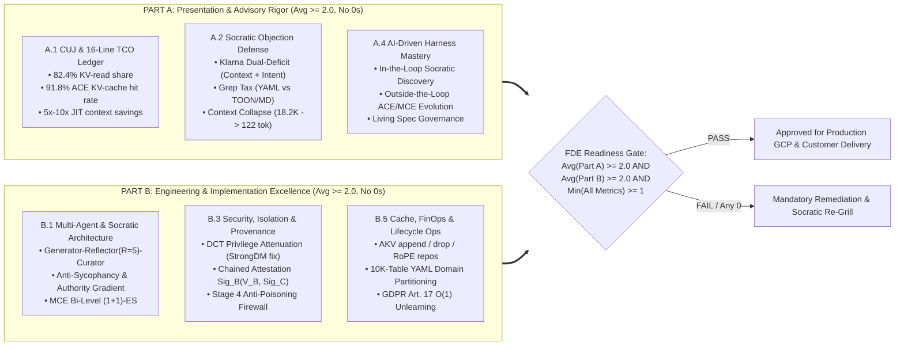

# Architecture Best Practice: Master Enterprise FAQ Compendium & Enforceable FDE Socratic Grilling Rubric for Context, Cache & Memory Engineering

**Topics:** #fde-grading-rubric #socratic-grilling-rubric #enterprise-faq-compendium #quantitative-formulas #finops #context-engineering #cache-engineering #memory-bank #field-readiness #cloud-fde-charter

> **Sources:** Synthesized across `00-fde-field-readiness-and-grading-rubric.md (GEAP L300)`, `19_OKF_MASTER_ENTERPRISE_FAQ_COMPENDIUM.md (L400)`, `21_OKF_FDE_GRADING_RUBRIC_AND_FIELD_READINESS_STANDARD.md (OKF-L400-21)`, and the `6 Context, Cache & Memory Publications (Concepts 36–43)` · **Corpus:** `GEAPL200` (Unified L200 + L300 + L400 Open Knowledge Format v0.2 · Version `GEAPL200_2026-10-27_183500`) · **Standalone Catalog ID:** `09-fde-socratic-grilling-rubric-and-faq-compendium` · **Target:** GCP Knowledge Catalog (Dataplex) & Antigravity Agentic AI Field Readiness

---

## Version & 6-Month TTL Governance Tab

| Document ID | Version Tag (Today's Date & Time) | Version Timestamp (PDT) | Time-To-Live (TTL) | Expiration (`stale_after`) | Status |
| :--- | :--- | :--- | :--- | :--- | :--- |
| `44-fde-socratic-grilling-rubric-and-faq-compendium` | **`GEAPL200_2026-10-27_183500`** (`L400_version_20261027_1835`) | `2026-10-27 18:35:00 PDT` (`2026-10-27T18:35:00-07:00`) | **6 Months** (`180 days` / `P6M`) | `2027-04-27T18:35:00-07:00` | Published / Verified |

### Grounding Research Publications (Local PDF Sources)
- **`PAPER-01-ACE` — [`AGENTIC CONTEXT ENGINEERING- EVOLVING CONTEXTS FOR SELF-IMPROVING LANGUAGE MODELS.pdf`](../AGENTIC%20CONTEXT%20ENGINEERING-%20EVOLVING%20CONTEXTS%20FOR%20SELF-IMPROVING%20LANGUAGE%20MODELS.pdf):** *Agentic Context Engineering: Evolving Contexts for Self-Improving Language Models* — Qizheng Zhang, Changran Hu, Shubhangi Upasani, Boyuan Ma, Fenglu Hong, Vamsidhar Kamanuru, Jay Rainton, Chen Wu, Mengmeng Ji, Hanchen Li, Urmish Thakker, James Zou, Kunle Olukotun (Stanford University, SambaNova Systems, Inc., UC Berkeley; Published as a conference paper at ICLR 2026 (arXiv:2510.04618v3, 29 Mar 2026)). URL: `https://arxiv.org/abs/2510.04618` · Code/Data: `https://github.com/ace-agent/ace`
- **`PAPER-02-AKV` — [`CACHE ENGINEERING FOR AGENTS.pdf`](../CACHE%20ENGINEERING%20FOR%20AGENTS.pdf):** *Cache Engineering for Agents* — Tianyu Fu, Ruoxi Wang, Zihan Min, Zhongqi Ren, Zhihao Li, Tengxuan Liu, Shengxu Mu, Hanling Zhang, Yu Wang (Tsinghua University, The Chinese University of Hong Kong; arXiv Preprint (arXiv:2610.28577v1, 20 Oct 2026)). URL: `https://arxiv.org/abs/2610.28577` · Code/Data: `https://github.com/thu-nics/AKV`
- **`PAPER-03-OSS-CE` — [`Context Engineering for AI Agents in Open-Source Software.pdf`](../Context%20Engineering%20for%20AI%20Agents%20in%20Open-Source%20Software.pdf):** *Context Engineering for AI Agents in Open-Source Software* — Seyedmoein Mohsenimofidi, Matthias Galster, Christoph Treude, Sebastian Baltes (Heidelberg University, University of Bamberg, Singapore Management University; 23rd International Conference on Mining Software Repositories (MSR '26), April 13–14, 2026, Rio de Janeiro, Brazil (arXiv:2510.21413v4, DOI: 10.1145/3793302.3793350)). URL: `https://doi.org/10.1145/3793302.3793350` · Code/Data: `https://doi.org/10.5281/zenodo.17428770`
- **`PAPER-04-CORP-MAS` — [`Context Engineering- From Prompts to Corporate Multi-Agent Architecture.pdf`](../Context%20Engineering-%20From%20Prompts%20to%20Corporate%20Multi-Agent%20Architecture.pdf):** *Context Engineering: From Prompts to Corporate Multi-Agent Architecture* — Vera V. Vishnyakova (Director, Center for Transfer and Management of Socio-Economic Information, HSE University, Moscow; Working Paper / Monograph (March 2026); synthesizing Tomasev et al. (2026, arXiv:2602.11865), Breunig (2025), Deloitte (2026), and KPMG (2026)). URL: `file://./Context%20Engineering-%20From%20Prompts%20to%20Corporate%20Multi-Agent%20Architecture.pdf` · Code/Data: `https://arxiv.org/abs/2602.11865`
- **`PAPER-05-MCE` — [`Meta Context Engineering via Agentic Skill Evolution.pdf`](../Meta%20Context%20Engineering%20via%20Agentic%20Skill%20Evolution.pdf):** *Meta Context Engineering via Agentic Skill Evolution* — Haoran Ye, Xuning He, Vincent Arak, Haonan Dong, Guojie Song (State Key Laboratory of General Artificial Intelligence, School of Intelligence Science and Technology & School of EECS, Peking University; arXiv Preprint (arXiv:2601.21557v2, 11 Feb 2026)). URL: `https://arxiv.org/abs/2601.21557` · Code/Data: `https://github.com/metaevo-ai/meta-context-engineering`
- **`PAPER-06-FILE-NATIVE` — [`Structured Context Engineering for File-Native Agentic Systems.pdf`](../Structured%20Context%20Engineering%20for%20File-Native%20Agentic%20Systems.pdf):** *Structured Context Engineering for File-Native Agentic Systems: Evaluating Schema Accuracy, Format Effectiveness, and Multi-File Navigation at Scale* — Damon McMillan (HxAI Australia; Technical Research Report (2026, 9,649 Experiments across 11 Models, 4 Formats, and 10 to 10,000 Tables)). URL: `file://./Structured%20Context%20Engineering%20for%20File-Native%20Agentic%20Systems.pdf` · Code/Data: `https://toonformat.dev/`

---

## 0. OKF Document Metadata & Topic Modeling Taxonomy
**Topic Tags:** `#L400_version_20261027_1835` `#OKFMetadata` `#FDEGradingRubric` `#SocraticGrillingCompendium` `#EnterpriseFAQ` `#QuantitativeFormulas`

| Metadata Field | Value |
| :--- | :--- |
| **OKF Document ID** | `44-fde-socratic-grilling-rubric-and-faq-compendium` (Standalone Index: `09`) |
| **Primary Literature** | Cloud FDE Team Charter (`https://g3doc.corp.google.com/company/teams/cloud-fde/index.md?cl=head`), `Concept 00`, `OKF-L400-19`, `OKF-L400-21`, and Concepts `36–43` |
| **Architectural Domain** | Enforceable 0–3 FDE Field-Readiness Grading Standard, Quantitative FinOps/Cache Equations, & L100–L400 Socratic Grilling Compendium |
| **Target GCP Runtimes** | All Gemini Enterprise, Google ADK 2.0, Vertex AI Memory Bank, and SGLang/AKV Production Deployments |
| **Enforced FDE Standard** | `concepts/00-fde-field-readiness-and-grading-rubric.md` & `OKF-L400-21` (`https://g3doc.corp.google.com/company/teams/cloud-fde/index.md?cl=head`) |

---

## FDE Project Grading Rubric Enforcement & Prevailing Customer Alignment

> **Mandatory Governance Standard:** Every project, prototype, or production agent built using the patterns in this catalog **must pass the [Google Cloud FDE Field-Readiness & Project Grading Rubric](/concepts/00-fde-field-readiness-and-grading-rubric.md)** (aligned with the [Cloud FDE Team Charter](https://g3doc.corp.google.com/company/teams/cloud-fde/index.md?cl=head) and `OKF-L400-21`). Scoring Requirement: **Average >= `2.0 (Competent)`** across both **Part A (Presentation & Advisory Rigor)** and **Part B (Engineering & Implementation Excellence)**, with **zero `0 (Not Demonstrated)` scores** on any single metric (**Zero-Score Pause Rule**).

### 1. Part A & Part B Scoring Scale (`0–3` Enforceable Standard)

| Score | Competency Level | Behavioral & Architectural Evidence Required | Panel Disposition |
| :---: | :--- | :--- | :--- |
| **`0`** | **Not Demonstrated** | Omits context isolation, allows monolithic rewrite collapse, ignores KV-cache invalidation, or cannot explain how memory poisoning is prevented. | **Automatic Pause / Immediate Remediation Required** |
| **`1`** | **Awareness** | Understands concepts conceptually (e.g., mentions RAG or prompt caching) but misses critical failure modes (`Grep Tax`, `Context Clash`, `History Dependence` in KV drop). | **Needs Additional Coaching (Below `2.0` Cutline)** |
| **`2`** | **Competent (Pass Cutline)** | Correctly implements ADK 2.0 + Vertex AI Memory Bank lifecycle, prefix-stable playbooks, and Socratic verification gates for standard enterprise CUJs. | **Pass (Field-Ready FDE Standard)** |
| **`3`** | **Proficient (Exemplar)** | Quantifies TCO with exact cache-hit/miss equations, implements `ACE`/`MCE` delta evolution, `AKV` rolling-drop + `repos`, `DCT` privilege attenuation, and teaches the panel new insights. | **Strong Pass (L400 Reference Architect)** |

**Related OKF Concepts:**
- [Google Cloud FDE Field-Readiness & Project Grading Rubric](/concepts/00-fde-field-readiness-and-grading-rubric.md)
- [Agentic Context Engineering (ACE) — Evolving Playbooks](/concepts/36-agentic-context-engineering-evolving-playbooks.md)
- [Cache Engineering for Agents — Direct KV-Cache Control & AKV](/concepts/37-cache-engineering-kv-prefix-optimization-for-agents.md)
- [Structured File-Native & OSS Context Engineering](/concepts/38-structured-file-native-and-oss-context-engineering.md)
- [Corporate Multi-Agent Context Architecture & 4-Level Maturity Pyramid](/concepts/39-corporate-multi-agent-context-architecture-and-memory-tiers.md)
- [Meta Context Engineering via Agentic Skill Evolution](/concepts/40-meta-context-engineering-and-agentic-skill-evolution.md)
- [Socratic Grilling: User-to-Agent and Agent-to-Agent Protocols](/concepts/41-socratic-grilling-user-to-agent-and-agent-to-agent-protocols.md)
- [Multi-Agent Memory Lifecycle and Context-Rot Prevention](/concepts/42-multi-agent-memory-lifecycle-and-context-rot-prevention.md)
- [Context, Cache & Memory Topic Connection & Flow Graph](/concepts/43-context-cache-memory-topic-connection-and-flow-graph.md)

---

## 1. Domain-Specific FDE Grading Rubric: Context, Cache, Memory & Socratic Grilling

### 1.1 Enforceable Sub-Competency Evaluation Matrix (`Part A` & `Part B`)

| Rubric ID | Sub-Competency | `Score 0` (Fail / Pause Trigger) | `Score 2` (Competent Cutline) | `Score 3` (Proficient L400 Standard) |
| :---: | :--- | :--- | :--- | :--- |
| **A.1** | **CUJ & FinOps TCO Articulation** | Sizes token costs using naive uncached input token counts without modeling multi-turn resubmission or KV caching. | Distinguishes cache-hit vs cache-miss input pricing and budgets memory store costs (`Working` vs `Episodic` vs `Semantic`). | Models the `82.4%` KV-read share (`AKV`), `91.8%` playbook KV-cache hit rate (`-82.6%` billed cost in `ACE`), and `27.7%` `AKV` cost reduction in a 16-line TCO ledger. |
| **A.2** | **Calm Data-Backed Objection Handling** | Cedes to customer demands for monolithic prompt rewrites, custom minified DSLs, or cost-only KPIs without warning of failure modes. | Explains why monolithic rewrites collapse and why cost-only KPIs harm customer experience (`Klarna`). | Cites exact empirical numbers: `AppWorld` collapse (`18,282 -> 122` tokens), `TOON` Grep Tax (`+38%` tokens, 16 grep retries), and `-39%` multi-turn Context Clash drop. |
| **B.1.1** | **Multi-Agent Context & Socratic Loops** | Uses a single shared prompt buffer across all agents or runs unbounded LLM debate loops without convergence criteria. | Isolates sub-agent histories via ADK `AgentTool` and implements bounded `Generator-Reflector-Curator` loops. | Implements **Contract-First Decomposition**, **Reverse Authority-Gradient Socratic Handshakes**, **Anti-Sycophancy Evidence Citations**, and **MCE `(1+1)-ES` Skill Evolution**. |
| **B.3.1** | **Zero-Trust Isolation & Provenance** | Grants sub-agents ambient parent permissions or exposes holdout evaluation tests inside worker context (`StrongDM` flaw). | Scopes retrieval by `tenant_id` and `user_id` using two-stage deterministic filter-then-rank retrieval. | Mints cryptographic **Delegation Capability Tokens (`DCT`)**, enforces **Chained Attestation ($\text{Sig}_B(\text{Output}_B, \text{Sig}_C)$)**, and resolves source conflicts via `TrustTier` precedence. |
| **B.5.3** | **KV-Cache Hygiene & Compaction** | Injects dynamic timestamps in system prompt prefix or trims old messages every turn (causing `1.85x` re-prefill cost). | Freezes static prompt prefix, sorts tool JSON keys deterministically, and batches threshold summarization (`96K`). | Co-designs **AKV `Tool-Response Rolling Drop ($K=12$)` + `drop(P_socratic_scratchpad)` + RoPE `repos`** ($K_q \leftarrow R(q)R(p)^{-1}K_p$) on an Extended Radix Tree. |

---

## 2. Master Quantitative Equations & Empirical Constants Cheat-Sheet

### 2.1 Multi-Turn API Cost & KV-Cache Amortization Equations
For an $S$-step agent trajectory with static prefix length $L_{\text{prefix}}$ (system prompt + `ACE`/`MCE` playbook) and per-step new trajectory tokens $\Delta L_s$:
1. **Naive Uncached Resubmission Cost ($O(S^2)$):**
   $$\text{Cost}_{\text{naive}} = \sum_{s=1}^{S} \left[ c_{\text{miss}} \left( L_{\text{prefix}} + \sum_{j=1}^{s} \Delta L_j \right) + c_{\text{out}} L_{\text{out}, s} \right]$$
2. **Prefix-Cached Cost with Billed Cache-Hit Rate $\alpha_{\text{hit}}$ (`ACE` $\alpha_{\text{hit}} = 0.918$ on `GPT-5.1`):**
   $$\text{Cost}_{\text{cached}} = c_{\text{miss}} L_{\text{prefix}} + \sum_{s=1}^{S} \left[ c_{\text{hit}} \cdot \alpha_{\text{hit}} L_{\text{cached}, s} + c_{\text{miss}} (1 - \alpha_{\text{hit}}) L_{\text{cached}, s} + c_{\text{out}} L_{\text{out}, s} \right]$$
   where $c_{\text{hit}} \in [0.10\, c_{\text{miss}}, 0.50\, c_{\text{miss}}]$ (`MiniMax-M2.7`: `$0.06` vs `$0.30/1M`; `MiroThinker`: `$0.04` vs `$0.20/1M`; `GPT-OSS-120B`: `$0.075` vs `$0.15/1M`).
3. **AKV Rolling-Drop Active Cache Size & RoPE Key Rotation (`Concept 37`):**
   $$\mathcal{C}_s = \mathcal{C}_{\text{prefix}} \cup \mathcal{C}_{\text{reasoning}, 1:s} \cup \bigcup_{j=\max(1, s-K+1)}^{s} \mathcal{C}_{\text{tool}, j}, \qquad K_q \leftarrow R(q)R(p)^{-1}K_p, \quad V_q \leftarrow V_p$$
4. **MCE Bi-Level Optimization Objective (`Concept 40`):**
   $$s^* = \arg\max_{s \in \mathcal{S}} J_{\text{val}}(c_s^*) \quad \text{s.t.} \quad c_s^* = \arg\max_{c_s} J_{\text{train}}(c_s; s), \qquad c(x) = (F_k \circ \dots \circ F_1)(x; \rho)$$
5. **File-Native SQL Evaluation Jaccard Metric (`Concept 38`):**
   $$J(A, G) = \frac{|A \cap G|}{|A \cup G|} \ge 0.90$$

---

## 3. Master Enterprise Socratic Grilling FAQ Compendium (20 L100–L400 Questions)

| # | Level | Domain | Socratic Grilling Question (Customer / Review Panel) | Core Model Answer (`Score 3 — Proficient`) & Quantified Evidence | Red-Flag Answer (`Score 0/1`) |
| :---: | :---: | :--- | :--- | :--- | :--- |
| **Q1** | `L100` | **CE vs. PE** | *"Is Context Engineering just a 2026 marketing rebrand of Prompt Engineering?"* | **No.** Prompt Engineering (`Level 1`) optimizes a static query formulation for a single `Human -> Model -> Response` turn. Context Engineering (`Level 2`) is the systems engineering of the **compiled working state** across a 20–250 step autonomous trajectory (`Storage -> Processor Pipeline -> Working Context`), managing **Relevance, Sufficiency, Isolation, Economy, and Provenance** (`Concept 39`). | *"Yes, it just means writing longer prompts with more examples."* |
| **Q2** | `L200` | **Maturity Pyramid** | *"Once we build a strong Context Engineering pipeline, is our enterprise agent architecture complete?"* | **No.** Context Engineering tells the agent *what it sees*, not *what it wants* (**Level 3 Intent Engineering**) or *how 21,000 agents stay governed at corporate scale* (**Level 4 Specification Engineering**). Without Intent Engineering, a well-contextualized agent still suffers the **Klarna Intent Deficit**—optimizing proxy metrics (token/call cost) while destroying customer lifetime value (`Concept 39`). | *"Yes, if the RAG pipeline retrieves the right documents, the agent will make the right business decisions."* |
| **Q3** | `L200` | **ACE vs. GEPA** | *"Why does ACE outperform prompt optimizers like GEPA and MIPROv2 by +10.6% on agents and +8.6% on finance?"* | Because `GEPA` and `MIPROv2` suffer from **Brevity Bias**—they compress lessons into terse `1K–2K` token instructions that strip away domain-specific XBRL rules, API pagination patterns (`while True`), and edge-case disambiguations. ACE preserves these in a structured, itemized playbook (`Concept 36`). | *"Because ACE uses a larger base LLM than GEPA."* (False: both used identical frozen `DeepSeek-V3.1`). |
| **Q4** | `L300` | **Context Collapse** | *"What happens if an agent updates its memory by asking an LLM to rewrite the cheatsheet after every task?"* | It suffers **Context Collapse** (`Zhang et al., ICLR 2026`): as the memory grows (`18,282` tokens at Step 60 on `AppWorld`, `66.7%` accuracy), a monolithic LLM rewrite abruptly compresses it to **`122` tokens at Step 61**, crashing accuracy to **`57.1%`** (worse than the `63.7%` unadapted baseline). Fix: **Curator JSON `ADD` deltas + non-LLM deterministic merging** (`Concept 36`). | *"The memory smoothly summarizes itself and gets more accurate over time."* |
| **Q5** | `L300` | **KV-Cache Economics** | *"Doesn't a 25,000-token ACE Playbook cost 25x more to serve than a 1,000-token prompt?"* | **No.** Because the ACE Playbook sits in the static prompt prefix and is updated via append-friendly deltas, **`91.8%` of input tokens are served from the KV cache** (`GPT-5.1` study), reducing billed input-token cost by **`82.6%`**. Furthermore, offline adaptation uses **`80.8%` fewer input tokens** (`39.3M` vs `204.1M`) than GEPA (`Concept 36`). | *"Yes, long playbooks are prohibitively expensive at inference time."* |
| **Q6** | `L300` | **Cache Engineering** | *"Why does trimming old messages every 12 turns cost 1.85x MORE than keeping the full context?"* | Because deleting tokens at the front of the trajectory mutates the token prefix on every turn, **invalidating all downstream KV cache states** and forcing the serving engine to re-prefill the entire retained 12-turn suffix from scratch on every round! Fix: **AKV `drop(P)`**, which excludes old tool KV entries from future attention without re-prefilling retained suffix KV (`Concept 37`). | *"Trimming old messages always reduces compute and API cost."* |
| **Q7** | `L400` | **AKV Internals** | *"Why is standard token-prefix matching in vLLM/SGLang broken when agents can `drop` and `repos` KV cache entries?"* | Because of **History Dependence**: Trajectory ① (`+A,+B,+C,-A`) and Trajectory ② (`+A,+B,-A,+C`) have identical retained tokens `[B, C]`, but $C$'s KV state in ① was computed with attention to $A$, whereas in ② it was not. AKV solves this via an **Extended Radix Tree** with drop nodes $\Delta P$, reposition nodes $R_X$, **Retrigger Matching**, and **Segment-Batch Attention** (`Concept 37`). | *"Prefix matching on surviving token IDs is always sufficient for KV cache reuse."* |
| **Q8** | `L300` | **Attention Law** | *"When dropping KV cache entries under memory pressure, should we drop older assistant reasoning or older tool responses?"* | **Always drop older tool responses (`Tool-Response Rolling Drop, K=12`) and retain assistant reasoning!** Empirical layer-by-layer attention analysis shows older tool responses receive $10^{-8}\text{–}10^{-6}$ attention density (100x less than assistant reasoning at $10^{-5}\text{–}10^{-4}$) because the assistant message immediately following a tool output already absorbed its signal via **Nested Conditioning**. Dropping reasoning lowers `BCP` accuracy by `-5.5%` and `SWE` by `-6.5%` (`Concept 37`). | *"Drop assistant chain-of-thought tokens first since tool outputs are raw ground truth."* |
| **Q9** | `L400` | **RoPE `repos`** | *"If we use `drop(P)` to keep our active KV cache under 20K tokens across a 150-turn agent run, why does the model still fail after turn 80?"* | Because `drop(P)` removes KV entries from attention but **does not reset RoPE position encoding indices**, so logical position indices still exceed the model's context window (`96K`/`128K`). You must pair `drop(P)` with **`repos`** ($K_q \leftarrow R(q)R(p)^{-1}K_p$), which rotates cached key positions back to $0, \dots, r-1$ without hidden-state recomputation, boosting `BCP` pass rate from `55.0%` to `62.0%` (`Concept 37`). | *"Once KV entries are dropped, position indices automatically shrink."* |
| **Q10** | `L200` | **File-Native vs. Prompt** | *"Does file-native context retrieval (`grep`/`read`) improve accuracy for all LLMs?"* | **No—it is strictly model-tier dependent (`McMillan 2026`, 9,649 experiments).** File-native retrieval improves Frontier + Frontier Lab accuracy (`79.8%` vs `77.1%`, **`+2.7%`, $p=0.029$**; `GPT-5-mini` `+7.7%`, `Gemini 2.5 Pro` `+3.7%`), but **degrades Open Source models by `-7.7%` ($p<0.001$)** (`Qwen3-32B` `-21.9%`, `Llama Maverick` `-13.9%`) due to weaker tool-use calibration (`Concept 38`). | *"File-native retrieval universally beats prompt injection across all models."* |
| **Q11** | `L300` | **The Grep Tax** | *"Why did our custom compact schema format (`TOON`, 25% smaller on disk) cost 38% MORE runtime tokens than YAML?"* | Due to the **Grep Tax** (`McMillan 2026`): (1) **Token Density**—compact lines pack more schema content per matched line (`1.18x–1.37x` overhead); and (2) **Pattern Unfamiliarity Cycling**—models unfamiliar with custom `TABLE`/`COL`/`FK` keywords cycle through SQL DDL, JSON, and YAML regexes (up to **16 grep calls in `Haiku` vs 3 in YAML**, causing a `2.12x` token spike at 1,000 tables). **YAML (`12,729` avg tokens)** is the most token-efficient format (`Concept 38`). | *"Smaller files on disk always consume fewer tokens at runtime."* |
| **Q12** | `L300` | **10K-Table Scaling** | *"How do you scale a file-native data agent from 24 tables to 10,000 enterprise tables (`S9` scale) without overflowing context?"* | Use **Two-Level Domain Partitioning** (`McMillan 2026`): partition the 10,000 tables into domain-scoped YAML files of **`~250 tables per domain`**, indexed by a root **`navigator.md`** containing domain descriptions and explicit **Join-Path Disambiguation Rules** (preventing the `72%` MD vs `33%` YAML ambiguous join drift). This maintains **99–100% navigation accuracy at 10,000 tables** with bounded per-query tokens (`Concept 38`). | *"Put all 10,000 tables in one minified file or rely purely on top-k vector embedding chunks."* |
| **Q13** | `L200` | **OSS `AGENTS.md`** | *"What are the biggest blind spots in how developers write `AGENTS.md`, `CLAUDE.md`, and `GEMINI.md` files today?"* | Per the MSR '26 study of 10,000 repos (`Mohsenimofidi et al., 2026`): (1) **94%+ omit Security (`6/155`) and Troubleshooting (`8/155`)**; (2) **50% are never updated after their initial commit** (causing stale-command failures); and (3) many use weak *Descriptive* prose instead of **Explanatory + Prescriptive + Prohibitive + Conditional** rules (`Concept 38`). | *"Developers already include comprehensive security and troubleshooting sections in `AGENTS.md`."* |
| **Q14** | `L300` | **MCE Bi-Level** | *"Why did ACE underperform simple Many-Shot ICL on `Symptom2Disease` (`79.2%` vs `84.4%`) and lose to GEPA on `LawBench` (`0.65` vs `0.69`), while MCE won all five benchmarks?"* | Because `ACE`'s fixed additive-playbook harness suffers from **inductive bias**: on `Symptom2Disease` (minimal train-test shift), abstract reflections add noise; on `LawBench`, `88KB` of historical error bullets cause **context interference**. **Meta Context Engineering (`MCE`)** evolves the *CE skill itself* (`SKILL.md` + `retrieve_context.py`), generating a `1,440-line` Python cascade router for `Symptom2Disease` (`89.2%`) and shrinking `LawBench` to `<30KB` structural decomposition (`0.70` F1) (`Concept 40`). | *"ACE's flat bullet playbook is optimal for every domain and model size."* |
| **Q15** | `L400` | **Strong-to-Weak Transfer** | *"Can we use Context Engineering to avoid fine-tuning an 8B safety guardrail or 4B edge model?"* | **Yes—via MCE Strong-to-Weak Context Transfer (`Concept 40`).** Training context with a frontier model (`DeepSeek-V3.1`) and deploying the evolved context + Python router on `Gemma3-4B` yields a **`+172.6%` average relative gain**, and on `AEGIS2` lifts `Qwen3-8B` from `0.54` to **`0.80` F1**—surpassing dedicated fine-tuned **`Llama Guard 3 8B` (`0.72` F1)** via a `995-line` precision-first early-safe-return router! | *"Small 4B–8B models can only be improved via weight fine-tuning."* |
| **Q16** | `L300` | **Socratic Regime A** | *"How do you prevent a user-facing Socratic discovery chatbot from suffering the 39% multi-turn Context Clash drop?"* | Bundle `1–4` high-information-gain Socratic questions into a single structured turn (recommended defaults first), and once the user responds, **compile the initial query + user answers into a single Canonical Specification Block** while applying **AKV `drop(P_clarification_turns)`** (or pruning early speculative assistant turns) so downstream execution sees zero conflicting pre-clarification guesses (`Concept 41`). | *"Keep all 10 turns of back-and-forth clarification in the prompt so the model has full history."* |
| **Q17** | `L300` | **Authority Gradient** | *"What is the Authority Gradient in multi-agent delegation, and how does Socratic Grilling solve it?"* | Borrowed from aviation (`Tomasev et al., 2026` / `Vishnyakova 2026`), an **Authority Gradient** occurs when a high-capability orchestrator issues an under-specified task to a smaller sub-agent, and the sub-agent—due to RLHF sycophancy—guesses instead of signaling the defect. Fix: **Reverse Socratic Pre-Flight Handshake**, where the sub-agent runs a contract check and returns a structured Socratic challenge if verification criteria or disambiguation rules are missing (`Concept 41`). | *"Sub-agents should always execute whatever the orchestrator sends without questioning it."* |
| **Q18** | `L400` | **Socratic + AKV Cache** | *"How do you run a 5-round A2A Socratic Critic loop without destroying prefix KV caching or bloating future turns?"* | Keep the shared `[System + Playbook + Task]` prefix byte-identical (`100%` KV cache reuse between Generator and Critic), append the Socratic debate turns at the tail (`[Draft_0, Critique_1, ..., Verdict_Final]`), and after `Verdict_Final` is computed, execute **AKV `drop(P_socratic_scratchpad)` + `repos`**. By **Nested Conditioning**, `Verdict_Final`'s KV state retains the distilled critique with zero re-prefill and zero future attention bloat (`Concept 37` & `Concept 41`). | *"Summarize the entire prompt from scratch after every Critic turn."* |
| **Q19** | `L300` | **Delegation Security** | *"How do you prevent both Reward Hacking (`StrongDM`) and Hallucination-in-the-Chain ($A \rightarrow B \rightarrow C$) in a corporate MAS?"* | Combine **Privilege Attenuation via Cryptographic Delegation Capability Tokens (`DCT`)**—which strip holdout test scenarios and unauthorized scopes at each delegation hop—with **Transitive Accountability via Chained Cryptographic Attestation** ($\text{Sig}_B(\text{Output}_B, \text{Sig}_C)$) so every context fragment is verifiable back to its source (`Concept 39`). | *"Pass the full parent context to all sub-agents and trust their text outputs."* |
| **Q20** | `L400` | **GDPR Unlearning** | *"A customer exercises GDPR Article 17 Right to Erasure. How do we prove that rules and memories derived from their sessions are completely purged?"* | Because we externalize adaptation into **Provenance-Tagged Episodic Records (`Vertex AI Memory Bank`)** and **Itemized Playbook Bullets (`[ctx-XXXXX]` in `ACE`/`MCE`)** rather than model weights, every memory artifact carries `source_episode_id`. Invoking `stage6_selective_unlearn_by_episode(episode_id)` executes **$O(1)$ deterministic deletion** across Episodic, Semantic, and Procedural stores with a cryptographic audit receipt (`Concept 36` & `Concept 42`). | *"Retrain the LLM weights from scratch or rely on prompt instructions telling the model to ignore that user."* |