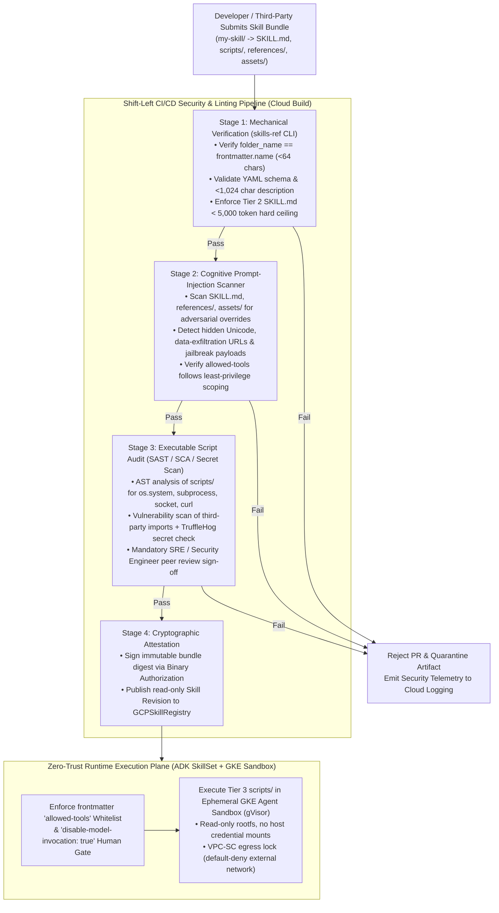
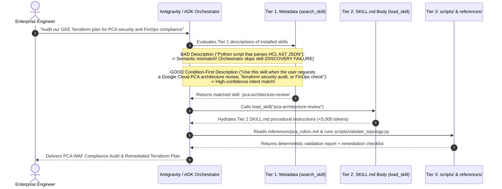
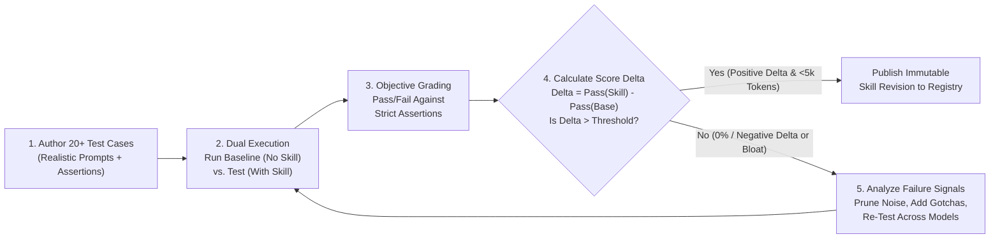
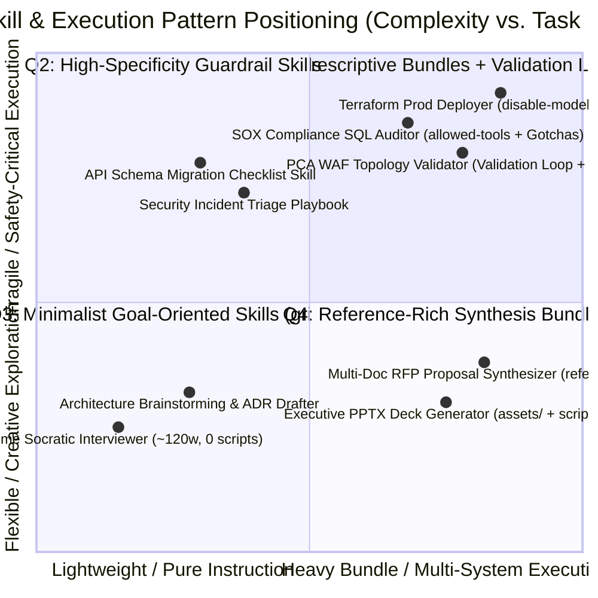

# B3: Agent Skills and the Skills Registry (`OKF-L400-B3` | `L400_version_20261026_0350`) — Authoritative Google Cloud OKF Knowledge Specification
**Topic Tags:** `#L400_version_20261026_0350` `#EnterpriseAgenticAI` `#AgentSkills` `#SkillsRegistry` `#GeminiEnterprisePlatform` `#AntigravityAICatalog` `#GoogleCloudWAF`

---

## 0. OKF Document Metadata & Topic Modeling Taxonomy
**Topic Tags:** `#L400_version_20261026_0350` `#OKFMetadata` `#TopicModeling` `#SemanticTaxonomy` `#GCPKnowledgeCatalog`

> **OKF v0.2 Trust Signals, Bucket Merge & Enforced FDE Grading Rubric (`OKF-L400-21`):**
> - **Version Tag:** `L400_version_20261026_0350` | **Status (`status`):** `stable` (`VETTED` / `APPROVED`) | **TTL (`stale_after`):** `2027-04-26T00:00:00Z` *(Maintains existing TTL & version)* | **Verified (`verified`):** `true`
> - **Merged Bucket OKF Lineage:** Reconciled with `Concepts 01, 03, 05, 06, 11, 12` in `gs://gea_agent_development_architectural_best_practices_1790796607` (`project=fivedaysai-prd-sandbox-317383`)
> - **Cloud FDE Prevailing Standard:** `https://g3doc.corp.google.com/company/teams/cloud-fde/index.md?cl=head`
> - **Enforced Project Grading Rubric (`OKF-L400-21`):** Adheres to the 0–3 FDE Field-Readiness Rubric (Pass Gate: Average >= 2.0 across Part A & Part B; Zero-Score Pause Rule: any `0 - Not Demonstrated` triggers an immediate pause and 2-week re-presentation). Primary mapped competencies for `OKF-L400-B3`: **Part A.4 (In-the-Loop & Outside-the-Loop Skill Harness + Mistake Feedback), Part B.3.4 (disable-model-invocation & Shift-Left Script Security), Part B.5.3 (3-Tier Progressive Context Disclosure), Part B.6.1 (Immutable SkillRevision Rollback), Part B.6.4 (5-Step Empirical Score-Delta Testing)**.

### 0.1 OKF Metadata Table
**Topic Tags:** `#OKFMetadataTable` `#CatalogSchema` `#L400_version_20261026_0350`

| Metadata Attribute | Specification Value |
| :--- | :--- |
| **Document ID** | `OKF-L400-B3` |
| **Document Title** | B3: Agent Skills and the Skills Registry — Enterprise Architecture & Operations Guide |
| **Version Tag** | `L400_version_20261026_0350` |
| **Lifecycle Pillar** | **Build** (within the 4 Pillars of Gemini Enterprise Agent Platform: *Build, Govern, Scale, Optimize*) |
| **Target Capabilities** | Open Standard `SKILL.md` Authoring & Package Anatomy (`scripts/`, `references/`, `assets/`); 3-Tier Progressive Context Disclosure (L1 Metadata, L2 Instructions `<5k` tokens, L3 On-Demand Resources); Condition-First Trigger Engineering; Prescriptive vs. High-Freedom Specificity Calibration; Self-Correcting Validation Loops & `Gotchas`; 5-Step Empirical Delta Evaluation; `grill-me` Dispatcher Pattern; Centralized `GCPSkillRegistry` Governance (`Skill` Container vs. Immutable `Skill Revision`); 5-Layer Platform Runtime (`search_skill`, `load_skill`); Skill-Driven MCP Tool Invocation vs. Sub-Agent Boundaries; Shift-Left Security Scanning against Prompt Injection & Malicious Scripts. |
| **Source Artifacts** | 1. `agent_skiils_and_skills_registry.md` (Full Lecture Transcript by Michael Chushkin, Applied AI Engineering; 20-Slide Breakdown; PCA Quizzes; Antigravity + MCP Integration Architecture; 20-Level Deep Q&A Compendium)<br/>2. `slides-b3-agent-skills-and-skills-registry.md` (Enterprise Architecture Guide, Taxonomy, Multi-Dimensional Trade-Offs, Google Cloud 5-Layer Reference Architecture & WAF Alignment) |
| **GCP Knowledge Catalog Ingestion Schema** | `gcp-okf://catalog/l400/build/b3-agent-skills-and-skills-registry@L400_version_20261026_0350` (Chunking Strategy: Heading-Anchored Semantic Blocks with Inline Topic Tags, Mermaid.js AST Preservation, Multi-Dimensional Decision Matrices, and Grounded Evaluation Q&A Pairs) |
| **Antigravity Agentic AI Role** | Primary procedural knowledge base and architectural blueprint consumed by Antigravity (`AGY`) orchestrator agents, ADK `SkillSet` runtimes, and Principal Certified Architect (PCA) review agents to author, validate (`skills-ref`), evaluate (5-Step Score Delta), govern (`GCPSkillRegistry`), and securely execute modular `SKILL.md` bundles alongside Model Context Protocol (MCP) servers on Google Cloud. |

---

### 0.2 Primary & Secondary Topic Tags
**Topic Tags:** `#PrimaryTopicTags` `#SecondarySubTopicTags` `#OntologyIndexing`

#### 0.2.1 Primary Topic Tags (6 Core Pillars)
**Topic Tags:** `#SkillMdOpenStandard` `#ProgressiveContextLoading` `#ValidationLoopsAndBundledScripts` `#EmpiricalDeltaEvaluation` `#EnterpriseSkillsRegistry` `#FiveLayerSkillRuntime`

1. **`#SkillMdOpenStandard`** *(Type: Architectural Standard)*: The portable, vendor-agnostic, and model-agnostic `SKILL.md` folder specification (`SKILL.md` + optional `scripts/`, `references/`, `assets/`) that replaces fragmented proprietary conventions (`CLAUDE.md`, `AGENTS.md`, LangChain/AutoGen/CrewAI prompt templates) under the **"One Skill, One Job"** modularity principle.
2. **`#ProgressiveContextLoading`** *(Type: Context Optimization Mechanism)*: The 3-tier on-demand context disclosure architecture—**Tier 1 Metadata** (`name` `<64 chars` + condition-first `description` `<1,024 chars`, ~100–1,000 tokens), **Tier 2 Instruction Body** (`SKILL.md` `<5,000 tokens` loaded strictly on activation), and **Tier 3 External Resources** (`scripts/`, `references/`, `assets/` read/executed strictly on demand).
3. **`#ValidationLoopsAndBundledScripts`** *(Type: Procedural Steering Capability)*: High-signal instruction patterns combining environment `Gotchas`, output `Templates`, `Scratchpad Checklists`, iterative `Validation Loops`, `Plan-Validate-Execute` safety gates, and deterministic `Bundled Scripts` in `scripts/` to eliminate repetitive LLM code-generation drift.
4. **`#EmpiricalDeltaEvaluation`** *(Type: Quality Engineering Discipline)*: The rigorous 5-step empirical evaluation framework measuring net **Performance Score Delta** (`With-Skill Pass Rate − Baseline Pass Rate`) across `20+` realistic test cases and multiple base models before publishing any skill revision.
5. **`#EnterpriseSkillsRegistry`** *(Type: Governance Control Plane)*: The centralized `GCPSkillRegistry` service separating mutable `Skill` logical containers (metadata, labels, default pointer) from read-only, cryptographically immutable `Skill Revision` snapshots (`v1.0.0`, `v1.1.0`) for enterprise reuse, IAM access control, zero-downtime rollbacks, and regulatory auditability.
6. **`#FiveLayerSkillRuntime`** *(Type: Platform Execution Architecture)*: The 5-layer Gemini Enterprise Agent Platform stack integrating User/App interfaces, ADK + Gemini Agent Loops, ADK `SkillSet` runtime tools (`search_skill`, `load_skill`, object caching, Skill-Driven MCP Tool Invocation), the `GCPSkillRegistry` proxy, and durable Cloud Storage / Spanner / Vertex AI Vector Search backends.

#### 0.2.2 Secondary Sub-Topic Tags (6 Operational Sub-Capabilities)
**Topic Tags:** `#ConditionFirstTriggering` `#DisableModelInvocation` `#SpecificityVsFreedom` `#GrillMeDispatcherPattern` `#SkillVsMcpVsSubAgent` `#ShiftLeftScriptSecurity`

1. **`#ConditionFirstTriggering`**: Imperative, user-intent frontmatter description authoring (`"Use this skill when..."`) to eliminate **Discovery Failure** during Tier 1 semantic vector matching.
2. **`#DisableModelInvocation`**: Safety-critical frontmatter control (`disable-model-invocation: true`) and tool scoping (`allowed-tools`) preventing autonomous LLM execution of destructive or non-idempotent workflows.
3. **`#SpecificityVsFreedom`**: Calibrating instruction prescriptiveness against task fragility—applying strict procedural sequences for fragile infrastructure/database mutations and high-freedom contextual `"why"` for creative/architectural design tasks.
4. **`#GrillMeDispatcherPattern`**: Minimalist (~120 words, 0 scripts) adversarial Socratic interview pattern (`grill-me`) that uses dispatcher routing, one-question-at-a-time constraints, and recommended defaults to resolve ambiguity into a rigorous design document before code generation.
5. **`#SkillVsMcpVsSubAgent`**: Architectural boundary separation across **Skills** (on-demand procedural playbooks/"the brain"), **MCP Tools** (atomic stateless execution primitives/"the muscle"), and **Sub-Agents** (isolated context windows and autonomous multi-turn delegates).
6. **`#ShiftLeftScriptSecurity`**: Supply-chain defense against prompt injection in `SKILL.md`/`references/` and malicious code execution in `scripts/` via `skills-ref` linting, SAST/SCA scanning, Binary Authorization signing, and ephemeral **GKE Agent Sandbox (`gVisor`)** isolation.

---

### 0.3 Three-Tier Taxonomy & Topic Taxonomy Matrix Table
**Topic Tags:** `#ThreeTierTaxonomy` `#TaxonomyMatrix` `#KnowledgeGraphSchema`

#### 0.3.1 Three-Tier Hierarchical Taxonomy
**Topic Tags:** `#Tier1Domain` `#Tier2Capability` `#Tier3Implementation`

- **Tier 1 Domain: Enterprise Agentic AI Build & Governance (`OKF-L400-B3`)**
  - **Tier 2 Capability Area A: Skill Package Foundations & Security (`#SkillMdOpenStandard`, `#ShiftLeftScriptSecurity`)**
    - *Tier 3 Leaf Primitives*: `SKILL.md` YAML Frontmatter (`name`, `description`, `license`, `compatibility`, `metadata`, `allowed-tools`, `disable-model-invocation`); Directory Layout (`scripts/`, `references/`, `assets/`); `skills-ref` CLI Verification; SAST/Prompt-Injection Quarantine & `gVisor` Sandboxing.
  - **Tier 2 Capability Area B: Progressive Context Disclosure & Trigger Mechanics (`#ProgressiveContextLoading`, `#ConditionFirstTriggering`)**
    - *Tier 3 Leaf Primitives*: Tier 1 Metadata (`<64` char name, `<1,024` char description, `~100–1,000` tokens); Tier 2 Instruction Body (`<5,000` tokens); Tier 3 On-Demand Resource Hydration; Condition-First Imperative Triggers; Mitigation of "Lost in the Middle" Attention Dilution.
  - **Tier 2 Capability Area C: Instruction Engineering & Empirical Delta Evaluation (`#ValidationLoopsAndBundledScripts`, `#EmpiricalDeltaEvaluation`, `#GrillMeDispatcherPattern`)**
    - *Tier 3 Leaf Primitives*: Context Economy (No Base-LLM Fundamentals); Specificity vs. Freedom Calibration; `Gotchas`, `Templates`, `Checklists`, `Validation Loops`, `Plan-Validate-Execute`, `Bundled Scripts`; `grill-me` Socratic Interviewer (`~120` words, `0` scripts); 5-Step Evaluation Loop (`20+` Test Cases, Baseline vs. With-Skill Score Delta).
  - **Tier 2 Capability Area D: Skills Registry Control Plane & Multi-Agent Runtime (`#EnterpriseSkillsRegistry`, `#FiveLayerSkillRuntime`, `#SkillVsMcpVsSubAgent`)**
    - *Tier 3 Leaf Primitives*: Logical `Skill` Container vs. Immutable `Skill Revision` Snapshot; 5-Layer Platform Stack; ADK `SkillSet` (`search_skill`, `load_skill`, In-Memory/Redis Caching); Skill-Driven MCP Tool Invocation vs. Sub-Agent Delegation.

#### 0.3.2 Topic Taxonomy Matrix Table
**Topic Tags:** `#TopicTaxonomyTable` `#ConceptMapping` `#EvidenceTraceability`

| Taxonomy Tier 1 (Domain) | Taxonomy Tier 2 (Capability Cluster) | Taxonomy Tier 3 (Technical Concept / Primitive) | Primary & Secondary Tags | Source Evidence Mapping | Antigravity (`AGY`) Operational Consumption Rule |
| :--- | :--- | :--- | :--- | :--- | :--- |
| **1. Skill Foundations & Package Security** | **1.1 Open Standard & Directory Anatomy** | `SKILL.md` Convergence & `"One Skill, One Job"` Scoping | `#SkillMdOpenStandard` | Slides 1–5; Transcript §1 | Package each coherent workflow into a single folder whose directory name exactly matches frontmatter `name`. |
| **1. Skill Foundations & Package Security** | **1.2 Frontmatter Interface & Guardrails** | 7-Field YAML Schema (`disable-model-invocation`, `allowed-tools`) | `#DisableModelInvocation` | Slide 6; Cycle 1 L2, Cycle 2 L2 | Enforce `disable-model-invocation: true` on destructive skills and restrict runtime tool scope via `allowed-tools`. |
| **1. Skill Foundations & Package Security** | **1.3 Supply-Chain & Script Security** | `skills-ref` Validation, Script Auditing & `gVisor` Isolation | `#ShiftLeftScriptSecurity` | Slide 5; WAF §4.3 | Scan `scripts/` for unauthorized network/system calls and `SKILL.md` for prompt injection before registry ingestion. |
| **2. Progressive Disclosure & Triggering** | **2.1 3-Tier Context Stack** | L1 Metadata (`~100–1k` tok), L2 Body (`<5k` tok), L3 On-Demand Files | `#ProgressiveContextLoading` | Slide 7; Cycle 1 L1, Cycle 2 L10 | Keep Tier 1 always in context; hydrate Tier 2 via `load_skill` on trigger; execute Tier 3 resources strictly on demand. |
| **2. Progressive Disclosure & Triggering** | **2.2 Semantic Trigger Engineering** | Condition-First Imperative Descriptions (`"Use this skill when..."`) | `#ConditionFirstTriggering` | Slide 8; Cycle 2 L6 | Lead `description` with user intent and concrete trigger conditions rather than internal script mechanics. |
| **3. Authoring Patterns & Evals** | **3.1 Context Economy & Specificity** | Omit Fundamentals; Fragile/Prescriptive vs. Flexible/Freedom | `#SpecificityVsFreedom` | Slides 9–10; Cycle 1 L3 | Strip base-LLM knowledge; enforce strict procedural steps for fragile mutations and contextual `"why"` for design tasks. |
| **3. Authoring Patterns & Evals** | **3.2 High-Reliability Instruction Patterns** | `Gotchas`, `Templates`, `Checklists`, `Validation Loops`, `Bundle Scripts` | `#ValidationLoopsAndBundledScripts` | Slide 11; Cycle 2 L3–L4 | Capture non-obvious environment traps in `Gotchas` and mandate `Plan-Validate-Execute` loops with deterministic scripts. |
| **3. Authoring Patterns & Evals** | **3.3 Empirical Quality Verification** | 5-Step Evaluation Loop (`20+` Cases, Baseline vs. Test Score Delta) | `#EmpiricalDeltaEvaluation` | Slide 12; Cycle 1 L4, Cycle 2 L9 | Reject any skill revision whose net Performance Score Delta over the no-skill baseline is $\le 0\%$ or exceeds `<5k` tokens. |
| **3. Authoring Patterns & Evals** | **3.4 Pure-Instruction Case Study** | `grill-me` (~120 Words, 0 Scripts, Dispatcher, 1 Question/Turn) | `#GrillMeDispatcherPattern` | Slides 13–15; Cycle 1 L5, Cycle 2 L5 | Use Socratic interview skills with recommended defaults to clarify ambiguous requirements into design docs prior to coding. |
| **4. Registry Governance & Runtime** | **4.1 Enterprise Registry Entities** | Logical `Skill` Container vs. Immutable `Skill Revision` Snapshot | `#EnterpriseSkillsRegistry` | Slides 16–17; Cycle 1 L6, Cycle 2 L7 | Pin production regulated agents to immutable `Skill Revision` IDs while using container default pointers for agile rollouts. |
| **4. Registry Governance & Runtime** | **4.2 5-Layer Platform & ADK SDK** | `GCPSkillRegistry`, `SkillSet` (`search_skill`, `load_skill`), Caching | `#FiveLayerSkillRuntime` | Slides 18–20; Cycle 1 L7–L8 | Proxy all storage/vector queries through `GCPSkillRegistry` and cache loaded `SkillRevision` objects in ADK memory/Redis. |
| **4. Registry Governance & Runtime** | **4.3 Execution Primitive Boundaries** | Skill ("Brain") vs. MCP Tool ("Muscle") vs. Sub-Agent (Isolated Loop) | `#SkillVsMcpVsSubAgent` | Transcript Follow-Ups 1–3; Cycle 1 L9 | Encapsulate atomic MCP tools inside procedural `SKILL.md` packages with `allowed-tools` and `Plan-Validate-Execute` gates. |

---

### 0.4 Module Topic Connection & Flow Graph
**Topic Tags:** `#TopicConnectionGraph` `#MermaidArchitecture` `#ASCIIFlowDiagram`

#### 0.4.1 Mermaid.js Module Topic Connection & Flow Graph (`graph LR`)
**Topic Tags:** `#MermaidGraphLR` `#EndToEndSkillFlow` `#SemanticConnections`

```mermaid
graph LR
    subgraph C1["Cluster 1: Foundations & Progressive Context"]
        Std["#SkillMdOpenStandard<br/>SKILL.md + scripts/ + references/ + assets/<br/>('One Skill, One Job' + skills-ref)"]
        FM["#DisableModelInvocation<br/>7 Frontmatter Fields<br/>(allowed-tools & Safety Flags)"]
        Trig["#ConditionFirstTriggering<br/>Imperative Intent Descriptions<br/>('Use this skill when...')"]
        PCL["#ProgressiveContextLoading<br/>L1 Metadata (~100-1k tok) -> L2 Body (<5k tok)<br/>-> L3 On-Demand Resources"]
        Std --> FM --> Trig --> PCL
    end

    subgraph C2["Cluster 2: Authoring Patterns & Empirical Eval"]
        Spec["#SpecificityVsFreedom<br/>Fragile -> Prescriptive Steps<br/>Flexible -> High Freedom + 'Why'"]
        Pat["#ValidationLoopsAndBundledScripts<br/>Gotchas + Plan-Validate-Execute<br/>+ Deterministic scripts/"]
        Grill["#GrillMeDispatcherPattern<br/>Case Study: grill-me (~120w, 0 scripts)<br/>1 Question/Turn + Defaults -> Design Doc"]
        Eval["#EmpiricalDeltaEvaluation<br/>5-Step Eval Loop (20+ Test Cases)<br/>Baseline vs. With-Skill Score Delta"]
        Spec --> Pat --> Grill --> Eval
    end

    subgraph C3["Cluster 3: Skills Registry & Security Governance"]
        Sec["#ShiftLeftScriptSecurity<br/>SAST/SCA + Prompt-Injection Scan<br/>+ Binary Authorization"]
        Reg["#EnterpriseSkillsRegistry<br/>GCPSkillRegistry Control Plane<br/>Skill Container vs. Immutable Skill Revision"]
        Sec --> Reg
    end

    subgraph C4["Cluster 4: 5-Layer Runtime & Primitive Boundaries"]
        Run["#FiveLayerSkillRuntime<br/>ADK SkillSet (search_skill / load_skill)<br/>+ Redis/Memory Caching + gVisor Sandbox"]
        Bound["#SkillVsMcpVsSubAgent<br/>Skill ('Brain') + MCP Tool ('Muscle')<br/>+ Sub-Agent (Isolated Context Loop)"]
        Run --> Bound
    end

    PCL ==>|"Feeds Discovery & Token Rules"| Spec
    Eval ==>|"Gates Positive Delta Revisions"| Sec
    Reg ==>|"Serves Immutable Snapshots"| Run
    Bound ==>|"Executes Portable Bundles"| Std
```



#### 0.4.2 ASCII Architectural Flow Diagram: End-to-End Skill Lifecycle & Runtime Topology
**Topic Tags:** `#ASCIITopology` `#LifecyclePipeline` `#RuntimeArchitecture`

```text
+======================================================================================================+
|                    B3: AGENT SKILLS & SKILLS REGISTRY — END-TO-END SYSTEM TOPOLOGY                   |
+======================================================================================================+

  [ PHASE A: AUTHORING & PACKAGING ]                 [ PHASE B: 5-STEP EMPIRICAL DELTA EVALUATION ]
  +----------------------------------------+         +-----------------------------------------------+
  | my-domain-skill/ (name == folder name) |         | 1. Write 20+ Realistic Test Prompts & Rubrics |
  |  |-- SKILL.md (Required, <5,000 tok)   |         | 2. Run Baseline (No Skill) vs Test (With Skill)|
  |  |    |-- YAML Frontmatter (7 Fields)  | ======> | 3. Grade Outputs Objectively vs. Assertions   |
  |  |    |-- Gotchas, Checklists, Loops   |         | 4. Measure Net Score Delta (Test - Baseline)  |
  |  |-- scripts/    (Optional Executables)|         | 5. Iterate Instructions Across Gemini Models  |
  |  |-- references/ (Optional Docs/JSON)  |         +-----------------------+-----------------------+
  |  +-- assets/     (Optional Templates)  |                                 |
  +----------------------------------------+                                 | (Pass: Delta > 0%,
                                                                             |  skills-ref + SAST OK)
                                                                             v
  [ PHASE D: 5-LAYER RUNTIME & 3-TIER PROGRESSIVE DISCLOSURE ]   [ PHASE C: GCPSKILLREGISTRY ]
  +------------------------------------------------------------+  +----------------------------------+
  | L1: User / App Plane (Gemini Enterprise / Antigravity IDE) |  | Logical Skill Container (Mutable)|
  | L2: Agent Loop (ADK + Gemini) [Support / Data / Code Agent]|  |  |-- Labels, IAM, Default Pointer|
  | L3: Skill Runtime (ADK SkillSet + Memorystore Cache)       |  |  +-- Immutable Skill Revisions   |
  |      |-- Tier 1: search_skill() -> Metadata (~100-1k tok)  |<-|       |-- v1.0.0 (Frozen Bundle) |
  |      |-- Tier 2: load_skill()   -> SKILL.md Body (<5k tok) |<-|       +-- v1.1.0 (Default Target)|
  |      +-- Tier 3: On-Demand -> scripts/ (gVisor) + MCP Tools|  | L5: Spanner + GCS + VectorSearch |
  +------------------------------------------------------------+  +----------------------------------+
```

---

## 1. Executive Overview, Problem Statement & Antigravity Agentic AI Development Context
**Topic Tags:** `#ExecutiveOverview` `#ProblemStatement` `#AntigravityDevelopmentContext` `#BuildPillar` `#L400_version_20261026_0350`

> **Enforced FDE Project Grading Rubric Reference (`OKF-L400-21` & `g3doc/company/teams/cloud-fde`):** Every project applying Section 1 of `OKF-L400-B3` is graded against **Part A.4 (In-the-Loop & Outside-the-Loop Skill Harness + Mistake Feedback), Part B.3.4 (disable-model-invocation & Shift-Left Script Security), Part B.5.3 (3-Tier Progressive Context Disclosure), Part B.6.1 (Immutable SkillRevision Rollback), Part B.6.4 (5-Step Empirical Score-Delta Testing)** and merged bucket **Concepts 01, 03, 05, 06, 11, 12** (`stale_after: 2027-04-26T00:00:00Z`, version `L400_version_20261026_0350`). Builders must achieve >= 2 (**Competent**) across Part A & Part B and avoid any 0 (**Not Demonstrated**) pause triggers.

### 1.1 The Enterprise Problem Statement: Prompt Sprawl, Vendor Lock-In, and Context Window Exhaustion
**Topic Tags:** `#PromptSprawl` `#FrameworkFragmentation` `#ContextWindowExhaustion`

Within the four lifecycle pillars of the **Gemini Enterprise Agent Platform**—**Build, Govern, Scale, and Optimize**—**Agent Skills and the Skills Registry** form the foundational backbone of the **Build** pillar (bridging directly into **Govern** and **Scale** at the organizational level). As enterprise engineering teams transitioned from single-prompt prototypes to autonomous multi-agent workflows, every organization independently encountered three severe architectural bottlenecks:

1. **Framework & Vendor Fragmentation**: Across the industry, teams repeatedly wrote Markdown files to capture operational procedures—how to run a blue/green deployment, how to query an internal data warehouse, or how to format a regulatory disclosure. However, every agent framework (LangChain, AutoGen, CrewAI) and vendor ecosystem invented its own incompatible prompt-steering convention (`CLAUDE.md`, `AGENTS.md`, custom YAML prompt wrappers). Instructions authored for one agent harness could not be ported to another without costly rewrites.
2. **Context Window Bloat & "Lost in the Middle" Degradation**: Because Large Language Models (LLMs) are stateless across API calls, naive architectures injected tens of thousands of tokens of procedural manuals, API schemas, and boilerplate code examples into the system prompt on every single turn. This static full-context injection exhausted token budgets, inflated inference latency (Time-to-First-Token), and triggered the **"lost in the middle"** phenomenon where diluted attention caused models to skip critical safety steps.
3. **Organizational Duplication & Unvetted Execution Risks**: At enterprise scale, dozens of departments (SRE, Finance, Merchandising, Customer Support) independently authored duplicate, unversioned skills in isolated Git repositories. Worse, when teams shared skills containing executable code (`scripts/`) without centralized security auditing or immutable revision locking, production agents suffered from silent instruction drift, hallucinated tool sequences, and host-level code execution vulnerabilities.

---

### 1.2 The Architectural Solution: Open Standard `SKILL.md` & The Centralized Skills Registry
**Topic Tags:** `#SkillMdConvergence` `#PortableKnowHow` `#CentralizedGovernance`

The Gemini Enterprise Agent Platform resolves these bottlenecks through two tightly coupled architectural innovations:

1. **The Open Standard `SKILL.md` Package**: Industry convergence around `SKILL.md` establishes a universal, vendor-agnostic, and model-agnostic unit of procedural know-how. A skill is not a heavyweight software framework or compiled binary—it is a coherent, self-contained **folder** governed by the **"One Skill, One Job"** principle. By combining a required `SKILL.md` file (YAML frontmatter + Markdown instructions) with optional `scripts/`, `references/`, and `assets/` subdirectories, and loading them via **3-Tier Progressive Context Disclosure**, an agent can have hundreds of skills installed while consuming only `~100–1,000 tokens` per skill in Tier 1 discovery metadata until a specific skill is dynamically activated.
2. **Empirical Evaluation & The Enterprise Skills Registry (`GCPSkillRegistry`)**: To guarantee that a skill is genuinely model-agnostic and adds measurable value rather than context bloat, every skill undergoes a **5-Step Empirical Evaluation Loop** that measures the net **Performance Score Delta** against a no-skill baseline across `20+` realistic test cases. Verified packages are published to the centralized **Skills Registry** (`GCPSkillRegistry`), which mirrors the operational model of **Vertex AI Model Registry** by separating a mutable logical **`Skill` container** from read-only, cryptographically **Immutable `Skill Revision` snapshots** (`v1.0.0`, `v1.1.0`) served dynamically to multi-agent teams via the ADK `SkillSet` runtime (`search_skill` and `load_skill`).

---

### 1.3 Role in Antigravity-Driven Agentic AI Development on Google Cloud
**Topic Tags:** `#AntigravityIDE` `#SkillDrivenMCP` `#MultiAgentOrchestration`

In **Antigravity (`AGY`)**—Google's agent-first development environment and orchestration harness—`SKILL.md` packages serve as the **procedural brain** that steers deterministic **Model Context Protocol (MCP)** tool servers (**the muscle**) and coordinates specialized **Sub-Agents**:

- **Pre-Implementation Specification via `grill-me`**: Before writing application code or provisioning GCP resources, Antigravity invokes pure-instruction Socratic skills such as `grill-me` (`~120` words, `0` scripts) to relentlessly interview the architect one question at a time (with recommended defaults), producing an unambiguous design specification covering scope, trade-offs, and explicit non-goals.
- **Skill-Driven MCP Tool Invocation**: Rather than exposing raw MCP server tools (e.g., `pca_query_guidelines`, `pca_validate_topology`, `deploy_agent_blueprint`) directly to an unguided agent loop—which leads to hallucinated parameter payloads or out-of-order execution—Antigravity encapsulates MCP tools inside modular `SKILL.md` folders (`pca-architecture-review`, `agentic-eval-runner`, `mcp-deploy-agent`). Each skill restricts tool access via frontmatter `allowed-tools`, documents GCP environment traps in `Gotchas`, enforces `Plan-Validate-Execute` loops, and locks destructive production rollouts behind `disable-model-invocation: true`.

---

## 2. Deep Technical Architecture, Matrices, Visual Pictures & Flow Diagrams
**Topic Tags:** `#DeepTechnicalArchitecture` `#ArchitecturalDiagrams` `#DecisionMatrices` `#L400_version_20261026_0350`

> **Enforced FDE Project Grading Rubric Reference (`OKF-L400-21` & `g3doc/company/teams/cloud-fde`):** Every project applying Section 2 of `OKF-L400-B3` is graded against **Part A.4 (In-the-Loop & Outside-the-Loop Skill Harness + Mistake Feedback), Part B.3.4 (disable-model-invocation & Shift-Left Script Security), Part B.5.3 (3-Tier Progressive Context Disclosure), Part B.6.1 (Immutable SkillRevision Rollback), Part B.6.4 (5-Step Empirical Score-Delta Testing)** and merged bucket **Concepts 01, 03, 05, 06, 11, 12** (`stale_after: 2027-04-26T00:00:00Z`, version `L400_version_20261026_0350`). Builders must achieve >= 2 (**Competent**) across Part A & Part B and avoid any 0 (**Not Demonstrated**) pause triggers.

### 2.1 `SKILL.md` Anatomy (`references/`, `assets/`, `scripts/`), Frontmatter Schema & Supply-Chain Security Scanning
**Topic Tags:** `#SkillMdAnatomy` `#FrontmatterSchema` `#SkillsRefValidation` `#ShiftLeftScriptSecurity`

#### 2.1.1 Convergence on the `SKILL.md` Open Standard & Directory Anatomy
**Topic Tags:** `#DirectoryLayout` `#OneSkillOneJob` `#MechanicalRules`

A **Skill** is a structured directory that encapsulates a single, coherent unit of domain know-how (**"One Skill, One Job"**) that is discovered via metadata and loaded strictly on demand. Unlike framework-bound abstractions (`CLAUDE.md`, `AGENTS.md`, or proprietary LangChain/CrewAI chains), a `SKILL.md` bundle is portable across agent harnesses, orchestrators, and foundational models (e.g., Gemini 2.5 Pro, Gemini 2.5 Flash).

##### ASCII Architectural Picture: Standard `SKILL.md` Package Layout & Mechanical Rules
**Topic Tags:** `#ASCIIPackageLayout` `#FolderNameParity` `#SkillsRefCLI`

```text
+---------------------------------------------------------------------------------------------------+
|                        STANDARD SKILL PACKAGE ANATOMY & MECHANICAL INVARIANTS                     |
+---------------------------------------------------------------------------------------------------+
  pca-architecture-review/               <-- RULE 1: Directory name MUST exactly match frontmatter
  |                                          `name: pca-architecture-review` (<64 chars, kebab-case)
  |-- SKILL.md                           <-- REQUIRED: YAML Frontmatter (Tier 1) + Markdown Body (Tier 2)
  |    |-- [YAML Frontmatter]            <-- 7 Fields: 2 Required (name, description), 5 Optional
  |    +-- [Markdown Instructions]       <-- Recommended <5,000 tokens (Gotchas, Loops, Checklists)
  |
  |-- scripts/                           <-- OPTIONAL (Tier 3): Deterministic executable code (Python,
  |    |-- validate_gcp_topology.py          Bash, Node.js). Executed on-demand in isolated sandbox.
  |    +-- format_eval_report.py             WARNING: High security risk if untrusted! Must be audited!
  |
  |-- references/                        <-- OPTIONAL (Tier 3): Deep documentation, JSON schemas, API
  |    |-- pca_pillars_rubric.json           specs, compliance manuals read on-demand via file tools.
  |    +-- gcp_iam_quotas_guide.md           Keeps Tier 2 SKILL.md body under the 5,000-token ceiling.
  |
  +-- assets/                            <-- OPTIONAL (Tier 3): Static output templates, golden examples,
       |-- adr_design_doc_template.md        boilerplate configs, PPTX/HTML layouts copied or filled.
       +-- terraform_module_skeleton.tf
+---------------------------------------------------------------------------------------------------+
| MECHANICAL RULE 2: Validate package structure in CI/CD prior to registration via `skills-ref` CLI |
+---------------------------------------------------------------------------------------------------+
```

##### Directory Component Breakdown Table
**Topic Tags:** `#PackageComponents` `#TierMapping` `#ResourceRoles`

| Component Path | Requirement Status | Progressive Context Tier | Primary Architectural Purpose | Typical Enterprise Artifacts |
| :--- | :--- | :--- | :--- | :--- |
| **`SKILL.md` (Frontmatter)** | **Strictly Required** | **Tier 1 (Metadata)** | Discovery interface scanned by the orchestrator on every turn (`~100–1,000` tokens per installed skill). | `name`, `description` (condition-first trigger), `allowed-tools`, `disable-model-invocation`. |
| **`SKILL.md` (Markdown Body)** | **Strictly Required** | **Tier 2 (Instructions)** | Procedural playbook injected into active context only when the skill is activated (`<5,000` tokens hard ceiling). | Step-by-step workflows, `Gotchas`, `Validation Loops`, `Plan-Validate-Execute` rules, `Checklists`. |
| **`scripts/`** | Optional | **Tier 3 (Resources)** | Pre-written, unit-tested executable scripts that replace error-prone, repetitive multi-line LLM code generation. | `validate_hcl.sh`, `render_pptx.py`, `parse_billing_csv.py`, `run_sast_check.py`. |
| **`references/`** | Optional | **Tier 3 (Resources)** | Heavy reference documentation and structured schemas read into context strictly when a specific sub-step requires them. | OpenAPI/Swagger specs, BigQuery table schemas, SOX/HIPAA regulatory tables, error-code catalogs. |
| **`assets/`** | Optional | **Tier 3 (Resources)** | Static templates, boilerplate files, and formatting skeletons used for deterministic output structure matching. | Markdown ADR templates, Terraform `.tf` skeletons, JSON output envelopes, slide deck themes. |

---

#### 2.1.2 Complete 7-Field `SKILL.md` Frontmatter Schema Matrix
**Topic Tags:** `#YAMLFrontmatter` `#AllowedTools` `#DisableModelInvocation`

The YAML frontmatter at the top of `SKILL.md` is the **only** part of the skill that the agent orchestrator inspects during initial query routing. If the frontmatter is malformed or poorly phrased, the Tier 2 body and Tier 3 resources are never reached.

| Frontmatter Field | Required / Optional | Data Type & Constraints | Operational & Security Semantics | Concrete Enterprise Example |
| :--- | :--- | :--- | :--- | :--- |
| **`name`** | **Required** | `string` (`< 64` characters; lowercase alphanumeric + hyphens) | Unique identifier for the skill. **Mechanical Rule**: Must match the enclosing folder name character-for-character so the runtime loader resolves paths deterministically. | `name: pca-architecture-review` |
| **`description`** | **Required** | `string` (`< 1,024` characters; ~100–1,000 tokens combined with `name` in Tier 1) | Semantic trigger interface evaluated by the orchestrator (`search_skill` / Tier 1 context). Must use **imperative, condition-first phrasing** (`"Use this skill when..."`) focused on user intent. | `description: Use this skill when the user requests a Google Cloud PCA Well-Architected Framework review, cost check, or security audit of an AI agent design.` |
| **`license`** | Optional | `string` (SPDX identifier or proprietary notice) | Declares legal redistribution and usage terms across internal business units or external open-source registries. | `license: Apache-2.0` or `license: Google-Internal-Restricted` |
| **`compatibility`** | Optional | `string` or `list[string]` | Declares required agent harnesses, runtime OS constraints, Python/Node versions, or CLI binaries needed by `scripts/`. Enables multi-tenant orchestrators to filter out incompatible skills prior to activation. | `compatibility: ["adk>=1.4", "antigravity", "python>=3.11", "terraform>=1.8"]` |
| **`metadata`** | Optional | `map[string, string]` | Arbitrary key-value governance labels used by enterprise registries for cost attribution, department ownership, compliance classification, and FinOps telemetry. | `metadata: { owner: "cloud-sre", cost_center: "cc-4092", compliance: "sox-tier1" }` |
| **`allowed-tools`** | Optional | `list[string]` | **Zero-Trust Execution Whitelist**: Explicitly enumerates the exact runtime or MCP tools the agent is permitted to invoke while this skill is active. Blocks hallucinated tool calls and lateral privilege escalation. | `allowed-tools: ["mcp_server__pca_query_guidelines", "mcp_server__pca_validate_topology"]` |
| **`disable-model-invocation`** | Optional | `boolean` (Default: `false`) | **Human-in-the-Loop Safety Lock**: When set to `true`, the LLM orchestrator is strictly forbidden from triggering the skill autonomously. Execution can only occur via an explicit human user command (e.g., `/deploy-prod`). | `disable-model-invocation: true` (Mandatory for destructive DB drops, prod deployments, credential revocations). |

---

#### 2.1.3 Security Scanning Against Prompt Injection, Malicious Scripts & Supply-Chain Attacks
**Topic Tags:** `#SupplyChainSecurity` `#PromptInjectionDefense` `#MaliciousScriptAuditing` `#GkeAgentSandbox`

As emphasized in Slide 5 of the lecture (*"A skill is not just a document; it's a bundle containing scripts. If the scripts are malicious, you can actually harm your system"*), importing an unvetted skill from the internet or an external repository introduces **two dual-surface threat vectors**:

1. **Executable Code Injection in `scripts/` (Host/Container Compromise)**: Malicious Python or Bash scripts inside `scripts/` can execute arbitrary shell commands, exfiltrate environment variables (`GOOGLE_APPLICATION_CREDENTIALS`, API keys) via outbound `curl`/DNS calls, mutate host filesystems, or install backdoors.
2. **Indirect Prompt Injection & Instruction Hijacking in `SKILL.md` / `references/` (Cognitive Compromise)**: Adversarial directives hidden inside Markdown comments, Unicode homoglyphs, or large JSON files in `references/` can attempt to override system guardrails, coerce the agent into calling unauthorized MCP tools, or exfiltrate conversation history via markdown image links (``).

##### Multi-Stage Shift-Left & Runtime Security Pipeline (`Mermaid.js` Flow Diagram)
**Topic Tags:** `#SecurityPipelineDiagram` `#SASTAndSCA` `#BinaryAuthorization`



---

#### 2.1.4 Inline Section Best Practices (`2.1`)
**Topic Tags:** `#BestPractices2_1` `#SkillPackagingRules` `#ZeroTrustSkills`

- **Enforce Strict Folder-to-Name Parity with `skills-ref`**: Every CI/CD pipeline must run `skills-ref` on every commit to verify that the directory name matches the YAML `name` field (`<64` characters) and that `SKILL.md` is present at the root of the skill directory.
- **Treat Third-Party Skills as Untrusted Executables**: Never register or execute a community or internet-sourced skill without manually and automatically auditing every file in `scripts/`, `references/`, and `assets/`.
- **Constrain Tool Blast Radius via `allowed-tools` and `disable-model-invocation`**: Explicitly declare `allowed-tools` in every operational skill's frontmatter so an active skill cannot be tricked into invoking unrelated tools, and mandate `disable-model-invocation: true` on any skill capable of mutating production state.

---

#### 2.1.5 Inline Section FAQs (`2.1` — 4 Q&As)
**Topic Tags:** `#InlineFAQ2_1` `#FrontmatterQA` `#SecurityQA`

1. **Q1: Why must the enclosing directory name strictly match the `name` field in `SKILL.md` frontmatter?**
   - **A:** The agent runtime and `GCPSkillRegistry` loader resolve Tier 2 instructions (`SKILL.md`) and Tier 3 relative paths (`scripts/`, `references/`, `assets/`) by mapping the discovered frontmatter `name` directly to the package directory namespace. A mismatch causes runtime path resolution failures when `load_skill` attempts to hydrate the skill; running `skills-ref` catches this mismatch during authoring.
2. **Q2: Can a valid, production-grade skill omit the `scripts/`, `references/`, and `assets/` folders entirely?**
   - **A:** Yes. `SKILL.md` is the **only** required file in a skill folder. As demonstrated by the `grill-me` case study (`~120` words, `0` scripts), a pure-instruction skill consisting solely of a single `SKILL.md` file can deliver transformative architectural value when the task requires behavioral steering rather than external code execution.
3. **Q3: What is the exact operational difference between `allowed-tools` and `disable-model-invocation: true` in `SKILL.md` frontmatter?**
   - **A:** `disable-model-invocation: true` controls **who can trigger the skill** (blocking the LLM orchestrator from activating the skill autonomously and requiring an explicit human command). Conversely, `allowed-tools` controls **what tools the agent may call after the skill is active** (enforcing a strict least-privilege whitelist of runtime or MCP tools during Tier 2/Tier 3 execution).
4. **Q4: How do we defend against both malicious scripts and indirect prompt injection inside imported skill packages?**
   - **A:** Apply a defense-in-depth pipeline: (1) run static AST/SAST scanners and mandatory human security review on `scripts/` to block unauthorized network/system calls; (2) run semantic prompt-injection scanners across `SKILL.md` and `references/` to strip instruction-hijacking directives or exfiltration URLs; (3) enforce `allowed-tools` in the ADK orchestrator; and (4) execute `scripts/` inside ephemeral, network-isolated **GKE Agent Sandbox (`gVisor`)** containers.

---

### 2.2 3-Tier Progressive Context Disclosure, Condition-First Triggering, Instruction Patterns & Empirical Evaluation
**Topic Tags:** `#ProgressiveContextLoading` `#ConditionFirstTriggering` `#ValidationLoopsAndBundledScripts` `#EmpiricalDeltaEvaluation` `#GrillMeDispatcherPattern`

#### 2.2.1 3-Tier Progressive Context Loading Architecture
**Topic Tags:** `#Tier1Metadata` `#Tier2Instructions` `#Tier3Resources` `#TokenEconomy`

Because LLMs are stateless across requests, every active instruction must be re-transmitted in the prompt context on every conversational turn. **Progressive Context Loading** solves the multi-skill scaling bottleneck by separating skill knowledge into three distinct tiers that enter the context window strictly on demand.

##### ASCII Visual Picture: 3-Tier Context Pyramid & Token Budget Ceiling
**Topic Tags:** `#ASCIITierPyramid` `#TokenBudgetCeiling` `#OnDemandHydration`

```text
+===================================================================================================+
|                     3-TIER PROGRESSIVE CONTEXT DISCLOSURE ARCHITECTURE                            |
+===================================================================================================+

                        / \
                       /   \        TIER 1: METADATA (name + description)
                      / T1  \       • Size: name (<64 chars) + description (<1,024 chars)
                     / ~100- \      • Cost: ~100 to 1,000 tokens per installed skill
                    / 1k tok  \     • Lifecycle: ALWAYS loaded in active orchestrator context
                   /-----------\    • Purpose: Semantic discovery across 100s of installed skills
                  /             \
                 /    TIER 2:    \  TIER 2: INSTRUCTIONS (Body of SKILL.md)
                /  SKILL.md Body  \ • Size: Strictly < 5,000 tokens (Hard Engineering Ceiling)
               /   (< 5,000 tok)   \• Lifecycle: Pulled into context ONLY when skill is activated
              /                     \ via `load_skill` after Tier 1 trigger match
             /-----------------------\
            /                         \
           /         TIER 3:           \ TIER 3: RESOURCES (scripts/, references/, assets/)
          /   scripts/ | references/    \• Size: Unbounded on disk; 0 tokens at rest!
         /           | assets/           \• Lifecycle: Read (`load_skill_resource`) or executed
        /     (0 Tokens Until Called)     \ ONLY when Tier 2 SKILL.md explicitly instructs it
       +-----------------------------------+
```

##### 3-Tier Progressive Disclosure Comparison Matrix
**Topic Tags:** `#ProgressiveDisclosureMatrix` `#TierComparison` `#LatencyOptimization`

| Context Tier | Artifact Source | Token Footprint & Hard Limits | Injection Trigger Mechanism | Concrete Runtime Example (PowerPoint Deck Generation Skill) |
| :--- | :--- | :--- | :--- | :--- |
| **Tier 1: Metadata** | YAML Frontmatter (`name` + `description`) for every installed skill | `name` `<64 chars`; `description` `<1,024 chars` (`~100–1,000 tokens` total) | Injected at session initialization or queried via `search_skill` against Vertex AI Vector Search. | Orchestrator sees `name: pptx-executive-deck` and `description: Use this skill when the user asks to generate a PowerPoint (.pptx) presentation...` |
| **Tier 2: Instructions** | Markdown body of `SKILL.md` | **Hard Ceiling: `< 5,000 tokens`** (concise procedural rules, `Gotchas`, `Checklists`) | Injected only when the orchestrator calls `load_skill("pptx-executive-deck")` upon matching user intent. | `SKILL.md` specifies the 5-step slide layout sequence, brand color palette rules, and when to call `scripts/render_deck.py`. |
| **Tier 3: Resources** | `scripts/`, `references/`, and `assets/` files | **`0 tokens` on idle turns**; enters context or executes in sandbox only when called | Invoked only when Tier 2 instructions direct the agent to read `references/` or run `scripts/`. | Heavy `python-pptx` generation code in `scripts/render_deck.py` and corporate master template in `assets/master_theme.pptx` execute only during deck synthesis. |

---

#### 2.2.2 Condition-First Trigger Descriptions & Preventing Discovery Failure
**Topic Tags:** `#DiscoveryFailure` `#ImperativeDescriptions` `#UserIntentMatching`

A pervasive failure mode in enterprise agent engineering is **Discovery Failure**: a team authors a technically flawless `SKILL.md` body with unit-tested `scripts/`, yet the orchestrator never activates it in production because the Tier 1 `description` describes internal mechanics rather than user intent.

- **Five Authoring Rules for Tier 1 Descriptions**:
  1. **Write to Trigger Action (Imperative Phrasing)**: Start with `"Use this skill when..."` rather than passive summaries like `"This skill provides utilities for..."`.
  2. **Lead with the Condition**: Place the triggering scenario in the first clause so both vector embedding models and LLM routers weight it highest.
  3. **Describe User Intent, Not Internal Mechanics**: State what the user is trying to accomplish (e.g., *"auditing cloud infrastructure for SOX compliance"*), not how the script is coded (e.g., *"runs a Python AST parser over JSON state files"*).
  4. **List All Applicable Contexts & Keywords**: Enumerate synonyms, file extensions, and edge-case contexts that should activate the skill.
  5. **Be Opinionated and Prescriptive**: Clearly bound when to use this skill versus adjacent skills; vague descriptions produce false-positive triggers or complete misses.

##### Mermaid.js Sequence Diagram: Condition-First Discovery vs. Discovery Failure
**Topic Tags:** `#DiscoverySequenceDiagram` `#Tier1ToTier3Flow` `#OrchestratorRouting`



---

#### 2.2.3 Context Economy, Specificity vs. Freedom, and High-Reliability Instruction Patterns
**Topic Tags:** `#ContextEconomy` `#SpecificityCalibration` `#GotchasPattern` `#PlanValidateExecute`

Once Tier 2 (`SKILL.md`) is activated, the quality of agent execution depends on three architectural disciplines:

1. **High-Signal Context Economy (What Stays Out of `SKILL.md`)**:
   - **Never explain fundamentals the base LLM already knows**: Explaining what an HTTP `POST` request is, how JSON syntax works, or standard Python `try/except` blocks wastes the `<5,000-token` budget and dilutes attention away from proprietary business rules.
   - **Scope skills like modular code functions ("One Skill, One Job")**: Separate database schema migration, API payload transformation, and executive report formatting into independent skills rather than one monolithic mega-skill.
2. **Calibrating Specificity vs. Model Freedom by Task Fragility**:
   - **Fragile / Safety-Critical Tasks $\rightarrow$ High Specificity (Low Freedom)**: When minor variations can cause outages, data loss, or compliance violations (e.g., production deployments, schema migrations, financial ledger postings), provide rigid, sequential procedural steps.
   - **Flexible / Creative Tasks $\rightarrow$ High Freedom (Context + "Why")**: When multiple valid paths exist (e.g., software design exploration, refactoring, drafting architecture proposals), specify the objective, constraints, and the underlying **"why"** so the model can adapt intelligently.
3. **Six Proven Instruction Patterns (Slide 11)**:
   - **`Gotchas`**: Document non-obvious environment traps, silent failure modes, and institutional tribal knowledge (e.g., *"Gotcha: The legacy billing API returns `HTTP 200 OK` even when the downstream ledger is offline; always inspect `response.body.ledger_state == 'READY'` before proceeding"*).
   - **`Templates`**: Provide strict Markdown or JSON output skeletons in `SKILL.md` or `assets/` for deterministic pattern matching.
   - **`Checklists`**: Embed multi-stage scratchpad checklists with explicit verification gates that the agent updates as it progresses.
   - **`Validation Loops`**: Instruct the agent to generate an artifact, run a deterministic validator script, parse stderr/failure logs, remediate its own output, and repeat until validation passes.
   - **`Plan-Validate-Execute`**: Force the agent to synthesize a dry-run plan and pass an automated validation gate before executing any destructive or state-mutating operation.
   - **`Bundled Scripts` (`scripts/`)**: Package tested, deterministic scripts inside `scripts/` instead of asking the LLM to re-synthesize complex multi-line parsing or rendering code from scratch on every turn.

---

#### 2.2.4 Real-World Case Study: The `grill-me` Skill & The 5-Step Empirical Evaluation Loop
**Topic Tags:** `#GrillMeCaseStudy` `#SocraticInterviewer` `#FiveStepEvalFramework` `#PerformanceScoreDelta`

##### The `grill-me` Case Study (Slides 13–15)
**Topic Tags:** `#AdversarialInterviewer` `#DispatcherPattern` `#RecommendedDefaults`

Created by MOK, **`grill-me`** became one of the most widely adopted software engineering skills despite containing **only ~120 words and zero scripts (`0` files in `scripts/`)**:
- **Problem Solved**: Left to its own devices, a coding agent given a vague prompt immediately guesses missing requirements and generates thousands of lines of flawed code.
- **Flipped Interaction Dynamic**: `grill-me` transforms the agent into a relentless Socratic interviewer that stress-tests the human engineer's plan before a single line of code is written.
- **Architectural Mechanics**:
  1. **Dispatcher Routing Pattern**: The root `SKILL.md` acts as a lightweight dispatcher defining trigger conditions and routing to focused grilling instructions (`grill-me.md`).
  2. **One Question at a Time + Recommended Defaults**: To prevent cognitive overload, the agent asks strictly **one question per turn** and proposes a **recommended default answer** for each question so the user can rapidly confirm or override.
  3. **Dependency-Tree Exploration & Structured Output**: Whenever a user's answer opens new architectural branches, the agent walks down each branch until all unknowns are resolved, terminating in a structured **Design Document** (Scope, Key Decisions, Trade-offs, and Explicit Non-Goals).

##### The 5-Step Empirical Skill Evaluation Framework (Slide 12)
**Topic Tags:** `#BaselineVsWithSkill` `#AssertionGrading` `#CrossModelPortability`

To verify that a skill works across models (e.g., Gemini 2.5 Flash and Gemini 2.5 Pro) and does not suffer from instruction bloat, authors must execute a 5-step empirical loop:
1. **Step 1 — Write `20+` Realistic Test Cases**: Author at least 20 diverse, representative user prompts paired with objective expected assertions.
2. **Step 2 — Run Without Skill (Baseline) & With Skill (Test)**: Execute the exact same 20+ prompts against the base model without the skill loaded, and then with the skill loaded.
3. **Step 3 — Grade Against Strict Assertions**: Score outputs objectively as Pass (`1`) or Fail (`0`) against programmatic assertions or deterministic rubrics.
4. **Step 4 — Measure the Performance Score Delta**: Calculate $\Delta = \text{PassRate}_{\text{WithSkill}} - \text{PassRate}_{\text{Baseline}}$. Never rely on raw pass rates alone—if Baseline is `85%` and With-Skill is `85%`, the skill has a **`0%` Delta** and is merely wasting tokens.
5. **Step 5 — Iterate Instructions & Re-Test Across Models**: Analyze failure signals, refine `SKILL.md` (or add missing `Gotchas`), and re-run across multiple target models until a strong positive Delta is achieved.



---

#### 2.2.5 Inline Section Best Practices (`2.2`)
**Topic Tags:** `#BestPractices2_2` `#TriggerEngineering` `#DeltaDrivenAuthoring`

- **Enforce the `<5,000-Token` Tier 2 Ceiling**: Keep `SKILL.md` bodies concise and high-signal; move bulky API schemas, reference tables, and long examples into `references/` or `assets/` (Tier 3) so they consume zero tokens until explicitly needed.
- **Mandate Condition-First Imperative Triggers**: Audit every frontmatter `description` to ensure it begins with `"Use this skill when..."` and describes user intent rather than internal implementation mechanics.
- **Gate Registry Promotion on Positive Empirical Delta**: Never promote a skill revision based on "vibe checks" or raw pass rates alone; require automated evaluation across `20+` test cases demonstrating a statistically positive Score Delta over the unassisted baseline model.

---

#### 2.2.6 Inline Section FAQs (`2.2` — 4 Q&As)
**Topic Tags:** `#InlineFAQ2_2` `#ProgressiveLoadingQA` `#EvaluationQA`

1. **Q1: Why does Progressive Context Loading separate Tier 2 (`SKILL.md` body) from Tier 3 (`scripts/`, `references/`, `assets/`) instead of loading the entire skill folder upon activation?**
   - **A:** Many enterprise skills bundle megabytes of reference schemas (`references/`) or multi-hundred-line utility scripts (`scripts/`) that are only needed for specific conditional branches of a workflow. Separating Tier 2 (`<5,000` tokens of procedural routing logic) from Tier 3 ensures the agent loads the lightweight playbook first and only reads or executes specific Tier 3 files when the current task branch requires them.
2. **Q2: Why is measuring the net Score Delta ($\text{With-Skill} - \text{Baseline}$) more important than measuring the raw pass rate of an agent with the skill loaded?**
   - **A:** Modern foundation models (such as Gemini 2.5 Pro) already possess strong zero-shot capabilities. A raw pass rate of `90%` with a skill loaded looks impressive in isolation, but if the base model already achieves `92%` without the skill, the skill actually caused a `-2%` regression while increasing token latency and cost. Only the net Score Delta proves that the skill's instructions genuinely improve task outcomes.
3. **Q3: How does the `Gotchas` instruction pattern differ from standard procedural steps in `SKILL.md`?**
   - **A:** Procedural steps tell the agent the happy-path sequence of actions, whereas `Gotchas` preemptively warn the agent about counter-intuitive environment traps, silent failures, and API quirks (such as endpoints returning `HTTP 200 OK` with an embedded error payload, or soft-delete replication delays) that would otherwise cause an LLM to misinterpret tool outputs.
4. **Q4: What architectural lesson does the `grill-me` skill (`~120` words, `0` scripts) teach enterprise skill authors?**
   - **A:** `grill-me` proves that a skill's impact is proportional to the precision of its behavioral steering rather than its word count or script complexity. By combining a crisp trigger description, a dispatcher pattern, a strict one-question-at-a-time constraint with recommended defaults, and a structured output goal, a tiny pure-instruction skill can prevent massive downstream engineering rework without adding context bloat.

---

### 2.3 Enterprise Skills Registry Governance (`Skill` vs. `Skill Revision`) & 5-Layer Platform Architecture
**Topic Tags:** `#EnterpriseSkillsRegistry` `#SkillContainerVsRevision` `#FiveLayerSkillRuntime` `#ADKSkillSet`

#### 2.3.1 Why Enterprise Scale Requires a Centralized Skills Registry
**Topic Tags:** `#OrganizationalScale` `#CrossTeamReuse` `#CentralizedGovernance`

When an organization scales from a single team experimenting with local `SKILL.md` folders to dozens of engineering, finance, support, and operations teams building agent workflows, local file copying breaks down:
- Teams duplicate effort by writing redundant skills in isolated repositories without discoverability.
- Unversioned edits to a shared Markdown file silently alter the behavior of downstream production agents without audit trails.
- Security teams lack a central choke point to enforce `skills-ref` linting, script SAST scanning, and Cloud IAM access controls.

The **Skills Registry (`GCPSkillRegistry`)** solves this by providing a centralized, governed catalog—architecturally analogous to **Vertex AI Model Registry**—where verified skills are versioned, discovered, and served dynamically over an enterprise API.

---

#### 2.3.2 Dual Registry Abstractions: Logical `Skill` Container vs. Immutable `Skill Revision` Snapshot
**Topic Tags:** `#SkillContainer` `#ImmutableSkillRevision` `#ZeroDowntimeRollback`

To balance rapid organizational iteration with strict production stability and regulatory auditability, the Skills Registry separates every registered capability into two distinct entities:

##### Comparison Matrix: `Skill` (Mutable Container) vs. `Skill Revision` (Immutable Snapshot)
**Topic Tags:** `#ContainerVsRevisionMatrix` `#AuditCompliance` `#VersionPinning`

| Architectural Dimension | **`Skill` (Logical Container)** | **`Skill Revision` (Immutable Snapshot)** |
| :--- | :--- | :--- |
| **Core Abstraction** | The top-level logical identity and governance envelope representing a capability across its lifecycle. | A point-in-time, content-addressed, frozen snapshot of the exact package (`SKILL.md`, `scripts/`, `references/`, `assets/`). |
| **Mutability Contract** | **Mutable Metadata & Pointer**: Container labels, IAM policy bindings, ownership tags, and the `default_revision` pointer can be updated at any time. | **Strictly Immutable (Read-Only)**: Once published (e.g., `v1.0.0`, `v1.1.0`), its instructions, frontmatter description, and scripts can **never** be modified in place. |
| **Stored Attributes** | Canonical `name`, organizational `labels`, access control lists (IAM), lifecycle state, and `default_revision` reference. | Fixed `SKILL.md` content, frozen `description` embedding, cryptographic SHA-256 bundle digest, `scripts/`, `references/`, `assets/`, and Eval Score Delta report. |
| **Consumption Pattern** | Agile internal agents reference the `Skill` container name to automatically track the latest verified default revision. | Regulated production agents (e.g., SOX financial auditing, clinical triage, prod Terraform deployers) pin explicitly to a certified `Skill Revision` (`v1.1.0`). |
| **Rollback & Canary Mechanics** | Instant zero-downtime rollback is achieved by repointing `default_revision` from `v1.2.0` back to `v1.1.0` without redeploying agent code. | Guarantees that historical audit logs (`Cloud Audit Logs`) map to the exact byte-for-byte instruction set executed at any past timestamp. |

---

#### 2.3.3 The 5-Layer Gemini Enterprise Agent Platform Architecture & ADK `SkillSet` Runtime
**Topic Tags:** `#FiveLayerArchitecture` `#GCPSkillRegistry` `#SearchSkillAndLoadSkill` `#SkillCaching`

At runtime, the Gemini Enterprise Agent Platform orchestrates skill discovery, hydration, caching, and storage isolation across **five hierarchical architectural layers** (Slides 18–19):

##### ASCII Architectural Diagram: 5-Layer Platform Stack & ADK `SkillSet` Integration
**Topic Tags:** `#ASCIIFiveLayerStack` `#RegistryProxyPattern` `#ADKRuntime`

```text
+====================================================================================================+
|             5-LAYER GEMINI ENTERPRISE AGENT PLATFORM — SKILLS REGISTRY & RUNTIME STACK             |
+====================================================================================================+

  [ LAYER 1: USER / APPLICATION INTERFACE ]
  +------------------------------------------------------------------------------------------------+
  | Gemini Enterprise UI  |  Antigravity IDE  |  Google Workspace / Chat  |  Custom Enterprise App |
  +-----------------------------------------------+------------------------------------------------+
                                                  | (Authenticated Task Prompt via IAP / Apigee)
                                                  v
  [ LAYER 2: AGENT LOOP (Google Cloud ADK + Vertex AI Gemini Models) ]
  +------------------------------------------------------------------------------------------------+
  |  +--------------------------+   +--------------------------+   +----------------------------+  |
  |  |  Support Agent (ADK)     |   |  Data Agent (ADK)        |   |  Code / Infra Agent (ADK)  |  |
  |  |  • Dynamic Skill Lookup  |   |  • Pinned Revision v1.0  |   |  • Multi-Skill Composition |  |
  |  +------------+-------------+   +------------+-------------+   +--------------+-------------+  |
  +---------------|------------------------------|--------------------------------|----------------+
                  +------------------------------+--------------------------------+
                                                 | (Binds ADK `SkillSet` as Tool Provider)
                                                 v
  [ LAYER 3: SKILL RUNTIME (ADK `SkillSet` Middleware + Loaded Object Cache) ]
  +------------------------------------------------------------------------------------------------+
  |  ADK `SkillSet` Runtime Engine                                                                 |
  |   |-- Tool 1: `search_skill(query)` -> Returns Tier 1 Metadata (name + condition-first desc)   |
  |   |-- Tool 2: `load_skill(name, rev)` -> Hydrates Tier 2 SKILL.md (<5k tok) & Tier 3 handles   |
  |   |-- Loaded Skill Object Cache (In-Memory + Memorystore Redis) -> Avoids repeat network I/O   |
  |   +-- Ephemeral Execution Sandbox (GKE Agent Sandbox / gVisor) -> Runs Tier 3 `scripts/`       |
  +----------------------------------------------+-------------------------------------------------+
                                                 | (gRPC / REST API Calls with Cloud IAM Token)
                                                 v
  [ LAYER 4: SKILLS REGISTRY CONTROL PLANE (`GCPSkillRegistry`) ]
  +------------------------------------------------------------------------------------------------+
  |  `GCPSkillRegistry` Service (Central Governance & Proxy Gatekeeper)                            |
  |   |-- Logical `Skill` Containers (Labels, IAM Policies, Mutable `default_revision` Pointer)    |
  |   +-- Immutable `Skill Revision` Snapshots (v1.0.0, v1.1.0, v2.0.0 - Signed & Frozen)          |
  +----------------------------------------------+-------------------------------------------------+
                                                 | (Strictly Proxied Queries; Zero Direct Agent I/O)
                                                 v
  [ LAYER 5: STORAGE BACKEND (Relational Metadata, Blob Bundles & Vector Index) ]
  +------------------------------------------------------------------------------------------------+
  |  +-----------------------------+  +-----------------------------+  +------------------------+  |
  |  | Cloud Spanner / Firestore   |  | Cloud Storage (GCS Buckets) |  | Vertex AI Vector Search|  |
  |  | (Revision Lineage & Labels) |  | (Immutable Skill Bundles)   |  | (Tier 1 Embeddings)    |  |
  |  +-----------------------------+  +-----------------------------+  +------------------------+  |
  +------------------------------------------------------------------------------------------------+
```

##### Deep-Dive Layer Responsibilities & ADK Code Integration Pattern
**Topic Tags:** `#LayerResponsibilities` `#ADKCodePattern` `#CachingMechanics`

1. **Layer 1 — User / Application Interface**: Exposes enterprise chat surfaces, Antigravity IDE workflows, and API gateways where users submit domain tasks or invoke explicit human-gated commands.
2. **Layer 2 — Agent Loop (`ADK + Gemini Model`)**: Specialized agents (`Support Agent`, `Data Agent`, `Code Agent`) run reasoning loops powered by Vertex AI Gemini models. Rather than hardcoding massive instructions into each agent's system prompt, the agent is configured with a `SkillSet`.
3. **Layer 3 — Skill Runtime (`SkillSet` Exposing `search_skill` & `load_skill`)**:
   - The ADK `SkillSet` component connects to `GCPSkillRegistry` and automatically exposes two native runtime tools to the LLM:
     - **`search_skill`**: Queries Tier 1 metadata across registered skills (or within a pre-filtered label/domain scope) so the agent discovers relevant skills dynamically.
     - **`load_skill`**: Fetches the specific `Skill Revision` snapshot, injects its Tier 2 `SKILL.md` instructions (`<5,000` tokens) into the active prompt context, enforces `allowed-tools`, and mounts Tier 3 resources (`scripts/`, `references/`, `assets/`).
   - **Loaded Skill Object Caching**: As highlighted in Slide 19, the ADK runtime caches hydrated `Skill` / `Skill Revision` objects in memory (and distributed **Memorystore for Redis/Valkey**) so multi-turn conversations and concurrent sub-agents do not repeatedly fetch unchanged bundles from Layer 4/Layer 5.
4. **Layer 4 — Skills Registry (`GCPSkillRegistry`)**: Enforces Cloud IAM permissions, manages `Skill` containers and immutable `Skill Revision` snapshots, and acts as the **mandatory security proxy** in front of storage.
5. **Layer 5 — Storage Backend (`Database / Vector Storage`)**: Stores revision metadata in **Cloud Spanner / Firestore**, immutable content-addressed archives in **Cloud Storage**, and Tier 1 condition-first description embeddings in **Vertex AI Vector Search**. **Architectural Rule**: Layer 2/3 agents never access Layer 5 databases or buckets directly; all reads pass through Layer 4 (`GCPSkillRegistry`) to guarantee IAM governance and revision consistency.

---

#### 2.3.4 Inline Section Best Practices (`2.3`)
**Topic Tags:** `#BestPractices2_3` `#RegistryGovernance` `#CacheOptimization`

- **Pin Regulated Workloads to Immutable `Skill Revision` IDs**: For production agents operating in regulated domains (financial services, healthcare, production infrastructure), bind the ADK `SkillSet` to an explicit `Skill Revision` (e.g., `v1.1.0`) rather than a floating pointer to guarantee zero behavioral drift and deterministic audit logs.
- **Never Bypass the Layer 4 Registry Proxy**: Prohibit agents from reading `SKILL.md` files directly from raw Cloud Storage buckets or Git repositories in production; routing exclusively through `GCPSkillRegistry` ensures Cloud IAM enforcement, Binary Authorization verification, and centralized telemetry.
- **Enable Layer 3 Loaded Skill Object Caching**: Configure ADK `SkillSet` in-memory and Memorystore caching with revision-digest cache keys (`skill_name@sha256`) so immutable revisions can be cached indefinitely with zero cache-invalidation staleness.

---

#### 2.3.5 Inline Section FAQs (`2.3` — 4 Q&As)
**Topic Tags:** `#InlineFAQ2_3` `#RegistryQA` `#FiveLayerQA`

1. **Q1: Why does the Skills Registry separate the `Skill` container from the `Skill Revision` snapshot instead of simply overwriting a single skill record when updates occur?**
   - **A:** Overwriting a live skill in place breaks reproducibility, invalidates compliance audit trails, and risks causing immediate production regressions across every downstream agent consuming that skill. Separating the mutable `Skill` container (which holds labels and the `default_revision` pointer) from immutable `Skill Revision` snapshots allows teams to publish new versions (`v1.2.0`), canary-test them, pin critical agents to `v1.1.0`, and execute instant rollbacks by repointing the container.
2. **Q2: How do `search_skill` and `load_skill` in Layer 3 map to the 3-Tier Progressive Context Loading model?**
   - **A:** `search_skill` operates strictly at **Tier 1**, searching condition-first `name` and `description` metadata embeddings in the registry without loading instruction bodies. Once the orchestrator selects a matching skill, `load_skill` hydrates **Tier 2** (injecting the `<5,000-token` `SKILL.md` body into context) and registers handles for **Tier 3** (`scripts/`, `references/`, `assets/`) to be read or executed on demand.
3. **Q3: Why are Layer 2/3 agents forbidden from querying Layer 5 storage (Cloud Storage / Vector DB) directly?**
   - **A:** Direct storage access bypasses tenant isolation, revision pointer resolution, IAM permission checks, and audit logging. By forcing all discovery and hydration calls through the Layer 4 `GCPSkillRegistry` proxy, the platform guarantees that agents only see skills their service account is authorized to access and always resolve the correct immutable revision snapshot.
4. **Q4: How does ADK's loaded skill object caching avoid serving stale instructions when a skill is updated?**
   - **A:** Because every `Skill Revision` (`v1.0.0`, `v1.1.0`) is strictly immutable once created, its content never changes. The Layer 3 cache stores payloads keyed by the immutable revision identifier (and resolves the lightweight container pointer TTL separately), guaranteeing zero content staleness while eliminating redundant network transfers.

---

### 2.4 Skill vs. MCP Tool vs. Sub-Agent Architectural Boundaries & Antigravity Integration
**Topic Tags:** `#SkillVsMcpVsSubAgent` `#BrainVsMuscle` `#AntigravityIntegration` `#ExecutionPrimitives`

#### 2.4.1 The Tri-Primitive Architecture: Skills ("The Brain"), MCP Tools ("The Muscle"), and Sub-Agents ("Isolated Delegates")
**Topic Tags:** `#TriPrimitiveModel` `#SkillDrivenMCP` `#ContextWindowIsolation`

A critical architectural decision in Google Cloud and Antigravity (`AGY`) agentic system design is knowing when to encapsulate logic as an **Agent Skill (`SKILL.md`)**, a **Model Context Protocol (MCP) Server Tool**, or a dedicated **Sub-Agent**. Rather than competing, these three primitives operate as complementary tiers in a unified orchestration stack:

1. **Agent Skill (`SKILL.md` Bundle) — *"The Procedural Brain"*:**
   - **Role**: Captures domain know-how, multi-step methodology, environment `Gotchas`, `Validation Loops`, and formatting templates loaded into the current agent's context window strictly on demand.
   - **Execution Context**: Runs **inside** the calling agent's existing conversation context window via 3-Tier Progressive Context Loading (`<5,000` tokens in Tier 2).
2. **MCP Server Tool — *"The Deterministic Muscle"*:**
   - **Role**: Exposes atomic, stateless, programmatic actions (e.g., querying a BigQuery table, running a PCA topology validator, calling a Jira/ServiceNow API, or executing a Cloud Run deployment API) over a standardized JSON-RPC schema.
   - **Execution Context**: Executes **externally** over the MCP client-server protocol. Crucially, MCP tools do **not** teach the agent *when*, *in what sequence*, or *under what business rules* to call those tools—that procedural orchestration belongs in `SKILL.md`.
3. **Sub-Agent (ADK / Antigravity Multi-Agent Delegate) — *"The Isolated Specialist Loop"*:**
   - **Role**: An autonomous reasoning entity with its own independent system persona, model assignment (e.g., Gemini 2.5 Flash for high-throughput triage vs. Gemini 2.5 Pro for deep code synthesis), dedicated `SkillSet`, and **isolated context window**.
   - **Execution Context**: Spawned when a sub-task requires tens of thousands of tokens of intermediate scratchpad reasoning (which would pollute the root agent's context window) or requires parallel asynchronous execution across disjoint security boundaries.

##### Multi-Dimensional Boundary Matrix: Agent Skill vs. MCP Tool vs. Sub-Agent
**Topic Tags:** `#BoundaryComparisonMatrix` `#SkillVsMcpMatrix` `#SubAgentIsolation`

| Architectural Dimension | **Agent Skill (`SKILL.md` Package)** | **MCP Server Tool (`@mcp.tool`)** | **Sub-Agent (ADK `LlmAgent` Delegate)** |
| :--- | :--- | :--- | :--- |
| **Primary Metaphor** | **The Brain / Playbook** (Procedural "How-To" & Orchestration Rules) | **The Muscle / Syscall** (Atomic External Action & Data I/O) | **The Specialist Teammate** (Autonomous Multi-Turn Worker) |
| **State & Context Window** | Shares the **active agent's context window** via 3-Tier Progressive Loading (`<5k` tokens). | **Stateless external RPC**; only tool schema (~100–300 tokens) and return payload enter context. | Owns a **completely isolated context window**; returns only a distilled summary/artifact to the root agent. |
| **Primary Artifact Format** | `SKILL.md` (YAML frontmatter + Markdown) + optional `scripts/`, `references/`, `assets/`. | Python/Go/TypeScript server binary exposing JSON Schema tool definitions over stdio/SSE/HTTP. | ADK Agent definition (`model`, `instruction`, `SkillSet`, `tools`, IAM Service Account). |
| **Governance & Versioning** | Governed in **`GCPSkillRegistry`** via mutable `Skill` container + immutable `Skill Revision`. | Governed via container registries (**Artifact Registry**), API gateways (**Apigee**), and IAM. | Governed via **Vertex AI Agent Engine** / **Cloud Run** deployment revisions and IAM identities. |
| **Security Boundary** | Restricts tool calls via frontmatter `allowed-tools` and `disable-model-invocation: true`; runs `scripts/` in `gVisor`. | Enforces schema validation, OAuth/IAM token checks, rate limiting, and backend DB permissions. | Enforces hard tenant/persona separation, independent VPC-SC perimeters, and separate IAM principals. |
| **When to Choose (Decision Rule)** | Choose when codifying **repeatable workflows, sequencing rules, validation loops, Socratic interviews (`grill-me`), or domain rubrics**. | Choose when exposing **live external system queries, database mutations, or deterministic API integrations**. | Choose when a workflow requires **massive intermediate context (>20k tokens), parallel fan-out, or distinct security/model tiers**. |

---

#### 2.4.2 Skill-Driven MCP Tool Invocation in Antigravity (`AGY`)
**Topic Tags:** `#SkillDrivenMCP` `#TwoTierAgentPattern` `#AntigravityBlueprints`

In Antigravity-driven development, enterprise architects combine **Skills** and **MCP Tools** into a **Two-Tier "Brain + Muscle" Architecture**. Instead of dumping 40 raw MCP tools into a monolithic system prompt, the team exposes atomic MCP endpoints on the server while packaging the orchestration playbooks into modular `SKILL.md` bundles:

##### Concrete Antigravity Skill-to-MCP Mapping Table
**Topic Tags:** `#AntigravitySkillsTable` `#McpToolWhitelisting` `#PcaReviewWorkflow`

| Antigravity Skill Folder (`name`) | Bound MCP Tools (`allowed-tools` in Frontmatter) | `disable-model-invocation` | Procedural Logic in `SKILL.md` (Tier 2) & Tier 3 Resources |
| :--- | :--- | :--- | :--- |
| **`grill-me`** *(Pre-Design Socratic Interviewer)* | `[]` *(Pure instruction skill; 0 scripts, 0 MCP tools)* | `false` *(Triggered when user asks to stress-test a plan)* | Asks 1 question/turn with recommended defaults; walks dependency trees; outputs Design Doc (`Scope`, `Decisions`, `Trade-offs`, `Non-Goals`). |
| **`pca-architecture-review`** *(WAF Compliance Auditor)* | `["mcp__pca_query_guidelines", "mcp__pca_validate_topology"]` | `false` *(Triggered on architecture/cost/security review requests)* | Enforces **Validation Loop**: calls `pca_validate_topology`, parses violations against `references/waf_rubric.md`, fixes blueprint, and formats via `assets/pca_report_template.md`. |
| **`agentic-eval-runner`** *(Empirical Benchmark Suite)* | `["mcp__run_agent_eval_suite", "mcp__fetch_baseline_metrics"]` | `false` *(Triggered when benchmarking agents or skills)* | Runs `20+` test cases with and without target skill/prompt; runs `scripts/calc_score_delta.py` to compute net Score Delta; blocks promotion if $\Delta \le 0\%$. |
| **`mcp-deploy-agent`** *(Production Blueprint Deployer)* | `["mcp__deploy_agent_blueprint", "mcp__verify_health_check"]` | **`true`** *(Strictly human-triggered for prod safety)* | Enforces **Plan-Validate-Execute**: generates dry-run manifest, checks GCP quotas (`Gotchas`), requires zero validation errors, and executes deployment only on human invocation. |

##### Mermaid.js Sequence Diagram: Two-Tier Skill + MCP Tool Execution & Sub-Agent Delegation
**Topic Tags:** `#TwoTierSequenceDiagram` `#BrainAndMuscleFlow` `#PlanValidateExecuteLoop`

```mermaid
sequenceDiagram
    autonumber
    actor Dev as Cloud Architect (Antigravity IDE)
    participant AGY as Root Antigravity Agent
    participant Reg as GCPSkillRegistry (SkillSet)
    participant MCP as Enterprise MCP Server ("The Muscle")
    participant Sub as Isolated Eval Sub-Agent

    Dev->>AGY: "Review this Vertex AI + GKE agent topology for PCA WAF compliance and deploy if valid"
    AGY->>Reg: search_skill("PCA architecture compliance review")
    Reg-->>AGY: Matches 'pca-architecture-review' (Tier 1 Condition-First Match)
    AGY->>Reg: load_skill("pca-architecture-review", revision="v1.1.0")
    Reg-->>AGY: Injects Tier 2 SKILL.md (<5k tok) + enforces allowed-tools whitelist
    loop Self-Correcting Validation Loop (Defined in SKILL.md)
        AGY->>MCP: call_tool("mcp__pca_validate_topology", blueprint_json)
        MCP-->>AGY: Returns Error: "Missing VPC-SC perimeter & single-zone GKE node pool"
        Note over AGY: Checks SKILL.md 'Gotchas' & auto-remediates blueprint JSON
        AGY->>MCP: call_tool("mcp__pca_validate_topology", remediated_blueprint_json)
        MCP-->>AGY: Returns PASS (Zero WAF Violations)
    end
    AGY->>Sub: Delegate async 20-case regression check (Isolated Context Window)
    Sub-->>AGY: Returns distilled Eval Summary: Score Delta = +28.5% (PASS)
    Note over AGY,Dev: 'mcp-deploy-agent' has disable-model-invocation: true -> Agent CANNOT auto-deploy!
    AGY-->>Dev: Presents Validated PCA Report + Remediated Blueprint; prompts human to invoke /mcp-deploy-agent
```

---

#### 2.4.3 Inline Section Best Practices (`2.4`)
**Topic Tags:** `#BestPractices2_4` `#SkillMcpSeparation` `#SubAgentHygiene`

- **Never Hardcode Procedural Sequencing Inside MCP Server Descriptions**: Keep MCP tool descriptions focused strictly on atomic input/output schemas, and place multi-step sequencing, retry logic, `Gotchas`, and `Validation Loops` inside `SKILL.md` so workflows can evolve via `GCPSkillRegistry` revisions without recompiling or redeploying MCP servers.
- **Pair Every Operational Skill with an Explicit `allowed-tools` Whitelist**: When a skill orchestrates MCP tools, list only those exact MCP tool names in the `SKILL.md` frontmatter `allowed-tools` field so the orchestrator cannot invoke unrelated or destructive MCP endpoints during execution.
- **Spawn a Sub-Agent Only When Context Isolation or Parallelism Is Required**: Use an on-demand `SKILL.md` whenever the workflow fits within `<5,000` instruction tokens and shares conversational state; escalate to a dedicated Sub-Agent only when intermediate tool outputs (e.g., scanning 50 log files) would overflow the parent context window.

---

#### 2.4.4 Inline Section FAQs (`2.4` — 4 Q&As)
**Topic Tags:** `#InlineFAQ2_4` `#SkillVsMcpQA` `#SubAgentBoundaryQA`

1. **Q1: If an enterprise already exposes its internal APIs via a Model Context Protocol (MCP) server, why does it still need Agent Skills (`SKILL.md`)?**
   - **A:** MCP servers provide the **muscle** (atomic, stateless API execution primitives), but they do not provide the **brain** (the procedural domain methodology). Without a skill, an agent facing 30 MCP tools must guess which tool to call first, how to interpret environment-specific quirks (`Gotchas`), how to self-correct failures (`Validation Loops`), and how to format deliverables. `SKILL.md` packages codify that operational playbook and load it strictly on demand.
2. **Q2: When should a workflow be packaged as a `SKILL.md` inside the current agent versus delegated to a separate Sub-Agent?**
   - **A:** Package the workflow as a **Skill** when the agent needs specialized procedural instructions (`<5,000` tokens) that operate directly on the current conversation state. Delegate to a **Sub-Agent** when the task generates massive intermediate token exhaust (such as running 20 parallel evaluation queries or parsing megabytes of telemetry) that must be isolated in a separate context window so only the final synthesized summary returns to the parent agent.
3. **Q3: Why should production deployment skills (`mcp-deploy-agent`) always set `disable-model-invocation: true` even if they already include a `Plan-Validate-Execute` loop?**
   - **A:** A `Plan-Validate-Execute` loop verifies technical validity (e.g., syntax and schema compliance), but it cannot replace human change-management authorization for non-idempotent production mutations. Setting `disable-model-invocation: true` guarantees at the orchestrator layer that the LLM can run the dry-run validation skill autonomously, but a human engineer must explicitly trigger the final deployment skill.
4. **Q4: Should deterministic data transformation logic live inside an MCP tool or inside a skill's `scripts/` folder?**
   - **A:** Use a **skill's `scripts/` folder** for self-contained, local artifact transformations (such as converting JSON to CSV, linting a local Terraform file, or rendering a `.pptx` deck from an `assets/` template) that travel portably with the skill bundle. Use an **MCP Server Tool** when the action requires authenticated network access to shared enterprise backend systems, databases, or multi-tenant cloud control planes.

---

## 3. Architectural Best Practices, Guardrails, Trade-Offs & Anti-Patterns
**Topic Tags:** `#ArchitecturalBestPractices` `#GovernanceGuardrails` `#TradeOffMatrix` `#AntiPatterns` `#L400_version_20261026_0350`

> **Enforced FDE Project Grading Rubric Reference (`OKF-L400-21` & `g3doc/company/teams/cloud-fde`):** Every project applying Section 3 of `OKF-L400-B3` is graded against **Part A.4 (In-the-Loop & Outside-the-Loop Skill Harness + Mistake Feedback), Part B.3.4 (disable-model-invocation & Shift-Left Script Security), Part B.5.3 (3-Tier Progressive Context Disclosure), Part B.6.1 (Immutable SkillRevision Rollback), Part B.6.4 (5-Step Empirical Score-Delta Testing)** and merged bucket **Concepts 01, 03, 05, 06, 11, 12** (`stale_after: 2027-04-26T00:00:00Z`, version `L400_version_20261026_0350`). Builders must achieve >= 2 (**Competent**) across Part A & Part B and avoid any 0 (**Not Demonstrated**) pause triggers.

### 3.1 Mermaid.js Architectural Quadrant Chart (`quadrantChart`)
**Topic Tags:** `#MermaidQuadrantChart` `#TaskFragilityVsContextFootprint` `#PatternSelection`

The following `quadrantChart` maps enterprise agentic patterns across **X-Axis: Context & Operational Complexity (Lightweight/Zero-Script $\rightarrow$ Heavy Resource/Multi-System Bundle)** and **Y-Axis: Task Fragility & Failure Blast Radius (Flexible/Creative $\rightarrow$ Fragile/Safety-Critical)**:



---

### 3.2 Multi-Dimensional Architectural Trade-Off Matrix
**Topic Tags:** `#MultiDimensionalTradeOffs` `#ArchitecturalDecisions` `#PrincipalArchitectMatrix`

| Architectural Decision Pair | Core Competing Dimensions | Option A Advantages & Profile | Option B Advantages & Profile | Definitive Google Cloud Principal Architect Selection Rule |
| :--- | :--- | :--- | :--- | :--- |
| **1. 3-Tier Progressive Context Loading vs. Static System-Prompt Injection** | **Token Economy & Scaling** vs. **Zero-Lookup Simplicity** | **3-Tier Progressive**: Scales to `500+` skills at `~100–1k` tokens/skill (Tier 1); loads `<5k` body (Tier 2) and `scripts/`/`references/` (Tier 3) strictly on demand. | **Static Injection**: Zero runtime `search_skill`/`load_skill` tool latency; instructions are present on turn 0. | Mandate **3-Tier Progressive Context Loading** for all domain workflows; reserve static system prompt injection strictly for global persona and universal safety invariants (`<500` tokens). |
| **2. Prescriptive Procedural Steps vs. High-Freedom Contextual Steering** | **Execution Determinism** vs. **Adaptive Reasoning** | **Prescriptive (Low Freedom)**: Eliminates step-skipping; enforces strict `Plan-Validate-Execute` ordering and exact CLI flags. | **High-Freedom (Context + "Why")**: Adapts fluidly to novel edge cases by explaining the underlying objective and rationale. | Use **Prescriptive** instructions for fragile, safety-critical workflows (infrastructure mutations, compliance filings); use **High-Freedom** steering for creative synthesis, refactoring, and design exploration. |
| **3. Autonomous Model Triggering vs. `disable-model-invocation: true`** | **Automation Velocity** vs. **Blast-Radius Containment** | **Autonomous Triggering**: Seamless zero-touch orchestration matched semantically via condition-first Tier 1 descriptions. | **`disable-model-invocation: true`**: Guarantees zero accidental or prompt-injected autonomous execution of destructive actions. | Enable **Autonomous Triggering** for read-only, analytical, and reversible tasks; enforce **`disable-model-invocation: true`** on all non-idempotent production mutations (`mcp-deploy-agent`). |
| **4. Mutable `Skill` Container Pointer vs. Pinned Immutable `Skill Revision`** | **Continuous Upgrade Agility** vs. **Cryptographic Auditability** | **Mutable Container Pointer**: Instant organization-wide rollout or rollback by updating `default_revision` in `GCPSkillRegistry`. | **Pinned `Skill Revision` (`v1.1.0`)**: Absolute behavioral determinism, zero silent drift, and byte-exact regulatory audit trails. | Pin **regulated production agents** to explicit immutable `Skill Revision` IDs; bind **dev/sandbox and internal productivity agents** to the `Skill` container's default pointer. |
| **5. Pure-Instruction Skill (`grill-me`) vs. Full Resource Bundle (`scripts/` + `references/`)** | **Minimalist Composability** vs. **Deterministic Automation** | **Pure-Instruction (`~120w`, `0` scripts)**: Ultra-low token footprint, zero script attack surface, effortless cross-model composability. | **Full Resource Bundle**: Offloads complex parsing/validation to deterministic unit-tested `scripts/` and deep `references/`. | Author **Pure-Instruction Skills** for behavioral steering, Socratic interviewing, and routing; build **Full Resource Bundles** when LLM code generation would be repetitive or error-prone. |
| **6. Granular Micro-Skills ("One Skill, One Job") vs. Monolithic Mega-Skill** | **Discovery Precision & Modular Reuse** vs. **Cross-Skill Handoff Overhead** | **Granular Micro-Skills**: High Tier 1 discovery precision, `<5,000` token Tier 2 payload, independent team ownership and versioning. | **Monolithic Mega-Skill**: Single `load_skill` call covers multiple disparate workflows without inter-skill transitions. | Enforce **"One Skill, One Job"** (`<5,000` tokens); if multiple sub-workflows share an entry point, use the **`grill-me` Dispatcher Pattern** to route to modular sub-references on demand. |

---

### 3.3 Hard Architectural Guardrails & Quantitative Thresholds
**Topic Tags:** `#HardGuardrails` `#QuantitativeThresholds` `#GovernanceSLOs`

| Guardrail ID | Architectural Control Domain | Mandatory Quantitative / Structural Threshold | Enforcement Mechanism in GCP & Antigravity |
| :--- | :--- | :--- | :--- |
| **`GR-SKILL-01`** | **Folder-to-Name Identity Parity** | `folder_name == frontmatter.name` (`< 64` characters, lowercase kebab-case) | Validated automatically by `skills-ref` CLI in Cloud Build CI pre-submit gate. |
| **`GR-SKILL-02`** | **Tier 1 Metadata Token Budget** | `description` `< 1,024` characters; combined Tier 1 metadata `~100–1,000 tokens` per skill | Enforced by `skills-ref` schema linter and `GCPSkillRegistry` ingestion API validator. |
| **`GR-SKILL-03`** | **Tier 2 Instruction Body Ceiling** | `SKILL.md` markdown body strictly **`< 5,000 tokens`** | Enforced by CI token-counter gate; overflow documentation must be refactored into `references/`. |
| **`GR-SKILL-04`** | **Empirical Evaluation Sample Size & Delta** | Minimum **`20+` test cases**; net **Performance Score Delta ($\Delta > 0\%$)** over no-skill baseline across target models | Enforced by automated Vertex AI Evaluation / `agentic-eval-runner` pipeline prior to publishing a `Skill Revision`. |
| **`GR-SKILL-05`** | **Zero-Trust Tool & Invocation Scoping** | Explicit `allowed-tools` whitelist on all tool-calling skills; `disable-model-invocation: true` on all destructive skills | Enforced at runtime by the ADK `SkillSet` orchestrator middleware before dispatching any tool or MCP call. |
| **`GR-SKILL-06`** | **Untrusted Script Quarantine & Sandboxing** | `100%` of `scripts/` scanned via SAST/SCA + SRE peer review; executed only in **GKE Agent Sandbox (`gVisor`)** | Enforced by Binary Authorization attestation in `GCPSkillRegistry` and VPC-SC network-isolated runtime pods. |

---

### 3.4 Enterprise Anti-Patterns & Remediation Blueprints
**Topic Tags:** `#EnterpriseAntiPatterns` `#FailureModes` `#RemediationPlaybooks`

| Anti-Pattern Name | Symptom & Architectural Root Cause | Production Failure Impact | Prescriptive Remediation Blueprint |
| :--- | :--- | :--- | :--- |
| **1. Implementation-Centric Description ("Discovery Failure")** | Author writes `description: Python utility using BeautifulSoup and regex to parse HTML tables` instead of user intent. | Orchestrator fails to match user prompts (*"Extract quarterly revenue from this webpage"*); skill is never loaded (`0%` activation rate). | Rewrite frontmatter using **Condition-First Imperative Phrasing**: `"Use this skill when the user needs to extract structured tables or financial metrics from HTML pages..."` |
| **2. Teaching the LLM Base Fundamentals ("Context Bloat")** | `SKILL.md` spends 8,000 tokens explaining standard SQL syntax, REST status codes, and Python `pandas` basics. | Exceeds `<5,000` token Tier 2 limit; triggers **"lost in the middle"** attention degradation where the agent ignores proprietary `Gotchas`. | Strip all general programming/domain knowledge the base Gemini model already knows; retain only proprietary rules, `Gotchas`, and `Validation Loops`. |
| **3. The "Swiss-Army Mega-Skill" Monolith** | A single `devops-everything` skill bundles CI/CD deployment, incident postmortems, FinOps billing, and IAM auditing. | Broad, vague description triggers constant false positives; massive context payload degrades latency and makes independent team updates impossible. | Decompose via **"One Skill, One Job"** into independent skills (`mcp-deploy-agent`, `sre-postmortem-drafter`, `finops-cost-auditor`) or apply a lightweight **Dispatcher Pattern**. |
| **4. Blind Execution of Community `scripts/`** | Developer downloads an open-source skill from GitHub and registers it directly without inspecting `scripts/`. | Malicious script in `scripts/setup.sh` exfiltrates service account tokens or corrupts container state during Tier 3 execution. | Mandate pre-registration SAST/secret scanning, manual SRE code review of `scripts/`, `skills-ref` validation, and isolated **GKE `gVisor`** sandbox execution. |
| **5. Vibe-Based Publishing (Raw Pass Rate Fallacy)** | Team tests a new skill on 2 prompts, sees `100%` pass rate, and publishes it without running a no-skill baseline comparison. | Across `20+` diverse production queries, the skill actually scores `-5%` Delta below the base model due to overly rigid instructions. | Execute the **5-Step Empirical Evaluation Framework**: benchmark `20+` test cases With-Skill vs. Baseline and gate release on positive **Score Delta**. |
| **6. Direct Layer 5 Storage Bypass** | Agent code reads `SKILL.md` directly from a shared Cloud Storage bucket or Git branch `main` at runtime. | Live edits break production agents mid-flight; bypasses Cloud IAM governance, revision immutability, and audit logging. | Route all runtime discovery and hydration exclusively through **Layer 4 (`GCPSkillRegistry`)** via ADK's `SkillSet` (`search_skill` / `load_skill`). |

---

## 4. Enterprise Customer Use Cases & Google Cloud Well-Architected Framework (WAF) Alignment
**Topic Tags:** `#EnterpriseCustomerUseCases` `#GoogleCloudWAF` `#CloudBillingReports` `#LookerStudio` `#L400_version_20261026_0350`

> **Enforced FDE Project Grading Rubric Reference (`OKF-L400-21` & `g3doc/company/teams/cloud-fde`):** Every project applying Section 4 of `OKF-L400-B3` is graded against **Part A.4 (In-the-Loop & Outside-the-Loop Skill Harness + Mistake Feedback), Part B.3.4 (disable-model-invocation & Shift-Left Script Security), Part B.5.3 (3-Tier Progressive Context Disclosure), Part B.6.1 (Immutable SkillRevision Rollback), Part B.6.4 (5-Step Empirical Score-Delta Testing)** and merged bucket **Concepts 01, 03, 05, 06, 11, 12** (`stale_after: 2027-04-26T00:00:00Z`, version `L400_version_20261026_0350`). Builders must achieve >= 2 (**Competent**) across Part A & Part B and avoid any 0 (**Not Demonstrated**) pause triggers.

### 4.1 Five-Pillar Google Cloud Well-Architected Framework (WAF) Alignment
**Topic Tags:** `#OperationalExcellence` `#SecurityPrivacyCompliance` `#Reliability` `#CostOptimization` `#PerformanceOptimization`

#### 4.1.1 Pillar 1: Operational Excellence (`Automate with CI/CD`, `Empirical Testing` & `Iterative Postmortem Learning`)
**Topic Tags:** `#WAFOperationalExcellence` `#CloudBuildCICD` `#PostmortemGotchas`

- **Automated Skill CI/CD & Empirical Gatekeeping**: Treat every `SKILL.md` package as production software managed in **Cloud Source Repositories / GitHub Enterprise** and built via **Cloud Build**. Every pull request triggers:
  1. Mechanical validation via `skills-ref` (`name == folder_name`, `<64` chars, `<1,024` char description, `<5,000` token Tier 2 body).
  2. The **5-Step Empirical Evaluation Framework** running `20+` test cases on **Vertex AI Evaluation Service**, computing the net **Performance Score Delta** ($\Delta = \text{PassRate}_{\text{WithSkill}} - \text{PassRate}_{\text{Baseline}}$) across Gemini 2.5 Flash and Gemini 2.5 Pro.
- **Canary Rollouts & Zero-Downtime Rollbacks via Registry Entities**: Publish passing builds as immutable `Skill Revision` snapshots (`v1.2.0`) in `GCPSkillRegistry`. Stage canary validations by pinning a `5%` traffic slice of agents to `v1.2.0` before updating the `Skill` container's `default_revision` pointer. If production telemetry degrades, revert the pointer to `v1.1.0` in `<1 second` without redeploying agent containers.
- **Blameless Postmortem Loop into `Gotchas`**: Codify every production incident or downstream API anomaly directly into the affected skill's `Gotchas` section and release a new immutable `Skill Revision` so the entire agent fleet permanently acquires that operational immunity.

#### 4.1.2 Pillar 2: Security, Privacy, and Compliance (`Zero Trust`, `Supply-Chain Integrity` & `Human-in-the-Loop Safety`)
**Topic Tags:** `#WAFSecurity` `#GkeSandboxGvisor` `#BinaryAuthorization` `#VpcServiceControls`

- **Shift-Left Script Auditing & Binary Authorization**: Because a skill containing a `scripts/` directory is an executable code bundle, enforce static AST/SAST scanning, Software Composition Analysis (SCA), secret detection, and mandatory Security/SRE peer review before signing the bundle digest with **Binary Authorization**.
- **Sandboxed Runtime Execution (`gVisor` + VPC-SC)**: Execute Tier 3 `scripts/` inside ephemeral **GKE Agent Sandbox (`gVisor`)** pods or isolated **Cloud Run** jobs running with least-privilege **Workload Identity** service accounts inside a **VPC Service Controls (VPC-SC)** perimeter with default-deny external internet egress.
- **Frontmatter Execution Locks (`allowed-tools` & `disable-model-invocation`)**: Restrict active skill tool execution to the explicit `allowed-tools` whitelist and require `disable-model-invocation: true` on all destructive or state-mutating production skills, recording every `search_skill`, `load_skill`, and script execution event in **Cloud Audit Logs**.

#### 4.1.3 Pillar 3: Reliability (`Deterministic Self-Correction`, `Immutable Pinning` & `Multi-Layer Caching Resilience`)
**Topic Tags:** `#WAFReliability` `#ValidationLoops` `#MemorystoreCaching` `#MultiRegionSpanner`

- **Self-Correcting `Validation Loops` & `Plan-Validate-Execute`**: Eliminate LLM syntax hallucinations by embedding deterministic validator scripts in `scripts/` (e.g., `terraform validate`, OpenAPI linters, SQL AST validators) and instructing the agent to iteratively self-remediate errors before execution.
- **Drift Elimination via Immutable Revision Pinning**: Pin mission-critical production agents (`Data Agent`, `Code Agent`, `SOX Compliance Agent`) to explicit immutable `Skill Revision` IDs (`v1.1.0`) so upstream edits never introduce unexpected production regressions.
- **High-Availability Storage & Layer 3 Caching Resilience**: Back `GCPSkillRegistry` (Layer 4) with multi-region **Cloud Spanner**, **Cloud Storage** dual-region buckets, and **Vertex AI Vector Search**. Enable ADK `SkillSet` in-memory and **Memorystore for Redis** object caching (Layer 3) so active agents continue serving loaded skills seamlessly even during transient registry control-plane maintenance.

#### 4.1.4 Pillar 4: Cost Optimization (`FinOps Token Economy`, **`Cloud Billing Reports`** & **`Looker Studio`** Observability)
**Topic Tags:** `#WAFCostOptimization` `#CloudBillingReports` `#LookerStudioDashboards` `#TokenFinOps`

- **85–95% Context Token Reduction via 3-Tier Progressive Disclosure**: By holding only Tier 1 metadata (`~100–1,000` tokens/skill) in active context, enforcing `<5,000` tokens for Tier 2 `SKILL.md` bodies, and deferring Tier 3 `scripts/` and `references/` to on-demand execution, enterprises avoid paying to re-process tens of thousands of idle instruction tokens on every conversational turn.
- **Eliminating Zero-Value Skills via Empirical Score Delta**: Decommission or refactor any skill whose 5-Step Evaluation shows a `0%` or negative Score Delta over the base model, immediately reclaiming wasted prompt token spend.
- **Right-Sizing Model Tiers via Bundled Scripts & `grill-me`**: Offload heavy deterministic computation to CPU-bound `scripts/` and well-scoped `SKILL.md` playbooks so high-volume workflows can execute reliably on cost-efficient **Gemini 2.5 Flash** instances rather than requiring expensive frontier reasoning models for routine tasks; use `grill-me` up front to prevent costly multi-thousand-token code-generation rework loops.
- **Granular FinOps Governance with `Cloud Billing Reports` and `Looker Studio`**:
  - Propagate `SKILL.md` frontmatter `metadata` labels (`cost_center`, `department`, `skill_name`, `skill_revision`) to Vertex AI API calls, Cloud Run/GKE runtime pods, and `GCPSkillRegistry` storage buckets.
  - Use **Cloud Billing reports** (backed by **BigQuery Cloud Billing Detailed Export**) to track real-time inference token spend, Vertex AI Vector Search query costs, and sandbox compute consumption segmented by individual skill and business unit, triggering automated **Cloud Billing budget alerts** when a skill revision causes an abnormal token spike.
  - Build executive FinOps and AI Engineering dashboards in **Looker Studio** joining BigQuery billing export tables with ADK `load_skill` telemetry and Vertex AI Evaluation logs to visualize **Cost-per-Successful-Task**, **Token Spend per Skill Revision**, and **Score Delta ROI (`% Accuracy Gain per $1,000 Token Spend`)** across the enterprise.

#### 4.1.5 Pillar 5: Performance Optimization (`Low-Latency Discovery`, `Loaded Object Caching` & `Pre-Compiled Scripts`)
**Topic Tags:** `#WAFPerformanceOptimization` `#Sub50msDiscovery` `#TTFTordeel` `#BundledScriptSpeed`

- **Sub-50ms Semantic Skill Discovery**: Index concise, condition-first Tier 1 descriptions (`<1,024` chars) in **Vertex AI Vector Search** (ScaNN index) and scope each ADK agent's `SkillSet` by domain labels so `search_skill` resolves in `<50 ms` P95.
- **Zero-Network Hydration via Layer 3 Object Caching**: Cache hydrated `Skill Revision` bundles in the ADK `SkillSet` in-memory and **Memorystore** cache layer, reducing subsequent `load_skill` calls within multi-turn sessions or across concurrent workers to `<5 ms`.
- **Accelerated Time-to-First-Token (TTFT) & Execution Speed**: Keep Tier 2 instructions lean (`<5,000` tokens) and strip base-LLM fundamentals to minimize prompt prefill latency, while executing pre-written `scripts/` natively in milliseconds rather than waiting 15–30 seconds for an LLM to stream数百 lines of boilerplate parsing code.

---

### 4.2 Enterprise Customer Case Studies Mapped to Google Cloud WAF Pillars (5 Detailed Stories)
**Topic Tags:** `#CustomerCaseStudies` `#EnterpriseDeployments` `#WAFCaseMapping`

#### 4.2.1 Case Study 1: Global Investment Bank — Scaling 180+ Regulatory & Quantitative Skills Without Context Overflow
**Topic Tags:** `#FinancialServicesCaseStudy` `#ProgressiveLoadingAtScale` `#CloudBillingAndLookerStudio`

- **Customer Profile & Challenge**: A Tier-1 global investment bank deployed an internal Research & Compliance Assistant across 4,500 analysts. Initially, the team concatenated 45 regulatory, SEC filing, and SQL auditing playbooks (~140,000 tokens) into a monolithic system prompt. Inference costs soared, P95 latency exceeded `19 seconds`, and "lost in the middle" attention dilution caused the agent to skip mandatory SOX validation steps `22%` of the time.
- **Antigravity & Skills Registry Solution**: The bank refactored the monolith into `180` modular `SKILL.md` packages governed in `GCPSkillRegistry` under the **"One Skill, One Job"** principle. Using **3-Tier Progressive Context Loading**, only Tier 1 metadata (`~250` tokens/skill, scoped by analyst desk labels via `search_skill`) entered active context, while `<3,200-token` Tier 2 `SKILL.md` bodies and Tier 3 SEC schema `references/` loaded strictly on demand via `load_skill`.
- **WAF Alignment & Quantified Outcomes**:
  - *Cost Optimization (**Cloud Billing Reports** & **Looker Studio**)*: By tagging every skill activation with frontmatter `metadata.cost_center` and analyzing token consumption in **Cloud Billing reports** and a custom **Looker Studio** FinOps dashboard, the bank verified an **`89%` reduction in average prompt tokens per turn** and **$1.4M in annualized Vertex AI inference savings**.
  - *Reliability & Performance*: P95 Time-to-First-Token dropped from `19.2s` to `1.8s`, and SOX compliance checklist adherence rose from `78%` to `99.4%`.

#### 4.2.2 Case Study 2: Fortune 100 Cloud FinOps & Infrastructure Platform — Self-Correcting Terraform Validation Loops & Human-Gated Prod Rollouts
**Topic Tags:** `#InfrastructureAutomationCaseStudy` `#PlanValidateExecute` `#DisableModelInvocation`

- **Customer Profile & Challenge**: A multinational telecommunications provider used an Antigravity-powered Cloud Infrastructure Agent paired with a custom GCP MCP server to generate and apply Terraform blueprints across 600+ GCP projects. Unassisted LLM code generation produced subtle IAM binding syntax errors and hit undocumented regional quota traps on `34%` of runs, and an ambiguous user prompt once triggered an unintended staging environment teardown.
- **Antigravity & Skills Registry Solution**: The platform team authored two paired skills: `pca-architecture-review` (autonomous) and `mcp-deploy-agent` (human-gated with `disable-model-invocation: true` and strict `allowed-tools`). Inside `pca-architecture-review`, the team documented regional GCP quota quirks in a **`Gotchas`** section and embedded a **`Validation Loop`** executing a bundled script (`scripts/validate_hcl_and_waf.sh` running `terraform validate`, `tflint`, and `mcp__pca_validate_topology`) until zero errors remained.
- **WAF Alignment & Quantified Outcomes**:
  - *Security & Operational Excellence*: `disable-model-invocation: true` eliminated `100%` of unauthorized autonomous production mutations. First-pass valid Terraform plan delivery reached **`99.1%`** (up from `66%`), cutting infrastructure change lead times by **`64%`**.

#### 4.2.3 Case Study 3: National Healthcare Provider Network — Zero-Trust Supply-Chain Auditing & Immutable `Skill Revision` Pinning for HIPAA Workloads
**Topic Tags:** `#HealthcareCaseStudy` `#ShiftLeftScriptSecurity` `#ImmutableSkillRevision`

- **Customer Profile & Challenge**: A healthcare network operating clinical triage and FHIR data-interoperability agents needed to adopt open-source Kubernetes log-triage and HL7 parsing skills while maintaining strict HIPAA auditability and preventing PHI data exfiltration.
- **Antigravity & Skills Registry Solution**: Before registering any community or internal skill into `GCPSkillRegistry`, the security engineering team enforced a Cloud Build gate running `skills-ref`, SAST/AST scanning over `scripts/`, and manual SRE code review—catching and stripping an unauthorized outbound `curl` telemetry call inside a third-party skill's `scripts/` directory. All production clinical agents were pinned to explicit **Immutable `Skill Revision`** snapshots (`fhir-validator@v1.4.0`) and executed Tier 3 scripts inside **GKE Agent Sandbox (`gVisor`)** pods locked inside a **VPC Service Controls** perimeter.
- **WAF Alignment & Quantified Outcomes**:
  - *Security, Privacy & Compliance*: Achieved **zero HIPAA audit findings** across 1.8 million annual clinical agent sessions, with `100%` cryptographic traceability mapping every historical agent action in **Cloud Audit Logs** to its exact immutable `Skill Revision` SHA-256 digest.

#### 4.2.4 Case Study 4: Enterprise SaaS Engineering Organization — Eliminating Specification Rework with the `grill-me` Socratic Interview Skill & 5-Step Evals
**Topic Tags:** `#SoftwareEngineeringCaseStudy` `#GrillMeCaseStudy` `#EmpiricalDeltaEvaluation`

- **Customer Profile & Challenge**: A 1,200-engineer SaaS company noticed that developers using coding agents in Antigravity IDE frequently submitted 2-sentence feature prompts, causing agents to hallucinate database schemas and generate 3,000+ lines of misaligned microservice code that failed architectural review `45%` of the time.
- **Antigravity & Skills Registry Solution**: The Principal Architecture group published an enterprise adaptation of the **`grill-me`** skill (`~120` words, `0` scripts, dispatcher routing, 1 question at a time with recommended defaults) alongside an automated **5-Step Empirical Evaluation** pipeline (`20+` test cases measuring Score Delta across Gemini 2.5 Pro and Flash). Engineers invoked `grill-me` before coding to lock down Scope, Key Decisions, Trade-offs, and Explicit Non-Goals.
- **WAF Alignment & Quantified Outcomes**:
  - *Operational Excellence & Cost Optimization*: Across 25 benchmarked engineering workflows, the `grill-me` + ADR workflow achieved a **`+41%` Performance Score Delta** over unassisted baseline prompting, reduced PR architectural rejection rates from `45%` to **`8%`**, and cut wasted code-regeneration token spend by **`52%`** (tracked via **Looker Studio** engineering productivity views over **Cloud Billing reports**).

#### 4.2.5 Case Study 5: Fortune 100 Omni-Channel Retailer — Consolidating 320 Departmental Skills into `GCPSkillRegistry`
**Topic Tags:** `#RetailConsolidationCaseStudy` `#EnterpriseSkillsRegistry` `#Layer3Caching`

- **Customer Profile & Challenge**: A global retailer discovered that its Merchandising, Supply Chain, Finance, and Customer Support teams had independently built `320` fragmented agent skills across 18 Git repositories, with `40%` functional duplication and frequent production breakages whenever a shared prompt file was edited in place.
- **Antigravity & Skills Registry Solution**: The retailer consolidated all verified skills into the 5-Layer Gemini Enterprise Agent Platform backed by `GCPSkillRegistry` (Layer 4) and ADK `SkillSet` with **Memorystore for Redis** object caching (Layer 3). Support, Data, and Code agents dynamically discovered cross-departmental capabilities via `search_skill` and `load_skill`.
- **WAF Alignment & Quantified Outcomes**:
  - *Reliability & Performance*: Eliminated `40%` duplicate authoring overhead, achieved a **`96.8%` Layer 3 skill cache hit rate** (`<4 ms` hydration latency), and reduced mean time to rollback faulty instruction updates from `45 minutes` (Git revert + redeploy) to **`<2 seconds`** (repointing the `Skill` container's `default_revision`).

---

### 4.3 Enterprise Customer Use Case & WAF Summary Matrix
**Topic Tags:** `#UseCaseSummaryMatrix` `#WAFMappingTable` `#QuantifiedBusinessImpact`

| Customer Use Case | Primary B3 Capabilities Applied | Google Cloud Services & WAF Pillars | Key Quantified Production Outcomes |
| :--- | :--- | :--- | :--- |
| **1. Global Investment Bank** *(180+ Regulatory & SQL Skills)* | 3-Tier Progressive Context Loading, `"One Skill, One Job"`, Condition-First Triggers | Vertex AI Gemini, `GCPSkillRegistry`, **Cloud Billing reports**, **Looker Studio** *(Cost, Performance, Reliability)* | **`89%` token reduction**, **$1.4M/yr** inference savings, TTFT `19.2s -> 1.8s`, `99.4%` SOX compliance. |
| **2. Fortune 100 Telecom FinOps & Infra** *(Terraform + MCP Automation)* | Skill-Driven MCP, `Gotchas`, `Validation Loops`, `Bundled Scripts`, `disable-model-invocation: true` | Antigravity (`AGY`), Cloud Run MCP Server, ADK `SkillSet`, Cloud IAM *(Security, Operational Excellence)* | **`99.1%` first-pass valid HCL**, **`0` unauthorized prod runs**, `64%` faster change lead time. |
| **3. National Healthcare Network** *(HIPAA Clinical & FHIR Agents)* | `skills-ref` CLI, Third-Party Script SAST Audit, Immutable `Skill Revision` Pinning | Cloud Build, Binary Authorization, **GKE Agent Sandbox (`gVisor`)**, VPC-SC *(Security, Reliability)* | **`0` HIPAA audit findings**, blocked malicious `curl` exfiltration in third-party `scripts/`, `100%` audit lineage. |
| **4. Enterprise SaaS Engineering** *(1,200 Developers in Antigravity)* | `grill-me` (~120w, 0 scripts, Dispatcher, 1 Q/Turn + Defaults), 5-Step Empirical Delta Evals | Antigravity IDE, Vertex AI Evaluation Service, **Cloud Billing reports**, **Looker Studio** *(Operational Excellence, Cost)* | **`+41%` Score Delta**, PR rejection rate `45% -> 8%`, **`52%` lower code-rework token spend**. |
| **5. Fortune 100 Global Retailer** *(320 Cross-Org Skills)* | 5-Layer Platform Stack, `Skill` Container vs. `Skill Revision`, `search_skill`/`load_skill` + Caching | `GCPSkillRegistry`, Cloud Spanner, GCS, Vertex AI Vector Search, Memorystore *(Reliability, Performance)* | Eliminated `40%` duplicate skills, **`96.8%` cache hit rate** (`<4ms` load), **`<2s` zero-downtime rollback**. |

---

## 5. Google Production Landing Metrics Evaluation Matrix
**Topic Tags:** `#ProductionLandingMetrics` `#SLOsAndSLIs` `#ObservabilityTelemetry` `#L400_version_20261026_0350`

> **Enforced FDE Project Grading Rubric Reference (`OKF-L400-21` & `g3doc/company/teams/cloud-fde`):** Every project applying Section 5 of `OKF-L400-B3` is graded against **Part A.4 (In-the-Loop & Outside-the-Loop Skill Harness + Mistake Feedback), Part B.3.4 (disable-model-invocation & Shift-Left Script Security), Part B.5.3 (3-Tier Progressive Context Disclosure), Part B.6.1 (Immutable SkillRevision Rollback), Part B.6.4 (5-Step Empirical Score-Delta Testing)** and merged bucket **Concepts 01, 03, 05, 06, 11, 12** (`stale_after: 2027-04-26T00:00:00Z`, version `L400_version_20261026_0350`). Builders must achieve >= 2 (**Competent**) across Part A & Part B and avoid any 0 (**Not Demonstrated**) pause triggers.

### 5.1 Production Readiness & Operational SLO Matrix
**Topic Tags:** `#ProductionSLOMatrix` `#QuantitativeTargets` `#VerificationTooling`

Before promoting any Agent Skill or Skills Registry integration into a Google Cloud production landing zone, Principal Architects and SREs evaluate the deployment against the following **12 quantitative production metrics**:

| Metric ID | Metric Category | Production SLI / KPI Definition | Target Production SLO / Threshold | Google Cloud Measurement & Telemetry Source | Automated Remediation / Alert Action |
| :--- | :--- | :--- | :--- | :--- | :--- |
| **`M-B3-01`** | **Mechanical Compliance** | `skills-ref` Schema & Naming Pass Rate (`folder_name == frontmatter.name`, `<64` chars) | **`100%` Pass Rate** (Hard CI Blocker) | Cloud Build CI logs (`skills-ref validate --strict`) | Block PR merge and reject `GCPSkillRegistry` revision creation. |
| **`M-B3-02`** | **Tier 1 Context Footprint** | Frontmatter Metadata Size (`name` + `description` token count per skill) | **`< 1,024 chars` / `100–1,000 tokens`** per skill | `skills-ref` token profiler & Vertex AI CountTokens API | Reject descriptions exceeding `1,024` chars; enforce concise condition-first phrasing. |
| **`M-B3-03`** | **Tier 2 Context Ceiling** | `SKILL.md` Markdown Body Token Count upon `load_skill` hydration | **Strictly `< 5,000 tokens`** (Target: `1,000–3,500` tokens) | CI Token Counter & ADK `SkillSet` hydration telemetry | Fail CI build if `>5,000` tokens; extract deep tables/schemas into Tier 3 `references/`. |
| **`M-B3-04`** | **Discovery Precision & Recall** | Tier 1 Semantic Routing Accuracy (`search_skill` Top-1 / Top-3 Match Rate on intent queries) | **Recall `@3 >= 96%`**, False-Positive Activation **`< 2%`** | Vertex AI Evaluation Service & ADK OpenTelemetry traces | Refactor implementation-centric descriptions into imperative `"Use this skill when..."` triggers. |
| **`M-B3-05`** | **Empirical Quality Gain** | 5-Step Eval **Performance Score Delta** ($\Delta = \text{Pass}_{\text{Skill}} - \text{Pass}_{\text{Baseline}}$ across `20+` cases) | **Net Delta $\Delta \ge +15\%$** (and strictly $> 0\%$ across all models) | Vertex AI Evaluation Service / `agentic-eval-runner` reports | Quarantine skill revisions with $\Delta \le 0\%$; iterate `Gotchas` and specificity calibration. |
| **`M-B3-06`** | **Self-Correction Convergence** | `Validation Loop` & `Plan-Validate-Execute` Convergence Rate within $\le 3$ iterations | **`>= 98.5%`** convergence within 3 validator iterations | ADK loop telemetry & `scripts/` exit-code logs in Cloud Logging | Add missing failure patterns to `Gotchas` or harden deterministic `scripts/` validators. |
| **`M-B3-07`** | **Discovery & Hydration Latency** | Layer 3 `search_skill` P95 Latency & Cached `load_skill` P95 Latency | `search_skill` **`< 50 ms`**; Cached `load_skill` **`< 10 ms`** | Cloud Trace, Cloud Monitoring & Memorystore Redis metrics | Scale Vertex AI Vector Search replicas and tune ADK `SkillSet` Memorystore cache TTLs. |
| **`M-B3-08`** | **Layer 3 Cache Efficiency** | ADK `SkillSet` Loaded `Skill Revision` Object Cache Hit Ratio | **`>= 95%` Cache Hit Ratio** in steady-state production | ADK Runtime Prometheus metrics in Cloud Monitoring | Pre-warm top immutable `Skill Revision` digests in Memorystore upon container startup. |
| **`M-B3-09`** | **Supply-Chain & Script Security** | SAST/SCA/Prompt-Injection Scan Pass Rate & `gVisor` Sandbox Containment | **`100%` signed** via Binary Authorization; **`0` unsandboxed runs** | Security Command Center, Binary Authorization & GKE Audit Logs | Revoke unsigned `Skill Revision`; block pod scheduling if `gVisor` runtimeClass is missing. |
| **`M-B3-10`** | **Zero-Trust Tool Containment** | Unauthorized Tool Invocation Attempts Blocked by `allowed-tools` & `disable-model-invocation` | **`100%` enforcement** (`0` out-of-scope or autonomous prod runs) | ADK Policy Guardrail logs & Cloud Audit Logs | Trigger high-severity P1 alert in Security Command Center on repeated policy violation attempts. |
| **`M-B3-11`** | **Rollback & Recovery Speed** | Mean Time to Rollback (MTTR) a Regressing Default Skill Revision in `GCPSkillRegistry` | **`< 5 seconds`** (via `Skill` container `default_revision` repoint) | `GCPSkillRegistry` control-plane audit logs & synthetic probes | Automate canary rollback trigger when production assertion pass rate drops `> 3%`. |
| **`M-B3-12`** | **FinOps Token Efficiency ROI** | Prompt Token Cost per Completed Workflow & Score Delta per `$1,000` Spend | **`>= 70%` token savings** vs. static prompt injection | **Cloud Billing reports** (BigQuery export) + **Looker Studio** FinOps dashboard | Alert FinOps & skill owners via Cloud Billing budget alerts if token/turn exceeds `6,500` tokens. |

---

## 6. Complete Bank of Scenario & PCA Certification Questions (25 Questions)
**Topic Tags:** `#PCACertificationQuestions` `#ScenarioBank` `#ExamPreparation` `#L400_version_20261026_0350`

> **Enforced FDE Project Grading Rubric Reference (`OKF-L400-21` & `g3doc/company/teams/cloud-fde`):** Every project applying Section 6 of `OKF-L400-B3` is graded against **Part A.4 (In-the-Loop & Outside-the-Loop Skill Harness + Mistake Feedback), Part B.3.4 (disable-model-invocation & Shift-Left Script Security), Part B.5.3 (3-Tier Progressive Context Disclosure), Part B.6.1 (Immutable SkillRevision Rollback), Part B.6.4 (5-Step Empirical Score-Delta Testing)** and merged bucket **Concepts 01, 03, 05, 06, 11, 12** (`stale_after: 2027-04-26T00:00:00Z`, version `L400_version_20261026_0350`). Builders must achieve >= 2 (**Competent**) across Part A & Part B and avoid any 0 (**Not Demonstrated**) pause triggers.

### 6.1 Foundations, Open Standards, Anatomy & Progressive Disclosure (Questions 1–8)
**Topic Tags:** `#FoundationsQuiz` `#AnatomyAndFrontmatterQuiz` `#ProgressiveDisclosureQuiz`

#### Question 1: Enterprise Agent Lifecycle & The Four Pillars (Slide 1)
**Topic Tags:** `#Question1` `#FourPillars` `#BuildPillar`

- **Scenario / Question**: An enterprise architecture team is adopting the Gemini Enterprise Agent Platform to standardize how 40 engineering teams develop and manage AI agents. Within the platform's four-pillar lifecycle (**Build, Govern, Scale, Optimize**), what primary architectural challenge do **Agent Skills** and the **Skills Registry** address?
  - **A)** Fine-tuning foundational LLM weights for specific department tasks.
  - **B)** Providing a standardized way to author, evaluate, version, and share reusable agent capabilities across the organization.
  - **C)** Replacing Cloud IAM with prompt-based access control.
  - **D)** Hardcoding agent behaviors into monolithic application binaries.
- **Correct Answer**: **B**
- **Deep Architectural Rationale**: In the Gemini Enterprise Agent Platform lifecycle, Agent Skills and the Skills Registry form the core of the **Build** pillar (and bridge directly into **Govern** and **Scale**). They replace ad-hoc, unversioned prompt engineering with a portable, reusable, evaluated, and centrally governed unit of procedural know-how (`SKILL.md` + `GCPSkillRegistry`). Option A is incorrect because skills inject procedural context at runtime without weight fine-tuning; Option C violates Zero Trust (Cloud IAM enforces registry access); Option D is the exact anti-pattern skills eliminate.

---

#### Question 2: Structuring Multi-Part Lectures & Operational Governance (Slide 2)
**Topic Tags:** `#Question2` `#AuthoringVsOperations` `#SkillLifecycle`

- **Scenario / Question**: A Lead AI Architect is establishing an internal Center of Excellence for Agentic AI. When structuring the enterprise agent skill lifecycle from developer laptop to multi-department production, what are the two primary operational phases that must be standardized?
  - **A)** Model Pre-training and Hardware Provisioning.
  - **B)** Skill Authoring (creating, packaging, and evaluating `SKILL.md` bundles) and Skill Operations (versioning, governing, and sharing via a centralized Skills Registry).
  - **C)** Front-end UI Design and Database Sharding.
  - **D)** Prompt Compression and Vector Quantization.
- **Correct Answer**: **B**
- **Deep Architectural Rationale**: Enterprise skill engineering divides cleanly into two complementary disciplines: **Authoring** (deciding what goes into `SKILL.md`, what stays out, how to package `scripts/`, `references/`, and `assets/`, and how to empirically evaluate the net Score Delta) and **Operations** (how to version immutable `Skill Revision` snapshots, enforce IAM governance, and share capabilities across the organization via `GCPSkillRegistry`).

---

#### Question 3: Overcoming Framework & Vendor Fragmentation (Slide 3)
**Topic Tags:** `#Question3` `#SkillMdStandard` `#VendorAgnosticPortability`

- **Scenario / Question**: Multiple business units across an enterprise have built agents using different frameworks (LangChain, AutoGen, CrewAI, and custom harnesses), resulting in fragmented instruction files (`CLAUDE.md`, `AGENTS.md`, custom YAML files) that cannot be reused across teams. How should a Principal Cloud Architect resolve this duplication?
  - **A)** Mandate that all teams rewrite their agents in a single proprietary framework and hardcode instructions into Python classes.
  - **B)** Adopt the open standard `SKILL.md` package specification to encapsulate portable, vendor-agnostic, and model-agnostic procedural know-how.
  - **C)** Store all instructions in a single global system prompt shared across every company agent.
  - **D)** Convert all procedural instructions into fine-tuned LoRA adapters per framework.
- **Correct Answer**: **B**
- **Deep Architectural Rationale**: The industry converged on the open standard **`SKILL.md`** specification specifically to eliminate lock-in to proprietary agent frameworks (`CLAUDE.md`, `AGENTS.md`, LangChain/CrewAI templates). Because a `SKILL.md` package is a self-contained folder of Markdown instructions and optional resources, it travels portably across models and orchestrator harnesses.

---

#### Question 4: Core Definition of an Agent Skill ("One Skill, One Job") (Slide 4)
**Topic Tags:** `#Question4` `#OneSkillOneJob` `#SkillDefinition`

- **Scenario / Question**: A development team asks what fundamentally defines an "Agent Skill" in the Gemini Enterprise Agent Platform and how it should be scoped. Which architectural principle best defines a well-architected skill?
  - **A)** A compiled binary microservice that replaces the underlying LLM reasoning loop.
  - **B)** A folder containing a required `SKILL.md` file (and optional `scripts/`, `references/`, `assets/`) that follows the **"One Skill, One Job"** principle and is discovered via metadata and loaded strictly on demand.
  - **C)** A static 50,000-token reference manual permanently injected into the agent's base system prompt.
  - **D)** A database connection string stored inside Secret Manager.
- **Correct Answer**: **B**
- **Deep Architectural Rationale**: A skill is a **folder** whose only required file is `SKILL.md`. It encapsulates one coherent unit of domain know-how (**"One Skill, One Job"**), is discovered via lightweight Tier 1 metadata (`name` + `description`), and is hydrated into context strictly on demand.

---

#### Question 5: Supply-Chain Security & Auditing Third-Party Skills (Slide 5)
**Topic Tags:** `#Question5` `#ShiftLeftScriptSecurity` `#SkillsRefValidation`

- **Scenario / Question**: Prior to registering a third-party open-source skill imported from the internet into an enterprise agent platform, what critical security step must an SRE or Security Engineer perform?
  - **A)** Convert all markdown files into PDF format.
  - **B)** Thoroughly inspect and audit all files in the `scripts/` folder for malicious code before execution, and validate the package layout with `skills-ref`.
  - **C)** Delete the `SKILL.md` file and only keep the `assets/` folder.
  - **D)** Increase the model's temperature parameter to bypass script execution.
- **Correct Answer**: **B**
- **Deep Architectural Rationale**: A skill is not merely a text document—it is an executable bundle when it includes a `scripts/` directory. Malicious scripts downloaded from untrusted repositories can execute arbitrary shell commands, exfiltrate credentials, or damage host infrastructure. Auditing `scripts/` (via SAST/SCA + human review) and verifying mechanical rules (`folder_name == frontmatter.name`) via `skills-ref` is mandatory prior to registration.

---

#### Question 6: Preventing Autonomous Execution of Destructive Skills (Slide 6)
**Topic Tags:** `#Question6` `#DisableModelInvocation` `#FrontmatterSafety`

- **Scenario / Question**: An enterprise DevOps team is authoring a skill that executes destructive database schema drops and production rollbacks during disaster recovery. They want to ensure the LLM never triggers this skill autonomously based on conversational context, requiring explicit human invocation instead. Which `SKILL.md` frontmatter configuration achieves this?
  - **A)** `license: restricted-human-only`
  - **B)** `disable-model-invocation: true`
  - **C)** `compatibility: manual-trigger`
  - **D)** `allowed-tools: none`
- **Correct Answer**: **B**
- **Deep Architectural Rationale**: Setting `disable-model-invocation: true` in the YAML frontmatter of `SKILL.md` is a hard orchestrator guardrail that prevents the model from autonomously selecting and activating the skill during Tier 1 semantic routing, requiring an explicit human command trigger instead.

---

#### Question 7: 3-Tier Progressive Context Loading & Token Economy (Slide 7)
**Topic Tags:** `#Question7` `#ProgressiveContextLoading` `#ThreeTierArchitecture`

- **Scenario / Question**: An enterprise agent is configured with 150 distinct departmental skills. If all skill instructions and scripts were loaded into the system prompt simultaneously, every user query would exceed the context window budget and incur massive latency. How does the 3-Tier Progressive Context Loading architecture solve this?
  - **A)** It randomly selects 5 skills per user session and discards the remaining 145 skills.
  - **B)** It keeps only Tier 1 Metadata (`name` and `description`, ~100–1k tokens) in context initially, loads Tier 2 `SKILL.md` instructions (`<5k` tokens) only when triggered, and accesses Tier 3 resources (`scripts/`, `references/`, `assets/`) strictly on demand.
  - **C)** It compresses all 150 skills into a single lossy summary paragraph using an external summarization model.
  - **D)** It forces the user to manually type the exact file path of the Python script they want to run.
- **Correct Answer**: **B**
- **Deep Architectural Rationale**: Progressive Context Loading decouples **discovery** (Tier 1 metadata: `<64` char `name` + `<1,024` char `description`, ~100–1,000 tokens) from **instruction hydration** (Tier 2 `SKILL.md` body: `<5,000` tokens loaded via `load_skill` only when matched) and **heavy execution assets** (Tier 3 `scripts/`, `references/`, `assets/`: `0` tokens until explicitly read or executed).

---

#### Question 8: Preventing Discovery Failure with Condition-First Descriptions (Slide 8)
**Topic Tags:** `#Question8` `#ConditionFirstTriggering` `#DiscoveryFailure`

- **Scenario / Question**: A developer writes a highly accurate skill for converting financial JSON logs into formatted CSV reports, but notices the agent orchestrator never activates the skill when users ask to *"export my transaction data to a spreadsheet."* Upon inspection, the frontmatter description reads: `"Contains Python scripts that use pandas DataFrame objects to parse raw JSON bytes."` Why is the skill failing to trigger, and how should it be fixed?
  - **A)** It causes syntax errors during `skills-ref` validation; remove the word `pandas`.
  - **B)** It describes internal implementation mechanics rather than user intent and triggering conditions; rewrite it using imperative, condition-first phrasing (e.g., `"Use this skill when the user wants to export, convert, or format JSON transaction logs into CSV or spreadsheet reports"`).
  - **C)** It exceeds the 5,000-token Tier 2 limit; move the description to `references/`.
  - **D)** It automatically sets `disable-model-invocation` to `true` when `Python` is mentioned.
- **Correct Answer**: **B**
- **Deep Architectural Rationale**: This is the classic **Discovery Failure** anti-pattern. Orchestrators match user prompts against Tier 1 `description` fields. If the description explains internal script mechanics (`pandas DataFrame`, `raw JSON bytes`) instead of user intent (`export transaction data to spreadsheet`), semantic matching fails and Tier 2 is never loaded.

---

### 6.2 Authoring Patterns, Specificity Trade-Offs, `grill-me` & Empirical Evals (Questions 9–15)
**Topic Tags:** `#AuthoringPatternsQuiz` `#GrillMeQuiz` `#EmpiricalEvalQuiz`

#### Question 9: Context Economy & Stripping Base-LLM Fundamentals (Slide 9)
**Topic Tags:** `#Question9` `#ContextEconomy` `#LostInTheMiddle`

- **Scenario / Question**: An engineer authors a 15,000-word `SKILL.md` file that includes basic tutorials on how REST APIs work, standard Python syntax rules, and six distinct company workflows. Why is this considered an architectural anti-pattern?
  - **A)** `SKILL.md` files only support YAML syntax, not Markdown.
  - **B)** Including base knowledge the LLM already knows wastes context tokens, dilutes model attention ("lost in the middle"), violates the `<5,000` token Tier 2 budget, and violates the modular **"One Skill, One Job"** principle.
  - **C)** The Skills Registry charges per word stored in Cloud Storage.
  - **D)** Large `SKILL.md` files disable the `scripts/` folder automatically.
- **Correct Answer**: **B**
- **Deep Architectural Rationale**: High-signal context economy requires stripping out general concepts the foundational model already knows (REST basics, standard Python syntax) and scoping each skill like a modular code function (**"One Skill, One Job"**, `<5,000` tokens in Tier 2) so model attention stays focused on proprietary rules and `Gotchas`.

---

#### Question 10: Calibrating Specificity vs. Freedom by Task Fragility (Slide 10)
**Topic Tags:** `#Question10` `#SpecificityVsFreedom` `#TaskFragility`

- **Scenario / Question**: When authoring agent skills, how should an architect calibrate the level of instruction specificity for a **production database migration skill** versus a **creative software architecture brainstorming skill**?
  - **A)** Use high freedom for both to maximize LLM creativity.
  - **B)** Use prescriptive, step-by-step procedural instructions for the fragile database migration task, and provide high freedom with clear objectives and contextual *"why"* for the creative brainstorming task.
  - **C)** Use prescriptive step-by-step instructions for brainstorming, and high freedom for database migrations.
  - **D)** Avoid using skills for fragile tasks altogether.
- **Correct Answer**: **B**
- **Deep Architectural Rationale**: Specificity must match **task fragility**. Fragile, safety-critical operations where sequencing errors cause outages or data corruption require rigid, prescriptive procedural steps (`Plan-Validate-Execute`). Creative or exploratory tasks benefit from high model freedom guided by clear objectives and the contextual *"why"*.

---

#### Question 11: Self-Correcting Validation Loops & Bundled Scripts (Slide 11)
**Topic Tags:** `#Question11` `#ValidationLoops` `#BundledScripts`

- **Scenario / Question**: An enterprise Cloud Infrastructure Agent frequently generates Terraform configurations with minor syntax errors when relying purely on single-pass LLM generation. Which combination of `SKILL.md` instruction patterns should be implemented to ensure high reliability before execution?
  - **A)** Remove all instructions and increase model temperature to `1.0`.
  - **B)** Combine a **Bundled Script** (a pre-written validation script in `scripts/`), a **Validation Loop** (instructing the agent to run the validator, fix errors, and repeat until passing), and **`Plan-Validate-Execute`** gating.
  - **C)** Add a 10,000-word tutorial on HCL syntax into the `description` field.
  - **D)** Set `disable-model-invocation: false` and skip validation to reduce latency.
- **Correct Answer**: **B**
- **Deep Architectural Rationale**: Packaging a deterministic validator (`terraform validate` / `tflint`) in `scripts/` and instructing the agent inside `SKILL.md` to execute a **Validation Loop** under a **Plan-Validate-Execute** gate allows the agent to self-correct syntax and policy errors iteratively before any state-mutating action occurs.

---

#### Question 12: The 5-Step Empirical Evaluation Framework & Score Delta (Slide 12)
**Topic Tags:** `#Question12` `#EmpiricalDeltaEvaluation` `#ScoreDelta`

- **Scenario / Question**: An engineering team creates a new coding skill and tests it on 25 test cases, achieving an `80%` pass rate with the skill loaded. Why is it premature to publish this skill to the enterprise Skills Registry based solely on this metric?
  - **A)** A pass rate of `100%` is strictly required for all skills.
  - **B)** They did not run the 25 test cases *without* the skill loaded to establish a baseline and measure the net **Performance Score Delta**; if the baseline model already achieves `82%` without the skill, the skill actually degrades performance (`-2%` Delta) while wasting context tokens.
  - **C)** Skill evaluations must only use 1 test case to save compute costs.
  - **D)** Skills can only be evaluated manually by end users in production.
- **Correct Answer**: **B**
- **Deep Architectural Rationale**: In the 5-Step Empirical Evaluation Framework (`20+` test cases, run With & Without skill, grade against assertions, measure Score Delta, iterate across models), raw pass rates are meaningless without a no-skill baseline. Only a positive **Score Delta** ($\text{Pass}_{\text{WithSkill}} - \text{Pass}_{\text{Baseline}} > 0$) proves the skill adds net value.

---

#### Question 13: The `grill-me` Case Study — Flipping the Coding Agent Dynamic (Slide 13)
**Topic Tags:** `#Question13` `#GrillMeCaseStudy` `#SocraticInterviewer`

- **Scenario / Question**: In enterprise software engineering, developers often give coding agents underspecified prompts, resulting in thousands of lines of code built on flawed assumptions. How does the `grill-me` skill pattern resolve this issue?
  - **A)** It automatically writes unit tests after the code is deployed to production.
  - **B)** It flips the interaction dynamic by turning the agent into a relentless interviewer that interrogates the user, walks down branches of the design tree, and produces a structured design document *before* any code is written.
  - **C)** It blocks the user from prompting the agent unless they upload a 50-page PDF specification first.
  - **D)** It executes a Python linter script over the existing codebase.
- **Correct Answer**: **B**
- **Deep Architectural Rationale**: `grill-me` solves premature code generation by flipping the human-AI interaction dynamic: instead of guessing missing requirements, the agent systematically interviews the engineer to surface edge cases, trade-offs, and non-goals, converging on a shared Design Document before implementation begins.

---

#### Question 14: `grill-me` Internal Mechanics — Dispatcher Pattern & Recommended Defaults (Slide 14)
**Topic Tags:** `#Question14` `#DispatcherPattern` `#RecommendedDefaults`

- **Scenario / Question**: When designing an interactive requirement-gathering skill modeled after `grill-me`, which specific interaction rule prevents user cognitive overload while accelerating convergence on a final design document?
  - **A)** Asking 25 open-ended questions simultaneously in a single prompt turn.
  - **B)** Asking strictly one question at a time and providing a recommended default answer for each question, while walking down each branch of the design tree until reaching shared understanding.
  - **C)** Generating the final code first and asking questions in code comments.
  - **D)** Refusing to suggest any default answers so the user must type everything from scratch.
- **Correct Answer**: **B**
- **Deep Architectural Rationale**: `grill-me` uses a lightweight dispatcher `SKILL.md` (`grill-me.md`) and enforces two core UX/cognitive rules: ask **one question at a time** (preventing wall-of-text fatigue) and **provide a recommended default** for every question (allowing the engineer to confirm with a single word or override specific assumptions while traversing the dependency tree).

---

#### Question 15: Key Design Takeaways from `grill-me` (~120 Words, 0 Scripts) (Slide 15)
**Topic Tags:** `#Question15` `#MinimalFootprint` `#ComposableSkills`

- **Scenario / Question**: Which key design lesson from the `grill-me` skill (`~120` words, `0` scripts) should be applied when authoring enterprise agent skills?
  - **A)** Every enterprise skill must contain at least 5 Python scripts and 3,000 words of documentation to be effective.
  - **B)** High-impact skills can have a minimal footprint (`~120` words, `0` scripts) when they focus sharply on a single behavioral change and remain composable with other skills.
  - **C)** Skills without a `scripts/` folder cannot be stored in the Skills Registry.
  - **D)** Design document generation requires fine-tuning a custom foundation model.
- **Correct Answer**: **B**
- **Deep Architectural Rationale**: `grill-me` proves that a skill does not need massive word counts or complex scripts to deliver transformative value. A focused, ~120-word pure-instruction skill consumes negligible Tier 2 context tokens, introduces zero script security risk, and composes seamlessly with downstream coding and evaluation skills.

---

### 6.3 Enterprise Skills Registry, Dual Abstractions & 5-Layer Runtime (Questions 16–20)
**Topic Tags:** `#SkillsRegistryQuiz` `#SkillRevisionQuiz` `#FiveLayerRuntimeQuiz`

#### Question 16: Why Enterprise Scale Requires a Centralized Skills Registry (Slide 16)
**Topic Tags:** `#Question16` `#EnterpriseSkillsRegistry` `#CrossTeamReuse`

- **Scenario / Question**: As an organization scales to dozens of teams building agentic workflows, why does managing skills purely as local files in isolated repositories fail, necessitating an enterprise **Skills Registry**?
  - **A)** Local markdown files cannot be read by Gemini models.
  - **B)** Isolated local files lead to duplicated effort across teams, lack centralized governance and access control, and prevent seamless cross-departmental discoverability and reuse.
  - **C)** Local files automatically delete themselves after 30 days.
  - **D)** The `SKILL.md` open standard prohibits storing files in Git.
- **Correct Answer**: **B**
- **Deep Architectural Rationale**: Without a centralized Skills Registry (`GCPSkillRegistry`), organizations suffer from severe skill sprawl (dozens of teams re-inventing duplicate skills in siloed repos), inconsistent quality, no Cloud IAM access governance, and no standardized API for multi-agent discovery.

---

#### Question 17: Dual Registry Entities — `Skill` Container vs. Immutable `Skill Revision` (Slide 17)
**Topic Tags:** `#Question17` `#SkillContainer` `#ImmutableSkillRevision`

- **Scenario / Question**: In the Google Cloud Skills Registry (`GCPSkillRegistry`), what is the architectural distinction between a **`Skill`** and a **`Skill Revision`**, and why is this separation critical for enterprise governance?
  - **A)** A `Skill` is written in Python, whereas a `Skill Revision` is written in YAML.
  - **B)** A `Skill` is a mutable logical container holding metadata, labels, and a default version pointer, whereas a `Skill Revision` is an immutable, read-only snapshot (`v1.0.0`, `v1.1.0`) of the package content (`SKILL.md`, `scripts/`, `references/`, `assets/`), ensuring auditability, version pinning, and safe rollbacks.
  - **C)** A `Skill` is used in development, while a `Skill Revision` deletes older versions automatically.
  - **D)** A `Skill Revision` can be edited in place by any user without creating a new version.
- **Correct Answer**: **B**
- **Deep Architectural Rationale**: Mirroring Vertex AI Model Registry, separating the mutable **`Skill` container** from read-only, cryptographically **Immutable `Skill Revision` snapshots** allows regulated production agents to pin to an audited revision (`v1.1.0`) while enabling instant zero-downtime rollbacks on the container's `default_revision` pointer.

---

#### Question 18: 5-Layer Platform Architecture & The Layer 4 Registry Proxy Rule (Slide 18)
**Topic Tags:** `#Question18` `#FiveLayerSkillRuntime` `#RegistryProxyRule`

- **Scenario / Question**: In the 5-Layer Gemini Enterprise Agent Platform architecture, how does an ADK Agent (Layer 2) discover and load skills stored in the backend database and vector storage (Layer 5)?
  - **A)** The ADK Agent connects directly to the Layer 5 database via raw SQL queries to read `SKILL.md` files.
  - **B)** The ADK Agent uses the Layer 3 `SkillSet` runtime (which exposes `search_skill` and `load_skill` tools) to communicate through the Layer 4 `GCPSkillRegistry`, which governs and proxies all access to Layer 5 storage.
  - **C)** The user manually copies and pastes the Layer 5 vector embeddings into the Layer 1 chat box.
  - **D)** Layer 5 pushes all skills directly to Layer 1 browsers without passing through the agent loop.
- **Correct Answer**: **B**
- **Deep Architectural Rationale**: In the 5-Layer stack (L1 User/App $\rightarrow$ L2 ADK Agent Loop $\rightarrow$ L3 Skill Runtime `SkillSet` $\rightarrow$ L4 `GCPSkillRegistry` $\rightarrow$ L5 Storage/Vector DB), Layer 2/3 agents never touch Layer 5 storage directly. All requests are mediated by `SkillSet` (`search_skill`, `load_skill`) talking to the Layer 4 `GCPSkillRegistry` proxy to enforce IAM, revision resolution, and audit logging.

---

#### Question 19: Multi-Agent Runtime — Pinning vs. Dynamic Lookup & Object Caching (Slide 19)
**Topic Tags:** `#Question19` `#MultiAgentRuntime` `#LoadedSkillCaching`

- **Scenario / Question**: In a multi-agent enterprise system with a Support Agent, a Data Agent, and a Code Agent connected to `GCPSkillRegistry` via ADK, how does the runtime optimize performance while supporting different stability requirements across agents?
  - **A)** It forces all three agents to share a single static system prompt and disables caching.
  - **B)** It allows individual agents to either dynamically search skills by label/query or pin to a specific immutable `Skill Revision` (e.g., `v1.0.0`), while the ADK runtime caches loaded skill objects to avoid repeated network fetches.
  - **C)** It duplicates the entire Vector Database inside every agent's local container image.
  - **D)** It requires human approval before `search_skill` can query metadata.
- **Correct Answer**: **B**
- **Deep Architectural Rationale**: ADK's `SkillSet` supports both dynamic semantic discovery (e.g., a Support Agent querying skills by label) and strict revision pinning (e.g., a Data Agent pinned to `v1.0.0`), while caching hydrated `Skill Revision` objects in Layer 3 memory/Redis to eliminate redundant network I/O across turns.

---

#### Question 20: End-to-End Enterprise Skill Lifecycle Integration (Slide 20)
**Topic Tags:** `#Question20` `#EndToEndSkillLifecycle` `#FiveKeyTakeaways`

- **Scenario / Question**: A Principal Cloud Architect is reviewing a team's proposed workflow for releasing a new enterprise skill to production. Which sequence represents the complete, well-architected lifecycle from authoring to runtime execution?
  - **A)** Write a 20,000-word `SKILL.md` $\rightarrow$ Skip validation $\rightarrow$ Email the zip file to developers $\rightarrow$ Paste into system prompt.
  - **B)** Author modular `SKILL.md` (`<5k` tokens) with condition-first description and audited `scripts/` $\rightarrow$ Validate with `skills-ref` $\rightarrow$ Run 5-step empirical evals (`20+` cases, verify positive Score Delta) $\rightarrow$ Publish immutable `Skill Revision` to `GCPSkillRegistry` $\rightarrow$ Discover & load on demand via ADK `SkillSet` (`search_skill` / `load_skill`).
  - **C)** Fine-tune Gemini weights on markdown files $\rightarrow$ Deploy to Cloud Storage $\rightarrow$ Query via SQL.
  - **D)** Write vague descriptions $\rightarrow$ Set `disable-model-invocation: true` on all read-only skills $\rightarrow$ Overwrite production skills in place without revisions.
- **Correct Answer**: **B**
- **Deep Architectural Rationale**: This synthesizes the five core pillars of Module B3: (1) open standard `SKILL.md` packaging (`<5k` tokens, audited `scripts/`, `skills-ref`), (2) 3-Tier Progressive Context Loading via condition-first descriptions, (3) specificity calibration + `Gotchas`/Validation Loops, (4) 5-Step Empirical Evaluation measuring net Score Delta across `20+` cases, and (5) governed deployment as an immutable `Skill Revision` in `GCPSkillRegistry` consumed via ADK `SkillSet`.

---

### 6.4 Advanced Antigravity (`AGY`), MCP Server & Security Scenario Questions (Questions 21–25)
**Topic Tags:** `#AntigravityScenarios` `#McpIntegrationQuiz` `#SecurityContainmentQuiz`

#### Question 21: Two-Tier "Brain + Muscle" Architecture — Combining Antigravity Skills with MCP Servers
**Topic Tags:** `#Question21` `#SkillDrivenMCP` `#BrainAndMuscle`

- **Scenario / Question**: An enterprise AI engineering team has built a custom Model Context Protocol (MCP) server exposing 18 atomic tools (`pca_query_guidelines`, `pca_validate_topology`, `deploy_agent_blueprint`, etc.). However, when developers use the MCP server in Antigravity (`AGY`), the agent calls tools in the wrong order, overlooks GCP regional quota traps, and formats architecture reports inconsistently. What is the well-architected solution?
  - **A)** Hardcode a 10,000-token procedural prompt inside every MCP tool's JSON Schema description field and recompile the MCP server whenever formatting rules change.
  - **B)** Implement a Two-Tier "Brain + Muscle" architecture: keep atomic execution tools in the MCP server ("the muscle") and encapsulate the procedural sequence, `Gotchas`, `Validation Loops`, `allowed-tools` whitelist, and `assets/` report templates inside modular `SKILL.md` bundles ("the brain").
  - **C)** Replace the MCP server entirely with static markdown files in `references/`.
  - **D)** Spawn 18 separate sub-agents, one for each MCP tool, without using skills.
- **Correct Answer**: **B**
- **Deep Architectural Rationale**: MCP tools provide stateless execution ("the muscle"), whereas `SKILL.md` bundles provide on-demand procedural orchestration ("the brain"). Binding specific MCP tools via frontmatter `allowed-tools` and codifying `Plan-Validate-Execute` loops and GCP `Gotchas` inside `SKILL.md` keeps MCP servers stateless and reusable while allowing workflows to evolve cleanly via `GCPSkillRegistry` revisions.

---

#### Question 22: Enforcing Least-Privilege Tool Scoping with `allowed-tools` During Skill Execution
**Topic Tags:** `#Question22` `#AllowedToolsWhitelist` `#PromptInjectionContainment`

- **Scenario / Question**: A security architect is reviewing a `pca-architecture-review` skill that reads untrusted architectural documents submitted by external vendors and calls an internal MCP server. The architect is concerned that an indirect prompt injection hidden inside a vendor document could trick the active agent into calling the `mcp__delete_cloud_sql_instance` tool exposed on the same MCP server. Which frontmatter mechanism directly mitigates this threat while the skill is active?
  - **A)** Setting `license: zero-trust` in `SKILL.md`.
  - **B)** Explicitly declaring `allowed-tools: ["mcp__pca_query_guidelines", "mcp__pca_validate_topology"]` in the `SKILL.md` frontmatter so the orchestrator blocks any tool call outside that whitelist while the skill is active.
  - **C)** Moving the vendor document into the `scripts/` folder.
  - **D)** Increasing the description length beyond 1,024 characters.
- **Correct Answer**: **B**
- **Deep Architectural Rationale**: The `allowed-tools` frontmatter field restricts the agent's execution scope while that skill is active. Even if an ingested document contains an adversarial prompt injection attempting to invoke `mcp__delete_cloud_sql_instance`, the ADK/Antigravity runtime blocks the call because it is not on the skill's `allowed-tools` whitelist.

---

#### Question 23: Deciding Between an On-Demand `SKILL.md` vs. an Isolated Sub-Agent
**Topic Tags:** `#Question23` `#SkillVsSubAgent` `#ContextIsolation`

- **Scenario / Question**: An architect is designing an incident-response system in Antigravity. Workflow A requires applying a 1,500-token Socratic checklist and formatting template to the user's current chat session. Workflow B requires fanning out across 40 microservices in parallel, reading 200,000 tokens of raw GKE container logs, and returning only a 300-word root-cause summary to the main chat. How should Workflow A and Workflow B be architected?
  - **A)** Implement both Workflow A and Workflow B as monolithic system prompts on the root agent.
  - **B)** Implement Workflow A as an on-demand **Agent Skill (`SKILL.md`)** loaded into the root agent's context window, and implement Workflow B as a delegated **Sub-Agent** with an isolated context window that itself loads a log-triage skill.
  - **C)** Implement Workflow A as a Sub-Agent and Workflow B as a Tier 1 frontmatter description.
  - **D)** Store the 200,000 tokens of live container logs inside the `assets/` folder of Workflow A.
- **Correct Answer**: **B**
- **Deep Architectural Rationale**: Workflow A (`1,500` tokens operating directly on the active conversation) is the textbook use case for an on-demand **Agent Skill (`SKILL.md`)**. Workflow B generates `200,000` tokens of intermediate log-scanning exhaust across 40 parallel tasks—executing it in the root agent's context window would cause immediate context overflow and attention degradation, so it belongs in an isolated **Sub-Agent** that returns only the distilled summary.

---

#### Question 24: Handling Silent API Failure Modes Using the `Gotchas` Pattern
**Topic Tags:** `#Question24` `#GotchasPattern` `#SilentFailureRemediation`

- **Scenario / Question**: During production operations, a Data Agent using an internal billing skill repeatedly hallucinates that batch ledger jobs succeeded because a legacy ERP health endpoint returns `HTTP 200 OK` with `{"status": "ERROR_LOCK_TIMEOUT"}` in the JSON payload whenever a table lock occurs. What is the fastest, most durable way to prevent all enterprise agents from repeating this mistake?
  - **A)** Fine-tune the Gemini base model on 10,000 examples of HTTP 200 error responses.
  - **B)** Document this exact silent failure trap in the **`Gotchas`** section of the skill's `SKILL.md`, add a test case for it in the 5-step eval suite, publish a new immutable `Skill Revision` (`v1.2.0`), and update the `Skill` container's default pointer in `GCPSkillRegistry`.
  - **C)** Rewrite the Tier 1 `description` to include the raw JSON schema of the ERP endpoint.
  - **D)** Set `disable-model-invocation: true` so humans have to check the ERP endpoint manually.
- **Correct Answer**: **B**
- **Deep Architectural Rationale**: The **`Gotchas`** pattern in `SKILL.md` is specifically designed to capture non-obvious environment traps and silent failure modes (`HTTP 200 OK` carrying an application-level error payload). Publishing an updated `Skill Revision` and repointing the `Skill` container in `GCPSkillRegistry` immediately propagates that institutional knowledge across every consuming agent.

---

#### Question 25: FinOps Governance & Detecting Negative-ROI Skills with Cloud Billing & Looker Studio
**Topic Tags:** `#Question25` `#FinOpsGovernance` `#CloudBillingAndLookerStudio`

- **Scenario / Question**: An enterprise FinOps and AI Platform team notices a `40%` month-over-month spike in Vertex AI prompt token consumption after five departments published 30 new skills to `GCPSkillRegistry`. How should the team identify which skills are driving bloated token spend without delivering accuracy gains, and remediate the issue?
  - **A)** Disable `GCPSkillRegistry` caching so every skill is fetched fresh from Cloud Storage on each turn.
  - **B)** Correlate frontmatter `metadata` labels (`cost_center`, `skill_name`, `skill_revision`) in **Cloud Billing reports** and **Looker Studio** dashboards with 5-Step Empirical Evaluation **Score Delta** metrics; decommission or refactor any skill revision that exceeds `<5,000` Tier 2 tokens or exhibits a $\le 0\%$ Score Delta over the base model.
  - **C)** Move all Tier 3 `references/` files directly into the Tier 1 `description` field.
  - **D)** Switch all read-only skills to `disable-model-invocation: true`.
- **Correct Answer**: **B**
- **Deep Architectural Rationale**: Propagating `SKILL.md` frontmatter `metadata` labels into **Cloud Billing reports** (via BigQuery export) and visualizing **Token Spend vs. Empirical Score Delta** in **Looker Studio** allows FinOps and architecture teams to pinpoint bloated skills (e.g., skills violating the `<5,000` token Tier 2 limit or yielding `0%` Score Delta) and either prune base-LLM boilerplate into Tier 3 `references/` or retire zero-delta skills altogether.

---

## 7. Comprehensive Module FAQ Compendium (20 Deep Technical FAQs)
**Topic Tags:** `#ModuleFAQCompendium` `#DeepTechnicalFAQs` `#PrincipalArchitectReference` `#L400_version_20261026_0350`

> **Enforced FDE Project Grading Rubric Reference (`OKF-L400-21` & `g3doc/company/teams/cloud-fde`):** Every project applying Section 7 of `OKF-L400-B3` is graded against **Part A.4 (In-the-Loop & Outside-the-Loop Skill Harness + Mistake Feedback), Part B.3.4 (disable-model-invocation & Shift-Left Script Security), Part B.5.3 (3-Tier Progressive Context Disclosure), Part B.6.1 (Immutable SkillRevision Rollback), Part B.6.4 (5-Step Empirical Score-Delta Testing)** and merged bucket **Concepts 01, 03, 05, 06, 11, 12** (`stale_after: 2027-04-26T00:00:00Z`, version `L400_version_20261026_0350`). Builders must achieve >= 2 (**Competent**) across Part A & Part B and avoid any 0 (**Not Demonstrated**) pause triggers.

### 7.1 Foundations, Anatomy, Frontmatter & Progressive Context Loading FAQs (FAQs 1–5)
**Topic Tags:** `#FoundationsFAQs` `#FrontmatterFAQs` `#ProgressiveLoadingFAQs`

#### FAQ 1: How does the 3-Tier Progressive Context Loading architecture solve the LLM context window bottleneck at enterprise scale?
**Topic Tags:** `#FAQ1` `#ProgressiveContextLoading` `#ContextWindowBottleneck`

- **Question**: How does the 3-Tier Progressive Context Loading architecture solve the LLM context window bottleneck when an enterprise agent is equipped with hundreds of skills?
- **Answer**: Because LLMs are stateless across requests, injecting all operational manuals and helper scripts into the base system prompt exhausts token limits, increases Time-to-First-Token (TTFT) latency, and causes "lost in the middle" attention dilution. Progressive Context Loading resolves this by partitioning skill data into three strict tiers:
  1. **Tier 1 (Metadata)**: Only the `name` (`<64` chars) and condition-first `description` (`<1,024` chars) are present in active context (`~100–1,000` tokens per skill), enabling lightweight discovery across hundreds of skills.
  2. **Tier 2 (Instructions)**: The `SKILL.md` markdown body (strictly `<5,000` tokens) is hydrated into the context window via `load_skill` **only** when the orchestrator matches the skill's trigger condition.
  3. **Tier 3 (Resources)**: Heavy external files in `scripts/`, `references/`, and `assets/` consume **zero tokens at rest** and are read or executed in a sandbox strictly when Tier 2 instructions direct the agent to access them.

---

#### FAQ 2: What are the exact mechanical rules and security controls enforced by `SKILL.md` frontmatter and `skills-ref`?
**Topic Tags:** `#FAQ2` `#FrontmatterControls` `#SkillsRefCLI`

- **Question**: What mechanical invariants and runtime security guardrails are defined in the `SKILL.md` YAML frontmatter, and how are they validated prior to deployment?
- **Answer**: Every `SKILL.md` file begins with a 7-field YAML frontmatter schema comprising two required fields (`name`, `description`) and five optional fields (`license`, `compatibility`, `metadata`, `allowed-tools`, `disable-model-invocation`). Two mechanical rules govern packaging:
  1. **Directory Name Parity**: The enclosing folder name must exactly match the frontmatter `name` field (`<64` characters) so runtime path loaders resolve Tier 2 and Tier 3 resources deterministically.
  2. **`skills-ref` CLI Verification**: Authors run `skills-ref` in local pre-commit hooks and Cloud Build CI pipelines to validate directory parity, YAML schema compliance, description character bounds (`<1,024` chars), and Tier 2 token ceilings (`<5,000` tokens).
  - At runtime, **`allowed-tools`** enforces a strict least-privilege whitelist of tools the agent may invoke while the skill is active, and **`disable-model-invocation: true`** prevents the LLM from autonomously triggering destructive or non-idempotent skills without explicit human invocation.

---

#### FAQ 3: What causes "Discovery Failure" in multi-skill agents, and how do Condition-First Descriptions prevent it?
**Topic Tags:** `#FAQ3` `#DiscoveryFailure` `#ConditionFirstTriggering`

- **Question**: Why do well-written `SKILL.md` packages sometimes achieve a `0%` activation rate in production ("Discovery Failure"), and what five rules prevent this?
- **Answer**: **Discovery Failure** occurs when an installed skill is never activated by the orchestrator because its Tier 1 `description` explains internal code mechanics (e.g., *"Runs a Python script using lxml to parse XML trees"*) rather than how a user expresses their goal. Because Tier 1 metadata is the **only** text visible to the router before `load_skill` is called, a poorly written description renders the entire Tier 2 body and Tier 3 scripts unreachable. Authors prevent Discovery Failure by following five condition-first rules:
  1. **Use imperative phrasing** (`"Use this skill when..."`).
  2. **Lead with the triggering condition** in the opening clause.
  3. **Focus on user intent and problem domain**, not internal script mechanics.
  4. **Enumerate all relevant contexts, synonyms, and file types**.
  5. **Be opinionated and unambiguous** to prevent both missed triggers and false-positive activations.

---

#### FAQ 4: Why must authors omit base-LLM fundamentals from `SKILL.md`, and where should deep reference documentation live instead?
**Topic Tags:** `#FAQ4` `#ContextEconomy` `#Tier3References`

- **Question**: Why is explaining foundational programming or domain concepts inside `SKILL.md` harmful to agent performance, and how should large reference manuals be packaged?
- **Answer**: Foundational models like Gemini 2.5 Pro and Flash already possess comprehensive pre-trained knowledge of standard protocols (HTTP, SQL, JSON, Python, Terraform syntax). Re-explaining these fundamentals inside `SKILL.md` wastes the `<5,000-token` Tier 2 budget, inflates inference cost, and dilutes the model's attention away from organization-specific constraints (**"lost in the middle"**). `SKILL.md` should contain only high-signal delta knowledge—proprietary business rules, sequencing gates, and `Gotchas`—while bulky API schemas, compliance tables, and reference manuals must be placed in the Tier 3 **`references/`** directory so the agent reads only the specific file needed on demand.

---

#### FAQ 5: How do `scripts/`, `references/`, and `assets/` differ in their runtime execution and security profiles?
**Topic Tags:** `#FAQ5` `#Tier3Subdirectories` `#ExecutionVsReference`

- **Question**: Within Tier 3 of a skill package, what is the exact functional and security distinction among `scripts/`, `references/`, and `assets/`?
- **Answer**:
  - **`scripts/` (Executable Code)**: Contains deterministic, unit-tested scripts (Python, Bash, Node.js) that the agent executes to perform validation, parsing, or artifact generation without generating repetitive code from scratch. Because `scripts/` executes code, it carries the highest security risk and requires SAST/SCA auditing plus **GKE Agent Sandbox (`gVisor`)** isolation.
  - **`references/` (On-Demand Documentation)**: Contains static documentation, JSON schemas, and policy tables that the agent reads into context on demand via `load_skill_resource`. It never executes as code, though it must be scanned for indirect prompt injection.
  - **`assets/` (Static Templates & Skeletons)**: Contains output skeletons, Markdown ADR templates, slide themes (`.pptx`), or boilerplate configurations that the agent copies or populates to guarantee deterministic output formatting.

---

### 7.2 Authoring Patterns, Specificity, `grill-me` & Empirical Evaluation FAQs (FAQs 6–10)
**Topic Tags:** `#AuthoringFAQs` `#GrillMeFAQs` `#EmpiricalEvaluationFAQs`

#### FAQ 6: How should an architect calibrate Instruction Specificity versus Model Freedom across different enterprise tasks?
**Topic Tags:** `#FAQ6` `#SpecificityVsFreedom` `#TaskFragilityCalibration`

- **Question**: When authoring `SKILL.md` instructions, how do you decide between strict step-by-step procedural rules and high-freedom goal-oriented guidance?
- **Answer**: Calibrate specificity directly against **task fragility and failure blast radius**:
  - **Fragile / Safety-Critical Tasks (High Specificity, Low Freedom)**: When a minor deviation in tool ordering or parameter formatting can cause a production outage, data corruption, or regulatory breach (e.g., database migrations, Terraform deployments, SOX compliance audits), enforce rigid, numbered procedural steps and mandatory `Plan-Validate-Execute` gates.
  - **Flexible / Creative Tasks (High Freedom + Contextual "Why")**: When multiple valid implementation paths exist (e.g., software design exploration, code refactoring, architectural synthesis), provide clear high-level objectives, boundary constraints, and the underlying **"why"** so the LLM can adapt its reasoning to novel inputs.

---

#### FAQ 7: How do `Gotchas`, `Validation Loops`, `Plan-Validate-Execute`, and `Bundled Scripts` work together to eliminate agent hallucinations?
**Topic Tags:** `#FAQ7` `#InstructionPatterns` `#SelfCorrectionLoops`

- **Question**: How do the core instruction patterns from Slide 11 interact at runtime to convert an error-prone LLM workflow into a deterministic enterprise process?
- **Answer**: They form a four-stage reliability pipeline inside `SKILL.md`:
  1. **`Gotchas` (Preventive Guardrails)**: Warn the agent up front about non-obvious environment traps and silent failures (e.g., GCP soft quotas or APIs returning `HTTP 200 OK` on internal errors) so the agent avoids known pitfalls on its first attempt.
  2. **`Bundled Scripts` (Deterministic Execution)**: Offload complex, repetitive operations (such as AST linting or `.pptx` rendering) to pre-written scripts in `scripts/`.
  3. **`Validation Loops` (Iterative Self-Correction)**: Instruct the agent to run a bundled validator script against its draft output, parse stderr/error logs, fix its own mistakes, and repeat until the validator returns exit code `0`.
  4. **`Plan-Validate-Execute` (Commit Gate)**: Guarantee that no state-mutating tool is invoked until the dry-run plan has passed every check in the Validation Loop.

---

#### FAQ 8: How does the 5-Step Empirical Evaluation Framework prevent context bloat and measure true skill ROI?
**Topic Tags:** `#FAQ8` `#FiveStepEvalFramework` `#PerformanceScoreDelta`

- **Question**: Walk through the 5-Step Empirical Evaluation Framework. Why is calculating the **Performance Score Delta** mandatory before publishing any skill to the Skills Registry?
- **Answer**: The 5-step framework transforms skill authoring from subjective "vibe checks" into an empirical engineering loop:
  1. **Write `20+` Realistic Test Cases**: Define diverse, representative prompts and objective assertions.
  2. **Run Without Skill (Baseline) & With Skill (Test)**: Execute the exact same `20+` prompts against the target model both without the skill and with the skill loaded.
  3. **Grade Outputs Against Strict Assertions**: Score every output objectively as Pass or Fail.
  4. **Measure the Net Score Delta ($\Delta = \text{Pass}_{\text{WithSkill}} - \text{Pass}_{\text{Baseline}}$)**: Raw pass rates are deceptive when base models are already strong. If the base model scores `88%` alone and `88%` with a 4,000-token skill loaded, the Score Delta is **`0%`**—meaning the skill adds zero value while inflating latency and token cost.
  5. **Iterate & Verify Across Models**: Refine `SKILL.md` based on failure signals and re-test across model tiers (e.g., Gemini 2.5 Flash and Pro) until a statistically significant positive Delta is achieved.

---

#### FAQ 9: What makes the `grill-me` skill (`~120` words, `0` scripts) so effective for software design document generation?
**Topic Tags:** `#FAQ9` `#GrillMeArchitecture` `#SocraticDesignDocs`

- **Question**: How does the `grill-me` skill achieve high-quality software design specifications using only `~120` words and zero scripts?
- **Answer**: Coding agents typically fail on complex features because they immediately guess missing requirements from underspecified prompts and generate thousands of lines of flawed code. `grill-me` flips this interaction dynamic through four minimalist mechanisms:
  1. **Dispatcher Pattern**: A concise root `SKILL.md` routes trigger requests directly to focused interviewing instructions.
  2. **Adversarial Socratic Persona**: Instructs the agent to relentlessly stress-test the user's plan and walk down every unresolved branch of the dependency tree before writing code.
  3. **One Question at a Time + Recommended Defaults**: Prevents user fatigue by asking strictly one question per turn while proposing a recommended default answer so the engineer can rapidly confirm or override.
  4. **Structured Output Artifact**: Terminates by synthesizing the agreed decisions into a formal **Design Document** covering Scope, Key Decisions, Trade-offs, and Explicit Non-Goals.

---

#### FAQ 10: How does the Dispatcher Routing Pattern allow complex multi-path workflows to obey the `<5,000-Token` Tier 2 limit?
**Topic Tags:** `#FAQ10` `#DispatcherRoutingPattern` `#ModularSkillDesign`

- **Question**: If a domain capability involves four distinct sub-workflows (e.g., AWS, Azure, GCP, and on-prem migration rules) totaling 16,000 tokens, how can an architect package it without violating the `<5,000-token` Tier 2 ceiling?
- **Answer**: Apply either **"One Skill, One Job"** (splitting into four separate skills if user intent is distinct up front) or the **Dispatcher Routing Pattern** inside a single skill folder. In the Dispatcher Pattern, the root `SKILL.md` (Tier 2) contains `<800` tokens of high-level triage instructions that inspect the user's target environment and direct the agent to load only the matching `<3,500-token` markdown playbook from `references/` (Tier 3, e.g., `references/gcp_migration_rules.md`), keeping active context usage well below 5,000 tokens on every turn.

---

### 7.3 Skills Registry Governance, 5-Layer Platform & Caching FAQs (FAQs 11–15)
**Topic Tags:** `#RegistryGovernanceFAQs` `#FiveLayerPlatformFAQs` `#CachingFAQs`

#### FAQ 11: How do the `Skill` container and `Skill Revision` entities in `GCPSkillRegistry` support both agile iteration and strict regulatory pinning?
**Topic Tags:** `#FAQ11` `#SkillContainerVsRevision` `#EnterpriseGovernance`

- **Question**: Explain the relationship between a `Skill` and a `Skill Revision` in `GCPSkillRegistry`. How does this dual abstraction satisfy both rapid DevOps iteration and strict SOX/HIPAA compliance?
- **Answer**: Modeled after **Vertex AI Model Registry**, `GCPSkillRegistry` separates mutable governance metadata from immutable package content:
  - **`Skill` (Mutable Logical Container)**: Holds the canonical skill name, organizational labels, IAM access policies, and a mutable `default_revision` pointer. Internal productivity or sandbox agents bind to the `Skill` container to automatically inherit the latest verified default revision, and SREs can execute instant `<2-second` zero-downtime rollbacks simply by repointing `default_revision`.
  - **`Skill Revision` (Immutable Snapshot)**: Every published release (`v1.0.0`, `v1.1.0`) is a read-only, content-addressed snapshot of `SKILL.md`, `description`, `scripts/`, `references/`, and `assets/`. Regulated production agents pin explicitly to a certified `Skill Revision` ID, guaranteeing zero behavioral drift and byte-exact reproducibility in **Cloud Audit Logs**.

---

#### FAQ 12: What are the exact responsibilities of each layer in the 5-Layer Gemini Enterprise Agent Platform architecture?
**Topic Tags:** `#FAQ12` `#FiveLayerStackBreakdown` `#ArchitecturalLayers`

- **Question**: Describe the five architectural layers of the Gemini Enterprise Agent Platform for Skills Registry and Runtime execution.
- **Answer**:
  1. **Layer 1 — User / Application Interface**: The entry surface (Gemini Enterprise UI, Antigravity IDE, Google Chat/Workspace, custom apps) submitting user prompts.
  2. **Layer 2 — Agent Loop (`ADK + Gemini Model`)**: Domain-specific reasoning agents (`Support Agent`, `Data Agent`, `Code Agent`) executing orchestration loops.
  3. **Layer 3 — Skill Runtime (`ADK SkillSet`)**: The middleware bound to Layer 2 agents that exposes `search_skill` (Tier 1 discovery) and `load_skill` (Tier 2/3 hydration), maintains the **Loaded Skill Object Cache** (in-memory + Memorystore), and runs Tier 3 `scripts/` in isolated `gVisor` sandboxes.
  4. **Layer 4 — Skills Registry (`GCPSkillRegistry`)**: The centralized control plane managing `Skill` containers, immutable `Skill Revision` snapshots, Cloud IAM enforcement, and acting as the mandatory security proxy over storage.
  5. **Layer 5 — Storage Backend (`Database / Vector Storage`)**: Durable persistence across **Cloud Spanner / Firestore** (metadata/lineage), **Cloud Storage** (immutable bundle archives), and **Vertex AI Vector Search** (Tier 1 description embeddings).

---

#### FAQ 13: Why must Layer 2/3 ADK agents never query Layer 5 storage (Cloud Storage / Vector Search) directly?
**Topic Tags:** `#FAQ13` `#Layer4ProxyMandate` `#ZeroTrustStorage`

- **Question**: Why does the 5-Layer Reference Architecture strictly prohibit Layer 2/3 agents from reading skill bundles directly from Layer 5 Cloud Storage buckets or Vector Databases?
- **Answer**: Allowing agents to query Layer 5 storage directly bypasses the Layer 4 `GCPSkillRegistry` governance plane, breaking four critical enterprise guarantees:
  1. **Fine-Grained Cloud IAM Enforcement**: Skill-level and revision-level access policies are evaluated at Layer 4.
  2. **Pointer Resolution Consistency**: Only `GCPSkillRegistry` atomically resolves a `Skill` container's `default_revision` pointer to the current immutable snapshot.
  3. **Cryptographic Integrity & Quarantine**: Layer 4 blocks revoked or unsigned revisions from being served.
  4. **Centralized Audit Lineage**: Routing every `search_skill` and `load_skill` call through Layer 4 produces a complete governance trail in **Cloud Audit Logs**.

---

#### FAQ 14: How does ADK's Layer 3 Loaded Skill Object Caching work across multi-turn conversations and concurrent agents?
**Topic Tags:** `#FAQ14` `#ADKSkillCaching` `#MemorystoreRedis`

- **Question**: How does the ADK `SkillSet` runtime cache loaded skills in Layer 3, and why does immutable revisioning make this cache virtually immune to staleness bugs?
- **Answer**: When an agent invokes `load_skill("pca-architecture-review", revision="v1.1.0")`, the Layer 3 `SkillSet` fetches the immutable `Skill Revision` bundle from `GCPSkillRegistry` once and caches the parsed object both in local process memory and in shared **Memorystore for Redis/Valkey**. Because `Skill Revision` `v1.1.0` is **strictly immutable and read-only**, its content (`SKILL.md`, `scripts/`, `references/`, `assets/`) can never change—meaning cache entries keyed by `skill_name@revision_id` never suffer from data staleness and can be served in `<5 ms` across thousands of subsequent turns. For agents tracking a container's mutable `default_revision` pointer, only a tiny pointer lookup (with a short 30–60s TTL) is refreshed, which then resolves against the immutable revision cache.

---

#### FAQ 15: How do teams manage canary rollouts and emergency rollbacks of skills in production without redeploying agent code?
**Topic Tags:** `#FAQ15` `#CanaryRollouts` `#ZeroDowntimeRollback`

- **Question**: How can an SRE team safely roll out a major update (`v2.0.0`) to a heavily used enterprise skill and roll it back instantaneously if production metrics degrade?
- **Answer**: Because skill code is decoupled from agent container binaries via `GCPSkillRegistry`:
  1. **Publish Immutable Snapshot**: CI/CD validates and publishes `v2.0.0` to `GCPSkillRegistry` without changing the `Skill` container's `default_revision` (which remains at `v1.9.0`).
  2. **Canary Pinning**: Configure the canary slice (`5%` of agent instances or staging workloads) to explicitly request `revision="v2.0.0"` via `load_skill`, while `95%` of production traffic continues resolving `v1.9.0`.
  3. **Promote or Instant Rollback**: Once Cloud Monitoring verifies positive assertion pass rates, update the `Skill` container's `default_revision` pointer to `v2.0.0`. If any anomaly appears in production, repoint `default_revision` back to `v1.9.0` via a single registry API call—completing an organization-wide rollback in `<2 seconds` with zero container redeployments.

---

### 7.4 Antigravity (`AGY`), MCP Servers, Sub-Agents & FinOps FAQs (FAQs 16–20)
**Topic Tags:** `#AntigravityFAQs` `#McpIntegrationFAQs` `#FinOpsAndSecurityFAQs`

#### FAQ 16: How do Agent Skills (`SKILL.md`), MCP Server Tools, and Sub-Agents complement one another in Antigravity (`AGY`)?
**Topic Tags:** `#FAQ16` `#SkillVsMcpVsSubAgent` `#TriPrimitiveSynergy`

- **Question**: In an Antigravity (`AGY`) enterprise architecture, how do you distinguish the exact roles of an Agent Skill (`SKILL.md`), an MCP Server Tool, and a Sub-Agent?
- **Answer**:
  - **Agent Skill (`SKILL.md` — "The Procedural Brain")**: Provides on-demand domain methodology, sequencing rules, `Gotchas`, and `Validation Loops` loaded directly into the active agent's context window (`<5,000` tokens).
  - **MCP Server Tool ("The Deterministic Muscle")**: Exposes stateless, atomic API actions or database queries over JSON-RPC. An MCP server exposes *capabilities*, while a `SKILL.md` package teaches the agent *how and in what order* to orchestrate those MCP tools (whitelisted via frontmatter `allowed-tools`).
  - **Sub-Agent ("The Isolated Specialist")**: Spawned as a separate agent loop with its own isolated context window when a sub-task generates massive intermediate token exhaust (`>20,000` tokens, such as scanning 40 log streams in parallel) or requires a distinct IAM principal/model tier, returning only a distilled summary to the root agent.

---

#### FAQ 17: What key trade-offs govern whether to split a complex workflow into multiple granular skills versus keeping it in one skill?
**Topic Tags:** `#FAQ17` `#SkillGranularityTradeOffs` `#OneSkillOneJob`

- **Question**: What architectural trade-offs must be evaluated when deciding whether to split a complex enterprise workflow into multiple granular skills?
- **Answer**: Architects balance four competing dimensions:
  1. **Context Window Economy vs. Discovery Overhead**: Monolithic skills violate the `<5,000-token` Tier 2 ceiling and waste tokens on unused branches; granular micro-skills keep Tier 2 payloads small (`1,000–3,000` tokens) but require distinct `search_skill`/`load_skill` calls when workflows chain together.
  2. **Discovery Precision vs. Semantic Collision**: Following **"One Skill, One Job"** enables crisp, condition-first Tier 1 descriptions (`<1,024` chars). However, splitting into overly microscopic fragments with overlapping descriptions can cause semantic collision during Tier 1 routing.
  3. **Security Blast Radius (`allowed-tools` & `disable-model-invocation`)**: Splitting read-only validation (`pca-architecture-review`) from destructive deployment (`mcp-deploy-agent`) is **mandatory** so that `disable-model-invocation: true` and strict `allowed-tools` whitelists can be applied solely to the destructive phase.
  4. **Independent Lifecycle & Ownership**: Separate skills allow different teams (e.g., Security vs. FinOps) to publish independent `Skill Revision` updates without coordinating merges on a single file.

---

#### FAQ 18: How do you secure the end-to-end execution of Tier 3 `scripts/` against both malicious code and indirect prompt injection?
**Topic Tags:** `#FAQ18` `#ZeroTrustScriptSecurity` `#GkeSandboxGvisor`

- **Question**: Because a skill package can execute code in `scripts/` and ingest untrusted data, what end-to-end security controls are required for Google Cloud production landing zones?
- **Answer**: Implement a 4-layer Zero-Trust defense:
  1. **Shift-Left CI Auditing**: Run `skills-ref` validation, static AST/SAST analysis on `scripts/`, dependency SCA checks, prompt-injection scanning on `SKILL.md`/`references/`, and mandatory SRE/Security peer review before signing the revision with **Binary Authorization**.
  2. **Frontmatter Orchestrator Locks**: Enforce `allowed-tools` whitelisting so active skills cannot call out-of-scope tools, and set `disable-model-invocation: true` on state-mutating skills.
  3. **Ephemeral `gVisor` Runtime Sandboxing**: Execute all Tier 3 `scripts/` inside **GKE Agent Sandbox (`gVisor`)** containers with a read-only root filesystem, no mounted host credentials, and strict CPU/memory quotas.
  4. **Network Containment (`VPC-SC`)**: Place the sandbox execution plane inside a **VPC Service Controls (VPC-SC)** perimeter with default-deny external internet egress to prevent data exfiltration.

---

#### FAQ 19: How do you use **Cloud Billing reports** and **Looker Studio** to govern FinOps token consumption and skill ROI across departments?
**Topic Tags:** `#FAQ19` `#CloudBillingReports` `#LookerStudioFinOps`

- **Question**: How should an enterprise FinOps and AI Platform team use **Cloud Billing reports** and **Looker Studio** to monitor, attribute, and optimize the cost of Agent Skills across business units?
- **Answer**:
  1. **Metadata Label Propagation**: Require every skill in `GCPSkillRegistry` to declare `metadata: { cost_center, department, skill_name }` in `SKILL.md` frontmatter, and propagate those labels into Vertex AI Gemini API calls and GKE/Cloud Run runtime telemetry.
  2. **Granular Cost Tracking in `Cloud Billing Reports`**: Use **Cloud Billing reports** (backed by BigQuery Cloud Billing Detailed Export) filtered by `skill_name` and `cost_center` to monitor daily prompt/completion token spend, Vertex AI Vector Search discovery costs, and sandbox compute charges, paired with automated Cloud Billing budget anomaly alerts.
  3. **Executive ROI Visualization in `Looker Studio`**: Build unified **Looker Studio** dashboards that join BigQuery Cloud Billing export tables with ADK `load_skill` invocation logs and 5-Step Empirical Evaluation results—enabling leaders to inspect **Token Cost per Completed Task**, identify bloated skills approaching the `5,000-token` ceiling, and compare **Empirical Score Delta ($\Delta\%$) per `$1,000` of inference spend** across every skill revision.

---

#### FAQ 20: What are the five golden takeaways from Module B3 for building and scaling enterprise agent skills on Google Cloud?
**Topic Tags:** `#FAQ20` `#FiveGoldenTakeaways` `#ExecutiveSummaryFAQ`

- **Question**: If a Principal Cloud Architect had to summarize the five non-negotiable takeaways of Module B3 (*Agent Skills and the Skills Registry*) for an enterprise engineering organization, what are they?
- **Answer**:
  1. **Package Capabilities in the Open Standard `SKILL.md` Layout**: Follow **"One Skill, One Job"**, enforce `folder_name == frontmatter.name` (`<64` chars) via `skills-ref`, keep Tier 2 `SKILL.md` bodies `<5,000` tokens, and audit all Tier 3 `scripts/` for malicious code before execution.
  2. **Engineer Tier 1 Metadata for 3-Tier Progressive Context Loading**: Eliminate Discovery Failure and context bloat by writing **condition-first, imperative descriptions** (`<1,024` chars, `"Use this skill when..."`) focused on user intent so Tier 2 and Tier 3 load strictly on demand.
  3. **Match Specificity to Fragility & Embed Self-Correction Patterns**: Strip base-LLM fundamentals; use prescriptive steps, `Gotchas`, `Validation Loops`, `Plan-Validate-Execute`, `allowed-tools`, and `disable-model-invocation: true` for fragile/destructive tasks, and use minimalist Socratic patterns (`grill-me`, `~120` words, `0` scripts) for pre-code design specification.
  4. **Gate Every Release on the 5-Step Empirical Score Delta**: Benchmark `20+` realistic test cases **With Skill vs. Without Skill (Baseline)** against objective assertions across target models, promoting only revisions that achieve a positive **Performance Score Delta ($\Delta > 0\%$)**.
  5. **Govern at Scale via `GCPSkillRegistry` & the 5-Layer ADK Runtime**: Separate mutable `Skill` containers from immutable `Skill Revision` snapshots in `GCPSkillRegistry` (Layer 4), consume them via ADK `SkillSet` (`search_skill`, `load_skill`, Layer 3 object caching), and track token FinOps ROI via **Cloud Billing reports** and **Looker Studio**.


---

## FDE Project Grading Rubric Enforcement & Prevailing Customer Alignment

> **Mandatory Governance Standard:** Every project, prototype, or production agent built using the patterns in this concept **must pass the [Google Cloud FDE Field-Readiness & Project Grading Rubric](/concepts/00-fde-field-readiness-and-grading-rubric.md)** (aligned with the [Cloud FDE Team Charter](https://g3doc.corp.google.com/company/teams/cloud-fde/index.md?cl=head)). Scoring Requirement: **Average >= `2.0 (Competent)`** across both **Part A (Presentation & Advisory Rigor)** and **Part B (Engineering & Implementation Excellence)**, with **zero `0 (Not Demonstrated)` scores** on any single metric.

## 8. Enforceable FDE Field-Readiness & Project Grading Rubric Alignment (`OKF-L400-21` & `g3doc/company/teams/cloud-fde`)
**Topic Tags:** `#L400_version_20261026_0350` `#FDEGradingRubric` `#FieldReadinessStandard` `#CloudFDECharter` `#BucketOKFMerge`

### 8.1 Module-Specific FDE Grading Rubric Scorecard (0–3 Scale: Part A & Part B)
**Topic Tags:** `#L400_version_20261026_0350` `#FDEGradingRubric` `#PresentationAndAdvisoryRigor` `#EngineeringAndImplementationExcellence`

Every application or architecture built using **`OKF-L400-B3` (Agent Skills and the Skills Registry (GCPSkillRegistry))** is evaluated against the standalone **FDE Grading Rubric (`OKF-L400-21`)**. To pass field readiness, the solution must achieve an average score of **>= 2.0 (Competent)** in both **Part A (Presentation & Advisory Rigor)** and **Part B (Engineering & Implementation Excellence)** with **zero `0 (Not Demonstrated)` scores**:

| Rubric Competency (`OKF-L400-21`) | `0 - Not Demonstrated` (Automatic Pause & 2-Week Re-Present) | `1 - Awareness` (Needs Coaching) | `2 - Competent` (Field-Ready Pass) | `3 - Proficient` (L400 Strong Pass) |
| :--- | :--- | :--- | :--- | :--- |
| **Part A.1 & A.2: Strategic Value, TCO & Technical Defense** | Presents `OKF-L400-B3` as an ungrounded "science project" with no CUJ, no TCO estimate, and inability to defend trade-offs under pushback. | Names high-level benefits of `Agent Skills and the Skills Registry (GCPSkillRegistry)` but lacks quantitative TCO math or data-backed trade-off defense. | Frames `Agent Skills and the Skills Registry (GCPSkillRegistry)` around customer personas & Critical User Journeys (CUJs), presents a viable TCO model (`O4`), and calmly defends design choices using data-backed matrices. | Quantifies unit economics across the 16-line TCO ledger, pre-empts CISO/CFO objections with empirical ablation stats, and links ADRs directly to commercial KPIs. |
| **Part A.4: AI-Driven Development Harness (In-Loop & Out-Loop)** | Built without a pre-configured AI harness, `SKILL.md`, or automated verification loop; agent mistakes are repeated manually. | Used basic IDE autocomplete without distinguishing In-the-Loop vs. Outside-the-Loop workflows or updating instructions. | Demonstrates pre-coding harness setup (`SKILL.md` + OKF MCP `tool_filter`), executes both **In-the-Loop** (spec fixes) and **Outside-the-Loop** (goal-driven lint/test loops), and feeds agent mistakes back into instructions. | Operates a self-improving Antigravity + `GCPSkillRegistry` (`B3`, `O3`) harness with containerized TDD verifiers (`O1`) and a versioned mistake-to-`Gotchas` ledger. |
| **Part B: Core Engineering Competencies (`Part A.4 (In-the-Loop & Outside-the-Loop Skill Harness + Mistake Feedback), Part B.3.4 (disable-model-invocation & Shift-Left Script Security), Part B.5.3 (3-Tier Progressive Context Disclosure), Part B.6.1 (Immutable SkillRevision Rollback), Part B.6.4 (5-Step Empirical Score-Delta Testing)`)** | Ignores the production guardrails of `OKF-L400-B3`, leaving single points of failure, unscoped credentials, or unverified LLM outputs. | Understands `Agent Skills and the Skills Registry (GCPSkillRegistry)` conceptually but misses critical production edge cases (e.g., group truncation, Confused Deputy, or context bloat). | Implements the production patterns of `OKF-L400-B3` and merged bucket `Concepts 01, 03, 05, 06, 11, 12` meeting latency SLAs, least-privilege security, deterministic + autorater evaluation, and graceful degradation. | Masters all L400 edge cases in `OKF-L400-B3`, automates shift-left policy/security gates in CI/CD across Progressive Deployment Rings, and teaches the panel novel optimization insights. |
| **Part B.2: Scoping, ADRs, API Specs & Operational Runbooks** | Missing architecture/sequence diagrams, ADRs, OpenAPI/MCP/A2A contracts, or troubleshooting runbooks. | Provides high-level box diagrams without sequence flows, formal ADRs, or actionable operational runbooks. | Delivers complete Mermaid/ASCII architecture & sequence diagrams, ADRs with trade-off rationale, contract-first API/MCP schemas, and day-2 troubleshooting runbooks. | Publishes version-pinned OKF v0.2 documentation bundles (`L400_version_20261026_0350`, `stale_after: 2027-04-26T00:00:00Z`) verified by automated `skills-ref` and schema linters. |

### 8.2 Cloud-FDE Prevailing Customer Best Practices & Bucket OKF Integration (`g3doc/company/teams/cloud-fde` & `Concepts 01, 03, 05, 06, 11, 12`)
**Topic Tags:** `#L400_version_20261026_0350` `#CloudFDECharter` `#BucketOKFMerge` `#PrevailingCustomerBestPractices`

In accordance with **`https://g3doc.corp.google.com/company/teams/cloud-fde/index.md?cl=head`** and the merged Cloud Storage bucket **`gs://gea_agent_development_architectural_best_practices_1790796607`** (`Concepts 01, 03, 05, 06, 11, 12`), engineers implementing `OKF-L400-B3` must follow these prevailing customer best practices while maintaining the existing TTL (`stale_after: 2027-04-26T00:00:00Z`) and version (`L400_version_20261026_0350`):
* **Enforce Architectural Separation & Progressive Disclosure (`Concepts 01, 03, 04, 05`)**: Keep MCP tools atomic and stateless (scoped via `McpToolset` `tool_filter`), package procedural reasoning in `GCPSkillRegistry` `SKILL.md` bundles (`< 5,000 tokens` Tier 2), validate OKF v0.2 frontmatter trust signals (`status`, `stale_after`, `verified`, `content_sha256`) before execution, and place static prefixes first for 75–90% Context Caching discounts.
* **Enforce Zero-Trust Gateway, PAB & Model Armor (`Concepts 13, 14, 15`)**: Register all agents, skills, and MCP servers in **Agent Registry** (`VETTED`/`PRODUCTION`), route all data-plane calls through **Enterprise Agent Gateway** over **Private Service Connect (PSC)**, bind least-privilege IAM with **Principal Access Boundaries (PAB)** and out-of-band `GcpAuthProviderScheme` token injection, and screen all inputs/outputs through **Model Armor** + **Cloud DLP**.
* **Enforce Component-Level Trajectory Eval & Progressive Rings (`Concepts 06, 07, 12`)**: Validate every skill and agent trajectory in Vertex AI Evaluation Service (`IN_ORDER` / `ANY_ORDER`, Goal Completion >92%, Tool Precision >98%, Step Token Bloat <15%, P95 Step Latency <500ms) using deterministic verifiers **beyond LLM-as-a-Judge** before promoting across `Sandbox -> SME Alpha -> Champion Beta -> Production GA` rings.

### 8.3 Zero-Score ("Pause & Re-Present") Disqualifier Checklist for `OKF-L400-B3`
**Topic Tags:** `#L400_version_20261026_0350` `#ZeroScorePauseGate` `#FDEGradingRubric`

* [ ] **Commercial & CUJ Anchoring Verified (`Part A.1` / `Part B.2.1`)**: No ungrounded "science project" elements; `OKF-L400-B3` is tied to a specific customer persona, CUJ, Definition of Done, and TCO model.
* [ ] **Pre-Coding Harness & Mistake Feedback Verified (`Part A.4`)**: Both In-the-Loop and Outside-the-Loop Antigravity harness workflows are documented, and mistakes discovered during `OKF-L400-B3` implementation were fed back into `SKILL.md` `Gotchas`.
* [ ] **Evaluation Beyond LLM-as-a-Judge Verified (`Part B.1.4`)**: Deterministic schema/code/citation verifiers and retrieval/trajectory metrics are active alongside calibrated autoraters.
* [ ] **Zero-Trust & Least Privilege Verified (`Part B.3.1`–`B.3.5`)**: No static keys/PATs; PAB, OAuth/WIF, CMEK, VPC-SC, and Model Armor guardrails are enforced.
* [ ] **ADRs, Diagrams, API Contracts & Runbooks Complete (`Part B.2.4`–`B.2.7`)**: All required design and operational artifacts for `OKF-L400-B3` are complete and pinned to `L400_version_20261026_0350`.

