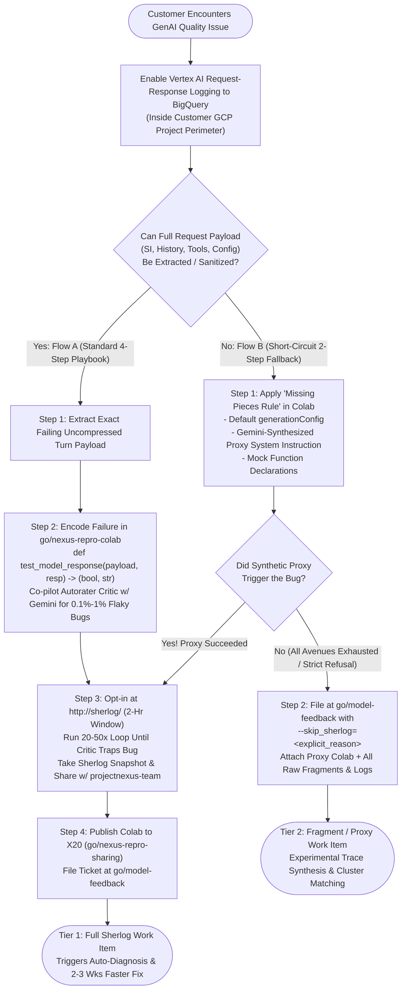
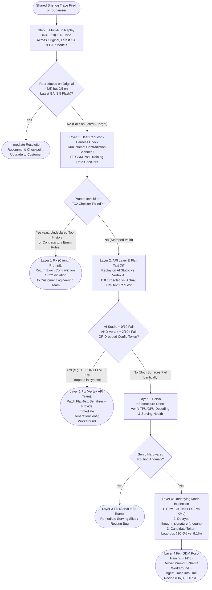
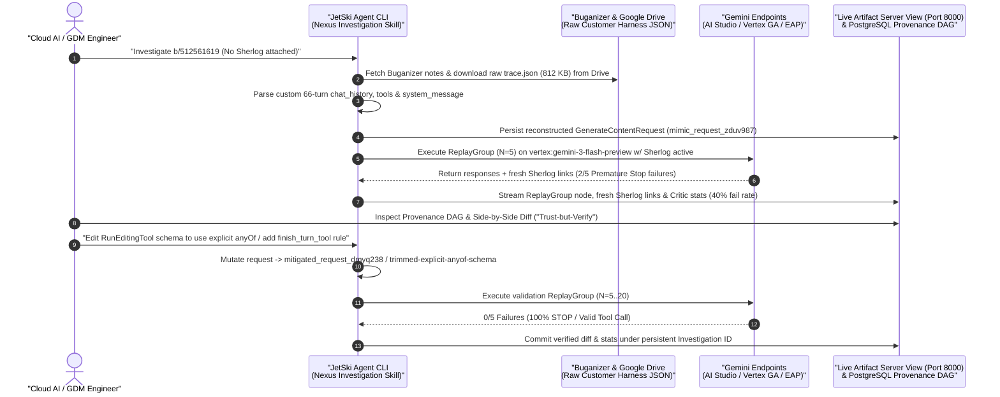
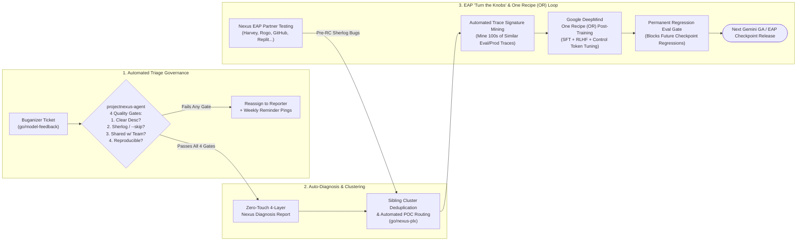
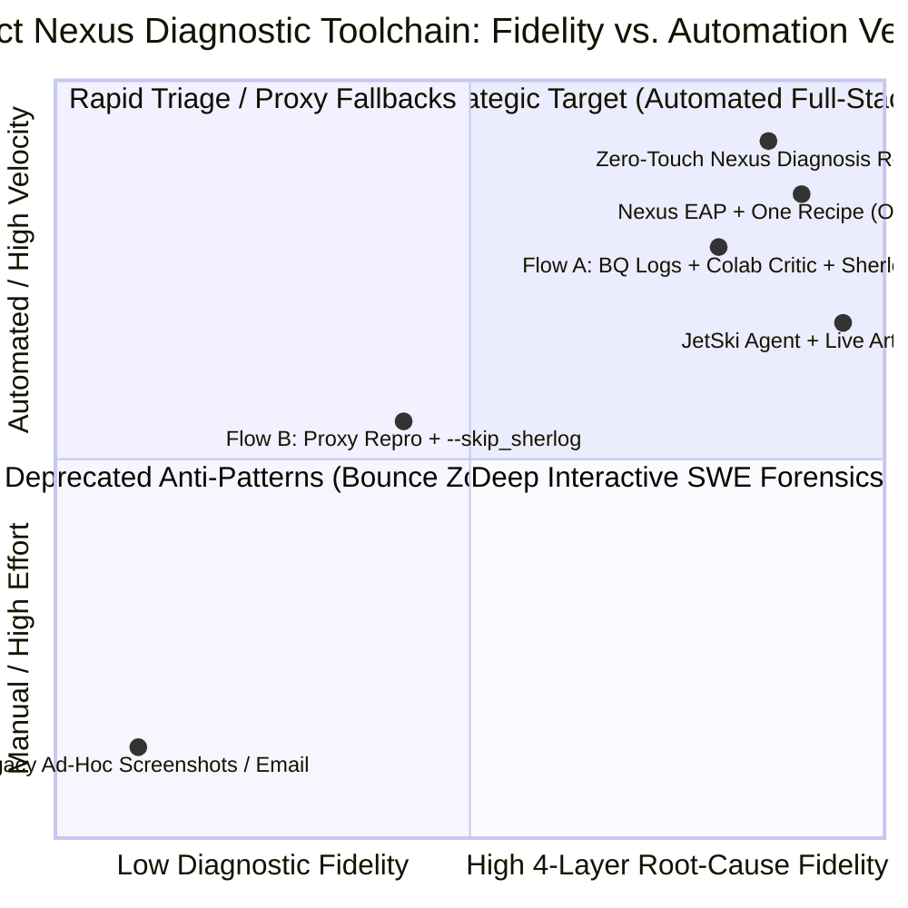

# O5: Project Nexus — Gemini Model Quality Reporting, Diagnostic Bisection & Agentic Root-Cause Engineering (`L400_version_20261026_0350`)
**Topic Tags:** `#L400_version_20261026_0350` `#ProjectNexus` `#GeminiModelQuality` `#SherlockTracing` `#DiagnosticBisection` `#JetskiAgent` `#OneRecipeHillClimbing` `#AntigravityAgenticAI`

---

## 0. OKF Document Metadata & Topic Modeling Taxonomy
**Topic Tags:** `#OKFMetadata` `#TopicModelingTaxonomy` `#L400_version_20261026_0350` `#KnowledgeCatalogSchema` `#ProjectNexusGovernance`

> **OKF v0.2 Trust Signals, Bucket Merge & Enforced FDE Grading Rubric (`OKF-L400-21`):**
> - **Version Tag:** `L400_version_20261026_0350` | **Status (`status`):** `stable` (`VETTED` / `APPROVED`) | **TTL (`stale_after`):** `2027-04-26T00:00:00Z` *(Maintains existing TTL & version)* | **Verified (`verified`):** `true`
> - **Merged Bucket OKF Lineage:** Reconciled with `Concepts 06, 07, 12` in `gs://gea_agent_development_architectural_best_practices_1790796607` (`project=fivedaysai-prd-sandbox-317383`)
> - **Cloud FDE Prevailing Standard:** `https://g3doc.corp.google.com/company/teams/cloud-fde/index.md?cl=head`
> - **Enforced Project Grading Rubric (`OKF-L400-21`):** Adheres to the 0–3 FDE Field-Readiness Rubric (Pass Gate: Average >= 2.0 across Part A & Part B; Zero-Score Pause Rule: any `0 - Not Demonstrated` triggers an immediate pause and 2-week re-presentation). Primary mapped competencies for `OKF-L400-O5`: **Part B.1.4 (Regression Detection & 4-Layer Root-Cause Triage: Model vs. Prompt vs. Harness vs. Retrieval), Part B.2.7 (Incident Escalation Runbooks Flow A/B), Part B.4.2 (Sherlock Trace Observability), Part B.6.3 (Hill-Climbing Lifecycle Management)**.

### 0.1 OKF Document Metadata & GCP Knowledge Catalog Ingestion Schema
**Topic Tags:** `#OKFMetadataTable` `#GCPKnowledgeCatalog` `#AntigravityIngestion` `#L400_version_20261026_0350`

| Metadata Attribute | Specification / Value | Architectural & Operational Significance |
| :--- | :--- | :--- |
| **Document ID** | `OKF-L400-O5` | Canonical L400 Open Knowledge Framework (OKF) identifier for Module O5 (Model Quality Reporting & Project Nexus). |
| **Document Title** | *Project Nexus: Gemini Model Quality Reporting, Diagnostic Bisection & Agentic Root-Cause Engineering* | Authoritative technical reference synthesizing field reporting, automated 4-layer stack bisection, interactive agentic investigation, and post-training hill-climbing. |
| **Version Tag** | `L400_version_20261026_0350` | Mandatory L400 Knowledge Catalog version stamp for deterministic RAG retrieval, schema lineage, and curriculum governance. |
| **Source Artifacts Synthesized** | 1. `05_model_quality_reporting.md` (Raw timestamped SME transcript)<br/>2. `o5_model_quality_reporting.md` (Curated 18-point key learning synthesis + full transcript)<br/>3. `sme-recording-o5-model-quality-reporting.md` (SME Recording O5 technical deep dive & PCA scenarios)<br/>4. `slides-o5-project-nexus-gemini-quality.md` (49-slide deck synthesis v1.1.0, `go/nexus-guide`) | Complete multi-modal convergence of Anna Novakovska's Cloud AI Applied Engineering session, Vertex Gemini Model Quality playbooks, and internal engineering toolchains. |
| **Target Capabilities** | • Verifiable Artifact Capture (**Flow A** & **Flow B**, `Sherlog` / **Sherlock** traces, **BigQuery** logging)<br/>• Probabilistic Failure Trapping (`0.1%–1%` tail risks via Colab loops & **Autorater Critics**)<br/>• **4-Layer Stack Bisection** (User Request, API Layer, Servo Layer, Underlying Model Weights)<br/>• Low-Level Token & Thought Forensics (`<ctrl42>` FC2, decrypted `thought_signature`, `<ctrl94>` vs. `<ctrl44>` logprobs)<br/>• Interactive Agentic Debugging (**JetSki / Jetski Agent** + **Live Artifact Tree Visualization Server**)<br/>• Pre-Release & Post-Training Loops (**Nexus EAP** & **One Recipe [OR]** RLHF/SFT hill-climbing) | Enables Forward Deployed Engineers (FDEs), Cloud Architects, and autonomous coding agents to diagnose complex GenAI regressions in minutes rather than months. |
| **GCP Knowledge Catalog Ingestion Schema** | `okf_schema_v4.2` (`chunk_strategy: hierarchical_heading_tags`, `embedding_model: gemini-embedding-001`, `vector_index: vertex_vector_search_l400`, `metadata_filter: #L400_version_20261026_0350`) | Every `#`, `##`, `###`, and `####` section is deterministically tagged with `**Topic Tags:**` immediately beneath the heading to support high-precision hybrid lexical + dense vector retrieval. |
| **Antigravity Agentic AI Role** | **Autonomous Diagnostic & Self-Healing Knowledge Base**: Consumed by Antigravity IDE agents, JetSki engineering agents, and Cloud AI FDEs to construct unit tests (`test_model_response`), validate `FC2` tool schemas, bisect cross-surface discrepancies (AI Studio vs. Vertex AI), and auto-remediate agent harness bugs. | Grounds Antigravity-driven agentic development workflows in Google DeepMind (GDM) post-training data standards and production observability contracts. |

### 0.2 Primary & Secondary Topic Tags
**Topic Tags:** `#PrimaryTopicTags` `#SecondarySubTopicTags` `#TaxonomyTags` `#L400_version_20261026_0350`

#### 0.2.1 Primary Topic Tags (6 Core Pillars)
**Topic Tags:** `#ProjectNexus` `#SherlogTracing` `#ActionableBugPlaybooks` `#FourLayerDiagnosticBisection` `#JetskiInteractiveAgent` `#OneRecipePostTrainingLoop`

1. **`#ProjectNexus`**: Unified model-quality resolution engine (`go/nexus-guide`, `go/nexus-plx`) spanning Gemini Text/Multimodal, GenMedia, Customer Engagement Suite (CES), Gemini Enterprise, and Google Workspace—uniting 300+ active reporters, SME Tiger Teams, and Google DeepMind (GDM) to cut resolution time by **50+ days** (and **2–3 additional weeks faster** with Sherlock traces).
2. **`#SherlogTracing`**: Cryptographic, time-windowed (`http://sherlog/`, 2-hour capture window with persistent snapshotting and `projectnexus-team` ACL sharing) full-stack internal execution traces that capture exact request tokenization, API serialization, Servo hardware telemetry, encrypted thoughts, and token logprobs.
3. **`#ActionableBugPlaybooks`**: Standardized dual-path reporting governance driving toward **100% Actionable Bugs** and **0% No-Trace Bugs** via **Flow A** (4-Step Standard Playbook: BigQuery Request-Response Logging, `go/nexus-repro-colab` with `test_model_response` Autorater Critic loops for `0.1%–1%` intermittent bugs, Sherlog capture, and X20 sharing at `go/model-feedback`) and **Flow B** (2-Step Short-Circuit Fallback: Missing Pieces Rule proxy synthesis + `--skip_sherlog=<reason>`).
4. **`#FourLayerDiagnosticBisection`**: Zero-touch auto-generated HTML **Nexus Bug Diagnosis Report** that evaluates cross-checkpoint reproducibility (`5/5` on `gemini-3-flash-preview` vs. `0/5` on `gemini-3.5-flash`) and bisects defects across **Layer 1: User Request** (Prompt Contradiction Scanner & P0 GDM Post-Training Data Checkers), **Layer 2: API Layer** (AI Studio vs. Vertex AI replay & flat-text diffing such as dropped `EFFORT LEVEL: 0.75`), **Layer 3: Servo Layer** (TPU/GPU serving health), and **Layer 4: Underlying Model** (`<ctrl95><ctrl42>call` FC2 syntax mixing, decrypted `thought_signature` into `<ctrl94>thought`, and `<ctrl94>` `9.1%` vs. `<ctrl44>` `90.6%` token logprobs).
5. **`#JetskiInteractiveAgent`**: Agentic root-causing workflow pairing the **JetSki / Jetski** software engineering agent (`Nexus Investigation Skill`) with the **Live Artifact Server View** (`http://bandemer.c.googlers.com:8000` backed by `postgres://.../nexus-debugging`) for "trust-but-verify" provenance auditing, interactive cross-surface `ReplayGroup` execution, surgical schema edits (`RunEditingTool` explicit `anyOf`), Sherlog-free Google Drive customer harness reconstruction, and on-the-fly Python diagnostic tool synthesis.
6. **`#OneRecipePostTrainingLoop`**: Closed-loop quality governance uniting the automated **Nexus Triage Agent** (4 Quality Gates), the **Early Access Program (EAP)** pre-release "turn the knobs" window, trace-signature mining across production/eval corpora, and the **One Recipe (OR)** SFT/RLHF post-training and regression-eval release gates.

#### 0.2.2 Secondary Sub-Topic Tags (6 Granular Sub-Domains)
**Topic Tags:** `#BigQueryTelemetry` `#AutoraterCriticLoops` `#PostTrainingDataCheckers` `#FlatTextSerializationDiff` `#TokenLogprobForensics` `#ArtifactTreeProvenanceDAG`

1. **`#BigQueryTelemetry`**: Customer-resident Vertex AI Request-Response Logging to BigQuery (`req_resp_logging`), preserving uncompressed intermediate turns of multi-step agent trajectories within the customer's VPC-SC, IAM, and CMEK perimeter.
2. **`#AutoraterCriticLoops`**: Programmatic Python assertions (`def test_model_response(request_payload, response_obj) -> (bool, str):`) and Gemini-co-piloted Autorater Critic prompts executed over 20–50+ iterations to deterministically trap `0.1%–1%` stochastic tail failures.
3. **`#PostTrainingDataCheckers`**: Google DeepMind P0 post-training validators (`FunctionCallsAreValidFC2`, `FunctionDeclarationsAreValidFC2`, `HasMultipleConsecutiveAssistantMessages`, `HasNoFC2Flattext`) and Prompt Contradiction Scanners that catch client-side schema and prompt defects before blaming model weights.
4. **`#FlatTextSerializationDiff`**: Expected vs. Actual flat-text tokenized request diffing across `<ctrl99>system`, `<ctrl95>`, and `<ctrl100>` boundaries to expose API translation regressions (such as Vertex AI dropping `EFFORT LEVEL: 0.75`).
5. **`#TokenLogprobForensics`**: Low-level inspection of decrypted `thought_signature` payloads (`<ctrl94>thought`) and first-step candidate token probability distributions (`<ctrl94>` thought at `p=0.091` vs. `<ctrl44>` empty function-response wait at `p=0.906`) to uncover latent failure propensity even in seemingly "successful" single runs.
6. **`#ArtifactTreeProvenanceDAG`**: Real-time PostgreSQL-backed Directed Acyclic Graph (DAG) visualization (`Investigation ID`) that records every request reconstruction (`mimic_request_zduv987`), schema diff (`trimmed-explicit-anyof-schema_iksd793`), and critic score to prevent agent hallucination and enable cross-timezone engineering handoffs.

### 0.3 Three-Tier Topic Modeling Taxonomy & Matrix
**Topic Tags:** `#ThreeTierTaxonomy` `#TaxonomyMatrix` `#DomainMapping` `#L400_version_20261026_0350`

#### 0.3.1 Three-Tier Hierarchical Taxonomy Tree
**Topic Tags:** `#HierarchicalTaxonomy` `#Tier1Foundations` `#Tier2Diagnostics` `#Tier3AgenticHillClimbing`

* **Tier 1: Model Quality Governance & Verifiable Artifact Capture**
  * **1.1 Project Nexus Resolution Engine**: Single source of truth (`go/nexus-guide`, `go/nexus-plx`), 300+ reporters, Tiger Team SMEs, 50+ day faster turnaround, 2–3 week Sherlog acceleration, cluster deduplication (55 thought-leakage tickets -> 1 parent).
  * **1.2 Four Structural LLM Reproduction Hurdles**: *Symptoms Not Prompts*, *One Symptom Many Causes*, *Any Layer Can Fail*, *Hard to Re-Run (Encrypted Thought Signatures & Flaky Outputs)*.
  * **1.3 Flow A (4-Step Standard Playbook)**: Step 1 Full Payload Capture (`contents`, `systemInstruction`, `tools`, `generationConfig`, BigQuery logging) -> Step 2 Unit Test Encoding (`test_model_response`, `0.1%–1%` Autorater Critic) -> Step 3 Repro Colab & `http://sherlog/` Snapshot -> Step 4 X20 (`go/nexus-repro-sharing`) & `go/model-feedback`.
  * **1.4 Flow B (2-Step Short-Circuit Fallback)**: Step 1 Missing Pieces Rule (Default `generationConfig`, Gemini-synthesized Proxy SI, Mock Tools) -> Step 2 Bypass Protocol (`--skip_sherlog=<reason>`, raw fragments, experimental trace synthesis).
* **Tier 2: Automated Triage Gates & 4-Layer Stack Bisection**
  * **2.1 Automated Nexus Triage Agent (`projectnexus-agent`)**: Gate 1 Unclear Description -> Gate 2 Missing Sherlog (`--skip_sherlog` check) -> Gate 3 Missing ACL (`projectnexus-team`) -> Gate 4 Non-Reproducible Across Models.
  * **2.2 Cross-Model Reproducibility Matrix**: Automated `N=5` or `N=10` critic-scored replays across original (`vertex:gemini-3-flash-preview`), latest GA (`vertex:gemini-3.5-flash`), and upcoming **EAP** checkpoints.
  * **2.3 4-Layer Serving Stack Bisection**:
    * *Layer 1 (User Request)*: Prompt Validation (`Valid` vs. `Invalid` stamps) + P0 GDM Post-Training Data Checkers (`FunctionCallsAreValidFC2`, `FunctionDeclarationsAreValidFC2`, `HasMultipleConsecutiveAssistantMessages`, `HasNoFC2Flattext`).
    * *Layer 2 (API Layer)*: Cross-Surface Replay Contrast (AI Studio vs. Vertex AI / Agent Platform) + Expected vs. Actual Flat-Text Request Diff (`EFFORT LEVEL: 0.75`).
    * *Layer 3 (Servo Layer)*: TPU/GPU Serving Infrastructure Health & Decoding Telemetry.
    * *Layer 4 (Underlying Model)*: Raw Response Flat-Text (`<ctrl95><ctrl42>call` FC2 vs. Markdown XML), Decrypted `thought_signature` (`<ctrl94>thought`), and Candidate Token Logprobs (`<ctrl94>` `9.1%` vs. `<ctrl44>` `90.6%`).
* **Tier 3: Agentic Root-Causing (`JetSki`) & Post-Training Hill-Climbing (`One Recipe`)**
  * **3.1 Interactive JetSki / Jetski Agent & Live Artifact Server**: Natural-language investigation skill + `http://bandemer.c.googlers.com:8000` ("Trust-but-Verify" Provenance DAG) + PostgreSQL persistence (`Investigation ID`).
  * **3.2 Surgical Schema Mutation & Sherlog-Free Reconstruction**: Interactive `ReplayGroup` stats, `RunEditingTool` schema mutation (`anyOf` `additionalProperties`), Google Drive raw harness ingestion (`b/512561619` `trace.json` -> `mimic_request_zduv987`), and on-the-fly custom Python tool synthesis.
  * **3.3 EAP Pre-Release Validation & One Recipe (OR) Loop**: Strategic EAP partner testing ("turn the knobs" window), trace-signature mining across production/eval corpora, SFT/RLHF post-training recipe updates, and permanent release-blocking regression evals.

#### 0.3.2 Comprehensive Topic Taxonomy Matrix Table
**Topic Tags:** `#TopicTaxonomyMatrix` `#ArchitecturalMapping` `#SourceCrossReference` `#L400_version_20261026_0350`

| Taxonomy Tier & Domain | Primary Topic Tag | Secondary Sub-Topic Tags | Key Architectural Artifacts & Primitives | Source Coverage (`05` / `o5` / `sme` / `slides`) | Antigravity Agentic AI Development Impact |
| :--- | :--- | :--- | :--- | :--- | :--- |
| **Tier 1.1: Unified Resolution Engine** | `#ProjectNexus` | `#SingleSourceOfTruth`<br/>`#TigerTeamSMEs` | `go/nexus-guide`, `go/nexus-plx`, 300+ reporters, 50+ days faster fix, 10x token efficiency tuning | `0:01–6:26`<br/>Slides 1–11 | Eliminates anecdotal escalation loops; grounds agent optimization in empirical trace clusters. |
| **Tier 1.2: Artifact Capture & Sherlog** | `#SherlogTracing` | `#BigQueryTelemetry`<br/>`#AutoraterCriticLoops` | `http://sherlog/` (2-hr window + Snapshot), `projectnexus-team` ACL, Vertex BQ Request-Response Logging | `6:27–14:40`<br/>Slides 12–19 | Captures uncompressed multi-turn agent trajectories inside customer GCP boundaries and traps `0.1%–1%` tail bugs. |
| **Tier 1.3: Dual-Path Bug Playbooks** | `#ActionableBugPlaybooks` | `#FlowAStandardPlaybook`<br/>`#FlowBShortCircuit` | `go/nexus-repro-colab`, `test_model_response()`, X20 `go/nexus-repro-sharing`, `go/model-feedback`, `--skip_sherlog` | `8:30–17:58`<br/>Slides 14–22 | Enforces 100% actionable bug hygiene; synthesizes proxy System Instructions when PII/defense rules block sharing. |
| **Tier 2.1: Automated Triage & Bisection** | `#FourLayerDiagnosticBisection` | `#PostTrainingDataCheckers`<br/>`#FlatTextSerializationDiff` | `projectnexus-agent` (4 Gates), `FunctionCallsAreValidFC2`, AI Studio vs. Vertex replay, `<ctrl99>system` `EFFORT LEVEL: 0.75` diff | `18:00–29:15`<br/>Slides 23–38 | Instantly separates client prompt/harness schema bugs (Layer 1) and Vertex API serializer bugs (Layer 2) from model weights. |
| **Tier 2.2: Model Weights & Logprob Forensics** | `#FourLayerDiagnosticBisection` | `#TokenLogprobForensics`<br/>`#DecryptedThoughts` | `<ctrl95><ctrl42>call` FC2 syntax, decrypted `thought_signature` (`<ctrl94>thought`), `<ctrl44>` (`90.6%`) vs. `<ctrl94>` (`9.1%`) logprobs | `29:16–32:10`<br/>Slides 39–42 | Exposes latent 90%+ failure propensities in single-run passes and diagnoses premature agent turn termination. |
| **Tier 3.1: Agentic Root-Causing (`JetSki`)** | `#JetskiInteractiveAgent` | `#ArtifactTreeProvenanceDAG`<br/>`#DynamicToolSynthesis` | JetSki (`Nexus Investigation Skill`), `http://bandemer.c.googlers.com:8000`, `RunEditingTool` `anyOf` diff, Drive `mimic_request` | `32:11–37:52`<br/>Slides 43–48 | Reconstructs `GenerateContentRequest` from custom third-party agent harness logs in Google Drive without an initial Sherlog. |
| **Tier 3.2: Pre-Release & Post-Training Loop** | `#OneRecipePostTrainingLoop` | `#EarlyAccessProgramEAP`<br/>`#TraceMiningRLHF` | **Nexus EAP** ("Turn the Knobs" window), **One Recipe (OR)** post-training pipeline, trace signature mining, regression eval gates | `19:05–21:45`<br/>Slides 25–28 | Converts isolated field failures into mined 500+ example SFT/RLHF training datasets and permanent release gates. |

### 0.4 Module Topic Connection & Flow Graph
**Topic Tags:** `#TopicConnectionGraph` `#MermaidArchitectureFlow` `#ASCIITopicFlow` `#L400_version_20261026_0350`

#### 0.4.1 Mermaid.js End-to-End Topic Connection Graph (`graph LR`)
**Topic Tags:** `#MermaidGraphLR` `#NexusTopology` `#EndToEndFlow`

```mermaid
graph LR
    subgraph T1["Tier 1: Telemetry & Dual-Path Bug Playbooks"]
        A["Customer GenAI Workload<br/>(Gemini / GenMedia / CES / GE / Workspace)"] --> B["4 Reproduction Hurdles<br/>(Symptoms, Multi-Cause, 4-Layer, Encrypted/Flaky)"]
        B --> C{"Full Artifacts<br/>Shareable?"}
        C -->|"Yes: Flow A (4-Step)"| D["Vertex BQ Logging +<br/>Repro Colab + Autorater Critic (0.1%-1%)"]
        D --> E["Sherlog Capture (2-Hr Window)<br/>+ Snapshot + X20 Share"]
        C -->|"No: Flow B (2-Step)"| F["Missing Pieces Proxy Repro<br/>or --skip_sherlog + Raw Fragments"]
    end

    subgraph T2["Tier 2: Automated Governance & 4-Layer Bisection"]
        E --> G["Nexus Triage Agent<br/>(4 Quality Gates)"]
        F --> G
        G --> H["Auto-Generated Nexus<br/>Bug Diagnosis Report"]
        H --> I["Cross-Model Replays<br/>(Orig vs. Latest GA vs. EAP)"]
        I --> J["4-Layer Bisection:<br/>L1 Prompt/FC2 | L2 API Flat-Text<br/>L3 Servo | L4 Model/Thoughts/Logprobs"]
    end

    subgraph T3["Tier 3: Interactive Agentic SWE & Post-Training Loop"]
        J --> K["JetSki Agent + Live Artifact Server<br/>(Trust-but-Verify Provenance DAG)"]
        K --> L["Drive Harness Reconstruction,<br/>Schema Edits & Custom Tool Synthesis"]
        J --> M["One Recipe (OR) Post-Training<br/>& EAP 'Turn the Knobs' Window"]
        L --> M
        M --> N["Trace Mining -> SFT/RLHF Weights<br/>+ Permanent Regression Eval Gate"]
    end
```



#### 0.4.2 ASCII Architectural Overview of the Project Nexus Ecosystem
**Topic Tags:** `#ASCIIDiagram` `#SystemTopology` `#ProjectNexusArchitecture`

```text
+======================================================================================================+
|                PROJECT NEXUS: UNIFIED GEMINI MODEL QUALITY RESOLUTION ENGINE (OKF-O5)                |
+======================================================================================================+
|                                                                                                      |
|  [1. CUSTOMER & FIELD CAPTURE PLANE]                                                                 |
|  +-------------------------------+    Flow A (Preferred -> 100%)    +-----------------------------+  |
|  | Vertex AI / Agent Platform    | -------------------------------> | BigQuery Request-Response   |  |
|  | GenMedia / CES / Workspace    |    Uncompressed Multi-Turn Logs  | Logging (Customer GCP Proj) |  |
|  +-------------------------------+                                  +--------------+--------------+  |
|                 |                                                                  |                 |
|                 | Flow B (PII / Sovereignty Refusal)                               v                 |
|                 v                                                   +-----------------------------+  |
|  +-------------------------------+    If Proxy Triggers Bug         | go/nexus-repro-colab        |  |
|  | Missing Pieces Proxy Synthesis| -------------------------------> | + test_model_response()     |  |
|  | (Gemini Proxy SI + Mock Tools)|                                  | (20-50x Loop for 0.1%-1%)   |  |
|  +--------------+----------------+                                  +--------------+--------------+  |
|                 | Exhausted -> --skip_sherlog=<reason>                             |                 |
|                 | + Raw Fragments / Experimental Synthesis                         v                 |
|                 |                                                   +-----------------------------+  |
|                 |                                                   | http://sherlog/ (2-Hr OptIn)|  |
|                 |                                                   | + Snapshot + X20 Share      |  |
|                 +-------------------------+-------------------------+--------------+--------------+  |
|                                           |                                        |                 |
|                                           v                                        v                 |
|  [2. AUTOMATED TRIAGE & 4-LAYER BISECTION PLANE]                                                     |
|  +------------------------------------------------------------------------------------------------+  |
|  | Buganizer (go/model-feedback) ---> Nexus Triage Agent (4 Quality Gates: Desc, Link, ACL, Repro)|  |
|  +------------------------------------------------+-----------------------------------------------+  |
|                                                   |                                                  |
|                         +-------------------------+-------------------------+                        |
|                         v                                                   v                        |
|  +----------------------------------------------+   +---------------------------------------------+  |
|  | AUTO-GENERATED NEXUS BUG DIAGNOSIS REPORT    |   | JETSKI AGENT + LIVE ARTIFACT SERVER (8000)  |  |
|  | • Step 0: Cross-Model Replay (Orig/GA/EAP)   |   | • Google Drive Raw Harness Reconstruction   |  |
|  | • Layer 1: Prompt & P0 FC2 Data Checkers     |   | • Interactive Cross-Surface ReplayGroups    |  |
|  | • Layer 2: AIS vs Vertex + Flat-Text Diff    |   | • Surgical Schema Edits (RunEditingTool)    |  |
|  | • Layer 3: Servo TPU/GPU Infra Validation    |   | • On-the-Fly Custom Python Tool Synthesis   |  |
|  | • Layer 4: Raw FC2, Thoughts & Logprobs      |   | • Postgres Provenance DAG (InvestigationID) |  |
|  +----------------------+-----------------------+   +-----------------------+---------------------+  |
|                         |                                                   |                        |
|                         +-------------------------+-------------------------+                        |
|                                                   v                                                  |
|  [3. CONTINUOUS LEARNING & RELEASE GATE PLANE]                                                       |
|  +------------------------------------------------------------------------------------------------+  |
|  | • Short-Term Unblocking: Fast Config/Prompt/Schema Workarounds (e.g., 10x Token Efficiency)    |  |
|  | • Pre-Release Tuning: Nexus Early Access Program (EAP) "Turn the Knobs" before Final RC        |  |
|  | • Long-Term Fix: One Recipe (OR) Trace Signature Mining -> SFT/RLHF -> Regression Eval Gates   |  |
|  +------------------------------------------------------------------------------------------------+  |
+======================================================================================================+
```

---

## 1. Executive Overview, Problem Statement & Antigravity Agentic AI Development Context
**Topic Tags:** `#ExecutiveOverview` `#ProblemStatement` `#AntigravityAgenticAI` `#ProjectNexusVision` `#L400_version_20261026_0350`

> **Enforced FDE Project Grading Rubric Reference (`OKF-L400-21` & `g3doc/company/teams/cloud-fde`):** Every project applying Section 1 of `OKF-L400-O5` is graded against **Part B.1.4 (Regression Detection & 4-Layer Root-Cause Triage: Model vs. Prompt vs. Harness vs. Retrieval), Part B.2.7 (Incident Escalation Runbooks Flow A/B), Part B.4.2 (Sherlock Trace Observability), Part B.6.3 (Hill-Climbing Lifecycle Management)** and merged bucket **Concepts 06, 07, 12** (`stale_after: 2027-04-26T00:00:00Z`, version `L400_version_20261026_0350`). Builders must achieve >= 2 (**Competent**) across Part A & Part B and avoid any 0 (**Not Demonstrated**) pause triggers.

### 1.1 The Evolution from 2024 Ad-Hoc Escalations to Project Nexus
**Topic Tags:** `#AdHocEscalations` `#UnifiedResolutionEngine` `#PortfolioCoverage` `#ResolutionVelocity`

In 2024, enterprise model quality reporting in Google Cloud relied primarily on manual, unstructured field escalations: Customer Engineers (CEs), Forward Deployed Engineers (FDEs), and account teams gathered anecdotal complaints over email or chat threads (*"the model quality got worse"* or *"the agent stopped calling tools"*) and manually pinged field specialists. As enterprise Generative AI adoption accelerated from simple single-turn text prompts into complex **multi-turn agentic harnesses, multimodal pipelines, and high-throughput production orchestrators**, those manual escalation channels broke down completely.

**Project Nexus** (`go/nexus-guide`, tracked centrally in `go/nexus-plx`) was architected by Cloud AI Applied Engineering (led by Anna Novakovska and the Vertex Gemini Model Quality engineering teams) in partnership with **Google DeepMind (GDM)** to serve as Google's **unified model-quality resolution engine and single source of truth**. Rather than treating model quality complaints as isolated support tickets, Project Nexus establishes a closed-loop engineering system across the entire Google Cloud Generative AI portfolio:
* **Core Gemini Models**: Gemini Pro, Flash, and Flash-Lite checkpoints across Vertex AI (`GenerateContent` / `StreamGenerateContent`) and Google AI Studio (Gemini Developer API).
* **GenMedia**: Imagen, Veo, Chirp, and Lyria multimodal generation workloads.
* **Customer Engagement Suite (CES)**: Conversational agents, contact-center QA, and virtual agent state machines.
* **Gemini Enterprise (GE) & Agent Platform**: Managed enterprise multi-agent orchestration, grounding, and connector ecosystems.
* **Google Workspace**: Embedded Gemini productivity and document-intelligence workflows.

#### 1.1.1 Quantitative Business & Engineering Impact of Project Nexus
**Topic Tags:** `#NexusMetrics` `#ResolutionAcceleration` `#ClusterDeduplication` `#TokenEfficiencyCaseStudy`

| Operational Metric / Dimension | Legacy 2024 Field Escalation Baseline | Project Nexus Unified Engine (`go/nexus-plx`) | Verified Engineering & Customer Impact |
| :--- | :--- | :--- | :--- |
| **Active Engineering Reporters** | Fragmented email/chat threads; no central index | **300+ active reporters** across Google Cloud & Field Engineering | Single source of truth for all reproducible model quality issues across Cloud & GDM. |
| **End-to-End Resolution Velocity** | Stalls for months; high triage bounce rate | **50+ days faster** average resolution time across the program | Rapid engineering triage, automated POC assignment, and direct **One Recipe (OR)** ingestion. |
| **Sherlock (`Sherlog`) Trace Acceleration** | Manual guesswork without internal stack telemetry | **2 to 3 additional weeks faster** resolution when a valid `http://sherlog/` trace is attached | Pinpoints exact failing layer (User Request, API, Servo, or Model) in minutes via zero-touch auto-diagnosis. |
| **Cluster Deduplication Case Study (Thought Leakage)** | Duplicate tickets filed independently across dozens of accounts | **55 customer bug reports** of thought-token leakage aggregated under **1 parent bug** (**23 fixed** in recent model revisions) | Eliminates redundant triage, tracks cluster-wide burn-down, and notifies all 55 account teams upon checkpoint fix. |
| **Rapid SME Workaround Case Study (`gemini-2.5-pro` -> `gemini-3.5-flash`)** | Customer blocks migration waiting months for a new model checkpoint | **~10x token efficiency improvement** delivered within **hours** via parameter/prompt tuning | Unblocked a customer hitting `MAX_TOKENS` during migration from `gemini-2.5-pro` to `gemini-3.5-flash` by adjusting thinking levels, temperature, and output format. |

### 1.2 The Four Structural Hurdles of Diagnosing LLM & Agentic Failures
**Topic Tags:** `#FourReproductionHurdles` `#SymptomsNotPrompts` `#OneSymptomManyCauses` `#AnyLayerCanFail` `#EncryptedThoughtSignatures`

A central thesis of Project Nexus is: ***"The model quality got worse" is an anecdote; a concrete, reproducible issue is a work item.*** However, transforming a customer's production failure into a reproducible work item requires overcoming four foundational technical hurdles unique to modern LLMs and reasoning agents:

1. **Hurdle 1 — Symptoms, Not Prompts (*Missing Customer Context*)**:
   * Enterprise customers frequently report surface symptoms (*"the agent hallucinated a SQL filter"* or *"it hit max tokens"*) while withholding proprietary `SystemInstruction` prompts, complex multi-agent orchestration wrappers, dynamic memory compression logic, or sensitive PII/PHI datasets.
   * Furthermore, custom agent frameworks dynamically summarize, truncate, or overwrite intermediate conversation turns (`contents`), obscuring the exact turn where the reasoning trajectory derailed.
2. **Hurdle 2 — One Symptom, Many Root Causes (*Diagnostic Ambiguity*)**:
   * Identical externally visible symptoms can originate from radically different underlying mechanisms. For example, **Thought Token Leakage** (internal reasoning tokens spilling into the final user-visible response) or **`MAX_TOKENS` Exhaustion** can be caused by:
     * Insufficient `thinking_budget` or stripped `EFFORT LEVEL` settings;
     * Contradictory rules in the user's `SystemInstruction` causing reasoning loops;
     * Mismatched tool names or undeclared historical function calls in multi-turn memory; or
     * True post-training model weight defects on specific token sequences.
3. **Hurdle 3 — Any Layer Can Fail (*4-Layer Serving Stack Complexity*)**:
   * An enterprise request traverses four distinct architectural layers before returning a response:
     1. **Layer 1: User Request / Client SDK Harness** (JSON/Protobuf payload construction, `generationConfig` defaults, conversation history formatting, and `FC2` tool schemas).
     2. **Layer 2: API Serialization Layer** (Surface-specific request translation on Vertex AI vs. AI Studio vs. Agent Platform into flat-text tokenized model inputs).
     3. **Layer 3: Servo Serving Infrastructure** (TPU/GPU accelerator slices, KV-cache routing, speculative decoding, and host preemption handling).
     4. **Layer 4: Underlying Model Weights** (Raw transformer decoding, internal control tokens `<ctrl42>` / `<ctrl44>` / `<ctrl94>`, and sampling probability distributions).
   * Without full-stack internal tracing, an engineer cannot tell whether a `MALFORMED_FUNCTION_CALL` error is a model weight regression or a Vertex AI API serializer bug.
4. **Hurdle 4 — Hard to Re-Run (*Encrypted Thought Signatures & Probabilistic Tail Failures*)**:
   * **Encrypted `thought_signature` Payloads**: In multi-turn Gemini 2.5/3.x reasoning models, intermediate model turns include cryptographically signed and encrypted `thought_signature` fields to preserve reasoning continuity across turns while protecting internal chain-of-thought representations. Manually copy-pasting conversation text into AI Studio omits or invalidates these signatures, causing either HTTP `400` validation errors or completely altered model behavior.
   * **Stochastic / Flaky Outputs (`0.1%–1%` Occurrence Rate)**: Severe production bugs—such as token-draining infinite repetition loops that spike Cloud Billing costs or rare instruction leaks—often trigger in only **0.1% to 1% of requests**. Running a single manual test in a playground will pass 99%+ of the time, creating a false sense of security unless automated multi-iteration replay loops and programmatic critics are used.

### 1.3 Antigravity Agentic AI Development Context & GCP Knowledge Catalog Integration
**Topic Tags:** `#AntigravityDevelopment` `#AgenticSelfHealing` `#GCPKnowledgeCatalog` `#L400_version_20261026_0350`

In **Antigravity-driven Agentic AI development**, autonomous software engineering agents (such as **JetSki / Jetski** and customer-facing enterprise agents built on the Google Cloud Agent Development Kit [ADK] and Vertex AI Agent Engine) must continuously build, validate, debug, and hill-climb complex multi-step workflows. Ingesting this `OKF-L400-O5` (`L400_version_20261026_0350`) artifact into the **GCP Knowledge Catalog** empowers Antigravity agents and human architects in four ways:
1. **Automated Pre-Flight Hygiene (Shift-Left Validation)**: Antigravity coding agents query the Knowledge Catalog rules for **Layer 1 GDM Post-Training Data Checkers** (`FunctionCallsAreValidFC2`, `FunctionDeclarationsAreValidFC2`, `HasMultipleConsecutiveAssistantMessages`, `HasNoFC2Flattext`) to statically validate agent harnesses and MCP tool schemas *before* deployment.
2. **Autonomous Repro Unit-Test Generation**: When an Antigravity agent encounters a stochastic failure (`0.1%–1%`), it automatically scaffolds the Project Nexus `def test_model_response(request_payload, response_obj) -> (bool, str):` assertion interface and executes a 20–50x critic-scored loop to trap the exact `Sherlog` trace.
3. **Cross-Surface & Flat-Text Root-Cause Bisection**: Agents use the 4-layer bisection decision tree to distinguish client harness bugs from API translation bugs (such as dropped `EFFORT LEVEL: 0.75` headers or `additionalProperties` schema rejections).
4. **Trust-but-Verify Agentic Investigation**: By pairing autonomous reasoning in **JetSki** with deterministic provenance tracking in the **Live Artifact Server View** (`http://bandemer.c.googlers.com:8000`), Antigravity workflows guarantee zero hallucination during root-cause analysis and seamless cross-timezone state persistence via `Investigation ID`.

---

## 2. Deep Technical Architecture, Matrices, Visual Pictures & Flow Diagrams
**Topic Tags:** `#DeepTechnicalArchitecture` `#ProjectNexusLifecycle` `#FourLayerBisection` `#JetskiArchitecture` `#OneRecipeLoop` `#L400_version_20261026_0350`

> **Enforced FDE Project Grading Rubric Reference (`OKF-L400-21` & `g3doc/company/teams/cloud-fde`):** Every project applying Section 2 of `OKF-L400-O5` is graded against **Part B.1.4 (Regression Detection & 4-Layer Root-Cause Triage: Model vs. Prompt vs. Harness vs. Retrieval), Part B.2.7 (Incident Escalation Runbooks Flow A/B), Part B.4.2 (Sherlock Trace Observability), Part B.6.3 (Hill-Climbing Lifecycle Management)** and merged bucket **Concepts 06, 07, 12** (`stale_after: 2027-04-26T00:00:00Z`, version `L400_version_20261026_0350`). Builders must achieve >= 2 (**Competent**) across Part A & Part B and avoid any 0 (**Not Demonstrated**) pause triggers.

### 2.1 Project Nexus End-to-End Quality Lifecycle, Sherlock (`Sherlog`) Trace Capture & Flow A vs. Flow B Bug Escalation
**Topic Tags:** `#ProjectNexusLifecycle` `#SherlogCapture` `#FlowAPlaybook` `#FlowBFallback` `#BigQueryLogging` `#AutoraterCritics`

#### 2.1.1 Anatomy of a Fully Reproducible Request & Vertex AI BigQuery Logging
**Topic Tags:** `#GenerateContentRequest` `#BigQueryRequestResponseLogging` `#MultiTurnAgentCapture` `#ZeroExfiltrationTelemetry`

To diagnose any LLM or agentic failure deterministically, engineering requires the exact **atomic `GenerateContentRequest` payload** from the specific turn where the failure originated—not the final turn where the orchestrator crashed. A complete request payload comprises four mandatory structural components:
1. **`contents` (Multi-Turn Conversation History)**: Every `user` and `model` turn leading up to the failure, including exact `functionCall` and `functionResponse` blocks, multimodal media pointers, and encrypted `thought_signature` fields.
2. **`systemInstruction` (Full System Prompt)**: The complete, unredacted system instruction governing persona, constraints, formatting rules, and tool-use policies.
3. **`tools` & `toolConfig` (Function Declarations & Execution Mode)**: Every declared `FunctionDeclaration` (name, description, JSON Schema parameters, `anyOf` / `additionalProperties` definitions) and `function_calling_config` (`AUTO`, `ANY`, `NONE`).
4. **`generationConfig` (Sampling & Thinking Parameters)**: Exact values for `temperature`, `topP`, `topK`, `maxOutputTokens`, `responseMimeType`, `responseSchema`, and `thinkingConfig` (`thinkingBudget` / `effort_level`). **Critical Quirk**: Client SDK defaults (e.g., Python `google-genai` SDK or third-party LangChain/Rust wrappers) frequently differ from raw Vertex AI REST API defaults; omitting `generationConfig` invalidates reproduction.

**Solving the Agent Harness Compression Problem with BigQuery Logging**:
Modern agent orchestrators frequently summarize, compress, or overwrite intermediate conversation turns in memory to conserve context tokens. If Turn 4 of an 8-turn clinical or financial trajectory subtly drops a constraint and causes Turn 7 to enter an infinite loop, scraping the application's final state fails to capture Turn 4. Project Nexus prescribes enabling **native Vertex AI Request-Response Logging to BigQuery** (`go/nexus-guide`) inside the customer's own GCP project:
* Captures every raw, uncompressed intermediate request and response turn automatically at the Vertex AI endpoint boundary.
* **Zero Data Exfiltration**: All logs remain inside the customer's own GCP project boundary, governed by customer IAM, VPC Service Controls (VPC-SC), and Customer-Managed Encryption Keys (CMEK). Customers can query the exact failing turn in BigQuery, sanitize any PII/PHI locally, and export only the sanitized payload for Flow A reproduction.

#### 2.1.2 Flow A (Standard 4-Step Playbook) vs. Flow B (Short-Circuit 2-Step Fallback)
**Topic Tags:** `#FlowAvsFlowB` `#NexusReproColab` `#TestModelResponse` `#SkipSherlog` `#MissingPiecesRule`

Project Nexus enforces a strict North Star metric: **Maximize Full Sherlog Traces toward 100%** and **Drive "No Traces At All" to 0%**. To achieve this across both open and highly regulated workloads, Nexus defines two formal submission workflows:

##### Flow A: The Standard 4-Step Playbook (Preferred Path -> Target 100%)
**Topic Tags:** `#FlowA` `#FourStepPlaybook` `#SherlogSnapshot` `#X20Sharing`

* **Step 1 — Capture Complete Request Details**: Extract the exact failing turn's `contents`, `systemInstruction`, `tools`, and `generationConfig` (ideally via Vertex AI BigQuery Request-Response Logging).
* **Step 2 — Encode Intermittent Failures (`0.1%–1%`) as a Programmatic Unit Test**:
  * Because LLM outputs are probabilistic, critical bugs (such as token-draining repetition loops that cause billing spikes or rare thought-token leaks) often occur in only **0.1% to 1% of runs**.
  * Engineers open the standardized **Nexus Reproduction Colab** (`go/nexus-repro-colab`) and implement the Python assertion interface:
    ```python
    def test_model_response(request_payload: dict, response_obj: Any) -> tuple[bool, str]:
        """
        Evaluates whether a single model inference succeeded or triggered the target bug.
        Returns:
            (True, "") if the response is valid/healthy.
            (False, "Detailed failure reason") if the target symptom/bug is detected.
        """
    ```
  * **Co-Piloting with Gemini (Autorater Critic)**: Rather than hand-coding brittle regexes for semantic bugs, engineers pass a sample bad output and evaluation rules to Gemini to draft an **Autorater / Critic prompt** inside `test_model_response`.
* **Step 3 — Reproduce in Colab with `Sherlog` Active & Snapshot the Trace**:
  * Enable tracing at **`http://sherlog/`**, which opens an active **2-hour trace capture window** for the engineer's credentials.
  * Execute the inference loop in `go/nexus-repro-colab` (**20 to 50+ iterations**, or up to 500 for `0.2%` bugs) until `test_model_response` returns `(False, ...)`, tracking the exact statistical failure rate (e.g., *"failing 1% of the time"* or *"2/50 runs failed"*).
  * Click **"Take Snapshot"** in the Sherlog UI (so the trace never expires) and **share permissions with `projectnexus-team`**.
* **Step 4 — Publish Repro Colab to X20 & File via `go/model-feedback`**:
  * Publish the reproduction Colab notebook to **X20** (`go/nexus-repro-sharing`) and submit the Buganizer issue via **`go/model-feedback`** attaching both the X20 Colab link and the snapshotted `http://sherlog/` link.

##### Flow B: The Short-Circuit 2-Step Fallback Protocol (When Critical Data Cannot Be Shared)
**Topic Tags:** `#FlowB` `#MissingPiecesRule` `#ProxyPromptSynthesis` `#SkipSherlogProtocol`

Used **only** when critical artifacts (full `SystemInstruction`, proprietary financial/defense data, customer images, or unredacted PII/PHI) are withheld by the customer:
* **Step 1 — The "Missing Pieces" Rule (Synthetic Proxy Reproduction)**:
  * **Missing `generationConfig`**: Test with standard default configuration settings first.
  * **Missing `systemInstruction`**: Feed a high-level structural description of the customer's use case and symptom into **Gemini** and prompt it to synthesize a plausible **Proxy System Instruction**.
  * **Missing `tools` / Function Declarations**: Construct lightweight **mock function declarations** matching the customer's domain.
  * **The Golden Rule of Flow B**: *If synthetic proxy reproduction triggers the failure in Colab, immediately transition back to **Flow A** (Step 3 & Step 4) to capture a real Sherlog trace!* Even when proxy reproduction fails to trigger the bug, the mock Colab script is still highly valuable to engineering.
* **Step 2 — Bypass Submission Protocol (`--skip_sherlog=<reason>`)**:
  * If all proxy reproduction avenues are exhausted or the customer legally prohibits trace capture, file the bug at `go/model-feedback` and include the mandatory bypass flag in the ticket body:
    `--skip_sherlog=The customer's input data contains highly sensitive, proprietary...` (or `skip sherlock` with explicit justification).
  * **Include Every Available Fragment**: Attach the un-reproduced proxy Colab, raw error stack strings, partial JSON fragments, and screenshots. The Nexus backend uses automated indexing and an **experimental trace-synthesis tool** to reconstruct realistic traces from incomplete fragments and map the ticket to existing reproducible parent bug clusters.

#### 2.1.3 ASCII Diagram: The 3-Tier Trace Spectrum & Flow A / Flow B Architecture
**Topic Tags:** `#ASCIITraceSpectrum` `#FlowAArchitecture` `#FlowBArchitecture`

```text
+----------------------------------------------------------------------------------------------------+
|                      THE PROJECT NEXUS 3-TIER TRACE SPECTRUM & ESCALATION FLOW                     |
+----------------------------------------------------------------------------------------------------+
|                                                                                                    |
|  TIER 1: FULL SHERLOG TRACE (FLOW A)  ============> [TARGET: MAXIMIZE TOWARD 100%]                 |
|  +----------------------------------------------------------------------------------------------+  |
|  | 1. Vertex AI BQ Logging (Customer Project) -> Uncompressed Turn Payload                      |  |
|  | 2. go/nexus-repro-colab -> def test_model_response(payload, resp) -> (bool, str) [20-50x]    |  |
|  | 3. Enable http://sherlog/ (2-Hr Window) -> Trap Failure -> Take Snapshot -> Share w/ Team    |  |
|  | 4. Publish to X20 (go/nexus-repro-sharing) -> File at go/model-feedback                      |  |
|  | => OUTCOME: Triggers Zero-Touch 4-Layer Report + Resolves 2-3 Weeks Faster (50+ Days Total)  |  |
|  +----------------------------------------------------------------------------------------------+  |
|                                                                                                    |
|  TIER 2: PARTIAL / FRAGMENT TRACE (FLOW B) =======> [TRACK, SUPPORT & SYNTHESIZE]                  |
|  +----------------------------------------------------------------------------------------------+  |
|  | 1. Missing Pieces Rule: Default Config + Gemini-Synthesized Proxy SI + Mock Tool Schemas     |  |
|  |    |-- (If Proxy Reproduces Bug!) ---> Transition Immediately to TIER 1 (Flow A Step 3)      |  |
|  |    +-- (If Exhausted / PII Locked) --> Proceed to Flow B Step 2                              |  |
|  | 2. File with --skip_sherlog=<explicit_reason> + Attach Proxy Colab & Raw Error Fragments     |  |
|  | => OUTCOME: Experimental Trace Synthesis + Sibling Cluster Matching + Priority Weighting     |  |
|  +----------------------------------------------------------------------------------------------+  |
|                                                                                                    |
|  TIER 3: NO TRACES AT ALL (LEGACY AD-HOC) ========> [TARGET: DRIVE TO 0% (BOUNCED)]                |
|  +----------------------------------------------------------------------------------------------+  |
|  | • Vague anecdotes ("model regressed") or un-runnable screenshots without --skip_sherlog      |  |
|  | => OUTCOME: Automatically reassigned back to reporter by projectnexus-agent w/ weekly pings  |  |
|  +----------------------------------------------------------------------------------------------+  |
+----------------------------------------------------------------------------------------------------+
```

#### 2.1.4 Mermaid.js Decision & Execution Flowchart: Flow A vs. Flow B Playbooks
**Topic Tags:** `#MermaidFlowchart` `#BugSubmissionDecisionTree` `#SherlogWorkflow`



#### 2.1.5 Multi-Dimensional Comparison Matrix: Flow A vs. Flow B vs. Legacy Escalation
**Topic Tags:** `#FlowComparisonMatrix` `#TelemetryGovernance` `#BugFilingStandards`

| Architectural Dimension | Flow A: Standard 4-Step Playbook (`Full Sherlog`) | Flow B: Short-Circuit 2-Step Fallback (`--skip_sherlog`) | Legacy Ad-Hoc Reporting (`No Traces At All`) |
| :--- | :--- | :--- | :--- |
| **Target Program Share** | **Maximize toward 100%** (Gold Standard) | **Exception-Only** (Regulated / Privacy-Locked) | **Drive to 0%** (Deprecated Anti-Pattern) |
| **Primary Data Source** | Customer Vertex AI BigQuery Request-Response Logs + Sanitized Payload | Gemini-synthesized Proxy SI + Mock Tool Declarations + Raw Error Fragments | Unstructured email descriptions, chat threads, or cropped UI screenshots |
| **Handling `0.1%–1%` Intermittent Bugs** | **Deterministic Trapping**: 20–50+ loop in `go/nexus-repro-colab` scored by `test_model_response` Autorater Critic | **Attempted Proxy Loop**: Runs `test_model_response` against synthetic prompt; falls back to fragments if 0% repro | **Complete Failure**: Single manual retries pass 99%+ of the time; dismissed as "Cannot Reproduce" |
| **Sherlog Trace Lifecycle** | Active 2-hr window at `http://sherlog/` -> **Take Snapshot** -> Share ACL with `projectnexus-team` | Bypassed via explicit `--skip_sherlog=<reason>` flag after proxy attempts fail | Missing without justification; fails Gate 2 & Gate 3 of `projectnexus-agent` |
| **Downstream Engineering Routing** | Triggers **Zero-Touch Nexus Diagnosis Report**, **EAP** replay, and **One Recipe (OR)** trace mining | Routed to **Experimental Trace Synthesis** engine and indexed against sibling parent bug clusters | **Automatically Bounced**: Reassigned back to reporter with automated weekly reminders |

#### 2.1.6 Inline Section Best Practices (Section 2.1)
**Topic Tags:** `#Section2_1BestPractices` `#BigQueryLoggingBestPractices` `#SherlogHygiene`

* **Always Enable Vertex AI Request-Response Logging to BigQuery Early**: Configure BigQuery logging in staging and production projects *before* incidents occur so uncompressed intermediate agent turns are captured inside the customer's GCP security boundary without relying on application-level memory state.
* **Never Rely on Single-Shot Retries for Stochastic Bugs**: When a customer reports a rare (`0.1%–1%`) repetition loop or empty response, always encode the symptom in `def test_model_response(request_payload, response_obj) -> (bool, str):` and run 20–50+ iterations with a Gemini-drafted Autorater Critic while `http://sherlog/` is active.
* **Snapshot and Share Every Sherlog Link Before Filing**: A raw `http://sherlog/` capture window stays active for 2 hours, and trace links are private by default; always click **"Take Snapshot"** and grant read access to `projectnexus-team` (and publish the X20 Colab via `go/nexus-repro-sharing`) so `projectnexus-agent` does not bounce the ticket.
* **Treat Failed Flow B Proxy Scripts as First-Class Artifacts**: Even if a Gemini-synthesized proxy System Instruction in Flow B Step 1 fails to reproduce the bug, always attach the proxy Colab notebook alongside `--skip_sherlog=<reason>` so engineering knows which hypotheses were already ruled out.

#### 2.1.7 Inline Section FAQs (Section 2.1)
**Topic Tags:** `#Section2_1FAQs` `#SherlogFAQs` `#FlowAFAQs`

1. **Q: Why does manual copy-pasting of a multi-turn agent conversation into Google AI Studio or Vertex AI Studio usually fail to reproduce a production bug?**
   * **A:** First, agent orchestrators dynamically compress or overwrite earlier turns, so the scraped final prompt lacks the intermediate turn where the error actually started. Second, SDK `generationConfig` defaults often differ from playground defaults. Third, multi-turn Gemini reasoning responses contain cryptographically signed, encrypted `thought_signature` blocks that cannot be manually copy-pasted as plain text without invalidating the turn state.
2. **Q: How can a regulated healthcare or financial services customer use Flow A without violating HIPAA or data residency policies?**
   * **A:** By enabling **Vertex AI Request-Response Logging to BigQuery** inside their own GCP project. The uncompressed logs never leave the customer's VPC Service Controls (VPC-SC) and CMEK perimeter. The customer's security team extracts the specific failing turn from BigQuery, scrubs/redacts any PHI/PII tokens locally, and runs the sanitized structure in `go/nexus-repro-colab` to generate a clean `Sherlog` trace.
3. **Q: What happens if I file a bug at `go/model-feedback` without a `http://sherlog/` link and forget to include the `--skip_sherlog=<reason>` tag?**
   * **A:** The automated **Nexus Triage Agent** (`projectnexus-agent`) will immediately flag the ticket at **Gate 2 (Missing Sherlog Check)**, post an automated policy reminder, reassign the Buganizer issue back to you, and send weekly nag notifications until you either attach a shared Sherlog snapshot or provide a valid `--skip_sherlog=<reason>` justification.
4. **Q: Why do I need to activate `http://sherlog/` right before running my Colab reproduction loop?**
   * **A:** Full-stack internal `Sherlog` trace recording captures heavyweight flat-text serialization, Servo telemetry, encrypted thoughts, and token logprobs across Google's serving stack. To avoid global serving overhead, `http://sherlog/` enables trace capture on an opt-in **2-hour window** for your identity; once the failing run is trapped by your Colab critic loop, taking a **Snapshot** persists that specific trace permanently.

---

### 2.2 4-Layer Root-Cause Triage & Bisection Architecture (Auto-Generated Nexus Bug Diagnosis Report)
**Topic Tags:** `#FourLayerBisection` `#NexusBugDiagnosisReport` `#PostTrainingCheckers` `#FlatTextDiff` `#TokenLogprobs` `#DecryptedThoughts`

When a reporter files a Buganizer issue with a valid, shared `Sherlog` link (`Flow A`), the Project Nexus pipeline automatically generates a standalone HTML **Nexus Bug Diagnosis Report** (persisted in a PostgreSQL **Artifact Tree**) and posts its URL directly onto the Buganizer thread within minutes. This zero-touch pipeline executes **Step 0 (Cross-Model Reproducibility)** followed by a deterministic **4-Layer Serving Stack Bisection** across **User Request**, **API Layer**, **Servo Layer**, and **Underlying Model Weights**.

#### 2.2.1 Step 0: Cross-Model Reproducibility & Automated Critic Scoring
**Topic Tags:** `#CrossModelReproducibility` `#AutomatedCritic` `#CheckpointUpgrade` `#EAPReplay`

Before dissecting low-level stack layers, the Nexus Report replays the exact captured `Sherlog` request multiple times (`N=5` or `N=10`) against:
1. The **Original Reported Model** (e.g., `vertex:gemini-3-flash-preview`);
2. The **Latest Generally Available (GA) Model** (e.g., `vertex:gemini-3.5-flash`); and
3. Upcoming **Early Access Program (EAP) Endpoints**.

Each replay is automatically graded (`PASSED` vs. `FAILED`) by an **AI Critic** that inspects finish reasons (`STOP` vs. `MAX_TOKENS` / `MALFORMED_FUNCTION_CALL`), candidate token counts, thought token counts, and semantic output rules:
* **Real-World Telemetry Evidence (Slide 31)**:
  * **Original Model (`vertex:gemini-3-flash-preview`)**: **`ERROR REPRODUCIBILITY 5/5`** (`finish_reason: MAX_TOKENS`, `prompt_tokens: 47084`, `candidates_tokens: 653`, `thoughts_token_count: 15727`). The Critic flags: *"The model hit the MAX_TOKENS limit and failed to complete the JSON output. The thoughts_token_count is very high (15727), exceeding the 15k threshold mentioned in the bug."*
  * **Newer Model (`vertex:gemini-3.5-flash`)**: **`ERROR REPRODUCIBILITY 0/5`** (`finish_reason: STOP`, `prompt_tokens: 47084`, `candidates_tokens: 2238`, `thoughts_token_count: 10897`). All 5 runs pass cleanly.
* **Immediate Architectural Action**: When `ERROR REPRODUCIBILITY` drops from `5/5` on an older checkpoint to `0/5` on a newer checkpoint, the FDE can immediately unblock the customer by recommending a **checkpoint upgrade** with empirical proof.

#### 2.2.2 Layer 1: User Request Validation (Prompt Contradiction Scanner & P0 GDM Post-Training Data Checkers)
**Topic Tags:** `#Layer1UserRequest` `#PromptValidation` `#GDMPostTrainingCheckers` `#FC2Validation`

If the bug reproduces on current checkpoints, Layer 1 inspects whether the defect was induced by the **User Request / Client Agent Harness** via two automated sub-engines:

1. **Automated Prompt Contradiction Scanner (`Valid` vs. `Invalid` Stamp — Slide 35)**:
   * **`Valid` Prompt with Diagnostic Warning (Left Example)**: The user prompt requests a bash script inside `<final_bash_script>` XML tags with no tools declared (`Tools present: False`), yet the model fails with `MALFORMED_FUNCTION_CALL`. Layer 1 stamps the prompt **`Valid`** and notes that the model/API aggressively misinterpreted `<final_bash_script>` XML tags as a tool call—proving this is a **true Model/API bug**, not user error.
   * **`Invalid` Prompt Stamp (Right Example — 100+ `add_memory` Tool Calls)**: A customer complains Gemini emits 100+ identical `add_memory` tool calls in a single turn. Layer 1 stamps the prompt **`Invalid`** and isolates three fatal client-side contradictions:
     1. *Mismatched Tool Name*: The `SystemInstruction` tells the model to call `manage_core_memory`, whereas the actual declared tool in `function_declarations` is `mcp_matrix_manage_memory`.
     2. *Invalid Enum Values Instructed*: The prompt commands the model to invoke `UPDATE` or `DELETE` actions, which do not exist in the tool schema's `action` enum (`[add_memory, search_memories, get_stats, ...]`).
     3. *Contradictory Manual vs. Automatic Memory Rules*: One paragraph states core memory is *"automatically injected — Do NOT manually search,"* while the next commands *"When significant events occur, update core memory."*
2. **P0 Google DeepMind (GDM) Post-Training Data Checkers (Slide 36)**:
   * Runs the exact programmatic validators that Google DeepMind uses to filter post-training SFT/RLHF datasets against the customer's multi-turn request:
     * **`FunctionCallsAreValidFC2` (Priority `P0`)**: Verifies that every historical `functionCall` in `contents` matches a currently declared function in `tools.function_declarations` and conforms to the `FC2` schema. *(Example Failure: Customer history contained calls to `mcp_lark-docs-mcp_fetch-doc` and `mcp_lark-docs-mcp_add-comments`, which the client harness had stripped from `function_declarations` on Turn 5).*
     * **`FunctionDeclarationsAreValidFC2` (Priority `P0`)**: Validates that all declared tool schemas conform to strict `FC2` OpenAPI/JSON Schema types.
     * **`HasMultipleConsecutiveAssistantMessages` (Priority `P0`)**: Checks for illegal consecutive `model` turns without an intervening `user` or `functionResponse` turn.
     * **`HasNoFC2Flattext` (Priority `P0`)**: Ensures raw internal `FC2` control token strings (`<ctrl42>`, `<ctrl95>`) were not accidentally injected as literal text into the user prompt.

#### 2.2.3 Layer 2: API Layer & Flat-Text Serialization Diff (AI Studio vs. Vertex AI)
**Topic Tags:** `#Layer2APILayer` `#CrossSurfaceReplay` `#FlatTextSerialization` `#EffortLevel075`

Before a JSON/Protobuf `GenerateContentRequest` reaches the raw Gemini transformer weights, the **API Layer** converts the structured request into **flat-text tokenized input** framed by internal control tokens (`<ctrl99>system`, `<ctrl95>`, `<ctrl100>`). Generating this flat text is a frequent source of surface-specific bugs. Layer 2 performs two checks:
1. **Cross-Surface Replay Contrast (AI Studio vs. Vertex AI / Agent Platform — Slide 37)**:
   * Replays the identical request `N=10` times on **Google AI Studio (Gemini API)** (`0/10` failures, 100% `STOP`) versus **Vertex AI** (`2/10` or `5/5` failures hitting `MAX_TOKENS` with `65,302` thought tokens and empty content). Because both surfaces invoke the exact same underlying model weights, divergence between AI Studio and Vertex AI **conclusively proves the bug resides in the Vertex AI API / Serving translation layer**.
2. **Expected vs. Actual Flat-Text Tokenized Request Diff (Slide 38)**:
   * Compares the expected canonical flat-text formatting against the actual flat-text string recorded inside the `Sherlog` trace:
     ```diff
      <ctrl99>system
      You are an expert bash script generator...
     -EFFORT LEVEL: 0.75<ctrl100>
     +<ctrl100>
     ```
   * **Root-Cause Discovery**: The Vertex AI API serializer dropped `EFFORT LEVEL: 0.75` from the `<ctrl99>system` header, starving or deregulating the model's thinking process and causing downstream `MALFORMED_FUNCTION_CALL` or `MAX_TOKENS` failures.

#### 2.2.4 Layer 3: Servo Serving Infrastructure & Layer 4: Underlying Model Weights, Decrypted Thoughts & Logprobs
**Topic Tags:** `#Layer3Servo` `#Layer4ModelWeights` `#Control42FC2` `#DecryptedThoughtSignature` `#Control44Logprobs`

* **Layer 3 — Servo Serving Infrastructure**: Validates TPU/GPU slice health, KV-cache routing, and decoding preemption telemetry to rule out transient hardware faults.
* **Layer 4 — Underlying Model Weights & Low-Level Forensics**: When Layers 1–3 pass, Layer 4 inspects three deep model artifacts:
  1. **Raw Response Flat-Text on Failure Finish Reasons (Slide 39)**:
     * When the API returns `"finish_reason": "MALFORMED_FUNCTION_CALL"` with an empty JSON body, Layer 4 exposes the **Raw Response Flat-Text** emitted by the model weights:
       `<ctrl95><ctrl42>call:default_api:bash... ```xml\n<final_bash_script>\n#!/bin/bash...`
     * This reveals that the model started a tool call using the internal **`FC2` control token (`<ctrl95><ctrl42>call`)** but immediately drifted into Markdown XML syntax (` ```xml <final_bash_script> `), causing the API response parser to fail.
  2. **Decrypted `thought_signature` Inspection (Slide 40)**:
     * Multi-turn requests carry an opaque base64 `thought_signature` (`Eoo6CkYIAx...`). Layer 4 decrypts this signature back into human-readable flat-text:
       `<ctrl99>model\n<ctrl94>thought\nThe user wants me to act as a judge for an EvaCloud Skill evaluation (v4)...`
     * Engineers can read the exact chain of thought from earlier turns that led to a downstream hallucination or tool loop.
  3. **Selected vs. Candidate Token Logprobs — Exposing Latent Failure Propensity (Slide 41)**:
     * Even when a replay **succeeds**, Layer 4 displays the exact probability of every **selected token** alongside the **unselected candidate tokens** at each decoding step:
       * **Selected Token**: `<ctrl94>` (start of internal `thought` block) — **Probability: `0.091` (`9.1%`)**.
       * **Top Unselected Candidate Token**: `<ctrl44>` (internal control token that **yields turn control to await a `FunctionResponse` from the user**) — **Probability: `0.906` (`90.6%`)**.
     * **Critical Insight**: Whenever the model samples `<ctrl44>` as its first token, generation halts immediately to wait for a tool response, which manifests externally to the customer as a completely **Empty API Response**! Thus, a single "successful" replay that picked `<ctrl94>` at `9.1%` was actually a lucky roll masking a **90.6% production failure rate**.

#### 2.2.5 ASCII Diagram: 4-Layer Serving Stack Bisection & Token-Level Forensics
**Topic Tags:** `#ASCIIFourLayerBisection` `#ControlTokenAnatomy` `#LogprobForensicsDiagram`

```text
+======================================================================================================+
|              AUTO-GENERATED NEXUS BUG DIAGNOSIS REPORT: 4-LAYER SERVING STACK BISECTION              |
+======================================================================================================+
|                                                                                                      |
|  [STEP 0: CROSS-MODEL REPRODUCIBILITY & AI CRITIC]                                                   |
|  • vertex:gemini-3-flash-preview ---> 5/5 FAILED (MAX_TOKENS, thoughts_token_count: 15,727 > 15k)    |
|  • vertex:gemini-3.5-flash ---------> 0/5 PASSED (STOP, thoughts_token_count: 10,897) => UPGRADE!    |
|                                                  |                                                   |
|                                                  v (If Reproducible on Target Checkpoint)            |
|  +------------------------------------------------------------------------------------------------+  |
|  | LAYER 1: USER REQUEST / CLIENT AGENT HARNESS VALIDATION                                        |  |
|  | • Prompt Contradiction Scanner: Stamps [Valid] vs [Invalid] (e.g., tool name mismatch, bad     |  |
|  |   enum values 'UPDATE'/'DELETE' vs 'add_memory', contradictory manual/auto memory rules)       |  |
|  | • P0 GDM Post-Training Data Checkers:                                                          |  |
|  |   [x] FunctionCallsAreValidFC2 (P0)          [x] FunctionDeclarationsAreValidFC2 (P0)          |  |
|  |   [x] HasMultipleConsecutiveAssistantMessages [x] HasNoFC2Flattext (P0)                        |  |
|  +-----------------------------------------------+------------------------------------------------+  |
|                                                  | (Layer 1 Valid)                                   |
|                                                  v                                                   |
|  +------------------------------------------------------------------------------------------------+  |
|  | LAYER 2: API SERIALIZATION LAYER (SURFACE PARITY & FLAT-TEXT DIFF)                             |  |
|  | • Cross-Surface Replay: AI Studio (0/10 Fail) vs. Vertex AI (2/10 or 5/5 Fail)                 |  |
|  | • Expected vs. Actual Flat-Text Tokenized Diff:                                                |  |
|  |   Expected: <ctrl99>system\n...EFFORT LEVEL: 0.75<ctrl100>                                     |  |
|  |   Actual:   <ctrl99>system\n...<ctrl100>  <-- [VERTEX API DROPPED EFFORT LEVEL: 0.75!]         |  |
|  +-----------------------------------------------+------------------------------------------------+  |
|                                                  | (Layer 2 Valid)                                   |
|                                                  v                                                   |
|  +------------------------------------------------------------------------------------------------+  |
|  | LAYER 3: SERVO SERVING INFRASTRUCTURE LAYER                                                    |  |
|  | • TPU/GPU Slice Health, KV-Cache Routing, Speculative Decoding & Preemption Telemetry          |  |
|  +-----------------------------------------------+------------------------------------------------+  |
|                                                  | (Layer 3 Healthy)                                 |
|                                                  v                                                   |
|  +------------------------------------------------------------------------------------------------+  |
|  | LAYER 4: UNDERLYING MODEL WEIGHTS, DECRYPTED THOUGHTS & CANDIDATE LOGPROBS                     |  |
|  | 1. Raw Flat-Text on Failure Finish Reason (MALFORMED_FUNCTION_CALL):                           |  |
|  |    "<ctrl95><ctrl42>call:bash... ```xml\n<final_bash_script>" (FC2 + Markdown XML syntax drift)|  |
|  | 2. Decrypted thought_signature:                                                                |  |
|  |    "Eoo6CkYIAx..." ---> "<ctrl99>model\n<ctrl94>thought\nThe user wants me to act as judge..." |  |
|  | 3. Selected vs. Candidate Token Logprobs (Step 1 Decoding Distribution):                       |  |
|  |    • Selected:   <ctrl94> (Start Thought)          --> p = 0.091 ( 9.1%) [Lucky Pass!]         |  |
|  |    • Candidate:  <ctrl44> (Await FunctionResponse) --> p = 0.906 (90.6%) [Causes Empty Resp!]  |  |
|  +------------------------------------------------------------------------------------------------+  |
+======================================================================================================+
```

#### 2.2.6 Mermaid.js Flowchart: 4-Layer Root-Cause Triage Decision Tree
**Topic Tags:** `#MermaidFourLayerTree` `#RootCauseDecisionFlow` `#DiagnosticTriage`



#### 2.2.7 Comprehensive 4-Layer Diagnostic Matrix: Signals, Control Tokens & Remediations
**Topic Tags:** `#FourLayerMatrix` `#ControlTokensReference` `#DiagnosticSignals`

| Stack Layer | Automated Validator / Diagnostic View | Concrete Failure Signal / Control Token Evidence | True Root Cause | Immediate Workaround & Long-Term Engineering Fix |
| :--- | :--- | :--- | :--- | :--- |
| **Step 0: Cross-Model Gate** | Multi-Run Replay (`N=5..10`) + AI Critic | `vertex:gemini-3-flash-preview` = `5/5` fail (`thoughts_token_count: 15,727`, `MAX_TOKENS`); `vertex:gemini-3.5-flash` = `0/5` fail (`thoughts_token_count: 10,897`, `STOP`). | Reasoning verbosity in older checkpoint exhausted output token budget. | **Immediate**: Upgrade workload endpoint to `gemini-3.5-flash` or cap `thinking_budget`. |
| **Layer 1: User Request (Prompt)** | Prompt Contradiction Scanner | Stamp: **`Invalid`**. Prompt references `manage_core_memory` and `UPDATE`/`DELETE` enums, while tool declaration is `mcp_matrix_manage_memory` with `add_memory`. | Client prompt contradicts declared MCP tool names and allowed enum values, inducing 100+ tool-call loop. | **Immediate**: Align prompt tool names and enum values with `function_declarations`; remove conflicting manual vs. auto memory rules. |
| **Layer 1: User Request (History)** | P0 GDM Checker: `FunctionCallsAreValidFC2` | `FAILED (P0)`: Historical turns call `mcp_lark-docs-mcp_fetch-doc`, which is absent from current turn's `tools.function_declarations`. | Agent harness dynamically pruned tool declarations across turns without pruning historical calls. | **Immediate**: Keep all historically invoked `FunctionDeclarations` registered in `tools` across the entire multi-turn session. |
| **Layer 2: API Serialization** | Cross-Surface Replay + Flat-Text Diff | AI Studio = `0/10` fail; Vertex AI = `2/10` or `5/5` fail. Flat-text diff shows `EFFORT LEVEL: 0.75` missing before `<ctrl100>` in `<ctrl99>system`. | Vertex AI API request-to-flat-text serializer stripped the thinking effort parameter. | **Immediate**: Explicit thinking config workaround.<br/>**Long-Term**: Vertex API team patches flat-text serializer. |
| **Layer 4: Model Weights (Syntax)** | Raw Response Flat-Text View | `finish_reason: MALFORMED_FUNCTION_CALL`. Raw flat-text shows `<ctrl95><ctrl42>call` followed by ````xml\n<final_bash_script>````. | Model confused XML tag instructions in user prompt with internal `FC2` (`<ctrl42>`) function-calling syntax. | **Immediate**: Replace XML tags (`<final_bash_script>`) with standard Markdown code blocks or JSON schema.<br/>**Long-Term**: GDM post-training negative examples via **One Recipe**. |
| **Layer 4: Model Weights (Sampling)** | Decrypted `thought_signature` & Candidate Logprobs | Step 1 selected `<ctrl94>` (thought) at **`p=0.091` (`9.1%`)**, while unselected candidate `<ctrl44>` (wait for `FunctionResponse`) had **`p=0.906` (`90.6%`)**. | Model is 90.6% inclined to yield turn control immediately (producing an **Empty Response**) due to ambiguous prior tool output formatting. | **Immediate**: Clarify `FunctionResponse` structure and `tool_config` constraints so `<ctrl94>` probability exceeds `0.99`. |

#### 2.2.8 Inline Section Best Practices (Section 2.2)
**Topic Tags:** `#Section2_2BestPractices` `#FourLayerBestPractices` `#LogprobBestPractices`

* **Always Check Step 0 Cross-Model Reproducibility Before Deep-Diving**: If the Auto-Generated Nexus Diagnosis Report shows `5/5` failure on a preview checkpoint and `0/5` on the latest GA or EAP checkpoint, prioritize validating a model checkpoint upgrade with the customer before spending days rewriting prompts.
* **Run P0 GDM Post-Training Checkers on Multi-Turn Agent Harnesses**: Never dynamically drop a tool from `tools.function_declarations` on Turn $N$ if Turn $1 \dots N-1$ contains a `functionCall` or `functionResponse` referencing that tool; doing so violates `FunctionCallsAreValidFC2` (`P0`) and destabilizes model tool calling.
* **Never Close an Intermittent Empty-Response Bug Based on a Single Successful Replay**: Always open Layer 4's **Selected vs. Candidate Token Logprobs** on the successful replay. If `<ctrl44>` (yield for function response) carries a high probability (e.g., `90.6%`) while the selected `<ctrl94>` (thought) token was sampled at `9.1%`, the workload is still critically broken.
* **Avoid Mixing Custom XML Instruction Tags with Function Calling**: When `MALFORMED_FUNCTION_CALL` occurs, inspect Layer 4 Raw Response Flat-Text to see if XML tags in the prompt (like `<final_bash_script>`) caused the model to blend `<ctrl95><ctrl42>call` FC2 control tokens with Markdown XML.

#### 2.2.9 Inline Section FAQs (Section 2.2)
**Topic Tags:** `#Section2_2FAQs` `#FlatTextFAQs` `#ControlTokenFAQs`

1. **Q: How can the exact same JSON request and model checkpoint succeed 10/10 times in Google AI Studio but fail with `MAX_TOKENS` or `MALFORMED_FUNCTION_CALL` on Vertex AI?**
   * **A:** Because AI Studio (Gemini Developer API) and Vertex AI have distinct **Layer 2 API serialization pipelines** that translate structured JSON/Protobuf requests into the raw flat-text string (`<ctrl99>system...<ctrl100>`) fed to the model weights. As shown in Slide 37–38, when Vertex AI's serializer accidentally dropped `EFFORT LEVEL: 0.75`, the model failed to regulate its thinking budget on Vertex AI while succeeding on AI Studio.
2. **Q: What do the internal control tokens `<ctrl42>`, `<ctrl44>`, `<ctrl94>`, `<ctrl95>`, `<ctrl99>`, and `<ctrl100>` represent in Layer 2 and Layer 4 diagnostics?**
   * **A:** They are reserved special control tokens used in Gemini's flat-text post-training representation: `<ctrl99>` and `<ctrl100>` delimit role/turn headers (e.g., `<ctrl99>system...<ctrl100>`, `<ctrl99>model`); `<ctrl94>thought` initiates an internal chain-of-thought reasoning block; `<ctrl95><ctrl42>call` initiates a structured **FC2 (Function Calling v2)** invocation; and `<ctrl44>` yields generation to await a `FunctionResponse` from the user/harness.
3. **Q: Why does high probability on `<ctrl44>` at the very first decoding step cause an "Empty API Response" in production?**
   * **A:** `<ctrl44>` is the internal stop/yield control token telling the serving stack that the model is waiting for a `FunctionResponse` from the user. If the model samples `<ctrl44>` as its first token (before emitting any text or `<ctrl42>` function call), decoding terminates immediately with zero visible content tokens—returning an empty response payload to the client.
4. **Q: Why is `thought_signature` encrypted in API responses, and how does the Nexus Diagnosis Report help engineers inspect it?**
   * **A:** Gemini encrypts multi-turn chain-of-thought state into `thought_signature` so stateless multi-turn REST calls can preserve reasoning continuity without exposing raw internal post-training tokens on the public wire. When a valid `Sherlog` trace is filed, Layer 4 of the internal Nexus Diagnosis Report automatically decrypts `thought_signature` back into readable `<ctrl94>thought` blocks so engineers can see exactly what the model was thinking on earlier turns.

---

### 2.3 Interactive Agentic Root-Causing: `JetSki` (`Jetski`) Agent & The "Trust-but-Verify" Live Artifact Server
**Topic Tags:** `#JetskiAgent` `#LiveArtifactServer` `#TrustButVerify` `#ProvenanceDAG` `#DriveHarnessReconstruction` `#DynamicToolSynthesis`

#### 2.3.1 Overcoming Static Report Limitations with JetSki + Live Artifact Server View
**Topic Tags:** `#StaticVsInteractive` `#JetskiInvestigationSkill` `#BandemerArtifactServer` `#PostgreSQLProvenance`

While the **Auto-Generated Nexus Bug Diagnosis Report** provides instant zero-touch 4-layer bisection, it is **highly scripted and static**. Complex enterprise escalations frequently require interactive hypothesis testing: mutating system instructions, rewriting complex nested JSON schemas (`additionalProperties`, `anyOf`), replaying across multiple endpoints, or reconstructing requests when the customer only provided raw third-party agent harness dumps in Google Drive without a `Sherlog` link.

To solve this, Project Nexus exposes every building block of the automated report as callable MCP/agent tools inside **JetSki / Jetski** (Google's internal software engineering agent, equipped with the **`Nexus Investigation Skill`**), paired in real time with the **Live Artifact Server View** (`http://bandemer.c.googlers.com:8000` backed by `postgres://.../nexus-debugging`):
* **Dual-Pane "Trust-but-Verify" Architecture (Slides 44–45)**:
  * **Right Terminal Pane (`JetSki` Agent CLI)**: The human engineer directs the investigation in natural language while JetSki autonomously executes logical follow-ups (running multi-run replays, computing failure statistics, proposing prompt/schema edits).
  * **Left Browser Pane (`Live Artifact Server View`)**: Because LLM agents can hallucinate conclusions if left unchecked, every action JetSki performs is written as an immutable node into a live **Provenance Directed Acyclic Graph (DAG)**. Engineers click any node (`Bug 500399629`, `SherlogRequest`, `ReplayGroup`, `PromptReport`, `RunEditingTool`) to verify the exact raw diffs, `Sherlog` trace links, and critic scores (**"Trust-but-Verify"**).
  * **Persistent Cross-Timezone Handoff (`Investigation ID`)**: Every session is persisted in PostgreSQL (`postgres://.../nexus-debugging`) under a unique **`Investigation ID`** (e.g., `d853a6fc-7277-4090-a7d0-f6132bd4f177`), allowing an FDE in Americas to hand off the exact live DAG to a Google DeepMind engineer in EMEA or APAC.

#### 2.3.2 Surgical Schema Mutation (`RunEditingTool`) & Cross-Surface `ReplayGroup` Verification
**Topic Tags:** `#RunEditingTool` `#SchemaMutation` `#ExplicitAnyOf` `#AdditionalPropertiesFix`

Slides 45–46 demonstrate how JetSki + Live Artifact Server resolves a complex tool-schema failure on `Bug 500399629`:
1. **Cross-Surface `ReplayGroup` Discovery**: JetSki executes a `ReplayGroup` across surfaces and streams the statistics to the Artifact Tree:
   * `aistudio:gemini-3-flash-preview`: **`0/5` (`0%` failure)** (`finish_reasons: STOP: 5`).
   * `vertex:gemini-3-flash-preview`: **`5/5` (`100%` failure)** (`finish_reasons: MALFORMED_FUNCTION_CALL: 5`).
   * `vertex_staging:gemini-3-flash-preview`: **`5/5` (`100%` failure)**.
2. **Surgical Tool Schema Hypothesis (`RunEditingTool` — Slide 46)**:
   * Inspecting the customer's `FunctionDeclaration` (`RunEditingTool`), JetSki identifies that the customer schema used an untyped catch-all `additional_properties: { bool_value: true }` inside the `params` object, causing the model on Vertex AI to emit invalid parameter types.
   * The engineer prompts JetSki: *"Use explicit anyOf in the schema of the tool where additionalProperties is used (leave descriptions unchanged)."*
   * JetSki generates node `trimmed-explicit-anyof-schema_iksd793`, replacing `bool_value: true` with an explicit `anyOf` schema:
     ```json
     "additional_properties": {
       "struct_value": {
         "fields": {
           "anyOf": {
             "list_value": {
               "values": [
                 { "struct_value": { "fields": { "type": { "string_value": "string" } } } },
                 { "struct_value": { "fields": { "type": { "string_value": "number" } } } }
               ]
             }
           }
         }
       }
     }
     ```
   * Re-running the `ReplayGroup` on `vertex:gemini-3-flash-preview` drops the failure rate from **`5/5` (`100%`) to `0/5` (`0%`)**, providing a verified schema fix the customer can deploy immediately.

#### 2.3.3 Sherlog-Free Investigation: Reconstructing Custom Agent Harnesses from Google Drive (`b/512561619`)
**Topic Tags:** `#SherlogFreeInvestigation` `#GoogleDriveIngestion` `#HarnessReconstruction` `#OnTheFlyToolSynthesis`

What happens when a strategic customer (such as **Emergent**, Slide 47, `b/512561619`) files a critical bug (*"Gemini 3.0 Flash Stopping Without Calling finish_turn_tool — Premature Task Termination"*) **without a Sherlog link**, and instead attaches a **Google Drive folder** containing raw JSON trace dumps (`trace.json`) from their proprietary agent harness?
1. **Autonomous Drive Download & Request Reconstruction**:
   * Given only the Buganizer ID (`b/512561619`), JetSki reads the bug comments, extracts the Google Drive link (`https://drive.google.com/file/d/1bcT_4d6N2q91vD...`), downloads `trace.json` (`812,188 bytes`), parses the customer's custom agent harness structure (`system_message`, `tools`, `chat_history` across 66 messages), and reconstructs a valid Vertex AI `GenerateContentRequest` node (`mimic_request_zduv987`).
2. **Fresh Sherlog Generation & Critic Verification**:
   * JetSki replays `mimic_request_zduv987` on `vertex:gemini-3-flash-preview` (`N=5`), successfully reproducing the customer's exact failure (`2/5` runs fail to call any tool and stop prematurely) and generating **fresh `Sherlog` traces** inside the Artifact Tree!
   * JetSki then tests a prompt mitigation (`mitigated_request_dmyq238` adding an explicit rule to invoke `finish_turn_tool`), reducing the failure rate to **`0/5` (`0%`)**.
3. **On-the-Fly Custom Python Tool Synthesis (Slide 48)**:
   * Because JetSki has read access to the **Nexus codebase**, if an investigation requires a specialized parser, custom logprob aggregator, or bespoke trace transformer that does not yet exist in the standard toolkit, the engineer simply asks JetSki in natural language to **write and execute a new Python diagnostic tool on the fly**.

#### 2.3.4 Mermaid.js Sequence Diagram: Interactive JetSki + Live Artifact Server Workflow
**Topic Tags:** `#MermaidSequenceDiagram` `#JetskiInteractionFlow` `#TrustButVerifySequence`



#### 2.3.5 Inline Section Best Practices (Section 2.3)
**Topic Tags:** `#Section2_3BestPractices` `#JetskiBestPractices` `#SchemaDesignBestPractices`

* **Always Pair JetSki Agent Sessions with the Live Artifact Server View**: Never rely solely on an LLM agent's terminal summary during root-cause triage; keep `http://bandemer.c.googlers.com:8000` open to inspect the deterministic Provenance DAG, raw request diffs, and `Sherlog` links ("trust-but-verify").
* **Replace Open-Ended `additionalProperties: true` with Explicit `anyOf` Type Unions in Tool Schemas**: When `MALFORMED_FUNCTION_CALL` occurs on Vertex AI tool declarations with dynamic dictionary keys, use `RunEditingTool` / schema validation to replace `additional_properties: { bool_value: true }` with explicit `anyOf` primitive type constraints (`string`, `number`, etc.).
* **Use JetSki's Drive Reconstruction for Custom Third-Party Harnesses**: When customers using custom Rust, Go, or TypeScript orchestrators cannot provide a `Sherlog` trace, have them upload their raw JSON conversation dump to Google Drive and use JetSki to reconstruct a canonical `GenerateContentRequest` (`mimic_request`) and generate fresh `Sherlog` traces automatically.
* **Persist Every Complex Investigation via `Investigation ID`**: Always share the PostgreSQL `Investigation ID` in the Buganizer ticket so downstream GDM or Vertex API engineers can resume the exact Artifact Tree state without re-running costly replays.

#### 2.3.6 Inline Section FAQs (Section 2.3)
**Topic Tags:** `#Section2_3FAQs` `#JetskiFAQs` `#ArtifactTreeFAQs`

1. **Q: When should an engineer transition from the Auto-Generated HTML Nexus Report to an interactive JetSki session?**
   * **A:** Use the Auto-Generated HTML Nexus Report first for instant zero-touch 4-layer bisection and cross-model checks. Transition to **JetSki + Live Artifact Server** when: (a) you need to iteratively test prompt or JSON tool-schema modifications (`anyOf`, `systemInstruction` edits) to find a customer workaround; (b) the bug has no `Sherlog` link and must be reconstructed from raw customer harness logs in Google Drive; or (c) you need to synthesize a custom Python diagnostic script on the fly.
2. **Q: How does the "Trust-but-Verify" architecture prevent JetSki from hallucinating diagnostic conclusions?**
   * **A:** Every tool call JetSki executes (reconstructing a request, editing a schema, running a `ReplayGroup`, scoring with a critic) writes its raw input/output payloads and `Sherlog` URLs directly into the PostgreSQL-backed **Live Artifact Server View**. The human engineer visually verifies the side-by-side diffs and statistical pass/fail counts in the browser DAG rather than trusting free-text agent summaries.
3. **Q: Can JetSki investigate a customer bug if the customer only has proprietary orchestrator JSON logs and zero `Sherlog` traces?**
   * **A:** Yes. As demonstrated in `b/512561619` (Slide 47), JetSki downloads the customer's raw `trace.json` from Google Drive, translates their proprietary `chat_history` and `tools` format into a valid Gemini `GenerateContentRequest` (`mimic_request_zduv987`), replays it against Vertex AI with `Sherlog` enabled, and populates the Artifact Tree with brand-new `Sherlog` traces.

---

### 2.4 Automated Quality Release Gates, Early Access Program (EAP) & The `One Recipe (OR)` Hill-Climbing Evaluation Loop
**Topic Tags:** `#NexusTriageAgent` `#QualityGates` `#EarlyAccessProgramEAP` `#OneRecipePostTraining` `#HillClimbingLoop`

#### 2.4.1 The 4 Automated Quality Gates of the Nexus Triage Agent (`projectnexus-agent`)
**Topic Tags:** `#ProjectNexusAgent` `#FourQualityGates` `#BuganizerAutomation` `#TriageHygiene`

Every bug submitted via `go/model-feedback` is immediately inspected by the automated **Nexus Triage Agent** (`projectnexus-agent@`). To protect engineering velocity and guarantee 100% actionable work items, the agent enforces **Four Mandatory Quality Gates** (Slide 24):
1. **Gate 1 — Unclear Description Gate**: Verifies that the ticket clearly states the unsatisfactory model output, the expected behavior, specific HTTP/API error codes (e.g., `400`, `MALFORMED_FUNCTION_CALL`, `MAX_TOKENS`), and business impact. Vague tickets are reassigned to the reporter.
2. **Gate 2 — Missing `Sherlog` Link Gate**: Checks for a valid `http://sherlog/` trace link. If absent without an explicit `--skip_sherlog=<reason>` justification flag, `projectnexus-agent` posts the Flow A / Flow B policy instructions and reassigns the bug back to the reporter.
3. **Gate 3 — Missing Permissions (ACL) Gate**: Verifies that the attached `Sherlog` snapshot and X20 Colab notebook are shared with **`projectnexus-team`**. Unshared links are bounced back immediately.
4. **Gate 4 — Cross-Model Reproducibility Gate**: Checks the automated replay results across Gemini checkpoints. If the reported failure cannot be reproduced across any model (`0/5` failures everywhere) and no statistical critic loop was provided, the ticket is returned to the reporter for clarification, accompanied by automated **weekly reminder pings**.

#### 2.4.2 The Nexus Early Access Program (EAP): Pre-Release "Turn the Knobs" Validation
**Topic Tags:** `#NexusEAP` `#TurnTheKnobsWindow` `#PreReleaseValidation` `#FrontierPartners`

Waiting until after a model checkpoint reaches General Availability (GA) to discover enterprise regressions is costly. The **Nexus Early Access Program (EAP)** (Slides 25–26) integrates strategic enterprise and AI-native frontier partners—including **Rogo**, **Loopit**, **Manus**, **Genspark**, **Harvey**, **GitHub**, **Replit**, and **Reka.ai**—directly into the Project Nexus loop **prior to the Final Release Candidate (RC)**:
* **The "Turn the Knobs" Engineering Window**: During EAP, Google DeepMind and Cloud AI engineers can still actively adjust post-training data mixtures, RLHF reward weights, thinking budgets, and API serializers before the checkpoint locks for GA.
* **High-Signal Pre-Release Categories Captured**:
  * *Grounding & Hallucination Regressions* on domain-specific financial and legal corpora;
  * *Agentic Tool-Calling & State-Machine Gaps* (e.g., Drizzle ORM SQL filter generation, Zod schema validation failures, or failure-loop stagnation when a tool call returns an error);
  * *Token & Cost Inefficiency* (e.g., models entering verbose reasoning loops on simple micro-summaries).
* **Dual Benefit for Customers**: Filing high-quality reproducible bugs via Flow A qualifies enterprise customers for **Nexus EAP enrollment**, giving them early access to frontier checkpoints and ensuring their exact production agent trajectories are used to tune the upcoming model before public launch.

#### 2.4.3 The `One Recipe (OR)` Post-Training Pipeline & Automated Trace Mining
**Topic Tags:** `#OneRecipePipeline` `#TraceSignatureMining` `#RLHFPostTraining` `#ReleaseBlockingEvals`

Once a bug passes the `projectnexus-agent` gates and is confirmed as a Layer 4 model loss, it enters the **Automation Takeover & `One Recipe (OR)` Pipeline** (Slides 27–28):
1. **Automated POC Routing & Deduplication**: The ticket is clustered with structurally similar bugs (such as the 55 thought-leakage reports grouped under 1 parent issue) and routed to the exact GDM / Cloud AI point of contact.
2. **Trace Signature Mining for Loss Hill-Climbing**: A single customer trace is rarely enough to retrain a foundation model without overfitting. Using the verified `Sherlog` trace as a seed signature, engineering **automatically mines hundreds of structurally similar production and evaluation traces** across internal corpora to construct a statistically robust **Loss Cluster Dataset**.
3. **Ingestion into `One Recipe (OR)` (SFT / RLHF / Safety Guardrails)**: The mined dataset is ingested into Google DeepMind's unified post-training pipeline (**One Recipe [OR]**), where engineers hill-climb against the failure mode via Supervised Fine-Tuning (SFT), Reinforcement Learning from Human/AI Feedback (RLHF/RLAIF), or new safety/control-token guardrails.
4. **Permanent Regression Evaluation Gates**: Every verified Nexus bug cluster is converted into an automated **Regression Eval Gate** in the pre-release evaluation suite—guaranteeing that future Gemini checkpoints cannot ship if they regress on that customer workload.

#### 2.4.4 Mermaid.js Closed-Loop Architecture: Triage Gates, EAP & `One Recipe (OR)` Hill-Climbing
**Topic Tags:** `#MermaidOneRecipeFlow` `#ClosedLoopQuality` `#EAPToGAFlow`



#### 2.4.5 Inline Section Best Practices (Section 2.4)
**Topic Tags:** `#Section2_4BestPractices` `#EAPBestPractices` `#OneRecipeBestPractices`

* **Pre-Validate All 4 `projectnexus-agent` Gates Before Submitting**: Verify that your bug description states expected vs. actual output, attaches a snapshotted `http://sherlog/` link (or `--skip_sherlog=<reason>`), grants `projectnexus-team` access to both Sherlog and the X20 Colab, and documents the exact `test_model_response` failure ratio (`e.g., 2/50 runs`).
* **Nominate High-Maturity Flow A Customers for the Nexus Early Access Program (EAP)**: Customers who maintain Vertex AI BigQuery logging and submit high-signal `Sherlog` traces should be enrolled in **Nexus EAP** so their complex agentic workloads are validated and hill-climbed during the pre-RC "turn the knobs" window.
* **Convert Every Production Incident into an Antigravity Local Eval + Nexus Regression Eval**: When a bug is resolved via a prompt/schema workaround in the short term and ingested into **One Recipe (OR)** for the long term, retain the `def test_model_response` unit test in the customer's CI/CD pipeline to verify the permanent fix when the next Gemini checkpoint releases.

#### 2.4.6 Inline Section FAQs (Section 2.4)
**Topic Tags:** `#Section2_4FAQs` `#OneRecipeFAQs` `#EAPFAQs`

1. **Q: What is the "One Recipe (OR)" pipeline in Project Nexus, and how does a single customer bug report influence Gemini model weights?**
   * **A:** **One Recipe (OR)** is Google DeepMind's unified post-training and alignment pipeline. When a reproducible `Sherlog` trace isolates a true Layer 4 model loss, engineering uses that trace's structural signature to automatically mine hundreds of similar examples, builds a targeted evaluation and SFT/RLHF training set, hill-climbs the model weights inside One Recipe, and registers a permanent regression eval gate.
2. **Q: Why is the Nexus Early Access Program (EAP) described as the window where engineering can still "turn the knobs"?**
   * **A:** Once a Gemini checkpoint reaches its Final Release Candidate (RC) and General Availability (GA), its model weights and post-training recipe are frozen. Testing partner workloads (e.g., Harvey, Rogo, GitHub, Replit) during the **EAP** window surfaces tool-calling, SQL/schema, and reasoning-loop edge cases while GDM engineers can still adjust reward models, post-training mixtures, and API serializers prior to RC freeze.
3. **Q: What happens if a bug is filed with a valid `Sherlog` link, but the automated replay shows `0/5` failures across all models?**
   * **A:** If the bug is a rare (`0.1%–1%`) probabilistic issue and the reporter only captured a single lucky pass or failed to attach the `go/nexus-repro-colab` critic loop showing a non-zero failure rate, **Gate 4** of `projectnexus-agent` will reassign the ticket back to the reporter requesting a reproducible trace or `test_model_response` loop.

---

## 3. Architectural Best Practices, Guardrails, Trade-Offs & Anti-Patterns
**Topic Tags:** `#ArchitecturalBestPractices` `#Guardrails` `#TradeOffMatrix` `#AntiPatterns` `#L400_version_20261026_0350`

> **Enforced FDE Project Grading Rubric Reference (`OKF-L400-21` & `g3doc/company/teams/cloud-fde`):** Every project applying Section 3 of `OKF-L400-O5` is graded against **Part B.1.4 (Regression Detection & 4-Layer Root-Cause Triage: Model vs. Prompt vs. Harness vs. Retrieval), Part B.2.7 (Incident Escalation Runbooks Flow A/B), Part B.4.2 (Sherlock Trace Observability), Part B.6.3 (Hill-Climbing Lifecycle Management)** and merged bucket **Concepts 06, 07, 12** (`stale_after: 2027-04-26T00:00:00Z`, version `L400_version_20261026_0350`). Builders must achieve >= 2 (**Competent**) across Part A & Part B and avoid any 0 (**Not Demonstrated**) pause triggers.

### 3.1 Mermaid.js 2x2 Architectural Positioning (`quadrantChart`)
**Topic Tags:** `#QuadrantChart` `#DiagnosticToolchainPositioning` `#AutomationVsFidelity`

The following `quadrantChart` positions the six primary diagnostic and reporting mechanisms across **Diagnostic Depth & Root-Cause Fidelity (X-Axis)** and **Automation & Resolution Velocity (Y-Axis)**:



### 3.2 Multi-Dimensional Architectural Trade-Off Matrix
**Topic Tags:** `#TradeOffMatrix` `#DiagnosticComparison` `#EnterpriseDecisionGuide` `#L400_version_20261026_0350`

| Diagnostic / Reporting Pattern | Trace Fidelity & Layer Visibility | Resolution Velocity & SLA Impact | Data Privacy & Sovereignty Posture | Effectiveness on `0.1%–1%` Stochastic Bugs | Engineering Effort & Cost | Recommended Enterprise Adoption Context |
| :--- | :--- | :--- | :--- | :--- | :--- | :--- |
| **1. Legacy Ad-Hoc Escalation** *(Anecdotes, Screenshots, Emails)* | **Very Low**: Missing `SystemInstruction`, compressed turns, zero token/layer telemetry | **Slowest (Months / Stalled)**: Bounced by `projectnexus-agent` Gates 1 & 2 | **High Risk**: Ad-hoc screenshots in emails often leak unredacted PII | **0% Effective**: Single manual retries pass 99%+ of the time | Low initial effort, **massive rework cost** due to weekly bounce pings | **Never Use (Deprecated Anti-Pattern)**: Drive to 0% across all field and engineering teams. |
| **2. Flow A: Vertex BQ Logging + Repro Colab + `Sherlog`** | **Full 4-Layer Fidelity**: Captures uncompressed turn, flat-text diff, thoughts & logprobs | **Fastest (+2–3 Wks Faster** on top of 50+ day Nexus reduction) | **Enterprise-Grade**: BQ logs stay inside customer GCP project (VPC-SC / CMEK) | **Very High**: 20–50+ loop with `test_model_response` Autorater Critic | Low-to-Moderate (15–30 mins using `go/nexus-repro-colab`) | **Default Gold Standard (Target -> 100%)**: Mandatory for all reproducible staging/prod bugs. |
| **3. Flow B: Missing Pieces Proxy + `--skip_sherlog`** | **Partial / Synthetic**: Relies on Gemini-drafted proxy SI, mock tools & raw fragments | **Moderate**: Routed to experimental trace synthesis & sibling cluster matching | **Maximum Isolation**: Zero raw customer prompts or payloads leave customer boundary | **Low-to-Moderate**: Only traps bug if synthetic proxy replicates exact trigger | Moderate (Drafting proxy SI & mock tool declarations) | **Strict Exception Only**: Use only when defense/sovereignty/PII rules prohibit sanitized Flow A. |
| **4. Zero-Touch Auto-Generated Nexus Diagnosis Report** | **Full 4-Layer Stack**: Automated Layer 1 (`FC2`), Layer 2 (`EFFORT LEVEL`), Layer 3, Layer 4 | **Instant (Minutes)**: Posted automatically onto Buganizer upon Flow A submission | **Internal ACL Protected**: Restricted to `projectnexus-team` & authorized engineers | **High**: Runs `N=5` or `N=10` critic-scored replays across GA & EAP endpoints | **Zero-Touch (100% Automated)** once Sherlog is attached | **First-Line Automated Triage**: Inspect immediately to check `3.5-flash` upgrade or layer fault. |
| **5. Interactive `JetSki` Agent + Live Artifact Server (`8000`)** | **Maximum ("Trust-but-Verify" DAG)**: Full 4-layer stack + custom Python tool synthesis | **Rapid Interactive (Hours)**: Solves complex multi-turn & custom-harness bugs | **Auditable Provenance**: Postgres DAG (`Investigation ID`) tracks every mutation | **Very High**: Multi-run `ReplayGroup` stats across surgical prompt/schema edits | Moderate-to-High (Interactive human-in-the-loop SWE pairing) | **Complex / No-Sherlog Escalations**: Use for `RunEditingTool` schema fixes or Google Drive harness dumps. |
| **6. Nexus EAP + `One Recipe (OR)` Post-Training Loop** | **Fleet-Wide Corpus Fidelity**: Mines 100s of similar trace signatures from seed Sherlog | **Pre-RC Prevention**: Fixes weights during "turn the knobs" window before GA | **Governed Eval Corpora**: Sanitized post-training SFT/RLHF and regression datasets | **Permanent Structural Fix**: Shifts token logprob distribution in model weights | High (GDM post-training compute & eval pipeline) | **Strategic Frontier Workloads**: Enroll top Flow A customers in EAP; feed all Layer 4 bugs to OR. |

### 3.3 Mandatory Architectural Guardrails for Antigravity & Enterprise Agents
**Topic Tags:** `#ArchitecturalGuardrails` `#AgenticGovernance` `#SchemaHygiene` `#TelemetryGuardrails`

1. **Guardrail 1 — Mandatory Uncompressed Turn Capture via Customer-Resident BigQuery Logging**:
   * Never rely on an agent orchestrator's summarized memory buffer for debugging. All production Vertex AI agent endpoints must enable **Request-Response Logging to a customer-owned BigQuery dataset** protected by VPC-SC and CMEK so any intermediate turn ($T_1 \dots T_N$) can be extracted intact.
2. **Guardrail 2 — Pre-Deployment Enforcement of P0 GDM Post-Training Data Checkers**:
   * CI/CD pipelines for Antigravity and enterprise agents must validate all multi-turn request builders against the four P0 GDM rules:
     * `FunctionCallsAreValidFC2`: Never strip a tool from `tools.function_declarations` if earlier turns in `contents` contain a `functionCall` or `functionResponse` for that tool.
     * `FunctionDeclarationsAreValidFC2`: Replace untyped `additionalProperties: true` in tool parameters with explicit `anyOf` type definitions (`string`, `number`, `boolean`).
     * `HasMultipleConsecutiveAssistantMessages`: Enforce strict role alternation (`user` / `functionResponse` <-> `model`).
     * `HasNoFC2Flattext`: Sanitize user inputs so raw control token literals (`<ctrl42>`, `<ctrl94>`, `<ctrl99>`) cannot be injected.
3. **Guardrail 3 — Statistical Critic Validation (`N >= 20`) & Logprob Inspection Before Sign-Off**:
   * Never certify a prompt or schema workaround based on a single passing run (`N=1`). All fixes must pass a minimum `N=20` `ReplayGroup` via `test_model_response` AND exhibit a healthy Step-1 token logprob margin (verifying `<ctrl44>` empty-response wait probability is `< 0.01` and `<ctrl94>` thought / `<ctrl42>` tool call probability is `> 0.95`).
4. **Guardrail 4 — Cryptographic `thought_signature` Preservation Across Multi-Turn State**:
   * Custom agent harnesses (written in Rust, Go, TypeScript, or Python) must preserve the exact base64 `thought_signature` returned by the model on every assistant turn and pass it back unmodified in subsequent turns; stripping or mocking `thought_signature` triggers HTTP `400` errors or degrades multi-turn reasoning.

### 3.4 Common Anti-Patterns & Architectural Remediations
**Topic Tags:** `#AntiPatterns` `#RemediationMatrix` `#DebuggingPitfalls` `#L400_version_20261026_0350`

| Anti-Pattern Name | Observed Symptom / Field Behavior | Why It Fails Architecturally | Prescriptive Project Nexus Remediation |
| :--- | :--- | :--- | :--- |
| **1. "Screenshot & Anecdote" Escalation** | Filing a ticket saying *"Gemini 3.5 Flash regressed vs 2.5 Pro"* with a cropped screenshot of a bad answer and no `Sherlog` link. | Fails Gate 1 & Gate 2 of `projectnexus-agent`; provides zero visibility into `generationConfig`, hidden turns, or which of the 4 stack layers failed. | Follow **Flow A**: Extract full payload from BigQuery, reproduce in `go/nexus-repro-colab` with `http://sherlog/` enabled, snapshot, and share with `projectnexus-team`. |
| **2. Single-Shot Manual Playground Retries for `0.1%` Bugs** | Pasting a prompt that failed 0.2% of the time in production into AI Studio once, seeing it succeed, and closing the ticket as "No Repro". | Stochastic tail failures (`0.1%–1%`) pass 99%+ of single runs; furthermore, single passes can hide a `90.6%` `<ctrl44>` empty-response logprob vulnerability. | Encode `def test_model_response(payload, resp) -> (bool, str):` with a Gemini Autorater Critic and loop 20–50+ times until the failure is trapped. |
| **3. Premature `--skip_sherlog` Abuse** | Adding `--skip_sherlog` to avoid spending 15 minutes setting up `go/nexus-repro-colab` when the customer *could* sanitize data or use a proxy prompt. | Deprives engineering of automated 4-layer bisection and delays resolution by **2 to 3 weeks**. | Execute **Flow B Step 1 (Missing Pieces Rule)** first: synthesize a proxy System Instruction with Gemini and mock tools; if it reproduces, switch back to **Flow A**. |
| **4. Dynamic Tool Pruning in Multi-Turn Agent Harnesses** | Removing unused tools from `tools.function_declarations` on Turn 6 while leaving Turn 2's `functionCall` to those tools in `contents`. | Violates P0 checker `FunctionCallsAreValidFC2`, causing the model weights to hallucinate tool names or emit `MALFORMED_FUNCTION_CALL`. | Keep all historically referenced `FunctionDeclarations` registered in `tools` for the life of the conversation history, or summarize/prune the historical tool turns cleanly. |
| **5. Mixing Custom XML Output Tags with `FC2` Tool Calling** | Instructing the model to wrap code in `<final_bash_script>` XML tags while function calling or structured schemas are active. | Induces Layer 4 syntax drift where the model starts with `<ctrl95><ctrl42>call` (`FC2`) and switches mid-stream into ````xml <final_bash_script>````. | Use standard JSON schema parameters or standard Markdown code blocks rather than custom XML tags alongside function calling. |

---

## 4. Enterprise Customer Use Cases & Google Cloud Well-Architected Framework (WAF) Alignment
**Topic Tags:** `#EnterpriseCustomerUseCases` `#WellArchitectedFramework` `#WAFAlignment` `#CloudBillingReports` `#LookerStudio` `#L400_version_20261026_0350`

> **Enforced FDE Project Grading Rubric Reference (`OKF-L400-21` & `g3doc/company/teams/cloud-fde`):** Every project applying Section 4 of `OKF-L400-O5` is graded against **Part B.1.4 (Regression Detection & 4-Layer Root-Cause Triage: Model vs. Prompt vs. Harness vs. Retrieval), Part B.2.7 (Incident Escalation Runbooks Flow A/B), Part B.4.2 (Sherlock Trace Observability), Part B.6.3 (Hill-Climbing Lifecycle Management)** and merged bucket **Concepts 06, 07, 12** (`stale_after: 2027-04-26T00:00:00Z`, version `L400_version_20261026_0350`). Builders must achieve >= 2 (**Competent**) across Part A & Part B and avoid any 0 (**Not Demonstrated**) pause triggers.

### 4.1 Five Deep Enterprise Customer Reference Architectures
**Topic Tags:** `#CustomerStories` `#ApexWealthManagement` `#MedVantageHealth` `#OmniCartRetail` `#VelocityLogistics` `#EmergentAgentPlatform`

#### 4.1.1 Case Study 1: Apex Global Wealth Management (FinServ — Checkpoint Migration & 10x Token Efficiency)
**Topic Tags:** `#FinServUseCase` `#CheckpointMigration` `#TokenEfficiency` `#ThoughtLeakageCluster`

* **Customer Profile & Workload**: Tier-1 investment bank migrating 40+ wealth-advisory and 50-page prospectus-extraction agents from `gemini-2.5-pro` to `gemini-3.5-flash` on Vertex AI to lower latency and cut inference spend.
* **Production Failure**: During staging tests, 3% of complex prospectus summaries hit `MAX_TOKENS` truncation, and occasional internal reasoning tokens leaked into client JSON responses. The customer's VP threatened to halt the migration.
* **Project Nexus Resolution**:
  1. FDE guided Apex to capture `Sherlog` traces via `go/nexus-repro-colab` (**Flow A**).
  2. The **Nexus Triage Agent** automatically linked the thought-leakage trace to an existing **55-bug parent cluster** (where 23 sibling issues were already fixed in the newest checkpoint revision).
  3. For the `MAX_TOKENS` issue, the **Auto-Generated Nexus Report** and SME Tiger Team analyzed the `thoughts_token_count` (`15,727` tokens) and delivered a fast parameter workaround (tuning `thinking_budget` / `effort_level`, `temperature`, and response schema formatting) within **hours**—achieving a **~10x improvement in token efficiency** and unblocking the production launch weeks before the next model revision.
  4. Apex tracked the resulting 90% drop in wasted reasoning tokens using **Cloud Billing reports** (filtered by Vertex AI SKU labels) and a custom **Looker Studio** FinOps dashboard built on BigQuery request-response token telemetry.

#### 4.1.2 Case Study 2: MedVantage Health Systems (Healthcare — `0.2%` Stochastic Loop via BigQuery + Autorater & Flow B Oncology Fallback)
**Topic Tags:** `#HealthcareUseCase` `#HIPAABigQueryLogging` `#StochasticLoopTrapping` `#FlowBOncology`

* **Customer Profile & Workload**: National healthcare provider running (a) an 8-turn clinical prior-authorization agent on Vertex AI whose custom orchestrator compresses intermediate turns, and (b) a restricted oncology genomics research agent governed by strict zero-exfiltration rules.
* **Production Failure**: Roughly **0.2% of prior-authorization runs** entered an infinite token-draining repetition loop on Turn 7 because Turn 4 subtly dropped a clinical constraint. Single manual retries in Vertex AI Studio always passed (99.8% pass rate).
* **Project Nexus Resolution**:
  1. **Prior-Authorization Agent (Flow A)**: Enabled **Vertex AI Request-Response Logging to BigQuery** inside MedVantage's HIPAA-compliant, VPC-SC and CMEK-protected GCP project. Queried the uncompressed Turn 4 payload, scrubbed PHI locally, and ran `go/nexus-repro-colab` with a Gemini-drafted **Autorater Critic** (`test_model_response`) over 500 iterations until the `0.2%` failure triggered—capturing a snapshot `Sherlog` trace and earning MedVantage admission into the **Nexus Early Access Program (EAP)**.
  2. **Oncology Unit (Flow B)**: Applied the **Missing Pieces Rule** by prompting Gemini to synthesize a proxy System Instruction and mock genomics tool schema. When proxy runs did not trigger the edge case, filed with `--skip_sherlog=Customer oncology data restricted by strict HIPAA/IRB sovereignty rules` plus raw stack fragments for experimental trace synthesis.

#### 4.1.3 Case Study 3: OmniCart Global E-Commerce (Retail — Layer 2 API `EFFORT LEVEL: 0.75` Diff & Layer 1 `FC2` Validation)
**Topic Tags:** `#RetailUseCase` `#CrossSurfaceBisection` `#EffortLevel075Diff` `#FC2HistoryValidation`

* **Customer Profile & Workload**: Global e-commerce platform deploying an autonomous inventory-reordering and bash/SQL remediation agent (`gemini-3-flash-preview`).
* **Production Failure**: Prompts prototyped in Google AI Studio succeeded `10/10` times, but when deployed to Vertex AI in production, requests failed with `MAX_TOKENS` (generating 65,000+ thought tokens with empty content) or `MALFORMED_FUNCTION_CALL` (`<ctrl95><ctrl42>call` mixed with ````xml <final_bash_script>````). Separately, a memory-management sub-agent emitted 100+ `add_memory` tool calls in a single turn.
* **Project Nexus Resolution**:
  1. **Layer 2 API Bisection**: The Auto-Generated Nexus Diagnosis Report replayed the request side-by-side (`0/10` failures on AI Studio vs. `2/10` / `5/5` failures on Vertex AI) and diffed the expected vs. actual flat-text request—proving that the Vertex AI API serializer dropped `EFFORT LEVEL: 0.75` from `<ctrl99>system`. The Vertex API team patched the serializer while the FDE replaced `<final_bash_script>` XML tags with structured JSON output.
  2. **Layer 1 Prompt & `FC2` Bisection**: For the 100+ `add_memory` loop, Layer 1 stamped the prompt **`Invalid`**, catching the mismatch between `manage_core_memory` in the prompt and `mcp_matrix_manage_memory` in `function_declarations`, plus undeclared historical calls (`FunctionCallsAreValidFC2` P0 failure).

#### 4.1.4 Case Study 4: NovaTel Communications (Telecom — Layer 4 Decrypted Thoughts & `90.6%` `<ctrl44>` Logprob Vulnerability)
**Topic Tags:** `#TelecomUseCase` `#CandidateLogprobs` `#Control44EmptyResponse` `#DecryptedThoughts`

* **Customer Profile & Workload**: Tier-1 telecom operator running an automated network-outage diagnostic agent (`EvaCloud Skill Evaluation v4`) across 15+ MCP diagnostic tools.
* **Production Failure**: In production, the agent intermittently returned completely **Empty API Responses** (`candidates_tokens: 0`) right after receiving a tool response, causing outage tickets to stall. When the account team replayed the captured `Sherlog` trace once, the replay succeeded (`PASSED`).
* **Project Nexus Resolution**:
  1. Instead of closing the ticket as "non-reproducible," the engineer opened **Layer 4 (Underlying Model)** in the Nexus Diagnosis Report on the passing replay.
  2. **Decrypted `thought_signature`** (`<ctrl99>model\n<ctrl94>thought`) revealed how the model interpreted prior turns, while **Selected vs. Candidate Token Logprobs** exposed that the successful run sampled `<ctrl94>` (thought) at only **`9.1%` probability (`p=0.091`)**, whereas `<ctrl44>` (yield turn control to await a `FunctionResponse`) carried a **`90.6%` probability (`p=0.906`)**!
  3. By restructuring the ambiguous `FunctionResponse` payload and enforcing explicit `tool_config` constraints, NovaTel shifted `<ctrl94>` / `<ctrl42>` probability above `99.4%`, eliminating empty responses completely.

#### 4.1.5 Case Study 5: Velocity Freight & Emergent Agent Platform (Logistics / SaaS — `JetSki` Drive Reconstruction & `RunEditingTool` Schema Fix)
**Topic Tags:** `#LogisticsUseCase` `#JetskiDriveReconstruction` `#RunEditingToolAnyOf` `#TrustButVerifyDAG`

* **Customer Profile & Workload**: Enterprise agent platforms (**Velocity Freight** & **Emergent**, `b/512561619` / `b/500399629`) running 66-turn custom orchestrators for document editing and customs tariff classification without `Sherlog` integration.
* **Production Failure**: (1) Premature task termination where Gemini 3.0 Flash stopped without calling `finish_turn_tool`, and (2) `5/5` (`100%`) `MALFORMED_FUNCTION_CALL` failures on Vertex AI when invoking `RunEditingTool`. Customer only provided a Google Drive folder containing an 812 KB `trace.json` file.
* **Project Nexus Resolution**:
  1. Engineer launched **JetSki** (`Nexus Investigation Skill`) connected to the **Live Artifact Server View** (`http://bandemer.c.googlers.com:8000`).
  2. JetSki automatically downloaded `trace.json` from Google Drive, reconstructed a valid 66-turn `GenerateContentRequest` (`mimic_request_zduv987`), replayed it on Vertex AI (`2/5` failures), and generated **fresh `Sherlog` traces** in the Artifact Tree.
  3. For `RunEditingTool`, JetSki surgically replaced `additional_properties: { bool_value: true }` with an explicit `anyOf: [{type: "string"}, {type: "number"}]` schema (`trimmed-explicit-anyof-schema_iksd793`), dropping `MALFORMED_FUNCTION_CALL` failures from **`5/5` (`100%`) to `0/5` (`0%`)**, and saved the DAG under a persistent **`Investigation ID`** for cross-timezone GDM handoff.

### 4.2 Google Cloud Well-Architected Framework (WAF) 5-Pillar Mapping Matrix
**Topic Tags:** `#GoogleCloudWAF` `#OperationalExcellence` `#SecurityPrivacyCompliance` `#ReliabilityPillar` `#CostOptimizationFinOps` `#PerformanceOptimization`

| Google Cloud WAF Pillar | Core Project Nexus Architectural Principle | Concrete Nexus Primitives & Mechanisms | Enterprise Observability & Governance Integration |
| :--- | :--- | :--- | :--- |
| **1. Operational Excellence** | Shift from anecdotal escalations to 100% verifiable, zero-touch diagnostic workflows and auditable agentic provenance. | • **Flow A 4-Step Playbook** (`go/nexus-repro-colab`, X20 `go/nexus-repro-sharing`)<br/>• **`projectnexus-agent` 4 Quality Gates**<br/>• **Zero-Touch 4-Layer Nexus Diagnosis Report**<br/>• **JetSki + Live Artifact Server (`Investigation ID`)** | Standardizes bug triage across 300+ reporters (`go/nexus-plx`), cuts resolution time by **50+ days** (+2–3 wks with `Sherlog`), and preserves full investigation DAGs in PostgreSQL. |
| **2. Security, Privacy & Compliance** | Zero-exfiltration customer telemetry, cryptographic thought protection, and privacy-preserving synthetic fallbacks. | • **Vertex AI Request-Response Logging to BigQuery** (Customer GCP project, VPC-SC, CMEK, IAM)<br/>• **Encrypted `thought_signature`** (Decrypted only inside ACL-governed `Sherlog` reports)<br/>• **Flow B Missing Pieces Rule** & `--skip_sherlog=<reason>` | Allows HIPAA, FinServ, and Defense customers to capture uncompressed multi-turn agent logs inside their own project perimeter, scrub PII/PHI locally, or use Gemini-synthesized proxy prompts. |
| **3. Reliability** | Deterministic trapping of `0.1%–1%` tail risks, pre-flight `FC2` validation, logprob margin verification, and permanent regression gates. | • **`test_model_response(payload, resp)` Autorater Critic loops** (20–50+ runs)<br/>• **P0 GDM Post-Training Data Checkers** (`FunctionCallsAreValidFC2`)<br/>• **Layer 4 Candidate Token Logprobs** (`<ctrl44>` vs. `<ctrl94>`)<br/>• **Nexus EAP & `One Recipe (OR)` Eval Gates** | Prevents single-run false positives (catching `90.6%` `<ctrl44>` empty-response propensity) and mines 100s of similar traces into permanent release-blocking regression evaluations. |
| **4. Cost Optimization (FinOps)** | Rapid elimination of runaway reasoning tokens, infinite repetition loops, and premature SFT spend—monitored via **Cloud Billing reports** and **Looker Studio**. | • **Layer 2 `EFFORT LEVEL: 0.75` Flat-Text Diffs** (eliminating 65,000-token runaway thought loops)<br/>• **Step 0 Checkpoint Upgrade Validation** (`15,727` -> `10,897` thought tokens on `3.5-flash`)<br/>• **SME Rapid Parameter Tuning (~10x token efficiency)** | Customers track token-per-task reduction and SKU spend using **Cloud Billing reports** (grouped by project/endpoint labels) and visualize `thoughts_token_count` vs. `candidates_tokens` waste ratios in **Looker Studio** connected to Vertex AI BigQuery request-response logs. |
| **5. Performance Optimization** | Minimizing Time-to-First-Token (TTFT), tail latency, and multi-second tool-call retry penalties through right-sized thinking budgets and clean `FC2` schemas. | • **Thinking Budget Calibration** (`thinking_budget` / `effort_level`)<br/>• **Layer 4 `<ctrl42>` FC2 vs. XML Drift Remediation**<br/>• **JetSki `RunEditingTool` Explicit `anyOf` Schema Tuning** | Eliminates 60+ second `MAX_TOKENS` hangs and `MALFORMED_FUNCTION_CALL` retry loops while enabling safe migration from heavier Pro models to low-latency Flash checkpoints. |

---

## 5. Google Production Landing Metrics Evaluation Matrix
**Topic Tags:** `#ProductionLandingMetrics` `#KPIsAndSLAs` `#TelemetryMatrix` `#ObservabilityThresholds` `#L400_version_20261026_0350`

> **Enforced FDE Project Grading Rubric Reference (`OKF-L400-21` & `g3doc/company/teams/cloud-fde`):** Every project applying Section 5 of `OKF-L400-O5` is graded against **Part B.1.4 (Regression Detection & 4-Layer Root-Cause Triage: Model vs. Prompt vs. Harness vs. Retrieval), Part B.2.7 (Incident Escalation Runbooks Flow A/B), Part B.4.2 (Sherlock Trace Observability), Part B.6.3 (Hill-Climbing Lifecycle Management)** and merged bucket **Concepts 06, 07, 12** (`stale_after: 2027-04-26T00:00:00Z`, version `L400_version_20261026_0350`). Builders must achieve >= 2 (**Competent**) across Part A & Part B and avoid any 0 (**Not Demonstrated**) pause triggers.

### 5.1 Enterprise & Antigravity Production Model Quality KPI Matrix
**Topic Tags:** `#ProductionKPIMatrix` `#SherlogSLAs` `#FourLayerSLAs` `#FinOpsMetrics`

| Metric Category | Metric Name / Indicator | Target Production SLA / KPI | Telemetry Source & Inspection Tool | Warning / Critical Alert Threshold | Automated / Prescriptive Remediation Action |
| :--- | :--- | :--- | :--- | :--- | :--- |
| **Bug Reporting Hygiene** | **Actionable Trace Coverage (`Flow A` + Valid `Flow B`)** | **100% Actionable Bugs** (**0% No-Trace Bugs**; Maximize Full `Sherlog` toward 100%) | `go/nexus-plx`, `go/model-feedback`, `projectnexus-agent` Gate 2 & Gate 3 logs | Any bug filed without shared `http://sherlog/` snapshot AND without `--skip_sherlog=<reason>` | `projectnexus-agent` automatically reassigns ticket to reporter with policy guide and weekly reminder pings. |
| **Resolution Velocity** | **End-to-End Bug Resolution Lead Time** | **50+ Days Faster** than baseline (**+2 to 3 Weeks Faster** with Full `Sherlog`) | `go/nexus-plx` resolution tracker & Buganizer SLA clock | Ticket un-triaged `> 24h` or awaiting reporter permissions `> 48h` | Auto-generate 4-Layer Nexus Diagnosis Report upon `Sherlog` attachment; auto-route to Layer POC. |
| **Cross-Checkpoint Parity** | **Step 0 Error Reproducibility Rate (`N=5..10`)** | **`0/5` (`0%`) Failure Rate** on target GA / EAP checkpoint | Auto-Generated Nexus Report Step 0 & JetSki `ReplayGroup` | `>= 1/5` (`>= 20%`) failure rate on target production checkpoint | Compare against latest GA (`gemini-3.5-flash`) & EAP endpoints; if `0/5` on newer checkpoint, execute model upgrade. |
| **Layer 1: Prompt & Harness Hygiene** | **P0 GDM Post-Training Checker Pass Rate** | **100% Pass (`Valid` Stamp)** across all 4 P0 `FC2` checkers | Nexus Report Layer 1 (`FunctionCallsAreValidFC2`, `FunctionDeclarationsAreValidFC2`, etc.) | Any `Invalid` prompt stamp or `P0 FAILED` checker in CI/CD or Buganizer | Fix undeclared historical tool calls, align prompt tool/enum names, and remove consecutive assistant turns. |
| **Layer 2: API Serialization Parity** | **Cross-Surface Replay Divergence (AI Studio vs. Vertex AI)** | **`0%` Divergence** between AI Studio and Vertex AI + **0 Flat-Text Diffs** | Nexus Report Layer 2 Cross-Surface Replay & Expected vs. Actual Flat-Text Diff | Vertex AI fail rate `> AI Studio` fail rate OR missing `<ctrl99>system` header tokens (`EFFORT LEVEL`) | Escalate flat-text diff to Vertex API team; apply explicit `generationConfig` / thinking parameter workaround. |
| **Layer 4: Latent Sampling Stability** | **Step-1 `<ctrl44>` (Empty Function-Response Wait) Token Probability** | **`p(<ctrl44>) < 0.01` (`< 1%`)** and **`p(<ctrl94> or <ctrl42>) > 0.95`** | Nexus Report Layer 4 Selected vs. Candidate Token Logprobs | `p(<ctrl44>) >= 0.05` (Critical if `p(<ctrl44>) > 0.50`, e.g., `90.6%` empty-response propensity) | Inspect decrypted `thought_signature` (`<ctrl94>thought`), clarify prior `FunctionResponse` formatting, and tighten `tool_config`. |
| **Tail-Risk Reliability** | **Stochastic Failure Rate on Looped Critic Eval (`N=20..50+`)** | **`0%` Failure Rate** (`test_model_response` returns `True` across `N >= 50` runs) | `go/nexus-repro-colab` Autorater Critic loop & Vertex AI BigQuery logs | Intermittent loop/leak failure rate `>= 0.1%` (`1 in 1,000` to `1 in 100` runs) | Trap failure with `Sherlog` in Colab loop; apply schema/prompt mitigation verified via JetSki `ReplayGroup` (`0/20` fail). |
| **Token & FinOps Efficiency** | **Reasoning-to-Output Token Ratio (`thoughts_token_count` / `candidates_tokens`)** | **`thoughts_token_count` within workload budget** (`< 15,000` tokens; **~10x efficiency gain** after tuning) | Vertex AI BigQuery Request-Response Logs, **Cloud Billing reports**, & **Looker Studio** dashboards | `thoughts_token_count > 15,000` or sudden spike in `MAX_TOKENS` finish reasons (`> 0.5%` of traffic) | Alert FinOps via **Cloud Billing reports** & **Looker Studio**; tune `thinking_budget` / `effort_level` and output schema. |

---

## 6. Complete Bank of Scenario & PCA Certification Questions
**Topic Tags:** `#PCACertificationQuestions` `#ScenarioBank` `#EnterpriseExamPrep` `#ModelQualityTriage` `#L400_version_20261026_0350`

> **Enforced FDE Project Grading Rubric Reference (`OKF-L400-21` & `g3doc/company/teams/cloud-fde`):** Every project applying Section 6 of `OKF-L400-O5` is graded against **Part B.1.4 (Regression Detection & 4-Layer Root-Cause Triage: Model vs. Prompt vs. Harness vs. Retrieval), Part B.2.7 (Incident Escalation Runbooks Flow A/B), Part B.4.2 (Sherlock Trace Observability), Part B.6.3 (Hill-Climbing Lifecycle Management)** and merged bucket **Concepts 06, 07, 12** (`stale_after: 2027-04-26T00:00:00Z`, version `L400_version_20261026_0350`). Builders must achieve >= 2 (**Competent**) across Part A & Part B and avoid any 0 (**Not Demonstrated**) pause triggers.

### 6.1 Question 1: Checkpoint Migration Unblocking & Rapid Token Efficiency Tuning
**Topic Tags:** `#Question1` `#CheckpointMigration` `#TokenEfficiency` `#SherlogFiling`

**Scenario:**
Your enterprise retail organization is migrating a high-throughput order-exception agent from `gemini-2.5-pro` to a newer `gemini-3.5-flash` checkpoint on Vertex AI. During canary testing, 2% of requests hit `MAX_TOKENS` limits and fail to return a valid tool call. Your VP of Engineering wants to halt the migration immediately and wait months for Google to release a new model checkpoint, citing *"severe model regression."* As the Lead Cloud Architect working with Google Cloud Support and Forward Deployed Engineering, what is the most effective architectural step to unblock the migration with minimal delay?

* **A.** Agree with the VP, roll back all staging environments to `gemini-2.5-pro`, and submit a general feedback ticket stating that the new Flash model has worse quality.
* **B.** Capture a reproducible **Sherlock (`Sherlog`) trace** of the failing `MAX_TOKENS` requests via `go/nexus-repro-colab` and file an actionable bug through **Project Nexus** so SMEs and automated diagnostics can identify fast prompt/parameter workarounds (such as tuning thinking budget, temperature, or response format) that immediately restore reliability and token efficiency while feeding the trace into post-training pipelines.
* **C.** Fine-tune the new Gemini Flash checkpoint using Supervised Fine-Tuning (SFT) on 500 historical order-exception transcripts to force shorter output token lengths.
* **D.** Increase the `temperature` parameter to `2.0` and double the `max_output_tokens` limit across all production endpoints without inspecting the underlying request trace.

**Correct Answer:** **B**

**Rationale & Distractor Analysis:**
* **Why B is Correct:** Project Nexus transforms vague "model quality regressed" anecdotes into verifiable engineering work items via **Sherlock (`Sherlog`) traces**. Filing a reproducible trace accelerates resolution by **2–3 additional weeks** (on top of the **50+ day** Nexus reduction) and engages the SME Tiger Team and automated diagnostics to uncover immediate configuration/prompt adjustments (e.g., tuning `thinking_budget` / `effort_level` or output schema), which in real Project Nexus case studies delivered a **~10x improvement in token efficiency** within hours while feeding the trace into **One Recipe (OR)** for long-term checkpoint improvement.
* **Why A is Incorrect:** Anecdotal reports without traces cannot be diagnosed across the 4-layer stack, are bounced by `projectnexus-agent`, and needlessly delay the cost/latency benefits of migrating to Flash.
* **Why C is Incorrect:** SFT is an expensive, heavyweight intervention that does not fix misconfigured thinking budgets or API serialization issues and introduces maintenance overhead.
* **Why D is Incorrect:** Raising `temperature=2.0` degrades determinism and increases syntax errors in structured tool calling, while blindly raising `max_output_tokens` during an unmitigated reasoning loop inflates cost and latency without fixing the root cause.

---

### 6.2 Question 2: Capturing `0.5%` Stochastic Multi-Turn Agent Failures Under Strict Healthcare Compliance (Flow A)
**Topic Tags:** `#Question2` `#BigQueryLogging` `#StochasticLoopTrapping` `#AutoraterCritic`

**Scenario:**
A healthcare enterprise runs a complex 8-turn diagnostic coding agent on Vertex AI. Their custom agent framework summarizes and overwrites intermediate conversation turns in memory to save context tokens. Roughly **0.5% of production executions** fail due to the model entering an infinite repetition loop on an intermediate step. Manual single-shot tests in Vertex AI Studio fail to reproduce the error, and the CISO requires that all raw production request logs remain within the customer's GCP project boundaries prior to sanitization. How should you architect the diagnostic capture workflow to produce a verifiable engineering artifact?

* **A.** Enable **Vertex AI Request-Response Logging to a BigQuery table** inside the customer's GCP project to capture the exact uncompressed intermediate turn, sanitize any PHI locally, and run a programmatic **Google Colab (`go/nexus-repro-colab`)** inference loop paired with a **Gemini Autorater Critic** (`test_model_response`) until the 0.5% failure occurs with `Sherlog` tracing enabled.
* **B.** Immediately file a Buganizer ticket with the `--skip_sherlog` keyword and attach a screenshot of the final Turn 8 error message from the user interface.
* **C.** Export the summarized Turn 8 memory buffer from the custom agent framework and run it 3 times manually in Google AI Studio.
* **D.** Disable multi-turn memory compression in production for all users and stream all raw patient prompts directly to an external third-party observability SaaS platform.

**Correct Answer:** **A**

**Rationale & Distractor Analysis:**
* **Why A is Correct:** This follows **Flow A** of Project Nexus: (1) Vertex AI Request-Response Logging to BigQuery keeps all raw data inside the customer's own GCP project boundary (preserving HIPAA/VPC-SC/CMEK compliance) while capturing every uncompressed intermediate turn before the agent harness overwrites it; and (2) running a programmatic Colab loop (`def test_model_response`) with an Autorater Critic traps the **0.5% stochastic failure** while `http://sherlog/` is active.
* **Why B is Incorrect:** Using `--skip_sherlog` (Flow B) when the customer *can* log requests in BigQuery and sanitize PHI locally wastes 2–3 weeks of triage time and omits the intermediate turn where the failure originated.
* **Why C is Incorrect:** The summarized Turn 8 buffer hides the intermediate turn where the constraint was lost, and 3 manual runs have less than a $1.5\%$ chance of triggering a $0.5\%$ probabilistic bug.
* **Why D is Incorrect:** Streaming raw PHI to an external third-party SaaS violates the CISO's data governance mandate.

---

### 6.3 Question 3: Layer 2 API Serialization Bisection (`AI Studio` vs. `Vertex AI` & Dropped `EFFORT LEVEL: 0.75`)
**Topic Tags:** `#Question3` `#Layer2APIBisection` `#FlatTextDiff` `#EffortLevel075`

**Scenario:**
An enterprise software team prototypes a multi-tool coding agent in Google AI Studio where function calling and bash script generation work reliably (`10/10` pass rate). Upon deploying the exact same system instructions, tool declarations, and `generationConfig` to Vertex AI, the application experiences `MALFORMED_FUNCTION_CALL` and `MAX_TOKENS` errors. When you examine the automated **Project Nexus Bug Diagnosis Report** for the captured `Sherlog` trace, what combination of diagnostic signals definitively proves that the root cause resides in the **Vertex AI API serialization layer (Layer 2)** rather than the user's prompt or raw model weights?

* **A.** The GDM Post-Training Data Checker stamps the user prompt as `Invalid` due to an undeclared function call in Turn 3 of the conversation history.
* **B.** The Layer 1 User Request validation passes (`Valid` stamp), **Layer 2 Cross-Surface Replay** shows failures on Vertex AI (`2/10` or `5/5`) versus `0/10` failures on AI Studio, and the **Expected vs. Actual Flat-Text Tokenized Request Diff** reveals that a configuration parameter (`EFFORT LEVEL: 0.75`) was omitted from `<ctrl99>system` during Vertex AI flat-text serialization.
* **C.** Both AI Studio and Vertex AI fail `5/5` times on `gemini-3-flash-preview`, but both succeed `5/5` times when replayed on `gemini-3.5-flash`.
* **D.** The Layer 3 Servo Infrastructure health check reports TPU host preemption errors during token decoding.

**Correct Answer:** **B**

**Rationale & Distractor Analysis:**
* **Why B is Correct:** Layer 2 of the Nexus Diagnosis Report isolates API/platform translation bugs by replaying the identical request on **AI Studio vs. Vertex AI** and diffing the **Expected vs. Actual Flat-Text Tokenized Request**. When AI Studio succeeds (`0/10` fail) and Vertex AI fails (`2/10` or `5/5` fail), and the flat-text diff proves `EFFORT LEVEL: 0.75` was stripped before `<ctrl100>` in `<ctrl99>system`, the defect is conclusively isolated to the Vertex AI API serialization layer.
* **Why A is Incorrect:** A failed GDM Post-Training Data Checker (`Invalid` stamp for undeclared historical tools) proves a **Layer 1 (User Request / Client Harness)** defect.
* **Why C is Incorrect:** Identical failure rates across both AI Studio and Vertex AI on an older checkpoint that disappear on a newer checkpoint indicate a **Layer 4 (Underlying Model Weights)** issue already resolved in the newer checkpoint.
* **Why D is Incorrect:** TPU host preemption is a **Layer 3 (Servo Infrastructure)** event manifesting as serving 5xx/timeouts rather than deterministic flat-text serialization omission.

---

### 6.4 Question 4: Layer 4 Candidate Token Logprob Forensics (`<ctrl44>` `90.6%` vs. `<ctrl94>` `9.1%`)
**Topic Tags:** `#Question4` `#TokenLogprobForensics` `#Control44EmptyResponse` `#Layer4ModelWeights`

**Scenario:**
A financial services customer escalates an intermittent production bug where their multi-turn portfolio-rebalancing agent occasionally returns a completely **empty response** (`candidates_tokens: 0`) immediately after receiving a tool execution output. You capture a `Sherlog` trace and trigger the automated Project Nexus Bug Diagnosis Report. When the report replays the trace once, the replay **succeeds** and returns a valid response. However, inspecting the **Layer 4 (Underlying Model) Selected vs. Candidate Token Logprobs** for the very first generated token of that successful replay reveals:
* **Selected Token:** `<ctrl94>` (initiate internal `thought` block) — **Probability: `9.1%` (`0.091`)**
* **Top Unselected Candidate Token:** `<ctrl44>` (yield turn to request a `FunctionResponse` from the user) — **Probability: `90.6%` (`0.906`)**

How should you interpret this telemetry and advise the customer?

* **A.** Close the Buganizer ticket as "Cannot Reproduce" since the automated replay succeeded and generated a valid response.
* **B.** Conclude that the workload is still critically vulnerable (**~90.6% failure propensity**) because emitting `<ctrl44>` immediately halts generation to await a function response (resulting in an empty API output); inspect the **decrypted `thought_signature`** (`<ctrl94>thought`) and conversation history to fix ambiguous `FunctionResponse` formatting or `tool_config` constraints.
* **C.** Advise the customer to keep their prompt unchanged and implement a simple 1-retry loop in their client application to mask the issue.
* **D.** Report a hardware failure to the TPU Servo infrastructure team since token probabilities did not sum to 100% on a single token.

**Correct Answer:** **B**

**Rationale & Distractor Analysis:**
* **Why B is Correct:** A single successful replay of a probabilistic model can mask a severe underlying failure mode. Inspecting candidate token logprobs reveals *how close* the model came to making a critical mistake: when `<ctrl44>` (yielding turn control to await a `FunctionResponse`) carries a **90.6% probability** vs. **9.1%** for `<ctrl94>` (thought), roughly 9 out of 10 runs at default sampling will halt immediately at step 1 and return an empty API response. Inspecting decrypted thoughts and correcting the turn formatting resolves the ambiguity at the root.
* **Why A is Incorrect:** Closing the ticket ignores empirical logprob proof that the customer's workload will fail ~90.6% of the time in production.
* **Why C is Incorrect:** Blind client-side retries against a 90.6% failure probability cause massive tail-latency spikes, token waste, and quota exhaustion ($0.906^2 \approx 82\%$ chance of failing twice in a row).
* **Why D is Incorrect:** A 90.6% vs. 9.1% probability split across top candidate tokens is a normal softmax output distribution reflecting model uncertainty, not a TPU hardware error.

---

### 6.5 Question 5: Interactive Agentic Investigation (`JetSki` + Live Artifact Server + Google Drive Reconstruction)
**Topic Tags:** `#Question5` `#JetskiAgent` `#LiveArtifactServer` `#GoogleDriveReconstruction`

**Scenario:**
An enterprise customer (`Emergent` / `Velocity`) files a critical model quality bug (`b/512561619`) regarding their custom 66-turn agent harness. They cannot provide a `Sherlog` trace, and instead attach a **Google Drive folder** containing an 812 KB proprietary JSON log (`trace.json`) from their custom orchestrator. You need to reconstruct a valid Gemini API request, evaluate statistical failure rates across multiple prompt/schema mitigations, guarantee zero hallucination in the diagnostic findings, and persist the investigation state so a Google DeepMind engineer in another timezone can continue the work seamlessly. Which workflow architecture satisfies all of these requirements?

* **A.** Rely exclusively on the static Auto-Generated HTML Nexus Diagnosis Report.
* **B.** Pair the **JetSki (`Jetski`)** interactive engineering agent (`Nexus Investigation Skill`) with the **Live Artifact Server View** (`http://bandemer.c.googlers.com:8000`) to download and reconstruct the `GenerateContentRequest` (`mimic_request`) from Google Drive, run multi-iteration `ReplayGroup` evaluations with fresh `Sherlog` capture, visually audit the deterministic provenance DAG (**"trust-but-verify"**), and persist the state in PostgreSQL under a shared **`Investigation ID`**.
* **C.** Manually rewrite the customer's 66-turn JSON log in a text editor, run a single test in AI Studio, and paste the chat transcript into an email thread.
* **D.** Require the customer to rewrite their entire custom orchestrator in Python and re-run production traffic before any triage can begin.

**Correct Answer:** **B**

**Rationale & Distractor Analysis:**
* **Why B is Correct:** The **JetSki + Live Artifact Server View** architecture is purpose-built for interactive, complex investigations beyond static reports. JetSki ingests raw customer harness JSON files from Google Drive, reconstructs a valid `GenerateContentRequest` (`mimic_request_zduv987`) to generate fresh `Sherlog` traces, evaluates statistical failure rates across `ReplayGroup` runs, supports on-the-fly Python tool synthesis, renders a verifiable Provenance DAG on port `8000` ("trust-but-verify"), and persists the entire graph in PostgreSQL via an **`Investigation ID`**.
* **Why A is Incorrect:** The static HTML Nexus Report requires an existing `Sherlog` trace to trigger and cannot ingest unstructured third-party JSON logs from Google Drive or perform interactive prompt/schema mutations.
* **Why C is Incorrect:** Manual transcription of 66-turn trajectories is error-prone, drops encrypted `thought_signature` state, lacks statistical multi-run validation, and leaves no auditable provenance tree.
* **Why D is Incorrect:** Requiring a customer to rewrite their production stack blocks resolution when JetSki can reconstruct the request from their existing logs in minutes.

---

### 6.6 Question 6: Flow B Short-Circuit Protocol & The "Missing Pieces" Rule Under Defense Sovereignty Constraints
**Topic Tags:** `#Question6` `#FlowBMissingPieces` `#ProxyPromptSynthesis` `#SkipSherlogProtocol`

**Scenario:**
A defense and aerospace contractor using Vertex AI Gemini for classified engineering document review reports that table extraction fails whenever a table spans three pages with merged header cells. Due to strict federal data sovereignty regulations, the customer is legally prohibited from sharing raw prompts, PDF documents, or BigQuery request-response logs outside their air-gapped environment. As the Google Cloud FDE, how should you apply the **Project Nexus Flow B** playbook to maximize the chance of an engineering fix?

* **A.** Refuse to file a Buganizer ticket since Project Nexus requires a customer-generated `Sherlog` trace for 100% of submissions without exception.
* **B.** File a one-line Buganizer ticket stating *"Table extraction broken for defense customer"* without any flags or attachments.
* **C.** Apply **Flow B Step 1 (The "Missing Pieces" Rule)** by testing default `generationConfig`, prompting Gemini to synthesize a plausible **Proxy System Instruction** and mock 3-page merged-cell PDF table, and running `go/nexus-repro-colab`; if the proxy triggers the bug, transition immediately to **Flow A** to capture a real `Sherlog` trace; if proxy attempts fail to trigger the bug, proceed to **Flow B Step 2** by attaching the proxy Colab, raw error stack fragments, and filing at `go/model-feedback` with `--skip_sherlog=<explicit sovereignty justification>`.
* **D.** Ask the customer to email unredacted photographs of their classified monitor screens to bypass BigQuery logging restrictions.

**Correct Answer:** **C**

**Rationale & Distractor Analysis:**
* **Why C is Correct:** Flow B prescribes a disciplined two-step fallback when customer artifacts cannot be shared: (1) use the **Missing Pieces Rule** (default config, Gemini-synthesized Proxy SI, mock tools/data) to attempt synthetic reproduction in Colab—and if it reproduces, transition back to **Flow A** to capture a full `Sherlog` trace; (2) only after proxy avenues are exhausted, file with `--skip_sherlog=<reason>` and attach the mock Colab and all available fragments so Nexus can run its **experimental trace-synthesis tool** and match sibling bug clusters.
* **Why A is Incorrect:** Project Nexus explicitly supports **Tier 2 (Partial / Fragment Trace via Flow B)** for privacy/sovereignty-locked customers.
* **Why B is Incorrect:** Filing without a `Sherlog` link and without `--skip_sherlog=<reason>` violates Gate 1 and Gate 2 of `projectnexus-agent` and will be automatically bounced.
* **Why D is Incorrect:** Soliciting photographs of classified screens is a severe security and compliance violation.

---

### 6.7 Question 7: Diagnosing 100+ Repeated Tool Calls via Layer 1 Prompt Contradiction Scanner
**Topic Tags:** `#Question7` `#Layer1PromptValidation` `#ContradictoryInstructions` `#InvalidPromptStamp`

**Scenario:**
A SaaS customer building an autonomous personal assistant with MCP memory tools files a high-priority escalation claiming that `gemini-3.5-flash` has a severe weight bug causing it to emit **100+ identical `add_memory` tool calls in a single turn**. You capture a `Sherlog` trace and open **Layer 1 (User Request Validation)** of the Auto-Generated Nexus Bug Diagnosis Report, which stamps the prompt as **`Invalid`**. Based on Project Nexus Layer 1 forensics (Slide 35), which combination of client-side prompt defects causes this exact behavior?

* **A.** Three simultaneous contradictions in the user's request: (1) **Mismatched Tool Name** (`SystemInstruction` tells the model to call `manage_core_memory`, while `function_declarations` declares `mcp_matrix_manage_memory`), (2) **Invalid Enum Values Instructed** (prompt commands `UPDATE` or `DELETE` actions, while the schema enum only permits `[add_memory, search_memories, get_stats, ...]`), and (3) **Contradictory Manual vs. Automatic Memory Instructions** (telling the model memory is automatically injected and not to search manually, then commanding it to manually update memory).
* **B.** The Vertex AI API layer dropped `temperature: 0.0` from the request header.
* **C.** The TPU Servo slice experienced a network partition during token streaming.
* **D.** The customer used `http://sherlog/` without clicking "Take Snapshot".

**Correct Answer:** **A**

**Rationale & Distractor Analysis:**
* **Why A is Correct:** Slide 35 of the Project Nexus deck illustrates this exact case: the Layer 1 Prompt Contradiction Scanner stamps the prompt **`Invalid`** because the prompt instructs the model to perform `UPDATE`/`DELETE` on `manage_core_memory`, whereas the only declared tool is `mcp_matrix_manage_memory` whose `action` enum lacks `UPDATE`/`DELETE` and only offers `add_memory` as a write action—trapping the model in a pathological loop of calling `add_memory` 100+ times.
* **Why B, C, and D are Incorrect:** None of these cause Layer 1 to stamp the user prompt `Invalid` or induce 100+ valid-schema `add_memory` calls in a single turn.

---

### 6.8 Question 8: P0 GDM Post-Training Data Checker `FunctionCallsAreValidFC2` Failure in Multi-Turn Agents
**Topic Tags:** `#Question8` `#FunctionCallsAreValidFC2` `#GDMDataCheckers` `#DynamicToolPruning`

**Scenario:**
An enterprise knowledge-management agent orchestrates 25 MCP tools across a 10-turn conversation. To reduce input token costs, the customer's engineering team modifies their orchestrator so that on each turn, a lightweight router dynamically passes only the 3 "most relevant" `FunctionDeclarations` in `tools`, while keeping the full 10-turn conversation history (`contents`) intact. Suddenly, on Turn 6, the model begins failing with tool-calling errors. When you inspect **Layer 1 (User Request Validation)** in the Nexus Bug Diagnosis Report, which **P0 Google DeepMind Post-Training Data Checker** fails and why?

* **A.** `HasNoFC2Flattext` fails because the customer used JSON format instead of XML.
* **B.** `FunctionCallsAreValidFC2` (`P0`) fails because Turn 2 and Turn 3 of `contents` contain historical `functionCall` invocations (e.g., `mcp_lark-docs-mcp_fetch-doc` and `mcp_lark-docs-mcp_add-comments`) that are no longer present in Turn 6's dynamically pruned `tools.function_declarations` list.
* **C.** `HasMultipleConsecutiveAssistantMessages` fails because the customer logged requests to BigQuery.
* **D.** `FunctionDeclarationsAreValidFC2` fails because Vertex AI only supports a maximum of 2 tools per request.

**Correct Answer:** **B**

**Rationale & Distractor Analysis:**
* **Why B is Correct:** As shown in Slide 36, the P0 GDM Post-Training Data Checker **`FunctionCallsAreValidFC2`** validates that every historical `functionCall` present in the multi-turn `contents` array corresponds to a declared function in the current request's `tools.function_declarations`. Dynamically pruning tool declarations on later turns while leaving earlier calls to those tools in `contents` violates Gemini's post-training `FC2` invariant.
* **Why A is Incorrect:** `HasNoFC2Flattext` checks for literal `<ctrl42>` strings injected into prompt text, not JSON vs. XML formatting.
* **Why C is Incorrect:** `HasMultipleConsecutiveAssistantMessages` checks turn role alternation in `contents`, which is unrelated to BigQuery logging.
* **Why D is Incorrect:** Vertex AI supports dozens/hundreds of function declarations; the failure is caused by historical calls referencing pruned declarations.

---

### 6.9 Question 9: Layer 4 Raw Response Flat-Text Forensics (`<ctrl95><ctrl42>call` FC2 + Markdown XML Drift)
**Topic Tags:** `#Question9` `#MalformedFunctionCall` `#Control42FC2` `#XMLSyntaxDrift`

**Scenario:**
A DevOps automation customer reports that their agent intermittently fails with `"finish_reason": "MALFORMED_FUNCTION_CALL"` and an empty `content: {}` body in the JSON API response. In their prompt, they instructed the model to generate a deployment script wrapped in `<final_bash_script>` XML tags. When you open **Layer 4 (Underlying Model)** of the Nexus Bug Diagnosis Report and inspect the **Raw Response Flat-Text**, what do you observe, and what is the fastest architectural remediation?

* **A.** The raw flat-text is completely blank (`0 bytes`), proving the request never reached the TPU pod; remediate by switching GCP regions.
* **B.** The raw flat-text shows the model initiated a structured tool call using internal `FC2` control tokens (`<ctrl95><ctrl42>call:default_api:bash...`) but immediately drifted into Markdown XML syntax (` ```xml\n<final_bash_script>\n#!/bin/bash... `), causing the API response parser to throw `MALFORMED_FUNCTION_CALL`; remediate immediately by replacing the custom `<final_bash_script>` XML tag instruction with standard JSON schema parameters or standard Markdown code blocks.
* **C.** The raw flat-text shows a Python stack trace from the customer's client SDK; remediate by upgrading `pip`.
* **D.** The raw flat-text contains only `<ctrl44>`; remediate by disabling all tools.

**Correct Answer:** **B**

**Rationale & Distractor Analysis:**
* **Why B is Correct:** As demonstrated in Slide 39 (and transcript lines 636–660), when the API returns `MALFORMED_FUNCTION_CALL` with an empty JSON content block, inspecting Layer 4's **Raw Response Flat-Text** reveals what the model weights actually emitted: `<ctrl95><ctrl42>call` followed by Markdown XML ````xml\n<final_bash_script>````. The custom XML tag in the prompt confused the model into mixing internal `FC2` syntax with XML, breaking the parser. Removing the conflicting XML tag instruction unblocks the customer immediately while the trace is fed into **One Recipe (OR)**.
* **Why A, C, and D are Incorrect:** `MALFORMED_FUNCTION_CALL` is specifically thrown by the response parser when the model starts a `<ctrl42>` function call block with invalid syntax, not from blank TPU responses, client `pip` versions, or `<ctrl44>` empty-turn yields.

---

### 6.10 Question 10: Resolving `RunEditingTool` `MALFORMED_FUNCTION_CALL` via `JetSki` Explicit `anyOf` Schema Mutation
**Topic Tags:** `#Question10` `#RunEditingTool` `#ExplicitAnyOf` `#AdditionalPropertiesSchema`

**Scenario:**
During an interactive **JetSki (`Jetski`)** investigation (`Bug 500399629`, Slide 46), you observe that a customer's `RunEditingTool` function declaration fails `5/5` times (`100%` failure rate) with `MALFORMED_FUNCTION_CALL` on `vertex:gemini-3-flash-preview`. Inspecting the tool declaration in the **Live Artifact Server View**, you see that the `params` object defines an open-ended catch-all `additional_properties: { bool_value: true }`. What surgical schema modification should you instruct JetSki to perform and verify via a `ReplayGroup`?

* **A.** Replace `additional_properties: { bool_value: true }` with an explicit **`anyOf`** schema specifying the allowed primitive property types (e.g., `anyOf: [{type: "string"}, {type: "number"}]`), leaving descriptions unchanged, and re-run the `ReplayGroup` on Vertex AI to verify that the failure rate drops from `5/5` (`100%`) to `0/5` (`0%`).
* **B.** Delete all tool descriptions and parameter names from `RunEditingTool` so the schema is completely empty.
* **C.** Convert the entire `FunctionDeclaration` into a plain-text paragraph inside the user prompt and disable native function calling.
* **D.** Set `maxOutputTokens` to `1` so the model cannot emit malformed arguments.

**Correct Answer:** **A**

**Rationale & Distractor Analysis:**
* **Why A is Correct:** As shown in Slide 46 (`trimmed-explicit-anyof-schema_iksd793`), untyped `additional_properties: { bool_value: true }` on Vertex AI often leads to ambiguous `FC2` argument serialization and `MALFORMED_FUNCTION_CALL` (`5/5` failures). Using JetSki's `RunEditingTool` workflow to replace `bool_value: true` with an explicit `anyOf` type union (`string`, `number`) resolves the schema ambiguity and drops the Vertex AI failure rate to **`0/5` (`0%`)**.
* **Why B, C, and D are Incorrect:** Deleting parameter names breaks tool execution, abandoning native function calling degrades reliability, and setting `maxOutputTokens: 1` truncates all output.

---

### 6.11 Question 11: Step 0 Cross-Model Reproducibility & High `thoughts_token_count` (`15,727` Tokens)
**Topic Tags:** `#Question11` `#Step0Reproducibility` `#ThoughtsTokenCount` `#ModelUpgradeMitigation`

**Scenario:**
A contact-center intelligence customer running a 47,084-token evaluation prompt on `vertex:gemini-3-flash-preview` escalates a production blocker where responses frequently truncate with `finish_reason: MAX_TOKENS` and incomplete JSON (`candidates_tokens: 653`). You file the `Sherlog` trace in Project Nexus. Within minutes, **Step 0 (Reproducibility Across Models)** of the Auto-Generated Nexus Diagnosis Report posts the following results:
* **`vertex:gemini-3-flash-preview`**: `ERROR REPRODUCIBILITY 5/5` (`MAX_TOKENS`, `thoughts_token_count: 15,727`)
* **`vertex:gemini-3.5-flash`**: `ERROR REPRODUCIBILITY 0/5` (`STOP`, `candidates_tokens: 2,238`, `thoughts_token_count: 10,897`)

What is the most accurate diagnosis and immediate action?

* **A.** The customer's 47,084-token input prompt exceeds Gemini's context window; instruct them to truncate their input prompt to 4,000 tokens.
* **B.** On `gemini-3-flash-preview`, excessive internal reasoning verbosity (`thoughts_token_count: 15,727` exceeding the 15K threshold) exhausted the output token budget before JSON generation could finish; because `gemini-3.5-flash` stabilizes reasoning at `10,897` tokens with `0/5` failures, share this empirical table with the customer to guide an immediate upgrade to `gemini-3.5-flash` (or cap `thinking_budget` if they must remain pinned temporarily).
* **C.** File a P0 outage ticket against the BigQuery storage engine.
* **D.** Tell the customer that JSON output is not supported for prompts over 10,000 tokens.

**Correct Answer:** **B**

**Rationale & Distractor Analysis:**
* **Why B is Correct:** Slide 31 demonstrates this exact scenario: the AI Critic identifies that `thoughts_token_count` hit `15,727` on `gemini-3-flash-preview`, starving `candidates_tokens` (`653`) and triggering `MAX_TOKENS`, whereas `gemini-3.5-flash` passed `5/5` times (`0/5` error reproducibility) with `thoughts_token_count: 10,897` and complete JSON (`2,238` tokens). This provides instant empirical justification to upgrade the customer to `gemini-3.5-flash`.
* **Why A, C, and D are Incorrect:** Gemini supports 1M+ token context windows, BigQuery is unrelated to token generation limits, and JSON output works cleanly on `gemini-3.5-flash` at 47K tokens.

---

### 6.12 Question 12: Passing the 4 Quality Gates of `projectnexus-agent`
**Topic Tags:** `#Question12` `#ProjectNexusAgent` `#FourQualityGates` `#SherlogPermissions`

**Scenario:**
A Cloud Customer Engineer captures a `Sherlog` trace for a reproducible Gemini bug in `go/nexus-repro-colab`, pastes the raw `http://sherlog/...` URL into a new `go/model-feedback` ticket, and goes on vacation without clicking **"Take Snapshot"** or sharing permissions on the trace or X20 Colab. Thirty minutes later, the automated **Nexus Triage Agent** (`projectnexus-agent`) processes the ticket. What action will `projectnexus-agent` take?

* **A.** Automatically bypass permissions using root access and route the bug to Google DeepMind.
* **B.** Flag the issue at **Gate 3 (Missing Permissions / Unshared Sherlog)**, post a comment instructing the reporter to snapshot and share the `Sherlog` link and X20 Colab with `projectnexus-team`, reassign the Buganizer ticket back to the reporter, and issue automated weekly reminder pings until resolved.
* **C.** Permanently delete the Buganizer ticket from the system.
* **D.** Automatically rewrite the customer's production code in GitHub.

**Correct Answer:** **B**

**Rationale & Distractor Analysis:**
* **Why B is Correct:** As detailed in Slide 24 (and transcript lines 490–530), `projectnexus-agent` enforces four strict gates: (1) Unclear Description, (2) Missing Sherlog Link (without `--skip_sherlog`), (3) **Sherlog / Colab Permissions Not Shared with `projectnexus-team`**, and (4) Non-Reproducible Across Models. Failing Gate 3 triggers an automatic reassignment back to the reporter with weekly reminders.
* **Why A, C, and D are Incorrect:** `projectnexus-agent` respects ACL boundaries (which is why taking a snapshot and sharing with `projectnexus-team` in Flow A Step 3/4 is mandatory), never deletes tickets, and does not touch external customer GitHub repos.

---

### 6.13 Question 13: Multi-Turn Encrypted `thought_signature` Validation & The Two-Part Engineering Fix Plan
**Topic Tags:** `#Question13` `#EncryptedThoughtSignature` `#HTTP400Validation` `#ThoughtLeakageCluster`

**Scenario:**
During the investigation of a cluster of **55 customer bug reports** involving thought tokens leaking into final responses or degraded multi-turn reasoning (Slide 8), Project Nexus engineers discovered that several third-party agent frameworks were either stripping the encrypted `thought_signature` field from historical model turns or injecting fake/placeholder strings into `thought_signature` on subsequent multi-turn REST API calls. What **two-part engineering Fix Plan** did Project Nexus establish to permanently eliminate this failure mode?

* **A.** (1) An **API Layer change** to return an explicit **HTTP `400` client error** whenever `thought_signature` in a multi-turn request is omitted, invalid, or fake; and (2) a **Model Post-Training change** forcing generation of a structured thought block containing empty or non-empty thoughts so reasoning tokens never spill into user-visible content.
* **B.** Disable chain-of-thought reasoning across all Gemini models globally.
* **C.** Return decrypted plaintext thoughts to all anonymous public internet users by default.
* **D.** Silently ignore all `systemInstruction` prompts whenever a `thought_signature` is present.

**Correct Answer:** **A**

**Rationale & Distractor Analysis:**
* **Why A is Correct:** Slide 8 (*Nexus Case Study: Deduping & Resolving a Complex Cluster*) explicitly documents the two-part Fix Plan for the 55 thought-leakage bugs (23 already fixed in recent checkpoints): (1) an API validation rule returning HTTP `400` when `thought_signature` is omitted/invalid/fake in multi-turn histories, and (2) a model training update forcing deterministic generation of a structured `<ctrl94>thought` block (with empty or non-empty thoughts) to prevent leakage into final content.
* **Why B, C, and D are Incorrect:** Disabling thinking ruins reasoning quality, exposing raw post-training control tokens publicly violates security design, and ignoring `systemInstruction` breaks application behavior.

---

### 6.14 Question 14: The Nexus Early Access Program (EAP) "Turn the Knobs" Pre-Release Window
**Topic Tags:** `#Question14` `#NexusEAP` `#TurnTheKnobsWindow` `#PreReleaseValidation`

**Scenario:**
An AI-native legal-tech enterprise (similar to **Harvey** or **Rogo**) builds complex multi-step contract-redlining and SQL/Zod schema agents on Vertex AI. They want to ensure that upcoming Gemini checkpoints do not regress on their proprietary tool-error recovery state machines before those checkpoints become Generally Available (GA). How does integrating this customer into the **Nexus Early Access Program (EAP)** (Slides 25–26) architecturally benefit both the customer and Google DeepMind?

* **A.** EAP gives the customer direct write access to Google's production TPU firmware.
* **B.** During the pre-release **EAP window** (prior to the Final Release Candidate [RC]), the customer tests their real production agent trajectories against upcoming Gemini checkpoints and files `Sherlog`-backed Nexus bugs during the critical engineering window when GDM and Cloud AI engineers can still **"turn the knobs"** (adjusting post-training SFT/RLHF recipes, thinking calibration, and API serializers); additionally, every Flow A bug filed in Nexus is automatically replayed against EAP endpoints.
* **C.** EAP exempts the customer from all token billing forever without requiring any bug reports.
* **D.** EAP replaces multi-turn function calling with static keyword matching.

**Correct Answer:** **B**

**Rationale & Distractor Analysis:**
* **Why B is Correct:** As shown in Slides 25–26, **Nexus EAP** engages frontier partners (**Rogo, Loopit, Manus, Genspark, Harvey, GitHub, Replit, Reka.ai**) before the Final RC lock. Filing reproducible `Sherlog` bugs during this window lets engineering **"turn the knobs"** on grounding, tool calling, cost/token efficiency, and state-machine recovery (e.g., Drizzle SQL filters, Zod schemas) before public GA launch.
* **Why A, C, and D are Incorrect:** EAP is a pre-release model validation and quality hill-climbing program, not firmware access, permanent free billing, or keyword matching.

---

### 6.15 Question 15: Trace Signature Mining & The `One Recipe (OR)` Post-Training Hill-Climbing Loop
**Topic Tags:** `#Question15` `#OneRecipePostTraining` `#TraceSignatureMining` `#RegressionEvalGates`

**Scenario:**
An enterprise customer files a single, fully reproducible `Sherlog` trace demonstrating an `Empty Response` failure when parallel function calling is combined with strict JSON schema output. The ticket passes all four `projectnexus-agent` gates and is confirmed by the Auto-Generated Nexus Diagnosis Report as a genuine **Layer 4 (Underlying Model Weights)** loss. How does Project Nexus transform this single customer `Sherlog` trace into a permanent improvement in future Gemini checkpoints without overfitting to a single customer prompt?

* **A.** Engineers hardcode an `if/else` string check for the customer's exact prompt inside the Vertex AI API gateway.
* **B.** Using the verified `Sherlog` trace as a structural seed signature, engineering **automatically mines hundreds of structurally similar production and evaluation traces** across internal corpora to construct a rich evaluation and training dataset, ingests that dataset into Google DeepMind's **`One Recipe (OR)`** post-training pipeline (SFT / RLHF / safety alignment) to hill-climb against the loss cluster, and registers a permanent **Regression Eval Gate**.
* **C.** Engineering trains a separate custom model checkpoint exclusively for that single customer.
* **D.** Engineering lowers the global `maxOutputTokens` limit for all Vertex AI customers.

**Correct Answer:** **B**

**Rationale & Distractor Analysis:**
* **Why B is Correct:** As detailed in Slides 27–28 (and transcript lines 515–560), once engineering receives a single reproducible `Sherlog` trace for a true model loss, they use its signature to **mine similar trace examples** across production/eval corpora, build comprehensive evaluation sets, feed the examples into the **`One Recipe (OR)`** post-training pipeline to hill-climb the model weights, and lock in a permanent regression gate.
* **Why A, C, and D are Incorrect:** Hardcoding prompt string checks is an unscalable anti-pattern, per-customer foundation checkpoints fragment the platform, and lowering global token limits harms all customers.

---

### 6.16 Question 16: Co-Piloting `def test_model_response` Autorater Critics with Gemini in `go/nexus-repro-colab`
**Topic Tags:** `#Question16` `#TestModelResponse` `#AutoraterCritic` `#NexusReproColab`

**Scenario:**
You are helping an enterprise media company reproduce a subtle semantic bug where `gemini-3.5-flash` occasionally (`~1%` of runs) switches from formal German to informal German halfway through a 3,000-word translated legal contract. Because the failure is semantic rather than a deterministic HTTP error code or simple regex match, writing a traditional Python assertion inside `go/nexus-repro-colab` is difficult. According to Project Nexus **Flow A Step 2** (Slide 16), what is the recommended engineering approach?

* **A.** Manually read 100 consecutive 3,000-word German translations yourself while refreshing AI Studio.
* **B.** Inside `go/nexus-repro-colab`, implement the standard unit-test function `def test_model_response(request_payload, response_obj) -> (bool, str):` and **co-pilot with Gemini**—feeding Gemini an example of the bad output and the linguistic rules so Gemini drafts and iteratively refines an **Autorater / Critic prompt** that grades each loop iteration and automatically traps the exact `Sherlog` trace when `(False, 'Failure description')` is returned.
* **C.** File the bug with `--skip_sherlog` because semantic bugs cannot be tested in Python.
* **D.** Set `temperature=0.0` and run the prompt only once (`N=1`).

**Correct Answer:** **B**

**Rationale & Distractor Analysis:**
* **Why B is Correct:** Slide 16 (*Flow A — Step 2: Encode the Failure as a Unit Test*) explicitly prescribes using `def test_model_response(request_payload, response_obj) -> (bool, str):` and **co-piloting with Gemini** to build an Autorater/Critic prompt when the failure condition is complex or semantic. Looping 20–50+ times in `go/nexus-repro-colab` with `Sherlog` active traps the 1% failure automatically.
* **Why A, C, and D are Incorrect:** Manual inspection of 100 long documents is unscalable, `--skip_sherlog` is unnecessary when an Autorater Critic can trap the bug, and `N=1` even at low temperature often misses 1% hardware/floating-point non-determinism.

---

### 6.17 Question 17: Interpreting Layer 1 `Valid` Stamp with XML Warning vs. True Model/API Defect
**Topic Tags:** `#Question17` `#Layer1ValidStamp` `#MalformedFunctionCallXML` `#TrueModelBug`

**Scenario:**
A customer files a `Sherlog` trace where their request failed with `"finish_reason": "MALFORMED_FUNCTION_CALL"`. You open **Layer 1 (User Request Validation)** of the Auto-Generated Nexus Bug Diagnosis Report (Slide 35 Left). Layer 1 displays a green **`Valid`** stamp, noting: *"Tools present: False. The user prompt requests a bash script inside `<final_bash_script>` XML tags... No tools are declared in the request, yet the model failed with MALFORMED_FUNCTION_CALL."* What does this Layer 1 finding prove?

* **A.** The customer's prompt is invalid and the ticket should be closed as user error.
* **B.** Because the prompt has **no contradictions** and **no tools were even declared** (`Tools present: False`), the customer did nothing wrong—proving this is a **true underlying Model / API parser defect** where the model/API aggressively misinterpreted `<final_bash_script>` XML tags as an internal `<ctrl42>` function call.
* **C.** The customer forgot to enable billing on their GCP project.
* **D.** The `Sherlog` trace was corrupted during X20 upload.

**Correct Answer:** **B**

**Rationale & Distractor Analysis:**
* **Why B is Correct:** As shown on the left side of Slide 35, when Layer 1 stamps the User Request as **`Valid`** and confirms `Tools present: False`, it exonerates the customer's prompt and proves that the `MALFORMED_FUNCTION_CALL` error is a genuine **Layer 2 / Layer 4 bug** (the model emitted `<ctrl95><ctrl42>call` triggered by XML tags even when no tools were declared), while still giving the FDE an immediate workaround (avoiding the XML tag).
* **Why A, C, and D are Incorrect:** The prompt is explicitly stamped `Valid`, billing errors return HTTP `403`, and the `Sherlog` trace rendered cleanly.

---

### 6.18 Question 18: On-the-Fly Custom Python Diagnostic Tool Synthesis in `JetSki`
**Topic Tags:** `#Question18` `#JetskiToolSynthesis` `#DynamicPythonTools` `#NexusCodebase`

**Scenario:**
During a deep-dive investigation in **JetSki (`Jetski`)** (`Nexus Investigation Skill`), a Google DeepMind engineer needs to calculate the Shannon entropy of the top-10 candidate token logprobs across 35 turns of a customer's multimodal video-understanding trace—a specialized metric not computed by any pre-built tool in the standard Nexus toolkit. How does JetSki handle this requirement (Slide 48)?

* **A.** JetSki halts the investigation and requires the engineer to file a feature request with a 6-month SLA.
* **B.** Because JetSki has read access to the **Nexus codebase**, the engineer simply asks JetSki in natural language to **write and execute a custom Python diagnostic tool on the fly**, which parses the `Sherlog` artifact, computes the multi-turn logprob entropy, and registers the output node directly in the **Live Artifact Server View** Provenance DAG.
* **C.** The engineer must export all data to Microsoft Excel on a local laptop.
* **D.** JetSki modifies the production Gemini model weights directly from the CLI.

**Correct Answer:** **B**

**Rationale & Distractor Analysis:**
* **Why B is Correct:** Slide 48 (*Beyond Static Reports: Interactive Agentic Investigations — Need a New Tool?*) highlights that because **JetSki** has direct access to the Nexus codebase, engineers can instruct it in natural language to **write and execute new Python diagnostic tools on the fly** whenever an investigation requires custom analysis beyond standard building blocks.
* **Why A, C, and D are Incorrect:** JetSki synthesizes tools dynamically in seconds without waiting for feature requests or manual Excel exports, and it never mutates production model weights directly from a debugging CLI.

---

### 6.19 Question 19: FinOps Governance of Token-Draining Loops Using Cloud Billing Reports & Looker Studio
**Topic Tags:** `#Question19` `#FinOpsGovernance` `#CloudBillingReports` `#LookerStudioDashboards`

**Scenario:**
An enterprise FinServ organization notices an unexpected 35% week-over-week spike in Vertex AI Gemini API charges after deploying a new multi-agent research workflow. Using Project Nexus diagnostics, the FDE discovers that **0.8% of production requests** hit an intermittent reasoning loop (`thoughts_token_count > 64,000` tokens before hitting `MAX_TOKENS`) due to a missing `EFFORT LEVEL` constraint and a contradictory tool enum in one sub-agent. After remediating the prompt and thinking budget via Project Nexus, which Google Cloud native FinOps architecture should the customer implement to continuously monitor cost anomalies and token-efficiency ratios across all sub-agents?

* **A.** Rely exclusively on monthly PDF invoices emailed to the accounting department 30 days after the billing cycle closes.
* **B.** Combine **Cloud Billing reports** (segmented by GCP project, Vertex AI SKU, and custom agent labels to track daily spend and set budget alerts) with a custom **Looker Studio** dashboard built directly on top of **Vertex AI Request-Response Logging in BigQuery** (tracking `thoughts_token_count`, `candidates_tokens`, `prompt_tokens`, and `finish_reason = MAX_TOKENS` rates per agent in near real time).
* **C.** Disable all logging to save BigQuery storage costs and guess token usage from CPU utilization.
* **D.** Hardcode `maxOutputTokens: 50` across all agents, truncating valid customer reports.

**Correct Answer:** **B**

**Rationale & Distractor Analysis:**
* **Why B is Correct:** Aligning Project Nexus with the **Google Cloud Well-Architected Framework (Cost Optimization Pillar)** requires pairing macro financial visibility in **Cloud Billing reports** (SKU-level spend, label filtering, and budget anomaly alerts) with granular token-telemetry analytics in **Looker Studio** powered by **Vertex AI BigQuery Request-Response Logs**—allowing engineering and FinOps teams to spot spikes in `thoughts_token_count` or `MAX_TOKENS` finish reasons (`0.1%–1%` tail loops) immediately.
* **Why A, C, and D are Incorrect:** Monthly PDFs are 30 days too late to stop a runaway token loop, disabling BigQuery logs blinds both FinOps and Project Nexus Flow A, and `maxOutputTokens: 50` breaks legitimate responses.

---

### 6.20 Question 20: Diagnosing Client SDK vs. Raw REST API `generationConfig` Default Discrepancies
**Topic Tags:** `#Question20` `#GenerationConfigDefaults` `#SDKvsRESTParity` `#FlowAStep1`

**Scenario:**
A customer's engineering team reports that their Python application using a customized third-party LLM wrapper produces repetitive outputs on Vertex AI, whereas when their developer copies only the `contents` (user prompt) and `systemInstruction` into a raw `curl` REST request, the model responds cleanly. Why does Project Nexus **Flow A Step 1** (Slide 15) mandate capturing the exact `generationConfig` alongside `contents`, `systemInstruction`, and `tools`?

* **A.** `generationConfig` contains the customer's credit card number.
* **B.** Client SDKs and third-party orchestration wrappers frequently apply different default sampling and output parameters (`temperature`, `topP`, `topK`, `maxOutputTokens`, `responseSchema`, `thinkingConfig`) than raw REST API defaults; omitting `generationConfig` during reproduction masks SDK-induced sampling bugs.
* **C.** Vertex AI refuses to return a response unless `generationConfig` is at least 10 MB in size.
* **D.** `generationConfig` automatically encrypts the user prompt.

**Correct Answer:** **B**

**Rationale & Distractor Analysis:**
* **Why B is Correct:** Slide 15 (*Flow A — Step 1: Capture Request Details*) explicitly warns that capturing `generationConfig` (`maxOutputTokens`, `responseSchema`, `temperature`, thinking settings) is mandatory because **SDK defaults often differ from raw REST API defaults**.
* **Why A, C, and D are Incorrect:** `generationConfig` holds model sampling/output parameters, not billing credentials, size padding, or prompt encryption.

---

### 6.21 Question 21: Resolving Premature Agent Turn Termination (`finish_turn_tool` Omission in `b/512561619`)
**Topic Tags:** `#Question21` `#PrematureTaskTermination` `#FinishTurnTool` `#JetskiPromptMitigation`

**Scenario:**
In the **Emergent** escalation (`b/512561619`, Slide 47), a 66-turn software-engineering agent harness requires the model to explicitly call a lifecycle tool named `finish_turn_tool` when its task is complete. However, on `gemini-3-flash-preview`, roughly **40% (`2/5`) of runs** stop generating tokens and terminate the turn *without* calling `finish_turn_tool` or any other tool, causing the customer's state machine to hang. After reconstructing `mimic_request_zduv987` in **JetSki** from the customer's Google Drive `trace.json` dump and capturing fresh `Sherlog` traces, how do you verify an immediate customer-unblocking mitigation before handing the trace to GDM post-training?

* **A.** Use JetSki to construct a mutated request node (`mitigated_request_dmyq238`) that reinforces the explicit `finish_turn_tool` invocation rule in the `systemInstruction` / tool config, run a multi-iteration `ReplayGroup` (`N=5..20`) on `vertex:gemini-3-flash-preview`, and verify in the **Live Artifact Server View** DAG that the failure rate drops from `2/5` (`40%`) to `0/5` (`0%`).
* **B.** Tell the customer to remove `finish_turn_tool` from their state machine and rely on random timeouts.
* **C.** Close the bug because the customer did not provide an initial `Sherlog` link.
* **D.** Switch the customer's agent to a text-embedding model (`gemini-embedding-001`).

**Correct Answer:** **A**

**Rationale & Distractor Analysis:**
* **Why A is Correct:** Slide 47 shows this exact end-to-end flow: JetSki downloads the 812 KB `trace.json` from Google Drive, builds `mimic_request_zduv987` (`2/5` failures), creates `mitigated_request_dmyq238` with an updated instruction enforcing `finish_turn_tool`, and verifies `0/5` failures (`100%` valid tool calls) on the Live Artifact Server DAG—unblocking the customer immediately while providing fresh `Sherlog` traces for GDM's **One Recipe** pipeline.
* **Why B, C, and D are Incorrect:** Removing state-machine lifecycle tools breaks the orchestrator, JetSki specifically supports Sherlog-free Drive reconstruction, and embedding models cannot generate text or call tools.

---

### 6.22 Question 22: End-to-End Antigravity Agentic AI Integration with Project Nexus & GCP Knowledge Catalog
**Topic Tags:** `#Question22` `#AntigravityAgenticAI` `#GCPKnowledgeCatalog` `#SelfHealingAgents`

**Scenario:**
You are architecting an **Antigravity-driven Agentic AI development platform** on Google Cloud that autonomously builds, tests, and deploys multi-agent applications on Vertex AI. To prevent common agent failures in production and automate root-cause triage when regressions occur, how should the Antigravity agent harness integrate the `OKF-L400-O5` (`L400_version_20261026_0350`) Project Nexus capabilities from the **GCP Knowledge Catalog**?

* **A.** Configure the Antigravity pipeline to: (1) run **Layer 1 P0 GDM Post-Training Data Checkers** (`FunctionCallsAreValidFC2`, explicit `anyOf` instead of `additionalProperties: true`, role alternation) as pre-deployment CI gates; (2) enable **Vertex AI Request-Response Logging to BigQuery** in all staging/prod projects; (3) auto-generate `def test_model_response` Autorater Critic loops (`N=20..50`) with `Sherlog` capture whenever tail anomalies occur; and (4) use **JetSki + Live Artifact Server** provenance DAGs to bisect Layer 1–4 defects and verify workarounds.
* **B.** Configure Antigravity agents to email plain-text stack traces to support without any request payloads or `Sherlog` traces.
* **C.** Disable all `thought_signature` fields and dynamically delete tool declarations after every turn.
* **D.** Run only a single manual test (`N=1`) in AI Studio before deploying to Vertex AI production.

**Correct Answer:** **A**

**Rationale & Distractor Analysis:**
* **Why A is Correct:** This synthesizes all four pillars of Project Nexus (`OKF-L400-O5`) into an autonomous Antigravity SDLC: shifting left with P0 `FC2` checkers and explicit `anyOf` schemas, preserving zero-exfiltration uncompressed turns in BigQuery, trapping `0.1%–1%` stochastic regressions via `test_model_response` critic loops with `Sherlog`, and executing "trust-but-verify" 4-layer bisection via JetSki and the Live Artifact Server.
* **Why B, C, and D are Incorrect:** Each represents a documented Project Nexus anti-pattern (anecdotal no-trace reporting, breaking `thought_signature` and `FunctionCallsAreValidFC2`, and ignoring Layer 2 AI Studio vs. Vertex AI serialization diffs and stochastic failure rates).

---

## 7. Comprehensive Module FAQ Compendium
**Topic Tags:** `#ModuleFAQCompendium` `#DeepTechnicalFAQs` `#ProjectNexusReference` `#L400_version_20261026_0350`

> **Enforced FDE Project Grading Rubric Reference (`OKF-L400-21` & `g3doc/company/teams/cloud-fde`):** Every project applying Section 7 of `OKF-L400-O5` is graded against **Part B.1.4 (Regression Detection & 4-Layer Root-Cause Triage: Model vs. Prompt vs. Harness vs. Retrieval), Part B.2.7 (Incident Escalation Runbooks Flow A/B), Part B.4.2 (Sherlock Trace Observability), Part B.6.3 (Hill-Climbing Lifecycle Management)** and merged bucket **Concepts 06, 07, 12** (`stale_after: 2027-04-26T00:00:00Z`, version `L400_version_20261026_0350`). Builders must achieve >= 2 (**Competent**) across Part A & Part B and avoid any 0 (**Not Demonstrated**) pause triggers.

### 7.1 Foundational Project Nexus, `Sherlog` & Bug Escalation FAQs (Q1–Q6)
**Topic Tags:** `#FoundationalFAQs` `#SherlogFAQs` `#FlowAvsFlowBFAQs`

#### 7.1.1 FAQ 1: What is Project Nexus (`go/nexus-guide`), and what products does it cover?
**Topic Tags:** `#FAQ1` `#ProjectNexusScope` `#UnifiedResolutionEngine`

**Answer:** Project Nexus is Google Cloud's centralized model-quality resolution engine and single source of truth (`go/nexus-plx`) uniting **300+ active field/engineering reporters**, a **Tiger Team of SMEs**, and **Google DeepMind (GDM)**. It covers **Gemini Text & Multimodal models**, **GenMedia** (Imagen, Veo, Chirp, Lyria), **Customer Engagement Suite (CES)**, **Gemini Enterprise (GE) / Agent Platform**, and **Google Workspace**, reducing average bug resolution time by **50+ days** (and **2–3 additional weeks faster** when a valid `Sherlog` trace is attached).

#### 7.1.2 FAQ 2: Why is a `Sherlog` (Sherlock) trace so critical compared to a standard bug description?
**Topic Tags:** `#FAQ2` `#SherlogValue` `#FullStackTelemetry`

**Answer:** A standard bug report only describes surface symptoms. A `http://sherlog/` trace captures the exact internal execution across all four layers of Google's serving stack: the raw user payload, the exact flat-text tokenized string produced by the API serializer (`<ctrl99>system...<ctrl100>`), Servo TPU/GPU hardware telemetry, the model's raw flat-text output (`<ctrl95><ctrl42>call`), decrypted `thought_signature` blocks (`<ctrl94>thought`), and step-by-step candidate token logprobs. Attaching a shared `Sherlog` snapshot triggers the zero-touch **Nexus Bug Diagnosis Report** and accelerates fixes by **2 to 3 weeks**.

#### 7.1.3 FAQ 3: How does the `http://sherlog/` 2-hour capture window work, and how do I prevent my trace from expiring?
**Topic Tags:** `#FAQ3` `#Sherlog2HourWindow` `#SherlogSnapshot`

**Answer:** Visiting `http://sherlog/` and opting in activates trace recording for your identity for a **2-hour window**. While that window is active, you run your reproduction script in `go/nexus-repro-colab`. Once the failure occurs and its `Sherlog` URL is printed, you must open the link, click **"Take Snapshot"** (which permanently freezes the trace so it never expires), and **share ACL permissions with `projectnexus-team`**.

#### 7.1.4 FAQ 4: Why do multi-turn agent orchestrators make manual bug reproduction nearly impossible without BigQuery Request-Response Logging?
**Topic Tags:** `#FAQ4` `#AgentHarnessCompression` `#VertexBigQueryLogging`

**Answer:** Modern agent frameworks dynamically summarize, compress, or overwrite earlier conversation turns in memory to save context tokens. If a subtle reasoning error occurs on Turn 4 and causes an infinite loop on Turn 7, scraping the final state misses Turn 4 entirely. Enabling **Vertex AI Request-Response Logging to BigQuery** captures every uncompressed intermediate request and response turn directly inside the customer's own GCP project boundary (protected by VPC-SC, IAM, and CMEK).

#### 7.1.5 FAQ 5: How do I deterministically capture an intermittent bug that only fails in `0.1%` to `1%` of production runs?
**Topic Tags:** `#FAQ5` `#IntermittentBugs` `#TestModelResponseCritic`

**Answer:** In **Flow A Step 2**, load `go/nexus-repro-colab` and implement `def test_model_response(request_payload, response_obj) -> (bool, str):`, which returns `(True, '')` on valid outputs and `(False, 'Failure reason')` when the bug triggers. Co-pilot with Gemini to draft an **Autorater Critic prompt** inside `test_model_response`, enable `http://sherlog/`, and loop the request **20 to 50+ times** (or 500x for `0.2%` bugs) until the critic traps the failure and captures its exact `Sherlog` link and failure ratio.

#### 7.1.6 FAQ 6: When is it acceptable to use Flow B (`--skip_sherlog=<reason>`), and what is the "Missing Pieces" Rule?
**Topic Tags:** `#FAQ6` `#FlowBMissingPiecesRule` `#SkipSherlogJustification`

**Answer:** Flow B is reserved strictly for cases where customer PII, HIPAA, or defense sovereignty rules prohibit sharing even sanitized payloads. Before bypassing `Sherlog`, you must execute **Flow B Step 1 (The Missing Pieces Rule)**: use default `generationConfig`, prompt Gemini to synthesize a plausible **Proxy System Instruction** from a high-level symptom description, and create mock tool declarations. **If the synthetic proxy reproduces the bug in Colab, immediately switch back to Flow A!** Only if all proxy attempts fail may you file at `go/model-feedback` with `--skip_sherlog=<reason>`, attaching the mock Colab and all raw fragments so Nexus can run experimental trace synthesis and match sibling bug clusters.

---

### 7.2 4-Layer Diagnostic Bisection & Token Forensics FAQs (Q7–Q12)
**Topic Tags:** `#FourLayerFAQs` `#PostTrainingCheckersFAQs` `#LogprobForensicsFAQs`

#### 7.2.1 FAQ 7: What are the four architectural layers bisected by the Auto-Generated Nexus Bug Diagnosis Report?
**Topic Tags:** `#FAQ7` `#FourLayersOverview` `#DiagnosticBisection`

**Answer:** After **Step 0 (Cross-Model Reproducibility across Original, Latest GA, and EAP checkpoints)**, the report bisects failures across:
1. **Layer 1: User Request / Client Harness** (Prompt Contradiction Scanner & P0 GDM Post-Training Data Checkers).
2. **Layer 2: API Serialization Layer** (AI Studio vs. Vertex AI cross-surface replay contrast & Expected vs. Actual flat-text tokenized request diffs).
3. **Layer 3: Servo Serving Infrastructure** (TPU/GPU accelerator health, KV-cache routing, and decoding telemetry).
4. **Layer 4: Underlying Model Weights** (Raw flat-text response inspection on failure finish reasons, decrypted `thought_signature` blocks, and Selected vs. Candidate token logprobs).

#### 7.2.2 FAQ 8: What are the four P0 Google DeepMind (GDM) Post-Training Data Checkers in Layer 1, and what do they catch?
**Topic Tags:** `#FAQ8` `#GDMPostTrainingCheckers` `#FC2ValidationRules`

**Answer:** They are the exact programmatic validators GDM uses to ensure post-training data integrity:
1. `FunctionCallsAreValidFC2` (`P0`): Checks that every `functionCall` in `contents` history matches a currently declared function in `tools.function_declarations` and obeys its schema.
2. `FunctionDeclarationsAreValidFC2` (`P0`): Validates that all tool declarations use valid `FC2` JSON Schema constructs.
3. `HasMultipleConsecutiveAssistantMessages` (`P0`): Flags illegal consecutive `model` turns without an intervening `user` or `functionResponse` turn.
4. `HasNoFC2Flattext` (`P0`): Verifies that raw internal control tokens (`<ctrl42>`, `<ctrl95>`) were not injected into user text.

#### 7.2.3 FAQ 9: How did Layer 2's Flat-Text Request Diff expose the root cause of a Vertex AI-only `MAX_TOKENS` / `MALFORMED_FUNCTION_CALL` bug?
**Topic Tags:** `#FAQ9` `#FlatTextRequestDiff` `#DroppedEffortLevel075`

**Answer:** Cross-surface replay showed `0/10` failures on Google AI Studio versus `2/10` (`MAX_TOKENS` with 65,000+ thought tokens) or `5/5` failures on Vertex AI for the identical request. Diffing the **Expected vs. Actual Flat-Text Tokenized Request** in Layer 2 revealed that the Vertex AI API serializer dropped `EFFORT LEVEL: 0.75` right before `<ctrl100>` inside the `<ctrl99>system` header—causing the model on Vertex AI to lose thinking-budget regulation.

#### 7.2.4 FAQ 10: Why does the model sometimes emit `<ctrl95><ctrl42>call` followed by Markdown XML ````xml <final_bash_script>````, and what finish reason does that trigger?
**Topic Tags:** `#FAQ10` `#MalformedFunctionCallSyntax` `#Control42VsXML`

**Answer:** `<ctrl95><ctrl42>call` is Gemini's internal **FC2 (Function Calling v2)** control token sequence. When a prompt asks for custom XML tags (such as `<final_bash_script>`) or uses ambiguous tool schemas, the model weights can start a structured `<ctrl42>` tool call and drift mid-generation into Markdown XML syntax. The API parser rejects the mixed syntax and returns `"finish_reason": "MALFORMED_FUNCTION_CALL"` with an empty JSON content block—which is only visible when inspecting **Layer 4 Raw Response Flat-Text**.

#### 7.2.5 FAQ 11: What happens if a client agent framework strips or fakes the `thought_signature` field in multi-turn conversations?
**Topic Tags:** `#FAQ11` `#ThoughtSignatureIntegrity` `#TwoPartFixPlan`

**Answer:** Stripping or altering the encrypted `thought_signature` breaks multi-turn reasoning continuity and previously caused **thought token leakage** (55 bugs clustered under 1 parent issue). Under Project Nexus's two-part engineering fix plan: (1) the **API Layer** now returns an explicit **HTTP `400` error** if `thought_signature` is omitted, invalid, or fake; and (2) **Model Post-Training** forces generation of a structured `<ctrl94>thought` block (empty or non-empty) so thoughts never leak into user content.

#### 7.2.6 FAQ 12: How can a single replay that `PASSED` still prove that a customer workload has a `90.6%` failure rate in production?
**Topic Tags:** `#FAQ12` `#CandidateTokenLogprobs` `#Control44EmptyResponse`

**Answer:** By inspecting **Layer 4 Selected vs. Candidate Token Logprobs** at decoding step 1 (Slide 41). In the documented case, the passing replay happened to sample `<ctrl94>` (start of internal `thought`) at only **`9.1%` probability (`p=0.091`)**, while the top unselected candidate token was `<ctrl44>` (yield turn control to await a `FunctionResponse`) at **`90.6%` probability (`p=0.906`)**. Because sampling `<ctrl44>` at step 1 immediately stops generation and returns an **Empty API Response**, 9 out of 10 production runs will fail until the ambiguous tool response formatting is fixed.

---

### 7.3 Interactive `JetSki` Agent, EAP & `One Recipe (OR)` FAQs (Q13–Q18)
**Topic Tags:** `#JetskiFAQs` `#ArtifactServerFAQs` `#OneRecipeAndEAPFAQs`

#### 7.3.1 FAQ 13: How do `JetSki` (`Jetski`) and the Live Artifact Server View (`http://bandemer.c.googlers.com:8000`) work together?
**Topic Tags:** `#FAQ13` `#JetskiAndArtifactServer` `#TrustButVerifyDAG`

**Answer:** **JetSki** is an interactive software engineering agent equipped with the **`Nexus Investigation Skill`** (wrapping all Nexus diagnostic building blocks as callable tools). As the engineer directs JetSki in the terminal, every reconstructed request, prompt/schema edit, `ReplayGroup` execution, and critic score is streamed into a PostgreSQL database (`postgres://.../nexus-debugging`) and rendered in real time as a Directed Acyclic Graph (DAG) on the **Live Artifact Server View** (`http://bandemer.c.googlers.com:8000`). This **"trust-but-verify"** design prevents agent hallucination and allows any colleague to resume the investigation via its **`Investigation ID`**.

#### 7.3.2 FAQ 14: How does JetSki resolve `MALFORMED_FUNCTION_CALL` errors caused by `additionalProperties: true` in Vertex AI tool declarations?
**Topic Tags:** `#FAQ14` `#RunEditingToolFix` `#ExplicitAnyOfSchema`

**Answer:** Using JetSki's `RunEditingTool` schema mutation workflow (Slide 46), the engineer instructs JetSki to replace untyped `additional_properties: { bool_value: true }` with an explicit **`anyOf`** list of allowed property types (e.g., `anyOf: [{type: "string"}, {type: "number"}]`), keeping descriptions unchanged. Re-running a `ReplayGroup` on Vertex AI verifies that the failure rate drops from `5/5` (`100%`) to `0/5` (`0%`).

#### 7.3.3 FAQ 15: How can JetSki investigate a bug when the customer only provides raw custom agent harness JSON logs in Google Drive and zero `Sherlog` links?
**Topic Tags:** `#FAQ15` `#SherlogFreeDriveIngestion` `#MimicRequestReconstruction`

**Answer:** Given the Buganizer ID (e.g., `b/512561619`), JetSki reads the ticket notes, downloads the customer's raw `trace.json` from Google Drive, parses their proprietary `system_message`, `tools`, and multi-turn `chat_history`, and reconstructs a valid Vertex AI `GenerateContentRequest` (`mimic_request_zduv987`). JetSki then replays that reconstructed request on Gemini with `Sherlog` enabled—reproducing the failure, generating **brand-new `Sherlog` links** in the Artifact Tree, and verifying prompt mitigations (`mitigated_request_dmyq238`).

#### 7.3.4 FAQ 16: What are the 4 Automated Quality Gates enforced by `projectnexus-agent` on every Buganizer submission?
**Topic Tags:** `#FAQ16` `#FourQualityGatesSummary` `#ProjectNexusAgentRules`

**Answer:**
1. **Gate 1 (Unclear Description)**: Must clearly state actual vs. expected output, error codes, and impact.
2. **Gate 2 (Missing Sherlog Link)**: Must include a valid `http://sherlog/` link OR an explicit `--skip_sherlog=<reason>` justification after exhausting Flow B Step 1.
3. **Gate 3 (Missing ACL Permissions)**: Both the snapshotted `Sherlog` trace and the X20 Colab (`go/nexus-repro-sharing`) must be shared with `projectnexus-team`.
4. **Gate 4 (Cross-Model Reproducibility)**: Must reproduce across at least one target endpoint or include a `go/nexus-repro-colab` statistical critic loop proving the intermittent failure rate.

#### 7.3.5 FAQ 17: How do the Nexus Early Access Program (EAP) and the `One Recipe (OR)` pipeline close the loop with Google DeepMind?
**Topic Tags:** `#FAQ17` `#NexusEAPAndOneRecipe` `#ClosedLoopModelQuality`

**Answer:** **Nexus EAP** lets frontier partners (**Rogo, Loopit, Manus, Genspark, Harvey, GitHub, Replit, Reka.ai**) and top Flow A enterprise customers test upcoming checkpoints *before* Final Release Candidate (RC) freeze, filing `Sherlog` traces while engineers can still **"turn the knobs."** Every verified Layer 4 bug is used as a seed signature to **automatically mine hundreds of similar traces**, which are ingested into GDM's **`One Recipe (OR)`** post-training pipeline (SFT/RLHF) and locked in as permanent pre-release regression eval gates.

#### 7.3.6 FAQ 18: How should enterprise FinOps teams combine Vertex AI BigQuery Request-Response Logs, Cloud Billing reports, and Looker Studio with Project Nexus?
**Topic Tags:** `#FAQ18` `#FinOpsCloudBillingLookerStudio` `#TokenEfficiencyMonitoring`

**Answer:** Enterprises should use **Cloud Billing reports** (filtered by GCP project, Vertex AI SKU, and agent labels) to monitor macro daily spend and budget alerts, while connecting **Looker Studio** directly to their **Vertex AI BigQuery Request-Response Logging** tables to track micro token telemetry (`thoughts_token_count` vs. `candidates_tokens`, `MAX_TOKENS` truncation rates, and `MALFORMED_FUNCTION_CALL` retry rates per sub-agent). When Looker Studio flags a token-efficiency regression or `0.1%–1%` loop spike, engineers extract the uncompressed turn from the same BigQuery table to execute **Project Nexus Flow A** and deliver **~10x token efficiency** workarounds.


---

## FDE Project Grading Rubric Enforcement & Prevailing Customer Alignment

> **Mandatory Governance Standard:** Every project, prototype, or production agent built using the patterns in this concept **must pass the [Google Cloud FDE Field-Readiness & Project Grading Rubric](/concepts/00-fde-field-readiness-and-grading-rubric.md)** (aligned with the [Cloud FDE Team Charter](https://g3doc.corp.google.com/company/teams/cloud-fde/index.md?cl=head)). Scoring Requirement: **Average >= `2.0 (Competent)`** across both **Part A (Presentation & Advisory Rigor)** and **Part B (Engineering & Implementation Excellence)**, with **zero `0 (Not Demonstrated)` scores** on any single metric.

## 8. Enforceable FDE Field-Readiness & Project Grading Rubric Alignment (`OKF-L400-21` & `g3doc/company/teams/cloud-fde`)
**Topic Tags:** `#L400_version_20261026_0350` `#FDEGradingRubric` `#FieldReadinessStandard` `#CloudFDECharter` `#BucketOKFMerge`

### 8.1 Module-Specific FDE Grading Rubric Scorecard (0–3 Scale: Part A & Part B)
**Topic Tags:** `#L400_version_20261026_0350` `#FDEGradingRubric` `#PresentationAndAdvisoryRigor` `#EngineeringAndImplementationExcellence`

Every application or architecture built using **`OKF-L400-O5` (Project Nexus — Gemini Quality Reporting, From Issue to Fix)** is evaluated against the standalone **FDE Grading Rubric (`OKF-L400-21`)**. To pass field readiness, the solution must achieve an average score of **>= 2.0 (Competent)** in both **Part A (Presentation & Advisory Rigor)** and **Part B (Engineering & Implementation Excellence)** with **zero `0 (Not Demonstrated)` scores**:

| Rubric Competency (`OKF-L400-21`) | `0 - Not Demonstrated` (Automatic Pause & 2-Week Re-Present) | `1 - Awareness` (Needs Coaching) | `2 - Competent` (Field-Ready Pass) | `3 - Proficient` (L400 Strong Pass) |
| :--- | :--- | :--- | :--- | :--- |
| **Part A.1 & A.2: Strategic Value, TCO & Technical Defense** | Presents `OKF-L400-O5` as an ungrounded "science project" with no CUJ, no TCO estimate, and inability to defend trade-offs under pushback. | Names high-level benefits of `Project Nexus — Gemini Quality Reporting, From Issue to Fix` but lacks quantitative TCO math or data-backed trade-off defense. | Frames `Project Nexus — Gemini Quality Reporting, From Issue to Fix` around customer personas & Critical User Journeys (CUJs), presents a viable TCO model (`O4`), and calmly defends design choices using data-backed matrices. | Quantifies unit economics across the 16-line TCO ledger, pre-empts CISO/CFO objections with empirical ablation stats, and links ADRs directly to commercial KPIs. |
| **Part A.4: AI-Driven Development Harness (In-Loop & Out-Loop)** | Built without a pre-configured AI harness, `SKILL.md`, or automated verification loop; agent mistakes are repeated manually. | Used basic IDE autocomplete without distinguishing In-the-Loop vs. Outside-the-Loop workflows or updating instructions. | Demonstrates pre-coding harness setup (`SKILL.md` + OKF MCP `tool_filter`), executes both **In-the-Loop** (spec fixes) and **Outside-the-Loop** (goal-driven lint/test loops), and feeds agent mistakes back into instructions. | Operates a self-improving Antigravity + `GCPSkillRegistry` (`B3`, `O3`) harness with containerized TDD verifiers (`O1`) and a versioned mistake-to-`Gotchas` ledger. |
| **Part B: Core Engineering Competencies (`Part B.1.4 (Regression Detection & 4-Layer Root-Cause Triage: Model vs. Prompt vs. Harness vs. Retrieval), Part B.2.7 (Incident Escalation Runbooks Flow A/B), Part B.4.2 (Sherlock Trace Observability), Part B.6.3 (Hill-Climbing Lifecycle Management)`)** | Ignores the production guardrails of `OKF-L400-O5`, leaving single points of failure, unscoped credentials, or unverified LLM outputs. | Understands `Project Nexus — Gemini Quality Reporting, From Issue to Fix` conceptually but misses critical production edge cases (e.g., group truncation, Confused Deputy, or context bloat). | Implements the production patterns of `OKF-L400-O5` and merged bucket `Concepts 06, 07, 12` meeting latency SLAs, least-privilege security, deterministic + autorater evaluation, and graceful degradation. | Masters all L400 edge cases in `OKF-L400-O5`, automates shift-left policy/security gates in CI/CD across Progressive Deployment Rings, and teaches the panel novel optimization insights. |
| **Part B.2: Scoping, ADRs, API Specs & Operational Runbooks** | Missing architecture/sequence diagrams, ADRs, OpenAPI/MCP/A2A contracts, or troubleshooting runbooks. | Provides high-level box diagrams without sequence flows, formal ADRs, or actionable operational runbooks. | Delivers complete Mermaid/ASCII architecture & sequence diagrams, ADRs with trade-off rationale, contract-first API/MCP schemas, and day-2 troubleshooting runbooks. | Publishes version-pinned OKF v0.2 documentation bundles (`L400_version_20261026_0350`, `stale_after: 2027-04-26T00:00:00Z`) verified by automated `skills-ref` and schema linters. |

### 8.2 Cloud-FDE Prevailing Customer Best Practices & Bucket OKF Integration (`g3doc/company/teams/cloud-fde` & `Concepts 06, 07, 12`)
**Topic Tags:** `#L400_version_20261026_0350` `#CloudFDECharter` `#BucketOKFMerge` `#PrevailingCustomerBestPractices`

In accordance with **`https://g3doc.corp.google.com/company/teams/cloud-fde/index.md?cl=head`** and the merged Cloud Storage bucket **`gs://gea_agent_development_architectural_best_practices_1790796607`** (`Concepts 06, 07, 12`), engineers implementing `OKF-L400-O5` must follow these prevailing customer best practices while maintaining the existing TTL (`stale_after: 2027-04-26T00:00:00Z`) and version (`L400_version_20261026_0350`):
* **Enforce Architectural Separation & Progressive Disclosure (`Concepts 01, 03, 04, 05`)**: Keep MCP tools atomic and stateless (scoped via `McpToolset` `tool_filter`), package procedural reasoning in `GCPSkillRegistry` `SKILL.md` bundles (`< 5,000 tokens` Tier 2), validate OKF v0.2 frontmatter trust signals (`status`, `stale_after`, `verified`, `content_sha256`) before execution, and place static prefixes first for 75–90% Context Caching discounts.
* **Enforce Zero-Trust Gateway, PAB & Model Armor (`Concepts 13, 14, 15`)**: Register all agents, skills, and MCP servers in **Agent Registry** (`VETTED`/`PRODUCTION`), route all data-plane calls through **Enterprise Agent Gateway** over **Private Service Connect (PSC)**, bind least-privilege IAM with **Principal Access Boundaries (PAB)** and out-of-band `GcpAuthProviderScheme` token injection, and screen all inputs/outputs through **Model Armor** + **Cloud DLP**.
* **Enforce Component-Level Trajectory Eval & Progressive Rings (`Concepts 06, 07, 12`)**: Validate every skill and agent trajectory in Vertex AI Evaluation Service (`IN_ORDER` / `ANY_ORDER`, Goal Completion >92%, Tool Precision >98%, Step Token Bloat <15%, P95 Step Latency <500ms) using deterministic verifiers **beyond LLM-as-a-Judge** before promoting across `Sandbox -> SME Alpha -> Champion Beta -> Production GA` rings.

### 8.3 Zero-Score ("Pause & Re-Present") Disqualifier Checklist for `OKF-L400-O5`
**Topic Tags:** `#L400_version_20261026_0350` `#ZeroScorePauseGate` `#FDEGradingRubric`

* [ ] **Commercial & CUJ Anchoring Verified (`Part A.1` / `Part B.2.1`)**: No ungrounded "science project" elements; `OKF-L400-O5` is tied to a specific customer persona, CUJ, Definition of Done, and TCO model.
* [ ] **Pre-Coding Harness & Mistake Feedback Verified (`Part A.4`)**: Both In-the-Loop and Outside-the-Loop Antigravity harness workflows are documented, and mistakes discovered during `OKF-L400-O5` implementation were fed back into `SKILL.md` `Gotchas`.
* [ ] **Evaluation Beyond LLM-as-a-Judge Verified (`Part B.1.4`)**: Deterministic schema/code/citation verifiers and retrieval/trajectory metrics are active alongside calibrated autoraters.
* [ ] **Zero-Trust & Least Privilege Verified (`Part B.3.1`–`B.3.5`)**: No static keys/PATs; PAB, OAuth/WIF, CMEK, VPC-SC, and Model Armor guardrails are enforced.
* [ ] **ADRs, Diagrams, API Contracts & Runbooks Complete (`Part B.2.4`–`B.2.7`)**: All required design and operational artifacts for `OKF-L400-O5` are complete and pinned to `L400_version_20261026_0350`.

