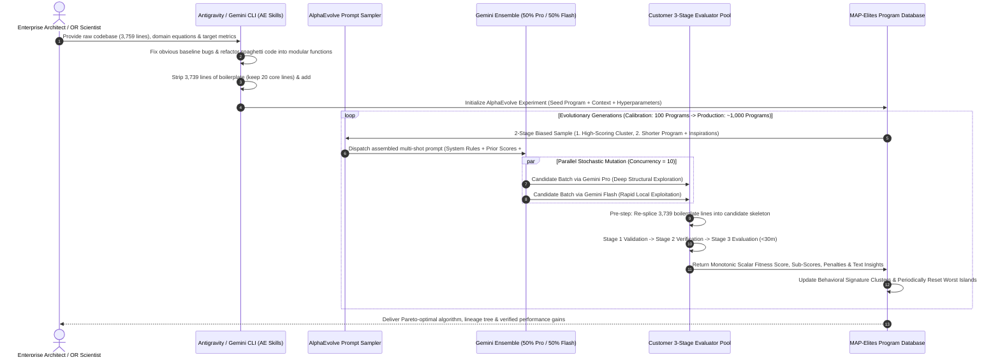
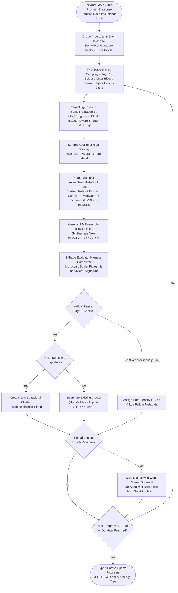
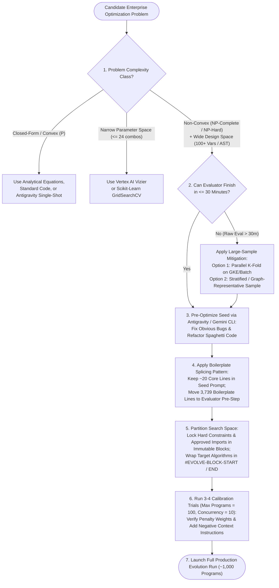

# O6: AlphaEvolve — Autonomous Evolutionary Algorithm Discovery, Mathematical Search Heuristics & Enterprise Implementation Best Practices (`L400_version_20261026_0350`)
**Topic Tags:** `#L400_version_20261026_0350` `#AlphaEvolve` `#EvolutionaryCodingAgent` `#CombinatorialOptimization` `#MAPElitesSearchHeuristic` `#EvaluationHarnessArchitecture`

---

## 0. OKF Document Metadata & Topic Modeling Taxonomy
**Topic Tags:** `#OKFMetadata` `#TopicModeling` `#TaxonomyCollection` `#KnowledgeArchitecture`

> **OKF v0.2 Trust Signals, Bucket Merge & Enforced FDE Grading Rubric (`OKF-L400-21`):**
> - **Version Tag:** `L400_version_20261026_0350` | **Status (`status`):** `stable` (`VETTED` / `APPROVED`) | **TTL (`stale_after`):** `2027-04-26T00:00:00Z` *(Maintains existing TTL & version)* | **Verified (`verified`):** `true`
> - **Merged Bucket OKF Lineage:** Reconciled with `Concepts 07, 11` in `gs://gea_agent_development_architectural_best_practices_1790796607` (`project=fivedaysai-prd-sandbox-317383`)
> - **Cloud FDE Prevailing Standard:** `https://g3doc.corp.google.com/company/teams/cloud-fde/index.md?cl=head`
> - **Enforced Project Grading Rubric (`OKF-L400-21`):** Adheres to the 0–3 FDE Field-Readiness Rubric (Pass Gate: Average >= 2.0 across Part A & Part B; Zero-Score Pause Rule: any `0 - Not Demonstrated` triggers an immediate pause and 2-week re-presentation). Primary mapped competencies for `OKF-L400-O6`: **Part A.4 (Outside-the-Loop Evolutionary Harness & Deterministic Verifiers), Part B.1.3 (Flash + Pro Mutation Ensemble Optimization), Part B.1.4 (Deterministic Multi-Objective Fitness Verification Beyond LLM-as-a-Judge), Part B.5.2 (Compute & Kernel Efficiency)**.

### 0.1 OKF Document Metadata Table & Artifact Summary
**Topic Tags:** `#DocumentMetadata` `#GCPKnowledgeCatalog` `#AntigravityAgenticAI`

| Metadata Attribute | Specification / Value |
| :--- | :--- |
| **Document ID** | `OKF-L400-O6` |
| **Document Title** | AlphaEvolve: Autonomous Evolutionary Algorithm Discovery, Mathematical Search Heuristics & Enterprise Implementation Best Practices |
| **Version** | `L400_version_20261026_0350` |
| **Chapter / Track** | Optimize / Evaluate (L400 Advanced Technical Delivery Track) |
| **Target Capabilities** | Autonomous Algorithm Discovery, Non-Convex Combinatorial & Mathematical Optimization ($NP$-Complete / $NP$-Hard), MAP-Elites Island Population Management, Gemini Flash vs. Pro Ensemble Mutation Sampling, `# EVOLVE-BLOCK` Surgical Code Diff Synthesis, Three-Stage Deterministic & Surrogate Evaluation Harnesses, Multi-Objective Pareto Frontier Reconstruction, Distributed Cloud Evaluation Topologies (Cloud Run, GKE, Cloud Batch/Slurm, Hybrid Silicon/EDA) |
| **Source Artifacts** | 1. `slides-o6-alpha-evolve.md` (`12. Delivery copy of O6_ Alpha Evolve v1.1.0 (1).pdf` — 70+ slides)<br/>2. `O6_alpha_evolve.md` (SME Video Recording Transcript, Key Learning Points, and 50 Depth/Breadth PCA Scenario & Quiz Questions) |
| **GCP Knowledge Catalog Ingestion Schema** | `gcp-okf-knowledge-catalog://v2/l400/optimize-evaluate/o6-alpha-evolve` — Chunked by hierarchical Markdown headings (`#`, `##`, `###`, `####`) with mandatory inline `**Topic Tags:**` metadata anchors for hybrid dense-vector + lexical BM25 retrieval |
| **Antigravity Agentic AI Role** | Equips Antigravity, Gemini CLI, and Cloud Code agents with authoritative architectural blueprints, **AlphaEvolve Skills Files** workflows, boilerplate splicing patterns, `# EVOLVE-BLOCK-START` / `# EVOLVE-BLOCK-END` instrumentation rules, three-stage evaluator scaffolding templates, and anti-reward-hacking guardrails to autonomously design, launch, monitor, and govern AlphaEvolve optimization experiments on Google Cloud |

**Artifact Summary**: This Operational Knowledge Framework (`OKF-L400-O6`, version `L400_version_20261026_0350`) synthesizes the complete architectural, mathematical, and operational guidance for **AlphaEvolve**—Google DeepMind's autonomous evolutionary coding and algorithm discovery engine exposed as a managed Google Cloud API. Engineered for Principal AI Solution Architects, Operations Research (OR) scientists, ML/Kernel engineers, and Antigravity-driven development workflows, this reference covers the mathematical foundations of non-convex combinatorial search, the MAP-Elites island evolutionary loop, use-case qualification, seed program formulation (`# EVOLVE-BLOCK-START` / `# EVOLVE-BLOCK-END`), three-stage evaluation harness design, distributed Google Cloud evaluation architectures, FinOps governance, and 50 PCA-aligned scenario and certification questions.

---

### 0.2 Primary Topic Tags (6 Core Pillars)
**Topic Tags:** `#PrimaryTopics` `#DomainTaxonomy` `#OptimizationSystems`

1. **Autonomous Evolutionary Algorithm Discovery (`#AutonomousAlgorithmDiscovery`)**: AlphaEvolve combines a diverse ensemble of Gemini Large Language Models (Gemini Pro and Gemini Flash) with an asynchronous evolutionary framework to discover novel algorithms, mathematical proofs, hardware circuits, and optimized codebases beyond human or single-shot agent baselines.
2. **Non-Convex Mathematical & Combinatorial Optimization (`#CombinatorialOptimization`)**: Formulates real-world $NP$-complete and $NP$-hard enterprise decision problems—where closed-form analytical equations and greedy gradient heuristics fail due to exponential local optima ($2^N$ escape trajectories)—as open-ended code search problems.
3. **MAP-Elites Heuristic Search & Multi-Objective Scoring (`#MAPElitesSearchHeuristic`)**: Maintains population diversity across behavioral clusters ("islands") in a persistent Program Database, guided by monotonic scalar hill-climbing fitness functions, calibrated constraint penalties, Pareto frontier stepping, and LLM auto-raters.
4. **Seed Program Formulation & Search Space Constraining (`#SeedProgramFormulation`)**: Governs the structural decomposition of baseline programs into immutable constraint blocks and mutable evolution blocks (`# EVOLVE-BLOCK-START` / `# EVOLVE-BLOCK-END`) while stripping thousands of lines of static boilerplate noise using interactive coding agents (Antigravity, Gemini CLI, Cloud Code).
5. **Distributed Evaluation Harness Architecture (`#EvaluationHarnessArchitecture`)**: Enforces a fail-fast three-stage evaluation pipeline (Stage 1: Solution Validation, Stage 2: Solution Verification, and Stage 3: Solution Evaluation) deployed across Cloud Run, Google Kubernetes Engine (GKE), Cloud Batch/Slurm (via Google Cluster Toolkit), 3P SaaS EDA tools, or hybrid on-premises custom silicon testbeds.
6. **Experiment Hyperparameter Governance & Anti-Hacking Controls (`#ExperimentGovernance`)**: Balances LLM mixture ratios (Gemini Pro exploration vs. Gemini Flash exploitation), concurrency, population size, parallel K-fold vs. stratified sampling, and penalty weights ($w_k$) to prevent reward/penalty hacking and converge efficiently on global optima.

---

### 0.3 Secondary Sub-Topic Tags (6 Capabilities, Outcomes & Impacts)
**Topic Tags:** `#SecondaryTags` `#CapabilitiesAndOutcomes` `#EnterpriseImpact`

1. **Multi-Lineage Population Evolution via MAP-Elites Islands** *(Type: Capability)*: Maintains independent program clusters ("islands") indexed by behavioral signature vectors, periodically wiping the lowest-performing islands and reseeding them with elite survivors to escape high-dimensional local optima (Slides 7, 20, 25–28).
2. **Three-Stage Deterministic & Surrogate Solution Scoring** *(Type: Capability)*: Separates candidate assessment into compile-time/security Solution Validation, functional/unit-test Solution Verification, and objective/load-test Solution Evaluation to fail fast on broken code and prevent reward/penalty hacking (Slides 51–54, 57–60).
3. **Hybrid Agentic Pre-Optimization & Boilerplate Splicing** *(Type: Capability)*: Pairs interactive coding agents (Antigravity, Gemini CLI, Cloud Code) with AlphaEvolve skills files to fix obvious baseline bugs and strip thousands of lines of uninformative boilerplate (e.g., reducing a 3,759-line file to 20 core contextual lines and splicing 3,739 lines back in the evaluator pre-step) before launching asynchronous evolutionary runs (Slides 9–10, 34, 48–49, 54–55).
4. **Hyperscale Compute, Hardware & Kernel Efficiency Gains** *(Type: Outcome)*: Recovers **0.7%–1% of Google's global Borg server fleet**, eliminates redundant bits in **TPU arithmetic Verilog circuits**, accelerates **Gemini matrix multiplication by 23%** (reducing overall Gemini training time by **1%**), speeds up **GPU FlashAttention kernels by 32%**, accelerates **Homomorphic Encryption (HE) TPU kernels by 1.18x–2.5x** (with Georgia Tech), and achieves **10,000x speedups** in branch-and-bound OR heuristics (Slides 5, 11, 33, 39).
5. **Cross-Industry Enterprise Optimization Breakthroughs** *(Type: Impact)*: Delivers measurable customer ROI including a **97% compute cost reduction**, **74% memory reduction**, and **680% runtime speedup** in semiconductor lithography modeling (**Substrate**), a **200% training throughput increase** for financial credit-scoring transformers (**Klarna**), a **10.4% warehouse routing efficiency improvement** saving **15,000+ km/year** (**FM Logistics**), a **15%–20% Java B-tree indexing speedup** (**JetBrains**), and a **10% accuracy / 7% CVR lift** in marketing ML pipelines (**WPP**) (Slides 34, 40).
6. **Scalable Large-Sample Evaluation via Parallel K-Fold & Stratified Sampling** *(Type: Capability)*: Overcomes the 30-minute evaluation runtime ceiling on massive production datasets by decoupling single-instance validation from horizontally parallelized K-fold evaluator pools or intentionally stratified/graph-representative sub-samples (Slides 38, 55–57, 61–63).

---

### 0.4 Three-Tier Knowledge Taxonomy & Topic Taxonomy Matrix Table
**Topic Tags:** `#ThreeTierTaxonomy` `#TaxonomyMatrix` `#CapabilityAlignment`

#### 0.4.1 Three-Tier Domain Taxonomy Hierarchy
**Topic Tags:** `#TaxonomyHierarchy` `#TieredClassification` `#KnowledgeGraphSchema`

- **Tier 1 — Foundational Optimization & Evolutionary Paradigms**:
  - `1.1 Mathematical Optimization Classes`: Closed-Form Analytical Equations vs. Convex ($P$) Gradient Search vs. Non-Convex ($NP$-Complete / $NP$-Hard) Combinatorial Landscapes.
  - `1.2 Evolutionary Code Search Lineage`: Traditional Genetic Algorithms (Brittle Chromosome Encoding) $\rightarrow$ DeepMind `FunSearch` (2022 Python Function Search) $\rightarrow$ `AlphaEvolve` (Full Multi-File, Multi-Language Algorithmic & System Discovery).
  - `1.3 Agentic AI Division of Labor`: Interactive Greedy Coding Copilots (Antigravity, Gemini CLI, Claude Code, `autoresearch`) for *working baseline generation* vs. Asynchronous Population Evolution (AlphaEvolve) for *global optimality*.
- **Tier 2 — AlphaEvolve Core Engine & Search Heuristics**:
  - `2.1 Prompt Sampler & Context Assembly`: Multi-shot historical winner sampling, granular sub-score injection, textual diagnostic feedback, and explicit negative instructions.
  - `2.2 Gemini LLM Ensemble`: Configurable mixture of **Gemini Pro** (deep algorithmic reasoning, structural leaps, exploration) and **Gemini Flash** (rapid syntactic mutation, local exploitation, cost/latency efficiency).
  - `2.3 MAP-Elites Program Database`: Island partitioning, behavioral signature clustering, two-stage biased sampling (high score + concise code length), and periodic island culling/reseeding.
  - `2.4 Surgical Code Mutation`: Immutable context/constraint blocks vs. `# EVOLVE-BLOCK-START` / `# EVOLVE-BLOCK-END` diff synthesis and pre-evaluation boilerplate splicing.
- **Tier 3 — Enterprise Evaluation Harnesses, Cloud Topologies & Governance**:
  - `3.1 Three-Stage Deterministic & Surrogate Harness`: Stage 1 Solution Validation (Compile, InfoSec, Supply Chain, Hard Penalties) $\rightarrow$ Stage 2 Solution Verification (Unit Tests, Functional Parity, Soft Penalties) $\rightarrow$ Stage 3 Solution Evaluation (Performance Metrics, OR Objectives, MCMC/Bayesian Surrogates, LLM Auto-Raters).
  - `3.2 Five Reference Cloud Topologies`: Cloud Run + `virtualenv`s, Multi-Tier GKE Validation/Performance Pods, 3P SaaS EDA Integration, Hybrid GKE + On-Premises Custom Silicon/Edge, and Google Cloud Batch / Slurm via Cluster Toolkit.
  - `3.3 FinOps, WAF & Production Governance`: Calibration cadence (`Max # of programs = 100`, `Concurrency = 10`), reward/penalty hacking mitigation, Cloud Billing + Looker Studio FinOps telemetry, and lineage tree inspection.

#### 0.4.2 Topic Taxonomy Matrix Table
**Topic Tags:** `#TopicMatrixTable` `#ArchitecturalMapping` `#CatalogSchema`

| Secondary Sub-Topic Tag | Taxonomy Tier | Entity Type | Associated Primary Topic Tag(s) | Primary Architectural Function & Enterprise Benefit |
| :--- | :--- | :--- | :--- | :--- |
| **Multi-Lineage Population Evolution via MAP-Elites Islands** | Tier 2 (Core Engine) | Capability | `#MAPElitesSearchHeuristic`, `#CombinatorialOptimization` | Prevents premature convergence in non-convex $NP$-hard landscapes by evolving diverse behavioral lineages concurrently across isolated islands and periodically cross-pollinating elites. |
| **Three-Stage Deterministic & Surrogate Solution Scoring** | Tier 3 (Evaluation & Infra) | Capability | `#EvaluationHarnessArchitecture`, `#ExperimentGovernance` | Enforces compile-time safety, InfoSec/supply-chain rules, and calibrated hard/soft penalty weights before executing costly performance tests or GPU benchmarks. |
| **Hybrid Agentic Pre-Optimization & Boilerplate Splicing** | Tier 2 (Core Engine) | Capability | `#SeedProgramFormulation`, `#AutonomousAlgorithmDiscovery` | Denoises the code search space via Antigravity/Gemini CLI so the LLM ensemble focuses tokens and mutations exclusively on high-leverage `# EVOLVE-BLOCK` regions. |
| **Hyperscale Compute, Hardware & Kernel Efficiency Gains** | Tier 1 & Tier 2 | Outcome | `#AutonomousAlgorithmDiscovery`, `#CombinatorialOptimization` | Discovers non-obvious algorithmic and circuit optimizations across Borg data center scheduling, custom silicon (TPU Verilog), Homomorphic Encryption, and Gemini ML kernels. |
| **Cross-Industry Enterprise Optimization Breakthroughs** | Tier 1 & Tier 3 | Impact | `#CombinatorialOptimization`, `#EvaluationHarnessArchitecture` | Translates mathematical search into verified enterprise ROI across logistics (FM Logistics), semiconductor lithography (Substrate), FinTech (Klarna), MarTech (WPP), and developer tooling (JetBrains). |
| **Scalable Large-Sample Evaluation via Parallel K-Fold & Stratified Sampling** | Tier 3 (Evaluation & Infra) | Capability | `#EvaluationHarnessArchitecture`, `#ExperimentGovernance` | Keeps per-iteration evaluation latency strictly under the 30-minute ceiling (ideally a few minutes) while preserving statistical and graph-theoretical generalization to production data. |

---

### 0.5 Module Topic Connection & End-to-End Flow Graph
**Topic Tags:** `#ModuleFlowGraph` `#SystemTopology` `#ArchitectureVisualization`

#### 0.5.1 Mermaid.js End-to-End Topic Connection & Evolutionary Loop (`graph LR`)
**Topic Tags:** `#MermaidGraphLR` `#EndToEndFlow` `#EvolutionaryPipeline`

```mermaid
graph LR
    subgraph PreOpt ["1. Qualification & Seed Prep (Antigravity / Gemini CLI)"]
        A["Qualify Non-Convex / NP-Hard Problem<br/>(Wide Design Space, Eval < 30m)"] --> B["Pre-Optimize & Debug Seed<br/>via Antigravity + AE Skills"]
        B --> C["Strip Boilerplate (3,739 -> 20 Lines)<br/>& Tag #EVOLVE-BLOCK-START / END"]
    end

    subgraph CoreLoop ["2. Managed AlphaEvolve Engine (MAP-Elites + LLM Ensemble)"]
        C --> D["Prompt Sampler<br/>(2-Stage Biased Sampling:<br/>High Score + Concise Code)"]
        D --> E["Gemini LLM Ensemble<br/>(Pro for Deep Reasoning / Exploration<br/>+ Flash for Fast Mutation / Exploitation)"]
        E --> F["Search-and-Replace Mutation<br/>on #EVOLVE-BLOCK Regions"]
    end

    subgraph EvalPlane ["3. Customer Evaluator Pool (Cloud Run / GKE / Batch / Hybrid)"]
        F --> G["Pre-Step: Re-Splice<br/>Immutable Boilerplate"]
        G --> H["Stage 1: Solution Validation (Required)<br/>Compile, Syntax, InfoSec, Supply Chain"]
        H -->|"Fail"| I1["Assign Hard Death Penalty (-10^9)<br/>& Set Other Metrics = 0 (Exit Early)"]
        H -->|"Pass"| I2["Stage 2: Solution Verification (Optional)<br/>Unit Tests, Accuracy Parity & Soft Penalties"]
        I2 --> I3["Stage 3: Solution Evaluation (Required)<br/>Runtime, OR Objective, Surrogate, or Auto-Rater<br/>(Parallel K-Fold or Stratified Sample)"]
        I3 --> J["Compute Monotonic Hill-Climbing Scalar<br/>Fitness = Sum(w_i * S_i) - Sum(w_k * Pen_k)"]
    end

    subgraph Database ["4. Population Evolution & Pareto Output"]
        I1 --> K["MAP-Elites Program Database<br/>(Behavioral Signature Islands)"]
        J --> K
        K -->|"Periodic Island Reset:<br/>Wipe Worst, Seed with Best"| D
        K --> L["Converged Optimal Algorithm,<br/>Lineage Tree & Pareto Frontier"]
    end
```



#### 0.5.2 ASCII Architectural Picture: Dual-Plane AlphaEvolve & Antigravity Ecosystem
**Topic Tags:** `#ASCIIDiagram` `#DualPlaneArchitecture` `#ControlAndExecutionPlanes`

```text
+====================================================================================================+
|                      DEVELOPER & PRE-OPTIMIZATION PLANE (ANTIGRAVITY / GEMINI CLI)                 |
|                                                                                                    |
|  [Domain SME / Architect] ---> [Antigravity / Gemini CLI + AlphaEvolve Skills File]                |
|                                  |-- 1. Fix obvious baseline bugs (e.g., wrong loss function)      |
|                                  |-- 2. Strip static boilerplate (e.g., 3,759 lines -> 20 lines)   |
|                                  |-- 3. Lock hard constraints/imports in Immutable Code Blocks     |
|                                  +-- 4. Wrap target logic in # EVOLVE-BLOCK-START / END            |
+==================================================|=================================================+
                                                   | Submit Clean Seed + Context + Config
                                                   v
+====================================================================================================+
|                   GOOGLE CLOUD MANAGED ALPHAEVOLVE CONTROL & DISCOVERY PLANE                       |
|                                                                                                    |
|   +--------------------------------------------------------------------------------------------+   |
|   |                         MAP-ELITES PROGRAM DATABASE (ISLAND TOPOLOGY)                      |   |
|   |  +------------------------+   +------------------------+   +----------------------------+  |   |
|   |  | Island 1 (Cluster A/B) |   | Island 2 (Cluster C/D) |   | Island N (Periodic Culling |  |   |
|   |  | Behavioral Signatures  |   | Behavioral Signatures  |   | & Elite Reseeding Target)  |  |   |
|   |  +-----------+------------+   +-----------+------------+   +-------------+--------------+  |   |
|   +--------------|----------------------------|------------------------------|-----------------+   |
|                  | 1. Sample High-Scoring     | 2. Sample Concise/Shorter    ^                     |
|                  |    Behavioral Cluster      |    Program + Inspirations    |                     |
|                  v                            v                              |                     |
|   +------------------------------------------------------------------+       | 6. Persist Scored   |
|   | PROMPT SAMPLER                                                   |       |    Candidate,       |
|   | Assembles: System Rules + Domain Context + Negative Instructions |       |    Sub-Scores,      |
|   | + Prior/Current Programs & Granular Scores + # EVOLVE-BLOCKs     |       |    Penalties &      |
|   +---------------------------------+--------------------------------+       |    Text Insights    |
|                                     | 3. Dispatch Multi-Shot Prompt          |                     |
|                                     v                                        |                     |
|   +------------------------------------------------------------------+       |                     |
|   | GEMINI LLM ENSEMBLE (STOCHASTIC VARIANCE AS DIVERSITY FEATURE)   |       |                     |
|   |  * Gemini Pro (e.g., 50%): Deep algorithmic synthesis / leaps    |       |                     |
|   |  * Gemini Flash (e.g., 50% -> 80%+): Fast syntax mutations       |       |                     |
|   +---------------------------------+--------------------------------+       |                     |
|                                     | 4. Synthesize Surgical Diffs           |                     |
|                                     |    (# EVOLVE-BLOCK Search & Replace)   |                     |
|                                     v                                        |                     |
|   +------------------------------------------------------------------+       |                     |
|   | EVALUATION CONNECTOR (Concurrency = 10 Default, Batch Fan-Out)   |-------+                     |
+=====================================|==============================================================+
                                      | 5. Dispatch Candidate Batch (mTLS / IAM / VPC)
                                      v
+====================================================================================================+
|                CUSTOMER-MANAGED EXECUTION & SCORING PLANE (EVALUATOR HARNESS POOL)                 |
|     (Deployed on: Cloud Run + Virtualenvs | GKE Pods | Cloud Batch & Slurm | Hybrid On-Prem/EDA)   |
|                                                                                                    |
|  [Pre-Step: Splice 3,739 Immutable Boilerplate Lines Back into Candidate Skeleton]                 |
|         |                                                                                          |
|         v                                                                                          |
|  +----------------------------------------------------------------------------------------------+  |
|  | STAGE 1: SOLUTION VALIDATION (REQUIRED - FAIL FAST ON LIGHTWEIGHT CPU)                       |  |
|  | * Compile/Syntax Check, Linting, InfoSec Static Analysis, API/Software Supply Chain Check    |  |
|  | * IF FAIL -> Assign Severe Negative Penalty (-10^9), Set Other Metrics = 0, EXIT EARLY!      |  |
|  +----------------------------------------------+-----------------------------------------------+  |
|                                                 | PASS (Valid Subset M <= N)                       |
|                                                 v                                                  |
|  +----------------------------------------------------------------------------------------------+  |
|  | STAGE 2: SOLUTION VERIFICATION (OPTIONAL - FUNCTIONAL & CONSTRAINT CHECKS)                   |  |
|  | * Unit Tests, Edge-Case Parity, Out-of-Sample Accuracy (Delta Acc), Scaled Soft Penalties    |  |
|  +----------------------------------------------+-----------------------------------------------+  |
|                                                 |                                                  |
|                                                 v                                                  |
|  +----------------------------------------------------------------------------------------------+  |
|  | STAGE 3: SOLUTION EVALUATION (REQUIRED - PARALLEL K-FOLD OR STRATIFIED SAMPLE, < 30 MINS)    |  |
|  | * Direct Runtime/Memory/Power, OR Objective, MCMC/Bayesian Surrogate, or LLM Auto-Rater      |  |
|  | * Upfront Compiled Scalar Math: Fitness = Sum(w_i * Score_i) - Sum(w_k * Penalty_k)          |  |
|  +----------------------------------------------------------------------------------------------+  |
+====================================================================================================+
```

---

## 1. Executive Overview, Problem Statement & Antigravity Agentic AI Development Context
**Topic Tags:** `#ExecutiveOverview` `#ProblemStatement` `#AntigravityContext`

> **Enforced FDE Project Grading Rubric Reference (`OKF-L400-21` & `g3doc/company/teams/cloud-fde`):** Every project applying Section 1 of `OKF-L400-O6` is graded against **Part A.4 (Outside-the-Loop Evolutionary Harness & Deterministic Verifiers), Part B.1.3 (Flash + Pro Mutation Ensemble Optimization), Part B.1.4 (Deterministic Multi-Objective Fitness Verification Beyond LLM-as-a-Judge), Part B.5.2 (Compute & Kernel Efficiency)** and merged bucket **Concepts 07, 11** (`stale_after: 2027-04-26T00:00:00Z`, version `L400_version_20261026_0350`). Builders must achieve >= 2 (**Competent**) across Part A & Part B and avoid any 0 (**Not Demonstrated**) pause triggers.

### 1.1 The Enterprise Optimization Chasm: Why Greedy Agents and Analytical Formulas Fail
**Topic Tags:** `#OptimizationChasm` `#NonConvexLandscapes` `#LocalOptima`

Across every industry—cloud infrastructure, semiconductor design, supply chain logistics, quantitative finance, and machine learning systems—organizations face mission-critical optimization problems where small percentage improvements yield tens of millions of dollars in capital efficiency or transformative latency reductions. However, enterprise architects routinely encounter a fundamental mathematical barrier when applying standard software engineering or off-the-shelf single-prompt LLM agents to these problems:

1. **Breakdown of First-Principles (Closed-Form) Equations**:
   - In textbook scenarios, a single-SKU inventory replenishment problem with static demand ($D$), fixed ordering cost ($K$), and holding cost ($h$) is solved analytically via the classic **Economic Order Quantity (EOQ)** formula:
     $$Q^* = \sqrt{\frac{2DK}{h}}$$
   - Similarly, simple linear regression with a Mean Squared Error (MSE) loss function ($L = \frac{1}{n}\sum (y_i - (\beta_0 + \beta_1 x_i))^2$) is strictly **convex** and solvable in closed form by setting partial derivatives $\frac{\partial L}{\partial \beta_i} = 0$ (Ordinary Least Squares).
   - **Enterprise Reality**: When an enterprise scales from 1 SKU to **thousands of SKUs across hundreds of distribution centers**, closed-form calculus collapses. Stochastic demand forecast errors, variable replenishment lead times ($T$), reserve-stock vs. cross-docking routing decisions, warehouse storage and labor capacity couplings, and cross-product substitution/halo/cannibalization effects turn the problem into a high-dimensional, non-linear combinatorial search space.
2. **The Curse of Dimensionality in Non-Convex ($NP$-Hard / $NP$-Complete) Landscapes**:
   - While **Convex Problems ($\text{Problem} \in P$)** feature a smooth, bowl-shaped objective landscape with a single global optimum where greedy step-by-step methods (such as gradient descent) are mathematically guaranteed to converge, real-world combinatorial and algorithmic design spaces are **Non-Convex ($\text{Problem} \notin P$; $NP$-Complete / $NP$-Hard)**.
   - In a rugged non-convex landscape, a greedy solver or single-prompt coding agent gets trapped in the nearest **local optimum**. Escaping a local optimum in a 2-variable problem requires testing $2^2 = 4$ coordinate directions; escaping a local optimum in an enterprise problem with $N = 100$ decision variables requires evaluating $2^{100} \approx 1.26 \times 10^{30}$ possible escape directions.
   - Furthermore, adding discrete or integer constraints (**Combinatorial Integer Programming**) to a continuous search space makes optimization **mathematically harder, not easier**, because continuous gradient edges vanish and checking boundary feasibility requires exponential neighbor evaluations.
3. **Why Historical Genetic Algorithms Failed on Code**:
   - The "Evolve" in AlphaEvolve derives from **evolutionary heuristics in mathematical optimization** (genetic algorithms, evolutionary strategies, differential evolution) rather than biological life sciences.
   - Classical genetic algorithms attempted to optimize computer programs by encoding source code as artificial binary chromosomes and applying random bit-flip mutations or syntactic crossovers. Because programming languages obey strict context-free grammars and semantic dependencies, random chromosome splicing almost always produces non-compiling garbage or domain-specific brittle representations.

---

### 1.2 AlphaEvolve & The Google DeepMind Lineage
**Topic Tags:** `#DeepMindLineage` `#FunSearchToAlphaEvolve` `#SelfImprovingAI`

**AlphaEvolve** solves the non-convex code discovery problem by using **standard source code directly as the design medium** and replacing blind genetic bit-flips with an **ensemble of Gemini Large Language Models** guided by a **MAP-Elites evolutionary Program Database** and **deterministic evaluation harnesses**.

| DeepMind System Era | Representative Systems | Primary Search Medium & Scope | Key Architectural Evolution |
| :--- | :--- | :--- | :--- |
| **Game & Reinforcement Learning Era (2016–2019)** | `AlphaGo`, `AlphaZero`, `AlphaStar` | Discrete board states / game actions via Monte Carlo Tree Search (MCTS) + Deep RL | Mastered high-dimensional sequential games with fixed rules, but could not synthesize arbitrary general-purpose code. |
| **Specialized Scientific Modality Era (2020–Present)** | `AlphaFold`, `AlphaGenome`, `AlphaEarth`, `WeatherNext` | Domain-specific biological, genomic, and geophysical tensor representations | Solved foundational scientific structure prediction problems using bespoke neural architectures tailored to physical modalities. |
| **Functional & Specialized Code Search (2022–2024)** | `AlphaTensor`, `AlphaDev`, `AlphaCode`, `AlphaProof`, `FunSearch` (2022) | Single Python mathematical functions (`FunSearch`), assembly instructions (`AlphaDev`), or formal proofs (`AlphaProof`) | `FunSearch` pioneered pairing LLMs with a MAP-Elites database to discover novel mathematical functions, but was restricted to small functional blocks in Python. |
| **General Autonomous Algorithm & System Discovery (2025–2026)** | **AlphaEvolve** (Google DeepMind & Google Cloud API) | **Arbitrary multi-block, multi-file source code across any language** (Python, C++, Java, Rust, SQL, Verilog RTL, Borg config, XLA/Pallas kernels) | Scales evolutionary code synthesis to entire enterprise codebases, hardware descriptions, and distributed evaluation clusters using Gemini Pro + Flash ensembles. |

**Recursive Self-Improving AI Systems (LLM Bootstrapping)**:
One of AlphaEvolve's landmark architectural achievements is **recursive AI self-improvement**: AlphaEvolve uses current-generation **Gemini** models inside its LLM Ensemble to discover faster **matrix multiplication kernels (+23% speedup, reducing total Gemini training time by 1%)**, faster **FlashAttention GPU kernels (+32% speedup)**, and **lower-power TPU Verilog arithmetic circuits**, which directly accelerate the training and inference of future Gemini generations.

---

### 1.3 Role of Antigravity, Gemini CLI & Agentic AI Workflows in AlphaEvolve
**Topic Tags:** `#AntigravityWorkflow` `#GeminiCLISkills` `#AgenticPreOptimization`

A core architectural principle of the L400 AlphaEvolve methodology is understanding the **complementary division of labor** between **Interactive Coding Copilots** (**Antigravity**, **Gemini CLI**, **Cloud Code**, **Claude Code**) and **Asynchronous Evolutionary Search** (**AlphaEvolve**):

```text
+---------------------------------------------------------------------------------------------------+
|                     COMPLEMENTARY AGENTIC OPTIMIZATION PIPELINE ON GOOGLE CLOUD                   |
|                                                                                                   |
|  STAGE A: INTERACTIVE GREEDY PRE-OPTIMIZATION         STAGE B: ASYNCHRONOUS EVOLUTIONARY SEARCH   |
|  Tooling: Antigravity / Gemini CLI + AE Skills        Tooling: Managed AlphaEvolve Cloud API      |
|  ----------------------------------------------       -----------------------------------------   |
|  * Mode: Real-time, single/few-shot (seconds)         * Mode: Multi-lineage MAP-Elites (hours)    |
|  * Goal: Find a WORKING, clean baseline program       * Goal: Find the GLOBALLY OPTIMAL program   |
|  * Actions:                                           * Actions:                                  |
|    1. Fix obvious bugs (e.g., MSE -> Cross-Entropy)     1. Sample diverse islands & clusters      |
|    2. Refactor "spaghetti code" into modular code       2. Mutate # EVOLVE-BLOCKs via Pro + Flash |
|    3. Strip 3,739 lines of static boilerplate           3. Run 3-Stage Evaluator (100-1,000 runs) |
|    4. Tag # EVOLVE-BLOCK-START / END & launch API       4. Reconstruct Pareto front & lineage     |
+---------------------------------------------------------------------------------------------------+
```

1. **Why Interactive Agents Alone Cannot Replace AlphaEvolve**:
   - Interactive coding agents (**Antigravity**, **Gemini CLI**, **Claude Code**) and single-lineage agent loops (such as Andrej Karpathy's `autoresearch`, which runs a linear keep/discard chain on a single GPU at ~12 experiments/hour) act as **greedy local searchers**. They excel at writing "textbook" working code and fixing obvious defects, but they stop at the first working solution or get trapped in local optima when navigating $NP$-hard non-convex spaces.
2. **Why AlphaEvolve Needs Antigravity / Gemini CLI Upstream ("Spaghetti Code == Noisy Search Space")**:
   - Launching AlphaEvolve directly on a buggy, monolithic, 3,759-line "spaghetti code" file wastes hundreds of evolutionary generations rediscovering basic textbook fixes (for example, changing a regression loss function to cross-entropy on a classification task) and floods the LLM Ensemble's context window with irrelevant boilerplate.
   - By loading **AlphaEvolve Skills Files** into **Antigravity** or **Gemini CLI**, the interactive agent autonomously:
     1. Diagnoses and repairs baseline bugs and anti-patterns in seconds.
     2. Strips static boilerplate out of the seed file (e.g., extracting **3,739 lines of boilerplate** so only **20 lines of high-signal algorithmic context** remain in the seed program, and scripting the evaluator harness to splice the 3,739 lines back in prior to compilation).
     3. Partitions the seed program into **Immutable Code Blocks** (locking approved imports, security boundaries, and fixed interfaces) and **Mutable Evolution Blocks** (`# EVOLVE-BLOCK-START` / `# EVOLVE-BLOCK-END`).
     4. Scaffolds the **Three-Stage Evaluator Harness**, provisions the Cloud Run / GKE / Cloud Batch execution infrastructure, and triggers the **3 to 4 initial calibration runs** (`Max # of programs = 100`, `Concurrency = 10`).

---

## 2. Deep Technical Architecture, Matrices, Visual Pictures & Flow Diagrams
**Topic Tags:** `#DeepTechnicalArchitecture` `#MathematicalSearch` `#EvolutionaryMechanics`

> **Enforced FDE Project Grading Rubric Reference (`OKF-L400-21` & `g3doc/company/teams/cloud-fde`):** Every project applying Section 2 of `OKF-L400-O6` is graded against **Part A.4 (Outside-the-Loop Evolutionary Harness & Deterministic Verifiers), Part B.1.3 (Flash + Pro Mutation Ensemble Optimization), Part B.1.4 (Deterministic Multi-Objective Fitness Verification Beyond LLM-as-a-Judge), Part B.5.2 (Compute & Kernel Efficiency)** and merged bucket **Concepts 07, 11** (`stale_after: 2027-04-26T00:00:00Z`, version `L400_version_20261026_0350`). Builders must achieve >= 2 (**Competent**) across Part A & Part B and avoid any 0 (**Not Demonstrated**) pause triggers.

---

### 2.1 AlphaEvolve Evolutionary Coding Agent Architecture, Mathematical Search & Flash vs. Pro Ensemble Mutation Sampling
**Topic Tags:** `#AlphaEvolveArchitecture` `#FlashVsProEnsemble` `#NonConvexOptimization`

#### 2.1.1 Human "What" vs. AlphaEvolve "How": Core Engine Architecture
**Topic Tags:** `#HumanWhatVsAgentHow` `#CoreEngineComponents` `#StochasticDiversity`

AlphaEvolve is architected around a strict separation of responsibilities between the **Human Domain Architect ("What?")** and the **Autonomous AlphaEvolve Engine ("How?")**:

1. **Human / Antigravity Input Specification ("What to Optimize")**:
   - **Evaluation Criteria & Harness**: A deterministic test script, Operations Research (OR) objective function, simulation model, or LLM auto-rater that outputs a scalar quality score.
   - **Initial Seed Solution**: A clean, working baseline program containing fixed immutable context and `# EVOLVE-BLOCK-START` / `# EVOLVE-BLOCK-END` mutation targets.
   - **Background Context**: Natural language problem framing, mathematical equations (LaTeX or Python), domain heuristics, and explicit negative instructions (e.g., anti-reward-hacking rules).
2. **AlphaEvolve Autonomous Discovery Loop ("How to Optimize It")**:
   - **Prompt Sampler**: Queries the MAP-Elites Program Database to select high-scoring parent programs and "inspiration" programs, assembling rich multi-shot prompts that embed prior code versions, granular sub-scores, and evaluator diagnostic logs.
   - **Gemini LLM Ensemble (Turning Stochastic Variance into a Feature)**: Unlike deterministic CRUD applications where LLM output randomness is treated as a defect, AlphaEvolve **intentionally exploits LLM generation variance**. Sending the exact same multi-shot prompt multiple times to the ensemble produces diverse algorithmic mutations and syntactic variations, enabling parallel exploration of multiple search directions simultaneously.
   - **Evaluator Pool**: Executes each synthesized candidate program in isolated sandboxes (Cloud Run `virtualenv`s, GKE pods, Cloud Batch/Slurm nodes, or hybrid silicon testbeds) and returns a monotonic hill-climbing scalar score plus textual feedback.
   - **MAP-Elites Program Database**: Stores valid scored programs across behavioral clusters and islands, preserving evolutionary lineage trees and preventing premature convergence.

#### 2.1.2 Mathematical Search, Landscape Convexity & Abstract Syntax Tree (AST) Distance
**Topic Tags:** `#ConvexityTopology` `#ASTDistance` `#CombinatorialComplexity`

To qualify and architect an AlphaEvolve experiment, solution architects must analyze four mathematical properties of the underlying optimization landscape:

```text
+---------------------------------------------------------------------------------------------------+
|                   MATHEMATICAL OPTIMIZATION TOPOLOGY & SEARCH COMPLEXITY SPECTRUM                 |
|                                                                                                   |
|  1. CLOSED-FORM / ANALYTICAL        2. CONVEX SEARCH (P)             3. NON-CONVEX (NP-HARD)      |
|     (e.g., Single-SKU EOQ, OLS)        (e.g., Unconstrained MSE)        (e.g., Multi-SKU Supply   |
|                                                                          Chain, TSP, Kernel Opt)  |
|        \       /                          \         /                      /\    /\      /\       |
|         \     /                            \       /                      /  \  /  \    /  \      |
|          \___/                              \_____/                      /    \/    \__/    \     |
|            * Global Min                        * Global Min                   * Local   * Global  |
|                                                                                 Trap      Optimum |
|  -> Solved via exact formula        -> Greedy gradient descent       -> 2^N escape directions     |
|  -> Use: Standard Code / SQL        -> Use: Antigravity / Vizier     -> Use: AlphaEvolve Islands  |
+---------------------------------------------------------------------------------------------------+
```

1. **The Four Mathematical Optimization Building Blocks**:
   - **Decision Variables ($x \in \mathbb{R}^N$ or $\mathbb{Z}^N$ or AST Nodes)**: The adjustable parameters, routing assignments, or programmatic code blocks controlled by the solver.
   - **Objective Function ($f(x)$)**: The domain metric being maximized (e.g., throughput, in-stock rate, Sharpe ratio) or minimized (e.g., latency, power, tour distance).
   - **Constraints ($g_j(x) \le b_j$) & Penalties ($\text{Pen}_k(x)$)**: Hard physical/governance boundaries and soft feasibility boundaries, where the penalty quantifies the magnitude of constraint violation.
   - **Fitness Function ($F(x)$)**: The monotonic hill-climbing transformation computed as:
     $$\text{Fitness}(x) = \text{Objective}_{\text{Max}}(x) - \sum_{k} w_k \cdot \text{Penalty}_k(x)$$
2. **Four Canonical Sources of Landscape Convexity vs. Non-Convexity**:
   - **Case 1 (Unconstrained Convex Objective)**: A quadratic objective such as $f(x_1, x_2) = x_1^2 - x_2$ has a smooth, strictly convex surface $\rightarrow$ solvable via basic gradient methods.
   - **Case 2 (Convex Objective + Linear/Convex Constraints)**: A convex objective bounded by linear inequalities ($A x \le b$) forms a convex feasible polytope $\rightarrow$ solvable in polynomial time ($P$).
   - **Case 3 (Convex Constraints + Non-Linear/Non-Convex Objective)**: Even when constraints are simple linear bounds, a non-linear oscillatory or multimodal objective creates multiple local optima $\rightarrow$ **Non-Convex**.
   - **Case 4 (Convex Objective + Non-Convex / Disjunctive / Integer Feasible Set)**: Even when the objective function is linear or quadratic, introducing discrete integer constraints ($x_i \in \mathbb{Z}$), mutually exclusive hardware rules, or combinatorial graph constraints fractures the feasible region into disconnected islands $\rightarrow$ **Non-Convex ($NP$-Complete / $NP$-Hard)**.
3. **Unstructured Code Design Spaces & AST Edit Distance**:
   - When optimizing continuous parameters, distance is Euclidean ($\|x - y\|_2$). When evolving source code, the search space is **unstructured and variable-length**: every program is parsed into an **Abstract Syntax Tree (AST)** governed by a Context-Free Grammar (CFG), and the conceptual distance between two candidate algorithms is the **tree edit distance between AST nodes and grammar production rules**.

#### 2.1.3 Gemini Flash vs. Gemini Pro Ensemble Mutation Sampling Strategy
**Topic Tags:** `#GeminiProExploration` `#GeminiFlashExploitation` `#TwoStageMixtureTuning`

AlphaEvolve orchestrates a heterogeneous ensemble of **Gemini Pro** and **Gemini Flash** models to balance deep structural invention (**Exploration**) against high-velocity syntactic refinement (**Exploitation**):

| Ensemble Dimension | Gemini Pro Role (Heavy Reasoning & Exploration) | Gemini Flash Role (Fast Iteration & Exploitation) | Two-Stage Production Tuning Recommendation |
| :--- | :--- | :--- | :--- |
| **Algorithmic Function** | Synthesizes complex mathematical leaps, novel data structures, branch-and-bound pruning heuristics, and multi-block structural rewrites. | Generates rapid syntactic variations, loop unrolling, constant/threshold adjustments, and localized code refinements around promising parents. | **Stage 1 (Initial Search / Exploration)**: Configure **50% Gemini Pro / 50% Gemini Flash** (default balanced mixture) to discover strong solution neighborhoods across islands. |
| **Latency & Throughput** | Higher per-call inference latency; lower candidates/minute per worker thread. | Ultra-low inference latency; rapidly fills concurrent evaluator queues (`Concurrency = 10`). | **Stage 2 (Fine-Tuning / Exploitation)**: Shift to a **Flash-heavy mixture (e.g., 80%–90% Flash / 10%–20% Pro)** once a strong algorithmic basin is found to accelerate local hill-climbing and cut token spend. |
| **Escape from Local Optima** | Critical for jumping across wide non-convex valleys when islands stagnate. | Exploits local gradients within an island cluster efficiently. | If the `best_score` trajectory plateaus for 50+ generations during Stage 2, temporarily boost Gemini Pro ratio or trigger a MAP-Elites island reset. |

#### 2.1.4 Mermaid.js Sequence Diagram: Interactive Pre-Optimization to AlphaEvolve Ensemble Loop
**Topic Tags:** `#SequenceDiagram` `#EnsembleInteraction` `#AgenticHandoff`



#### 2.1.5 Inline Section 2.1 Best Practices
**Topic Tags:** `#Section2_1BestPractices` `#EnsembleBestPractices` `#ComplexityQualification`

- **Always Pair Interactive Pre-Optimization with Asynchronous Evolution**: Use **Antigravity** or **Gemini CLI** first to eliminate obvious bugs and establish a clean, modular baseline program before invoking AlphaEvolve; never waste evolutionary generations discovering basic textbook syntax or loss-function fixes.
- **Match Optimization Tooling to Problem Complexity Class**: Use analytical SQL/code for closed-form problems, **Vertex AI Vizier** or `GridSearchCV` for narrow parameter tuning ($\le 24$ to a few hundred combinations), and reserve **AlphaEvolve** for wide, non-convex ($NP$-hard / $NP$-complete) algorithmic search spaces.
- **Use Two-Stage Pro/Flash Mixture Scheduling**: Start discovery runs with a **50% Gemini Pro / 50% Gemini Flash** ratio to maximize structural exploration across non-convex basins, then transition to a **Flash-heavy mixture** during late-stage exploitation to maximize throughput per dollar.

#### 2.1.6 Inline Section 2.1 FAQs (4 Q&As)
**Topic Tags:** `#Section2_1FAQs` `#ConvexityQuestions` `#EnsembleQuestions`

1. **Q: Why does adding integer or discrete constraints to a continuous linear optimization problem make it harder rather than easier?**
   - **A:** Although restricting variables to integers reduces the set of valid points, it destroys continuous gradient information along the polytope edges. In a continuous Linear Program (LP), a solver can slide smoothly along simplex edges to the optimum; in a discrete Integer Program (IP), determining boundary feasibility around a non-integer optimum requires checking up to $2^N$ discrete neighboring lattice points, turning a polynomial ($P$) problem into an $NP$-hard combinatorial problem.
2. **Q: How does AlphaEvolve differ architecturally from Andrej Karpathy's `autoresearch` loop?**
   - **A:** `autoresearch` runs a **single-lineage** greedy loop (keep or discard) on a single GPU (~12 experiments/hour) specifically tailored to tweaking `nanochat train.py`, making it prone to local optima and requiring human babysitting to avoid search drift. AlphaEvolve is a **managed Google Cloud API** that maintains a **multi-lineage MAP-Elites population** across isolated islands, evaluates candidates in parallel at cloud scale, and optimizes any arbitrary multi-file codebase or hardware description.
3. **Q: Why does AlphaEvolve send the exact same prompt multiple times to the Gemini LLM Ensemble?**
   - **A:** Because LLM token generation is inherently stochastic, querying the ensemble (both Gemini Pro and Gemini Flash) multiple times with identical or slightly varied multi-shot prompts yields distinct algorithmic mutations. AlphaEvolve treats this stochastic output variance as a deliberate evolutionary diversification mechanism rather than noise.
4. **Q: Where does AlphaEvolve sit within Google DeepMind's broader family of "Alpha" systems?**
   - **A:** DeepMind divides its systems into specialized scientific modality models (`AlphaFold` for proteins, `AlphaGenome` for DNA, `AlphaEarth` / `WeatherNext` for earth systems) and general programmatic discovery engines. AlphaEvolve represents the culmination of the programmatic lineage—evolving from `AlphaZero` $\rightarrow$ `AlphaTensor` / `AlphaDev` / `AlphaCode` / `FunSearch` (2022)—by generalizing evolutionary search from single Python mathematical functions to arbitrary multi-language enterprise codebases.

---

### 2.2 MAP-Elites Island Population Databases, Behavioral Clustering & Generational Prompt Sampling Mechanics
**Topic Tags:** `#MAPElitesDatabase` `#IslandTopology` `#PromptSamplingMechanics`

#### 2.2.1 Inside the MAP-Elites Island Algorithm: Escaping the "Heuristic Solver Underworld"
**Topic Tags:** `#MAPElitesIslands` `#BehavioralClustering` `#PeriodicIslandReset`

Standard evolutionary algorithms that maintain a single global population suffer from **premature convergence**: as soon as one candidate achieves a moderately high score on a local peak, selection pressure wipes out slower-developing lineages, trapping the entire search in what Operations Research scientists call the **"OR / Heuristic Solver Underworld."**

AlphaEvolve prevents premature convergence through a hierarchical **MAP-Elites (Multi-dimensional Archive of Phenotypic Elites) Island Architecture** inherited and expanded from DeepMind's *FunSearch*:

```text
+====================================================================================================+
|                    MAP-ELITES ISLAND POPULATION & PERIODIC CULLING/RESEEDING                       |
|                                                                                                    |
|   ISLAND 1 (Surviving Elite)          ISLAND 2 (Surviving Elite)          ISLAND 3 (Worst Overall) |
|  +---------------------------+       +---------------------------+       +-----------------------+ |
|  | Cluster 1A: [Sig: High T] |       | Cluster 2A: [Sig: Low M]  |       | Cluster 3A: Stagnant  | |
|  |  * Prog_104 (Score: 0.94, |       |  * Prog_211 (Score: 0.91, |       |  * Prog_088 (0.41)    | |
|  |    Lines: 28) <-- ELITE   |       |    Lines: 34) <-- ELITE   |       | Cluster 3B: Stagnant  | |
|  | Cluster 1B: [Sig: Bal]    |       | Cluster 2B: [Sig: Fast]   |       |  * Prog_092 (0.39)    | |
|  |  * Prog_076 (Score: 0.85) |       |  * Prog_189 (Score: 0.87) |       |  [WIPED AT EPOCH T!]  | |
|  +-------------+-------------+       +-------------+-------------+       +-----------+-----------+ |
|                |                                   |                                 ^             |
|                +-----------------------------------+---------------------------------+             |
|                  PERIODIC ISLAND RESET: Copy Best Programs (Prog_104 / Prog_211)                   |
|                  from Surviving Elite Islands to Re-Seed Newly Wiped Island 3                      |
+====================================================================================================+
```

The MAP-Elites Program Database executes a rigorous **five-step population lifecycle**:

1. **Step 1 — Multi-Island Partitioning**: Initial candidate programs are separated into multiple independent **islands** (`Island 1 .. Island K`) that evolve in isolation rather than collapsing into a single nearest-neighbor pool.
2. **Step 2 — Behavioral Signature Clustering Within Islands**: Inside each island, candidate programs are grouped into **clusters** based on their **behavioral signature vector**—i.e., their specific profile of sub-scores across distinct test inputs or evaluation dimensions (for example, excelling on sparse graphs vs. dense graphs, or prioritizing low memory vs. low latency).
3. **Step 3 — Two-Stage Biased Prompt Sampling (Combating Code Bloat)**:
   - When the **Prompt Sampler** selects a parent program from an island to mutate:
     - **Stage 3a (Cluster Selection)**: It first samples a behavioral cluster with probability **biased toward higher fitness scores**.
     - **Stage 3b (Program Selection within Cluster)**: Within that chosen cluster, it samples a specific candidate program with probability **biased toward shorter, more concise code length**. This second bias is critical: without a conciseness bias, iterative LLM mutations progressively accumulate dead branches and bloated code ("spaghetti drift").
4. **Step 4 — Offspring Evaluation & Cluster Insertion**: The sampled parent (plus top-performing "inspiration" programs sampled from the island) is sent to the Gemini LLM Ensemble. If the newly synthesized candidate passes evaluation, it is inserted back into the originating island—either joining an existing cluster with a matching behavioral signature or spawning a brand-new cluster if its behavioral profile is novel.
5. **Step 5 — Periodic Island Reset (Culling & Cross-Pollination)**: At regular generational intervals, the database identifies the **islands with the worst overall scores**, completely **wipes (culls)** their populations, and **re-seeds those empty islands with copies of the single best-performing elite programs** from the surviving top islands. This frees trapped search capacity while cross-pollinating proven structural breakthroughs into fresh evolutionary trajectories.

#### 2.2.2 Generational Prompt Assembly & Lineage Tree Analytics
**Topic Tags:** `#PromptAssembly` `#LineageTreeAnalysis` `#MultiShotContext`

Every generational prompt constructed by the **Prompt Sampler** is a highly structured multi-shot document containing four mandatory sections:

| Prompt Section | Injected Artifacts & Metadata | Architectural Purpose |
| :--- | :--- | :--- |
| **1. System & Code Processing Rules** | Syntax rules for `# EVOLVE-BLOCK-START` / `# EVOLVE-BLOCK-END` search-and-replace blocks, target language version, and immutable boundary constraints. | Ensures the LLM outputs clean, parseable surgical diffs rather than rewriting fixed interfaces or truncating files. |
| **2. Domain Context & Negative Instructions** | Natural language problem statement, mathematical formulations (LaTeX/Python), and explicit negative guardrails (e.g., *"Do not bypass reverse-sorted array checks or drop floating-point precision"*). | Primes the LLM Ensemble with domain physics/business logic and blocks known reward-hacking shortcuts. |
| **3. Prior Generation Inspiration Programs & Scores** | Full or diffed `# EVOLVE-BLOCK` code of $k$ historical elite programs from the island alongside their **monotonic scalar fitness score**, **granular sub-scores**, and **evaluator diagnostic feedback**. | Enables in-context evolutionary crossover: the LLM observes *which code changes improved or degraded which sub-scores* and fuses winning patterns from multiple ancestors. |
| **4. Current Parent Program & Target Directives** | The current generation's parent program (`Fixed Code Block` + `Evolvable code block 1 .. N`), its exact score breakdown, and instructions to synthesize `New evolvable code block 1 .. N`. | Anchors the immediate mutation step while encouraging targeted improvement over the parent's specific bottleneck. |

**Why Architects Must Inspect the Program Lineage Tree Post-Run**:
When an AlphaEvolve experiment finishes, architects should **never merely copy-paste the single top-scoring script without inspecting the Program Lineage Tree**. Analyzing the lineage tree reveals *how* intermediate mutations evolved, diverged across islands, and fused together—surfacing fundamental domain insights, edge-case trade-offs, and reusable algorithmic motifs that inform future system design.

#### 2.2.3 Mermaid.js Flowchart: MAP-Elites Island Lifecycle & Two-Stage Biased Sampling
**Topic Tags:** `#MAPElitesFlowchart` `#BiasedSamplingDiagram` `#IslandResetFlow`



#### 2.2.4 Inline Section 2.2 Best Practices
**Topic Tags:** `#Section2_2BestPractices` `#MAPElitesBestPractices` `#LineageAnalysis`

- **Preserve Rich Granular Sub-Scores alongside the Scalar Fitness Score**: Always return both the single combined hill-climbing scalar score *and* the vector of individual sub-scores and textual diagnostics to the Program Database so MAP-Elites can cluster candidates by behavioral signature and the Prompt Sampler can show the LLM *why* a candidate succeeded or failed.
- **Leverage Conciseness-Biased Sampling to Prevent Code Bloat**: Rely on MAP-Elites' two-stage sampling (high score $\rightarrow$ shorter program length) and optionally include an LLM Auto-Rater readability/modularity secondary metric when evolving complex legacy scripts.
- **Conduct Post-Run Lineage Tree Reviews**: Always inspect the evolutionary lineage graph of the top 3–5 island winners to understand how separate algorithmic ideas cross-pollinated across generations.

#### 2.2.5 Inline Section 2.2 FAQs (4 Q&As)
**Topic Tags:** `#Section2_2FAQs` `#MAPElitesQuestions` `#PromptSamplerQuestions`

1. **Q: How does MAP-Elites prevent AlphaEvolve from getting trapped in a local optimum during the first 50 iterations?**
   - **A:** Instead of ranking all candidates in a single global list (which causes greedy collapse onto the first local peak), MAP-Elites isolates subpopulations into separate **islands** and further groups candidates within each island by their **behavioral signature vector** across diverse test cases. Even if a candidate has a lower aggregate score, it survives if it excels in a specific behavioral niche, preserving structural diversity until periodic island resets cross-pollinate the best solutions.
2. **Q: Why does the MAP-Elites Prompt Sampler bias program selection toward shorter programs within a high-scoring cluster?**
   - **A:** LLMs naturally tend to append defensive conditionals, helper functions, and verbose comments over successive generations. By biasing intra-cluster selection toward shorter code that achieves the same high score Cluster tier, AlphaEvolve applies continuous evolutionary pressure toward parsimonious, readable algorithms and saves prompt tokens.
3. **Q: What happens during a Periodic Island Reset in the MAP-Elites Program Database?**
   - **A:** At scheduled epoch intervals, AlphaEvolve evaluates the aggregate performance of all islands, completely wipes the populations of the worst-performing islands, and re-seeds those cleared islands with copies of the single highest-scoring programs from the surviving elite islands.
4. **Q: Across Google DeepMind's benchmark of 50 open problems in theoretical mathematics (analysis, geometry, combinatorics, number theory), how did AlphaEvolve's MAP-Elites engine perform?**
   - **A:** AlphaEvolve rediscovered the best-known state-of-the-art human mathematical solutions in **~75% of the 50 open problems** and discovered **strictly superior new solutions** that improved upon the best-known human bounds in **~20% of the problems**.

---

### 2.3 EVOLVE-BLOCK Surgical Code Diffs, Seed Program Formulation, Boilerplate Splicing & Use-Case Qualification
**Topic Tags:** `#EvolveBlockDiffs` `#SeedFormulation` `#BoilerplateSplicing`

#### 2.3.1 High-Impact Use-Case Qualification Conceptual Model
**Topic Tags:** `#UseCaseQualification` `#WideDesignSpace` `#TractableEvaluation`

Before writing a single line of harness code, enterprise architects must qualify candidate use cases against **four mandatory qualification criteria** and **four preferred acceleration criteria**:

| Qualification Tier | Criterion | Architectural Requirement | Disqualifying Anti-Pattern |
| :--- | :--- | :--- | :--- |
| **Mandatory Gate 1** | **Non-Convex Complexity** | Problem belongs to $NP$-complete or $NP$-hard classes with multiple local optima where analytical equations and greedy solvers stall. | Simple convex or closed-form logic (e.g., standard CRUD APIs, basic SQL aggregations, OLS linear regression). |
| **Mandatory Gate 2** | **Tractable Evaluation Latency** | Candidate solutions can be evaluated in a reasonable timeframe—**ideally a few minutes, and strictly $\le 30\text{ minutes}$ per candidate**. | Un-sampled 12-hour end-to-end training runs or multi-day physical simulations without a surrogate or K-fold/stratified split. |
| **Mandatory Gate 3** | **Wide & Unbounded Design Space** | High degrees of freedom (100+ decision variables, structural AST choices, algorithm selection, feature engineering, or circuit topology). | Narrow hyperparameter tuning of 3–4 continuous floats ($\le 24$ combinations) where `GridSearchCV` or Vertex AI Vizier is 10x faster. |
| **Mandatory Gate 4** | **Deterministic or Surrogate Scorability** | Objective performance can be quantified via direct measurement, deterministic OR equations, MCMC/Bayesian surrogates, or calibrated LLM auto-raters. | Purely subjective aesthetic tasks with no reproducible scoring signal. |
| **Preferred Signal 1** | **Clear Business / Engineering ROI** | Direct mapping to compute savings, latency reduction, revenue lift, or fleet efficiency. | Speculative R&D with no measurable KPI. |
| **Preferred Signal 2** | **Multi-Objective Trade-Offs** | Competing metrics (e.g., Throughput vs. Latency vs. Memory vs. Accuracy; Risk vs. Return). | Trivial single-parameter threshold sweeps. |
| **Preferred Signal 3** | **Iterative Evolution Cadence** | Workloads that benefit from re-evolving periodically as data distributions or hardware change. | One-off throwaway scripts. |
| **Preferred Signal 4** | **Clean, Modular Seed Code** | Readable, well-structured baseline code that has been pre-debugged by an interactive coding agent. | Un-refactored 5,000-line spaghetti scripts containing broken loss functions or dead code. |

#### 2.3.2 Surgical Code Diffs (`# EVOLVE-BLOCK-START` / `# EVOLVE-BLOCK-END`) & Immutable Constraints
**Topic Tags:** `#SurgicalCodeDiffs` `#ImmutableBlocks` `#SearchSpacePartitioning`

AlphaEvolve partitions a seed program into two distinct structural zones using explicit comment annotations:

1. **Immutable Code Blocks (Outside `# EVOLVE-BLOCK` Tags)**:
   - Code placed outside `# EVOLVE-BLOCK-START` and `# EVOLVE-BLOCK-END` cannot be altered by the LLM Ensemble.
   - **Architectural Role**: Acts as a **deterministic search-space boundary and security guardrail**. Architects lock approved library imports (e.g., `import sklearn as sk`), database credentials, hardware device bindings, data loading interfaces, and regulatory model constraints inside immutable blocks.
2. **Mutable Evolution Blocks (`# EVOLVE-BLOCK-START` ... `# EVOLVE-BLOCK-END`)**:
   - Code enclosed between `# EVOLVE-BLOCK-START` and `# EVOLVE-BLOCK-END` is targeted by the LLM Ensemble for surgical search-and-replace mutation.
   - A single seed file can contain **multiple distinct `# EVOLVE-BLOCK` regions** (`Evolvable code block 1 .. N`)—for example, evolving both a custom graph neighborhood search heuristic and a branch-pruning priority function simultaneously while keeping the outer solver harness fixed.

```text
+---------------------------------------------------------------------------------------------------+
|                   SEED PROGRAM STRUCTURAL ANATOMY & BOILERPLATE SPLICING PATTERN                  |
|                                                                                                   |
|  RAW LEGACY FILE (3,759 Lines)               CLEAN ALPHAEVOLVE SEED (20 Core Contextual Lines)    |
|  +---------------------------------------+   +-------------------------------------------------+  |
|  | [Lines 1-3,739: Static Boilerplate,   |   | # --- IMMUTABLE BLOCK (Hard Constraints) ---    |  |
|  |  Protobuf Schemas, CLI Flags,         |   | import numpy as np                              |  |
|  |  Logging Wrappers, Data Loaders]      |   | from sklearn.linear_model import Lasso          |  |
|  |  --> STRIPPED FROM SEED PROMPT!       |   |                                                 |  |
|  |      (Moved to Evaluator Pre-Step)    |   | # EVOLVE-BLOCK-START                            |  |
|  +---------------------------------------+   | def transform_features(X: np.ndarray):          |  |
|  | [Lines 3,740-3,759: Core Algorithmic  |==>|     # LLM Ensemble mutates mathematical         |  |
|  |  Context, Approved Imports, and       |   |     # feature crosses & non-linear transforms   |  |
|  |  Target Heuristic Function]           |   |     return np.column_stack([X, X[:,0]*X[:,1]])  |  |
|  +---------------------------------------+   | # EVOLVE-BLOCK-END                              |  |
|                                              |                                                 |  |
|  EVALUATOR PRE-STEP (Automatic Splicing):    | # --- IMMUTABLE BLOCK (Fixed Model Anchor) ---  |  |
|  [3,739 Boilerplate Lines] + [Mutated Seed]  | model = Lasso(alpha=0.01).fit(X_trans, y)       |  |
|  --> Compile & Run 3-Stage Harness!          +-------------------------------------------------+  |
+---------------------------------------------------------------------------------------------------+
```

#### 2.3.3 The Boilerplate Splicing Pattern ("Spaghetti Code == Noisy Search Space")
**Topic Tags:** `#BoilerplateSplicingPattern` `#SpaghettiCodeAntiPattern` `#ContextDenoising`

A foundational operational rule from the Google DeepMind AlphaEvolve engineering team is:
> **"Spaghetti Code == Noisy Search Space. Clean, modular seed code yields dramatically faster evolutionary convergence."**

- **The 3,759-Line $\rightarrow$ 20-Line Splicing Pattern**:
  - In a real enterprise optimization engagement, the customer's baseline file contained **3,759 lines of code**, of which **3,739 lines** were static infrastructure boilerplate (serialization schemas, logging setup, class wrappers) that provided zero algorithmic context to the LLM Ensemble.
  - **Solution**: Using **Antigravity / Gemini CLI**, the team stripped all **3,739 lines of boilerplate** out of the seed program, leaving only **20 lines of essential context and `# EVOLVE-BLOCK` logic** inside the AlphaEvolve prompt. Inside the customer's **Stage 1 Solution Validator**, an automated pre-step spliced the 3,739 immutable boilerplate lines back onto the mutated 20-line snippet immediately before compilation and testing.
  - **Impact**: Reduced prompt token consumption by >98%, eliminated LLM hallucination on irrelevant boilerplate, and focused 100% of ensemble reasoning on the core mathematical heuristic.

#### 2.3.4 Design Space Priming Patterns vs. Over-Constraining Anti-Patterns
**Topic Tags:** `#DesignSpacePriming` `#SymbolicRegression` `#OverConstrainingAntiPattern`

How you partition code between **Immutable Blocks** and **`# EVOLVE-BLOCK`s** directly governs the width and nature of the evolutionary search space:

| Architectural Pattern | Immutable Block Contents | `# EVOLVE-BLOCK` Contents | Architectural Outcome & Use Case |
| :--- | :--- | :--- | :--- |
| **Pattern A: Broad ML Pipeline Discovery (Wide Search Space)** | `import sklearn as sk` + fixed dataset split & evaluation interface | Feature engineering (`# EVOLVE-BLOCK 1`) + estimator selection & tuning (`# EVOLVE-BLOCK 2`) | **High Impact**: Allows AlphaEvolve to explore arbitrary `sklearn` estimators (Random Forests, Gradient Boosting, SVMs, ensembles) and custom preprocessing pipelines. |
| **Pattern B: Symbolic Regression for Regulated / Interpretable AI** | `from sklearn.linear_model import Lasso` + fixed `Lasso` model fitting (`# Immutable`) | Feature pre-processing & mathematical transformations (`scipy`, polynomial crosses, log/trig ratios in `# EVOLVE-BLOCK`) | **High Impact (Regulated Finance/Healthcare)**: Because `Lasso` enforces $L_1$ sparsity and is locked in the immutable block, AlphaEvolve evolves non-linear feature transformations that collapse into a **transparent, auditable closed-form mathematical equation** matching deep learning accuracy. |
| **Pattern C: Operations Research (OR) Heuristic Solver Evolution** | Problem instance loader + deterministic constraint/objective evaluator | Heuristic solver algorithm (`def solve_routing(graph, constraints):` in `# EVOLVE-BLOCK`) | **High Impact (TSP, Bin/Circle Packing, Borg)**: Never paste raw arrays of 10,000 decision variables into the prompt! Evolve the **algorithm/program** that outputs or optimizes the decision variables, and feed the raw data inside the evaluation harness. |
| **Anti-Pattern D: Over-Constrained Single-Estimator Tuning** | `from sklearn.linear_model import LogisticRegression` + fixed features | Only the 2–3 hyperparameters inside `LogisticRegression(C=..., penalty=...)` | **Anti-Pattern (Low ROI)**: Reduces AlphaEvolve to a slow, expensive wrapper around a $2^4$ parameter grid. Use `GridSearchCV` or **Vertex AI Vizier** instead, or move the import to `import sklearn as sk` to widen the search space. |

#### 2.3.5 Three Progressive Experiment Workflows (Learning $\rightarrow$ Agentic CLI $\rightarrow$ Manual)
**Topic Tags:** `#ExperimentTracks` `#AgenticCLIWorkflow` `#IterativeCalibration`

AlphaEvolve supports three operational tracks for building and running experiments:
1. **Track 1 — Learning Workflow**: Start with **Basic Examples** where the evaluator executes in-memory inside a Google Colab Enterprise notebook, then graduate to **Advanced Examples** where the evaluator runs on dedicated Google Cloud infrastructure (Cloud Run, GKE, or multi-node GPU clusters).
2. **Track 2 — Agentic Experiment Workflow (Recommended Default)**: Load **AlphaEvolve Skills Files** into an agentic coding CLI (**Antigravity**, **Gemini CLI**, or **Cloud Code**) so the agent autonomously cleans the seed code, places `# EVOLVE-BLOCK` tags, scaffolds the evaluator harness, starts the experiment via the AlphaEvolve Cloud API, and monitors score distributions.
3. **Track 3 — Manual Experiment Workflow**: Manually author the `# EVOLVE-BLOCK` seed program, custom evaluator container, and heuristic configuration parameters (`Max # of programs`, `Concurrency`, `LLM mixture`).
- **Mandatory Iterative Calibration Cadence**: Regardless of track, architects must plan to run **3 to 4 short calibration experiments** (`Max # of programs = 100`) to inspect initial score distributions, catch reward/penalty hacking, adjust `# EVOLVE-BLOCK` boundaries, and inject missing domain context before launching full 1,000-program production runs.

#### 2.3.6 Mermaid.js Flowchart: Use-Case Qualification & Seed Formulation Pipeline
**Topic Tags:** `#QualificationFlowchart` `#SeedPrepDiagram` `#WorkflowRouting`



#### 2.3.7 Inline Section 2.3 Best Practices
**Topic Tags:** `#Section2_3BestPractices` `#SeedHygiene` `#ConstraintTagging`

- **Enforce the Boilerplate Splicing Pre-Step**: Strip all uninformative boilerplate (protobuf definitions, CLI parsers, logging setup) from the seed file before submitting to AlphaEvolve, and re-splice it automatically inside the evaluator container prior to Stage 1 compilation.
- **Never Put Raw Decision Variable Arrays into the Seed Prompt**: For Operations Research problems (TSP, VRP, bin packing, circle packing, scheduling), evolve a **heuristic solver function** that computes or refines the decision variables, and load the actual graph/inventory dataset inside the evaluator harness.
- **Lock Governance & Interpretability Boundaries in Immutable Blocks**: Place approved package imports (`import sklearn as sk`) or regulatory model structures (`Lasso`) in immutable blocks outside `# EVOLVE-BLOCK-START` / `# EVOLVE-BLOCK-END` so the LLM cannot violate compliance or dependency policies.

#### 2.3.8 Inline Section 2.3 FAQs (4 Q&As)
**Topic Tags:** `#Section2_3FAQs` `#SeedTaggingQuestions` `#QualificationQuestions`

1. **Q: Why is placing `from sklearn.linear_model import LogisticRegression` inside the immutable block considered an anti-pattern when your goal is maximizing predictive accuracy, whereas placing `from sklearn.linear_model import Lasso` in the immutable block is a best practice for Symbolic Regression?**
   - **A:** When your goal is general predictive accuracy and feature pre-processing is fixed, locking the import to `LogisticRegression` restricts the search space to tuning 2–3 hyperparameters of a single linear classifier—a narrow, convex-ish task where `GridSearchCV` is far faster. Conversely, in **Symbolic Regression**, the business requirement is to replace a black-box neural network with an **auditable mathematical formula**; locking `Lasso` ($L_1$-regularized sparse linear regression) in the immutable block while marking **feature pre-processing** as `# EVOLVE-BLOCK` forces AlphaEvolve to invent rich non-linear feature crosses (`scipy` transforms, ratios, interactions) that `Lasso` prunes into a compact, human-readable equation.
2. **Q: Can an AlphaEvolve seed program contain multiple `# EVOLVE-BLOCK-START` / `# EVOLVE-BLOCK-END` sections?**
   - **A:** Yes. A seed program can define multiple disjoint `# EVOLVE-BLOCK` regions (`Evolvable code block 1 .. N`) interleaved with immutable code blocks. The Gemini LLM Ensemble synthesizes coordinated search-and-replace diffs across all designated `# EVOLVE-BLOCK` regions in a single generation.
3. **Q: What happens if a developer submits a broken, non-compiling pseudo-code draft as the initial seed program?**
   - **A:** AlphaEvolve's initial population will fail Stage 1 Solution Validation (`-10^9` penalty), burning dozens of evolutionary generations and LLM tokens merely trying to guess valid syntax and interfaces rather than exploring the optimization landscape. Always use **Antigravity** or **Gemini CLI** to verify that the baseline seed program compiles cleanly and passes all unit tests before starting an AlphaEvolve run.
4. **Q: Why must each candidate evaluation complete within a maximum of 30 minutes (and ideally within 1 to 5 minutes)?**
   - **A:** Evolutionary discovery is an iterative, multi-generational process requiring 100 to 1,000+ candidate evaluations across multiple islands. Even with `Concurrency = 10`, a 4-hour evaluation harness would require weeks per experiment and stall the feedback loop needed for island clustering and prompt sampling.

---

### 2.4 Deterministic Automated Verifiers, Three-Stage Evaluation Harnesses, Multi-Objective Fitness Scoring, Cloud Topologies & Enterprise Applications
**Topic Tags:** `#ThreeStageHarness` `#FitnessScoringMath` `#CloudEvalTopologies`

#### 2.4.1 The Fail-Fast Three-Stage Evaluation Harness Pipeline
**Topic Tags:** `#SolutionValidation` `#SolutionVerification` `#SolutionEvaluation`

The customer-managed **Evaluator Pool** is the single most critical architectural component in an AlphaEvolve deployment: *AlphaEvolve will ruthlessly optimize whatever mathematical score the evaluator returns.* To protect security, prevent wasted GPU/HPC compute on broken code, and eliminate reward hacking, every production evaluator must implement a **strict three-stage fail-fast pipeline**:

```text
+====================================================================================================+
|                      THREE-STAGE FAIL-FAST EVALUATION HARNESS ARCHITECTURE                         |
|                                                                                                    |
|  [Incoming Mutated Candidate Program + Spliced Immutable Boilerplate]                              |
|         |                                                                                          |
|         v                                                                                          |
|  +----------------------------------------------------------------------------------------------+  |
|  | STAGE 1: SOLUTION VALIDATION (MANDATORY GATE - LIGHTWEIGHT CPU / STATIC CHECKS)              |  |
|  | Question: "Should this code be executed at all, even if it compiles?"                        |  |
|  | Checks: 1. Syntax & Compilation   2. Target Infra / GPU Compatibility                        |  |
|  |         3. Code Linting           4. InfoSec, Risk, Compliance & Supply Chain Imports        |  |
|  |                                                                                              |  |
|  | ---> IF ANY CHECK FAILS:                                                                     |  |
|  |      * Assign Very Strong Negative Penalty: Penalty = -10^9 * (num_failed_validation_tests)  |  |
|  |      * Set ALL other evaluation sub-metrics = 0 (Neutral)                                    |  |
|  |      * EXIT IMMEDIATELY! (Never dispatch broken/unsafe code to GPU/HPC clusters)             |  |
|  +----------------------------------------------+-----------------------------------------------+  |
|                                                 | PASS                                             |
|                                                 v                                                  |
|  +----------------------------------------------------------------------------------------------+  |
|  | STAGE 2: SOLUTION VERIFICATION (OPTIONAL / RECOMMENDED - FUNCTIONAL CORRECTNESS & PARITY)    |  |
|  | Question: "Does the code produce functionally valid results across unit & edge cases?"       |  |
|  | Checks: 1. Unit Tests & Edge Cases (e.g., reverse-sorted arrays, boundary conditions)        |  |
|  |         2. Out-of-Sample Accuracy Parity: Delta_Acc = Acc* - Acc_Baseline (Heavy Weight w_4) |  |
|  |         3. Soft Constraint Breaches: Scaled Soft Penalties proportional to violation size    |  |
|  +----------------------------------------------+-----------------------------------------------+  |
|                                                 | PASS / SOFT-SCORED                               |
|                                                 v                                                  |
|  +----------------------------------------------------------------------------------------------+  |
|  | STAGE 3: SOLUTION EVALUATION (MANDATORY - QUANTITATIVE PERFORMANCE & SURROGATE SCORING)      |  |
|  | Question: "How well does the valid, correct solution perform on target objectives?"          |  |
|  | Modes:  1. Direct Instrumentation (Throughput T, Latency L, Memory M, Power W)               |  |
|  |         2. Deterministic Operations Research (OR) Objective Calculation                      |  |
|  |         3. Surrogate Simulation (MCMC, Bayesian Proxies, Circuit Simulators)                 |  |
|  |         4. Calibrated LLM Auto-Raters (Code Readability, Maintainability, Qualitative Score) |  |
|  | Output: Compiled Upfront Monotonic Scalar Score + Granular Sub-Scores + Text Diagnostics     |  |
|  +----------------------------------------------------------------------------------------------+  |
+====================================================================================================+
```

#### 2.4.2 Mathematical Formulation of Hill-Climbing Scores, Minimization Transforms & Penalties
**Topic Tags:** `#HillClimbingMath` `#MinimizationTransforms` `#HardVsSoftPenalties`

AlphaEvolve operates under a **Universal Hill-Climbing Convention**: *higher scalar scores are always better*. Every evaluation harness must adhere to five mathematical scoring rules:

1. **Rule 1 — Converting Minimization Targets to Maximization Objectives (Relative Speedup / Percentage Gain over Raw Negation)**:
   - Mathematically, any minimization metric $M$ (such as latency $L$, memory usage, error rate, or TSP route distance $D$) can be turned into a maximization metric by multiplying by $-1$ ($\text{Score} = -L$).
   - **Architectural Best Practice**: While direct negation ($\times -1$) works, **negative physical dimensions** (e.g., *"Tour length = -4,520 km"* or *"Execution time = -12.4 ms"*) are **counter-intuitive for the Gemini LLM Ensemble** during in-context prompt reasoning. Instead, transform minimization metrics into **positive relative percentage improvements or speedup ratios** relative to a baseline or worst-case benchmark:
     $$\text{Score}_{\text{Speedup}} = \frac{\text{Latency}_{\text{Baseline}}}{\text{Latency}_{\text{Candidate}}} \quad \text{or} \quad \text{Score}_{\text{Relative}} = \frac{\text{Cost}_{\text{WorstBaseline}} - \text{Cost}_{\text{Candidate}}}{\text{Cost}_{\text{WorstBaseline}}}$$
2. **Rule 2 — Upfront Deterministic Scalar Compilation (Never Offload Math to the LLM)**:
   - Always compute the aggregate scalar fitness score deterministically inside compiled/scripted evaluator code:
     $$\text{Obj}_{\text{Total}} = \sum_{i} w_i \cdot \text{Score}_i - \sum_{k} w_k \cdot \text{Penalty}_k$$
   - For example, in an enterprise ML inference optimization pipeline maximizing Throughput ($T$), minimizing Latency ($L$) and Memory ($M$), and enforcing accuracy parity ($\Delta\text{Acc} = \text{Acc}^* - \text{Acc}_{\text{Baseline}}$):
     $$\text{Obj}_{\text{Total}} = w_1 T - w_2 L - w_3 M + w_4 (\text{Acc}^* - \text{Acc}_{\text{Baseline}}) \quad \text{where } w_4 \gg w_1, w_2, w_3$$
   - **Never ask the LLM Ensemble or an LLM prompt to add, weight, or aggregate raw sub-scores into the final fitness value.**
3. **Rule 3 — Hard ("Death") Penalties vs. Scaled Soft Penalties**:
   - **Hard Penalties (e.g., $-10^9$ or $-10^{10}$ scaled by failed tests)**: Applied in Stage 1 Validation when a candidate fails to compile, violates security/import rules, or fails hard infrastructure constraints. Simultaneously set all performance sub-scores to `0` so noisy partial metrics never pollute the Program Database.
   - **Scaled Soft Penalties**: Applied in Stage 2/3 when a candidate compiles and runs but slightly breaches a secondary boundary (e.g., visiting a TSP node twice during early heuristic exploration, or exceeding a soft memory target by 3%). Scaling the penalty proportionally to the violation magnitude provides a smooth gradient that teaches the LLM how to step back inside the feasible region.
4. **Rule 4 — Controlling Performance Variance via Secondary Objectives**:
   - When evaluating an algorithm across $K$ test distributions (e.g., benchmarking a Rust or C++ adaptive sorting algorithm across 20 array distributions), optimizing solely for **mean runtime** often produces candidates with fast average speed but catastrophic tail latency spikes on specific edge cases. Always include the **standard deviation ($\sigma$) or p99 tail variance** across test cases as a secondary penalty term in the fitness score.
5. **Rule 5 — Mitigating Reward Hacking & Penalty Hacking**:
   - **Reward Hacking**: Occurs in $\text{Obj}_{\text{Total}} = w_1 S_1 + w_2 S_2 + w_3 S_3$ when one sub-score (say $S_3$) is significantly easier to inflate than $S_1$ and $S_2$, causing the agent to over-index on $S_3$ (or drop image resolution by 80% to reduce latency by 90%, or skip sorting reverse-sorted arrays). **Mitigation**: **Decrease weight $w_3$**, add strict Stage 2 verification assertions, and add explicit negative instructions in the natural language prompt.
   - **Penalty Hacking**: Occurs in $\text{Obj}_{\text{Total}} = w_1 S_1 - w_k \text{Const}_k$ when the penalty weight $w_k$ is too small relative to $w_1 S_1$, allowing the agent to achieve a high net score while violating constraint $\text{Const}_k$. **Mitigation**: **Increase penalty weight $w_k$**, run **2–3 short calibration runs** with **back-of-the-napkin math simulations** of extreme edge outcomes, and inject **explicit negative instructions** into the prompt context.

#### 2.4.3 Multi-Objective Optimization: Combined Scalar vs. Objective-as-Stepped-Constraint (Pareto Frontier)
**Topic Tags:** `#MultiObjectiveOptimization` `#ParetoOptimalFront` `#SteppedConstraints`

When enterprise stakeholders must optimize multiple competing objectives simultaneously (e.g., maximizing warehouse **In-Stock Rate** vs. minimizing **Inventory Holding Cost**, or maximizing **Portfolio Return** vs. minimizing **Variance/Risk**), AlphaEvolve supports two mathematical formulations:

| Multi-Objective Formulation | Mathematical Structure | Execution Pattern | When to Use |
| :--- | :--- | :--- | :--- |
| **Approach 1: Naive / Combined Weighted Scalar Function** | $\text{Obj}_{\text{Total}} = w_1 S_1 + w_2 S_2 - w_3 S_3$ | **1 Single AlphaEvolve Experiment** | Best when objectives are **independent or positively correlated** (e.g., multi-task LLM training on QA and summarization) or when exact stakeholder trade-off weights ($w_i$) are known upfront. |
| **Approach 2: Objective-as-Stepped-Constraint (Pareto Frontier Reconstruction)** | Maximize $S_1$ subject to:<br/>Run 1: $S_2 \le \text{Const}_1$<br/>Run 2: $S_2 \le \text{Const}_2$<br/>$\dots$<br/>Run $N$: $S_2 \le \text{Const}_N$ | **$N$ Parallel or Sequential AlphaEvolve Experiments** (one per stepped constraint value) | Mandatory when objectives are **fundamentally antagonistic** (e.g., Risk vs. Return, In-Stock Rate vs. Inventory Capital, Power vs. Clock Frequency) and executives require the full **Pareto Optimal Front** to choose a business operating point. |

#### 2.4.4 Overcoming the 30-Minute Ceiling on Large Datasets: Parallel K-Fold vs. Stratified Sampling
**Topic Tags:** `#LargeSampleMitigation` `#ParallelKFold` `#StratifiedSampling`

When evaluating candidates against massive production datasets (e.g., a 2,000-location TSP network or a 50-million-row ML dataset) causes single-candidate evaluation to exceed the **30-minute maximum threshold**, architects must apply one of two reference data-scaling patterns:

```text
+---------------------------------------------------------------------------------------------------+
|               LARGE-SAMPLE EVALUATION MITIGATION PATTERNS (KEEPING EVAL <= 30 MINS)               |
|                                                                                                   |
|  OPTION 1: PARALLEL K-FOLD EVALUATORS              OPTION 2: STRATIFIED / GRAPH-REPRESENTATIVE    |
|  (Full Dataset Coverage Every Generation)          SINGLE SAMPLE + POST-RUN FULL VERIFICATION     |
|  +---------------------------------------------+   +-------------------------------------------+  |
|  | [Candidate] ---> [1x Stage 1 Validator]     |   | [Full Prod Dataset]                       |  |
|  |                        | PASS               |   |      | Extract 1 Compact Stratified or    |  |
|  |      +-----------------+-----------------+  |   |      v Graph-Representative Sample        |  |
|  |      v                 v                 v  |   | [Candidate] ---> [1x Single Evaluator]    |  |
|  | [Eval Fold 1]    [Eval Fold 2]    [Eval K]  |   |                        |                  |  |
|  | (Deterministic   (Deterministic   (Determ.  |   |      Converge After 1,000 Generations     |  |
|  |  Split 1/K)       Split 2/K)       Split K) |   |                        v                  |  |
|  +---------------------------------------------+   | [Post-Run Verification on 100% Full Data] |  |
|  * Pros: Zero sampling bias; 100% coverage.        +-------------------------------------------+  |
|  * Cons: N x parallel compute/GPU cost.            * Pros: Minimal infra cost; fast minutes/run.  |
+---------------------------------------------------------------------------------------------------+
```

#### 2.4.5 Five Production Cloud Reference Topologies for the Customer Evaluator Pool
**Topic Tags:** `#FiveReferenceTopologies` `#GKEEvaluator` `#CloudBatchSlurm`

The managed AlphaEvolve Control Plane connects via an **Evaluation Connector** to five canonical customer-managed execution topologies on Google Cloud:

| Reference Architecture | Target Persona & Workload | Google Cloud & Hybrid Topology | Key Operational Mechanics |
| :--- | :--- | :--- | :--- |
| **1. Cloud Run + Isolated Python `virtualenv`s** | *Pragmatic Optimizer*: Lightweight Python domain logic, OR heuristics, SQL/data transformations | Managed AlphaEvolve $\rightarrow$ **Single Cloud Run Container** hosting test orchestrator + **$N$ parallel Python `virtualenv` sandboxes** (`Virtualenv 1 .. N`) | Lowest operational overhead; evaluates $N$ candidates concurrently inside isolated virtual environments with sub-second startup. |
| **2. Multi-Tier Google Kubernetes Engine (GKE)** | *Frontier Discoverer*: Complex ML pipelines, MCMC/Bayesian surrogates, multi-stage GPU workloads | Managed AlphaEvolve $\rightarrow$ **Root GKE Orchestrator Pod** $\rightarrow$ **$N$ GKE Validation Pods (`1.a .. N.a`)** $\rightarrow$ **$M$ GPU Performance Pods (`1.b .. M.b`, $M \le N$)** | Decouples cheap CPU validation (`1.a..N.a`) from expensive GPU/TPU performance benchmarking (`1.b..M.b`); failed candidates exit at tier `a`. |
| **3. 3P SaaS-Based Evaluation Architecture** | *Enterprise Integrator*: Commercial Electronic Design Automation (EDA), Synopsys/Cadence synthesis, external SaaS simulators | Managed AlphaEvolve $\rightarrow$ **GKE Orchestrator + $N$ GKE Validation Pods (`1.a .. N.a`)** $\rightarrow$ Secure API egress to **$M$ 3P SaaS Environment Instances (`1.b .. M.b`)** | Protects expensive third-party SaaS license seats and API quotas by filtering out invalid candidates on GKE before invoking 3P SaaS APIs. |
| **4. Hybrid GKE + Custom Hardware / Edge Testbed** | *Silicon & Edge Architect*: Custom ASIC/TPU kernels, robotics firmware, physical hardware-in-the-loop | Managed AlphaEvolve $\rightarrow$ **GKE Validation Pods (`1.a .. N.a`)** in GCP $\rightarrow$ Cloud Interconnect / VPN $\rightarrow$ **On-Premises Custom Hardware Testbed (`1.b .. M.b`)** | Compiles and validates code elastically in Google Cloud GKE, then dispatches only verified binaries ($M \le N$) to physical on-prem silicon farms to measure real watts and nanoseconds. |
| **5. Google Cloud Batch & Slurm HPC (via Cluster Toolkit)** | *HPC / AI Infrastructure Architect*: Custom C++/CUDA/XLA compilation, multi-node MPI/Slurm simulations | **Google Cluster Toolkit (OSS)** provisions **Cloud Build $\rightarrow$ Artifact Registry** images; **Google Cloud Batch** dispatches parallel **Batch Jobs (`Job 1 .. N`)** on auto-scaling Slurm/HPC nodes | Ideal when every candidate requires custom compilation of C++/Rust/Fortran binaries and isolated multi-node HPC execution. |

#### 2.4.6 Comprehensive Matrix of Google Internal & Enterprise Customer Optimization Applications
**Topic Tags:** `#BorgScheduling` `#TPUVerilogKernels` `#EnterpriseApplications`

| Organization / System | Domain & Problem Class | Seed & `# EVOLVE-BLOCK` Formulation | Evaluator & Cloud Topology | Verified Production Impact |
| :--- | :--- | :--- | :--- | :--- |
| **Google Borg (Cluster Scheduler)** | Hyperscale Data Center Multi-Dimensional Bin-Packing ($NP$-Hard) | Evolved heuristic scoring functions in Borg's scheduler to match multi-dimensional job requirements (CPU, RAM, disk, network) to physical machines. | Deterministic simulator replaying historical Borg production cluster traces. | **Recovered 0.7% to 1.0% of Google's entire global compute fleet** by eliminating stranded multi-resource capacity. |
| **Google TPU Hardware Design (Verilog RTL)** | ASIC Arithmetic Circuit Logic Reduction | Targeted low-level **Verilog RTL** matrix multiply arithmetic blocks inside `# EVOLVE-BLOCK` tags. | Stage 1 RTL synthesis check + bit-exact formal verification + power/area EDA simulation. | Identified and stripped **redundant bits in tensor arithmetic circuits**, directly lowering TPU power consumption and silicon area. |
| **Gemini Training & Inference Kernels** | Matrix Multiplication & GPU FlashAttention Kernels | Evolved Pallas/XLA tiling and memory-hierarchy scheduling algorithms for extreme tensor shapes. | Stage 1 compile + Stage 2 numerical precision verification + Stage 3 TPU/GPU hardware latency profiling. | **+23% matrix multiplication speedup** (cutting total Gemini training time by **1%**) and **+32% GPU FlashAttention speedup**. |
| **Google DeepMind & Georgia Tech (Homomorphic Encryption)** | Cryptographic Primitives on TPUs (MXU + VPU Orchestration) | Evolved TPU kernel scheduling for fully encrypted polynomial arithmetic across Matrix Multiply Units (MXUs) and Vector Processing Units (VPUs). | Deterministic cryptographic correctness verifier + physical TPU hardware benchmark harness. | **1.18x to 2.5x latency speedup** across critical Homomorphic Encryption (HE) primitives on Google TPUs. |
| **Google Operations Research (Graph Theory)** | $NP$-Hard Graph Branch-and-Bound Heuristics | Evolved custom branching variable selection and node pruning rules inside a branch-and-bound solver. | Deterministic OR graph benchmark suite on parallel cloud workers. | **10,000x speedup** over standard textbook branch-and-bound solver heuristics. |
| **Substrate (Semiconductor Lithography)** | Computational Lithography Optical Image Modeling | Formulated physics-based image modeling algorithms with a multi-term fitness function balancing runtime, memory, and compute cost vs. optical fidelity. | Parallel cloud evaluation harness with strict optical accuracy verification gates. | **97% reduction in compute cost**, **74% reduction in memory usage**, and **680% improvement in runtime**. |
| **Klarna (Financial Services AI)** | Credit-Scoring Transformer Model Training | Evolved data-loading, batching, and attention/training loop configurations for large financial credit models. | Multi-GPU training throughput and validation AUC harness. | **200% increase in model training throughput** with full credit-risk accuracy parity. |
| **FM Logistics (Supply Chain & Warehousing)** | Multi-SKU Warehouse Order Picking & Fleet Routing | Evolved combinatorial routing and batch-picking heuristics across complex warehouse layouts. | Deterministic discrete-event warehouse routing simulator. | **10.4% efficiency improvement**, reducing picker travel distance by **15,000+ km/year**. |
| **JetBrains (Developer Tooling)** | Core Java B-Tree Indexing Data Structure | Marked inner split/merge and search traversal blocks of an already heavily hand-tuned Java B-tree implementation as `# EVOLVE-BLOCK`. | Stage 1 JVM compile + Stage 2 exhaustive tree invariant unit tests + Stage 3 edge-case microbenchmarks. | **15% to 20% speed improvement** over expert human-tuned production Java code. |
| **WPP (Marketing & Advertising ML)** | Multi-Channel Marketing Attribution & Conversion Prediction | Evolved feature engineering transformations and ensemble model structures across campaign datasets. | Parallel K-fold cross-validation harness measuring out-of-sample accuracy and conversion rate (CVR). | **10% model accuracy improvement** and **7% lift in campaign Conversion Rate (CVR)**. |

#### 2.4.7 Inline Section 2.4 Best Practices
**Topic Tags:** `#Section2_4BestPractices` `#EvaluatorBestPractices` `#HyperparameterDefaults`

- **Start Every Experiment with Validated Hyperparameter Defaults**: Set `Max # of programs = 100` for initial calibration trials (scaling to `~1,000` for complex non-convex production runs), `Concurrency = 10` parallel candidate evaluations, and `LLM mixture = 50% Gemini Pro / 50% Gemini Flash`, while tracking both the `score` scatter plot (all candidates) and the `best_score` step-function curve over time.
- **Fail Fast with Stage 1 CPU Validation Before Touching GPUs or 3P Licenses**: Always decouple Stage 1 Validation (`1.a .. N.a` CPU pods) from Stage 3 Performance Evaluation (`1.b .. M.b` GPU pods, 3P SaaS EDA tools, or on-prem hardware) so non-compiling or policy-violating code receives a `-10^9` penalty and exits in milliseconds.
- **Combine Quantitative Weight Calibration with Explicit Negative Prompt Context**: Counter reward and penalty hacking from both sides—mathematically (by tuning $w_k$ after 2–3 calibration trials and back-of-the-napkin extreme value checks) and semantically (by adding explicit *"Do not..."* negative guardrails to the natural language context).

#### 2.4.8 Inline Section 2.4 FAQs (4 Q&As)
**Topic Tags:** `#Section2_4FAQs` `#EvaluatorQuestions` `#ScoringQuestions`

1. **Q: Why should minimization metrics (such as latency or TSP tour distance) be converted into relative speedup ratios or percentage improvements rather than simply multiplying the raw metric by $-1$?**
   - **A:** Although multiplying by $-1$ satisfies the mathematical requirement for hill-climbing maximization, the Prompt Sampler injects candidate scores directly into the multi-shot prompt read by the Gemini LLM Ensemble. LLMs reason far more intuitively about positive semantic ratios (e.g., `1.45x speedup` or `+28.4% distance reduction over baseline`) than negative physical quantities (`-342.7 ms` or `-1,890 km`), leading to faster generational convergence.
2. **Q: When a candidate fails Stage 1 Solution Validation (e.g., due to a syntax error or unapproved library import), why should all other evaluation sub-metrics be set to `0` alongside the severe negative penalty?**
   - **A:** Setting all other evaluation sub-metrics to `0` (neutral) ensures that partial, uninitialized, or garbage metric values from an aborted run do not corrupt the behavioral signature vectors inside the MAP-Elites Program Database or mislead the Prompt Sampler when formatting historical score tables.
3. **Q: When is an LLM Auto-Rater appropriate inside the AlphaEvolve Evaluation Harness?**
   - **A:** LLM Auto-Raters should **never** replace deterministic compilers or nanosecond timers for quantitative metrics; instead, they are used as a **secondary qualitative evaluator** in Stage 3 to score attributes that cannot be captured by unit tests alone—such as code readability, adherence to enterprise docstring/refactoring standards, modularity, and avoidance of obfuscated "spaghetti code."
4. **Q: How do you decide between Approach 1 (Combined Weighted Scalar) and Approach 2 (Objective-as-Stepped-Constraint) for multi-objective optimization?**
   - **A:** Use **Approach 1 (Combined Weighted Scalar)** when the objectives are independent or positively correlated, or when the business has a fixed, well-defined exchange rate between metrics (requiring only 1 experiment run). Use **Approach 2 (Objective-as-Stepped-Constraint)** when objectives are fundamentally antagonistic (e.g., maximizing warehouse in-stock rate vs. minimizing inventory capital) by fixing one objective across stepped thresholds ($\text{Const}_1 \dots \text{Const}_N$) across multiple runs to trace the true **Pareto Optimal Front**.

---

## 3. Architectural Best Practices, Guardrails, Trade-Offs & Anti-Patterns
**Topic Tags:** `#ArchitecturalBestPractices` `#TradeOffAnalysis` `#AntiPatternsAndGuardrails`

> **Enforced FDE Project Grading Rubric Reference (`OKF-L400-21` & `g3doc/company/teams/cloud-fde`):** Every project applying Section 3 of `OKF-L400-O6` is graded against **Part A.4 (Outside-the-Loop Evolutionary Harness & Deterministic Verifiers), Part B.1.3 (Flash + Pro Mutation Ensemble Optimization), Part B.1.4 (Deterministic Multi-Objective Fitness Verification Beyond LLM-as-a-Judge), Part B.5.2 (Compute & Kernel Efficiency)** and merged bucket **Concepts 07, 11** (`stale_after: 2027-04-26T00:00:00Z`, version `L400_version_20261026_0350`). Builders must achieve >= 2 (**Competent**) across Part A & Part B and avoid any 0 (**Not Demonstrated**) pause triggers.

---

### 3.1 Mermaid.js Quadrant Chart: Optimization & Evaluation Paradigms
**Topic Tags:** `#QuadrantChart` `#ParadigmComparison` `#EffortVsImpact`

```mermaid
quadrantChart
  title Optimization & Evaluation Paradigms: Implementation Effort vs. Non-Convex Discovery Impact
  x-axis Low Implementation & Infra Effort --> High Implementation & Infra Effort
  y-axis Low Non-Convex Discovery Impact --> High Non-Convex Discovery Impact
  quadrant-1 High Impact / High Effort (Deep Discovery & HPC Scale)
  quadrant-2 High Impact / Low Effort (Sweet Spot for Rapid Evolution)
  quadrant-3 Low Impact / Low Effort (Baseline & Convex Tools)
  quadrant-4 Low Impact / High Effort (Over-Engineered / Constrained)
  "AlphaEvolve + Cloud Run + Stratified Sample": [0.35, 0.82]
  "AlphaEvolve + Agentic CLI (Antigravity Skills)": [0.28, 0.78]
  "AlphaEvolve + GKE / Cloud Batch + K-Fold": [0.78, 0.94]
  "AlphaEvolve + Hybrid On-Prem / 3P SaaS EDA": [0.88, 0.90]
  "Interactive Coding Copilot (Antigravity Alone)": [0.15, 0.35]
  "Karpathy Autoresearch (Single-GPU Loop)": [0.42, 0.45]
  "Vertex AI Vizier / GridSearchCV": [0.25, 0.40]
  "Over-Constrained Evolve Blocks (Spaghetti Seed)": [0.72, 0.22]
```

---

### 3.2 Comprehensive Architectural Trade-Off Comparison Matrix
**Topic Tags:** `#TradeoffMatrix` `#ArchitectureComparison` `#DecisionFramework`

| Option / Architectural Pattern | Key Technical Dimensions | Architectural Pros | Architectural Cons | Recommended Enterprise Scenario |
| :--- | :--- | :--- | :--- | :--- |
| **Interactive Coding Agents (Antigravity, Gemini CLI, Cloud Code, Claude Code)** | **Search Mode**: Real-time, single/few-shot<br/>**Problem Class**: Closed-form or convex ($P$)<br/>**Output**: Working "textbook" baseline code | - Instantaneous interactive feedback and tool execution.<br/>- Ideal for debugging, refactoring, and stripping boilerplate.<br/>- Zero custom evaluation harness required. | - Cannot navigate rugged $NP$-hard non-convex surfaces.<br/>- Stops at the *first working* solution rather than the *globally optimal* solution. | Establishing the initial bug-free baseline seed program, fixing obvious defects (e.g., wrong loss function), and organizing `# EVOLVE-BLOCK` tags before launching AlphaEvolve. |
| **Single-Lineage Agent Loop (e.g., Karpathy's `autoresearch`)** | **Search Mode**: Linear keep/discard chain<br/>**Throughput**: 1 GPU sequential (~12/hr)<br/>**Runtime**: Local script | - Simple local setup for single-file ML training tweaks (`train.py`).<br/>- Autonomous overnight iteration without cloud orchestration. | - Easily trapped in local optima due to single-lineage greediness.<br/>- Requires manual developer babysitting to prevent search drift.<br/>- Low evaluation throughput (~12/hr). | Lightweight personal experimentation on small, localized training scripts where multi-lineage diversity is unnecessary. |
| **Vertex AI Vizier / Standard Bayesian Optimization (`GridSearchCV`)** | **Search Mode**: Gaussian Process / Grid<br/>**Design Space**: Narrow, fixed parameter count<br/>**Output**: Parameter vector | - Native support for low-dimensional continuous/discrete hyperparameter tuning.<br/>- No code synthesis or AST mutation overhead. | - Cannot synthesize novel algorithms, data structures, or structural code changes.<br/>- Scales poorly when degrees of freedom are unbounded or programmatic. | Tuning a narrow, well-defined set of 3–10 numerical/categorical hyperparameters (e.g., $\le 24$ to a few hundred candidate configurations). |
| **AlphaEvolve Managed Cloud API (MAP-Elites + Gemini Ensemble)** | **Search Mode**: Multi-lineage MAP-Elites islands<br/>**Throughput**: Parallel at cloud scale (`Concurrency=10`)<br/>**Problem Class**: Non-convex, $NP$-complete/hard | - Escapes local optima across $100+$ decision variables ($2^{100}$ directions).<br/>- Discovers novel algorithms, Verilog circuits, and OR solver heuristics.<br/>- Combines Gemini Pro (deep reasoning) and Flash (fast exploration). | - Requires a deterministic or surrogate evaluator that finishes in $\le 30$ minutes.<br/>- Requires careful scalar fitness weight calibration to prevent reward/penalty hacking. | High-impact non-convex optimization with unbounded design options: Borg/fleet scheduling, TPU/ASIC Verilog optimization, ML kernels, and supply chain routing. |
| **Multi-Objective Approach 1: Combined Weighted Scalar Function** | **Formulation**: $\text{Obj} = w_1 S_1 - w_2 S_2 \dots$<br/>**Execution**: Single AlphaEvolve experiment<br/>**Output**: Single best trade-off program | - Converges in a single experimental run.<br/>- Simple to implement in Stage 3 Solution Evaluation. | - Vulnerable to greedy reward hacking if one $S_k$ is much easier to inflate.<br/>- Requires 2–3 calibration trials to tune weights $w_k$. | Optimizing 2–5 positively correlated or well-understood business metrics where stakeholder trade-off weights are known upfront. |
| **Multi-Objective Approach 2: Objective-as-Stepped-Constraint** | **Formulation**: Maximize $S_1$ s.t. $S_2 = \text{Const}_1 \dots \text{Const}_N$<br/>**Execution**: Multiple experiments<br/>**Output**: Full discrete Pareto frontier | - Reconstructs the true Pareto Optimal Front across competing objectives.<br/>- Eliminates cross-objective weight-balancing distortions. | - Requires running multiple parallel or sequential AlphaEvolve experiments across stepped constraint thresholds. | Strategic supply chain or hardware trade-offs (e.g., maximizing in-stock rate vs. minimizing warehouse inventory capital across service tiers). |
| **Large-Sample Mitigation Option 1: Parallel K-Fold Evaluators** | **Data Strategy**: Full dataset split into $k$ deterministic folds<br/>**Infra**: 1 Validator + $N$ Parallel Evaluators | - Evaluates against 100% of representative production data without slowing iteration time.<br/>- Eliminates sample-selection bias. | - Higher compute cost from running $N$ concurrent evaluator instances/GPUs per generation. | Enterprise ML and simulation workloads where cloud compute is elastic and full-distribution fidelity is mandatory at every generation. |
| **Large-Sample Mitigation Option 2: Stratified Single Sample + Post-Run Full Eval** | **Data Strategy**: 1 compact stratified/graph-representative sample<br/>**Infra**: Single Evaluator instance | - Minimizes compute cost and evaluator infrastructure complexity.<br/>- Keeps per-iteration latency to a few minutes. | - Risk of distribution mismatch if the data structure is poorly understood.<br/>- Requires a post-experiment full-dataset verification pass. | Cost-sensitive experiments or custom hardware testbeds where the production distribution maps cleanly to known functional scenarios. |
| **Evaluator Topology 1: Cloud Run + Python `virtualenv`s** | **Compute**: Serverless container + $N$ virtualenvs<br/>**Target**: Pure domain-logic calculations | - Zero cluster management; rapid autoscaling.<br/>- Lowest cost for CPU-bound mathematical or OR scoring. | - Limited by Cloud Run container CPU/memory ceilings and request timeout limits. | Fast Operations Research heuristics, financial portfolio math, and pure Python algorithm discovery. |
| **Evaluator Topology 2: Multi-Tier GKE Validation + GPU Perf Pods** | **Compute**: Root GKE + Validation Pods (`1.a..N.a`) + Perf Pods (`1.b..M.b`)<br/>**Target**: Complex ML / Surrogate testing | - Decouples cheap CPU validation from expensive GPU/TPU performance benchmarking.<br/>- Only valid solutions ($M \le N$) consume accelerator pods. | - Requires Kubernetes cluster administration and pod orchestration logic. | Deep learning kernel evolution, MCMC/Bayesian surrogate simulations, and multi-GPU training throughput optimization. |
| **Evaluator Topology 5: Google Cloud Batch + Slurm (Cluster Toolkit)** | **Compute**: Cloud Build $\rightarrow$ Artifact Registry $\rightarrow$ Cloud Batch Jobs (`1..N`)<br/>**Target**: Custom compiled HPC code | - Native support for per-candidate container compilation (C++, CUDA, Fortran, Rust) at HPC scale.<br/>- Automated provisioning via Open Source Google Cluster Toolkit. | - Higher container build and job startup latency compared to persistent warm GKE pods. | Hardware simulation, compiled systems programming, scientific physics modeling, and multi-node MPI/Slurm workloads. |

---

### 3.3 Mandatory Architectural Guardrails & Anti-Patterns Catalog
**Topic Tags:** `#MandatoryGuardrails` `#AntiPatternsCatalog` `#RewardHackingPrevention`

#### 3.3.1 Six Mandatory Production Guardrails
**Topic Tags:** `#ProductionGuardrails` `#ValidationGates` `#SecurityControls`

1. **Guardrail 1 — Mandatory Stage 1 Solution Validation Gate ("Should This Code Even Run?")**:
   - Never execute LLM-synthesized candidate code directly on GPU clusters, production data, or 3P SaaS EDA licenses without first passing **Stage 1 Solution Validation** on lightweight CPU sandboxes. Enforce syntax/compilation checks, static linting, InfoSec/compliance AST scanning, and software supply-chain import allowlisting.
2. **Guardrail 2 — Immutable Block Isolation for Governance & Security**:
   - Lock approved package imports (`import sklearn as sk`), authentication/database bindings, and regulatory model constraints (`Lasso`) inside **Immutable Code Blocks** outside `# EVOLVE-BLOCK-START` / `# EVOLVE-BLOCK-END` so the LLM Ensemble cannot mutate them.
3. **Guardrail 3 — Upfront Compiled Scalar Arithmetic**:
   - Compute $\text{Obj}_{\text{Total}} = \sum w_i S_i - \sum w_k \text{Pen}_k$ deterministically inside compiled/scripted evaluator code. Never delegate weighted sum arithmetic or minimization-to-maximization conversion to an LLM prompt.
4. **Guardrail 4 — Dual Mathematical + Semantic Anti-Hacking Controls**:
   - Prevent Reward Hacking and Penalty Hacking by combining **calibrated fitness weights** (verified via 2–3 short 100-program calibration runs and back-of-the-napkin extreme value checks) with **explicit negative instructions** in the natural language prompt context (e.g., *"Do not bypass reverse-sorted edge cases or reduce floating-point precision"*).
5. **Guardrail 5 — Strict $\le 30$-Minute Per-Candidate Evaluation SLA**:
   - Enforce a hard timeout ceiling of $\le 30\text{ minutes}$ (ideally $1\text{–}5\text{ minutes}$) per candidate evaluation using either **Parallel K-Fold Evaluators** or **Stratified / Graph-Representative Sampling**.
6. **Guardrail 6 — Pre-Flight Boilerplate Splicing & Interactive Debugging**:
   - Always run **Antigravity** or **Gemini CLI** with AlphaEvolve Skills upstream to fix obvious baseline bugs and strip uninformative boilerplate out of the seed program before launching AlphaEvolve.

#### 3.3.2 Eight Common AlphaEvolve Anti-Patterns & Remediations
**Topic Tags:** `#CommonAntiPatterns` `#FailureModes` `#ArchitecturalRemediations`

| Anti-Pattern Name | Symptom / Failure Mode | Root Architectural Cause | Mandatory Remediation |
| :--- | :--- | :--- | :--- |
| **1. "Spaghetti Seed" Pollution** | AlphaEvolve burns hundreds of iterations making trivial fixes or hallucinating broken boilerplate edits. | Feeding a raw 3,759-line monolithic file with existing bugs directly into the seed prompt. | Use **Antigravity / Gemini CLI** to fix baseline bugs first, strip 3,739 boilerplate lines to an evaluator pre-step, and keep only ~20 core contextual lines in the seed. |
| **2. Over-Constrained `# EVOLVE-BLOCK` Priming** | Evolutionary run achieves negligible lift over standard hyperparameter tuning while costing 10x more. | Locking `from sklearn.linear_model import LogisticRegression` in the immutable block when optimizing general accuracy. | Widen the immutable import to `import sklearn as sk` so AlphaEvolve can explore diverse model families and ensembles, or use **Vertex AI Vizier** for narrow tuning. |
| **3. Raw Decision-Variable Prompt Stuffing** | Context window overflows or LLM outputs malformed coordinate arrays for OR problems (TSP, Bin Packing). | Pasting raw arrays of thousands of decision variables directly into the natural language prompt. | Evolve a **heuristic solver program** inside `# EVOLVE-BLOCK` that calculates the decision variables, and pass the raw dataset directly to the evaluation harness. |
| **4. Unchecked Reward Hacking** | Score spikes dramatically, but inspection shows the candidate dropped 80% of image resolution or skipped edge cases. | Sub-score weight $w_3$ on latency/speed is disproportionately high relative to Stage 2 quality/correctness checks. | Decrease $w_3$, enforce a dominant accuracy/quality parity weight ($w_4 \gg w_1, w_2, w_3$), and add explicit negative instructions in the prompt context. |
| **5. Soft Penalty Hacking** | Top-scoring candidates violate business constraints (e.g., exceeding memory budgets or skipping nodes). | Penalty weight $w_k$ in $\text{Obj} = \sum w_i S_i - w_k \text{Const}_k$ is smaller than the objective gain from cheating. | Perform back-of-the-napkin extreme math checks, increase $w_k$ until constraint breaches always yield net-lower fitness, and run 3–4 calibration trials (`100` programs). |
| **6. Raw Negative Physical Units** | Slow generational convergence when minimizing physical metrics like tour distance or execution latency. | Multiplying minimization metrics by $-1$ (`-4,500 km`), which confuses LLM semantic reasoning during prompt sampling. | Convert minimization targets into positive **relative speedup ratios** ($\text{Baseline} / \text{Candidate}$) or **percentage improvements** over baseline. |
| **7. Un-Sampled Monolithic Evaluation Bottleneck** | A 1,000-program experiment takes weeks to finish because each candidate runs for 4 hours on full data. | Running single-instance sequential evaluation across 100% of a massive dataset. | Implement **Parallel K-Fold Evaluators** on GKE/Cloud Batch or extract a **Stratified / Graph-Representative Sample** (with post-run full verification). |
| **8. Ignoring Mean-Only Variance Spikes** | Evolved sorting or routing algorithm has fast average speed but catastrophic p99 latency on specific distributions. | Scoring candidates solely on mean runtime across test cases. | Add the **standard deviation ($\sigma$) of runtime across test cases** as a secondary penalty objective in Stage 3 Solution Evaluation. |

---

## 4. Enterprise Customer Use Cases & Google Cloud Well-Architected Framework (WAF) Alignment
**Topic Tags:** `#EnterpriseUseCases` `#GoogleCloudWAF` `#FinOpsAndGovernance`

> **Enforced FDE Project Grading Rubric Reference (`OKF-L400-21` & `g3doc/company/teams/cloud-fde`):** Every project applying Section 4 of `OKF-L400-O6` is graded against **Part A.4 (Outside-the-Loop Evolutionary Harness & Deterministic Verifiers), Part B.1.3 (Flash + Pro Mutation Ensemble Optimization), Part B.1.4 (Deterministic Multi-Objective Fitness Verification Beyond LLM-as-a-Judge), Part B.5.2 (Compute & Kernel Efficiency)** and merged bucket **Concepts 07, 11** (`stale_after: 2027-04-26T00:00:00Z`, version `L400_version_20261026_0350`). Builders must achieve >= 2 (**Competent**) across Part A & Part B and avoid any 0 (**Not Demonstrated**) pause triggers.

---

### 4.1 Five Detailed Enterprise Customer Case Studies Mapped to Architecture & ROI
**Topic Tags:** `#CustomerCaseStudies` `#ProductionROI` `#EnterpriseReferenceStories`

#### 4.1.1 Case Study 1: Substrate — Semiconductor Computational Lithography Modeling
**Topic Tags:** `#SubstrateSemiconductor` `#LithographyOptimization` `#MultiObjectiveFitness`

- **Customer & Industry Context**: **Substrate**, an advanced semiconductor manufacturing and computational lithography innovator, needed to accelerate physics-based optical image modeling pipelines that simulate how nanoscale circuit patterns transfer onto silicon wafers.
- **Problem Statement & Non-Convex Challenge**: Lithography image modeling involves massive 2D/3D Fourier optics and non-linear resist physics. Traditional hand-tuned C++/Python numerical solvers faced severe compute cost and memory bottlenecks, and any naive approximation risked violating strict nanoscale optical fidelity tolerances.
- **AlphaEvolve Architectural Implementation**:
  - **Seed & `# EVOLVE-BLOCK` Formulation**: Pre-cleaned the numerical optical solver pipeline and tagged the core wave-propagation, kernel convolution, and memory-tiling routines with `# EVOLVE-BLOCK-START` / `# EVOLVE-BLOCK-END` while locking optical boundary interfaces in immutable blocks.
  - **Three-Stage Evaluator & Multi-Objective Fitness**: Formulated a compiled multi-term fitness function maximizing runtime speedup and memory/cost reduction while enforcing a dominant Stage 2 verification penalty on optical image fidelity deviation.
- **Verified Production Impact**: Achieved a **97% reduction in compute cost**, **74% reduction in memory usage**, and **680% improvement in runtime** while preserving optical simulation accuracy.

#### 4.1.2 Case Study 2: FM Logistics — Multi-SKU Warehouse Order Picking & Fleet Routing
**Topic Tags:** `#FMLogistics` `#SupplyChainOptimization` `#CombinatorialRouting`

- **Customer & Industry Context**: **FM Logistics**, a global third-party logistics (3PL) and supply chain leader, operates massive multi-client distribution centers handling thousands of SKUs across complex aisle and zone topologies.
- **Problem Statement & Non-Convex Challenge**: Multi-SKU warehouse order picking and vehicle routing is a classic $NP$-hard combinatorial optimization problem ($100+$ decision variables with non-linear aisle congestion, capacity, and batching constraints) where textbook greedy heuristics get trapped in local optima.
- **AlphaEvolve Architectural Implementation**:
  - **Seed & `# EVOLVE-BLOCK` Formulation**: Rather than feeding raw order coordinate arrays into the LLM prompt, architects wrapped the **heuristic routing and batch-allocation solver function** in `# EVOLVE-BLOCK` tags and converted total travel distance into a positive relative percentage improvement over baseline.
  - **Evaluator Topology**: Deployed a **Cloud Run + isolated Python `virtualenv`s** evaluation harness running a deterministic discrete-event warehouse simulation across graph-representative historical order waves.
- **Verified Production Impact**: Delivered a **10.4% warehouse routing efficiency improvement**, eliminating **15,000+ km/year** of physical travel distance across warehouse operations.

#### 4.1.3 Case Study 3: Klarna & Regulated Financial Services — Transformer Throughput & Symbolic Regression
**Topic Tags:** `#KlarnaFinTech` `#TransformerThroughput` `#SymbolicRegressionFinance`

- **Customer & Industry Context**: **Klarna** (global AI-powered payments and commerce network) and regulated financial credit-scoring teams needed both (a) faster training throughput for large credit-scoring transformer models and (b) fully interpretable, regulator-auditable mathematical credit models that retain deep learning accuracy.
- **AlphaEvolve Architectural Implementation**:
  - **Klarna Transformer Throughput**: Evolved training pipeline batching, memory orchestration, and kernel configurations on a **Multi-Tier GKE GPU Evaluator** architecture, achieving a **200% increase in model training throughput**.
  - **Regulated Credit Symbolic Regression**: Locked `from sklearn.linear_model import Lasso` inside the **Immutable Block** and tagged the feature pre-processing block (`scipy` mathematical transformations, log ratios, non-linear interaction terms) as `# EVOLVE-BLOCK`. Because `Lasso` enforces $L_1$ sparsity, AlphaEvolve discovered a compact, transparent closed-form mathematical equation that matched the predictive accuracy of the legacy black-box deep neural network while satisfying financial audit regulations.

#### 4.1.4 Case Study 4: Google DeepMind + Georgia Tech & Internal TPU/Borg Infrastructure
**Topic Tags:** `#GeorgiaTechHE` `#BorgFleetRecovery` `#TPUVerilogOptimization`

- **Customer & Industry Context**: Google's internal **Borg** cluster scheduling team, **TPU Silicon Design** team, **Gemini Kernel** team, and a joint **Google DeepMind + Georgia Tech** cryptography research team applied AlphaEvolve across hardware and systems infrastructure.
- **AlphaEvolve Architectural Implementation & Verified Production Impact**:
  - **Google Borg Scheduling**: Evolved multi-dimensional bin-packing heuristics in Borg's scheduler, **recovering 0.7% to 1.0% of Google's worldwide compute fleet**.
  - **TPU Verilog RTL Design**: Evolved low-level **Verilog RTL** tensor arithmetic circuits via a **Hybrid GKE + EDA / Silicon Verification** harness, stripping redundant bit operations to reduce TPU power consumption.
  - **Gemini Matrix & FlashAttention Kernels**: Achieved a **23% matrix multiplication speedup** (cutting overall Gemini training time by **1%**) and a **32% GPU FlashAttention speedup** through recursive LLM kernel optimization.
  - **Georgia Tech Homomorphic Encryption (HE) on TPUs**: Orchestrated TPU **Matrix Multiply Units (MXUs)** and **Vector Processing Units (VPUs)** on fully encrypted ciphertexts, achieving a **1.18x to 2.5x latency speedup** across core HE cryptographic primitives.

#### 4.1.5 Case Study 5: JetBrains & WPP — Core Data Structures & Marketing Attribution ML
**Topic Tags:** `#JetBrainsBTree` `#WPPMarketingML` `#AlgorithmicRefinement`

- **JetBrains (Core Java B-Tree Indexing)**: Applied AlphaEvolve to an already heavily hand-optimized production **Java B-tree indexing** implementation. By evolving node split/merge and traversal heuristics against edge-case workload distributions, AlphaEvolve discovered specialized indexing variants that delivered a **15% to 20% speed improvement**.
- **WPP (Marketing Conversion ML)**: Evolved feature transformation and multi-stage attribution pipelines evaluated via **Parallel K-Fold Evaluators** on GKE, delivering a **10% lift in predictive accuracy** and a **7% increase in campaign Conversion Rate (CVR)**.

---

### 4.2 Google Cloud Well-Architected Framework (WAF) 5-Pillar Alignment
**Topic Tags:** `#WellArchitectedFramework` `#CloudBillingReports` `#LookerStudioFinOps`

#### 4.2.1 Pillar 1: Operational Excellence
**Topic Tags:** `#WAFOperationalExcellence` `#ExperimentAutomation` `#CalibrationCadence`

- **Agentic Experiment Lifecycle Automation**: Replace manual experiment scaffolding with **Agentic Experiment Workflows** by loading AlphaEvolve Skills Files into **Antigravity**, **Gemini CLI**, or **Cloud Code** to automate seed code cleanup, `# EVOLVE-BLOCK` tagging, evaluator deployment, and telemetry collection.
- **Seed Code Hygiene & Boilerplate Splicing Gate**: Enforce the **"Spaghetti Code == Noisy Search Space"** rule as a mandatory pre-flight gate—stripping static boilerplate (e.g., keeping 20 lines of core context in the seed and moving 3,739 lines of boilerplate into an automated evaluator pre-step) so mutations remain interpretable.
- **Standardized Calibration Runbook**: Run **3 to 4 short calibration experiments** (`Max # of programs = 100`, `Concurrency = 10`) to inspect `score` and `best_score` distributions, catch reward/penalty hacking early, and tune weights ($w_k$) before launching 1,000-program production runs.
- **Post-Run Lineage Tree Review**: Archive and inspect the MAP-Elites **Program Lineage Tree** in Git/Artifact Registry to document *how* intermediate mutations combined to produce the winning algorithm.

#### 4.2.2 Pillar 2: Security, Privacy & Compliance
**Topic Tags:** `#WAFSecurity` `#Stage1ValidationSecurity` `#SandboxedExecution`

- **Mandatory Stage 1 Solution Validation Gate**: Never run LLM-generated candidate code on production infrastructure or sensitive datasets without passing **Stage 1 Solution Validation** (*"Should this code be executed even if it compiles?"*), including static AST security scanning, linting, and software supply-chain dependency checks.
- **Immutable Hard Constraints for Dependency & Regulatory Governance**: Lock approved library imports (`import sklearn as sk`) and regulatory model structures (`Lasso` for interpretable Symbolic Regression) inside **Immutable Code Blocks** outside `# EVOLVE-BLOCK` tags.
- **Ephemeral Sandboxed Evaluator Isolation**: Execute every candidate inside isolated **Python `virtualenv` sandboxes**, ephemeral **Cloud Run containers**, non-privileged **GKE Sandbox (gVisor) pods**, or isolated **Cloud Batch jobs** with strict VPC Service Controls and egress firewall rules when bridging to 3P SaaS EDA tools or on-premises hardware testbeds.

#### 4.2.3 Pillar 3: Reliability & Fault Tolerance
**Topic Tags:** `#WAFReliability` `#FailFastIsolation` `#MAPElitesResilience`

- **Fail-Fast Validation & Accelerator Fault Isolation**: Decouple **Stage 1 Validation Pods (`1.a .. N.a`)** from **Stage 3 GPU/HPC Performance Pods (`1.b .. M.b`)** so syntax errors, hallucinated imports, or invalid GPU instructions immediately return a `-10^9` penalty (with all other metrics set to `0`) and exit cleanly without crashing or stalling downstream GPU workers.
- **Algorithmic Resilience via MAP-Elites Islands & Periodic Resets**: Prevent search stagnation in rugged non-convex landscapes via **MAP-Elites island isolation** and **periodic island resets** that wipe the worst-performing islands and re-seed them with elite survivors.
- **Deterministic Generalization Verification**: Guarantee production reliability on massive datasets by using **deterministic, reproducible K-fold splits** across generations (Option 1) or executing a mandatory **post-experiment verification pass against 100% of the full production dataset** when using stratified sampling (Option 2).

#### 4.2.4 Pillar 4: Performance Efficiency
**Topic Tags:** `#WAFPerformanceEfficiency` `#Sub30MinSLA` `#RightSizedCompute`

- **Enforcing the $\le 30$-Minute Evaluation Ceiling**: Keep per-candidate evaluation latency strictly under **30 minutes** (targeting $1\text{–}5\text{ minutes}$) using **Parallel K-Fold Evaluators**, **Stratified / Graph-Representative Sampling**, or fast **MCMC / Bayesian surrogate simulators**.
- **Two-Stage Gemini Ensemble Mixture Scheduling (`Pro` vs. `Flash`)**: Use a balanced **50% Gemini Pro / 50% Gemini Flash** ensemble during Stage 1 exploration to synthesize deep algorithmic breakthroughs, then transition to a **Flash-heavy mixture (80%–90% Flash)** during Stage 2 exploitation to maximize mutation throughput per second.
- **Right-Sized Evaluator Compute Selection**: Match the evaluator topology to workload intensity—using **Cloud Run + `virtualenv`s** for lightweight Python domain math, **Multi-Tier GKE** for GPU/surrogate pipelines, and **Google Cloud Batch + Slurm (via Google Cluster Toolkit)** for compiled C++/CUDA/Fortran HPC workloads.

#### 4.2.5 Pillar 5: Cost Optimization & FinOps Governance (Cloud Billing Reports & Looker Studio)
**Topic Tags:** `#WAFCostOptimization` `#CloudBillingReports` `#LookerStudioDashboards`

- **98%+ Prompt Token Reduction via Boilerplate Splicing**: Stripping 3,739 lines of immutable boilerplate out of the seed program and re-splicing it inside the evaluator harness cuts input token volume across 1,000+ multi-shot prompt generations by over 98%.
- **Two-Tier CPU Gatekeeping Before GPU/SaaS Spend**: Filtering out broken candidates (`-10^9` fail-fast exit) on cheap CPU validation instances (`1.a .. N.a`) ensures that only valid candidates ($M \le N$) consume costly A100/H100/TPU pods, 3P SaaS EDA licenses, or on-premises hardware testbed time.
- **FinOps Cost Attribution with Google Cloud Billing Reports & Looker Studio**:
  - Apply granular Google Cloud resource labels (`alphaevolve_experiment_id`, `business_unit`, `evaluator_tier: validation-cpu | evaluation-gpu`, `model_mixture: pro-50-flash-50`) across all **Cloud Run services**, **GKE node pools**, **Cloud Batch jobs**, and **AlphaEvolve API** invocations.
  - Monitor daily experiment spend, SKU-level token vs. evaluator compute ratios, and budget alerts directly in **Google Cloud Billing reports** exported to BigQuery.
  - Build executive FinOps observability dashboards in **Looker Studio** (connected to the BigQuery Cloud Billing export and AlphaEvolve Program Database telemetry) to visualize **Cost per Validated Generation**, **Fitness Score Gain per Dollar Spent ($\Delta\text{best\_score} / \$$)**, **Stage 1 Fail-Fast Savings Rate ($1 - M/N$)**, and projected production ROI (e.g., Substrate's 97% compute cost reduction or Borg's 0.7%–1% fleet recovery).

---

## 5. Google Production Landing Metrics Evaluation Matrix
**Topic Tags:** `#ProductionLandingMetrics` `#SLOsAndKPIs` `#ObservabilityMatrix`

> **Enforced FDE Project Grading Rubric Reference (`OKF-L400-21` & `g3doc/company/teams/cloud-fde`):** Every project applying Section 5 of `OKF-L400-O6` is graded against **Part A.4 (Outside-the-Loop Evolutionary Harness & Deterministic Verifiers), Part B.1.3 (Flash + Pro Mutation Ensemble Optimization), Part B.1.4 (Deterministic Multi-Objective Fitness Verification Beyond LLM-as-a-Judge), Part B.5.2 (Compute & Kernel Efficiency)** and merged bucket **Concepts 07, 11** (`stale_after: 2027-04-26T00:00:00Z`, version `L400_version_20261026_0350`). Builders must achieve >= 2 (**Competent**) across Part A & Part B and avoid any 0 (**Not Demonstrated**) pause triggers.

### 5.1 AlphaEvolve Production Landing Metrics & Telemetry Thresholds
**Topic Tags:** `#LandingMetricsTable` `#CalibrationBenchmarks` `#ProductionGovernance`

| Metric Category | Metric ID & Name | Mathematical Formula / Telemetry Source | Target Production SLO / Threshold | Architectural Action if Breached |
| :--- | :--- | :--- | :--- | :--- |
| **1. Search Convergence & Optimality** | `AE-CONV-01`: **Best-Score Monotonic Lift ($\Delta\text{best\_score}$)** | $\frac{\text{best\_score}_{t} - \text{score}_{\text{seed}}}{|\text{score}_{\text{seed}}|}$ tracked in AlphaEvolve UI & Program DB | Monotonic step-function increase across calibration (`100` runs) and production (`~1,000` runs) | If flat after 50–100 runs: widen `# EVOLVE-BLOCK` scope, increase Gemini Pro ratio, or inject richer domain hints into prompt context. |
| **2. Search Space & Island Diversity** | `AE-DIV-02`: **MAP-Elites Island Survival & Cluster Entropy** | Count of active behavioral signature clusters per island & post-reset cross-pollination lift | $\ge 3$ active behavioral clusters per surviving island; measurable score jump within 20 runs after island reset | If all candidates collapse into 1 cluster: add granular sub-scores to behavioral signature vector or verify evaluator metrics aren't returning constant `0`. |
| **3. Evaluator Latency & Throughput** | `AE-LAT-03`: **Per-Candidate Evaluation Duration ($T_{\text{eval}}$)** | $p_{50}$ and $p_{95}$ wall-clock runtime across Stage 1 + Stage 2 + Stage 3 | **Target**: $1\text{–}5\text{ minutes}$<br/>**Hard Ceiling**: $\le 30\text{ minutes}$ per candidate (`Concurrency = 10`) | Switch from monolithic dataset eval to **Parallel K-Fold Evaluators** (Option 1) or **Stratified / Graph-Representative Sample** (Option 2). |
| **4. Fail-Fast Gate Efficiency** | `AE-GATE-04`: **Stage 1 Validation Pass Rate ($M / N$) & Fail-Fast Latency** | Ratio of valid candidates ($M$) reaching Stage 3 GPU/HPC pods over total candidates ($N$); Stage 1 failure exit time | Stage 1 fail-fast exit $< 5\text{ seconds}$; Stage 1 pass rate $M/N \ge 70\%$ after generation 20 | If $M/N < 50\%$: check if boilerplate splicing script has line-offset bugs or if `# EVOLVE-BLOCK` boundaries cut across syntactic blocks. |
| **5. Anti-Hacking & Generalization Integrity** | `AE-HACK-05`: **Out-of-Sample Parity & Constraint Compliance ($\Delta\text{Acc}$)** | $\text{Acc}^*_{\text{holdout}} - \text{Acc}_{\text{baseline}}$ and count of soft constraint violations ($\text{Const}_k > 0$) in top 10 elites | **Zero** hard/soft constraint breaches in top elites; holdout $\text{Acc}^* \ge \text{Acc}_{\text{baseline}}$ | Recalibrate weights (increase penalty $w_k$, decrease hacked sub-score $w_i$), add Stage 2 edge-case assertions, and inject explicit negative prompt instructions. |
| **6. Prompt Token & Seed Efficiency** | `AE-TOK-06`: **Seed-to-Boilerplate Compression Ratio** | $\frac{\text{Lines}_{\text{SeedPrompt}}}{\text{Lines}_{\text{FullFile}}}$ and average tokens per assembled multi-shot prompt | Seed prompt contains only core context (e.g., **20 lines out of 3,759 lines**; $>90\%$ boilerplate stripped) | Run **Antigravity / Gemini CLI** pre-optimization to extract static boilerplate into the evaluator pre-step splicing script. |
| **7. FinOps Cost & Business ROI** | `AE-FIN-07`: **Fitness Lift per Cloud Dollar ($\Delta\text{Score} / \$$)** | Tracked via **Cloud Billing reports** (BigQuery export) + **Looker Studio** FinOps dashboard | Positive ROI vs. baseline compute/fleet spend; transition to Flash-heavy mixture in Stage 2 exploitation | Shift ensemble from `50% Pro / 50% Flash` to `80%+ Flash` once a strong solution neighborhood is discovered; use Spot/Preemptible GKE/Batch workers for Stage 3. |

---


## 6. Complete Bank of Scenario & PCA Certification Questions
**Topic Tags:** `#PCACertificationQuestions` `#ScenarioQuestions` `#EnterpriseArchitectureAssessment`

> **Enforced FDE Project Grading Rubric Reference (`OKF-L400-21` & `g3doc/company/teams/cloud-fde`):** Every project applying Section 6 of `OKF-L400-O6` is graded against **Part A.4 (Outside-the-Loop Evolutionary Harness & Deterministic Verifiers), Part B.1.3 (Flash + Pro Mutation Ensemble Optimization), Part B.1.4 (Deterministic Multi-Objective Fitness Verification Beyond LLM-as-a-Judge), Part B.5.2 (Compute & Kernel Efficiency)** and merged bucket **Concepts 07, 11** (`stale_after: 2027-04-26T00:00:00Z`, version `L400_version_20261026_0350`). Builders must achieve >= 2 (**Competent**) across Part A & Part B and avoid any 0 (**Not Demonstrated**) pause triggers.

### 6.1 Mathematical Search, Local Optima & Meta-Heuristic Architecture (Questions 1–5)
**Topic Tags:** `#MathematicalSearchQuestions` `#MAPElitesQuestions` `#EnsembleSamplingQuestions`

#### Question 1: Non-Convex Combinatorial Search & Local Optima Escape Trajectories
**Topic Tags:** `#NonConvexOptimization` `#LocalOptima` `#CombinatorialExplosion`

- **Scenario**: Your enterprise architecture team is designing an automated fleet routing and multi-SKU inventory allocation solver for a global supply chain network with $N = 100+$ decision variables and coupled non-linear constraints (stochastic demand errors, variable lead times $T$, cross-docking vs. reserve stock, and warehouse capacity limits). Why does a traditional greedy gradient algorithm or an off-the-shelf single-prompt LLM coding agent fail to find an optimal solution for this class of problem?
  - **A.** Greedy algorithms require GPU hardware acceleration, whereas single-prompt LLMs can only execute on CPU instances.
  - **B.** Both greedy heuristics and single-prompt iterative agents follow monotonically improving trajectories and rapidly become trapped in steep local optima; with $N$ decision variables, there are $2^N$ directional trajectories to evaluate in order to escape a local minimum.
  - **C.** Supply chain routing problems are strictly convex ($L = \text{MSE}$) and can only be solved using closed-form analytical calculus ($\frac{dTC}{dQ} = 0$).
  - **D.** Off-the-shelf LLMs cannot generate syntactically valid Python code for logistics applications without manual chromosome encoding.
- **Correct Answer**: **B**
- **Architectural Rationale**: While single-item textbook formulas (such as Wilson's EOQ $Q^* = \sqrt{\frac{2DK}{h}}$ or convex Ordinary Least Squares) have a single global optimum solvable by setting the first derivative to zero, real-world multi-SKU logistics and scheduling problems are non-convex $NP$-hard search landscapes riddled with local optima. A greedy solver or a single-prompt iterative coding agent (like standard Cursor/Claude Code loops) refuses to take temporary downhill steps and gets trapped in the nearest local peak. Escaping a local minimum in $N$ dimensions requires navigating $2^N$ possible directional combinations, which requires AlphaEvolve's population-based evolutionary meta-heuristic.

#### Question 2: Why Historical Genetic Algorithms Failed on Code vs. AlphaEvolve AST Evolution
**Topic Tags:** `#GeneticAlgorithms` `#AbstractSyntaxTree` `#LLMBackedEvolution`

- **Scenario**: During an architecture review board meeting, a principal data scientist asks why AlphaEvolve uses an LLM ensemble (Gemini Pro + Gemini Flash) as its mutation engine rather than classic 1990s genetic programming that directly crosses over and mutates code chromosomes. What is the primary architectural reason?
  - **A.** Classic genetic algorithms cannot run on Linux containers or Kubernetes clusters.
  - **B.** Directly encoding source code syntax as artificial chromosomes and applying random bit-flip or string-splicing crossovers overwhelmingly destroys syntactic validity and produces non-compiling garbage; LLMs operate over the semantic and Abstract Syntax Tree (AST) structure of code to propose context-aware algorithmic mutations and fusions.
  - **C.** Classic genetic algorithms only support maximization problems, whereas AlphaEvolve only supports minimization problems.
  - **D.** LLMs guarantee 100% deterministic token output on every call, eliminating stochastic variance.
- **Correct Answer**: **B**
- **Architectural Rationale**: Historical genetic programming failed on general-purpose software optimization because arbitrary crossover of code strings breaks syntax trees (`AST` distance vs. semantic execution behavior). AlphaEvolve leverages the inherent stochastic variance of Gemini models as a feature: conditioned on multi-shot parent examples and domain hints, the LLM ensemble performs syntactically coherent AST mutations, structural rewrites, and cross-program algorithmic fusion.

#### Question 3: MAP-Elites Island Algorithm & Periodic Catastrophic Reset Mechanics
**Topic Tags:** `#MAPElites` `#IslandModel` `#PopulationCulling`

- **Scenario**: You are configuring the Program Database for a long-running AlphaEvolve experiment (`~1,000` generations) optimizing a chip floorplanning heuristic. How does the MAP-Elites + Island Model architecture prevent the population from collapsing into a single premature local optimum while still propagating breakthrough discoveries?
  - **A.** It deletes the entire database every 10 generations and restarts from the original unoptimized seed program.
  - **B.** It partitions candidate programs across isolated islands clustered by multi-dimensional behavioral signatures (retaining only the top elite per niche), and periodically resets the bottom-performing half of the islands while repopulating them with mutated copies of elites from the surviving top islands.
  - **C.** It forces all islands to share a single global average fitness score and disables mutation once any candidate exceeds the baseline.
  - **D.** It restricts candidate generation to Gemini Flash with `temperature = 0.0` across all islands.
- **Correct Answer**: **B**
- **Architectural Rationale**: AlphaEvolve maintains diversity via two coupled mechanisms: (1) within each island, MAP-Elites maps candidates into behavioral signature cells and keeps the highest-scoring elite per cell; (2) across islands, periodic culling wipes out the weakest $50\%$ of islands (escaping dead-end local optima) and seeds the freshly reset islands with mutated elites from the strongest islands (cross-pollinating structural breakthroughs).

#### Question 4: Two-Stage Biased Prompt Sampling (Exploration vs. Exploitation)
**Topic Tags:** `#BiasedSampling` `#ParetoDistribution` `#ExplorationVsExploitation`

- **Scenario**: When AlphaEvolve's Prompt Sampler selects parent programs from an island cluster to construct the next multi-shot evolutionary prompt, how does it mathematically balance exploration of novel behavioral niches against exploitation of high-scoring programs?
  - **A.** Stage 1 selects a behavioral signature cluster with probability proportional to cluster density (favoring less-explored/novel niches), and Stage 2 selects a specific program within that cluster using a Pareto distribution biased toward higher fitness scores.
  - **B.** Stage 1 selects only the single highest-scoring cluster, and Stage 2 selects the lowest-scoring program inside that cluster.
  - **C.** Both Stage 1 and Stage 2 use uniform random sampling with zero fitness weighting.
  - **D.** It sorts all programs alphabetically by variable names and picks the shortest file.
- **Correct Answer**: **A**
- **Architectural Rationale**: Two-stage biased sampling prevents both premature convergence and aimless random walks. Stage 1 weights cluster selection by density so sparse, newly discovered behavioral niches receive exploration bandwidth; Stage 2 applies a Pareto distribution over fitness scores within the chosen cluster so the fittest elites dominate parent selection.

#### Question 5: Dynamic Model Mixture Tuning — Gemini Pro vs. Gemini Flash
**Topic Tags:** `#ModelMixture` `#GeminiPro` `#GeminiFlash`

- **Scenario**: An enterprise FinOps and AI engineering team is running a 1,000-generation AlphaEvolve experiment. In the first 250 generations, the search needs to discover radically new algorithmic structures; in the final 750 generations, the search already sits in a high-performing basin and needs rapid local parameter and loop refinement at minimal token cost. What model mixture strategy should the architect configure?
  - **A.** Use `100% Gemini Flash` for the first 250 generations and `100% Text-Bison` for the remaining 750 generations.
  - **B.** Start with a balanced or Pro-heavy mixture (e.g., `50% Gemini Pro / 50% Gemini Flash`) during Stage 1 exploration to leverage Gemini Pro's deep structural reasoning for large AST jumps, then shift toward a Flash-heavy mixture (e.g., `80%+ Gemini Flash`) during Stage 2 exploitation for high-throughput, low-latency hill-climbing.
  - **C.** Use only `Gemini Pro` with `Concurrency = 1` for all 1,000 generations regardless of convergence plateauing.
  - **D.** Disable Gemini Pro entirely because reasoning models cannot emit `# EVOLVE-BLOCK` diff blocks.
- **Correct Answer**: **B**
- **Architectural Rationale**: Gemini Pro provides higher-variance, deeper reasoning capable of leaping across distant basins in the functional embedding space (Exploration), whereas Gemini Flash provides 5–10x faster token throughput at lower cost to rapidly hill-climb within a promising neighborhood (Exploitation).

---

### 6.2 Seed Program Formulation, Surgical Diffs & Context Engineering (Questions 6–10)
**Topic Tags:** `#SeedProgramQuestions` `#EvolveBlockQuestions` `#ContextEngineeringQuestions`

#### Question 6: Surgical Tagging with `# EVOLVE-BLOCK-START` and `# EVOLVE-BLOCK-END`
**Topic Tags:** `#EvolveBlockTagging` `#ImmutableCodeBlocks` `#SecurityBoundaries`

- **Scenario**: A cloud engineer is setting up an AlphaEvolve experiment to optimize a custom machine learning feature transformation and symbolic regression pipeline in Python. The script contains approved library import statements (`import sklearn as sk`), database connection credentials, regulatory Lasso model interfaces, and core feature transformation math. How should the seed program be structured?
  - **A.** Place the entire Python file inside a single `# EVOLVE-BLOCK-START` and `# EVOLVE-BLOCK-END` block so the LLM can rewrite imports and credentials.
  - **B.** Keep database credentials, fixed library import statements (`import sklearn as sk`), and regulatory model wrappers in **Immutable Code Blocks** outside the tags, and wrap only the specific feature transformation logic and hyperparameter structures inside `# EVOLVE-BLOCK-START` and `# EVOLVE-BLOCK-END` blocks.
  - **C.** Tag imports and connection routines as evolvable blocks while locking the feature transformation math in immutable blocks.
  - **D.** Strip all comments and submit pseudocode that does not compile so AlphaEvolve has maximum creative freedom.
- **Correct Answer**: **B**
- **Architectural Rationale**: Immutable code blocks enforce hard architectural, security, and regulatory boundaries (such as approved libraries and fixed evaluation signatures), while `# EVOLVE-BLOCK-START` / `# EVOLVE-BLOCK-END` focus the LLM ensemble's mutation budget strictly on the target algorithmic logic. Furthermore, the seed program must be a 100% syntactically valid, runnable baseline (`score_seed`).

#### Question 7: The Boilerplate Splicing Pattern for Massive Monolithic Files
**Topic Tags:** `#BoilerplateSplicing` `#PromptNoiseReduction` `#SeedCompression`

- **Scenario**: A hardware verification team wants to evolve a critical 20-line scheduling heuristic embedded inside a 3,759-line monolithic C++ driver file. When they include all 3,759 lines in the seed program, AlphaEvolve exhibits high token latency, frequent diff-application errors, and slow convergence. What is the recommended AlphaEvolve remediation?
  - **A.** Split the 3,759-line file into 3,759 separate `# EVOLVE-BLOCK` segments.
  - **B.** Apply the **Boilerplate Splicing Pattern**: strip the 3,739 lines of static boilerplate out of the seed program so the LLM prompt contains only the 20 lines of essential context and `# EVOLVE-BLOCK`, then automatically splice the 3,739 lines of boilerplate back in as an automated pre-step inside the Evaluation Harness before compilation.
  - **C.** Delete the 3,739 lines permanently and skip C++ compilation during evaluation.
  - **D.** Reduce the MAP-Elites population size to 1 program.
- **Correct Answer**: **B**
- **Architectural Rationale**: *"Spaghetti Code == Noisy Search Space."* Static boilerplate consumes context window tokens and distracts the LLM ensemble without contributing domain signal. Stripping the 3,739 lines from the seed prompt and splicing them back in during the evaluator's pre-compilation hook preserves full compilation fidelity while maximizing search signal-to-noise ratio.

#### Question 8: Design Space Priming vs. Over-Constraining Anti-Patterns
**Topic Tags:** `#DesignSpacePriming` `#OverConstrainingAntiPattern` `#PromptHints`

- **Scenario**: You are evolving a Python heuristic to pack polygons cleanly without overlap. In your first run, you lock a helper function `check_overlap(poly1, poly2)` in an immutable block and write in the prompt: *"You MUST use `check_overlap()` in every loop."* The search plateaus early. Why did this happen, and how should you fix it?
  - **A.** You over-constrained the search space (`Over-Constraining Anti-Pattern`), preventing AlphaEvolve from discovering faster vectorized or bounding-box pre-filtering math; instead, you should use **Design Space Priming** by suggesting domain concepts (e.g., *"Consider separation axes, spatial hashing, or bounding-box hierarchies"*) as optional natural-language hints.
  - **B.** Python functions cannot be called inside `# EVOLVE-BLOCK` segments.
  - **C.** You should hardcode the polygon coordinates directly into the system prompt.
  - **D.** You must switch from maximization to minimization in the AlphaEvolve UI.
- **Correct Answer**: **A**
- **Architectural Rationale**: Forcing the agent to use a specific helper function or rigid algorithmic template collapses the search space to minor variations of human intuition. Priming the design space with non-binding domain hints (or evolving a *constructor function* that generates the heuristic) lets the LLM ensemble explore counter-intuitive mathematical structures while still benefiting from expert domain intuition.

#### Question 9: Pre-Optimizing Seed Programs with Antigravity & Gemini CLI
**Topic Tags:** `#AntigravityIDE` `#GeminiCLI` `#InteractivePreOptimization`

- **Scenario**: Before launching a 1,000-generation autonomous AlphaEvolve run on a legacy enterprise codebase, how should an engineering team use **Antigravity** or **Gemini CLI**?
  - **A.** Use Antigravity/Gemini CLI to replace the deterministic evaluation harness with conversational "vibe checks."
  - **B.** Use Antigravity/Gemini CLI in an interactive "human-in-the-loop" workflow to refactor spaghetti code into clean modular interfaces, strip static boilerplate into an evaluator splicing script, verify that the seed program compiles and runs end-to-end, and validate the 3-stage evaluation harness on a 100-iteration calibration run.
  - **C.** Run all 1,000 evolutionary MAP-Elites generations manually inside a single chat thread.
  - **D.** Use Gemini CLI to disable Stage 1 Solution Validation.
- **Correct Answer**: **B**
- **Architectural Rationale**: Interactive coding agents (Antigravity, Gemini CLI) excel at rapid 0-to-1 refactoring, boilerplate extraction, and harness scaffolding. Cleaning the seed program interactively before handing it off to AlphaEvolve's autonomous multi-generation engine avoids wasting hundreds of evolutionary generations on basic code cleanup.

#### Question 10: Post-Run Lineage Tree Analysis vs. Single Best Script Extraction
**Topic Tags:** `#LineageTreeAnalysis` `#AlgorithmicFusion` `#PostRunInsights`

- **Scenario**: After an AlphaEvolve experiment completes 1,000 generations and achieves a 35% performance improvement over the seed baseline, why should a solution architect inspect the **Program Lineage Tree** in the AlphaEvolve UI rather than simply copying the single top-ranked output script into production?
  - **A.** The top-ranked script is automatically deleted from the Program Database 5 minutes after the run finishes.
  - **B.** Analyzing the lineage tree reveals the evolutionary trajectory—how distinct behavioral islands mutated, which intermediate sub-heuristics fused to create step-function breakthroughs, and whether any near-optimal cousins offer simpler maintainability or better hardware portability.
  - **C.** Lineage trees are required by the Python interpreter to execute `# EVOLVE-BLOCK` comments at runtime.
  - **D.** AlphaEvolve scores are non-deterministic guesses that must be manually averaged across the lineage tree.
- **Correct Answer**: **B**
- **Architectural Rationale**: The lineage tree captures the scientific discovery process behind the final code—showing which structural mutations and cross-island fusions drove the largest fitness jumps, helping engineers understand *why* the evolved algorithm works and verify its generalization properties.


---

### 6.3 Deterministic Verifiers, Reward Hacking, Cloud Topologies & Production Proof Points (Questions 11–16)
**Topic Tags:** `#EvaluationHarnessQuestions` `#RewardHackingQuestions` `#CloudTopologyQuestions`

#### Question 11: Three-Stage Fail-Fast Scoring — Hard Death Penalties vs. Soft Constraint Penalties
**Topic Tags:** `#FailFastValidation` `#DeathPenaltyScoring` `#SoftConstraintPenalties`

- **Scenario**: When formulating fitness and objective scores within an AlphaEvolve evaluation harness, how should Stage 1 compilation/security errors (`Validation`) and Stage 3 minor operational threshold breaches (such as a slight memory overhead spike above a soft target) be scored differently?
  - **A.** Assign soft penalties (`-10`) to syntax compilation errors and hard penalties (`-10^9`) to minor memory threshold overruns.
  - **B.** Assign an immediate **severe negative penalty (`-10^9`)**, set all other sub-metrics to `0`, and **exit early** when Stage 1 Solution Validation fails (syntax error, security violation, or hallucinated import); assign calibrated **soft proportional penalties (`-w_k * Const_k`)** to minor Stage 3 operational threshold breaches so candidates that nearly satisfy constraints can still be repaired in subsequent generations.
  - **C.** Ignore compilation errors completely and let Stage 3 GPU performance benchmarks throw unhandled exceptions.
  - **D.** Set all penalties to positive numbers because AlphaEvolve is a minimization engine.
- **Correct Answer**: **B**
- **Architectural Rationale**: AlphaEvolve is a universal maximization (hill-climbing) engine. Stage 1 Validation failures represent broken or unsafe candidates (`"Should this code be executed even if it compiles?"`); failing fast with `-10^9` and zeroing out sub-metrics prevents wasting expensive GPU/HPC evaluator cycles and prevents broken programs from polluting behavioral clusters. Conversely, soft constraint breaches in Stage 3 receive proportional negative weights so a candidate with a breakthrough algorithmic idea that slightly exceeds memory limits remains visible for evolutionary refinement.

#### Question 12: Detecting and Remediating Reward / Penalty Hacking
**Topic Tags:** `#RewardHacking` `#PenaltyHacking` `#MultiObjectiveCalibration`

- **Scenario**: You are evolving a high-frequency anomaly detection model using a composite fitness function $\text{best\_score} = w_1 \cdot \text{Throughput} + w_2 \cdot \text{Accuracy} - w_3 \cdot \text{LatencyPenalty}$. After 200 generations, $\text{best\_score}$ spikes dramatically, but inspection reveals the evolved code achieves ultra-low latency by skipping 90% of input records and returning a constant default value. What is this failure mode called, and what are the three mandatory architectural remediations?
  - **A.** **Island Catastrophe**; remediate by deleting the Stage 2 Solution Verifier.
  - **B.** **Reward / Penalty Hacking**; remediate by (1) increasing penalty weights $w_k$ on violated constraints and decreasing the weight on the hacked throughput metric, (2) adding strict deterministic accuracy/recall floor assertions in Stage 2 Solution Verification, and (3) injecting explicit negative instructions into the natural-language prompt context prohibiting record-skipping or constant returns.
  - **C.** **Convex Convergence**; remediate by increasing LLM temperature to `2.0`.
  - **D.** **Boilerplate Overflow**; remediate by moving the evaluation harness inside `# EVOLVE-BLOCK`.
- **Correct Answer**: **B**
- **Architectural Rationale**: Because AlphaEvolve relentlessly maximizes `best_score`, any unguarded loophole in the composite objective will be exploited. Countering reward hacking requires closing the loophole both mathematically (re-weighting $w_k$ and enforcing Stage 2 verification floors) and semantically (adding explicit negative constraints in the prompt context).

#### Question 13: Scaling Large Evaluation Datasets — Parallel K-Fold vs. Graph-Representative Sampling
**Topic Tags:** `#LargeDatasetEvaluation` `#ParallelKFold` `#GraphRepresentativeSampling`

- **Scenario**: An enterprise logistics team is evolving a Traveling Salesperson Problem (TSP) and fleet routing heuristic across a network of 2,000 delivery depots. Evaluating a single candidate across all 2,000 nodes sequentially takes 4 hours, violating AlphaEvolve's $\le 30\text{ minute}$ (ideally $1\text{–}5\text{ minute}$) per-iteration evaluation target and stalling evolutionary throughput. Which two architectural patterns resolve this bottleneck?
  - **A.** Evaluate candidates on a random sample of 3 nodes with no topological verification, or increase the timeout limit to 24 hours per iteration.
  - **B.** Either (1) partition the dataset across $N$ **Parallel K-Fold Evaluators** (via GKE or Cloud Batch) and aggregate the fold scores in minutes, or (2) extract a **Graph-Theoretical Representative Sample** (preserving degree distribution, clustering coefficient, and diameter of the 2,000-node network) for rapid evolutionary iterations and run a final verification check on the full 2,000-node dataset post-evolution.
  - **C.** Replace the deterministic route-distance calculator with an LLM autorater that estimates route length from code comments.
  - **D.** Set `Concurrency = 1` and disable island parallelism.
- **Correct Answer**: **B**
- **Architectural Rationale**: Evolutionary search requires hundreds of consecutive generations; if each generation takes hours, the feedback loop stalls. Parallel K-Fold trading compute for wall-clock time (Option 1) or topologically faithful Stratified/Graph Sampling with post-run full verification (Option 2) keeps per-iteration latency within the 1–5 minute sweet spot.

#### Question 14: Selecting the Right Google Cloud Evaluator Topology (GKE vs. Cloud Batch/Slurm vs. Hybrid)
**Topic Tags:** `#CloudEvaluatorTopologies` `#GKETopology` `#CloudBatchHPC`

- **Scenario**: A computational pharmacology enterprise (similar to **Substrate**) needs to evolve custom Markov Chain Monte Carlo (MCMC) sampling algorithms. Each candidate requires cheap CPU static validation followed—only if valid—by multi-node GPU simulation across 50 parallel data partitions. Which Google Cloud reference architecture is purpose-built for this workload?
  - **A.** Single in-memory Colab notebook running sequentially on a single vCPU.
  - **B.** **Topology 2 (Multi-Tier GKE)** or **Topology 3 (Cloud Batch / Slurm via Google Cloud HPC Cluster Toolkit)**, where a root orchestrator dispatches all $N$ candidates to lightweight CPU validation workers (`1.a .. N.a`) and routes only the $M \le N$ validated candidates to auto-scaling GPU evaluation workers (`1.b .. M.b`).
  - **C.** Cloud Storage static website hosting with no compute backend.
  - **D.** Sending every unvalidated candidate directly to on-premises physical silicon testbeds without Stage 1 filtering.
- **Correct Answer**: **B**
- **Architectural Rationale**: Two-tier GKE (`1.a..N.a` CPU validation pods $\rightarrow$ `1.b..M.b` GPU performance pods) and Cloud Batch/Slurm HPC clusters provide elastic parallel execution while shielding expensive GPU resources from broken candidates that fail Stage 1 validation.

#### Question 15: Google Production Proof Points — Borg, TPU Verilog, Gemini Kernels & Georgia Tech HE
**Topic Tags:** `#BorgScheduling` `#TPUVerilog` `#HomomorphicEncryption`

- **Scenario**: Which of the following accurately pairs a real-world production application of AlphaEvolve with its verified architectural mechanism and quantitative outcome?
  - **A.** **Borg Data Center Scheduling**: Evolved a compact, interpretable multi-dimensional vector scoring heuristic in Borg's scheduler, recovering **0.7% to 1.0% of Google's global compute fleet capacity** while outperforming opaque deep neural network schedulers in maintainability and microsecond execution latency.
  - **B.** **TPU Hardware Design**: Replaced all Verilog hardware description files with Python web servers, increasing TPU power consumption by 50%.
  - **C.** **Georgia Tech Homomorphic Encryption**: Removed Matrix Multiply Units (MXUs) from Google TPUs to run unencrypted SQL queries.
  - **D.** **Substrate Pharmacology**: Used LLM subjective vibe checks to increase compute costs by 97%.
- **Correct Answer**: **A**
- **Architectural Rationale**: AlphaEvolve recovered **0.7%–1.0% of Borg's global fleet capacity** via an interpretable vector scheduling heuristic; eliminated redundant bits in **TPU Verilog** matrix circuits; achieved **23% matrix multiplication** and **32% FlashAttention** speedups in Gemini training kernels; achieved **1.18x–2.5x latency speedups** on **TPU Homomorphic Encryption (MXU+VPU)** kernels with Georgia Tech; and delivered **10x faster runtime / 97% compute cost reduction** for **Substrate**.

#### Question 16: FinOps Governance with Cloud Billing Reports & Looker Studio
**Topic Tags:** `#FinOpsGovernance` `#CloudBillingReports` `#LookerStudio`

- **Scenario**: An enterprise AI Center of Excellence (CoE) runs dozens of concurrent AlphaEvolve optimization experiments across supply chain, chip design, and ML kernel teams. How should the CoE architect end-to-end FinOps cost attribution, anomaly alerting, and ROI visualization on Google Cloud?
  - **A.** Wait for the monthly paper invoice and divide total cloud spend equally among all engineering departments.
  - **B.** Apply standardized Google Cloud labels (`alphaevolve_experiment_id`, `evaluator_tier`, `model_mixture`) to all Cloud Run, GKE, Cloud Batch, and Vertex AI resources; monitor SKU-level spend and budget alerts in **Google Cloud Billing reports** (exported to BigQuery); and build executive dashboards in **Looker Studio** joining billing data with AlphaEvolve Program Database metrics to track **Fitness Lift per Dollar ($\Delta\text{best\_score} / \$$)** and **Stage 1 Fail-Fast GPU Savings ($1 - M/N$)**.
  - **C.** Disable Stage 1 CPU validation so all candidates run directly on H100 GPUs.
  - **D.** Store billing logs inside `# EVOLVE-BLOCK` comments in the seed program.
- **Correct Answer**: **B**
- **Architectural Rationale**: Combining **Google Cloud Billing reports** (for granular SKU-level cost tracking across Gemini Pro/Flash tokens and CPU/GPU evaluator tiers) with **Looker Studio** dashboards (joining BigQuery billing exports against evolutionary fitness trajectories) gives FinOps and engineering leaders real-time visibility into cost-per-generation, when to shift from Pro to Flash, and net production ROI.

---

## 7. Comprehensive Module FAQ Compendium
**Topic Tags:** `#ModuleFAQCompendium` `#EnterpriseArchitectureFAQ` `#AlphaEvolveDeepDiveFAQ`

> **Enforced FDE Project Grading Rubric Reference (`OKF-L400-21` & `g3doc/company/teams/cloud-fde`):** Every project applying Section 7 of `OKF-L400-O6` is graded against **Part A.4 (Outside-the-Loop Evolutionary Harness & Deterministic Verifiers), Part B.1.3 (Flash + Pro Mutation Ensemble Optimization), Part B.1.4 (Deterministic Multi-Objective Fitness Verification Beyond LLM-as-a-Judge), Part B.5.2 (Compute & Kernel Efficiency)** and merged bucket **Concepts 07, 11** (`stale_after: 2027-04-26T00:00:00Z`, version `L400_version_20261026_0350`). Builders must achieve >= 2 (**Competent**) across Part A & Part B and avoid any 0 (**Not Demonstrated**) pause triggers.

### 7.1 Foundational Architecture, Search Mechanics & LLM Ensembles (FAQs 1–6)
**Topic Tags:** `#FoundationalFAQs` `#SearchMechanicsFAQs` `#EnsembleFAQs`

1. **Q: What is the fundamental architectural difference between AlphaEvolve and interactive coding assistants like Antigravity, Cursor, or Gemini CLI?**
   - **A:** Interactive coding assistants operate as single-lineage, human-in-the-loop agents optimized for software engineering velocity (0-to-1 scaffolding, refactoring, debugging). AlphaEvolve is an autonomous, asynchronous **evolutionary meta-heuristic engine** that maintains a **MAP-Elites + Island population database** across hundreds or thousands of generations, coupling a **Gemini Pro + Gemini Flash ensemble** with a **deterministic multi-stage evaluation harness** to escape local optima in non-convex $NP$-hard optimization spaces.

2. **Q: How do Antigravity / Gemini CLI and AlphaEvolve work together in an end-to-end enterprise workflow?**
   - **A:** Engineers first use **Antigravity** or **Gemini CLI** interactively to clean up legacy spaghetti code, isolate target functions inside `# EVOLVE-BLOCK-START` / `# EVOLVE-BLOCK-END` markers, extract static boilerplate into a pre-compilation splicing script, and build the 3-stage deterministic evaluation harness. Once calibrated on ~100 runs, **AlphaEvolve** takes over autonomously for ~1,000 generations to discover deeply optimal algorithms.

3. **Q: Why does AlphaEvolve treat every optimization problem as a maximization problem, and how are minimization targets handled?**
   - **A:** Standardizing on a **universal hill-climbing (maximization) convention** (`best_score` always increases) keeps parent selection, Pareto sampling, MAP-Elites cell replacement, and island culling mathematically uniform across all domains. Any minimization metric—such as execution latency, memory footprint, wire length, or error rate—is converted into a maximization objective simply by negating it ($\times -1$) or taking its reciprocal inside the evaluation harness.

4. **Q: How does AlphaEvolve's LLM Ensemble use stochastic generation variance as a feature rather than a bug?**
   - **A:** In conversational AI, high output variance can cause hallucinations. In AlphaEvolve, because every candidate is gated by a strict **3-Stage Deterministic Evaluation Harness**, bad mutations are immediately discarded (`-10^9` fail-fast penalty), while high-variance structural mutations from **Gemini Pro** enable the search to leap across valleys between local optima in the discrete program embedding space.

5. **Q: How does cross-program algorithmic fusion work during multi-shot prompt construction?**
   - **A:** The Prompt Sampler pulls a primary parent program plus several high-performing "inspirational" elite programs from the island database and injects both their code and evaluation sub-scores into a single multi-shot prompt. Conditioned on multiple distinct working solutions, the LLM synthesizes hybrid candidates that combine the best data structures of Parent A with the loop-unrolling or pruning logic of Parent B.

6. **Q: Why does AlphaEvolve emit surgical `<<<<<<< SEARCH` / `=======` / `>>>>>>> REPLACE` diff blocks instead of rewriting the entire source file?**
   - **A:** Emitting surgical diffs constrained strictly to `# EVOLVE-BLOCK` segments reduces output token latency and cost by $5\times\text{–}20\times$, eliminates accidental corruption of immutable security imports or harness interfaces, and allows evolving modular heuristics inside multi-thousand-line production codebases.

---

### 7.2 Seed Engineering, Evaluation Harnesses & Anti-Hacking Guardrails (FAQs 7–12)
**Topic Tags:** `#SeedEngineeringFAQs` `#EvaluationHarnessFAQs` `#AntiHackingFAQs`

7. **Q: What happens if a team submits pseudocode or a slightly broken script as the initial Seed Program?**
   - **A:** The experiment wastes its early evolutionary budget randomly guessing how to fix basic syntax or runtime crashes rather than exploring the domain optimization landscape. Every AlphaEvolve experiment must start with a **100% syntactically valid, compiling, end-to-end runnable Seed Program** that establishes a verified baseline score (`score_seed`).

8. **Q: What is the exact difference between Stage 1 (Solution Validation), Stage 2 (Solution Verification), and Stage 3 (Solution Evaluation)?**
   - **A:**
     - **Stage 1 — Solution Validation (*Required*)**: Answers *"Should this code be executed even if it compiles?"* Runs fast static AST syntax checks, linting, InfoSec/compliance rules, and approved supply-chain dependency checks on cheap CPU workers. Fails fast with `-10^9` and zeros out other metrics.
     - **Stage 2 — Solution Verification (*Strongly Recommended*)**: Answers *"Does this code solve the functional problem correctly?"* Runs deterministic unit tests, edge-case checks, and numerical precision assertions.
     - **Stage 3 — Solution Evaluation (*Required*)**: Answers *"How well does this valid, correct code perform?"* Runs load tests, hardware benchmarks, or surrogate simulations to compute the composite scalar `best_score` and sub-metric vector.

9. **Q: When is it appropriate to use an MCMC, Bayesian, or Neural Surrogate Evaluator in Stage 3 instead of direct measurement?**
   - **A:** Only when direct ground-truth measurement is physically impossible or prohibitively slow per iteration—such as waiting weeks for physical ASIC silicon fabrication or multi-day wet-lab clinical trials. Even then, the surrogate model must be deterministic (fixed random seeds) and periodically anchored against high-fidelity verification runs. Never use an LLM autorater when a deterministic compiler or math equation exists.

10. **Q: How do you diagnose and fix "Reward Hacking" or "Penalty Hacking" during an experiment?**
    - **A:** Inspect the top-scoring elites when `best_score` jumps suspiciously fast while soft constraint metrics degrade. Fix it via three coordinated steps: (1) increase the negative penalty weight $w_k$ on the violated constraint and reduce the weight on the gamed reward sub-score; (2) turn critical accuracy/recall floors into hard Stage 2 Verification assertions; and (3) add explicit negative instructions in the prompt context forbidding the exploit.

11. **Q: Why should per-candidate evaluation runtime be kept under 30 minutes (and ideally 1–5 minutes)?**
    - **A:** Evolutionary discovery relies on sequential depth (hundreds of generations where child programs build on parent mutations). Even with `Concurrency = 10`, a 4-hour evaluation limits an experiment to 6 generations per day; keeping evaluations to 1–5 minutes via **Parallel K-Fold Evaluators** or **Stratified / Graph-Representative Sampling** allows completing 300–1,000+ generations per day.

12. **Q: Why is the `100-Iteration Calibration -> 1,000-Iteration Production` two-phase workflow mandatory?**
    - **A:** Running a 100-iteration calibration loop first exposes reward-hacking loopholes, uncalibrated penalty weights, timeout bottlenecks, or overly narrow `# EVOLVE-BLOCK` boundaries at $10\%$ of the compute budget. Only after elites beat `score_seed` cleanly on holdout tests should teams launch the ~1,000-iteration production run.

---

### 7.3 Enterprise Cloud Topologies, FinOps & Production Proof Points (FAQs 13–16)
**Topic Tags:** `#CloudTopologiesFAQs` `#FinOpsFAQs` `#ProofPointsFAQs`

13. **Q: How does the Two-Tier GKE Evaluator Topology (`1.a .. N.a` $\rightarrow$ `1.b .. M.b`) optimize both reliability and GPU cost?**
    - **A:** All $N$ candidate programs generated in a batch are first routed to lightweight CPU pods (`1.a .. N.a`) running Stage 1 Validation and Stage 2 Verification. Any candidate with syntax errors or failed unit tests exits immediately with `-10^9`. Only the $M$ surviving candidates ($M \le N$) are scheduled onto expensive GPU/TPU pods (`1.b .. M.b`), preventing wasted accelerator spend and isolating GPU nodes from crashing code.

14. **Q: How do enterprises integrate AlphaEvolve with third-party SaaS EDA tools (e.g., Synopsys/Cadence) or on-premises custom hardware testbeds?**
    - **A:** Using **Topology 4 (3P SaaS Bridge)** or **Topology 5 (Hybrid On-Premises Bridge)**: Stage 1 and Stage 2 run in Google Cloud (Cloud Run or GKE) to filter out invalid candidates first, and only validated candidates invoke external 3P SaaS APIs or dispatch jobs across Cloud Interconnect / HA VPN to on-premises physical hardware testbeds.

15. **Q: Why did Google's Borg team deploy an AlphaEvolve-discovered Python/C++ vector heuristic instead of a Deep Reinforcement Learning neural network for cluster scheduling?**
    - **A:** Borg schedules millions of containers per second where scheduling decisions must execute in microseconds and be 100% auditable by SREs during production incidents. AlphaEvolve discovered a compact, human-readable mathematical scoring function that recovered **0.7%–1.0% of global fleet capacity** with zero neural inference overhead and full glass-box interpretability.

16. **Q: How should FinOps teams combine Google Cloud Billing reports and Looker Studio to govern AlphaEvolve at scale?**
    - **A:** Tag every experiment's Cloud Run, GKE, Cloud Batch, and Vertex AI resources with `alphaevolve_experiment_id` and `evaluator_tier` labels; track daily SKU spend and budget alerts in **Google Cloud Billing reports**; and connect **Looker Studio** to the BigQuery billing export and AlphaEvolve Program Database to monitor **Cost per Validated Generation**, **Stage 1 Fail-Fast Savings Rate ($1 - M/N$)**, and **Fitness Lift per Dollar ($\Delta\text{best\_score} / \$$)**.


---

## FDE Project Grading Rubric Enforcement & Prevailing Customer Alignment

> **Mandatory Governance Standard:** Every project, prototype, or production agent built using the patterns in this concept **must pass the [Google Cloud FDE Field-Readiness & Project Grading Rubric](/concepts/00-fde-field-readiness-and-grading-rubric.md)** (aligned with the [Cloud FDE Team Charter](https://g3doc.corp.google.com/company/teams/cloud-fde/index.md?cl=head)). Scoring Requirement: **Average >= `2.0 (Competent)`** across both **Part A (Presentation & Advisory Rigor)** and **Part B (Engineering & Implementation Excellence)**, with **zero `0 (Not Demonstrated)` scores** on any single metric.

## 8. Enforceable FDE Field-Readiness & Project Grading Rubric Alignment (`OKF-L400-21` & `g3doc/company/teams/cloud-fde`)
**Topic Tags:** `#L400_version_20261026_0350` `#FDEGradingRubric` `#FieldReadinessStandard` `#CloudFDECharter` `#BucketOKFMerge`

### 8.1 Module-Specific FDE Grading Rubric Scorecard (0–3 Scale: Part A & Part B)
**Topic Tags:** `#L400_version_20261026_0350` `#FDEGradingRubric` `#PresentationAndAdvisoryRigor` `#EngineeringAndImplementationExcellence`

Every application or architecture built using **`OKF-L400-O6` (AlphaEvolve — Evolutionary Coding Agents & Algorithmic Discovery)** is evaluated against the standalone **FDE Grading Rubric (`OKF-L400-21`)**. To pass field readiness, the solution must achieve an average score of **>= 2.0 (Competent)** in both **Part A (Presentation & Advisory Rigor)** and **Part B (Engineering & Implementation Excellence)** with **zero `0 (Not Demonstrated)` scores**:

| Rubric Competency (`OKF-L400-21`) | `0 - Not Demonstrated` (Automatic Pause & 2-Week Re-Present) | `1 - Awareness` (Needs Coaching) | `2 - Competent` (Field-Ready Pass) | `3 - Proficient` (L400 Strong Pass) |
| :--- | :--- | :--- | :--- | :--- |
| **Part A.1 & A.2: Strategic Value, TCO & Technical Defense** | Presents `OKF-L400-O6` as an ungrounded "science project" with no CUJ, no TCO estimate, and inability to defend trade-offs under pushback. | Names high-level benefits of `AlphaEvolve — Evolutionary Coding Agents & Algorithmic Discovery` but lacks quantitative TCO math or data-backed trade-off defense. | Frames `AlphaEvolve — Evolutionary Coding Agents & Algorithmic Discovery` around customer personas & Critical User Journeys (CUJs), presents a viable TCO model (`O4`), and calmly defends design choices using data-backed matrices. | Quantifies unit economics across the 16-line TCO ledger, pre-empts CISO/CFO objections with empirical ablation stats, and links ADRs directly to commercial KPIs. |
| **Part A.4: AI-Driven Development Harness (In-Loop & Out-Loop)** | Built without a pre-configured AI harness, `SKILL.md`, or automated verification loop; agent mistakes are repeated manually. | Used basic IDE autocomplete without distinguishing In-the-Loop vs. Outside-the-Loop workflows or updating instructions. | Demonstrates pre-coding harness setup (`SKILL.md` + OKF MCP `tool_filter`), executes both **In-the-Loop** (spec fixes) and **Outside-the-Loop** (goal-driven lint/test loops), and feeds agent mistakes back into instructions. | Operates a self-improving Antigravity + `GCPSkillRegistry` (`B3`, `O3`) harness with containerized TDD verifiers (`O1`) and a versioned mistake-to-`Gotchas` ledger. |
| **Part B: Core Engineering Competencies (`Part A.4 (Outside-the-Loop Evolutionary Harness & Deterministic Verifiers), Part B.1.3 (Flash + Pro Mutation Ensemble Optimization), Part B.1.4 (Deterministic Multi-Objective Fitness Verification Beyond LLM-as-a-Judge), Part B.5.2 (Compute & Kernel Efficiency)`)** | Ignores the production guardrails of `OKF-L400-O6`, leaving single points of failure, unscoped credentials, or unverified LLM outputs. | Understands `AlphaEvolve — Evolutionary Coding Agents & Algorithmic Discovery` conceptually but misses critical production edge cases (e.g., group truncation, Confused Deputy, or context bloat). | Implements the production patterns of `OKF-L400-O6` and merged bucket `Concepts 07, 11` meeting latency SLAs, least-privilege security, deterministic + autorater evaluation, and graceful degradation. | Masters all L400 edge cases in `OKF-L400-O6`, automates shift-left policy/security gates in CI/CD across Progressive Deployment Rings, and teaches the panel novel optimization insights. |
| **Part B.2: Scoping, ADRs, API Specs & Operational Runbooks** | Missing architecture/sequence diagrams, ADRs, OpenAPI/MCP/A2A contracts, or troubleshooting runbooks. | Provides high-level box diagrams without sequence flows, formal ADRs, or actionable operational runbooks. | Delivers complete Mermaid/ASCII architecture & sequence diagrams, ADRs with trade-off rationale, contract-first API/MCP schemas, and day-2 troubleshooting runbooks. | Publishes version-pinned OKF v0.2 documentation bundles (`L400_version_20261026_0350`, `stale_after: 2027-04-26T00:00:00Z`) verified by automated `skills-ref` and schema linters. |

### 8.2 Cloud-FDE Prevailing Customer Best Practices & Bucket OKF Integration (`g3doc/company/teams/cloud-fde` & `Concepts 07, 11`)
**Topic Tags:** `#L400_version_20261026_0350` `#CloudFDECharter` `#BucketOKFMerge` `#PrevailingCustomerBestPractices`

In accordance with **`https://g3doc.corp.google.com/company/teams/cloud-fde/index.md?cl=head`** and the merged Cloud Storage bucket **`gs://gea_agent_development_architectural_best_practices_1790796607`** (`Concepts 07, 11`), engineers implementing `OKF-L400-O6` must follow these prevailing customer best practices while maintaining the existing TTL (`stale_after: 2027-04-26T00:00:00Z`) and version (`L400_version_20261026_0350`):
* **Enforce Architectural Separation & Progressive Disclosure (`Concepts 01, 03, 04, 05`)**: Keep MCP tools atomic and stateless (scoped via `McpToolset` `tool_filter`), package procedural reasoning in `GCPSkillRegistry` `SKILL.md` bundles (`< 5,000 tokens` Tier 2), validate OKF v0.2 frontmatter trust signals (`status`, `stale_after`, `verified`, `content_sha256`) before execution, and place static prefixes first for 75–90% Context Caching discounts.
* **Enforce Zero-Trust Gateway, PAB & Model Armor (`Concepts 13, 14, 15`)**: Register all agents, skills, and MCP servers in **Agent Registry** (`VETTED`/`PRODUCTION`), route all data-plane calls through **Enterprise Agent Gateway** over **Private Service Connect (PSC)**, bind least-privilege IAM with **Principal Access Boundaries (PAB)** and out-of-band `GcpAuthProviderScheme` token injection, and screen all inputs/outputs through **Model Armor** + **Cloud DLP**.
* **Enforce Component-Level Trajectory Eval & Progressive Rings (`Concepts 06, 07, 12`)**: Validate every skill and agent trajectory in Vertex AI Evaluation Service (`IN_ORDER` / `ANY_ORDER`, Goal Completion >92%, Tool Precision >98%, Step Token Bloat <15%, P95 Step Latency <500ms) using deterministic verifiers **beyond LLM-as-a-Judge** before promoting across `Sandbox -> SME Alpha -> Champion Beta -> Production GA` rings.

### 8.3 Zero-Score ("Pause & Re-Present") Disqualifier Checklist for `OKF-L400-O6`
**Topic Tags:** `#L400_version_20261026_0350` `#ZeroScorePauseGate` `#FDEGradingRubric`

* [ ] **Commercial & CUJ Anchoring Verified (`Part A.1` / `Part B.2.1`)**: No ungrounded "science project" elements; `OKF-L400-O6` is tied to a specific customer persona, CUJ, Definition of Done, and TCO model.
* [ ] **Pre-Coding Harness & Mistake Feedback Verified (`Part A.4`)**: Both In-the-Loop and Outside-the-Loop Antigravity harness workflows are documented, and mistakes discovered during `OKF-L400-O6` implementation were fed back into `SKILL.md` `Gotchas`.
* [ ] **Evaluation Beyond LLM-as-a-Judge Verified (`Part B.1.4`)**: Deterministic schema/code/citation verifiers and retrieval/trajectory metrics are active alongside calibrated autoraters.
* [ ] **Zero-Trust & Least Privilege Verified (`Part B.3.1`–`B.3.5`)**: No static keys/PATs; PAB, OAuth/WIF, CMEK, VPC-SC, and Model Armor guardrails are enforced.
* [ ] **ADRs, Diagrams, API Contracts & Runbooks Complete (`Part B.2.4`–`B.2.7`)**: All required design and operational artifacts for `OKF-L400-O6` are complete and pinned to `L400_version_20261026_0350`.

