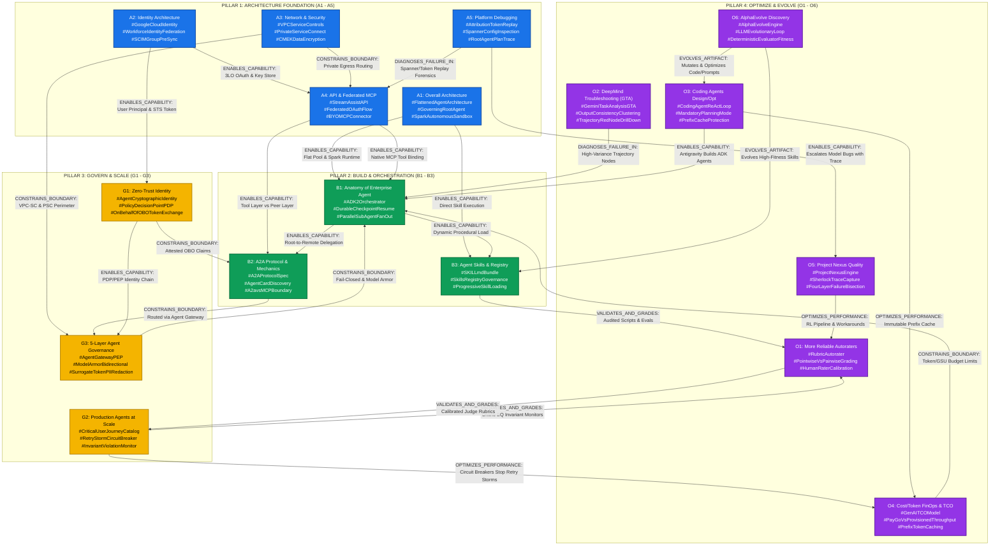

# 18_OKF_TOPIC_CONNECTION_AND_FLOW_GRAPH: Master L400 Topic Modeling, Cross-Module Semantic Graph & Antigravity Routing Specification
**Topic Tags:** `#L400_version_20261026_0350` `#OpenKnowledgeFormat` `#TopicConnectionGraph` `#GCPKnowledgeCatalog` `#AntigravityAgenticAI` `#MasterTaxonomy` `#L400EnterpriseArchitecture`

---

## 0. OKF Document Metadata & Global Topic Modeler Overview
**Topic Tags:** `#L400_version_20261026_0350` `#OKFMetadata` `#GlobalTopicModeler` `#KnowledgeGraphSchema` `#SemanticRetrieval` `#AntigravityRouting`

> **OKF v0.2 Trust Signals, Bucket Merge & Enforced FDE Grading Rubric (`OKF-L400-21`):**
> - **Version Tag:** `L400_version_20261026_0350` | **Status (`status`):** `stable` (`VETTED` / `APPROVED`) | **TTL (`stale_after`):** `2027-04-26T00:00:00Z` *(Maintains existing TTL & version)* | **Verified (`verified`):** `true`
> - **Merged Bucket OKF Lineage:** Reconciled with `Concepts 01-15` in `gs://gea_agent_development_architectural_best_practices_1790796607` (`project=fivedaysai-prd-sandbox-317383`)
> - **Cloud FDE Prevailing Standard:** `https://g3doc.corp.google.com/company/teams/cloud-fde/index.md?cl=head`
> - **Enforced Project Grading Rubric (`OKF-L400-21`):** Adheres to the 0–3 FDE Field-Readiness Rubric (Pass Gate: Average >= 2.0 across Part A & Part B; Zero-Score Pause Rule: any `0 - Not Demonstrated` triggers an immediate pause and 2-week re-presentation). Primary mapped competencies for `OKF-L400-18`: **Part B.2.4 (System Design Artifacts & Cross-Module Architecture Flows) & Part B.7.1 (Modular Interface Contracts)**.

### 0.1 Document Control & Open Knowledge Format (OKF) Specification
**Topic Tags:** `#L400_version_20261026_0350` `#DocumentControl` `#OKFSpecification` `#Version20261026_0350` `#SchemaCompliance`

| Metadata Attribute | Canonical Specification Value |
| :--- | :--- |
| **Document Identifier** | `18_OKF_TOPIC_CONNECTION_AND_FLOW_GRAPH.md` |
| **Canonical Release Version Tag** | `L400_version_20261026_0350` |
| **OKF Schema Standard** | Google Open Knowledge Format (OKF) v4.2 — Multi-Tier Semantic Knowledge Graph |
| **Target Ingestion Platforms** | Google Cloud Knowledge Catalog, Vertex AI Search (Structured + Chunked Graph Store), Antigravity Agentic Context Engine, BigQuery Vector & Graph Index (`GRAPH_TABLE`) |
| **Synthesized Curriculum Scope** | All 17 Gemini Enterprise L400 Technical Training Modules (`A1`–`A5`, `B1`–`B3`, `G1`–`G3`, `O1`–`O6`) |
| **Primary Tag Cardinality** | **102 Primary Topic Tags** (6 canonical primary tags per module across 17 modules) |
| **Secondary Tag Cardinality** | **102 Secondary Capability/Outcome/Impact Tags** (6 secondary tags per module across 17 modules) |
| **Taxonomy Architecture** | Three-Tier Hierarchical Ontology: **Tier 1 (Domain)** $\rightarrow$ **Tier 2 (Entity / Technology)** $\rightarrow$ **Tier 3 (Architectural / Operational Pattern)** |

### 0.2 GCP Knowledge Catalog Graph Schema (Nodes, Edges, & Properties)
**Topic Tags:** `#L400_version_20261026_0350` `#GCPKnowledgeCatalog` `#GraphSchema` `#PropertyGraph` `#SpannerGraph` `#BigQueryGraph`

When ingested into **Google Cloud Knowledge Catalog**, **Vertex AI RAG Engine**, or **Cloud Spanner Graph**, every heading and section across the 18 L400 OKF files is parsed using the deterministic `#L400_version_20261026_0350` anchor tag and mapped into a strongly typed Property Graph $G = (V, E, P)$:

#### 0.2.1 Vertex (Node) Entity Types
**Topic Tags:** `#L400_version_20261026_0350` `#GraphVertices` `#NodeEntityTypes` `#OntologyNodes` `#KnowledgeCatalogEntities`

1. **`PillarNode` (`:Pillar`)**: Represents the four foundational pillars of the Gemini Enterprise Agent Platform:
   - `ARCH` (**Architecture**: `A1`–`A5`)
   - `BUILD` (**Build**: `B1`–`B3`)
   - `GOV_SCALE` (**Govern & Scale**: `G1`–`G3`)
   - `OPTIMIZE` (**Optimize**: `O1`–`O6`)
2. **`ModuleNode` (`:Module`)**: Represents each of the 17 canonical L400 modules (`A1` through `O6`) and its companion OKF document (`01_OKF` through `17_OKF`).
3. **`PrimaryTopicNode` (`:PrimaryTopic`)**: The 102 core technical concepts, protocols, services, and primitives (e.g., `#FlattenedAgentArchitecture`, `#WorkforceIdentityFederation`, `#ADK2Orchestrator`, `#A2AProtocol`, `#AgentGatewayPEP`, `#AutoraterCalibration`, `#AlphaEvolveEngine`).
4. **`SecondaryCapabilityNode` (`:SecondaryCapability`)**: The 102 operational outcomes, SLAs, failure mitigations, and business impacts (e.g., `#LatencyReduction`, `#ZeroExfiltration`, `#RetryStormPrevention`, `#10xPrefixCacheSavings`, `#ParetoFrontierOptimization`).
5. **`TaxonomyPatternNode` (`:TaxonomyPattern`)**: The three-tier classification tuple `(Domain, Entity_Technology, Pattern)` enabling zero-hallucination architectural pattern matching.

#### 0.2.2 Directed Edge (Relationship) Types
**Topic Tags:** `#L400_version_20261026_0350` `#GraphEdges` `#DirectedRelationships` `#SemanticAdjacency` `#DependencyVectors`

| Edge Label (`REL_TYPE`) | Source Node $\rightarrow$ Target Node | Semantic Meaning in GCP Knowledge Catalog & Antigravity |
| :--- | :--- | :--- |
| **`ENABLES_CAPABILITY`** | `:Module` / `:PrimaryTopic` $\rightarrow$ `:PrimaryTopic` | Upstream architectural primitive is a mandatory prerequisite for downstream runtime execution (e.g., `A2` `#GoogleCloudIdentity` $\rightarrow$ `G1` `#PrincipalPropagation`). |
| **`CONSTRAINS_BOUNDARY`** | `:PrimaryTopic` $\rightarrow$ `:PrimaryTopic` | Security, governance, or FinOps policy bounds the execution space of an agent or tool (e.g., `A3` `#VPCServiceControls` $\rightarrow$ `A4` `#FederatedMCPConnector`). |
| **`VALIDATES_AND_GRADES`** | `:PrimaryTopic` $\rightarrow$ `:PrimaryTopic` | Evaluation, autorater, or troubleshooting loop measures and scores a build/runtime artifact (e.g., `O1` `#RubricAutorater` $\rightarrow$ `B3` `#SkillEvaluationSuite`). |
| **`OPTIMIZES_PERFORMANCE`** | `:PrimaryTopic` $\rightarrow$ `:PrimaryTopic` | Evolutionary, caching, or routing mechanism reduces latency/cost or improves accuracy (e.g., `O4` `#PrefixTokenCaching` $\rightarrow$ `O3` `#CodingAgentReActLoop`). |
| **`DIAGNOSES_FAILURE_IN`** | `:PrimaryTopic` $\rightarrow$ `:PrimaryTopic` | Observability or forensic workflow isolates root causes in an upstream component (e.g., `A5` `#AttributionTokenReplay` $\rightarrow$ `B1` `#ADK2Orchestrator`). |
| **`EVOLVES_ARTIFACT`** | `:PrimaryTopic` $\rightarrow$ `:PrimaryTopic` | Autonomous code/prompt mutation engine improves an algorithm, prompt, or skill (e.g., `O6` `#AlphaEvolveEngine` $\rightarrow$ `B3` `#SKILLmdBundle`). |

```sql
-- Canonical Spanner Graph / BigQuery Graph DDL for L400 OKF Topic Ingestion
CREATE PROPERTY GRAPH L400_Enterprise_Agent_Knowledge_Graph
  NODE TABLES (
    L400_Modules KEY (module_id)
      LABEL Module PROPERTIES (module_id, okf_file, pillar, title, version_tag),
    L400_Topics KEY (topic_tag)
      LABEL Topic PROPERTIES (topic_tag, tag_tier, module_id, domain_tier1, entity_tier2, pattern_tier3, version_tag)
  )
  EDGE TABLES (
    L400_Topic_Connections KEY (edge_id)
      SOURCE KEY (source_tag) REFERENCES L400_Topics (topic_tag)
      DESTINATION KEY (target_tag) REFERENCES L400_Topics (topic_tag)
      LABEL CONNECTS_TO PROPERTIES (relationship_type, coupling_weight, runtime_phase, enforcement_mode, version_tag)
  );
```

### 0.3 Antigravity Semantic Retrieval & Context-Window Routing Guide
**Topic Tags:** `#L400_version_20261026_0350` `#AntigravityContextEngine` `#SemanticRouting` `#TokenBudgetOptimization` `#ProgressiveDisclosure`

When an **Antigravity Coding or Architecture Agent** is tasked with designing, building, securing, debugging, or optimizing a Gemini Enterprise solution, loading all 17 OKF documents simultaneously into the prompt context window causes **Context Rot** (see Module `O3`) and violates **Prefix Cache Efficiency** (see Module `O4`). Instead, Antigravity agents execute a **3-Stage Progressive Topic Routing Protocol**:

1. **Stage 1 — Version-Pinned Tag Resolution (`#L400_version_20261026_0350`)**:
   - All retrieval queries filter strictly on `version_tag = 'L400_version_20261026_0350'` to prevent mixing stale 2024/2025 architectural guidance (such as legacy hierarchical sub-agent chains or mandatory WIF-only Entra Object ID matching) with current 2026 flattened architecture and Cloud Identity best practices.
2. **Stage 2 — Primary & Adjacency Hop Lookup via `18_OKF_TOPIC_CONNECTION_AND_FLOW_GRAPH.md`**:
   - The agent inspects this master graph first, maps the user's engineering intent to **1–2 Anchor Modules** and **3–5 Primary Topic Tags**, and traverses 1-hop `CONSTRAINS_BOUNDARY` and `ENABLES_CAPABILITY` edges to identify required co-dependent sections.
3. **Stage 3 — Surgical H3/H4 Section Chunk Injection**:
   - Using the universal heading topic tags placed immediately beneath every `#`, `##`, `###`, and `####` header, the agent retrieves only the matching markdown sub-trees into its active working memory, preserving $>85\%$ prefix cache hit ratios.

---

## 1. Master L400 Topic Taxonomy Catalog (All 17 Modules: A1–O6)
**Topic Tags:** `#L400_version_20261026_0350` `#MasterTopicCatalog` `#PrimaryTopicTags` `#SecondaryCapabilityTags` `#ThreeTierTaxonomy` `#All17Modules`

> **Enforced FDE Project Grading Rubric Reference (`OKF-L400-21` & `g3doc/company/teams/cloud-fde`):** Every project applying Section 1 of `OKF-L400-18` is graded against **Part B.2.4 (System Design Artifacts & Cross-Module Architecture Flows) & Part B.7.1 (Modular Interface Contracts)** and merged bucket **Concepts 01-15** (`stale_after: 2027-04-26T00:00:00Z`, version `L400_version_20261026_0350`). Builders must achieve >= 2 (**Competent**) across Part A & Part B and avoid any 0 (**Not Demonstrated**) pause triggers.

### 1.1 Architecture Pillar (`A1`–`A5`) Topic Taxonomy & Tag Catalog
**Topic Tags:** `#L400_version_20261026_0350` `#ArchitecturePillar` `#A1_A5_Taxonomy` `#EnterpriseFoundation` `#IdentityNetworkAPI` `#PlatformDebugging`

| Module ID & OKF File | Canonical Module Title | Primary Topic Tags (6 per Module = 30 Tags) | Secondary Capability / Outcome / Impact Tags (6 per Module = 30 Tags) | Three-Tier Taxonomy: (1) Domain $\rightarrow$ (2) Entity/Technology $\rightarrow$ (3) Pattern |
| :--- | :--- | :--- | :--- | :--- |
| **`A1`**<br>`01_OKF_A1_OVERALL_ARCHITECTURE.md` | **Gemini Enterprise Overall Architecture** | `#FlattenedAgentArchitecture`<br>`#GoverningRootAgent`<br>`#SparkAutonomousSandbox`<br>`#DiscoveryEngineControlPlane`<br>`#SharedToolSkillPool`<br>`#RegionalMultiTenantStorage` | `#RoundTripLatencyElimination`<br>`#ContextLossPrevention`<br>`#MultiDayAutonomousExecution`<br>`#DataResidencyCompliance`<br>`#ModularConnectorAgility`<br>`#ZeroCopyGrounding` | **Tier 1 (Domain):** Enterprise Platform Architecture<br>**Tier 2 (Entity/Tech):** Gemini Enterprise Control Plane, Governing Agent, Spark VM Sandbox, Cloud Storage/Spanner<br>**Tier 3 (Pattern):** Evolution from Search-First (2024) $\rightarrow$ Hierarchical Multi-Agent $\rightarrow$ Flattened Direct Tool/Skill Execution + Spark Long-Running Loop |
| **`A2`**<br>`02_OKF_A2_IDENTITY_ARCHITECTURE.md` | **Identity Architecture & Federation** | `#GoogleCloudIdentity`<br>`#WorkforceIdentityFederation`<br>`#STSAssertionExchange`<br>`#SCIMGroupPreSync`<br>`#DownstreamOAuth3LO`<br>`#ACLPermissionEnforcement` | `#GroupAssertionLimitBypass`<br>`#ZeroStandingPrivileges`<br>`#SeamlessAgentNotebookSharing`<br>`#LandingZoneAlignment`<br>`#SessionTimeoutGovernance`<br>`#IdentityReconfigurationAvoidance` | **Tier 1 (Domain):** Enterprise Identity & Access Management<br>**Tier 2 (Entity/Tech):** Cloud Identity, Workforce Identity Federation (WIF), `sts.googleapis.com`, SCIM Protocol, OIDC/SAML Assertions<br>**Tier 3 (Pattern):** Dual-Path Identity Pattern (Cloud Identity Recommended Default vs. WIF + SCIM Pre-Sync to bypass 200-OIDC / 150-SAML group limits) |
| **`A3`**<br>`03_OKF_A3_NETWORK_ARCHITECTURE_AND_SECURITY.md` | **Network Architecture, Security & VPC-SC** | `#VPCServiceControls`<br>`#PrivateServiceConnect`<br>`#CMEKDataEncryption`<br>`#ContextAwareAccess`<br>`#ModelArmorInlineFilter`<br>`#SharedResponsibilityModel` | `#APIExfiltrationMitigation`<br>`#CryptographicDestruction`<br>`#PrivateGoogleAccessRouting`<br>`#60DayPromptRetentionControl`<br>`#ZeroPublicIPExposure`<br>`#DevicePostureVerification` | **Tier 1 (Domain):** Cloud Network Security & Data Protection<br>**Tier 2 (Entity/Tech):** VPC-SC Perimeters, Private Service Connect (PSC), Cloud KMS (CMEK), Access Context Manager, Security Command Center<br>**Tier 3 (Pattern):** Defense-in-Depth Perimeter Pattern (Context-Aware Access Ingress $\rightarrow$ VPC-SC API Boundary $\rightarrow$ PSC Private Tunnel $\rightarrow$ CMEK At-Rest Encryption) |
| **`A4`**<br>`04_OKF_A4_API_INTEGRATION_AND_FEDERATED_CONNECTOR.md` | **API Integration, Federated Connector Auth Flow & BYO MCP** | `#StreamAssistAPI`<br>`#FederatedOAuthFlow`<br>`#BYOMCPConnector`<br>`#GoogleTokenKeyStore`<br>`#PortalEmbeddedSurface`<br>`#ConnectorAuthStateAPI` | `#DirectMCPLowLatency`<br>`#ThirdPartyTokenLifecycle`<br>`#CustomPortalAdoption`<br>`#GracefulUnlinkRevocation`<br>`#PerUserOAuthConsent`<br>`#DiscoveryEngineBypass` | **Tier 1 (Domain):** API Integration & Federated Connectivity<br>**Tier 2 (Entity/Tech):** `streamAssist` API, Native MCP Server/Client, OAuth 2.0 Auth Code Grant, Google Key Store, SharePoint/Custom Portals<br>**Tier 3 (Pattern):** Federated Auth & Direct MCP Pattern (UI/Portal OAuth Consent $\rightarrow$ Key Store Token Binding $\rightarrow$ Direct Native MCP Invocation bypassing Discovery Engine hop) |
| **`A5`**<br>`05_OKF_A5_DEBUGGING_AND_TROUBLESHOOTING.md` | **Debugging & Troubleshooting Gemini Enterprise** | `#AttributionTokenReplay`<br>`#SpannerConfigInspection`<br>`#ProjectNumberResolution`<br>`#RootAgentPlanTrace`<br>`#ConnectorScopeVerification`<br>`#SystemInstructionPatching` | `#RapidRootCauseIsolation`<br>`#SubAgentToolErrorDetection`<br>`#AuthScopeMismatchFix`<br>`#ZeroDowntimePromptWorkaround`<br>`#EngineeringEscalationTriage`<br>`#DeterministicReplayAudit` | **Tier 1 (Domain):** Platform Observability & Forensic Debugging<br>**Tier 2 (Entity/Tech):** Assist/Attribution Tokens, Internal Replay Tooling, Cloud Spanner Configuration Tables, Code Search, Cloud Logging<br>**Tier 3 (Pattern):** Five-Step Forensic Triage Pattern (Collect Project Number & Attribution Token $\rightarrow$ Replay Trajectory $\rightarrow$ Inspect Spanner ACL/Scopes $\rightarrow$ Audit Prompt $\rightarrow$ Patch/Escalate) |

---

### 1.2 Build Pillar (`B1`–`B3`) Topic Taxonomy & Tag Catalog
**Topic Tags:** `#L400_version_20261026_0350` `#BuildPillar` `#B1_B3_Taxonomy` `#ADK2Internals` `#A2AProtocol` `#SkillsRegistry`

| Module ID & OKF File | Canonical Module Title | Primary Topic Tags (6 per Module = 18 Tags) | Secondary Capability / Outcome / Impact Tags (6 per Module = 18 Tags) | Three-Tier Taxonomy: (1) Domain $\rightarrow$ (2) Entity/Technology $\rightarrow$ (3) Pattern |
| :--- | :--- | :--- | :--- | :--- |
| **`B1`**<br>`06_OKF_B1_ANATOMY_OF_AN_ENTERPRISE_AGENT.md` | **Anatomy of an Enterprise Agent & ADK 2.0 Internals** | `#ADK2Orchestrator`<br>`#DurableCheckpointResume`<br>`#IdempotentToolExecution`<br>`#ParallelSubAgentFanOut`<br>`#PolyglotAgentRuntime`<br>`#TenantIsolatedMemory` | `#CrashRecoveryNoSideEffects`<br>`#CrossUserDataIsolation`<br>`#EndToEndAuditTrail`<br>`#ExfiltrationCallBlocking`<br>`#HeterogeneousFrameworkInterop`<br>`#AutomatedRootCauseSynthesis` | **Tier 1 (Domain):** Agentic Runtime & Orchestration Engineering<br>**Tier 2 (Entity/Tech):** Agent Development Kit (ADK 2.0), LangGraph on Cloud Run, GitHub/Google MCP Servers, BigQuery Bug DB, Vertex AI Search<br>**Tier 3 (Pattern):** Durable Fan-Out Orchestrator Pattern (ADK 2.0 Root Orchestrator $\rightarrow$ Parallel Sub-Agent Dispatch $\rightarrow$ Idempotent State Checkpointing $\rightarrow$ Audited Synthesis) |
| **`B2`**<br>`07_OKF_B2_A2A_PROTOCOL_AND_MULTI_AGENT_MECHANICS.md` | **A2A Protocol & Multi-Agent Mechanics** | `#A2AProtocolSpec`<br>`#AgentCardDiscovery`<br>`#TaskLifecycleStateMachine`<br>`#A2avsMCPBoundary`<br>`#StreamingArtifactSSE`<br>`#PushNotificationWebhook` | `#OpaqueAgentEncapsulation`<br>`#CrossVendorAgentInterop`<br>`#AsyncLongRunningCoordination`<br>`#CapabilityBasedNegotiation`<br>`#LooseCouplingResilience`<br>`#StructuredModalityExchange` | **Tier 1 (Domain):** Multi-Agent Communication & Interoperability<br>**Tier 2 (Entity/Tech):** Agent-to-Agent (A2A) Protocol, `.well-known/agent.json` Agent Cards, JSON-RPC 2.0 over HTTP/SSE, MCP Tool Layer<br>**Tier 3 (Pattern):** Dual-Protocol Separation Pattern (A2A for Peer-to-Peer Autonomous Agent Collaboration with Opaque Internal State vs. MCP for Deterministic Tool/Resource Invocation) |
| **`B3`**<br>`08_OKF_B3_AGENT_SKILLS_AND_SKILLS_REGISTRY.md` | **Agent Skills Authoring & Enterprise Skills Registry** | `#SKILLmdBundle`<br>`#SkillsRegistryGovernance`<br>`#ProgressiveSkillLoading`<br>`#SkillsRefValidation`<br>`#ExecutableScriptsAudit`<br>`#SkillEvaluationSuite` | `#MaliciousScriptPrevention`<br>`#OnDemandReferenceLoading`<br>`#OrgWideProceduralReuse`<br>`#DeterministicFolderNaming`<br>`#SemanticVersionPinning`<br>`#DesignDocAutomation` | **Tier 1 (Domain):** Procedural Knowledge Packaging & Reuse<br>**Tier 2 (Entity/Tech):** `SKILL.md` Manifest, `scripts/`, `references/`, `assets/` Bundles, `skills-ref` Validator, Enterprise Skills Registry<br>**Tier 3 (Pattern):** Verified Progressive Skill Bundle Pattern (Metadata Discovery $\rightarrow$ `SKILL.md` Instruction Load $\rightarrow$ On-Demand `references/` Read $\rightarrow$ Audited `scripts/` Execution) |

---

### 1.3 Govern & Scale Pillar (`G1`–`G3`) Topic Taxonomy & Tag Catalog
**Topic Tags:** `#L400_version_20261026_0350` `#GovernAndScalePillar` `#G1_G3_Taxonomy` `#ZeroTrustIdentity` `#ProductionResilience` `#AgentGovernance`

| Module ID & OKF File | Canonical Module Title | Primary Topic Tags (6 per Module = 18 Tags) | Secondary Capability / Outcome / Impact Tags (6 per Module = 18 Tags) | Three-Tier Taxonomy: (1) Domain $\rightarrow$ (2) Entity/Technology $\rightarrow$ (3) Pattern |
| :--- | :--- | :--- | :--- | :--- |
| **`G1`**<br>`09_OKF_G1_ZERO_TRUST_IDENTITY_FOUNDATION.md` | **Zero-Trust Identity Foundation for Agents** | `#AgentCryptographicIdentity`<br>`#PolicyDecisionPointPDP`<br>`#PolicyEnforcementPointPEP`<br>`#OnBehalfOfOBOTokenExchange`<br>`#ScopedAuthorityAttestation`<br>`#ConfusedDeputyPrevention` | `#LeastPrivilegeToolAccess`<br>`#ShortLivedCredentialRotation`<br>`#VerifiableIdentityChain`<br>`#TenantInstanceBinding`<br>`#ZeroImplicitTrust`<br>`#CrossAgentCallAttribution` | **Tier 1 (Domain):** Zero-Trust Agentic Identity & Authorization<br>**Tier 2 (Entity/Tech):** SPIFFE/Cryptographic Agent IDs, IAM Policy Decision Point (PDP), Agent Gateway Policy Enforcement Point (PEP), OAuth 2.0 Token Exchange (RFC 8693 OBO)<br>**Tier 3 (Pattern):** Attested OBO Delegation Pattern (User Principal + Agent Cryptographic Identity $\rightarrow$ PDP Policy Check $\rightarrow$ PEP Gateway Enforcement $\rightarrow$ Scoped Downstream Token) |
| **`G2`**<br>`10_OKF_G2_MANAGING_PRODUCTION_AGENTS_AT_SCALE.md` | **Managing Production Agents at Scale** | `#CriticalUserJourneyCatalog`<br>`#RetryStormCircuitBreaker`<br>`#InvariantViolationMonitor`<br>`#BigQueryOnlineSampling`<br>`#GracefulDegradationFallback`<br>`#FleetQuotaProtection` | `#TokenExplosionPrevention`<br>`#ContinuousAlignmentTracking`<br>`#SharedDependencyProtection`<br>`#LatencySpikeContainment`<br>`#HallucinationCascadeStop`<br>`#AutomatedSLORemediation` | **Tier 1 (Domain):** Distributed Agent SRE & Production Reliability<br>**Tier 2 (Entity/Tech):** CUJ Evaluation Matrix, BigQuery Online Traffic Sampler, Distributed Circuit Breakers, Load Shedding/Backoff Middleware, Cloud Monitoring<br>**Tier 3 (Pattern):** Anti-Fragile Fleet Pattern (Pre-Prod CUJ Invariant Gate + Runtime BigQuery Sampling + Explicit Timeout/Circuit-Breaker to prevent LLM Retry Storms on slow APIs) |
| **`G3`**<br>`11_OKF_G3_AGENT_GOVERNANCE.md` | **Five-Layer Enterprise Agent Governance** | `#AgentGatewayPEP`<br>`#DualInvokerBinding`<br>`#ModelArmorBidirectional`<br>`#SurrogateTokenPIIRedaction`<br>`#FailClosedPerimeter`<br>`#TerraformDriftGovernance` | `#IndirectPromptInjectionBlock`<br>`#LateralMovementElimination`<br>`#BypassResistantRuntimes`<br>`#PSCDrainLifecycleControl`<br>`#ReversiblePIIDetokenization`<br>`#DeterministicIaCCompliance` | **Tier 1 (Domain):** End-to-End Agent Security & Policy Governance<br>**Tier 2 (Entity/Tech):** Managed Agent Gateway, Cloud Run Invoker IAM Binding, Model Armor (Prompt + Response Filter), DLP Surrogate Tokens, Terraform IaC<br>**Tier 3 (Pattern):** Five-Layer Fail-Closed Governance Pattern (L1 PSC/VPC Perimeter $\rightarrow$ L2 Cryptographic ID $\rightarrow$ L3 Dual Invoker Binding $\rightarrow$ L4 Bidirectional Model Armor/PII Surrogates $\rightarrow$ L5 IaC Drift Control) |

---

### 1.4 Optimize Pillar (`O1`–`O6`) Topic Taxonomy & Tag Catalog
**Topic Tags:** `#L400_version_20261026_0350` `#OptimizePillar` `#O1_O6_Taxonomy` `#Autoraters` `#CodingAgents` `#FinOpsTCO` `#ProjectNexus` `#AlphaEvolve`

| Module ID & OKF File | Canonical Module Title | Primary Topic Tags (6 per Module = 36 Tags) | Secondary Capability / Outcome / Impact Tags (6 per Module = 36 Tags) | Three-Tier Taxonomy: (1) Domain $\rightarrow$ (2) Entity/Technology $\rightarrow$ (3) Pattern |
| :--- | :--- | :--- | :--- | :--- |
| **`O1`**<br>`12_OKF_O1_MORE_RELIABLE_AUTORATERS.md` | **More Reliable Autoraters & Evaluation Science** | `#RubricAutorater`<br>`#PointwiseVsPairwiseGrading`<br>`#PositionVerbosityBiasMitigation`<br>`#ChainOfThoughtJudge`<br>`#HumanRaterCalibration`<br>`#AtomicCriterionDecomposition` | `#HighKappaHumanAlignment`<br>`#SubjectiveQualityVelocity`<br>`#BiasFreeModelComparison`<br>`#LowVarianceScoring`<br>`#AutomatedRegressionGating`<br>`#ScalableEvalThroughput` | **Tier 1 (Domain):** LLM-as-a-Judge & Automated Evaluation Science<br>**Tier 2 (Entity/Tech):** Autorater Judges, Atomic Rubrics, Pairwise Swap-Augmentation, CoT Judge Prompts, Cohen's Kappa / Krippendorff's Alpha Calibration<br>**Tier 3 (Pattern):** Decomposed Calibrated Autorater Pattern (Break Holistic Score into Atomic Binary/Likert Criteria $\rightarrow$ CoT Verification $\rightarrow$ Pairwise Position Swap $\rightarrow$ Human Gold-Set Calibration) |
| **`O2`**<br>`13_OKF_O2_DEEPMIND_TROUBLESHOOTING_TOOL.md` | **DeepMind Troubleshooting Tool (Gemini Task Analysis)** | `#GeminiTaskAnalysisGTA`<br>`#OutputConsistencyClustering`<br>`#LabelFreeFailureDiagnosis`<br>`#TrajectoryRedNodeDrillDown`<br>`#SelfRecoveryDetection`<br>`#AutomatedPromptPatching` | `#ZeroLabeledDataDebugging`<br>`#VarianceDrivenBugDiscovery`<br>`#MultiRunFailureLocalization`<br>`#RapidPromptIteration`<br>`#SubStepFragilityMapping`<br>`#AutomatedFixVerification` | **Tier 1 (Domain):** Label-Free Agent Trajectory Diagnostics<br>**Tier 2 (Entity/Tech):** DeepMind Gemini Task Analysis (`go/gemini-task-analysis`), N-Sample Consistency Engine, Trajectory Graph Visualizer, Self-Critique Patcher<br>**Tier 3 (Pattern):** Consistency-Inconsistency Diagnostic Pattern (Execute $N$ Parallel Runs per Input $\rightarrow$ Measure Output/Step Consistency $\rightarrow$ Flag High-Variance Red Nodes $\rightarrow$ Distinguish Fatal Failure vs. Self-Recovery) |
| **`O3`**<br>`14_OKF_O3_DESIGN_AND_OPTIMIZATION_OF_CODING_AGENTS.md` | **Design & Optimization of Coding Agents** | `#CodingAgentReActLoop`<br>`#MandatoryPlanningMode`<br>`#ContextRotCompaction`<br>`#PrefixCacheProtection`<br>`#DiminishingReturnsTermination`<br>`#SandboxedToolExecution` | `#10xPrefixCacheSavings`<br>`#InfiniteLoopPrevention`<br>`#CleanContextWindowSignal`<br>`#ReadOnlyPlanVerification`<br>`#HighPassAt1CodeSynthesis`<br>`#SafeFilesystemMutation` | **Tier 1 (Domain):** Autonomous Software Engineering & Coding Agents<br>**Tier 2 (Entity/Tech):** ReAct (Reason + Act) Tool Loop, Read-Only Planning Mode, Immutable System/Tool Prefix Cache, Sub-Agent Context Summarizer, Ephemeral Sandbox<br>**Tier 3 (Pattern):** Cache-Preserving Plan-Then-Act Pattern (Read-Only Planning Phase $\rightarrow$ Append-Only Prefix-Protected ReAct Loop $\rightarrow$ Sub-Agent Context Offloading $\rightarrow$ Diminishing-Returns Termination) |
| **`O4`**<br>`15_OKF_O4_COST_TOKEN_ESTIMATION_ANALYSIS_OPTIMIZATION.md` | **Cost/Token Estimation, Analysis & FinOps Optimization** | `#GenAITCOModel`<br>`#PayGoVsProvisionedThroughput`<br>`#PrefixTokenCaching`<br>`#TieredModelRouting`<br>`#ContextWindowPruning`<br>`#BatchPredictionDiscount` | `#PredictableUnitEconomics`<br>`#GSUUtilizationOptimization`<br>`#PromptTokenCompression`<br>`#FlashToProCascadeSavings`<br>`#SpilloverTrafficControl`<br>`#PerTenantCostAttribution` | **Tier 1 (Domain):** Enterprise GenAI FinOps & Capacity Engineering<br>**Tier 2 (Entity/Tech):** Vertex AI Billing Engine, Provisioned Throughput (GSUs), Explicit/Implicit Context Caching, Gemini Flash/Pro Tiered Router, Batch API<br>**Tier 3 (Pattern):** FinOps Multi-Lever Optimization Pattern (Baseline Token Telemetry $\rightarrow$ Context Pruning & Prefix Caching $\rightarrow$ Flash/Pro Cascade Routing $\rightarrow$ Base-Load Provisioned Throughput + PayGo Burst) |
| **`O5`**<br>`16_OKF_O5_PROJECT_NEXUS_GEMINI_QUALITY.md` | **Project Nexus: Gemini Quality from Issue to Fix** | `#ProjectNexusEngine`<br>`#SherlockTraceCapture`<br>`#BigQueryOptInLogging`<br>`#FourLayerFailureBisection`<br>`#PrivacySafeSyntheticRepro`<br>`#ThinkingBudgetWorkaround` | `#MultiWeekResolutionSpeedup`<br>`#VerifiableArtifactConversion`<br>`#ThoughtLeakageMitigation`<br>`#PIISafeBugEscalation`<br>`#RLPipelineFeedbackLoop`<br>`#ImmediateCustomerUnblocking` | **Tier 1 (Domain):** Production Model Quality Resolution & Escalation<br>**Tier 2 (Entity/Tech):** Project Nexus Resolution Engine, Sherlock Trace Links, Customer BigQuery Request/Response Logs, Synthetic Prompt Generator, Model RL Feedback Pipeline<br>**Tier 3 (Pattern):** Verifiable Trace-to-Fix Pattern (Convert Anecdote to Sherlock/BQ Trace or PII-Safe Synthetic Repro $\rightarrow$ Bisect across Request/API/Serving/Weights $\rightarrow$ Apply Thinking/Temp Workaround $\rightarrow$ Feed RL Pipeline) |
| **`O6`**<br>`17_OKF_O6_ALPHA_EVOLVE.md` | **AlphaEvolve: Autonomous Algorithm & Code Discovery** | `#AlphaEvolveEngine`<br>`#LLMEvolutionaryLoop`<br>`#DeterministicEvaluatorFitness`<br>`#MapElitesArchiveDB`<br>`#DiffBasedCodeMutation`<br>`#ParetoFrontierOptimization` | `#SuperhumanAlgorithmDiscovery`<br>`#BorgSchedulingEfficiency`<br>`#TPUPowerCircuitReduction`<br>`#KernelMatrixSpeedup`<br>`#HallucinationProofVerification`<br>`#MultiObjectiveFitnessBalance` | **Tier 1 (Domain):** Evolutionary LLM Search & Algorithmic Discovery<br>**Tier 2 (Entity/Tech):** Google DeepMind AlphaEvolve, Gemini Flash + Pro Ensemble Mutators, Automated Deterministic Evaluator Pool, Evolutionary Population Database<br>**Tier 3 (Pattern):** Generate-Evaluate-Select Evolutionary Pattern (Parent Program + Rich Context Prompt $\rightarrow$ LLM Diff Mutation $\rightarrow$ Automated Multi-Metric Fitness Evaluation $\rightarrow$ Evolutionary Archive Selection) |

### 1.5 Summary Verification of the 204 Canonical Tags (102 Primary + 102 Secondary)
**Topic Tags:** `#L400_version_20261026_0350` `#TagCardinalityAudit` `#102PrimaryTags` `#102SecondaryTags` `#CatalogCompleteness`

- **Architecture Pillar (`A1`–`A5`)**: $5 \text{ modules} \times 6 = 30 \text{ Primary Tags}$ | $5 \times 6 = 30 \text{ Secondary Tags}$
- **Build Pillar (`B1`–`B3`)**: $3 \text{ modules} \times 6 = 18 \text{ Primary Tags}$ | $3 \times 6 = 18 \text{ Secondary Tags}$
- **Govern & Scale Pillar (`G1`–`G3`)**: $3 \text{ modules} \times 6 = 18 \text{ Primary Tags}$ | $3 \times 6 = 18 \text{ Secondary Tags}$
- **Optimize Pillar (`O1`–`O6`)**: $6 \text{ modules} \times 6 = 36 \text{ Primary Tags}$ | $6 \times 6 = 36 \text{ Secondary Tags}$
- **Total L400 Master Tag Inventory**: **102 Primary Topic Tags** + **102 Secondary Capability/Outcome/Impact Tags** = **204 Standardized Graph Nodes** (all version-pinned to `#L400_version_20261026_0350`).


---

## 2. End-to-End Topic Connection & Flow Graphs (Mermaid.js & ASCII Visual Pictures)
**Topic Tags:** `#L400_version_20261026_0350` `#TopicFlowGraphs` `#MermaidKnowledgeGraph` `#RuntimeFlowArchitecture` `#AntigravityEvolutionLoop` `#ASCIIArchitectureMap`

> **Enforced FDE Project Grading Rubric Reference (`OKF-L400-21` & `g3doc/company/teams/cloud-fde`):** Every project applying Section 2 of `OKF-L400-18` is graded against **Part B.2.4 (System Design Artifacts & Cross-Module Architecture Flows) & Part B.7.1 (Modular Interface Contracts)** and merged bucket **Concepts 01-15** (`stale_after: 2027-04-26T00:00:00Z`, version `L400_version_20261026_0350`). Builders must achieve >= 2 (**Competent**) across Part A & Part B and avoid any 0 (**Not Demonstrated**) pause triggers.

### 2.1 Diagram 1: Master Cross-Pillar Knowledge Graph (`graph TB`)
**Topic Tags:** `#L400_version_20261026_0350` `#MasterCrossPillarGraph` `#ArchitectureToBuild` `#GovernToOptimize` `#17ModuleTopology`

The following `graph TB` topology maps all 17 L400 modules across the four foundational pillars (**Architecture**, **Build**, **Govern & Scale**, and **Optimize**), showing the primary semantic edges (`ENABLES_CAPABILITY`, `CONSTRAINS_BOUNDARY`, `VALIDATES_AND_GRADES`, `OPTIMIZES_PERFORMANCE`, `DIAGNOSES_FAILURE_IN`, and `EVOLVES_ARTIFACT`).



---

### 2.2 Diagram 2: Runtime Request-to-Response Topic Flow Graph (`flowchart LR`)
**Topic Tags:** `#L400_version_20261026_0350` `#RuntimeRequestFlow` `#EndToEndDataPlane` `#IdentityToObservability` `#ZeroTrustExecutionPath`

The following `flowchart LR` traces a single enterprise user request from initial authentication through network perimeters, orchestrator planning, skill loading, A2A/MCP invocation, inline governance, FinOps caching, and post-execution observability/debugging.

```mermaid
flowchart LR
    subgraph STAGE1 ["1. User Identity & Zero-Trust Auth (A2 / G1)"]
        U1["User / Portal Request<br/>#PortalEmbeddedSurface (A4)"]
        U2["Cloud Identity / WIF + SCIM<br/>#GoogleCloudIdentity<br/>#WorkforceIdentityFederation (A2)"]
        U3["STS Exchange & OBO Token<br/>#STSAssertionExchange (A2)<br/>#OnBehalfOfOBOTokenExchange (G1)"]
        U1 --> U2 --> U3
    end

    subgraph STAGE2 ["2. Network & VPC-SC Perimeter (A3)"]
        N1["Context-Aware Access<br/>#ContextAwareAccess (A3)"]
        N2["VPC Service Controls & PSC<br/>#VPCServiceControls<br/>#PrivateServiceConnect (A3)"]
        N3["CMEK Encrypted State<br/>#CMEKDataEncryption (A3)"]
        U3 --> N1 --> N2 --> N3
    end

    subgraph STAGE3 ["3. Governing Agent & ADK 2.0 (A1 / B1 / O3)"]
        R1["streamAssist API Ingress<br/>#StreamAssistAPI (A4)"]
        R2["Flattened Governing Root Agent<br/>#FlattenedAgentArchitecture (A1)<br/>#ADK2Orchestrator (B1)"]
        R3["Mandatory Read-Only Plan<br/>& Durable Checkpoint<br/>#MandatoryPlanningMode (O3)<br/>#DurableCheckpointResume (B1)"]
        N3 --> R1 --> R2 --> R3
    end

    subgraph STAGE4 ["4. Dynamic Skills Registry (B3)"]
        S1["Progressive Skill Discovery<br/>#ProgressiveSkillLoading (B3)"]
        S2["Load SKILL.md & References<br/>#SKILLmdBundle (B3)"]
        S3["Verified Script Execution<br/>#SkillsRefValidation<br/>#ExecutableScriptsAudit (B3)"]
        R3 --> S1 --> S2 --> S3
    end

    subgraph STAGE5 ["5. A2A Multi-Agent & Federated MCP (B2 / A4)"]
        M1["A2A Agent Card Discovery<br/>& Task Delegation<br/>#AgentCardDiscovery<br/>#A2AProtocolSpec (B2)"]
        M2["Direct Native MCP Server<br/>& Key Store OAuth Token<br/>#BYOMCPConnector<br/>#GoogleTokenKeyStore (A4)"]
        S3 --> M1
        S3 --> M2
    end

    subgraph STAGE6 ["6. Agent Gateway, Model Armor & SRE (G3 / G2)"]
        G_PEP["Agent Gateway PEP &<br/>Dual Invoker Binding<br/>#AgentGatewayPEP<br/>#DualInvokerBinding (G3)"]
        G_MA["Bidirectional Model Armor<br/>& Surrogate PII Tokens<br/>#ModelArmorBidirectional<br/>#SurrogateTokenPIIRedaction (G3)"]
        G_CB["Circuit Breaker & Quota Guard<br/>(Prevent LLM Retry Storms)<br/>#RetryStormCircuitBreaker (G2)"]
        M1 --> G_PEP
        M2 --> G_PEP
        G_PEP --> G_MA --> G_CB
    end

    subgraph STAGE7 ["7. FinOps, Caching & Model Routing (O4)"]
        F1["Immutable Prefix Token Cache<br/>(>=10x Cost Savings)<br/>#PrefixTokenCaching (O4)<br/>#PrefixCacheProtection (O3)"]
        F2["Tiered Flash/Pro Routing<br/>& Provisioned Throughput GSUs<br/>#TieredModelRouting<br/>#PayGoVsProvisionedThroughput (O4)"]
        G_CB --> F1 --> F2
    end

    subgraph STAGE8 ["8. Observability, Debugging & Quality (A5 / G2 / O1 / O2 / O5)"]
        Q1["BQ Online Sampling &<br/>Calibrated Autorater Eval<br/>#BigQueryOnlineSampling (G2)<br/>#RubricAutorater (O1)"]
        Q2["GTA Consistency Clustering<br/>& Attribution Token Replay<br/>#GeminiTaskAnalysisGTA (O2)<br/>#AttributionTokenReplay (A5)"]
        Q3["Project Nexus Sherlock Trace<br/>& 4-Layer Failure Bisection<br/>#ProjectNexusEngine<br/>#SherlockTraceCapture (O5)"]
        F2 --> Q1 --> Q2 --> Q3
    end
```



---

### 2.3 Diagram 3: Antigravity Autonomous Development & Evolution Topic Loop (`flowchart TD`)
**Topic Tags:** `#L400_version_20261026_0350` `#AntigravityDevLoop` `#AutonomousCodingEvolution` `#AlphaEvolveIntegration` `#ClosedLoopQuality`

The following `flowchart TD` illustrates how **Antigravity** combines **Coding Agent Architecture (`O3`)**, **ADK 2.0 & Skills (`B1`/`B3`)**, **AlphaEvolve Evolutionary Discovery (`O6`)**, and **Autoraters + DeepMind GTA (`O1`/`O2`)** into a continuous self-improving engineering loop.

```mermaid
flowchart TD
    START(["Engineering Task / Bug DB Spec / Bottleneck Kernel<br/>#L400_version_20261026_0350"])

    subgraph PHASE_PLAN ["Phase 1: Antigravity Read-Only Planning & Context Assembly (O3 + B3)"]
        P1["Antigravity Coding Agent Enters Mandatory Planning Mode<br/>#CodingAgentReActLoop #MandatoryPlanningMode (O3)"]
        P2["Query GCP Knowledge Catalog for L400 OKF Topic Chunks<br/>& Load Verified SKILL.md Bundles<br/>#ProgressiveSkillLoading #SkillsRefValidation (B3)"]
        P3["Protect Immutable System/Tool Prefix Cache<br/>& Compact Noisy Context History<br/>#PrefixCacheProtection #ContextRotCompaction (O3/O4)"]
        P1 --> P2 --> P3
    end

    subgraph PHASE_BUILD ["Phase 2: Polyglot Agent & Tool Implementation (B1 + B2 + G3)"]
        C1["Synthesize ADK 2.0 Root Orchestrator & Durable Checkpoints<br/>#ADK2Orchestrator #DurableCheckpointResume (B1)"]
        C2["Wire A2A Agent Cards (.well-known/agent.json)<br/>& Native Federated MCP Clients<br/>#A2AProtocolSpec (B2) #BYOMCPConnector (A4)"]
        C3["Bind Terraform IaC for Agent Gateway PEP,<br/>Dual Invoker IAM & Model Armor Surrogate PII<br/>#AgentGatewayPEP #DualInvokerBinding #TerraformDriftGovernance (G3)"]
        P3 --> C1 --> C2 --> C3
    end

    subgraph PHASE_EVAL ["Phase 3: Multi-Dimensional Evaluation & Consistency Diagnostics (O1 + O2 + G2)"]
        E1["Execute Pre-Prod Critical User Journey (CUJ) Suite<br/>#CriticalUserJourneyCatalog #InvariantViolationMonitor (G2)"]
        E2["Grade Subjective Quality via Decomposed CoT Autoraters<br/>(Pairwise Swap + Human Kappa Calibrated)<br/>#RubricAutorater #AtomicCriterionDecomposition (O1)"]
        E3["Run DeepMind Gemini Task Analysis (GTA) Across N Samples<br/>to Detect High-Variance Red Trajectory Nodes<br/>#GeminiTaskAnalysisGTA #OutputConsistencyClustering (O2)"]
        C3 --> E1 --> E2 --> E3
    end

    DECISION{"Trajectory Consistent &<br/>Fitness / SLO Targets Met?"}
    E3 --> DECISION

    subgraph PHASE_EVOLVE ["Phase 4: AlphaEvolve Evolutionary Optimization Loop (O6 + O5)"]
        EV1["Seed AlphaEvolve Population DB with Current Agent Code,<br/>Prompts, Routing Policies & Kernel Algorithms<br/>#AlphaEvolveEngine #MapElitesArchiveDB (O6)"]
        EV2["Generate Diff-Based Mutations via Gemini Flash + Pro Ensemble<br/>#DiffBasedCodeMutation #LLMEvolutionaryLoop (O6)"]
        EV3["Score Candidates via Deterministic Evaluators<br/>(Latency, Token Cost, Pass@1, Invariant Compliance)<br/>#DeterministicEvaluatorFitness #ParetoFrontierOptimization (O6)"]
        EV4["If Model-Weight/Serving Defect Detected:<br/>Capture Sherlock Trace & Bisect via Project Nexus<br/>#ProjectNexusEngine #FourLayerFailureBisection (O5)"]
        EV1 --> EV2 --> EV3
        EV3 -.->|Model Layer Defect| EV4
    end

    DECISION -->|"No (Variance / Cost / Accuracy Gap)"| EV1
    EV3 -->|"Select Pareto-Optimal Mutant & Update SKILL.md / ADK Code"| P2
    EV4 -->|"Apply Thinking Budget / Temp Workaround"| P2
    DECISION -->|"Yes (Production Ready)"| DEPLOY(["Deploy Governed Fleet with BQ Online Sampling & Circuit Breakers<br/>#BigQueryOnlineSampling #RetryStormCircuitBreaker (G2)"])
```



---

### 2.4 Diagram 4: Full-Page ASCII Architectural Picture of the L400 Topic Universe
**Topic Tags:** `#L400_version_20261026_0350` `#ASCIITopicUniverse` `#FullStackBlueprint` `#FourPillarSynthesis` `#VisualKnowledgeMap`

```text
========================================================================================================================================
                   GEMINI ENTERPRISE L400 MASTER TOPIC UNIVERSE & CONNECTION ARCHITECTURE (L400_version_20261026_0350)
========================================================================================================================================

  +----------------------------------------------------------------------------------------------------------------------------------+
  | LAYER 1: ZERO-TRUST IDENTITY, NETWORK PERIMETER & FEDERATED INGRESS (MODULES A2, A3, A4, G1)                                     |
  |                                                                                                                                  |
  |  [Enterprise User / Custom Portal (A4)]                                                                                          |
  |         |                                                                                                                        |
  |         v  (1) Authenticate Principal                                                                                            |
  |  +----------------------------------------------------+       +---------------------------------------------------------------+  |
  |  | A2: IDENTITY ARCHITECTURE                          |       | G1: ZERO-TRUST IDENTITY FOUNDATION                            |  |
  |  | * #GoogleCloudIdentity (Primary Recommended)       |------>| * #AgentCryptographicIdentity (Tenant + Project + Instance)   |  |
  |  | * #WorkforceIdentityFederation (sts.googleapis.com)|       | * #PolicyDecisionPointPDP (IAM / Business Rules)              |  |
  |  | * #SCIMGroupPreSync (Bypasses 200-OIDC/150-SAML)   |       | * #OnBehalfOfOBOTokenExchange (Scoped Authority Attestation)  |  |
  |  +----------------------------------------------------+       +---------------------------------------------------------------+  |
  |         |                                                                                     |                                  |
  |         v  (2) Enforce Perimeter & Encryption                                                 v  (3) Verify Attested Claims      |
  |  +----------------------------------------------------------------------------------------------------------------------------+  |
  |  | A3: NETWORK ARCHITECTURE & SECURITY PERIMETER                                                                              |  |
  |  | * #ContextAwareAccess (Device/IP) --> #VPCServiceControls (Zero Exfiltration) --> #PrivateServiceConnect (PSC Private Hop) |  |
  |  | * #CMEKDataEncryption (Customer KMS Keys) | #ModelArmorInlineFilter | 60-Day Configurable Prompt Retention                 |  |
  |  +----------------------------------------------------------------------------------------------------------------------------+  |
  +----------------------------------------------------------------------------------------------------------------------------------+
                                                                  |
                                                                  v  (4) Ingress via streamAssist API (#StreamAssistAPI - A4)
  +----------------------------------------------------------------------------------------------------------------------------------+
  | LAYER 2: FLATTENED ORCHESTRATION, ADK 2.0 RUNTIME, DYNAMIC SKILLS & A2A/MCP MECHANICS (MODULES A1, B1, B2, B3, A4)               |
  |                                                                                                                                  |
  |  +----------------------------------------------------------------------------------------------------------------------------+  |
  |  | A1: OVERALL PLATFORM ARCHITECTURE & B1: ANATOMY OF AN ENTERPRISE AGENT (ADK 2.0 INTERNALS)                                 |  |
  |  |                                                                                                                            |  |
  |  |  +---------------------------------------------------+    +-------------------------------------------------------------+  |  |
  |  |  | #FlattenedAgentArchitecture (A1)                  |    | #SparkAutonomousSandbox (A1)                                |  |  |
  |  |  | * Direct Root Access to Flat Pool of Tools/Skills |    | * Long-Running Multi-Day Autonomous VM Execution Loop       |  |  |
  |  |  | * Eliminates Deep Hierarchical Round-Trip Latency |    | * Isolated Sandbox for Repetitive Complex Workflows         |  |  |
  |  |  +---------------------------------------------------+    +-------------------------------------------------------------+  |  |
  |  |  +----------------------------------------------------------------------------------------------------------------------+  |  |
  |  |  | #ADK2Orchestrator (B1): #DurableCheckpointResume (Crash Recovery w/o Re-Running Side Effects) | #TenantIsolatedMemory|  |  |
  |  |  +----------------------------------------------------------------------------------------------------------------------+  |  |
  |  +----------------------------------------------------------------------------------------------------------------------------+  |
  |         |                                                     |                                               |                  |
  |         v (5a) Load Procedural Knowledge                      v (5b) Delegate to Peer Agents                  v (5c) Call Tools  |
  |  +--------------------------------------+   +-------------------------------------------+   +---------------------------------+  |
  |  | B3: AGENT SKILLS & REGISTRY          |   | B2: A2A PROTOCOL & MULTI-AGENT MECHANICS  |   | A4: FEDERATED & BYO MCP         |  |
  |  | * #SKILLmdBundle (Required Manifest) |   | * #A2AProtocolSpec (Peer Collaboration)   |   | * #BYOMCPConnector (Direct Call)|  |
  |  | * scripts/ (Audited Code Execution)  |   | * #AgentCardDiscovery (.well-known/json)  |   | * #FederatedOAuthFlow (3LO)     |  |
  |  | * references/ (On-Demand Context)    |   | * #TaskLifecycleStateMachine (SSE/Webhook)|   | * #GoogleTokenKeyStore (Unlink  |  |
  |  | * #SkillsRefValidation & Registry    |   | * #A2avsMCPBoundary (Opaque vs Tool)      |   |   Deletes Token Immediately)    |  |
  |  +--------------------------------------+   +-------------------------------------------+   +---------------------------------+  |
  +----------------------------------------------------------------------------------------------------------------------------------+
                                                                  |
                                                                  v  (6) Mandatory Egress/Ingress Governance & Fleet Resilience
  +----------------------------------------------------------------------------------------------------------------------------------+
  | LAYER 3: 5-LAYER AGENT GOVERNANCE, PRODUCTION SRE AT SCALE & FINOPS TCO OPTIMIZATION (MODULES G2, G3, O4)                        |
  |                                                                                                                                  |
  |  +----------------------------------------+   +-----------------------------------------+   +---------------------------------+  |
  |  | G3: 5-LAYER AGENT GOVERNANCE           |   | G2: PRODUCTION AGENTS AT SCALE          |   | O4: COST/TOKEN FINOPS & TCO     |  |
  |  | * L1: PSC + VPC-SC (#FailClosed)       |   | * #CriticalUserJourneyCatalog (Pre-Prod)|   | * #GenAITCOModel & Unit Econ    |  |
  |  | * L2: Cryptographic Agent IDs          |   | * #BigQueryOnlineSampling (Prod Traffic)|   | * #PrefixTokenCaching (>=10x)   |  |
  |  | * L3: #AgentGatewayPEP +               |   | * #InvariantViolationMonitor            |   | * #TieredModelRouting (Flash/Pro|  |
  |  |       #DualInvokerBinding              |   | * #RetryStormCircuitBreaker (Stops LLM  |   | * #PayGoVsProvisionedThroughput |  |
  |  | * L4: #ModelArmorBidirectional +       |   |   Retries on 15s API Latency Spikes)    |   |   (GSU Base + PayGo Spillover)  |  |
  |  |       #SurrogateTokenPIIRedaction      |   | * #FleetQuotaProtection                 |   | * #BatchPredictionDiscount      |  |
  |  | * L5: #TerraformDriftGovernance        |   |                                         |   |                                 |  |
  |  +----------------------------------------+   +-----------------------------------------+   +---------------------------------+  |
  +----------------------------------------------------------------------------------------------------------------------------------+
                                                                  |
                                                                  v  (7) Telemetry, Forensics, Evaluation & Evolutionary Improvement
  +----------------------------------------------------------------------------------------------------------------------------------+
  | LAYER 4: FORENSIC DEBUGGING, AUTORATERS, GTA, CODING AGENTS, PROJECT NEXUS & ALPHAEVOLVE (MODULES A5, O1, O2, O3, O5, O6)        |
  |                                                                                                                                  |
  |  +----------------------------------------+   +-----------------------------------------+   +---------------------------------+  |
  |  | A5: PLATFORM DEBUGGING & TRIAGE        |   | O1: MORE RELIABLE AUTORATERS            |   | O2: DEEPMIND GTA TOOL           |  |
  |  | * #ProjectNumberResolution             |   | * #RubricAutorater & #ChainOfThoughtJudge|  | * #GeminiTaskAnalysisGTA        |  |
  |  | * #AttributionTokenReplay              |   | * #AtomicCriterionDecomposition         |   | * #OutputConsistencyClustering  |  |
  |  | * #SpannerConfigInspection (Scopes/URI)|   | * #PointwiseVsPairwiseGrading (Swap)    |   | * #TrajectoryRedNodeDrillDown   |  |
  |  | * #SystemInstructionPatching           |   | * #HumanRaterCalibration (Kappa/Alpha)  |   | * #LabelFreeFailureDiagnosis    |  |
  |  +----------------------------------------+   +-----------------------------------------+   +---------------------------------+  |
  |  +----------------------------------------+   +-----------------------------------------+   +---------------------------------+  |
  |  | O5: PROJECT NEXUS (GEMINI QUALITY)     |   | O3: CODING AGENTS & ANTIGRAVITY         |   | O6: ALPHAEVOLVE ENGINE          |  |
  |  | * #ProjectNexusEngine                  |   | * #CodingAgentReActLoop                 |   | * #AlphaEvolveEngine            |  |
  |  | * #SherlockTraceCapture (2-3 Wk Faster)|   | * #MandatoryPlanningMode (Read-Only)    |   | * #LLMEvolutionaryLoop          |  |
  |  | * #BigQueryOptInLogging                |   | * #ContextRotCompaction (Sub-Agents)    |   | * #DeterministicEvaluatorFitness|  |
  |  | * #FourLayerFailureBisection           |   | * #PrefixCacheProtection (10x Savings)  |   | * #MapElitesArchiveDB           |  |
  |  | * #PrivacySafeSyntheticRepro           |   | * #DiminishingReturnsTermination        |   | * #ParetoFrontierOptimization   |  |
  |  +----------------------------------------+   +-----------------------------------------+   +---------------------------------+  |
  +----------------------------------------------------------------------------------------------------------------------------------+
========================================================================================================================================
```


---

## 3. Cross-Module Topic Dependency & Adjacency Matrix
**Topic Tags:** `#L400_version_20261026_0350` `#CrossModuleAdjacency` `#17x17CouplingMatrix` `#UpstreamConstraints` `#DownstreamEnablement` `#GraphEdgeWeights`

> **Enforced FDE Project Grading Rubric Reference (`OKF-L400-21` & `g3doc/company/teams/cloud-fde`):** Every project applying Section 3 of `OKF-L400-18` is graded against **Part B.2.4 (System Design Artifacts & Cross-Module Architecture Flows) & Part B.7.1 (Modular Interface Contracts)** and merged bucket **Concepts 01-15** (`stale_after: 2027-04-26T00:00:00Z`, version `L400_version_20261026_0350`). Builders must achieve >= 2 (**Competent**) across Part A & Part B and avoid any 0 (**Not Demonstrated**) pause triggers.

### 3.1 Master 17x17 Cross-Module Topic Coupling Matrix (`A1`–`O6` $\times$ `A1`–`O6`)
**Topic Tags:** `#L400_version_20261026_0350` `#17x17AdjacencyMatrix` `#CouplingIntensity` `#RelationshipCodes` `#SemanticGraphWeights`

The matrix below defines the directed semantic coupling from **Row Module (Source $i$)** to **Column Module (Target $j$)** across all 17 L400 modules (`A1`–`O6`).
- **Legend of Coupling Codes**:
  - **`E-H` / `E-M`**: `ENABLES_CAPABILITY` (High = `0.95` / Medium = `0.70` weight)
  - **`C-H` / `C-M`**: `CONSTRAINS_BOUNDARY` (High = `0.95` / Medium = `0.70` weight)
  - **`V-H` / `V-M`**: `VALIDATES_AND_GRADES` (High = `0.90` / Medium = `0.65` weight)
  - **`O-H` / `O-M`**: `OPTIMIZES_PERFORMANCE` (High = `0.90` / Medium = `0.65` weight)
  - **`D-H` / `D-M`**: `DIAGNOSES_FAILURE_IN` (High = `0.90` / Medium = `0.65` weight)
  - **`X-H` / `X-M`**: `EVOLVES_ARTIFACT` (High = `0.90` / Medium = `0.65` weight)
  - **`SELF`**: Canonical Intra-Module Topic Cohesion (`1.00`)
  - **`--`**: Orthogonal / Indirect (2-hop path required)

| Src \ Dst | `A1` | `A2` | `A3` | `A4` | `A5` | `B1` | `B2` | `B3` | `G1` | `G2` | `G3` | `O1` | `O2` | `O3` | `O4` | `O5` | `O6` |
| :--- | :---: | :---: | :---: | :---: | :---: | :---: | :---: | :---: | :---: | :---: | :---: | :---: | :---: | :---: | :---: | :---: | :---: |
| **`A1` (Overall Arch)** | `SELF` | `E-M` | `E-M` | `E-H` | `E-H` | `E-H` | `E-H` | `E-H` | `E-M` | `E-H` | `E-M` | `--` | `E-M` | `E-H` | `O-H` | `E-M` | `--` |
| **`A2` (Identity Arch)** | `C-H` | `SELF` | `E-H` | `E-H` | `E-H` | `C-H` | `C-M` | `C-M` | `E-H` | `--` | `E-H` | `--` | `--` | `--` | `--` | `--` | `--` |
| **`A3` (Network/VPC-SC)** | `C-H` | `C-M` | `SELF` | `C-H` | `E-M` | `C-H` | `C-H` | `C-M` | `E-H` | `E-M` | `E-H` | `--` | `--` | `C-M` | `--` | `C-M` | `--` |
| **`A4` (API & Fed MCP)** | `E-H` | `C-H` | `C-M` | `SELF` | `E-H` | `E-H` | `E-H` | `E-M` | `E-H` | `C-M` | `C-H` | `--` | `E-M` | `E-M` | `O-M` | `E-M` | `--` |
| **`A5` (Debugging)** | `D-H` | `D-H` | `D-M` | `D-H` | `SELF` | `D-H` | `D-M` | `D-M` | `D-M` | `E-M` | `D-M` | `E-M` | `E-H` | `D-M` | `--` | `E-H` | `--` |
| **`B1` (ADK 2.0 Agent)** | `E-H` | `C-M` | `C-M` | `E-H` | `E-H` | `SELF` | `E-H` | `E-H` | `E-H` | `E-H` | `E-H` | `E-M` | `E-H` | `E-H` | `E-H` | `E-M` | `E-M` |
| **`B2` (A2A Protocol)** | `E-H` | `--` | `C-M` | `E-H` | `E-M` | `E-H` | `SELF` | `E-M` | `C-H` | `E-H` | `C-H` | `--` | `E-M` | `E-M` | `C-M` | `--` | `--` |
| **`B3` (Agent Skills)** | `E-H` | `--` | `--` | `E-M` | `E-M` | `E-H` | `E-M` | `SELF` | `C-M` | `E-M` | `C-M` | `V-H` | `E-M` | `E-H` | `O-H` | `--` | `E-M` |
| **`G1` (Zero-Trust ID)** | `C-H` | `C-H` | `E-H` | `C-H` | `E-M` | `C-H` | `C-H` | `C-M` | `SELF` | `E-H` | `E-H` | `--` | `--` | `C-M` | `--` | `--` | `--` |
| **`G2` (Prod at Scale)** | `O-H` | `--` | `--` | `C-H` | `E-M` | `C-H` | `C-H` | `V-M` | `E-M` | `SELF` | `E-H` | `V-H` | `E-H` | `C-M` | `O-H` | `E-H` | `--` |
| **`G3` (Agent Gov)** | `C-H` | `C-M` | `E-H` | `C-H` | `E-M` | `C-H` | `C-H` | `C-H` | `E-H` | `E-H` | `SELF` | `--` | `--` | `C-H` | `C-M` | `E-M` | `--` |
| **`O1` (Autoraters)** | `--` | `--` | `--` | `--` | `E-M` | `V-H` | `V-M` | `V-H` | `--` | `V-H` | `--` | `SELF` | `E-H` | `V-H` | `O-M` | `V-H` | `V-H` |
| **`O2` (DeepMind GTA)** | `D-M` | `--` | `--` | `D-M` | `D-H` | `D-H` | `D-H` | `D-H` | `--` | `D-H` | `--` | `E-H` | `SELF` | `D-H` | `O-M` | `E-H` | `E-M` |
| **`O3` (Coding Agents)** | `E-H` | `--` | `--` | `E-M` | `E-M` | `E-H` | `E-M` | `E-H` | `--` | `O-M` | `C-M` | `E-M` | `E-M` | `SELF` | `O-H` | `--` | `E-H` |
| **`O4` (Cost/FinOps)** | `O-H` | `--` | `--` | `O-M` | `--` | `C-H` | `C-M` | `O-H` | `--` | `O-H` | `--` | `O-M` | `--` | `O-H` | `SELF` | `O-M` | `O-M` |
| **`O5` (Project Nexus)** | `D-M` | `--` | `C-M` | `--` | `D-H` | `D-H` | `--` | `--` | `--` | `D-H` | `C-M` | `E-H` | `E-H` | `D-M` | `O-M` | `SELF` | `--` |
| **`O6` (AlphaEvolve)** | `O-M` | `--` | `--` | `--` | `--` | `X-H` | `--` | `X-H` | `--` | `O-M` | `--` | `E-M` | `--` | `X-H` | `O-H` | `--` | `SELF` |

---

### 3.2 Upstream Constraints vs. Downstream Enablement Dependency Table (All 17 Modules)
**Topic Tags:** `#L400_version_20261026_0350` `#UpstreamDownstreamTable` `#ArchitecturalConstraints` `#RuntimeEnablement` `#FailureCascadeAnalysis`

| Module | Upstream Constraining & Enabling Topics (What Must Exist Before This Module) | Downstream Enabled & Constrained Topics (What This Module Unlocks or Bounds) | Critical Architectural Failure Mode If Dependency Is Violated |
| :--- | :--- | :--- | :--- |
| **`A1`<br>Overall Architecture** | • `A2` `#GoogleCloudIdentity` / `#WorkforceIdentityFederation` (Tenant auth)<br>• `A3` `#VPCServiceControls` & `#CMEKDataEncryption` (Regional storage boundary) | • `B1` `#ADK2Orchestrator` (Runs in flattened architecture)<br>• `B3` `#ProgressiveSkillLoading` (Flat pool access)<br>• `O4` `#GenAITCOModel` (Fewer LLM hops reduce token TCO) | Retaining legacy 2024/2025 deep hierarchical sub-agent chains causes multi-hop context loss, $3\times$–$5\times$ latency inflation, and runaway token multiplication. |
| **`A2`<br>Identity Architecture** | • GCP Landing Zone Organization & IAM Hierarchy<br>• External IdP (Entra ID / Okta) OIDC/SAML or Google Cloud Identity Directory | • `A4` `#FederatedOAuthFlow` (3LO token exchange)<br>• `G1` `#OnBehalfOfOBOTokenExchange`<br>• `A5` `#SpannerConfigInspection` (User/group ACL troubleshooting) | Switching identity modes (`Cloud Identity` $\leftrightarrow$ `WIF`) post-deployment is destructive; omitting `#SCIMGroupPreSync` on WIF causes silent ACL drops when users belong to $>200$ OIDC or $>150$ SAML groups. |
| **`A3`<br>Network & Security** | • `A2` `#GoogleCloudIdentity` (IAM principal resolution)<br>• Cloud KMS key ring availability for `#CMEKDataEncryption` | • `G3` `#AgentGatewayPEP` & `#FailClosedPerimeter`<br>• `A4` `#BYOMCPConnector` (Private egress via PSC)<br>• `O5` `#BigQueryOptInLogging` (Governed trace storage) | Misconfiguring VPC-SC ingress/egress rules or tearing down PSC endpoints before the 15–20 minute connection drain window triggers `412 Condition Not Met` or breaks federated MCP calls. |
| **`A4`<br>API & Federated MCP** | • `A2` `#DownstreamOAuth3LO` (Per-user consent)<br>• `A3` `#PrivateServiceConnect` (Private MCP transport) | • `B1` `#ParallelSubAgentFanOut` (GitHub/Google MCP calls)<br>• `B2` `#A2avsMCPBoundary` (Tool invocation layer)<br>• `A5` `#ConnectorScopeVerification` | Routing third-party tool calls through legacy Discovery Engine ingestion APIs instead of direct native `#BYOMCPConnector` introduces severe round-trip latency and stale state; failing to unlink properly leaves orphaned tokens in Key Store. |
| **`A5`<br>Platform Debugging** | • `A1` `#DiscoveryEngineControlPlane` (Engine ID & Project Number)<br>• `A4` `#ConnectorAuthStateAPI` & Spanner tables | • `O5` `#ProjectNexusEngine` & `#SherlockTraceCapture`<br>• `B1` `#ADK2Orchestrator` (`#SystemInstructionPatching` workarounds) | Providing a GCP **Project ID** string instead of the numeric **Project Number** or omitting the **Assist/Attribution Token** prevents trajectory replay and blocks Spanner connector inspection. |
| **`B1`<br>Anatomy of Enterprise Agent** | • `A1` `#FlattenedAgentArchitecture`<br>• `G1` `#AgentCryptographicIdentity`<br>• `O3` `#CodingAgentReActLoop` (Antigravity builds the Bug DB agent) | • `B2` `#A2AProtocolSpec` (Orchestrator delegates to Cloud Run LangGraph/Salesforce sub-agents)<br>• `G2` `#RetryStormCircuitBreaker`<br>• `O2` `#GeminiTaskAnalysisGTA` | Omitting `#DurableCheckpointResume` and `#IdempotentToolExecution` causes crashed orchestrators to re-execute non-idempotent side effects (e.g., duplicate Jira tickets or duplicate emails) upon recovery. |
| **`B2`<br>A2A Protocol & Mechanics** | • `B1` `#ADK2Orchestrator` (Client agent)<br>• `G1` `#ScopedAuthorityAttestation` (OBO identity propagation)<br>• `G3` `#AgentGatewayPEP` | • Cross-vendor/polyglot multi-agent collaboration (`LangGraph`, `ADK`, external enterprise agents)<br>• `G2` `#FleetQuotaProtection` | Using MCP where A2A is required exposes internal agent memory/state and breaks opaque encapsulation; using A2A where MCP is required adds unnecessary LLM reasoning overhead to deterministic CRUD tools. |
| **`B3`<br>Agent Skills & Registry** | • `A1` `#SharedToolSkillPool`<br>• `O1` `#RubricAutorater` (`#SkillEvaluationSuite`) | • `O3` `#CodingAgentReActLoop` & `#PrefixCacheProtection` (On-demand `references/` loading keeps base prompt lean)<br>• `O6` `#AlphaEvolveEngine` (Evolves skill scripts/prompts) | Mismatching the skill folder name and the `name` field in `SKILL.md` breaks skill loading (`#SkillsRefValidation`); executing unvetted internet `scripts/` bundles without `#ExecutableScriptsAudit` enables arbitrary code execution / RCE. |
| **`G1`<br>Zero-Trust Identity** | • `A2` `#STSAssertionExchange`<br>• `A3` `#VPCServiceControls` | • `G3` `#AgentGatewayPEP` & `#DualInvokerBinding`<br>• `B1`/`B2` cross-agent call attribution & `#ConfusedDeputyPrevention` | Using shared static Service Account keys instead of per-agent cryptographic identities and OBO token exchange allows a compromised or prompt-injected sub-agent to act as a **Confused Deputy** across all tenant data. |
| **`G2`<br>Prod Agents at Scale** | • `B1` `#ParallelSubAgentFanOut`<br>• `O1` `#RubricAutorater` (Powers online/offline invariant scoring) | • `O4` `#GenAITCOModel` (Prevents token explosions via `#RetryStormCircuitBreaker`)<br>• `O5` `#ProjectNexusEngine` (Triggers quality alerts from `#BigQueryOnlineSampling`) | When a shared downstream dependency slows down (e.g., 15s latency), LLMs interpret timeouts as tool argument errors and autonomously retry—creating a fleet-wide **Retry Storm** that exhausts quotas and multiplies token spend by $10\times+$. |
| **`G3`<br>Agent Governance** | • `A3` `#PrivateServiceConnect` & `#VPCServiceControls`<br>• `G1` `#PolicyDecisionPointPDP` & `#PolicyEnforcementPointPEP` | • `B1`/`B2` runtime execution security (`#ModelArmorBidirectional`, `#SurrogateTokenPIIRedaction`, `#DualInvokerBinding`) | Relying solely on network perimeters without `#DualInvokerBinding` or `#ModelArmorBidirectional` allows indirect prompt injections inside retrieved documents to exfiltrate raw PII unless replaced by `#SurrogateTokenPIIRedaction`. |
| **`O1`<br>More Reliable Autoraters** | • Human Gold-Standard Evaluation Sets<br>• Atomic Rubric Definitions (`#AtomicCriterionDecomposition`) | • `G2` `#InvariantViolationMonitor` & `#CriticalUserJourneyCatalog`<br>• `B3` `#SkillEvaluationSuite`<br>• `O5` `#ProjectNexusEngine` regression gates | Using monolithic 1–5 holistic LLM judge prompts without `#AtomicCriterionDecomposition`, `#ChainOfThoughtJudge`, and pairwise position-swap augmentation introduces severe verbosity, position, and self-preference bias (low Cohen's $\kappa$). |
| **`O2`<br>DeepMind GTA Tool** | • `B1`/`B2` multi-step agent trajectories<br>• `O1` evaluation rubrics (optional; GTA works label-free) | • `A5` `#SystemInstructionPatching`<br>• `O3` `#CodingAgentReActLoop` prompt refinement<br>• `O5` `#FourLayerFailureBisection` | Evaluating an agent with only $N=1$ run per prompt hides stochastic trajectory fragility; running `#GeminiTaskAnalysisGTA` across $N$ samples clusters outputs by consistency and pinpoints exact red-node failure steps without human labels. |
| **`O3`<br>Coding Agents Design/Opt** | • `B3` `#SKILLmdBundle` & `#ProgressiveSkillLoading`<br>• `G3` `#FailClosedPerimeter` & `#SandboxedToolExecution` | • `B1` `#ADK2Orchestrator` (Antigravity builds enterprise sub-agents)<br>• `O4` `#PrefixTokenCaching` ($10\times$ cost savings)<br>• `O6` `#AlphaEvolveEngine` | Mutating system prompts or tool declarations mid-trajectory invalidates the LLM prefix token cache (destroying the $10\times$ cost discount), while omitting `#MandatoryPlanningMode` and `#DiminishingReturnsTermination` causes Context Rot and infinite loops. |
| **`O4`<br>Cost/Token FinOps & TCO** | • `A1` `#FlattenedAgentArchitecture`<br>• `O3` `#PrefixCacheProtection`<br>• `G2` `#RetryStormCircuitBreaker` | • Enterprise production viability (`#PayGoVsProvisionedThroughput`, `#TieredModelRouting`, `#BatchPredictionDiscount`) | Running 100% of steady-state high-volume traffic on uncached Gemini Pro Pay-As-You-Go instead of combining **Provisioned Throughput (GSUs)** + **Prefix Caching** + **Flash-to-Pro Tiered Routing** inflates production TCO by $5\times$–$15\times$. |
| **`O5`<br>Project Nexus Quality** | • `A5` `#AttributionTokenReplay` & `#ProjectNumberResolution`<br>• `G2`/`O5` `#BigQueryOptInLogging` & `#SherlockTraceCapture` | • Model RL training pipeline improvements<br>• Immediate customer unblocking via `#ThinkingBudgetWorkaround` | Escalating anecdotal "model quality degraded" complaints without a `#SherlockTraceCapture`, `#BigQueryOptInLogging` payload, or `#PrivacySafeSyntheticRepro` delays resolution by 2–3 weeks and prevents 4-layer bisection (Request vs. API vs. Serving vs. Weights). |
| **`O6`<br>AlphaEvolve Discovery** | • `O3` `#CodingAgentReActLoop` & `#DiffBasedCodeMutation`<br>• Deterministic verification harness (`#DeterministicEvaluatorFitness`) | • Superhuman algorithm/kernel discovery (Borg scheduling, TPU circuit reduction, matrix multiplication)<br>• `B3`/`B1` autonomous code & prompt optimization | Applying `#AlphaEvolveEngine` to subjective tasks lacking a fast, deterministic, automated fitness evaluator (`#DeterministicEvaluatorFitness`) allows LLM hallucinations to survive selection and corrupt the `#MapElitesArchiveDB`. |


---

## 4. Antigravity Knowledge Catalog Query & Topic Routing Recipes
**Topic Tags:** `#L400_version_20261026_0350` `#AntigravityRoutingRecipes` `#KnowledgeCatalogQueries` `#TaskToTopicMapping` `#ContextWindowOptimization`

> **Enforced FDE Project Grading Rubric Reference (`OKF-L400-21` & `g3doc/company/teams/cloud-fde`):** Every project applying Section 4 of `OKF-L400-18` is graded against **Part B.2.4 (System Design Artifacts & Cross-Module Architecture Flows) & Part B.7.1 (Modular Interface Contracts)** and merged bucket **Concepts 01-15** (`stale_after: 2027-04-26T00:00:00Z`, version `L400_version_20261026_0350`). Builders must achieve >= 2 (**Competent**) across Part A & Part B and avoid any 0 (**Not Demonstrated**) pause triggers.

### 4.1 Master Engineering Task-to-OKF Topic Routing Matrix (12 Canonical Antigravity Scenarios)
**Topic Tags:** `#L400_version_20261026_0350` `#TaskRoutingMatrix` `#OKFFileSelection` `#MandatoryTagBundles` `#AgenticWorkflowLookup`

When an Antigravity agent receives an engineering prompt, it classifies the intent against the **12 Canonical Engineering Scenarios** below and loads only the specified **Primary OKF Files** and **Target Heading Topic Tags**:

| Recipe ID | Engineering Task / User Intent | Primary OKF Files to Load | Co-Dependent (1-Hop) OKF Files | Mandatory Topic Tags to Filter & Inject (`#L400_version_20261026_0350` + ...) |
| :--- | :--- | :--- | :--- | :--- |
| **`RCP-01`** | **Design a Multi-Agent Root Orchestrator with Crash Recovery & Parallel Sub-Agents** | `01_OKF_A1_OVERALL_ARCHITECTURE.md`<br>`06_OKF_B1_ANATOMY_OF_AN_ENTERPRISE_AGENT.md` | `07_OKF_B2_A2A_PROTOCOL_AND_MULTI_AGENT_MECHANICS.md`<br>`14_OKF_O3_DESIGN_AND_OPTIMIZATION_OF_CODING_AGENTS.md` | `#FlattenedAgentArchitecture` `#ADK2Orchestrator` `#DurableCheckpointResume` `#IdempotentToolExecution` `#ParallelSubAgentFanOut` `#TenantIsolatedMemory` |
| **`RCP-02`** | **Configure Enterprise Identity (Cloud Identity vs. WIF + Entra ID/Okta) & Fix Group ACL Limits** | `02_OKF_A2_IDENTITY_ARCHITECTURE.md`<br>`09_OKF_G1_ZERO_TRUST_IDENTITY_FOUNDATION.md` | `04_OKF_A4_API_INTEGRATION_AND_FEDERATED_CONNECTOR.md`<br>`05_OKF_A5_DEBUGGING_AND_TROUBLESHOOTING.md` | `#GoogleCloudIdentity` `#WorkforceIdentityFederation` `#STSAssertionExchange` `#SCIMGroupPreSync` `#GroupAssertionLimitBypass` `#OnBehalfOfOBOTokenExchange` |
| **`RCP-03`** | **Harden Zero-Trust Network Perimeter, VPC-SC, PSC, Agent Gateway & Model Armor PII Redaction** | `03_OKF_A3_NETWORK_ARCHITECTURE_AND_SECURITY.md`<br>`11_OKF_G3_AGENT_GOVERNANCE.md` | `09_OKF_G1_ZERO_TRUST_IDENTITY_FOUNDATION.md` | `#VPCServiceControls` `#PrivateServiceConnect` `#CMEKDataEncryption` `#AgentGatewayPEP` `#DualInvokerBinding` `#ModelArmorBidirectional` `#SurrogateTokenPIIRedaction` `#FailClosedPerimeter` |
| **`RCP-04`** | **Embed Gemini Enterprise into Custom Portals (`streamAssist`) & Wire Direct Native BYO MCP Servers** | `04_OKF_A4_API_INTEGRATION_AND_FEDERATED_CONNECTOR.md`<br>`07_OKF_B2_A2A_PROTOCOL_AND_MULTI_AGENT_MECHANICS.md` | `02_OKF_A2_IDENTITY_ARCHITECTURE.md`<br>`06_OKF_B1_ANATOMY_OF_AN_ENTERPRISE_AGENT.md` | `#StreamAssistAPI` `#PortalEmbeddedSurface` `#FederatedOAuthFlow` `#BYOMCPConnector` `#GoogleTokenKeyStore` `#A2avsMCPBoundary` `#DirectMCPLowLatency` |
| **`RCP-05`** | **Interconnect Heterogeneous/Cross-Vendor Agents (`ADK 2.0` + `LangGraph` + `Cloud Run`) via A2A** | `07_OKF_B2_A2A_PROTOCOL_AND_MULTI_AGENT_MECHANICS.md`<br>`06_OKF_B1_ANATOMY_OF_AN_ENTERPRISE_AGENT.md` | `09_OKF_G1_ZERO_TRUST_IDENTITY_FOUNDATION.md`<br>`11_OKF_G3_AGENT_GOVERNANCE.md` | `#A2AProtocolSpec` `#AgentCardDiscovery` `#TaskLifecycleStateMachine` `#StreamingArtifactSSE` `#PushNotificationWebhook` `#AgentCryptographicIdentity` `#DualInvokerBinding` |
| **`RCP-06`** | **Author, Validate (`skills-ref`), Audit, and Publish Reusable `SKILL.md` Bundles** | `08_OKF_B3_AGENT_SKILLS_AND_SKILLS_REGISTRY.md` | `12_OKF_O1_MORE_RELIABLE_AUTORATERS.md`<br>`14_OKF_O3_DESIGN_AND_OPTIMIZATION_OF_CODING_AGENTS.md` | `#SKILLmdBundle` `#SkillsRegistryGovernance` `#ProgressiveSkillLoading` `#SkillsRefValidation` `#ExecutableScriptsAudit` `#SkillEvaluationSuite` `#MaliciousScriptPrevention` |
| **`RCP-07`** | **Prevent Production Retry Storms, Quota Exhaustion, & Token Explosions Under Dependency Latency** | `10_OKF_G2_MANAGING_PRODUCTION_AGENTS_AT_SCALE.md`<br>`15_OKF_O4_COST_TOKEN_ESTIMATION_ANALYSIS_OPTIMIZATION.md` | `06_OKF_B1_ANATOMY_OF_AN_ENTERPRISE_AGENT.md` | `#RetryStormCircuitBreaker` `#FleetQuotaProtection` `#GracefulDegradationFallback` `#GenAITCOModel` `#PayGoVsProvisionedThroughput` `#TokenExplosionPrevention` |
| **`RCP-08`** | **Build Calibrated LLM Autoraters & Pre-Prod/Online Critical User Journey (CUJ) Monitors** | `12_OKF_O1_MORE_RELIABLE_AUTORATERS.md`<br>`10_OKF_G2_MANAGING_PRODUCTION_AGENTS_AT_SCALE.md` | `08_OKF_B3_AGENT_SKILLS_AND_SKILLS_REGISTRY.md` | `#RubricAutorater` `#AtomicCriterionDecomposition` `#PointwiseVsPairwiseGrading` `#PositionVerbosityBiasMitigation` `#HumanRaterCalibration` `#CriticalUserJourneyCatalog` `#BigQueryOnlineSampling` |
| **`RCP-09`** | **Diagnose Intermittent Agent Failures Without Labeled Data & Triage Connector/Prompt Bugs** | `05_OKF_A5_DEBUGGING_AND_TROUBLESHOOTING.md`<br>`13_OKF_O2_DEEPMIND_TROUBLESHOOTING_TOOL.md` | `16_OKF_O5_PROJECT_NEXUS_GEMINI_QUALITY.md` | `#AttributionTokenReplay` `#SpannerConfigInspection` `#ProjectNumberResolution` `#GeminiTaskAnalysisGTA` `#OutputConsistencyClustering` `#TrajectoryRedNodeDrillDown` `#LabelFreeFailureDiagnosis` |
| **`RCP-10`** | **Escalate Reproducible Gemini Model Quality Bugs (Thought Leakage, Looping, Max Tokens) via Project Nexus** | `16_OKF_O5_PROJECT_NEXUS_GEMINI_QUALITY.md`<br>`05_OKF_A5_DEBUGGING_AND_TROUBLESHOOTING.md` | `13_OKF_O2_DEEPMIND_TROUBLESHOOTING_TOOL.md` | `#ProjectNexusEngine` `#SherlockTraceCapture` `#BigQueryOptInLogging` `#FourLayerFailureBisection` `#PrivacySafeSyntheticRepro` `#ThinkingBudgetWorkaround` |
| **`RCP-11`** | **Optimize Coding Agent ReAct Loops, Eliminate Context Rot, & Achieve $10\times$ Prefix Cache Savings** | `14_OKF_O3_DESIGN_AND_OPTIMIZATION_OF_CODING_AGENTS.md`<br>`15_OKF_O4_COST_TOKEN_ESTIMATION_ANALYSIS_OPTIMIZATION.md` | `08_OKF_B3_AGENT_SKILLS_AND_SKILLS_REGISTRY.md` | `#CodingAgentReActLoop` `#MandatoryPlanningMode` `#ContextRotCompaction` `#PrefixCacheProtection` `#PrefixTokenCaching` `#DiminishingReturnsTermination` `#TieredModelRouting` |
| **`RCP-12`** | **Evolve Novel Algorithms, Scheduling Heuristics, or High-Fitness Agent Prompts via AlphaEvolve** | `17_OKF_O6_ALPHA_EVOLVE.md`<br>`14_OKF_O3_DESIGN_AND_OPTIMIZATION_OF_CODING_AGENTS.md` | `12_OKF_O1_MORE_RELIABLE_AUTORATERS.md`<br>`08_OKF_B3_AGENT_SKILLS_AND_SKILLS_REGISTRY.md` | `#AlphaEvolveEngine` `#LLMEvolutionaryLoop` `#DeterministicEvaluatorFitness` `#MapElitesArchiveDB` `#DiffBasedCodeMutation` `#ParetoFrontierOptimization` |

---

### 4.2 Executable GCP Knowledge Catalog & BigQuery Graph Query Recipes for Antigravity
**Topic Tags:** `#L400_version_20261026_0350` `#GQLRecipes` `#BigQueryGraphSQL` `#PythonAntigravityRouter` `#DeterministicChunkRetrieval`

#### 4.2.1 Recipe A: GQL (Graph Query Language) 1-Hop Constraint & Enablement Traversal
**Topic Tags:** `#L400_version_20261026_0350` `#GQLTraversal` `#SpannerGraphQuery` `#BoundaryConstraintLookup` `#AntigravityPreFlight`

Before generating Terraform or ADK 2.0 code for any module (e.g., `B1` or `B2`), the Antigravity agent runs the following GQL query against the ingested L400 Property Graph to retrieve all mandatory security (`CONSTRAINS_BOUNDARY`) and FinOps (`OPTIMIZES_PERFORMANCE`) rules:

```sql
GRAPH L400_Enterprise_Agent_Knowledge_Graph
MATCH (src:Topic)-[r:CONNECTS_TO]->(dst:Topic)
WHERE dst.module_id IN ('B1', 'B2')
  AND r.version_tag = 'L400_version_20261026_0350'
  AND r.relationship_type IN ('CONSTRAINS_BOUNDARY', 'ENABLES_CAPABILITY', 'OPTIMIZES_PERFORMANCE')
  AND r.coupling_weight >= 0.85
RETURN
  src.module_id AS upstream_module,
  src.topic_tag AS mandatory_upstream_tag,
  r.relationship_type AS dependency_type,
  dst.module_id AS target_module,
  dst.topic_tag AS target_tag,
  src.pattern_tier3 AS architectural_pattern_to_enforce
ORDER BY r.coupling_weight DESC;
```

#### 4.2.2 Recipe B: Python Antigravity Progressive Topic Loader (Zero Context-Rot Selector)
**Topic Tags:** `#L400_version_20261026_0350` `#PythonTopicRouter` `#ProgressiveContextLoader` `#PrefixCachePreservation` `#HeadingTagParser`

```python
import re
from pathlib import Path
from typing import List, Set, Dict

CANONICAL_VERSION_TAG = "#L400_version_20261026_0350"

def retrieve_okf_sections_by_topic_tags(
    okf_directory: Path,
    target_files: List[str],
    required_tags: Set[str],
) -> Dict[str, List[str]]:
    """
    Surgically extracts markdown sections from L400 OKF files whose Universal Heading
    Topic Tags match `#L400_version_20261026_0350` and at least one tag in `required_tags`.
    Preserves Antigravity Prefix Token Cache by loading only high-signal sections.
    """
    heading_pattern = re.compile(r"^(#{1,4})\s+(.+)$")
    tag_line_pattern = re.compile(r"^\*\*Topic Tags:\*\*\s+(.+)$")
    extracted_chunks: Dict[str, List[str]] = {}

    for filename in target_files:
        filepath = okf_directory / filename
        if not filepath.exists():
            continue
        lines = filepath.read_text(encoding="utf-8").splitlines()
        i = 0
        file_chunks: List[str] = []
        while i < len(lines):
            h_match = heading_pattern.match(lines[i])
            if h_match and (i + 1) < len(lines):
                t_match = tag_line_pattern.match(lines[i + 1])
                if t_match:
                    tags_in_section = set(re.findall(r"`(#[A-Za-z0-9_]+)`", t_match.group(1)))
                    if CANONICAL_VERSION_TAG in tags_in_section and (tags_in_section & required_tags):
                        level = len(h_match.group(1))
                        chunk_lines = [lines[i], lines[i + 1]]
                        j = i + 2
                        while j < len(lines):
                            next_h = heading_pattern.match(lines[j])
                            if next_h and len(next_h.group(1)) <= level:
                                break
                            chunk_lines.append(lines[j])
                            j += 1
                        file_chunks.append("\n".join(chunk_lines))
                        i = j
                        continue
            i += 1
        if file_chunks:
            extracted_chunks[filename] = file_chunks
    return extracted_chunks
```

---

## 5. Topic Modeling & Knowledge Graph FAQ Section (16 Comprehensive Q&As)
**Topic Tags:** `#L400_version_20261026_0350` `#TopicModelingFAQ` `#KnowledgeGraphQA` `#L400ArchitecturalSynthesis` `#AntigravityBestPractices`

> **Enforced FDE Project Grading Rubric Reference (`OKF-L400-21` & `g3doc/company/teams/cloud-fde`):** Every project applying Section 5 of `OKF-L400-18` is graded against **Part B.2.4 (System Design Artifacts & Cross-Module Architecture Flows) & Part B.7.1 (Modular Interface Contracts)** and merged bucket **Concepts 01-15** (`stale_after: 2027-04-26T00:00:00Z`, version `L400_version_20261026_0350`). Builders must achieve >= 2 (**Competent**) across Part A & Part B and avoid any 0 (**Not Demonstrated**) pause triggers.

### 5.1 Architectural & Protocol Connection FAQs (Q1–Q6)
**Topic Tags:** `#L400_version_20261026_0350` `#ArchitectureFAQs` `#FlattenedVsHierarchical` `#A2AvsMCP` `#IdentityAndGovernance`

#### 5.1.1 Q1: Why does every heading in `18_OKF_TOPIC_CONNECTION_AND_FLOW_GRAPH.md` and across the OKF suite carry `**Topic Tags:** #L400_version_20261026_0350` immediately beneath it?
**Topic Tags:** `#L400_version_20261026_0350` `#DeterministicChunking` `#VersionPinning` `#RAGPrecision`

**Answer:** Standard RAG chunkers split Markdown documents at arbitrary token boundaries (e.g., every 512 tokens), severing headings from their technical tables, code blocks, and architectural constraints. Placing `**Topic Tags:** \`#L400_version_20261026_0350\` \`#Tag1\` \`#Tag2\`` on the line immediately following every `#`, `##`, `###`, and `####` heading guarantees that:
1. **GCP Knowledge Catalog** and **Antigravity** can parse the exact hierarchical AST (`H1` $\rightarrow$ `H4`) and attach deterministic topic metadata to every section.
2. The version tag `#L400_version_20261026_0350` prevents semantic drift by ensuring 2024/2025 legacy architectures are never mixed with current 2026 L400 guidance.

#### 5.1.2 Q2: How does the Flattened Architecture in `A1` (`#FlattenedAgentArchitecture`) connect to ADK 2.0 (`B1`), Skills (`B3`), and FinOps (`O4`)?
**Topic Tags:** `#L400_version_20261026_0350` `#FlattenedAgentArchitecture` `#ADK2Orchestrator` `#ProgressiveSkillLoading` `#GenAITCOModel`

**Answer:** In the 2024–2025 hierarchical agent era, each data source (Jira, Confluence, Drive) was wrapped in a separate sub-agent, causing multi-hop LLM round-trips, high latency, and context loss. In the 2026 **Flattened Architecture (`A1`)**, the Governing Root Agent (`B1` `#ADK2Orchestrator`) directly accesses a flat pool of native MCP tools (`A4`) and progressively loaded skills (`B3` `#SKILLmdBundle`), while reserving full sub-agent delegation (`B2` `#A2AProtocolSpec`) or `#SparkAutonomousSandbox` (`A1`) for genuinely complex or multi-day tasks. This directly optimizes `#GenAITCOModel` (`O4`) by cutting redundant intermediate LLM reasoning hops.

#### 5.1.3 Q3: When should an Antigravity architect route a capability through `B2` (`#A2AProtocolSpec`) versus `A4` (`#BYOMCPConnector`) versus `B3` (`#SKILLmdBundle`)?
**Topic Tags:** `#L400_version_20261026_0350` `#A2avsMCPBoundary` `#A2AProtocolSpec` `#BYOMCPConnector` `#SKILLmdBundle`

**Answer:**
- **Use MCP (`A4` `#BYOMCPConnector`)** when invoking a **stateless or deterministic tool, database query, or API endpoint** (e.g., fetching GitHub issues or querying BigQuery) where inputs and outputs follow a rigid JSON schema.
- **Use Skills (`B3` `#SKILLmdBundle`)** when injecting **reusable procedural knowledge, domain workflows, reference docs (`references/`), and vetted helper scripts (`scripts/`)** directly into the current agent's execution loop.
- **Use A2A (`B2` `#A2AProtocolSpec`)** when delegating an open-ended, multi-step goal to a **peer or remote autonomous agent** (e.g., a LangGraph agent on Cloud Run or a Salesforce partner agent) whose internal memory, prompts, and reasoning trajectory must remain **opaque** and encapsulated behind an **Agent Card** (`.well-known/agent.json`).

#### 5.1.4 Q4: How do `A2` (Identity Architecture) and `G1` (Zero-Trust Identity Foundation) work together to prevent the Confused Deputy problem across multi-agent chains?
**Topic Tags:** `#L400_version_20261026_0350` `#GoogleCloudIdentity` `#WorkforceIdentityFederation` `#AgentCryptographicIdentity` `#ConfusedDeputyPrevention`

**Answer:** `A2` establishes the **human user's enterprise identity** via **Google Cloud Identity** (recommended primary path) or **Workforce Identity Federation (WIF)** with `sts.googleapis.com` and **SCIM group pre-sync** (to bypass the 200-OIDC and 150-SAML token group limits). `G1` then binds that user identity to the **agent's own unique cryptographic identity** (`#AgentCryptographicIdentity` scoped to tenant, project, and instance) using **On-Behalf-Of (OBO) Token Exchange** (`#OnBehalfOfOBOTokenExchange`). Every downstream tool or peer agent verifies both *who the human user is* and *which specific agent is acting on their behalf* at the Policy Enforcement Point (`#AgentGatewayPEP`), eliminating static service account keys and preventing Confused Deputy escalation.

#### 5.1.5 Q5: How do `A3` (Network Security) and `G3` (Agent Governance) combine to stop Indirect Prompt Injection and PII Exfiltration?
**Topic Tags:** `#L400_version_20261026_0350` `#VPCServiceControls` `#PrivateServiceConnect` `#AgentGatewayPEP` `#ModelArmorBidirectional` `#SurrogateTokenPIIRedaction`

**Answer:** Network controls alone (`A3` `#VPCServiceControls` and `#PrivateServiceConnect`) prevent unauthorized network egress, and `#DualInvokerBinding` (`G3`) ensures containers only accept traffic routed through the managed **Agent Gateway PEP**. However, an authorized tool response (e.g., reading an external support ticket) can still contain an **indirect prompt injection** or sensitive customer PII. `G3` places **Bidirectional Model Armor** (`#ModelArmorBidirectional`) inline at the gateway to block adversarial instructions and replaces sensitive PII in tool responses with **DLP Surrogate Tokens** (`#SurrogateTokenPIIRedaction`) before the payload ever reaches the LLM context window.

#### 5.1.6 Q6: Why does `G3` highlight a 15-to-20-minute drain lifecycle when managing Private Service Connect (`A3`/`G3`) via Terraform (`#TerraformDriftGovernance`)?
**Topic Tags:** `#L400_version_20261026_0350` `#PSCDrainLifecycleControl` `#TerraformDriftGovernance` `#FailClosedPerimeter` `#412ConditionNotMet`

**Answer:** When an Agent Gateway is attached to a Private Service Connect (PSC) endpoint, it immediately enforces a **fail-closed perimeter** (`#FailClosedPerimeter`). During infrastructure teardown or replacement via Terraform, PSC endpoints require **15 to 20 minutes** to drain active connections. Attempting to delete the network attachment prematurely triggers `HTTP 412 Condition Not Met` errors; therefore, Antigravity Terraform modules (`G3`) must explicitly codify `timeouts` and lifecycle ordering.

---

### 5.2 Scale, FinOps, Coding Agents & Evolution FAQs (Q7–Q16)
**Topic Tags:** `#L400_version_20261026_0350` `#ScaleAndOptimizeFAQs` `#RetryStorms` `#PrefixCaching` `#AutoratersAndGTA` `#ProjectNexusAndAlphaEvolve`

#### 5.2.1 Q7: What is an LLM "Retry Storm" in `G2` (`#RetryStormCircuitBreaker`), and how does it impact `O4` (`#GenAITCOModel`)?
**Topic Tags:** `#L400_version_20261026_0350` `#RetryStormCircuitBreaker` `#TokenExplosionPrevention` `#FleetQuotaProtection` `#GenAITCOModel`

**Answer:** Unlike traditional microservices that catch HTTP 504 timeouts deterministically, when a shared third-party API slows down (e.g., 15-second latency), an LLM orchestrator interprets the tool failure as a malformed tool-call argument, rewrites the parameters, and retries autonomously inside its ReAct loop. Across thousands of concurrent sessions, this creates a multiplicative **Retry Storm** (`G2`) that saturates shared model quotas, causes cascading hallucinations, and inflates token billing (`O4`) by an order of magnitude. `G2` mandates infrastructure-level circuit breakers (`#RetryStormCircuitBreaker`) and explicit fallback directives before errors reach the LLM.

#### 5.2.2 Q8: How do `O3` (`#PrefixCacheProtection`), `B3` (`#ProgressiveSkillLoading`), and `O4` (`#PrefixTokenCaching`) interact to achieve $\ge 10\times$ cost savings?
**Topic Tags:** `#L400_version_20261026_0350` `#PrefixCacheProtection` `#PrefixTokenCaching` `#10xPrefixCacheSavings` `#ContextRotCompaction`

**Answer:** Modern coding and enterprise agents execute 20–100+ sequential tool calls per task (`O3`). If the system instructions, tool definitions, and conversation prefix remain strictly **append-only and immutable** (`#PrefixCacheProtection`), Vertex AI's prefix caching (`O4` `#PrefixTokenCaching`) reuses the KV-cache across turns for a $\ge 10\times$ input token cost reduction. `B3` supports this by keeping initial skill metadata lightweight and loading heavy `references/` files on demand (`#ProgressiveSkillLoading`), while `O3` offloads noisy exploratory subtasks to sub-agents so only clean summaries enter the root prefix (`#ContextRotCompaction`).

#### 5.2.3 Q9: How should an enterprise combine Provisioned Throughput (GSUs) and Pay-As-You-Go in `O4` (`#PayGoVsProvisionedThroughput`)?
**Topic Tags:** `#L400_version_20261026_0350` `#PayGoVsProvisionedThroughput` `#GSUUtilizationOptimization` `#SpilloverTrafficControl` `#TieredModelRouting`

**Answer:** `O4` demonstrates that sizing **Provisioned Throughput (Generative AI Serving Units — GSUs)** for 100% of peak traffic wastes money during off-peak hours, whereas running 100% on Pay-As-You-Go (PayGo) sacrifices term discounts and SLA capacity guarantees. The optimal L400 FinOps pattern commits **GSUs for predictable base-load traffic** (achieving high utilization) with automatic **PayGo spillover** for burst peaks, paired with **Tiered Model Routing** (`#TieredModelRouting` — routing routine classification/extraction to Gemini Flash and complex synthesis to Gemini Pro) and **Batch Prediction** (`#BatchPredictionDiscount` — 50% discount for offline workloads like `G2`/`O1` batch evals).

#### 5.2.4 Q10: How do `O1` (More Reliable Autoraters) and `O2` (DeepMind GTA Tool) complement each other in the evaluation lifecycle?
**Topic Tags:** `#L400_version_20261026_0350` `#RubricAutorater` `#GeminiTaskAnalysisGTA` `#LabelFreeFailureDiagnosis` `#HumanRaterCalibration`

**Answer:**
- **`O2` (`#GeminiTaskAnalysisGTA`)** is a **label-free diagnostic tool** (`go/gemini-task-analysis`): it runs the same input $N$ times, clusters outputs by **consistency vs. inconsistency** (`#OutputConsistencyClustering`), and highlights high-variance trajectory steps in red (`#TrajectoryRedNodeDrillDown`) as well as self-recovery paths—requiring zero human labels or reference answers.
- **`O1` (`#RubricAutorater`)** is a **calibrated quality grading framework**: it decomposes subjective quality into atomic criteria (`#AtomicCriterionDecomposition`), requires Chain-of-Thought verification (`#ChainOfThoughtJudge`), mitigates position/verbosity bias via pairwise swap-augmentation, and calibrates LLM judges against human raters using Cohen's $\kappa$ / Krippendorff's $\alpha$.
- **Synergy**: Engineers use `O2` (GTA) first to rapidly localize and patch broken trajectory steps without labels, then lock in regression gates using `O1` calibrated autoraters in `G2` pre-prod CUJ suites and BigQuery online monitors.

#### 5.2.5 Q11: What is the difference between `A5` (Platform Debugging), `O2` (DeepMind GTA), and `O5` (Project Nexus) when troubleshooting an issue?
**Topic Tags:** `#L400_version_20261026_0350` `#AttributionTokenReplay` `#GeminiTaskAnalysisGTA` `#ProjectNexusEngine` `#FourLayerFailureBisection`

**Answer:**
1. **Start with `A5` (`05_OKF_A5_DEBUGGING_AND_TROUBLESHOOTING.md`)** for **Gemini Enterprise platform, connector, and ACL issues**: collect the numeric **Project Number** (never just the Project ID string), Engine ID, and **Assist/Attribution Token**, replay the token trace, and inspect **Cloud Spanner** tables to verify OAuth scopes, connector URIs, and user ACLs.
2. **Use `O2` (`13_OKF_O2_DEEPMIND_TROUBLESHOOTING_TOOL.md`)** for **agent prompt and multi-step trajectory fragility**: run $N$ samples in GTA to find where the agent's reasoning or tool selection diverges across runs and apply automated prompt patches.
3. **Escalate via `O5` (`16_OKF_O5_PROJECT_NEXUS_GEMINI_QUALITY.md`)** for **core Gemini model quality anomalies** (e.g., thought leakage, infinite token looping, regressions): capture a verifiable **Sherlock trace** or **BigQuery Opt-In Log** (or construct a **PII-safe synthetic reproduction**), bisect the defect across the 4 layers (**User Request $\rightarrow$ API/SDK $\rightarrow$ Serving Infra $\rightarrow$ Model Weights**), apply immediate workarounds (e.g., adjusting `thinking_budget` or temperature), and feed the artifact into the RL pipeline.

#### 5.2.6 Q12: Why does attaching a Sherlock trace or BigQuery log in `O5` (`#SherlockTraceCapture`) accelerate model bug resolution by 2 to 3 weeks?
**Topic Tags:** `#L400_version_20261026_0350` `#SherlockTraceCapture` `#BigQueryOptInLogging` `#MultiWeekResolutionSpeedup` `#VerifiableArtifactConversion`

**Answer:** Anecdotal reports ("Gemini quality got worse") lack the exact prompt prefix, tool declarations, model version, serving parameters, and thinking tokens required to reproduce intermittent stochastic failures. A **Sherlock trace link** or **Customer BigQuery Opt-In Log** converts an anecdote into a deterministic, replayable engineering artifact (`#VerifiableArtifactConversion`), allowing Project Nexus (`O5`) to immediately bisect whether the root cause lies in prompt structure, API parameter serialization, serving quantization/routing, or raw model weights—saving 2–3 weeks of back-and-forth triage.

#### 5.2.7 Q13: How does AlphaEvolve (`O6` `#AlphaEvolveEngine`) prevent LLM hallucinations from corrupting discovered algorithms or enterprise configurations?
**Topic Tags:** `#L400_version_20261026_0350` `#AlphaEvolveEngine` `#DeterministicEvaluatorFitness` `#HallucinationProofVerification` `#MapElitesArchiveDB`

**Answer:** AlphaEvolve (`O6`) separates **creative mutation** from **rigorous verification**. While an ensemble of Gemini Flash (high-throughput breadth) and Gemini Pro (deep algorithmic reasoning) proposes code diffs (`#DiffBasedCodeMutation`), **every candidate program is executed and scored by an automated, deterministic evaluator** (`#DeterministicEvaluatorFitness`) across multi-objective metrics (correctness, runtime latency, memory, TPU circuit area, or Borg scheduling efficiency). Any hallucinated, non-compiling, or incorrect code receives zero fitness and is discarded before it can enter the evolutionary population database (`#MapElitesArchiveDB`).

#### 5.2.8 Q14: When should an enterprise engineering team use `O3` (Coding Agents / Antigravity) versus `O6` (AlphaEvolve)?
**Topic Tags:** `#L400_version_20261026_0350` `#CodingAgentReActLoop` `#AlphaEvolveEngine` `#SoftwareEngineeringVsEvolution` `#ParetoFrontierOptimization`

**Answer:**
- **Use `O3` (Coding Agents / Antigravity)** for **interactive and autonomous software engineering workflows**: building new ADK 2.0 sub-agents (like the `B1` BigQuery Bug DB agent), refactoring repositories, writing unit tests, and fixing bugs using a **Mandatory Read-Only Planning Mode** followed by a prefix-cached **ReAct tool loop**.
- **Use `O6` (AlphaEvolve)** when you have a **well-defined algorithmic, mathematical, heuristic, or systems optimization bottleneck** equipped with a **fast automated fitness function** (e.g., optimizing data-center scheduling heuristics, kernel matrix multiplication, hardware circuit logic, or evolving Pareto-optimal prompt/routing heuristics over hundreds of generations).

#### 5.2.9 Q15: How do `B3` (`#ExecutableScriptsAudit`) and `O3` (`#SandboxedToolExecution`) protect enterprises against supply-chain attacks in agent skills?
**Topic Tags:** `#L400_version_20261026_0350` `#ExecutableScriptsAudit` `#MaliciousScriptPrevention` `#SandboxedToolExecution` `#SkillsRegistryGovernance`

**Answer:** As emphasized in `B3`, a skill bundle is **not just a Markdown file (`SKILL.md`)—it is an executable package** containing a `scripts/` directory that the agent runs directly. Downloading an unverified skill from the public internet and invoking it inside a coding agent (`O3`) can execute malicious shell or Python payloads. Enterprises must enforce:
1. Manual and automated code inspection of every file inside `scripts/` (`#ExecutableScriptsAudit`).
2. Structural validation via `skills-ref` (`#SkillsRefValidation`) where folder name strictly matches the `SKILL.md` `name` field.
3. Publication only through a version-pinned internal **Enterprise Skills Registry** (`#SkillsRegistryGovernance`) paired with least-privilege **sandboxed execution** (`O3` `#SandboxedToolExecution` and `G3` `#FailClosedPerimeter`).

#### 5.2.10 Q16: How do I validate that all 18 OKF files in the L400 curriculum maintain 100% graph referential integrity in GCP Knowledge Catalog?
**Topic Tags:** `#L400_version_20261026_0350` `#GraphReferentialIntegrity` `#OKFValidationPipeline` `#KnowledgeCatalogAudit`

**Answer:** Run a three-part automated CI check prior to Knowledge Catalog ingestion:
1. **Universal Heading Tag Check**: Verify via regex that every `#`, `##`, `###`, and `####` line across `01_OKF` through `18_OKF` is immediately followed by `**Topic Tags:** \`#L400_version_20261026_0350\`` plus at least two domain/entity/pattern tags.
2. **Primary & Secondary Tag Resolution**: Confirm that all **102 Primary Topic Tags** and **102 Secondary Capability Tags** defined in Section 1 of `18_OKF_TOPIC_CONNECTION_AND_FLOW_GRAPH.md` resolve to their canonical module (`A1`–`O6`).
3. **Adjacency Edge Completeness**: Verify that every high-weight edge (`E-H`, `C-H`, `V-H`, `O-H`, `D-H`, `X-H`) in the Section 3 `17x17` Coupling Matrix maps to at least one concrete routing recipe in Section 4.


---

## FDE Project Grading Rubric Enforcement & Prevailing Customer Alignment

> **Mandatory Governance Standard:** Every project, prototype, or production agent built using the patterns in this concept **must pass the [Google Cloud FDE Field-Readiness & Project Grading Rubric](/concepts/00-fde-field-readiness-and-grading-rubric.md)** (aligned with the [Cloud FDE Team Charter](https://g3doc.corp.google.com/company/teams/cloud-fde/index.md?cl=head)). Scoring Requirement: **Average >= `2.0 (Competent)`** across both **Part A (Presentation & Advisory Rigor)** and **Part B (Engineering & Implementation Excellence)**, with **zero `0 (Not Demonstrated)` scores** on any single metric.

## 8. Enforceable FDE Field-Readiness & Project Grading Rubric Alignment (`OKF-L400-21` & `g3doc/company/teams/cloud-fde`)
**Topic Tags:** `#L400_version_20261026_0350` `#FDEGradingRubric` `#FieldReadinessStandard` `#CloudFDECharter` `#BucketOKFMerge`

### 8.1 Module-Specific FDE Grading Rubric Scorecard (0–3 Scale: Part A & Part B)
**Topic Tags:** `#L400_version_20261026_0350` `#FDEGradingRubric` `#PresentationAndAdvisoryRigor` `#EngineeringAndImplementationExcellence`

Every application or architecture built using **`OKF-L400-18` (Master Topic Connection & Flow Graph)** is evaluated against the standalone **FDE Grading Rubric (`OKF-L400-21`)**. To pass field readiness, the solution must achieve an average score of **>= 2.0 (Competent)** in both **Part A (Presentation & Advisory Rigor)** and **Part B (Engineering & Implementation Excellence)** with **zero `0 (Not Demonstrated)` scores**:

| Rubric Competency (`OKF-L400-21`) | `0 - Not Demonstrated` (Automatic Pause & 2-Week Re-Present) | `1 - Awareness` (Needs Coaching) | `2 - Competent` (Field-Ready Pass) | `3 - Proficient` (L400 Strong Pass) |
| :--- | :--- | :--- | :--- | :--- |
| **Part A.1 & A.2: Strategic Value, TCO & Technical Defense** | Presents `OKF-L400-18` as an ungrounded "science project" with no CUJ, no TCO estimate, and inability to defend trade-offs under pushback. | Names high-level benefits of `Master Topic Connection & Flow Graph` but lacks quantitative TCO math or data-backed trade-off defense. | Frames `Master Topic Connection & Flow Graph` around customer personas & Critical User Journeys (CUJs), presents a viable TCO model (`O4`), and calmly defends design choices using data-backed matrices. | Quantifies unit economics across the 16-line TCO ledger, pre-empts CISO/CFO objections with empirical ablation stats, and links ADRs directly to commercial KPIs. |
| **Part A.4: AI-Driven Development Harness (In-Loop & Out-Loop)** | Built without a pre-configured AI harness, `SKILL.md`, or automated verification loop; agent mistakes are repeated manually. | Used basic IDE autocomplete without distinguishing In-the-Loop vs. Outside-the-Loop workflows or updating instructions. | Demonstrates pre-coding harness setup (`SKILL.md` + OKF MCP `tool_filter`), executes both **In-the-Loop** (spec fixes) and **Outside-the-Loop** (goal-driven lint/test loops), and feeds agent mistakes back into instructions. | Operates a self-improving Antigravity + `GCPSkillRegistry` (`B3`, `O3`) harness with containerized TDD verifiers (`O1`) and a versioned mistake-to-`Gotchas` ledger. |
| **Part B: Core Engineering Competencies (`Part B.2.4 (System Design Artifacts & Cross-Module Architecture Flows) & Part B.7.1 (Modular Interface Contracts)`)** | Ignores the production guardrails of `OKF-L400-18`, leaving single points of failure, unscoped credentials, or unverified LLM outputs. | Understands `Master Topic Connection & Flow Graph` conceptually but misses critical production edge cases (e.g., group truncation, Confused Deputy, or context bloat). | Implements the production patterns of `OKF-L400-18` and merged bucket `Concepts 01-15` meeting latency SLAs, least-privilege security, deterministic + autorater evaluation, and graceful degradation. | Masters all L400 edge cases in `OKF-L400-18`, automates shift-left policy/security gates in CI/CD across Progressive Deployment Rings, and teaches the panel novel optimization insights. |
| **Part B.2: Scoping, ADRs, API Specs & Operational Runbooks** | Missing architecture/sequence diagrams, ADRs, OpenAPI/MCP/A2A contracts, or troubleshooting runbooks. | Provides high-level box diagrams without sequence flows, formal ADRs, or actionable operational runbooks. | Delivers complete Mermaid/ASCII architecture & sequence diagrams, ADRs with trade-off rationale, contract-first API/MCP schemas, and day-2 troubleshooting runbooks. | Publishes version-pinned OKF v0.2 documentation bundles (`L400_version_20261026_0350`, `stale_after: 2027-04-26T00:00:00Z`) verified by automated `skills-ref` and schema linters. |

### 8.2 Cloud-FDE Prevailing Customer Best Practices & Bucket OKF Integration (`g3doc/company/teams/cloud-fde` & `Concepts 01-15`)
**Topic Tags:** `#L400_version_20261026_0350` `#CloudFDECharter` `#BucketOKFMerge` `#PrevailingCustomerBestPractices`

In accordance with **`https://g3doc.corp.google.com/company/teams/cloud-fde/index.md?cl=head`** and the merged Cloud Storage bucket **`gs://gea_agent_development_architectural_best_practices_1790796607`** (`Concepts 01-15`), engineers implementing `OKF-L400-18` must follow these prevailing customer best practices while maintaining the existing TTL (`stale_after: 2027-04-26T00:00:00Z`) and version (`L400_version_20261026_0350`):
* **Enforce Architectural Separation & Progressive Disclosure (`Concepts 01, 03, 04, 05`)**: Keep MCP tools atomic and stateless (scoped via `McpToolset` `tool_filter`), package procedural reasoning in `GCPSkillRegistry` `SKILL.md` bundles (`< 5,000 tokens` Tier 2), validate OKF v0.2 frontmatter trust signals (`status`, `stale_after`, `verified`, `content_sha256`) before execution, and place static prefixes first for 75–90% Context Caching discounts.
* **Enforce Zero-Trust Gateway, PAB & Model Armor (`Concepts 13, 14, 15`)**: Register all agents, skills, and MCP servers in **Agent Registry** (`VETTED`/`PRODUCTION`), route all data-plane calls through **Enterprise Agent Gateway** over **Private Service Connect (PSC)**, bind least-privilege IAM with **Principal Access Boundaries (PAB)** and out-of-band `GcpAuthProviderScheme` token injection, and screen all inputs/outputs through **Model Armor** + **Cloud DLP**.
* **Enforce Component-Level Trajectory Eval & Progressive Rings (`Concepts 06, 07, 12`)**: Validate every skill and agent trajectory in Vertex AI Evaluation Service (`IN_ORDER` / `ANY_ORDER`, Goal Completion >92%, Tool Precision >98%, Step Token Bloat <15%, P95 Step Latency <500ms) using deterministic verifiers **beyond LLM-as-a-Judge** before promoting across `Sandbox -> SME Alpha -> Champion Beta -> Production GA` rings.

### 8.3 Zero-Score ("Pause & Re-Present") Disqualifier Checklist for `OKF-L400-18`
**Topic Tags:** `#L400_version_20261026_0350` `#ZeroScorePauseGate` `#FDEGradingRubric`

* [ ] **Commercial & CUJ Anchoring Verified (`Part A.1` / `Part B.2.1`)**: No ungrounded "science project" elements; `OKF-L400-18` is tied to a specific customer persona, CUJ, Definition of Done, and TCO model.
* [ ] **Pre-Coding Harness & Mistake Feedback Verified (`Part A.4`)**: Both In-the-Loop and Outside-the-Loop Antigravity harness workflows are documented, and mistakes discovered during `OKF-L400-18` implementation were fed back into `SKILL.md` `Gotchas`.
* [ ] **Evaluation Beyond LLM-as-a-Judge Verified (`Part B.1.4`)**: Deterministic schema/code/citation verifiers and retrieval/trajectory metrics are active alongside calibrated autoraters.
* [ ] **Zero-Trust & Least Privilege Verified (`Part B.3.1`–`B.3.5`)**: No static keys/PATs; PAB, OAuth/WIF, CMEK, VPC-SC, and Model Armor guardrails are enforced.
* [ ] **ADRs, Diagrams, API Contracts & Runbooks Complete (`Part B.2.4`–`B.2.7`)**: All required design and operational artifacts for `OKF-L400-18` are complete and pinned to `L400_version_20261026_0350`.

