# O7: Multi-Agent Tokenomics, Agent-to-User Grilling & Inter-Agent Critique Optimization (`OKF-L400-O7`)
**Topic Tags:** `#L400_version_20261027_1721` `#Tokenomics_version_20261027_1721` `#AITokenomics` `#MultiAgentSystems` `#AgentUserGrilling` `#InterAgentGrilling` `#CoasianFirmBoundary` `#AdjointTokenAllocation` `#RiskAwareOptimization` `#ShadowPricing` `#S2MAD` `#DebateOCR` `#LatentMAS` `#FDEGradingRubric`

---

## 0. OKF Document Metadata & Topic Modeling Taxonomy
**Topic Tags:** `#L400_version_20261027_1721` `#Tokenomics_version_20261027_1721` `#GoogleOKF` `#DocumentMetadata` `#TopicModeling`

| Metadata Field | Value |
| :--- | :--- |
| **OKF Document ID** | `OKF-L400-O7` |
| **Title** | Multi-Agent Tokenomics, Agent-to-User Grilling & Inter-Agent Critique Optimization |
| **Track / Level** | Track O: Optimization, Quality & FinOps (`L400` + Unified `OKF-TOK-36`..`43` Capstone) |
| **Version** | `L400_version_20261027_1721` · `Tokenomics_version_20261027_1721` (Schema `v1.2.0` / `OKF v0.2`) |
| **Status** | `stable` (`verified: true`) |
| **Last Verified** | `2026-10-27T17:21:00-07:00` |
| **Stale After (TTL)** | `2027-04-26T00:00:00Z` (`180 days`) |
| **Primary Sources** | 1. Quanyan Zhu, *"AI Tokenomics: The Economics of Tokens, Computation, and Pricing in Foundation Models"*, NYU, June 2026 (`arXiv:2606.24616v1`) 2. Yuxi Chen et al., *"Token Economics for LLM Agents: A Dual-View Study from Computing and Economics"*, Zhejiang Univ & Alibaba Cloud, May 2026 (`arXiv:2605.09104v1`) 3. Unified OKF Concepts `36`–`43` (`okf/concepts/36-*.md` .. `43-*.md`) & `O4_OKF_Cost_Token_Estimation_Analysis_and_Optimization.md` |
| **Upstream Dependencies** | `OKF-L400-B1` (Enterprise Agent Anatomy), `OKF-L400-B2` (A2A & Multi-Agent Mechanics), `OKF-L400-O3` (Coding Agents), `OKF-L400-O4` (Cost/Token Estimation & FinOps) |
| **Downstream Consumers** | `OKF-L400-G2` (Production Agents at Scale), `OKF-L400-G3` (Agent Governance), `SPEC-OKF-GCS-SYNC-v2.0.0` |

---

## 1. Executive Summary: From Passive Token Accounting to Active Multi-Agent Tokenomics
**Topic Tags:** `#Tokenomics_version_20261027_1721` `#ExecutiveSummary` `#AITokenomics` `#DualViewFramework`

Traditional Cloud FinOps (`OKF-L400-O4`) tracks token consumption *ex post* as an invoice line item. **AI Tokenomics** elevates tokens to their triple economic role as **Factors of Production (Capital Goods)**, **Media of Exchange (Internal Agent Currency)**, and **Units of Account** across a 5-part technical footprint (Zhu 2026):
$$T_{\text{tot}} = T_I + T_C + T_R + T_O + T_H$$
and a 5-category multi-agent lifecycle (Chen et al. 2026): **Input Tokens ($T_I$)**, **Reasoning Tokens ($T_H / M_{\text{int}}$)**, **Communication Tokens ($M_{\text{comm}}$)**, **External Tool/RAG Tokens ($T_R / M_{\text{ext}}$)**, and **Output Tokens ($T_O$)**.

In enterprise **Multi-Agent Systems (MAS)** deployed on Google Cloud (Vertex AI Agent Engine, ADK 2.0, A2A Protocol, and MCP), the most severe token-economic bottlenecks arise in **Grilling Workflows**:
1. **Scenario A — Agent-to-User Grilling in Chatbot Elicitation (`OKF-TOK-37`):** When an agent interrogates a human user across multiple conversational turns to resolve prompt ambiguity ($u_j$) before dispatching downstream workflows.
2. **Scenario B — Inter-Agent Grilling, Critic Loops & Multi-Agent Debate (`OKF-TOK-38`):** When specialized Critic, Verifier, Red-Team, or Judge agents interrogate Executor/Generator agents across iterative reflection or debate rounds.

```mermaid
flowchart TB
    subgraph DualGrilling["The Dual Grilling Tokenomics Frontier in Multi-Agent Systems"]
        direction LR
        subgraph UserGrill["Scenario A: Agent-to-User Grilling (Chatbot Elicitation)"]
            U1["Ambiguous User Prompt<br/>High Uncertainty u_j (γ > 1)"] --> U2["Front-Door Entropy Gate<br/>(Gemini 2.5 Flash)"]
            U2 -->|"EVPI > P̃_grill·T_grill + w·τ_user"| U3["Bounded Batch Slot-Filling<br/>(Top-k Questions + Defaults in 1 Turn)"]
            U2 -->|"EVPI ≤ Threshold (or in Memory/RAG)"| U4["Collapse u_j → u_j*<br/>Dispatch to MAS DAG"]
            U3 --> U4
        end

        subgraph AgentGrill["Scenario B: Inter-Agent Grilling (Critic / Debate / Verification)"]
            A1["Upstream Planner (w_P)<br/>4.76% Tokens → +21.4% Marginal Impact"] --> A2["Generator / Executor (w_E)<br/>Compact YAML / CodeAgents Format"]
            A2 --> A3["Selective Critic / Verifier Pool (w_V)<br/>Coasian Boundary N* + S²-MAD Similarity Gate"]
            A3 -->|"Novel Critique & Marginal Value > λ"| A4["DebateOCR / LatentMAS KV Transfer<br/>(70–84% Token Reduction)"]
            A4 --> A2
            A3 -->|"Converged or CoRL Stop-Loss Hit"| A5["Verified Output (Y ≥ Z)<br/>+4.47% Utility vs. Generation-Heavy"]
        end
    end
    U4 --> A1
```

---

## 2. Mathematical Foundations of Multi-Agent & Grilling Tokenomics
**Topic Tags:** `#Tokenomics_version_20261027_1721` `#MathematicalFormulation` `#CESProductionFunction` `#CoasianBoundary` `#AdjointOptimization`

### 2.1 Generalized Nested CES Production & Shadow Price Escalation (Chen et al. 2026)
Agent answer quality $Y$ is jointly produced by model technological endowment $A$, physical compute capital $K$, intermediate token expenditure $M$, and human-in-the-loop cognitive labor $L$:
$$Y = A \cdot \left[\delta K^\rho + (1-\delta) M^\rho\right]^{\frac{\theta}{\rho}} \cdot L^\beta \cdot e^\epsilon, \qquad \min_{K,L,M} TC = P_k \cdot K + P_m \cdot M + w \cdot L \quad \text{s.t. } Y \ge Z$$
As agent architectures scale from a single agent to a multi-agent hierarchy and a multi-tenant ecosystem, the effective **Shadow Price ($\tilde{P}$)** of a token escalates across three structural boundaries:
1. **Micro-Level (Single Agent Factor Substitution):** $\tilde{P}_{\text{int/ext}} = P_m + w \cdot \tau_{\text{inf}}$
2. **Meso-Level (Multi-Agent Synchronization & Formatting Tax):** $\tilde{P}_{\text{comm}} = P_m + w \cdot \tau_{\text{sync}} + \Delta C_{\text{coord}}$
3. **Macro-Level (Ecosystem Congestion & Compliance Tax):** $\tilde{P}_{\text{eco}} = P_m + w \cdot \tau_{\text{cong}} + C_{\text{comp}}(\Gamma)$

### 2.2 Scenario A: Agent-to-User Grilling Economics (Uncertainty Elasticity vs. Human Wage $w \cdot L$)
From Zhu (2026) Eq. (2.3), expected task token demand $T_j$ depends on task difficulty $d_j$, context size $c_j$, and uncertainty/ambiguity $u_j$:
$$T_j = \mathbb{E}[\widehat{T}_j \mid d_j, c_j, u_j] = a \, d_j^\alpha \, c_j^\beta \, u_j^\gamma \qquad (\beta \approx 1, \;\; \gamma > 1)$$
Because uncertainty elasticity is **super-linear ($\gamma > 1$)**, allowing an unclarified, high-$u_j$ query into a multi-agent workflow causes downstream token consumption to explode from $10^3$ to $10^5$–$10^6+$ tokens. However, grilling the user incurs human cognitive labor $w \cdot L$. Therefore, an elicitation question round $t$ reducing uncertainty from $u_j^{(t)}$ to $u_j^{(t+1)}$ is economically optimal **if and only if**:
$$\underbrace{P_{\text{eff}} \cdot a \, d_j^\alpha \, c_j^\beta \left( (u_j^{(t)})^\gamma - (u_j^{(t+1)})^\gamma \right)}_{\text{Expected Downstream Token Savings } (-\Delta \mathbb{E}[C_{\text{MAS}}])} \; > \; \underbrace{\tilde{P}_{\text{grill}} \cdot T_{\text{grill}}^{(t)} + w \cdot \tau_{\text{user}}^{(t)}}_{\text{Marginal User-Grilling Cost (Tokens + Human Time)}}$$

### 2.3 Scenario B: Inter-Agent Grilling Economics (Coasian Firm Boundary $N^*$ & Adjoint Shadow Values $\mu_w$)
In a multi-agent graph $G(V, E)$ with $N = |V|$ agents, total cost decomposes into **Node Production Cost ($C_{\text{prod}}$)** and **Internal Transaction Cost ($C_T(G)$)**:
$$TC(G) = P_k \cdot K + w \cdot L + \underbrace{\sum_{v \in V} \tilde{P}_{\text{prod}} \cdot M_{\text{prod},v}}_{C_{\text{prod}} \text{ (Declines with Specialization)}} + \underbrace{\tilde{P}_{\text{comm}} \cdot (M_{\text{comm}} + M_{\text{waste}})}_{C_T(G) \propto O(|V|^2) \text{ (Grows Super-Linearly)}}$$
The **Coasian Optimum ($N^*$)** occurs where the marginal specialization dividend equals the marginal communication tax: $-\frac{\partial C_{\text{prod}}}{\partial N} = \frac{\partial C_T(G)}{\partial N}$.

Within the workflow DAG $G = (\mathcal{W}, E)$, stage quality follows $q_w = (1 - e^{-\beta_w T_w}) g_w(\{q_j\}_{j \in \text{Pa}(w)})$, and the **Reverse-Topological Adjoint Shadow Value ($\mu_w$)** (Zhu 2026 Eq. 5.4–5.9) governs risk-aware token allocation across Planner, Generator, and Critic/Verifier stages:
$$\mu_w = \frac{\partial U}{\partial q_w} + \sum_{k \in \text{Ch}(w)} \mu_k \frac{\partial q_k}{\partial q_w}, \qquad \mu_w \frac{\partial \phi_w}{\partial T_w} - \zeta \frac{\partial \Phi}{\partial T_w} = \lambda$$
where the 4-channel risk functional is $\Phi(T) = \sum_{w} \sigma_w^2(T_w) + \sum_{r} \psi_r(x_r(T)) + \sum_{(j,w)\in E} \kappa_{jw} \Sigma_j(T) (\frac{\partial q_w}{\partial q_j})^2 + \Lambda(T)$.

---

## 3. Master Architectural Comparison: Agent-to-User Grilling vs. Inter-Agent Grilling
**Topic Tags:** `#Tokenomics_version_20261027_1721` `#TradeOffMatrix` `#AgentUserGrilling` `#InterAgentGrilling`

| Dimension | Scenario A: Agent-to-User Grilling (`OKF-TOK-37`) | Scenario B: Inter-Agent Grilling / Debate (`OKF-TOK-38`..`41`) |
| :--- | :--- | :--- |
| **Primary Economic Driver** | Collapse super-linear task uncertainty $u_j^\gamma$ ($\gamma > 1$) before invoking expensive MAS execution. | Exploit specialization dividends and suppress downstream error propagation $\kappa_{jw}\Sigma_j(\partial q_w/\partial q_j)^2$. |
| **Binding Cost Constraint** | Human cognitive wage & latency $w \cdot L$ ($\tilde{P}_{\text{user}} = w \cdot \tau_{\text{user}}$) + multi-turn context replay $T_C$. | Super-linear internal transaction tax $C_T(G) = O(|V|^2 R)$ (59.4% of ChatDev tokens; >150:1 input/output ratio). |
| **Optimal Allocation Proof** | Stop grilling when marginal EVPI falls below $\tilde{P}_{\text{grill}} T_{\text{grill}} + w \cdot \tau_{\text{user}}$. | Shifting 20K tokens from Generation to Verification/Testing yields **+4.47% net utility** (`0.795` vs `0.761`); Upstream Planning (4.76% tokens) yields **+21.4% higher marginal impact** than Execution (47.62% tokens). |
| **Extensive-Margin Controls** | 1. **Episodic Memory / Self-RAG Gate** (never ask what is in `Mem0`/Vertex Memory Bank) 2. **Single-Turn Batch Slot-Filling** (top-$k$ EVPI questions with defaults) | 1. **$S^2$-MAD Viewpoint Similarity Filter** (skip redundant debate rounds) 2. **AgentPrune / AgentDropout** (prune low-rank edges & idle critics) 3. **CoRL / BAVT Stop-Loss** (hard multiplicative budget cutoff) |
| **Intensive-Margin & KV Controls** | 1. **Gemini 2.5 Flash** front-door elicitation router 2. **LLMLingua / Gisting** working-memory compression | 1. **CodeAgents** (YAML + Python pseudocode critiques instead of prose) 2. **DebateOCR / LatentMAS** (70–84% token reduction via vision/KV transfer) 3. **KVComm / TokenDance** cross-agent KV cache reuse + `RCR-Router` |
| **Security & Sponge Defense** | **Model Armor** input screening against jailbreaks & many-shot context stuffing (`Input-Token Risk`). | **SupervisorAgent** inline loop interceptor + **Agent Gateway** token circuit breakers against `AgentDojo` memory poisoning & `Engorgio`/`Crabs` sponge attacks. |

---

## 4. Enterprise Customer Use Cases Mapped to the 5 Google Cloud WAF Pillars
**Topic Tags:** `#Tokenomics_version_20261027_1721` `#CustomerUseCases` `#GoogleCloudWAF` `#LandingMetrics`

| WAF Pillar | Customer Scenario & Grilling Bottleneck | Tokenomic Intervention Implemented (`OKF-TOK-36`..`43`) | Quantified Landing Metrics |
| :--- | :--- | :--- | :--- |
| **1. Cost Optimization** | **Tier-1 Investment Bank (M&A Due Diligence MAS):** 6-agent debate loop consumed 1.4M tokens/deal due to prose debate and uncached 100K-token contract context. | Deployed **CodeAgents** YAML critique schemas, **$S^2$-MAD** similarity gating, **DebateOCR** round compression, and Vertex AI 90% Prefix Context Caching (`p_C = 0.10 p_I`). | **78.4% reduction** in total tokens/deal (`1.4M → 302K`); **83.1% reduction** in API spend while increasing clause recall by `+3.8%`. |
| **2. Performance Optimization** | **Global Retail E-Commerce Chatbot (Order & Returns Concierge):** Serial 5-turn chatbot interrogation caused 41% user drop-off (excessive $w \cdot L$) and 18s p95 latency. | Implemented **Vertex AI Memory Bank** pre-check, **EVPI Entropy Gate** on Gemini 2.5 Flash, and **Single-Turn Batch Slot-Filling Card** with pre-selected defaults. | Reduced average user-grilling turns from **4.8 to 1.1 turns**; cut p95 resolution time by **64%** and lifted conversion by **+19.2%**. |
| **3. Reliability** | **Autonomous DevSecOps Coding Agent (`SWE-Bench` Enterprise):** Generator agent consumed 75% of token budget but shipped subtle regressions into CI/CD. | Reallocated 65K token budget via **Adjoint DAG Optimization (`OKF-TOK-39`)**: 5K spec/plan, 5K code gen, 25K verification grilling, 25K test grilling, 10K repair + **SupervisorAgent** inline filter. | Lifted first-pass CI merge rate from **61.2% to 84.7%** (`+4.47%` theoretical utility baseline; **-71% downstream rollback incidents**). |
| **4. Security, Privacy & Compliance** | **Healthcare Prior-Authorization MAS:** Vulnerable to indirect prompt injection (`PoisonedRAG`) and `Engorgio` sponge prompts forcing infinite critic-executor loops. | Enforced **Security-Conditioned Token Budgeting (`OKF-TOK-42`)**: Model Armor provenance screening, `RCR-Router` role-scoped memory (`LEGOMem`), and `CoRL` hard per-hop token stop-loss. | **100% containment** of `AgentDojo` cross-agent injection cascades; capped worst-case p99 sponge-attack token spend at **1.15x baseline**. |
| **5. Operational Excellence** | **Telecom Network Operations Center (NOC):** Unpredictable 30x run-to-run token variance across incident-response swarms broke monthly FinOps forecasts. | Deployed **OpenTelemetry GenAI v2.6+** 5-category token attribution (`T_I, T_C, T_R, T_O, T_H` + `M_comm`) exported to BigQuery and governed by **PACT** SLA contracts. | Reduced unattributed hidden-reasoning/communication variance by **89%**; achieved **99.4% GSU capacity utilization**. |

---

## 5. FDE Project Grading Rubric Enforcement & Prevailing Customer Alignment
**Topic Tags:** `#Tokenomics_version_20261027_1721` `#FDEGradingRubric` `#FieldReadinessStandard` `#ZeroScoreDisqualifier`

> **Mandatory Governance Anchor:** Evaluated strictly against [`/concepts/00-fde-field-readiness-and-grading-rubric.md`](../concepts/00-fde-field-readiness-and-grading-rubric.md) (`OKF-L400-21`) and [`https://g3doc.corp.google.com/company/teams/cloud-fde/index.md?cl=head`](https://g3doc.corp.google.com/company/teams/cloud-fde/index.md?cl=head). Passing requires a section average $\ge 2.0$ with **zero `0` scores**.

| Rubric Dimension (`OKF-L400-21`) | `0 — Absent (PAUSE)` | `1 — Awareness` | `2 — Competent (Pass)` | `3 — Proficient (Exemplar)` |
| :--- | :--- | :--- | :--- | :--- |
| **Part A.1 & A.2: Strategic Value, TCO & Technical Defense** | Treats token spend as flat prompt length; cannot explain why multi-agent debate or user-grilling inflates costs. | Mentions token prices ($p_I, p_O$) but ignores hidden reasoning ($T_H$), human cognitive labor ($w \cdot L$), and $O(|V|^2)$ communication taxes. | Models full 5-part footprint ($T_{\text{tot}}$), applies Coasian boundary ($N^*$) and EVPI user-grilling stopping rules, and defends verification/planning allocation using adjoint math. | Quantifies the 18-line Tokenomics TCO ledger, proves +4.47% verification and +21.4% planning leverage with live BigQuery OTel telemetry, and optimizes risk-adjusted utility $\mathcal{V}(T) - \zeta\Phi(T)$. |
| **Part B.1 & B.3: Multi-Agent Orchestration, Context & Memory** | Uses dense all-to-all natural-language agent debate and serial multi-turn user interrogation without memory checks. | Uses basic system prompts to ask agents to "be concise" without structural topology pruning or KV/memory gating. | Implements $S^2$-MAD similarity gating, CodeAgents YAML critiques, bounded batch user slot-filling, Vertex Context Caching, and RCR-Router memory budgets. | Combines learned/pruned topologies (AgentPrune/G-Designer), DebateOCR/LatentMAS representational exchange (70–84% savings), and JIT role-scoped memory (`LEGOMem`/`Intrinsic Memory`). |
| **Part B.4 & B.5: Reliability, Security & Sponge-Attack Governance** | Relies on LLM self-predicted token budgets ($r \le 0.39$) with no loop circuit breakers or shared-memory isolation. | Sets a single global timeout but lacks per-agent token budgets, provenance verification, or inline loop interception. | Enforces ADK `before_model_callback` token budgets, `SupervisorAgent` inline loop interception, Model Armor input/RAG screening, and `CoRL` stop-loss cutoffs. | Jointly optimizes $C_{\text{defense}}(\pi) + \mathbb{E}[L_{\text{attack}} \mid K,\pi]$ across the 5 lifecycle token risk channels with zero-trust OBO token attenuation and automated QoS degradation. |

### Zero-Score ("Pause & Re-Present") Disqualifier Checklist
- [ ] **Disqualifier 1:** Relying on LLM self-estimation of token consumption (`Pearson r ≤ 0.39`) instead of deterministic harness-level token/turn stop-loss enforcement.
- [ ] **Disqualifier 2:** Deploying an $N$-agent critic/debate loop without a Coasian boundary check ($N^*$), viewpoint similarity gate ($S^2$-MAD), or max-round circuit breaker.
- [ ] **Disqualifier 3:** Interrogating the user in a chatbot loop without first checking Episodic/Long-Term Memory and comparing marginal EVPI against human cognitive labor cost ($w \cdot \tau_{\text{user}}$).
- [ ] **Disqualifier 4:** Allocating 100% of token budgets proportional to raw token volume ($T_w$) rather than risk-adjusted marginal productivity ($\mu_w \frac{\partial \phi_w}{\partial T_w} - \zeta \frac{\partial \Phi}{\partial T_w} = \lambda$).
