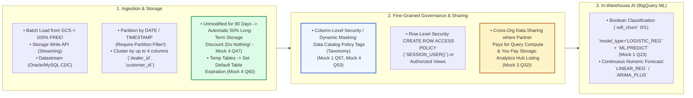

# OKF-PCA-01: Storage, Databases, BigQuery Analytics & Data Pipeline Architecture

## 1. Executive Architectural Decision Matrix (When to Use Which Data Store)

When architecting cloud-native applications on Google Cloud, use this deterministic selection matrix aligned with the **Google Cloud Well-Architected Framework (Performance Optimization, Reliability, and Cost Optimization Pillars)**:

| Application Requirement / Workload Pattern | Recommended Google Cloud Service | Key Architectural Configuration & SLA | Anti-Pattern / Common Mistake to Avoid |
| :--- | :--- | :--- | :--- |
| **Global Relational OLTP** requiring ACID transactions, external (strong) consistency across continents, and horizontal scaling from `1K -> 10M+` users *(Mock 1 Q8, Mock 4 Q56)* | **Cloud Spanner** *(Multi-Region)* | • `99.999%` SLA (Multi-Region) / `99.99%` (Regional) • **Interleaved Tables (`INTERLEAVE IN PARENT`)** to physically co-locate parent-child rows (`Customers -> Orders -> LineItems`) in the same storage split *(Area 1 Q6)* • **Stale Reads (`max_staleness = 15s`) + Adding Nodes/Processing Units** to absorb 10x read spikes from local replicas without Paxos leader round-trips *(Mock 4 Q56)* | ❌ Using Cloud Firestore or single-region Cloud SQL when global multi-continent relational ACID scale is required. ❌ Using BigQuery `PARTITION BY` / `CLUSTER BY` syntax in Spanner DDL. |
| **Regional Relational OLTP** (`MySQL`, `PostgreSQL`, `SQL Server`) with standard lift-and-shift or microservice schemas (`<64 TB`) *(Area 1 Q4, Mock 3 Q57)* | **Cloud SQL** *(or **AlloyDB for PostgreSQL** for 4x transactional throughput + columnar engine + pgvector)* | • **Intra-Region Zonal HA (`RPO = 0, RTO < 2m`):** Primary + Synchronous Standby in a 2nd zone (automatic failover; tested via `gcloud sql instances failover`) • **Read Offload:** Create an **In-Region Read Replica** (the HA Standby **cannot** serve read queries!) • **Regional DR:** Create a **Cross-Region Read Replica** and promote on regional outage • **Fast Schema Testing:** Use native **`Clone` (`gcloud sql instances clone`)** *(Mock 3 Q57)* | ❌ Assuming Point-in-Time Recovery (`PITR`) provides automatic HA failover (`PITR` is for logical data corruption recovery). ❌ Trying to send `SELECT` queries to the synchronous HA Standby instance. |
| **High-Velocity Wide-Column / Key-Value / IoT Time-Series** (`>10,000 writes/sec`, `<10ms` latency, `HBase` API, or `AP` availability-over-consistency session matching) *(Mock 1 Q39, Mock 4 Q49)* | **Cloud Bigtable** | • Design composite row keys as **`HighCardinalityID#ReverseTimestamp`** (e.g., `VehicleVIN#ReverseTimestamp`) so recent queries per entity are contiguous without single-node timestamp hotspotting • Multi-cluster replication with automatic failover (`AP` system: prioritizes availability with eventual consistency across clusters, or single-cluster routing for strong read-your-writes) | ❌ Starting a Bigtable row key with a sequential `Timestamp#...` or static constant (causes 100% single-tablet hotspotting). ❌ Storing millions of 1 KB JSON records as individual Cloud Storage objects instead of Bigtable *(Mock 4 Q49)*. |
| **Mobile & Web Document NoSQL** requiring real-time client listeners, offline device synchronization, and user presence indication *(Mock 4 Q25)* | **Cloud Firestore (Native Mode)** & **Firebase Realtime Database** | • Serverless scale-to-zero document store (`99.999%` Multi-Region SLA) • Real-time snapshot listeners push deltas directly to iOS/Android/Web clients | ❌ Using Cloud SQL polling or BigQuery for real-time chat delivery and user presence *(Mock 4 Q25)*. |
| **Sub-Millisecond In-Memory Session / Query Cache** that must survive a zonal outage automatically *(Area 1 Q10)* | **Cloud Memorystore for Redis (`Standard Tier HA` or `Redis Cluster HA`)** | • Synchronous/asynchronous cross-zone replica with automatic failover (`<30s`) and optional RDB snapshot persistence | ❌ Choosing **Memorystore for Memcached** when high availability, zonal failover, or RDB persistence is required (Memcached is purely ephemeral with zero replication!). |
| **Enterprise Shared File Storage** (`NFS` for Linux/GKE vs. `SMB` + Active Directory for Windows) *(Area 4 Q4)* | • Linux `NFSv3/v4.1`: **Cloud Filestore** • Windows `SMB` + AD: **Google Cloud NetApp Volumes** | • **Filestore Regional (`Enterprise`):** Synchronous multi-zone replication (`99.99%` SLA); supports GKE `ReadWriteMany (RWX)` PVCs • **NetApp Volumes:** Native `SMB` + `NFS` with Active Directory ACLs & Kerberos | ❌ Using Cloud Filestore Basic (Zonal NFSv3) for Windows Server `SMB` shares requiring Active Directory integration *(Area 4 Q4)*. |
| **Unstructured Object Storage & Data Lake** (`Strong Global Consistency`, Lifecycle Tiering, WORM Archival) *(Mock 2 Q6, Mock 3 Q46, Mock 4 Q50)* | **Cloud Storage (`GCS`)** *(plus **Regional Persistent Disk `RePD`** for synchronous 2-zone block storage)* | • **100% Strongly Consistent Globally** for all operations (read-after-write, overwrite, delete, and bucket listing — *Mock 2 Q6*) • **Storage Classes:** `Standard` (hot) $\rightarrow$ `Nearline` (`30d min`) $\rightarrow$ `Coldline` (`90d min`) $\rightarrow$ `Archive` (`365d min`) via **Object Lifecycle Management** or **Autoclass** • **Immutable WORM Compliance:** **Bucket Lock (Retention Policy) + Lock the Retention Policy** *(Mock 3 Q46)* | ❌ Believing GCS object overwrites or listings are eventually consistent *(Mock 2 Q6)* (404s are caused by missing files, ACLs, or Cloud CDN negative caching). ❌ Using Object Versioning alone for SEC 17a-4 / HIPAA immutable audit logs (Admins can still delete versioned objects unless Retention Policy is **Locked**!). |

---

## 2. BigQuery Enterprise Architecture, Security & FinOps Rules

---

## 3. Data Pipeline & Orchestration Architecture (`Dataflow` vs. `Dataproc` vs. `Composer` vs. `Workflows`)

1. **Cloud Dataflow (Managed Apache Beam — Unified Stream & Batch):**
   * Use for **serverless streaming pipelines**, **late-arriving/out-of-order IoT/mobile telemetry** (using **Event-Time Windowing, Watermarks, and Allowed Lateness**), and **in-flight PII de-identification** calling the **Sensitive Data Protection (`Cloud DLP`) API** before landing in BigQuery *(Mock 2 Q58, Mock 4 Q34)*.
2. **Cloud Dataproc (Managed Apache Spark & Hadoop):**
   * Use for **lifting-and-shifting existing Spark/Hadoop/Hive/Presto jobs**.
   * **Performance Rule (*Mock 4 Q27*):** If Spark jobs spill to disk frequently during shuffles, **increase executor memory** (or use high-memory machine types) and **optimize partitioning**.
   * **FinOps Rule:** Store persistent data in **Cloud Storage (`gs://`)** instead of HDFS so clusters can be **ephemeral** (deleted when job finishes), and attach **Spot VMs strictly as Secondary Worker nodes** (compute-only, zero HDFS blocks!).
3. **Cloud Composer (Managed Apache Airflow) vs. Cloud Workflows (*Mock 3 Q39 vs. Mock 4 Q28*):**
   * **Cloud Composer (*Mock 3 Q39*):** Use for **complex multi-step Data / ETL / ML DAGs** coordinating Dataflow jobs, BigQuery queries, Dataproc jobs, and Python scripts with dependencies.
   * **Cloud Workflows (*Mock 4 Q28*):** Use for **serverless, low-latency HTTP API / microservice state machines** with conditional branching (`switch`), error handling, and retries.

---

## FDE Project Grading Rubric Enforcement & Prevailing Customer Alignment

This OKF concept module enforces the architectural standards defined in `00-fde-field-readiness-and-grading-rubric.md` and the official Google Cloud Forward Deployed Engineering (FDE) handbook (`https://g3doc.corp.google.com/company/teams/cloud-fde/index.md?cl=head`), prioritizing production-grade reliability (`RPO/RTO`), least-privilege data governance, and FinOps cost efficiency.
