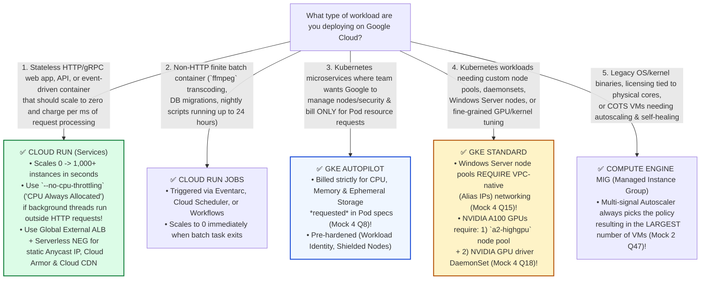

# OKF-PCA-02: Compute Engine, GKE, Serverless & Vertex AI Architecture

## 1. Compute Platform Selection Matrix (`Cloud Run` vs. `Cloud Run Jobs` vs. `GKE Autopilot` vs. `GKE Standard` vs. `Compute Engine MIGs`)

---

## 2. High-Yield GKE & Compute Engine Security, Networking & Availability Rules

| Architectural Requirement | Mandatory Google Cloud Configuration | Why Alternatives Fail (Exam Traps) |
| :--- | :--- | :--- |
| **1. Encrypt Data IN-USE Inside Physical RAM (`Memory`) with Zero App Code Changes** *(Area 2 Q7, Mock 4 Q2)* | ✅ **Confidential GKE Nodes / Confidential VMs** (powered by **AMD SEV / Intel TDX** hardware memory encryption keys that Google cannot read) | ❌ **Shielded VMs / Shielded GKE Nodes** only validate BIOS/UEFI boot and kernel integrity against rootkits (`Secure Boot`, `vTPM`, `Integrity Monitoring` — *Mock 4 Q36*); they **do NOT encrypt RAM**! |
| **2. GKE Pods Accessing Google Cloud APIs (`Cloud SQL`, `GCS`, `Secret Manager`, `BigQuery`) Without JSON Keys** *(Mock 4 Q5)* | ✅ **1) Enable Workload Identity on the GKE cluster + 2) Bind the Kubernetes Service Account (`KSA`) to the Google Service Account (`GSA`)** (`roles/iam.workloadIdentityUser`) | ❌ Using the Compute Engine default node service account (`0.0.0.0/0` cloud-platform scope) or mounting downloaded SA JSON keys inside Kubernetes Secrets. |
| **3. Transparent Pod-to-Pod `mTLS` Encryption & Layer-7 Service Authorization Across GKE** *(Mock 1 Q26, Sec Set 1 Q9)* | ✅ **Anthos Service Mesh (`Google Cloud Service Mesh` / Managed Istio)** | ❌ Rewriting every application microservice to manage its own TLS certificates in code, or relying on Kubernetes `NetworkPolicies` (which only filter L3/L4 IP/Port, not `mTLS` encryption!). |
| **4. Distribute GKE Deployment Replicas Evenly Across Zones for High Availability** *(Mock 1 Q60)* | ✅ **Pod Topology Spread Constraints (`topologySpreadConstraints` with `topologyKey: topology.kubernetes.io/zone`)** or **Pod Anti-Affinity** | ❌ Using `DaemonSets` for stateless web workloads (`DaemonSets` run exactly 1 pod per node for logging/monitoring/GPU driver agents). |
| **5. Spot VMs (Preemptible VMs) Runtime & Cost Rules** *(Mock 2 Q17, Mock 4 Q45)* | • **Spot VMs:** 60–91% discount; **NO minimum runtime guarantee** (can be preempted at any time with a 30-second ACPI shutdown notice — *Mock 2 Q17*). • **Weekday Dev/Test VMs (`9 AM – 5 PM`):** Attach a Compute Engine **Instance Schedule** *(Mock 3 Q54, Mock 4 Q45)*. • **Oversized/Idle VMs:** Query the **Recommender API** programmatically *(Mock 4 Q31)*. | ❌ Assuming Spot VMs have a checkbox that guarantees 30 minutes of uninterrupted execution. ❌ Querying `compute.instances.list` alone to get ML rightsizing recommendations. |

---

## 3. Vertex AI & Generative AI Architecture Patterns (`Mock 1 Q34` & `Mock 4 Q3, Q17, Q18, Q21, Q42`)

1. **Mixed CPU Preprocessing + GPU Inference on Vertex AI (*Mock 4 Q21*):**
   * Build a **Custom Container that implements both CPU preprocessing and GPU inference stages**, and deploy it to a **Vertex AI Endpoint configured with an appropriate machine type and attached GPU accelerator**.
2. **Responsible AI & Content Safety on Vertex AI (*Mock 4 Q3 & Q17*):**
   * **Imperceptible AI Content Provenance (*Mock 4 Q3*):** **Imagen on Vertex AI** automatically embeds **SynthID watermarking** directly into the pixel/audio/text data so detection tools can verify AI generation even if EXIF metadata is stripped.
   * **Blocking Harmful Outputs (*Mock 4 Q17*):** Configure **Vertex AI Safety Filter Settings (`Safety Attributes` thresholds)** to block Hate Speech, Harassment, Sexually Explicit, and Dangerous Content.
3. **ML Model Lifecycle & Versioning (*Mock 4 Q42*):**
   * Use **Vertex AI Model Registry** as the central repository to version models, track evaluation metadata/lineage, and deploy aliases to endpoints.
4. **LLM Context & Response Caching (*Mock 1 Q34*):**
   * Cache **repeated queries with identical prompts** and **common document summarization requests** (e.g., using Vertex AI Context Caching or Memorystore for Redis) to cut token latency and cost; never cache highly personalized real-time banking responses across users.

---

## FDE Project Grading Rubric Enforcement & Prevailing Customer Alignment

This OKF concept module enforces the architectural standards defined in `00-fde-field-readiness-and-grading-rubric.md` and the official Google Cloud Forward Deployed Engineering (FDE) handbook (`https://g3doc.corp.google.com/company/teams/cloud-fde/index.md?cl=head`), ensuring secure-by-default compute isolation (Confidential Computing, Workload Identity, Service Mesh mTLS) and cost-optimal serverless/GKE sizing.
