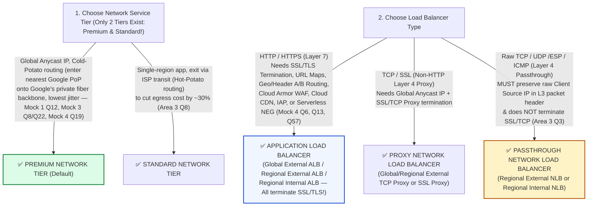

# OKF-PCA-03: VPC Networking, Load Balancing, Hybrid Connectivity & Cloud DNS Architecture

## 1. Google Cloud Load Balancer Decision Tree & Network Service Tiers

---

## 2. Critical VPC, Firewall, GKE Control Plane & Hybrid Networking Laws

| Scenario / Architectural Requirement | Winning Google Cloud Solution | Trap / Mistake to Avoid |
| :--- | :--- | :--- |
| **1. Global Multi-Region Private VM Communication (`US <-> EU <-> Asia`) without External IPs or VPNs** *(Mock 4 Q55 & Q20)* | ✅ **Single Global VPC** with regional subnets (`us-central1`, `europe-west1`, `asia-east1`)! *(Note: VPCs are **Global**, Subnets are **Regional**—a VM in `us-east1` must attach to a subnet in `us-east1` [Mock 4 Q20]!)* | ❌ Creating 3 separate Regional VPCs and connecting them with VPN tunnels or VPC Peering *(Mock 4 Q55)*. |
| **2. Centrally Enforce Organization/Folder Firewall Rules (`'Deny SSH from Internet'`) That Project Owners Cannot Override** *(Mock 4 Q24)* | ✅ **Hierarchical Firewall Policies** (attached at the Organization or Folder node; evaluated *before* local VPC rules unless delegated via `goto_next`) | ❌ Using `constraints/compute.vmExternalIpAccess` (which blocks all external IPs rather than selectively blocking port 22 SSH). |
| **3. Prevent Attackers from Bypassing Cloud Armor / Global Load Balancer by Hitting Backend VMs Directly** *(Sec Set 1 Q4, Area 5 Q3)* | ✅ **Configure VPC Ingress Firewall Rules allowing traffic ONLY from Google Front End (`GFE`) / Health Check IP ranges (`130.211.0.0/22` and `35.191.0.0/16`)** (or use **Identity-Aware Proxy TCP forwarding** for SSH) | ❌ Selecting `VPC Service Controls` (VPC-SC protects multi-tenant Google APIs like BigQuery/GCS, never VM web server TCP ports!). |
| **4. Private GKE Cluster `kubectl` Access to Control Plane Without VPN (2 Opposite Cases!)** *(Mock 1 Q37, Mock 3 Q17 & Q60, Area 5 Q16)* | • **Case A — Control Plane Public Endpoint IS Enabled:** Enable **Master Authorized Networks** and allowlist corporate/developer public CIDRs. • **Case B — Control Plane Public Endpoint is DISABLED (Private Endpoint Only):** Deploy a **Bastion Host (Jump VM) secured by IAP** + use **IAP TCP Forwarding (`--tunnel-through-iap`)**! | ❌ Selecting **Kubernetes Network Policies** (Pod-to-Pod only) or **Cloud NAT** (100% outbound egress only—never allows inbound access!). |
| **5. Connect Across Different Organizations or Overlapping RFC 1918 CIDRs + Granular On-Prem Access to Specific Google APIs** *(Mock 1 Q49, Mock 4 Q12)* | • **Cross-Org / Overlapping IPs:** **Private Service Connect (`PSC`)** (Producer/Consumer NAT) or **Cloud VPN with NAT**. • **On-Prem to Specific Google API (`BigQuery`) via Interconnect without routing YouTube/Gmail (*Mock 4 Q12*):** **Private Service Connect (`PSC`) endpoints for Google APIs**! | ❌ Using `Shared VPC` across different Organizations or using `VPC Peering` with overlapping IP ranges. |
| **6. Route Traffic Between Multiple Spoke VPCs Through a Central Hub VPC Running 3rd-Party NGFW Appliances (`Palo Alto / Fortinet`)** *(Mock 1 Q47, Area 3 Q5)* | ✅ **Network Connectivity Center (`NCC`) with Router Appliance** (for transitive hub-and-spoke routing) + **Internal Passthrough NLB (`ILB`)** as `--next-hop-ilb` in front of the NGFW MIG! | ❌ Using `VPC Network Peering` (non-transitive!) or `Cloud IDS` (out-of-band mirrored detection only—never inline!). |
| **7. HA VPN BGP Route Exchange Troubleshooting & Bi-Directional Hybrid Cloud DNS** *(Mock 1 Q33, Mock 4 Q26)* | • **HA VPN UP (`UDP 500/4500`), but BGP routes not exchanging (*Mock 1 Q33*):** Allow **`TCP Port 179` (`BGP`)** on the on-premises firewall and Cloud Router. • **Bi-Directional Hybrid DNS (*Mock 4 Q26*):** Configure **Cloud DNS Outbound Forwarding Zones** (`GCP -> On-Prem`) + **Inbound Server Policy** (`On-Prem -> GCP`)! | ❌ Assuming an implied allow rule opens TCP Port 179 on on-premises firewalls, or using Public DNS for RFC 1918 names. |
| **8. Legacy Layer-2 (`L2`) Broadcast / ARP Failover vs. Multicast UDP vs. Active FTP vs. Full Packet Forensics** *(Mock 3 Q7 & Q41, Mock 1 Q50, Area 3 Q15)* | • **L2 Broadcast / ARP Failover (*Mock 3 Q7*):** GCP VPC is Layer-3 SDN (no L2 broadcast); use **Google Cloud VMware Engine (`GCVE`)**. • **Multicast UDP (*Mock 3 Q41*):** Use an **overlay network (`Weave`/`Flannel`)** or refactor to **Consul/Agones/Envoy**. • **FTP Server (*Mock 1 Q50*):** Switch from Active FTP to **Passive FTP**. • **100% L2/L3 Packet Payload Capture (`.pcap` — *Area 3 Q15*):** Use **VPC Packet Mirroring** (VPC Flow Logs only capture 5-tuple headers!). | ❌ Confusing **VPC Packet Mirroring** (L2/L3 `.pcap` for IDS) with **L7 Shadow Deployment (`requestMirrorPolicy`)** *(Area 7 Q18)*. |

---

## FDE Project Grading Rubric Enforcement & Prevailing Customer Alignment

This OKF concept module enforces the architectural standards defined in `00-fde-field-readiness-and-grading-rubric.md` and the official Google Cloud Forward Deployed Engineering (FDE) handbook (`https://g3doc.corp.google.com/company/teams/cloud-fde/index.md?cl=head`), ensuring zero-trust network segmentation, deterministic hybrid failover (`99.99%` HA VPN / Interconnect), and global edge acceleration.
