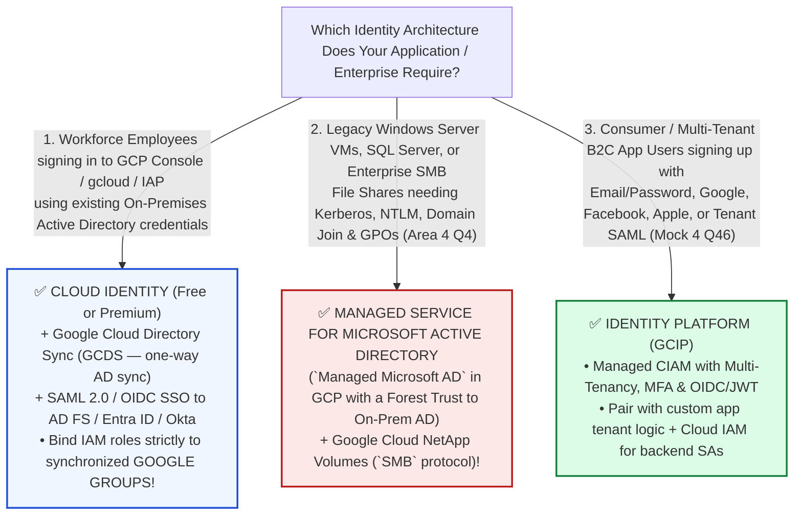

# OKF-PCA-04: Identity, Resource Hierarchy, Organization Policies, IAM & Cloud Billing FinOps

## 1. Workforce, Customer & Windows Workload Identity Architecture

---

## 2. Resource Hierarchy, Organization Policies & IAM Governance Rules

| Governance Domain | Architectural Law & Best Practice | Verified Exam Trap to Avoid |
| :--- | :--- | :--- |
| **1. Project Identifiers & 30-Day Deletion Recovery** *(Area 4 Q1)* | • **Project Name** is mutable at any time; **Project ID** and **Project Number** are **permanently immutable** after creation. • Accidentally deleted (`SHUTDOWN`) projects can be restored within a **30-day recovery window** (`IAM & Admin > Manage Resources`). | ❌ Opening a P1 ticket to rename a Project ID or assuming deleted projects are unrecoverable after 24 hours. |
| **2. High-Yield Organization Policy Constraints** *(Mock 3 Q1, Q19, Q37; Mock 4 Q33, Q58)* | • **Restrict Regions (*Mock 3 Q37*):** `constraints/gcp.resourceLocations` set to **`Allow` (`in:us-central1-locations`, `in:europe-west1-locations`)**. • **Block Public GCS Buckets (*Mock 4 Q33*):** `constraints/storage.publicAccessPrevention` (`Enforce`). • **Block VM Public IPs (*Mock 3 Q19*):** `constraints/compute.vmExternalIpAccess` (`Enforce` at Org root, override to `Not Enforce` on DMZ project). • **Block SA JSON Keys:** `constraints/iam.disableServiceAccountKeyCreation`. • **Restrict Domains:** `constraints/iam.allowedPolicyMemberDomains`. • **Require Central CMEK Project (*Mock 3 Q1*):** `constraints/gcp.restrictCmekCryptoKeyProjects` + `constraints/gcp.restrictNonCmekServices`. • **Restrict VM Machine Types (*Mock 4 Q58*):** `constraints/compute.restrictMachineTypes` (for Folder-level policy) or **GPU Quota = 0** (for project capacity cap). | ❌ Confusing `storage.uniformBucketLevelAccess` (which disables per-object ACLs in favor of IAM) with `storage.publicAccessPrevention` (which blocks `allUsers`/`allAuthenticatedUsers` — *Mock 4 Q33*). |
| **3. Custom IAM Roles Scope & IAM Deny Policies** *(Area 4 Q5)* | • 🚨 **LAW: Custom IAM Roles can ONLY be created at the `Organization` level or `Project` level—NEVER at the `Folder` level!** (To share a Custom Role across a Folder, create it at the **Organization** level and *bind* it at the Folder level). • **IAM Deny Policies:** Evaluated *before* all Allow policies; can block a permission (e.g., `cloudkms.cryptoKeyVersions.destroy`) **even if a user holds `roles/owner`**, with tag exemptions (`!resource.matchTag('org/env', 'sandbox')`). | ❌ Running `gcloud iam roles create --folder=...` *(Area 4 Q5)*. |
| **4. Service Account Dual Nature (`SA User` vs. `Token Creator`) & Lifecycle** *(Area 4 Q7, Q8, Q12)* | • **Attach SA to a VM / Cloud Run:** Grant **`roles/iam.serviceAccountUser`** scoped to the specific Service Account. • **Temporarily Impersonate SA via CLI (`--impersonate-service-account`):** Grant **`roles/iam.serviceAccountTokenCreator`**. • **Right-size 90-day unused permissions:** Use **IAM Recommender + IAM Policy Simulator**. • **Retire unused SAs safely:** Follow a **Disable-then-Delete** lifecycle! | ❌ Exporting long-lived Service Account JSON keys or deleting unused Service Accounts immediately without disabling first. |
| **5. Resource Manager Tags (`Secure Tags`) vs. Billing Labels** *(Mock 1 Q44, Mock 4 Q40, Area 4 Q20)* | • **Resource Manager Tags (`TagKeys/TagValues`):** IAM-governed (`roles/resourcemanager.tagUser`), inherited down hierarchy; used for **IAM Conditions, IAM Deny exemptions, Org Policy conditions, and VPC Network Firewall Policies**. • **Billing Labels (`cost-center: 123`, `env: prod`):** Key-value metadata enforced via **Terraform modules** (*Mock 1 Q44*) and exported to **BigQuery Cloud Billing Exports** (*Mock 4 Q40*) for cost allocation! | ❌ Using Billing Labels for VPC Firewall rules or IAM Conditions, or using legacy Network Tags for billing exports. |

---

## 3. Cloud Billing Architecture, FinOps Budgets, BigQuery Exports & CUDs

1. **Cloud Billing Separation of Duties (*Area 4 Q10 & Q20*):**
   * **Finance Admins (Payment cards & invoices, zero project access):** `roles/billing.admin` (`Billing Account Administrator`) on the Billing Account.
   * **Platform Engineers (Link new projects to Billing Account without seeing invoices):** `roles/resourcemanager.projectCreator` + `roles/billing.user` (`Billing Account User`) on the Billing Account (plus `roles/billing.projectManager` on the project).
   * **Project Managers (View costs & create/edit Budgets without modifying payment methods):** `roles/billing.costsManager` (`Billing Account Costs Manager`).
2. **Enforcing a Hard Spending Cap at 100% of Sandbox Budget (*Area 4 Q13*):**
   * **Cloud Billing Budgets ONLY send notifications—they never stop VMs automatically!**
   * **Architecture:** `Cloud Billing Budget -> Programmatic Notification to Cloud Pub/Sub -> Cloud Run function` (calls Compute Engine API to stop VMs or `projects.updateBillingInfo` to unlink billing).
3. **BigQuery Cloud Billing Export (`Standard` vs. `Detailed` & Multi-Region Backfill — *Area 4 Q14*):**
   * Enable **`Detailed usage cost`** (for VM instance ID & GKE Namespace/Pod label granularity) into a **Multi-Region (`US` or `EU`) BigQuery dataset**—because **Multi-Region (`US`/`EU`) automatically backfills billing data from the start of the previous month** (whereas single-region datasets only export data from the day enabled!).
4. **Shared VPC Service Project Billing & Committed Use Discounts (`CUDs` — *Mock 3 Q4, Q20, Q28*):**
   * Enable **Shared VPC Service Project Billing** so network egress charges are billed directly to the originating Service Project rather than the Host Project.
   * **CUDs** are shared automatically across all projects linked to the same Cloud Billing Account; use **Compute Flexible CUDs (Spend-based)** to discount **Compute Engine + GKE + Cloud Run** across any region or machine family.

---

## FDE Project Grading Rubric Enforcement & Prevailing Customer Alignment

This OKF concept module enforces the architectural standards defined in `00-fde-field-readiness-and-grading-rubric.md` and the official Google Cloud Forward Deployed Engineering (FDE) handbook (`https://g3doc.corp.google.com/company/teams/cloud-fde/index.md?cl=head`), establishing enterprise-grade landing-zone guardrails, keyless authentication, and FinOps cost accountability.
