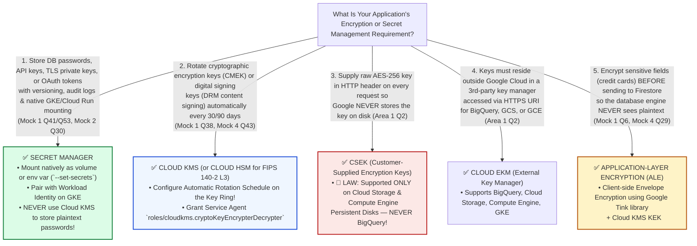

# OKF-PCA-05: Security, KMS, Secret Manager, VPC Service Controls & Compliance Architecture

## 1. Encryption Key Management & Secrets Decision Matrix (`GMEK` vs. `CMEK` vs. `CSEK` vs. `EKM` vs. `Tink ALE` vs. `Secret Manager`)

---

## 2. Zero-Trust Perimeter Defense: `VPC Service Controls` vs. `IAP` vs. `Cloud Armor` vs. `CAS`

| Security Control | Primary Architectural Role | Critical Configuration & Verified Exam Traps |
| :--- | :--- | :--- |
| **1. VPC Service Controls (`VPC-SC`)** *(Mock 4 Q9)* | **API-Level Data Exfiltration Perimeter** around multi-tenant Google Cloud APIs (`BigQuery`, `Cloud Storage`, `Spanner`, `Vertex AI`). Prevents a stolen credential or rogue insider from copying data to an external project's GCS bucket! | • **Allowing Human Analysts in via Google Cloud Console (*Mock 4 Q9*):** Because the Cloud Console runs outside the perimeter, configure **Access Context Manager (`Access Levels` based on User Identity or Corporate IP)** and attach it to the perimeter's **Ingress Policy**! • **Trap:** A **Perimeter Bridge** only connects two GCP perimeters—it **never** grants human Console access! |
| **2. Identity-Aware Proxy (`IAP`)** *(Sec Set 1 Q1 & Q2)* | **Zero-Trust Identity & Context Front Door (`BeyondCorp`)** for human staff/admins accessing internal web apps (`Cloud Run`, `App Engine`, `GKE`) or SSH/RDP (`--tunnel-through-iap`). | • Evaluates user identity (`Cloud Identity` / `AD SSO`) + device posture (`Access Context Manager`) *before* traffic reaches the app. • Require **`roles/iap.httpsResourceAccessor`** (or `roles/run.invoker`). |
| **3. Google Cloud Armor + GFE Firewall Lockdown** *(Sec Set 1 Q4, Area 5 Q3)* | **Edge Layer-7 WAF & DDoS Protection** attached to External Application Load Balancers (OWASP Top 10 `SQLi`/`XSS`, Adaptive Protection, reCAPTCHA, geo/IP rate-limiting). | • **Mandatory Backend Lockdown (*Area 5 Q3*):** To stop attackers from bypassing Cloud Armor by hitting VM IPs directly, configure **VPC Ingress Firewall Rules allowing traffic ONLY from Google Front End (`GFE`) ranges (`130.211.0.0/22` and `35.191.0.0/16`)**! |
| **4. Binary Authorization + Container Analysis API** *(Mock 1 Q48, Mock 2 Q40, Sec Set 1 Q3)* | **Cryptographic Container Admission Control** for GKE and Cloud Run. | • **Vulnerability Scanning (`Artifact Analysis`)** only **detects** CVEs. • **Binary Authorization** **blocks** unsigned images. • **3x Repeat Trap:** If an image is signed by the attestor yet fails with `'Image verification failed'`, **the `Attestation` occurrence metadata was not created in the Container Analysis API**! |
| **5. Certificate Authority Service (`CAS`)** *(Mock 2 Q32)* | **Managed Private CA** for issuing internal `mTLS` and microservice mesh TLS certificates via API without running an OpenSSL VM. | • Use **Certificate Manager** for public Load Balancer SSL certificates; use **Certificate Authority Service (`CAS`)** for internal private PKI. |

---

## 3. Regulatory Compliance Patterns (`PCI-DSS`, `HIPAA`, `Malware Quarantine`)

1. **Minimizing PCI-DSS Audit Scope (*Area 5 Q1 / ExamTopics Q#15*):**
   * **Tokenize** 16-digit Primary Account Numbers (`PANs`) at the point of capture (or via **Sensitive Data Protection `Cloud DLP` Format-Preserving Encryption / Crypto-Deterministic Tokenization**) so **only surrogate tokens** ever enter your downstream microservices and BigQuery analytics tables! Any database storing raw PANs (even encrypted at rest with GMEK/CMEK) falls 100% in scope for PCI-DSS audits.
2. **De-Identifying PHI Before BigQuery Ingestion (*Mock 2 Q58*):**
   * Never load raw PHI CSVs into BigQuery first and apply column security if the mandate says *"de-identify before loading into BigQuery."* Run a **Cloud Dataflow pipeline calling the Sensitive Data Protection (`Cloud DLP`) API** to mask/tokenize PHI in flight before writing to BigQuery!
3. **Cloud Storage Malware & Virus Scanning (*2x Repeat Offender: Mock 2 Q31 & Mock 4 Q51*):**
   * **There is NO native built-in malware scanning checkbox in Cloud Storage!**
   * **Architecture:** Implement the **Two-Bucket Quarantine Pattern**: upload files to an `unscanned` bucket $\rightarrow$ trigger an **Eventarc / Cloud Run function** on `storage.object.finalize` $\rightarrow$ scan the file using a containerized third-party antivirus engine (such as **ClamAV**) $\rightarrow$ move clean files to the `clean` bucket or infected files to the `quarantine` bucket!

---

## FDE Project Grading Rubric Enforcement & Prevailing Customer Alignment

This OKF concept module enforces the architectural standards defined in `00-fde-field-readiness-and-grading-rubric.md` and the official Google Cloud Forward Deployed Engineering (FDE) handbook (`https://g3doc.corp.google.com/company/teams/cloud-fde/index.md?cl=head`), guaranteeing defense-in-depth security across network, identity, compute, and data layers.
