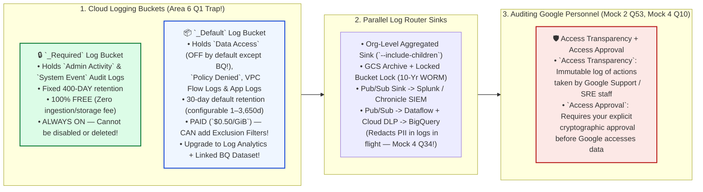

# OKF-PCA-06: Cloud Operations, Observability, Trace, Profiler & Site Reliability Engineering

## 1. Cloud Logging Architecture, Audit Log Buckets (`_Required` vs. `_Default`) & Access Transparency

* **FinOps Log Routing Law:** Because the **Log Router** evaluates all sinks in parallel, you can route noisy VPC Flow Logs via an **Export Sink to Cloud Storage Coldline/Archive** while adding an **Exclusion Filter on the `_Default` log sink** to save `$0.50/GiB` in Cloud Logging ingestion fees without losing a single archived log! And remember: **Log-Based Metrics** are evaluated *before* `_Default` Exclusion Filters!

---

## 2. Cloud Monitoring, APM (`Cloud Trace` vs. `Cloud Profiler` vs. `Error Reporting`) & Visualization

| Observability Requirement | Winning Google Cloud Tool & Configuration | Verified Exam Trap to Avoid |
| :--- | :--- | :--- |
| **1. Collect Compute Engine VM Memory (`RAM %`), Free Disk Space (`df -h`), & `/var/log/*` Application Logs** *(Area 6 Q3)* | ✅ Install the unified **Cloud Ops Agent** on VMs (via VM Manager OS Policy Assignment or golden image) | ❌ Relying on default hypervisor metrics (hypervisor only sees CPU, Disk I/O, and Network bytes—never guest OS RAM or filesystem free space!). |
| **2. Visualize API Latency Distribution Percentiles (`p50`, `p95`, `p99`) Over Time** *(Mock 4 Q38)* | ✅ **Heatmap chart showing latency distribution over time** (or percentile line chart) on a custom Cloud Monitoring dashboard *(Mock 4 Q54)* | ❌ Using a bar chart of request counts, pie chart, or a single line chart showing mathematical average/mean only *(Mock 4 Q38)*. |
| **3. Diagnose End-to-End Request Latency Across Multiple Microservices (`App Engine -> Functions -> Firestore`)** *(Repeat Offender: Mock 2 Q35, Mock 3 Q11, Mock 4 Q7)* | ✅ **1) Enable Cloud Trace API + 2) Ensure applications propagate the `X-Cloud-Trace-Context` (or W3C `traceparent`) HTTP header** across every outbound call | ❌ Selecting **Cloud Profiler** (Profiler only measures CPU/Heap inside a single binary, never cross-service RPC latency hops!). |
| **4. Pinpoint Which Specific Java/Go/Python/Node Function Is Burning CPU or Allocating Heap Memory in Production** *(Area 6 Q6)* | ✅ **Cloud Profiler** (continuous `<1%` overhead statistical profiler generating **CPU and Heap Flame Graphs** per method) | ❌ Selecting Cloud Trace or VPC Flow Logs for function-level CPU/memory profiling. |
| **5. Automatically Group & Deduplicate Crash Stack Traces and Alert on New Exceptions** *(Area 6 Q13)* | ✅ **Google Cloud Error Reporting** | ❌ Manually grepping millions of raw log lines or alerting on every `[WARN]` log line. |
| **6. Multi-Project Dashboards (`Metrics Scope`) & Managed Multi-Cluster GKE Prometheus (`PromQL` / `Grafana`)** | • **Multi-Project Monitoring:** Dedicated central **Scoping Project** with monitored projects added to its **Metrics Scope**. • **Managed Prometheus:** **Google Cloud Managed Service for Prometheus (`GMP`)**. | ❌ Running self-managed Prometheus StatefulSets that crash with `OOMKilled` errors when GKE clusters scale. |

---

## 3. Site Reliability Engineering (`SRE`) — `SLIs`, `SLOs`, `SLAs`, `Error Budgets`, `Toil` & `Blameless Postmortems`

1. **The SRE Contract (`SLI -> SLO -> SLA` & `Error Budget`):**
   * **SLI (Service Level Indicator):** Quantitative user-centric metric based on the **Four Golden Signals** (*Latency `p95`/`p99`, Traffic, Errors, Saturation*) measured at the Load Balancer (never use average GKE node CPU % as an Availability SLI!).
   * **SLO (Service Level Objective) vs. SLA (Service Level Agreement):** Your internal **SLO (`99.95%`) must always be stricter than your external contractual SLA (`99.90%`)** so **Error Budget Burn Rate Alerts** (Fast-Burn Page vs. Slow-Burn Ticket) alert SREs *before* you breach the customer SLA!
   * **Error Budget (`100% - SLO`):** When the rolling 30-day Error Budget is exhausted (`0%` remaining), **freeze/halt non-urgent feature releases** and dedicate 100% of engineering cycles to reliability until the budget recovers!
2. **Eliminating `Toil`:**
   * **Toil** is manual, repetitive, automatable, tactical operational work devoid of enduring value that scales linearly ($O(n)$) with service growth. Cap **Toil `<50%`** of an SRE's time so $\ge 50\%$ is spent writing automation.
3. **Incident Response (*Mock 1 Q41*) & Blameless Postmortems (*Mock 2 Q19*):**
   * **During an Outage:** Mitigate user impact FIRST (rollback/drain traffic) using clear **Incident Commander (`IC`), Operations (`Ops`), and Communications (`Comms`)** roles; configure reliable **on-call alert notification channels** and attach **actionable runbooks** to alerts (*Mock 1 Q41*).
   * **After an Outage (*Mock 2 Q19*):** Write a **Blameless Postmortem** containing **1) a complete Timeline of events from detection to resolution + 2) concrete, prioritized Action items to prevent recurrence**—never blame or reprimand individuals!

---

## FDE Project Grading Rubric Enforcement & Prevailing Customer Alignment

This OKF concept module enforces the architectural standards defined in `00-fde-field-readiness-and-grading-rubric.md` and the official Google Cloud Forward Deployed Engineering (FDE) handbook (`https://g3doc.corp.google.com/company/teams/cloud-fde/index.md?cl=head`), embedding Google SRE error-budget governance and full-stack observability into every customer deployment.
