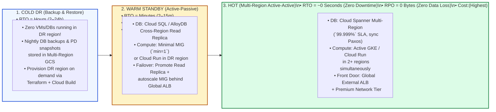

# OKF-PCA-08: Cloud Migration (6 Rs), Disaster Recovery Tiers (`RTO/RPO`) & The 4 Official Case Studies

## 1. The 4-Phase Migration Framework (`Assess -> Plan -> Deploy -> Optimize`) & Migration Tooling Matrix

| Migration Workload / Scenario | Recommended Strategy (`6 Rs`) | Winning Google Cloud Migration Service |
| :--- | :--- | :--- |
| **1. Discovery, Dependency Mapping, TCO & First-Mover Selection** | **Phase 1: Assess** | ✅ **Google Cloud Migration Center** (inventory + TCO + `mFit` container readiness). Always select a **low-risk, non-critical, loosely coupled app** as your first pilot! |
| **2. Standard On-Premises VMware / AWS / Azure VMs $\rightarrow$ Compute Engine VMs** *(Mock 4 Q52)* | **Rehost (`Lift & Shift`)** | ✅ **Migrate to Virtual Machines (`M2VM`)** with VMware/cloud source (agentless background disk replication + fast cutover). *(Never pick `"GCVE only"` for standard VMs!)* |
| **3. Legacy VMware Apps Needing Layer-2 (`L2`) Broadcast, Gratuitous ARP Failover & vCenter/NSX-T** *(Mock 3 Q7)* | **Rehost (`Lift & Shift VMware`)** | ✅ **Google Cloud VMware Engine (`GCVE`)** migrated via **VMware HCX**. |
| **4. Extract Legacy Linux/Windows VM Apps Directly Into GKE / Cloud Run Containers** | **Replatform (`Lift & Optimize`)** | ✅ **Migrate to Containers (`M2C`)**. |
| **5. Homogeneous Production Database Migration (`MySQL`, `PostgreSQL`, `SQL Server`, `Oracle->AlloyDB`) with `<5 Min` Downtime** *(Mock 4 Q4)* | **Replatform (`Managed DB`)** | ✅ **Database Migration Service (`DMS`)** (serverless continuous **Change Data Capture `CDC`** replication). |
| **6. Heterogeneous Database Streaming (`Oracle / MySQL -> BigQuery or GCS`)** | **Replatform / Refactor** | ✅ **Datastream** (serverless CDC) + **Dataflow**. |
| **7. Cloud-to-Cloud (`AWS S3 -> GCS Archive`) or Fast Network Data Transfer** *(Mock 4 Q48)* | **Data Migration (Online)** | ✅ **Storage Transfer Service (`STS`)** (serverless, automatic checksums, retries, delta sync). |
| **8. Massive Data (`600 TB`) over Saturated/Slow Link (`100 Mbps`) with Tight Deadline (`14 Days`)** *(Area 1 Q7)* | **Data Migration (Offline)** | ✅ **Google Cloud Transfer Appliance** (`40 TB` / `300 TB` physical encrypted rackable appliance). |
| **9. Gradual Decomposition of a Monolith into Cloud Run / GKE Microservices** | **Refactor (`Cloud-Native`)** | ✅ **Strangler Fig Pattern** behind **Apigee** or a **Global External Application Load Balancer (`URL Maps`)** peeling off routes one by one. |

---

## 2. Disaster Recovery (`DR`) Architecture Matrix: Matching `RTO` & `RPO` to `Cold`, `Warm` & `Hot` Tiers

---

## 3. Master Blueprint for All 4 Official Google Cloud PCA Case Studies

| Official Case Study | Business Context & Core Bottlenecks | Canonical Target Google Cloud Architecture (Trigger $\rightarrow$ Service) |
| :--- | :--- | :--- |
| **1. EHR Healthcare** *(Electronic Health Records SaaS)* | Expiring colocation leases; legacy MySQL/Postgres/SQL Server/MongoDB/Redis; hospital on-prem connectivity; strict HIPAA compliance; clinical `HL7v2 / FHIR / DICOM` interoperability. | • **Clinical Ingestion & De-identification:** `Cloud Healthcare API (HL7v2/FHIR/DICOM)` + `Sensitive Data Protection (Cloud DLP)` $\rightarrow$ `BigQuery` (+ `BigQuery ML` readmission predictions). • **Hybrid Connectivity:** `Dedicated Interconnect` + `HA VPN` backup + `Cloud DNS Forwarding/Inbound`. • **Identity:** `Cloud Identity + GCDS + SAML SSO` (or `Managed Microsoft AD + NetApp Volumes` for Windows Kerberos/GPO/SMB). • **Compute & Compliance:** `GKE Multi-Cluster + Multi-Cluster Ingress + Config Sync`; `GCS Archive + Locked Bucket Lock` (10-yr WORM) + `Access Transparency`. |
| **2. Helicopter Racing League (`HRL`)** *(Global Live Sports Streaming)* | Global 4K/8K live & recorded video streaming; remote race-truck edge ingestion; real-time helicopter sensor telemetry; live AI predictions (`overtake probability`, `crowd sentiment`). | • **Global Video Delivery:** `Premium Network Tier` + `Global External ALB` + `Cloud CDN / Media CDN` (with `Signed URLs / Signed Cookies`) + `GCS Object Lifecycle / Autoclass` (`-> Coldline/Archive` after 90d). • **Video Transcoding:** `GCS` $\rightarrow$ `Eventarc` $\rightarrow$ `Cloud Workflows / Cloud Run Jobs` (`Transcoder API / Live Stream API`). • **Real-Time Telemetry & AI:** `Cloud Pub/Sub` $\rightarrow$ `Cloud Dataflow (Streaming invoking Vertex AI Endpoints)` $\rightarrow$ `Cloud Bigtable` (sub-10ms live broadcast HUD) & `BigQuery`. • **Sponsor/Partner APIs:** `Apigee API Management` (Monetization & Developer Portal). |
| **3. Mountkirk Games** *(Global Multiplayer Mobile Gaming)* | Session-based multiplayer game scaling 1K $\rightarrow$ 10M players; mobile telemetry packets arriving hours late/out-of-order; global transactional player state & leaderboards. | • **Global Game Servers:** `Multi-Region GKE` (with `Agones`) + `HPA / Cluster Autoscaler` behind `Global External Proxy NLB / ALB` on `Premium Network Tier`. • **Global Player Profiles & Leaderboards:** `Cloud Spanner Multi-Region` (+ `Stale Reads` & extra Nodes for 10x tournament read spikes — *Mock 4 Q56*); `Cloud Bigtable` (or `Memorystore Redis HA`) for high-velocity session-to-IP state (*Mock 1 Q39*). • **Late/Out-of-Order Mobile Logs:** `Cloud Pub/Sub` $\rightarrow$ `Cloud Dataflow (Event-Time Windowing, Watermarks & Allowed Lateness)` $\rightarrow$ `BigQuery`. |
| **4. TerramEarth** *(20M Agricultural & Mining Vehicles IoT)* | **99% (`19.8M`) offline vehicles** uploading `.gzip` batches once/day at depots; **1% (`200K`) cellular vehicles** streaming live telemetry (`9 TB/day`) for predictive maintenance; 500 independent dealers. | • **99% Offline Depot Batch Path (Lowest Cost):** `Cloud Storage` $\rightarrow$ `BigQuery Batch Load` (100% FREE ingestion!). • **1% Cellular Live Streaming Path:** `Cloud Pub/Sub` $\rightarrow$ `Cloud Dataflow (Streaming + Vertex AI)` $\rightarrow$ `Cloud Bigtable` & `BigQuery`. • **Bigtable Row Key:** `Vehicle_VIN#ReverseTimestamp` (prevents timestamp hotspotting). • **BigQuery & Dealer Isolation:** Partition by `telemetry_date`, Cluster by `dealer_id`, enforce `Row-Level Security / Authorized Views` (or `Analytics Hub`), and expose partner APIs via `Apigee` (+ `Cloud Endpoints ESPv2` for internal GKE gRPC). |

---

## FDE Project Grading Rubric Enforcement & Prevailing Customer Alignment

This OKF concept module enforces the architectural standards defined in `00-fde-field-readiness-and-grading-rubric.md` and the official Google Cloud Forward Deployed Engineering (FDE) handbook (`https://g3doc.corp.google.com/company/teams/cloud-fde/index.md?cl=head`), providing end-to-end enterprise reference architectures across healthcare, media, gaming, and industrial IoT.
