# Antigravity GCS & Google Cloud Dataplex Synchronization Specification (`SPEC-OKF-PCA-WAF-SYNC-v1.0.0`)

* **Exact Absolute Specification File Path:** `/Users/prdmohan/ge_spark_workspace/projects/PCA-Exam-Prep/Architect-Best-Practices/specs/ANTIGRAVITY_OKF_PCA_WAF_SYNC_SPEC.md`
* **Companion Update Spec Path:** `/Users/prdmohan/ge_spark_workspace/projects/PCA-Exam-Prep/Architect-Best-Practices/specs/okf-gcs-update-spec.md`
* **OKF Bundle Root Path:** `/Users/prdmohan/ge_spark_workspace/projects/PCA-Exam-Prep/Architect-Best-Practices/`
* **Version Tag:** `PCA_WAF_OKF_2026-11-24_173000` (`L400_version_20261124_1730`)
* **Creation Timestamp:** `2026-11-24T17:30:00-08:00` (`2026-11-24 17:18 PST`)
* **Time-To-Live (`TTL`):** **6 Months (`180 days` / ISO-8601 `P6M`)** $\rightarrow$ **`stale_after: "2027-05-24T17:30:00-08:00"`**

---

## 1. End-to-End Gemini Enterprise & Dataplex ("Data Flex") Ingestion Architecture

```mermaid
flowchart LR
    subgraph Local["1. Local OKF v0.2 Bundle\n(/Users/prdmohan/.../PCA-Exam-Prep/okf/)"]
        C["• 9 Concept Markdown Files (`OKF-PCA-01`..`09`)\n• 9 Dataplex Entry JSONs (`catalog-entries/*.json`)\n• `bundle.json`, `MANIFEST.json`, `aspect-type-okf.json`\n• `index.md` & `log.md`"]
    end

    subgraph GCS["2. Multi-Region Cloud Storage\n(Uniform Bucket-Level Access + PAP)"]
        B["`gs://gea_agent_development_architectural_best_practices_pca_waf/\nPCA_WAF_OKF_2026-11-24_173000/okf/`"]
    end

    subgraph Dataplex["3. Google Cloud Dataplex Universal Catalog\n(`fivedaysai-prd-sandbox-317383`)"]
        DP["• AspectType: `fivedaysai-prd-sandbox-317383.us.okf`\n• EntryGroup: `geapl200-architecture-kb`\n• Enforces SHA-256 integrity & 6-Month TTL (`P6M`)"]
    end

    subgraph Graph["4. Hybrid Graph Storage & Antigravity MCP"]
        SG["⚡ Cloud Spanner Graph\n(`geapl200-okf-graph`)\nPrimary Low-Latency Agent Cache"]
        BQG["📊 BigQuery Graph\n(`geapl200_okf_kg`)\nSecondary Analytical KG"]
        MCP["🤖 Gemini Enterprise / Antigravity CLI\nArchitectural Decision Engine"]
    end

    Local -->|"gcloud storage rsync"| GCS
    GCS -->|"Dataplex Entry API Import"| Dataplex
    Dataplex --> SG & BQG
    SG & BQG --> MCP

    style Local fill:#eff6ff,stroke:#1d4ed8,stroke-width:2px
    style Dataplex fill:#dcfce7,stroke:#15803d,stroke-width:2px
    style SG fill:#fef3c7,stroke:#b45309,stroke-width:2px
```



---

## 2. Authoritative Source Papers, Books & Diagnostic Corpora Cited

Every OKF concept and Dataplex catalog entry in this bundle carries explicit bibliographic provenance to the following authoritative sources:

1. **Primary Textbook (`PCA_Book.pdf`):**
   * **Title:** *Official Google Cloud Certified Professional Cloud Architect Study Guide*
   * **Author:** Dan Sullivan
   * **Affiliation / Publisher:** Sybex / John Wiley & Sons, Inc. (ISBN: `978-1-119-60244-6`)
   * **Local File Path:** `/Users/prdmohan/ge_spark_workspace/projects/PCA-Exam-Prep/PCA_Book.pdf`
   * **URL:** `https://cloud.google.com/certification/cloud-architect`
2. **Primary Curriculum Reference Deck (`UDEMY-Course-PCA.pdf`):**
   * **Title:** *Google Cloud Professional Cloud Architect (PCA): Complete Certification Course & Architectural Reference Deck (242 Slides, Sections 1–12)*
   * **Authors:** GCP PCA Curriculum Architecture Team
   * **Local File Path:** `/Users/prdmohan/ge_spark_workspace/projects/PCA-Exam-Prep/UDEMY-Course-PCA.pdf`
3. **Forensic Diagnostic Corpus (`ExamTopics.pdf`, `GCP PCA Mock Tests 1–4`, `Simulators 1–8`):**
   * **Title:** *Forensic Diagnostic Corpus: GCP PCA Mock Exams 1–4 (Nov 2, 3, 6, 9, 2026), Security Practice Set 1 & Service Area Simulators 1–8 (350+ Verified Scenarios)*
   * **Authors:** Pradeep Mohan (Forward Deployed Engineer, Generative AI, Google Cloud) & GCP PCA Test Bank
   * **Local File Paths:**
     * `/Users/prdmohan/ge_spark_workspace/projects/PCA-Exam-Prep/ExamTopics.pdf`
     * `/Users/prdmohan/ge_spark_workspace/projects/PCA-Exam-Prep/PCA_Exam_Printable_Cheat_Sheet.md`
     * `/Users/prdmohan/ge_spark_workspace/projects/PCA-Exam-Prep/Service_Area_1_20_Questions_Exam.md` through `Service_Area_8_20_Questions_Exam.md`
4. **Google Cloud Well-Architected Framework (`WAF`):**
   * **Title:** *Google Cloud Architecture Framework — Operational Excellence, Security/Privacy/Compliance, Reliability, Cost Optimization (FinOps), and Performance Optimization*
   * **Authors:** Google Cloud Architecture Center (`Google LLC`)
   * **URL:** `https://cloud.google.com/architecture/framework`

---

## 3. Complete OKF v0.2 Concept & Dataplex Catalog Inventory (`SHA-256` Verified)

| Concept ID | Local OKF Concept File Path | Local Dataplex Catalog Entry JSON Path | `content_sha256` | `file_sha256` |
| :--- | :--- | :--- | :--- | :--- |
| **`OKF-PCA-01`** | `/Users/prdmohan/ge_spark_workspace/projects/PCA-Exam-Prep/Architect-Best-Practices/concepts/01-storage-databases-bigquery-and-data-pipelines.md` | `/Users/prdmohan/ge_spark_workspace/projects/PCA-Exam-Prep/Architect-Best-Practices/catalog-entries/01-storage-databases-bigquery-and-data-pipelines.json` | `4812308516c042b2f61222c28584a573b77562e4032e28952efccea6363e5877` | `ead9d45886749f4b34b704ed8c332d5c68d1ad2770f06ee51254a1c2585c2cfc` |
| **`OKF-PCA-02`** | `/Users/prdmohan/ge_spark_workspace/projects/PCA-Exam-Prep/Architect-Best-Practices/concepts/02-compute-engine-gke-serverless-and-vertex-ai.md` | `/Users/prdmohan/ge_spark_workspace/projects/PCA-Exam-Prep/Architect-Best-Practices/catalog-entries/02-compute-engine-gke-serverless-and-vertex-ai.json` | `d7a7fe9dbdd1629a0bb387d66e5596776873443d6586c03c782ded7bddb0c82b` | `3660be9dde2ae971f334cdeb8a829ca72f457b4c587d319e15dfdab54429f054` |
| **`OKF-PCA-03`** | `/Users/prdmohan/ge_spark_workspace/projects/PCA-Exam-Prep/Architect-Best-Practices/concepts/03-vpc-networking-load-balancing-hybrid-and-dns.md` | `/Users/prdmohan/ge_spark_workspace/projects/PCA-Exam-Prep/Architect-Best-Practices/catalog-entries/03-vpc-networking-load-balancing-hybrid-and-dns.json` | `38a0bed10565e2f87f9d473adf5272013c6bf2fb7a40c9f7d7332684e081f329` | `1ce0a5e2e8ae18aace63a815ca2991dc54314b3d12dedbcdb925cb0555cd3199` |
| **`OKF-PCA-04`** | `/Users/prdmohan/ge_spark_workspace/projects/PCA-Exam-Prep/Architect-Best-Practices/concepts/04-identity-hierarchy-org-policies-iam-and-finops-billing.md` | `/Users/prdmohan/ge_spark_workspace/projects/PCA-Exam-Prep/Architect-Best-Practices/catalog-entries/04-identity-hierarchy-org-policies-iam-and-finops-billing.json` | `b1084c2f54a64a664d69c6a76c539eb7cc9b73e7cbbcab76837a10480dc89605` | `bef2eddd8d97231d430f25322c44245a749097c1f80a404006fe637c8d1d0535` |
| **`OKF-PCA-05`** | `/Users/prdmohan/ge_spark_workspace/projects/PCA-Exam-Prep/Architect-Best-Practices/concepts/05-security-kms-secret-manager-vpc-sc-and-compliance.md` | `/Users/prdmohan/ge_spark_workspace/projects/PCA-Exam-Prep/Architect-Best-Practices/catalog-entries/05-security-kms-secret-manager-vpc-sc-and-compliance.json` | `830c4c267760b6ce84360bec6cf8004cf94860b3d9be1bb9daa7192c89c2c4e9` | `22f223d6991f476a465cef25494e9c448bb348ac585008f7e7a1c72f80ea392e` |
| **`OKF-PCA-06`** | `/Users/prdmohan/ge_spark_workspace/projects/PCA-Exam-Prep/Architect-Best-Practices/concepts/06-cloud-operations-observability-trace-profiler-and-sre.md` | `/Users/prdmohan/ge_spark_workspace/projects/PCA-Exam-Prep/Architect-Best-Practices/catalog-entries/06-cloud-operations-observability-trace-profiler-and-sre.json` | `629d76d3ade8b03fd04a273039af8657b628e654129d913282d7c155487ab435` | `cbb666e0f70be8f4ce0a5eabcf74086c45a6c417798db7eba16b12bf7e972646` |
| **`OKF-PCA-07`** | `/Users/prdmohan/ge_spark_workspace/projects/PCA-Exam-Prep/Architect-Best-Practices/concepts/07-devops-cicd-cloud-deploy-terraform-iac-and-api-management.md` | `/Users/prdmohan/ge_spark_workspace/projects/PCA-Exam-Prep/Architect-Best-Practices/catalog-entries/07-devops-cicd-cloud-deploy-terraform-iac-and-api-management.json` | `8d17ea948c6d262e4e17589981779a810549499cae053a1dc8f3376e194cc714` | `5e0ca36555c69f9942d2306dfae0e760349b6dbe743b75b3eddfb53630915c06` |
| **`OKF-PCA-08`** | `/Users/prdmohan/ge_spark_workspace/projects/PCA-Exam-Prep/Architect-Best-Practices/concepts/08-migration-6rs-dr-rto-rpo-and-enterprise-case-studies.md` | `/Users/prdmohan/ge_spark_workspace/projects/PCA-Exam-Prep/Architect-Best-Practices/catalog-entries/08-migration-6rs-dr-rto-rpo-and-enterprise-case-studies.json` | `8479db6b4c2733cce2d8221d96051d7c3118fd784d9e0d028028d561d3597363` | `32db7f85f3a24e086b77a4231d4efef00c692fed113bbc0643afb2ee0422c69c` |
| **`OKF-PCA-09`** | `/Users/prdmohan/ge_spark_workspace/projects/PCA-Exam-Prep/Architect-Best-Practices/concepts/09-well-architected-5-second-decision-matrices-and-anti-patterns.md` | `/Users/prdmohan/ge_spark_workspace/projects/PCA-Exam-Prep/Architect-Best-Practices/catalog-entries/09-well-architected-5-second-decision-matrices-and-anti-patterns.json` | `edb493840e5b6d291ad25f20b17622155e01506773788785066f2be8e9254709` | `f182bb40f5a3e609b212bf30f9861ba768a35ed001e172774432686418ddcf8f` |

---

## 4. Automated GCS & Dataplex ("Data Flex") Synchronization Runbook

Execute the following commands to synchronize the local OKF v0.2 bundle to Cloud Storage and register all 9 architectural decision entries into **Google Cloud Dataplex Universal Catalog**:

```bash
# 1. Set Environment Variables
export PROJECT_ID="fivedaysai-prd-sandbox-317383"
export LOCATION="us"
export ENTRY_GROUP="geapl200-architecture-kb"
export VERSION_TAG="PCA_WAF_OKF_2026-11-24_173000"
export GCS_BUCKET="gs://gea_agent_development_architectural_best_practices_pca_waf"
export OKF_ROOT="/Users/prdmohan/ge_spark_workspace/projects/PCA-Exam-Prep/okf"

# 2. Ensure Multi-Region GCS Bucket Enforces Uniform Bucket-Level Access & Public Access Prevention
gcloud storage buckets update "${GCS_BUCKET}" \
  --uniform-bucket-level-access \
  --public-access-prevention

# 3. Synchronize OKF v0.2 Bundle to Versioned GCS Path
gcloud storage rsync --recursive "${OKF_ROOT}" "${GCS_BUCKET}/${VERSION_TAG}/okf/"

# 4. Register / Update Custom OKF AspectType in Dataplex Universal Catalog
gcloud dataplex aspect-types create okf \
  --project="${PROJECT_ID}" \
  --location="${LOCATION}" \
  --display-name="Open Knowledge Format (OKF v0.2) Architectural Aspect" \
  --metadata-template-file-name="${OKF_ROOT}/aspect-type-okf.json" || true

# 5. Register All 9 Architectural Concept Entries in Dataplex EntryGroup
for entry_json in "${OKF_ROOT}"/catalog-entries/[0-9][0-9]-*.json; do
  entry_slug=$(basename "${entry_json}" .json | tr '-' '_')
  curl -X PATCH \
    -H "Authorization: Bearer $(gcloud auth print-access-token)" \
    -H "Content-Type: application/json" \
    -d @"${entry_json}" \
    "https://dataplex.googleapis.com/v1/projects/${PROJECT_ID}/locations/${LOCATION}/entryGroups/${ENTRY_GROUP}/entries/${entry_slug}?allowMissing=true"
done
```

---

## 5. Cloud Spanner Graph (`geapl200-okf-graph`) & BigQuery Graph (`geapl200_okf_kg`) Schema DDL

```sql
-- Cloud Spanner Graph Schema for Sub-10ms Gemini Enterprise Architectural Retrieval
CREATE TABLE OkfConceptNode (
  ConceptId        STRING(64) NOT NULL,
  Title            STRING(512) NOT NULL,
  Description      STRING(MAX) NOT NULL,
  Corpus           STRING(64) NOT NULL,
  VersionTag       STRING(128) NOT NULL,
  L400Version      STRING(64) NOT NULL,
  Timestamp        TIMESTAMP NOT NULL,
  TtlIso8601       STRING(16) NOT NULL,
  StaleAfter       TIMESTAMP NOT NULL,
  ContentSha256    STRING(64) NOT NULL,
  GcsUri           STRING(1024) NOT NULL,
  DataplexEntry    STRING(1024) NOT NULL
) PRIMARY KEY (ConceptId);

CREATE TABLE OkfWafPillarEdge (
  ConceptId        STRING(64) NOT NULL,
  WafPillar        STRING(64) NOT NULL,
  RelationshipType STRING(64) NOT NULL,
  FOREIGN KEY (ConceptId) REFERENCES OkfConceptNode (ConceptId)
) PRIMARY KEY (ConceptId, WafPillar);

CREATE OR REPLACE PROPERTY GRAPH GeaPcaWafArchitectureGraph
  NODE TABLES (OkfConceptNode)
  EDGE TABLES (
    OkfWafPillarEdge
      SOURCE KEY (ConceptId) REFERENCES OkfConceptNode (ConceptId)
      DESTINATION KEY (ConceptId) REFERENCES OkfConceptNode (ConceptId)
      LABEL GovernsPillar
  );
```

---

## 6. Revision Ledger

| Spec Version | OKF Version Tag | Timestamp | `stale_after` (`6M` TTL) | Summary |
| :--- | :--- | :--- | :--- | :--- |
| **`SPEC-OKF-PCA-WAF-SYNC-v1.0.0`** | `PCA_WAF_OKF_2026-11-24_173000` (`L400_version_20261124_1730`) | `2026-11-24T17:30:00-08:00` | `2027-05-24T17:30:00-08:00` | Initial full-corpus OKF v0.2 + Google Cloud Dataplex ("data flex") synchronization specification covering `OKF-PCA-01` through `OKF-PCA-09`. |
