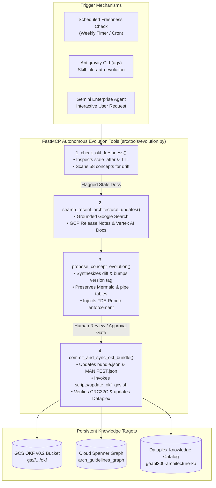

# Spec (d): Autonomous OKF Evolution Tools & Antigravity Skill (`okf-auto-evolution-tools-spec.md`)

**Status:** ACTIVE (Target Specification)  
**Target Repository:** [`https://github.com/prdmohangoogley/gea-agents-arch-guidelines-mcp-server`](https://github.com/prdmohangoogley/gea-agents-arch-guidelines-mcp-server)  
**Canonical Repo Path:** `docs/specs/okf-auto-evolution-tools-spec.md` (mirrored at `specs/okf-auto-evolution-tools-spec.md`)  
**Target GCP Project:** `fivedaysai-prd-sandbox-317383` (`301802433103`)  
**New FastMCP Tools:** `check_okf_freshness`, `search_recent_architectural_updates`, `propose_concept_evolution`, `commit_and_sync_okf_bundle`  
**New Antigravity Skill:** `.agents/skills/okf-auto-evolution/SKILL.md`  
**Governing Standard:** [`docs/specs/okf-gcs-update-spec.md`](../docs/specs/okf-gcs-update-spec.md) · Concept 27 (Model Upgrades & Drift) · Concept 32 (Agent Change Management)

---

## 1. Executive Summary & Objective

This specification establishes an autonomous, closed-loop knowledge evolution system within the MCP server. It equips the server with tools capable of:
1. Detecting decaying architectural concepts approaching their 180-day `stale_after` threshold.
2. Inquiring external web sources and Google Cloud release notes via **Google Search / Grounded Vertex Search** for net-new architectural patterns, API deprecations, and FDE rubric updates.
3. Automatically drafting layout-preserved concept evolutions with recalculated SHA-256 digests.
4. Exposing an **Antigravity Skill** (`okf-auto-evolution`) in the Skills Registry so autonomous coding agents and developers can trigger, review, and test updates end-to-end within **Gemini Enterprise**.

---

## 2. Autonomous Evolution Workflow & Loop



---

## 3. New FastMCP Tool Specifications (`src/tools/evolution.py`)

### 3.1 `check_okf_freshness`

```python
@mcp.tool()
async def check_okf_freshness(threshold_days: int = 30) -> dict[str, Any]:
    """Audit all 58 OKF v0.2 concepts for staleness, TTL expiration, and documentation drift.

    Args:
        threshold_days: Warning window in days prior to stale_after expiration (default 30).

    Returns:
        Structured envelope listing expired concepts, expiring concepts, and overall corpus freshness index.
    """
```
- **Behavior:** Scans `okf/concepts/` (or GCS metadata), parses `stale_after` RFC3339 timestamps from YAML frontmatter, compares against `datetime.now(timezone.utc)`, and calculates freshness percentage.

### 3.2 `search_recent_architectural_updates`

```python
@mcp.tool()
async def search_recent_architectural_updates(topic: str, max_results: int = 5) -> dict[str, Any]:
    """Execute grounded Google Search to discover recent Google Cloud architectural patterns and releases.

    Args:
        topic: Specific architecture domain (e.g. 'Vertex AI Agent Engine', 'Model Armor API', 'Spanner Graph GQL').
        max_results: Maximum relevant groundings to return (default 5).

    Returns:
        Summarized list of recent documentation updates, deprecations, and release notes with source URLs.
    """
```
- **Behavior:** Utilizes the Vertex AI Grounding API or Google Search tool to fetch authoritative Google Cloud release notes, changelogs, and official architectural whitepapers published in the last 180 days.

### 3.3 `propose_concept_evolution`

```python
@mcp.tool()
async def propose_concept_evolution(
    concept_id: str,
    update_summary: str,
    new_architectural_findings: list[str],
) -> dict[str, Any]:
    """Draft an incremental evolution of an OKF concept preserving formatting and bumping version tags.

    Args:
        concept_id: Identifier of target concept (e.g., '02-zero-ambient-authority', '33-model-armor').
        update_summary: High-level rationale for revision.
        new_architectural_findings: List of new patterns, API updates, or rubric criteria to incorporate.

    Returns:
        Structured diff preview, updated YAML frontmatter, recalculated content_sha256, and proposed markdown.
    """
```
- **Behavior:** Loads the existing concept markdown, preserves all Mermaid diagrams and GFM tables, modifies content sections, bumps the `version_tag`, anchors `stale_after` to +180 days from execution date, computes `content_sha256 = hashlib.sha256(content).hexdigest()`, and outputs a reviewable diff.

### 3.4 `commit_and_sync_okf_bundle`

```python
@mcp.tool()
async def commit_and_sync_okf_bundle(
    concept_id: str,
    evolved_markdown: str,
    approved_by: str,
) -> dict[str, Any]:
    """Commit an approved concept evolution, regenerate manifest digests, and trigger GCS/Dataplex sync.

    Args:
        concept_id: Identifier of updated concept.
        evolved_markdown: Validated full markdown content.
        approved_by: Signoff identity (e.g. 'antigravity-agent', 'user:prdmohan@google.com').

    Returns:
        Execution status, GCS CRC32C verification hash, Dataplex entry update status, and git commit SHA.
    """
```
- **Behavior:** Writes file to `okf/concepts/`, updates `bundle.json`, `MANIFEST.json`, runs `scripts/crc32c_verify.py`, invokes `scripts/update_okf_gcs.sh`, and updates Dataplex aspect entry.

---

## 4. Antigravity Skill Definition (`.agents/skills/okf-auto-evolution/SKILL.md`)

```markdown
---
name: okf-auto-evolution
description: >-
  Monitors, updates, and evolves the OKF v0.2 Enterprise Architecture Guidelines corpus.
  Discovers outdated concepts using freshness checks and grounded Google Search, drafts
  backward-compatible revisions, and synchronizes changes to GCS and Knowledge Catalog.
---

# OKF Autonomous Evolution Skill

This skill allows Antigravity agents to maintain the 58-concept OKF corpus in an evergreen state.

## Operational Workflow

1. **Check Corpus Freshness**:
   Invoke the MCP tool to identify concepts with `stale_after` expiring in <= 30 days:
   ```bash
   # via Antigravity MCP tool call
   call_mcp_tool(ServerName="arch-guidelines", ToolName="check_okf_freshness", Arguments={"threshold_days": 30})
   ```

2. **Grounded Architectural Research**:
   For flagged concepts, search for recent Google Cloud architectural patterns:
   ```bash
   call_mcp_tool(ServerName="arch-guidelines", ToolName="search_recent_architectural_updates", Arguments={"topic": "Google Cloud Model Armor new filters 2026"})
   ```

3. **Draft Concept Revision**:
   Draft the updated concept adhering strictly to OKF v0.2 formatting rules:
   - Must preserve all Mermaid diagrams and GFM tables.
   - Must maintain `## FDE Project Grading Rubric Enforcement` section.
   - Must calculate `content_sha256`.

4. **Synchronize & Verify**:
   Execute `scripts/update_okf_gcs.sh` and verify CRC32C digests across all 124 bucket objects.
```

---

## 5. Verification & Testing in Gemini Enterprise

### 5.1 Interactive Agent Test Conversation

Configure Gemini Enterprise agent with the `arch-guidelines` toolset and execute the following dialogue:

1. **User Prompt:**
   > *"Run a freshness audit on our enterprise architectural guidelines. Are any concepts expiring?"*
2. **Agent Execution:**
   - Agent invokes `check_okf_freshness(threshold_days=45)`.
   - Tool returns JSON showing any concepts within 45 days of `stale_after`.
3. **User Follow-Up:**
   > *"Search for recent Google Cloud releases regarding Model Armor and propose an update for Concept 33."*
4. **Agent Execution:**
   - Agent invokes `search_recent_architectural_updates(topic="Model Armor enterprise guardrails")`.
   - Agent invokes `propose_concept_evolution(...)` with the synthesized findings.
   - Agent outputs a clean Markdown diff with updated frontmatter and revised FDE Rubric scoring.

---

## 6. Acceptance Criteria

| ID | Criteria | Validation Method | Target SLA |
|---|---|---|---|
| **AC-D.1** | Staleness Detection | `check_okf_freshness` flags all concepts past TTL | 100% detection accuracy |
| **AC-D.2** | Grounded Research | `search_recent_architectural_updates` returns valid GCP doc URLs | >= 3 official doc URLs returned |
| **AC-D.3** | Layout Preservation | Proposed markdown retains 100% of Mermaid blocks and tables | AST table and code block count equality |
| **AC-D.4** | SHA-256 Digest Match | `content_sha256` exactly matches body text | Validated by `scripts/merge_l400_concepts.py` QA logic |
| **AC-D.5** | Antigravity Trigger | Skill callable via Antigravity CLI without errors | Clean run via `agy` or subagent |
| **AC-D.6** | Gemini Enterprise Tool Binding | Tools successfully callable via Gemini Enterprise Chat UI | Zero tool schema deserialization errors |
